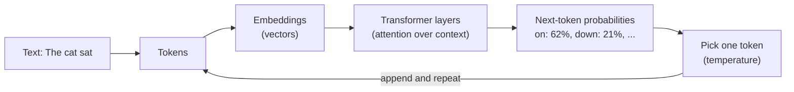
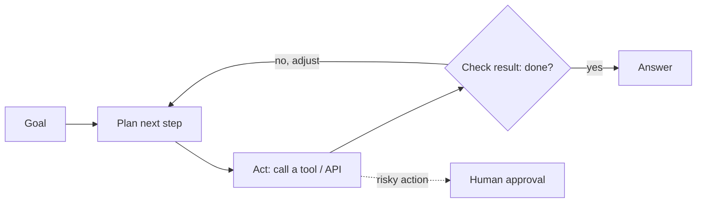
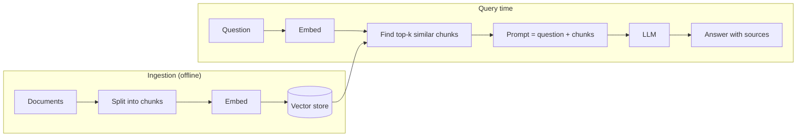
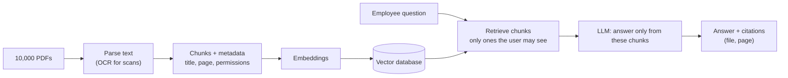

# AI for Java / Spring Boot Developers: LLMs, RAG and Agents

## AI Fundamentals

### ❓ What is AI?

Machines performing tasks that normally need human intelligence: understanding language, recognising images, making decisions, learning from examples.

---

### ❓ What is the difference between AI, Machine Learning and Deep Learning?

| Term | Meaning |
|---|---|
| AI | The broad field: machines doing "intelligent" tasks (includes rule-based systems) |
| Machine Learning | A subset of AI: systems **learn patterns from data** instead of being explicitly programmed |
| Deep Learning | A subset of ML: uses **multi-layer neural networks** (vision, speech, LLMs) |
| Generative AI | Deep-learning models that **create** new content |

AI ⊃ ML ⊃ Deep Learning ⊃ (most of) Generative AI.

---

### ❓ What is Generative AI?

AI that generates new content — text, code, images, audio or video — from a prompt, instead of only classifying or predicting. ChatGPT, Claude and image generators are examples.

---

### ❓ What is an LLM (Large Language Model)?

A deep-learning model (usually a Transformer) trained on very large amounts of text to predict the next token. That simple objective, at scale, lets it answer questions, summarise, translate and write code.

---

### ❓ What is NLP?

Natural Language Processing: the field of making computers understand and produce human language — tokenisation, sentiment analysis, translation, question answering. LLMs are today's dominant NLP technique.

---

### ❓ What is a neural network?

A computational model of layers of connected "neurons". Each connection has a weight; training adjusts the weights so the network's outputs match the expected ones. Deep learning means many such layers.

---

### ❓ What is the difference between supervised and unsupervised learning?

| Supervised | Unsupervised |
|---|---|
| Trained on **labelled** data (input + correct answer) | Trained on **unlabelled** data |
| Predicts labels or values | Finds structure: clusters, patterns |
| Spam detection, price prediction | Customer segmentation, anomaly detection |

LLM pre-training is **self-supervised**: the "label" is simply the next token in the text.

## LLMs and Generative AI

### ❓ What is ChatGPT (or Claude) based on internally?

**Transformer**-based large language models. The Transformer's **attention** mechanism lets every token weigh every other token in the context. The models are pre-trained on large text corpora, then fine-tuned with instruction data and human feedback (RLHF) to follow instructions and be helpful.

---

### ❓ How does an LLM work at a high level?

1. The input text is split into **tokens**.
2. Each token becomes a vector (an **embedding**).
3. Transformer layers use attention to build a representation of the whole context.
4. The model outputs a probability for every possible next token.
5. One token is chosen (influenced by **temperature**), appended, and the process repeats until the answer is complete.



The model doesn't look facts up; it predicts likely text — which is why grounding (RAG) matters.

---

### ❓ What is a token?

A unit of text the model processes — a word, part of a word or a punctuation mark. Roughly 1 token ≈ 4 English characters ≈ ¾ of a word. API pricing, rate limits and context windows are measured in tokens.

---

### ❓ What is a context window?

The maximum number of tokens (prompt + conversation history + retrieved documents + the generated answer) the model can handle in one request. Anything beyond it must be truncated, summarised or retrieved selectively.

---

### ❓ What is temperature?

A setting that controls randomness. Low (≈0) → focused, repeatable answers (good for extraction, code, factual Q&A). High (≈1) → more varied, creative output.

---

### ❓ What is hallucination?

When the model produces confident but incorrect or invented information — fake facts, citations or APIs. It happens because the model predicts plausible text rather than checking facts.

---

### ❓ What is prompt engineering?

Designing instructions that get reliable results: a clear role and task, relevant context, constraints, examples (few-shot) and a required output format such as JSON.

---

### ❓ What is fine-tuning?

Further training a pre-trained model on task-specific examples so its **behaviour** changes — a style, format or domain skill. It is costly to maintain and doesn't add up-to-date facts well; RAG is usually the first choice for private knowledge.

## RAG, Embeddings and Vector Databases

### ❓ What is RAG (Retrieval-Augmented Generation)?

Before calling the LLM, the application **retrieves** relevant pieces of its own documents and puts them into the prompt. The model then answers **from that context**, ideally with citations.

```text
Question → embed → vector search → top-k chunks → prompt (question + chunks) → LLM → answer with sources
```

---

### ❓ Why do we need RAG?

LLMs don't know your private or recent data and may hallucinate. RAG supplies company documents at query time without retraining, keeps answers current (update the index, not the model), and makes answers traceable to sources.

---

### ❓ What are embeddings?

Numeric vectors that represent the **meaning** of text (or images). Similar meanings produce vectors that are close together, measured with cosine similarity, for example. "Reset my password" and "I forgot my login" end up near each other.

---

### ❓ What is a vector database?

A database that stores embeddings and finds the nearest vectors to a query vector quickly (approximate nearest-neighbour indexes such as HNSW). Examples: pgvector, Pinecone, Weaviate, Milvus, Elasticsearch, Redis.

---

### ❓ What is semantic search?

Search by **meaning** instead of exact keywords: the query is embedded and compared with document embeddings. Often combined with keyword search (hybrid search) for names and codes.

---

### ❓ What is the difference between RAG and fine-tuning?

| | RAG | Fine-tuning |
|---|---|---|
| What changes | The **context** given to the model | The model's **weights** |
| Best for | Private, changing knowledge | Style, format, specialised behaviour |
| Updating knowledge | Re-index documents | Retrain |
| Citations | Natural | Not available |
| Cost | Lower, operational | Higher, training |

---

### ❓ What is chunking?

Splitting documents into smaller pieces (for example 300–800 tokens with some overlap) before embedding them, so retrieval returns focused passages that fit the context window. Chunk size and overlap strongly affect answer quality.

## AI Agents and MCP

### ❓ What is an AI agent?

An AI system that can **reason about a goal, choose tools, act, observe the results and continue** until the task is done — for example, look up an order, check stock and draft a reply.

---

### ❓ What is the difference between an LLM and an AI agent?

An LLM produces a response to one prompt. An agent wraps the LLM in a **loop with tools and memory**: it decides which action to take, executes it (API call, database query), feeds the result back to the model, and repeats.

---

### ❓ What is tool calling (function calling)?

The model returns a structured request to call a function you defined (name plus JSON arguments) instead of plain text. Your application executes it and sends the result back; the model then continues. It is how LLMs reach real systems safely — the application stays in control of what actually runs.

---

### ❓ What is MCP (Model Context Protocol)?

An open standard for connecting AI applications to tools and data sources. An **MCP server** exposes tools, resources and prompts (for example GitHub, a database, internal APIs); any MCP-capable client or agent can use them without a custom integration for each pair.

---

### ❓ What is a multi-agent architecture?

Several specialised agents (planner, researcher, coder, reviewer) cooperate on a task, usually coordinated by an orchestrator. It helps with complex work but adds latency, cost and debugging complexity.

---

### ❓ What is an agentic workflow?

A workflow in which the AI decides and executes the next steps itself (plan → act → check → adjust) rather than following a fixed sequence — typically with guardrails, limits and human approval for risky actions.



## AI Integration in Spring Boot

### ❓ How would you integrate an LLM API (OpenAI, Claude…) into Spring Boot?

Use **Spring AI**: add the starter for your provider, put the API key in configuration (from an environment variable or a secrets manager, never in code), and inject a `ChatClient`.

```properties
spring.ai.openai.api-key=${OPENAI_API_KEY}
```

```java
@RestController
class AssistantController {

    private final ChatClient chatClient;

    AssistantController(ChatClient.Builder builder) {
        this.chatClient = builder
            .defaultSystem("You are a support assistant for ACME employees. Be concise.")
            .build();
    }

    @GetMapping("/api/ask")
    String ask(@RequestParam String question) {
        return chatClient.prompt().user(question).call().content();
    }
}
```

Alternatively call the provider's REST API with `RestClient`/`WebClient` or its official Java SDK.

---

### ❓ How would you build an AI chatbot with Spring Boot and Angular?

- **Angular:** chat UI, sends the message plus a conversation id, renders the streamed answer (Markdown, code blocks).
- **Spring Boot:** authenticates the user, loads recent conversation history, optionally retrieves documents (RAG), calls the LLM through Spring AI, streams the answer back over Server-Sent Events, stores the conversation.
- **Cross-cutting:** rate limiting per user, logging of token usage, content filtering, timeouts and fallbacks.

---

### ❓ How would you implement RAG using company documents in Spring Boot?

**Ingestion (offline):** read documents → split into chunks → create embeddings → store in a vector store.
**Query time:** retrieve the top-k chunks for the question → build a prompt with them → ask the LLM to answer only from them and cite sources.



```java
// Ingestion
List<Document> chunks = new TokenTextSplitter().apply(documents);
vectorStore.add(chunks);                    // embeds and stores each chunk

// Question answering
List<Document> context = vectorStore.similaritySearch(
    SearchRequest.builder().query(question).topK(5).build());

String sources = context.stream().map(Document::getText).collect(Collectors.joining("\n---\n"));
String answer = chatClient.prompt()
    .system("Answer only from the sources below. If they don't contain the answer, say so.\n" + sources)
    .user(question)
    .call()
    .content();
```

Also apply access control to retrieval: users must only retrieve documents they are allowed to read.

---

### ❓ How would you secure sensitive data sent to an external LLM?

- Send only what's needed; **mask or remove PII** and secrets before the call.
- Use providers and plans with data-processing agreements and no training on your data; choose a region if required.
- Enforce authorization before retrieval, so the model never sees documents the user can't access.
- Keep API keys in a secrets manager; log prompts carefully (redacted).
- For highly sensitive data, use a self-hosted or private-cloud model.

---

### ❓ How would you handle LLM API rate limits and token costs?

- Retry `429` responses with exponential backoff and jitter (e.g. Resilience4j), with a cap.
- Rate-limit per user and per tenant; queue non-urgent work.
- Reduce tokens: trim history, summarise long conversations, retrieve fewer and smaller chunks, set `max_tokens`.
- Use smaller, cheaper models for simple tasks; use prompt caching where the provider supports it.
- Track token usage per feature and user; alert on budgets.

---

### ❓ How would you implement streaming AI responses?

Stream tokens as they are generated, so users see the answer start in about a second instead of waiting for the whole response.

```java
@GetMapping(value = "/api/ask/stream", produces = MediaType.TEXT_EVENT_STREAM_VALUE)
Flux<String> stream(@RequestParam String question) {
    return chatClient.prompt().user(question).stream().content();
}
```

On the Angular side, read the Server-Sent Events stream (`EventSource`, or `fetch` with a stream reader) and append each chunk. Stop generation when the user cancels.

---

### ❓ How would you reduce hallucinations?

Ground answers with RAG and require citations; instruct the model to say "I don't know" when the context lacks the answer; use low temperature; validate outputs (schemas, business rules, checking cited sources exist); use confidence thresholds or a second verification pass; add human review for high-risk answers.

---

### ❓ How would you evaluate the accuracy of AI-generated answers?

Build a **test set** of real questions with expected answers or sources. Measure retrieval quality (did the right chunks come back?), answer correctness and faithfulness to sources (human review or an LLM-as-judge with a rubric), and track user feedback. Run the evaluation on every prompt, model or chunking change, like regression tests.

---

### ❓ How would you implement AI response caching?

- **Exact cache:** key = hash of (model, prompt, parameters) → stored answer in Redis with a TTL.
- **Semantic cache:** embed the question and reuse an answer when a previous question is very similar.
- Don't cache personalised or permission-dependent answers across users; invalidate when the source documents change.

---

### ❓ How would you design fallbacks if the LLM provider is unavailable?

Set timeouts, use a circuit breaker (Resilience4j), and on failure fall back to a secondary provider or model, a cached answer, or a non-AI path (search results, "try again later"). Show a clear message and never block core business flows on the LLM.

## Scenario-Based Questions

### ❓ Your company has 10,000 PDF documents. Employees want answers based only on those documents. How would you design it?

Document ingestion (PDF parsing, OCR if needed) → chunking with metadata (title, page, permissions) → embeddings → vector database → at query time: retrieval with access control → LLM prompt restricted to the retrieved chunks → answer **with citations**. Add re-indexing when documents change, an evaluation set, and monitoring.



---

### ❓ An LLM API takes 20 seconds to respond. How would you improve the user experience?

Stream the response; process long tasks asynchronously with progress updates; cache frequent answers; use a faster or smaller model where quality allows; shorten prompts and retrieved context; run independent calls in parallel.

---

### ❓ The AI gives incorrect answers about financial information. How would you minimise this?

Use RAG over authoritative data, require source citations, compute numbers in code from the database rather than letting the model calculate, validate outputs against business rules, use confidence thresholds, and route uncertain or high-impact answers to human review.

---

### ❓ How would you prevent prompt injection attacks?

Treat all user input and retrieved content as **data, not instructions**: keep system instructions separate, delimit untrusted content, give tools least-privilege permissions, require confirmation for sensitive actions, validate and filter outputs, and never let model output directly run commands or queries without checks.

---

### ❓ How would you build a secure enterprise AI chatbot?

SSO authentication and role-based authorization; RAG with per-user document permissions; PII masking before external calls; prompt-injection defences; audit logging of prompts, sources and answers (redacted); rate limits and cost controls; provider data agreements; evaluation and monitoring of answer quality.
