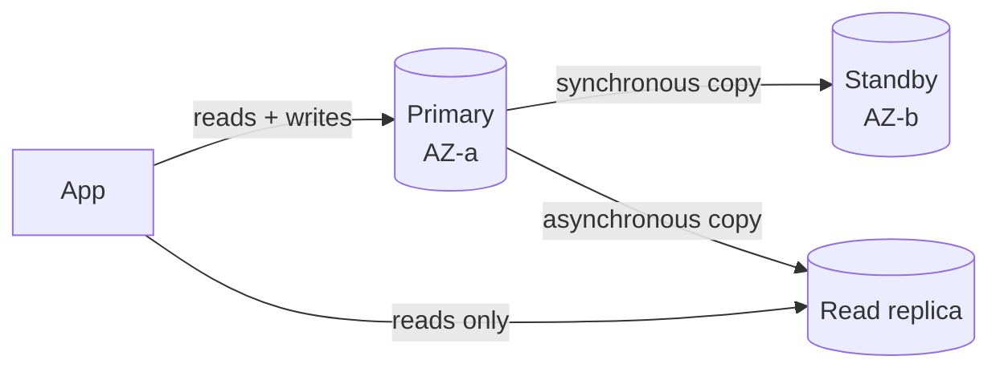
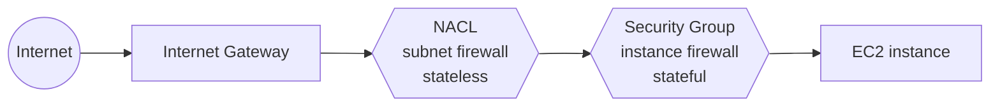
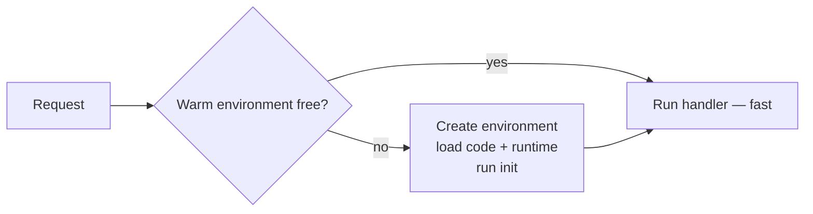

# AWS Cloud Practitioner

## 💻 COMPUTE SERVICES

### ❓ What are the main AWS Compute services (EC2, Lambda, Auto Scaling, Elastic Beanstalk, ECS, EKS, Fargate)?

**Level:** 🟢 Beginner

### 📝 Answer

**Core Compute Services (VERY IMPORTANT)**

| Service                          | Explanation                                                                                                        |
| -------------------------------- | ------------------------------------------------------------------------------------------------------------------ |
| **Amazon EC2**                   | Virtual servers in the cloud. You choose instance type, OS, storage, and network. Used for full control workloads. |
| **EC2 Auto Scaling**             | Automatically adds or removes EC2 instances based on demand to maintain performance and reduce cost.               |
| **Elastic Load Balancing (ELB)** | Distributes incoming traffic across multiple targets (EC2, containers, IPs) to improve availability.               |
| **AWS Lambda**                   | Serverless compute. Run code without managing servers. Pay only for execution time.                                |
| **AWS Elastic Beanstalk**        | Platform as a Service (PaaS) for deploying applications without managing infrastructure.                           |
| **Amazon Lightsail**             | Simplified compute for small apps, websites, or beginners with predictable pricing.                                |

**Container & Modern Compute (High-Level Awareness)**

| Service            | Explanation                                                                            |
| ------------------ | -------------------------------------------------------------------------------------- |
| **Amazon ECS**     | Managed container orchestration for Docker containers.                                 |
| **Amazon EKS**     | Managed Kubernetes service.                                                            |
| **AWS Fargate**    | Serverless compute engine for containers (used with ECS/EKS).                          |
| **AWS App Runner** | Fully managed service to run containerized web apps without infrastructure management. |

**Batch & Specialized Compute (Basic Recognition Only)**

| Service               | Explanation                                                      |
| --------------------- | ---------------------------------------------------------------- |
| **AWS Batch**         | Runs batch computing jobs at any scale without managing servers. |
| **EC2 Image Builder** | Automates creation of secure VM images (AMI).                    |

**Hybrid & Edge Compute (Conceptual Awareness)**

| Service                 | Explanation                                          |
| ----------------------- | ---------------------------------------------------- |
| **AWS Outposts**        | AWS infrastructure on-premises (hybrid cloud).       |
| **AWS Wavelength**      | Ultra-low latency compute for 5G applications.       |
| **VMware Cloud on AWS** | Run VMware workloads directly on AWS infrastructure. |

---

### ❓ AWS Compute: which service fits each scenario?

**Level:** 🟡 Intermediate

### 📝 Answer

1️⃣ A company needs virtual servers in the cloud with full control over OS and software → **Amazon EC2**

2️⃣ An application must automatically increase or decrease EC2 instances based on traffic → **Amazon EC2 Auto Scaling**

3️⃣ Incoming traffic must be distributed across multiple EC2 instances → **Elastic Load Balancing (ELB)**

4️⃣ A developer wants to run code without provisioning or managing servers → **AWS Lambda**

5️⃣ A startup wants the easiest way to deploy a small web application with minimal configuration → **Amazon Lightsail**

6️⃣ A web application needs automatic deployment, scaling, and management without handling infrastructure → **AWS Elastic Beanstalk**

7️⃣ Containers must be run without managing the underlying servers → **AWS Fargate**

8️⃣ A company wants to run Docker containers using AWS-managed orchestration → **Amazon ECS**

9️⃣ An organization needs a managed Kubernetes service → **Amazon EKS**

🔟 Large-scale batch jobs must be processed efficiently without manual resource management → **AWS Batch**

1️⃣1️⃣ A developer wants to run microservices using containers with AWS handling scheduling and scaling → **Amazon ECS**

1️⃣2️⃣ Compute workloads must run only when an event occurs and stop automatically → **AWS Lambda**

1️⃣3️⃣ A business wants to deploy AWS infrastructure inside its on-premises data center → **AWS Outposts**

1️⃣4️⃣ A low-latency application must be delivered to 5G mobile devices → **AWS Wavelength**

1️⃣5️⃣ A company wants to migrate VMware workloads to AWS without re-architecting → **VMware Cloud on AWS**

1️⃣6️⃣ A web application must scale automatically and remain highly available → **Amazon EC2 Auto Scaling**

1️⃣7️⃣ Developers want a managed platform to upload code and let AWS handle capacity planning → **AWS Elastic Beanstalk**

1️⃣8️⃣ A containerized application must run with no cluster or server management → **AWS Fargate**

1️⃣9️⃣ A business wants to pay only for the exact execution time of code → **AWS Lambda**

2️⃣0️⃣ A small business wants predictable pricing and a simple cloud experience → **Amazon Lightsail**

---

## 🗄️ STORAGE SERVICES

### ❓ What are the main AWS Storage services (S3, Glacier, EBS, EFS, FSx)?

**Level:** 🟢 Beginner

### 📝 Answer

| **Service**                          | **Storage Type**        | **Explanation**                                                                                                                                                                  |
| ------------------------------------ | ----------------------- | -------------------------------------------------------------------------------------------------------------------------------------------------------------------------------- |
| **Amazon S3**                        | Object Storage          | Scalable object storage used to store files such as images, videos, backups, logs, and static website content. Data is stored as objects in buckets and accessed via HTTP/HTTPS. |
| **Amazon S3 Glacier**                | Archival Object Storage | Low-cost storage for long-term data archiving where data is accessed infrequently. Retrieval takes minutes to hours depending on the retrieval option.                           |
| **Amazon S3 Glacier Deep Archive**   | Archival Object Storage | Lowest-cost AWS storage option designed for long-term data retention (years). Data retrieval usually takes hours.                                                                |
| **Amazon EBS (Elastic Block Store)** | Block Storage           | Persistent block-level storage used with EC2 instances. Data remains even after EC2 is stopped and is typically used for OS disks or databases.                                  |
| **Amazon EFS (Elastic File System)** | File Storage            | Fully managed, scalable file system that can be mounted on multiple EC2 instances simultaneously. Commonly used for shared file systems.                                         |
| **Amazon FSx**                       | File Storage            | Managed file systems for specific workloads such as Windows File Server or high-performance computing. Cloud Practitioner only requires recognition, not deep details.           |
| **AWS Storage Gateway**              | Hybrid Storage          | Connects on-premises environments with AWS cloud storage, allowing local applications to store data in AWS seamlessly.                                                           |
| **AWS Backup**                       | Backup Service          | Centralized service to automate and manage backups across AWS services like EBS, EFS, RDS, and DynamoDB.                                                                         |

### ❓ AWS Storage: which service fits each scenario?

**Level:** 🟡 Intermediate

### 📝 Answer

1️⃣ A company needs highly durable object storage to store images and videos → **Amazon S3**

2️⃣ Data must be stored long-term at the lowest cost and accessed once or twice a year → **Amazon S3 Glacier Deep Archive**

3️⃣ An application requires block storage attached to EC2 instances → **Amazon EBS**

4️⃣ Multiple EC2 instances need to share the same file system simultaneously → **Amazon EFS**

5️⃣ A business wants automatic backups across AWS services from a single place → **AWS Backup**

6️⃣ Frequently accessed data needs low-latency object storage → **Amazon S3 Standard**

7️⃣ Data must be archived with minutes-to-hours retrieval time at low cost → **Amazon S3 Glacier Flexible Retrieval**

8️⃣ An on-premises application needs hybrid access to cloud storage → **AWS Storage Gateway**

9️⃣ Storage is needed for Windows file systems with SMB protocol → **Amazon FSx for Windows File Server**

🔟. A high-performance workload needs shared file storage with millisecond latency → **Amazon EFS**

1️⃣1️⃣ A company wants storage that provides 11 nines (99.999999999%) durability → **Amazon S3**

1️⃣2️⃣ Temporary storage is required only while an EC2 instance is running → **Instance Store**

1️⃣3️⃣ A workload needs persistent storage that survives EC2 termination → **Amazon EBS** (a data volume; the **root** volume is deleted on termination by default — `DeleteOnTermination`)

1️⃣4️⃣ Data must be stored for regulatory compliance for 7–10 years → **Amazon S3 Glacier Deep Archive**

1️⃣5️⃣ An application requires object-level access over the internet → **Amazon S3**

1️⃣6️⃣ A company wants to migrate large petabytes of data physically to AWS → **AWS Snowball**

1️⃣7️⃣ Storage must support POSIX-compliant file system access → **Amazon EFS**

1️⃣8️⃣ A business wants low-cost storage with infrequent access → **Amazon S3 Standard-IA**

1️⃣9️⃣ A backup solution is required for EC2, RDS, DynamoDB, and EFS together → **AWS Backup**

2️⃣0️⃣ Data must be cached locally while still stored in S3 for low latency → **AWS Storage Gateway (File Gateway)**

---

## 🗄️ AWS DATABASE SERVICES

### ❓ What are the main AWS Database services (RDS, Aurora, DynamoDB, ElastiCache, Redshift)?

**Level:** 🟢 Beginner

### 📝 Answer

1. Relational Databases (SQL)

| Service           | Explanation                                                                                         |
| ----------------- | --------------------------------------------------------------------------------------------------- |
| **Amazon RDS**    | Fully managed relational database service supporting MySQL, PostgreSQL, MariaDB, Oracle, SQL Server |
| **Amazon Aurora** | AWS-built high-performance relational DB compatible with MySQL & PostgreSQL                         |

---

2. NoSQL Databases

| Service             | Explanation                                    |
| ------------------- | ---------------------------------------------- |
| **Amazon DynamoDB** | Serverless NoSQL key-value & document database |

3. In-Memory Databases (Caching)

| Service                | Explanation                                   |
| ---------------------- | --------------------------------------------- |
| **Amazon ElastiCache** | In-memory data store using Redis or Memcached |

4. Data Warehousing (Analytics)

| Service             | Explanation                                          |
| ------------------- | ---------------------------------------------------- |
| **Amazon Redshift** | Fully managed data warehouse for analytics workloads |

5. Document Databases

| Service               | Explanation                                            |
| --------------------- | ------------------------------------------------------ |
| **Amazon DocumentDB** | Managed JSON document database compatible with MongoDB |

6. Graph Databases

| Service            | Explanation                  |
| ------------------ | ---------------------------- |
| **Amazon Neptune** | Fully managed graph database |

7. Key-Value (Cassandra-compatible)

| Service              | Explanation                               |
| -------------------- | ----------------------------------------- |
| **Amazon Keyspaces** | Serverless Apache Cassandra-compatible DB |

### ❓ AWS Database: which service fits each scenario?

**Level:** 🟡 Intermediate

### 📝 Answer

1️⃣ A business needs a fully managed relational database with automated backups and patching → **Amazon RDS**

2️⃣ An application requires a MySQL/PostgreSQL-compatible database with high performance and fault tolerance → **Amazon Aurora**

3️⃣ A serverless application needs a NoSQL key-value database with single-digit millisecond latency → **Amazon DynamoDB**

4️⃣ A company wants a petabyte-scale data warehouse for analytical queries → **Amazon Redshift**

5️⃣ A gaming app needs an in-memory data store for microsecond latency → **Amazon ElastiCache**

6️⃣ A business wants a MongoDB-compatible fully managed database → **Amazon DocumentDB**

7️⃣ A recommendation engine needs to store and query relationships between entities → **Amazon Neptune**

8️⃣ An IoT application needs a time-series database optimized for fast ingestion → **Amazon Timestream**

9️⃣ A company wants a Cassandra-compatible serverless database → **Amazon Keyspaces**

🔟. An application requires durable backups and point-in-time recovery for databases → **Amazon RDS**

1️⃣1️⃣. A company needs a database that automatically scales capacity based on traffic → **Amazon DynamoDB**

1️⃣2️⃣ A startup wants a relational database without managing servers and with pay-as-you-go pricing → **Amazon Aurora Serverless**

1️⃣3️⃣ An analytics team wants to run complex SQL queries across large datasets → **Amazon Redshift**

1️⃣4️⃣ A caching layer is required to reduce database read latency → **Amazon ElastiCache**

1️⃣5️⃣ A graph-based fraud detection system needs fast traversal of connected data → **Amazon Neptune**

1️⃣6️⃣ A company wants a managed relational database supporting multiple engines (MySQL, PostgreSQL, Oracle) → **Amazon RDS**

1️⃣7️⃣ A serverless app needs a database that integrates natively with AWS Lambda → **Amazon DynamoDB**

1️⃣8️⃣ A company wants real-time analytics on structured data using SQL → **Amazon Redshift**

1️⃣9️⃣ A document-based application needs JSON-like storage with MongoDB compatibility → **Amazon DocumentDB**

2️⃣0️⃣ A workload requires a highly available NoSQL database with global replication → **Amazon DynamoDB Global Tables**

---

## 🌐 NETWORKING & CONTENT DELIVERY

### ❓ What are the main AWS Networking & Content Delivery services (VPC, Route 53, CloudFront, API Gateway)?

**Level:** 🟢 Beginner

### 📝 Answer

| **Service**                      | **Explanation**                                                                                                                                     |
| -------------------------------- | --------------------------------------------------------------------------------------------------------------------------------------------------- |
| **Amazon VPC**                   | A logically isolated virtual network in AWS. Used to launch AWS resources (EC2, RDS, etc.) in a private, controlled network with your own IP ranges |
| **Subnets**                      | A segmented range of IPs inside a VPC. Used to separate resources (public vs private) across Availability Zones                                     |
| **Internet Gateway (IGW)**       | A gateway that allows VPC resources to access the internet. Required for public subnets so instances can send/receive internet traffic              |
| **NAT Gateway**                  | Allows private subnet resources to access the internet. Used when instances must download updates but must NOT be publicly accessible               |
| **Route Tables**                 | Rules that control traffic routing in a VPC. Determines where network traffic is directed (IGW, NAT, VPC peering, etc.)                             |
| **Security Groups**              | Virtual firewall at the instance level. Controls inbound and outbound traffic (stateful)                                                            |
| **Network ACL (NACL)**           | Firewall at the subnet level. Provides an extra layer of security (stateless)                                                                       |
| **Elastic Load Balancing (ELB)** | Distributes incoming traffic across multiple targets. Improves availability and fault tolerance (ALB, NLB – no deep config needed for exam)         |
| **Amazon Route 53**              | Highly available DNS (Domain Name System) service. Routes users to applications using domain names and routing policies                             |
| **Amazon CloudFront**            | Content Delivery Network (CDN). Delivers content (images, videos, APIs) with low latency using edge locations                                       |
| **AWS Direct Connect**           | Dedicated private connection from on-premises to AWS. Used for consistent network performance and lower latency (enterprise use case)               |
| **Site-to-Site VPN**             | Encrypted tunnel between on-prem and AWS. Used for hybrid cloud connectivity over the public internet                                               |
| **AWS Global Accelerator**       | Improves availability and performance using AWS global network. Routes traffic to the nearest healthy endpoint using static IPs                     |
| **Amazon API Gateway**           | Managed service to create, publish, and secure APIs. Acts as a front door for applications (often used with Lambda)                                 |

### ❓ AWS Networking & Content Delivery: which service fits each scenario?

**Level:** 🟡 Intermediate

### 📝 Answer

1️⃣ A company needs a DNS service to route users to applications globally → **Amazon Route 53**

2️⃣ A business wants to deliver content to users with low latency worldwide → **Amazon CloudFront**

3️⃣ An application needs a logically isolated virtual network in AWS → **Amazon VPC**

4️⃣ Private subnets must access the internet without inbound traffic → **NAT Gateway**

5️⃣ Resources in a VPC must communicate with the internet → **Internet Gateway**

6️⃣ A company wants a dedicated private connection from on-premises to AWS → **AWS Direct Connect**

7️⃣ Multiple VPCs need to communicate using a central hub → **AWS Transit Gateway**

8️⃣ An application needs a fully managed API front door → **Amazon API Gateway**

9️⃣ A global application needs static IPs and improved availability → **AWS Global Accelerator**

🔟 A company wants DDoS protection at the network edge → **AWS Shield**

1️⃣1️⃣ A web application needs protection from common web attacks (SQL injection, XSS) → **AWS WAF**

1️⃣2️⃣ A business wants to cache content closer to users automatically → **Amazon CloudFront**

1️⃣3️⃣ A hybrid architecture needs secure site-to-site encrypted connectivity → **Site-to-Site VPN**

1️⃣4️⃣ An application requires private access to AWS services without internet exposure → **AWS PrivateLink**

1️⃣5️⃣ A company wants fine-grained traffic control between microservices → **AWS App Mesh**

1️⃣6️⃣ DNS health checks are needed to route traffic only to healthy endpoints → **Amazon Route 53**

1️⃣7️⃣ A company wants content delivery with built-in SSL and edge locations → **Amazon CloudFront**

1️⃣8️⃣ Multiple AWS accounts must share VPC resources securely → **AWS Resource Access Manager (RAM)**

1️⃣9️⃣ An application needs layer-7 load balancing for HTTP/HTTPS traffic → **Application Load Balancer**

2️⃣0️⃣ A company needs automatic scaling and distribution of incoming traffic → **Elastic Load Balancing**

---

## 🔐 SECURITY, IDENTITY & COMPLIANCE

### ❓ What are the main AWS Security, Identity & Compliance services (IAM, KMS, Shield, WAF, GuardDuty)?

**Level:** 🟢 Beginner

### 📝 Answer

| **Service**                                  | **Explanation**                                                                                                                  |
| -------------------------------------------- | -------------------------------------------------------------------------------------------------------------------------------- |
| **AWS Identity and Access Management (IAM)** | Core AWS service to **manage users, groups, roles, and permissions**. Uses policies written in JSON to define _who can do what_. |
| **IAM Identity Center (SSO)**                | Centralized **single sign-on (SSO)** service to manage access across **multiple AWS accounts and applications**.                 |
| **Amazon Cognito**                           | Provides **user sign-up, sign-in, and authentication** for web and mobile apps. Used for **application users**, not AWS admins.  |
| **AWS Organizations**                        | Helps manage **multiple AWS accounts** centrally, apply **Service Control Policies (SCPs)**, and consolidate billing.            |
| **AWS Key Management Service (KMS)**         | Managed service to **create, manage, and control encryption keys** used to encrypt data across AWS services.                     |
| **AWS Secrets Manager**                      | Securely **stores and rotates secrets** like database passwords, API keys, and tokens.                                           |
| **AWS Certificate Manager (ACM)**            | Manages **SSL/TLS certificates** for services like ALB, CloudFront, and API Gateway.                                             |
| **AWS Shield**                               | Provides **DDoS protection**. Shield Standard is automatic and free; Shield Advanced offers enhanced protection.                 |
| **AWS Web Application Firewall (WAF)**       | Protects web applications from **common web exploits** like SQL injection and XSS attacks.                                       |
| **Amazon GuardDuty**                         | **Threat detection service** that continuously monitors AWS accounts for malicious activity using ML and logs.                   |
| **Amazon Inspector**                         | **Automated security assessment** service that scans EC2 and container workloads for vulnerabilities.                            |
| **Amazon Macie**                             | Uses ML to **discover and protect sensitive data** (like PII) stored in Amazon S3️⃣                                               |
| **AWS Security Hub**                         | Central dashboard that **aggregates security findings** from multiple AWS security services.                                     |
| **AWS Artifact**                             | Provides **on-demand access to compliance reports** and agreements (SOC, ISO, PCI).                                              |
| **AWS CloudTrail**                           | Records **all API calls and account activity** for auditing and compliance.                                                      |

### ❓ AWS Security, Identity & Compliance: which service fits each scenario?

**Level:** 🟡 Intermediate

### 📝 Answer

1️⃣ A company needs to control who can access AWS resources → **IAM**

2️⃣ Users need single sign-on (SSO) to AWS accounts and business apps → **IAM Identity Center**

3️⃣ A web application needs protection from SQL injection and XSS attacks → **AWS WAF**

4️⃣ The business wants DDoS protection for applications → **AWS Shield**

5️⃣ The company needs to store API keys and database passwords securely → **AWS Secrets Manager**

6️⃣ Data must be encrypted using customer-managed encryption keys → **AWS KMS**

7️⃣ The organization wants to detect suspicious activity and compromised accounts → **Amazon GuardDuty**

8️⃣ A security team wants to scan EC2 instances for vulnerabilities → **Amazon Inspector**

9️⃣ The company needs to discover sensitive data like PII in S3 buckets → **Amazon Macie**

🔟 Developers want user sign-up, sign-in, and authentication for an app → **Amazon Cognito**

1️⃣1️⃣ The audit team wants compliance reports and certifications → **AWS Artifact**

1️⃣2️⃣ A company wants to centrally manage security alerts and findings → **AWS Security Hub**

1️⃣3️⃣ An enterprise needs hardware-based key storage → **AWS CloudHSM**

1️⃣4️⃣ A company wants to record all AWS API calls for auditing → **AWS CloudTrail**

1️⃣5️⃣ The security team wants managed firewall rules across multiple accounts → **AWS Firewall Manager**

1️⃣6️⃣ An organization wants to analyze and investigate security incidents → **Amazon Detective**

1️⃣7️⃣ The business needs SSL/TLS certificates for its websites → **AWS Certificate Manager**

1️⃣8️⃣ A company wants to control access between AWS accounts → **AWS Resource Access Manager (RAM)**

1️⃣9️⃣ The security team needs network-level firewall protection → **AWS Network Firewall**

2️⃣0️⃣ The company wants to monitor compliance against security rules → **AWS Config**

---

## 🛠️ MANAGEMENT & MONITORING

### ❓ What are the main AWS Management & Monitoring services (CloudWatch, CloudTrail, Config, Systems Manager)?

**Level:** 🟢 Beginner

### 📝 Answer

| **Service**                   | **Explanation**                                                                                                                                                                                   |
| ----------------------------- | ------------------------------------------------------------------------------------------------------------------------------------------------------------------------------------------------- |
| **Amazon CloudWatch**         | Collects **metrics, logs, and alarms** from AWS resources like EC2, Lambda, RDS, etc. Used to **monitor performance and health** of AWS resources and trigger alerts when thresholds are crossed. |
| **AWS CloudTrail**            | Records **all API calls and account activity** made in your AWS account. Used for **auditing, governance, and security investigations** (who did what, when).                                     |
| **AWS Config**                | Tracks **resource configurations** and configuration changes over time. Helps with **compliance and drift detection** (e.g., “Was encryption turned off?”).                                       |
| **AWS Systems Manager**       | Centralized operational hub for **patching, automation, parameter storage, and run commands**.Used to **manage EC2 and hybrid resources at scale** without logging into servers.                  |
| **AWS Trusted Advisor**       | Analyzes your account and gives **best-practice recommendations**. Helps improve **cost optimization, security, fault tolerance, and performance**.                                               |
| **AWS Health Dashboard**      | Displays **service-level and account-specific AWS issues**. Used to understand **AWS outages and planned maintenance** affecting your resources.                                                  |
| **AWS Organizations**         | Manages **multiple AWS accounts centrally** using OUs and policies.Enables **account governance, consolidated billing, and SCPs**.                                                                |
| **AWS Control Tower**         | Automates **multi-account setup** using AWS best practices. Used to quickly build a **secure, governed landing zone**.                                                                            |
| **AWS Service Catalog**       | Allows admins to create **approved service portfolios**. Ensures teams launch **only compliant and pre-approved resources**.                                                                      |
| **AWS Well-Architected Tool** | Reviews workloads against AWS **best-practice pillars**. Helps identify **architectural risks** in cost, security, reliability, etc.                                                              |
| **AWS Auto Scaling**          | Automatically adjusts capacity across services (EC2, ECS, DynamoDB). Ensures **availability and cost efficiency** during demand changes.                                                          |

### ❓ AWS Management & Monitoring: which service fits each scenario?

**Level:** 🟡 Intermediate

### 📝 Answer

1️⃣ A company needs to monitor CPU, memory, and create alarms for AWS resources → **Amazon CloudWatch**

2️⃣ A security team needs a record of all API calls made in an AWS account → **AWS CloudTrail**

3️⃣ An auditor asks who deleted an S3 bucket and when → **AWS CloudTrail**

4️⃣ A company wants to track configuration changes and resource compliance → **AWS Config**

5️⃣ A business needs centralized operational data and automated remediation → **AWS Systems Manager**

6️⃣ An organization wants best-practice recommendations for cost, security, and performance → **AWS Trusted Advisor**

7️⃣ A DevOps team needs to view logs, metrics, and set alarms in one place → **Amazon CloudWatch**

8️⃣ A compliance team wants to check if resources follow internal rules continuously → **AWS Config**

9️⃣ A company wants to centrally manage multiple AWS accounts → **AWS Organizations**

🔟 A startup needs to set up a multi-account AWS environment with guardrails → **AWS Control Tower**

1️⃣1️⃣ A business wants to automatically notify users of AWS service outages → **AWS Service Health Dashboard**

1️⃣2️⃣ A developer needs to trace requests across microservices → **AWS X-Ray**

1️⃣3️⃣ A company wants to store and search application logs → **Amazon CloudWatch Logs**

1️⃣4️⃣ A finance team needs alerts when AWS usage exceeds a threshold → **AWS Budgets**

1️⃣5️⃣ A business wants to analyze historical AWS spending trends → **AWS Cost Explorer**

1️⃣6️⃣ A security team wants a centralized view of security findings → **AWS Security Hub**

1️⃣7️⃣ A company wants to define infrastructure using templates → **AWS CloudFormation**

1️⃣8️⃣ An operations team wants patch management for EC2 instances → **AWS Systems Manager**

1️⃣9️⃣ A company needs automatic scaling recommendations to reduce cost → **AWS Compute Optimizer**

2️⃣0️⃣ A business wants to track operational best practices using a framework → **AWS Well-Architected Tool**

---

## 💰 PRICING & COST MANAGEMENT

### ❓ What are the main AWS Pricing & Cost Management services (Cost Explorer, Budgets, Pricing Calculator, Savings Plans)?

**Level:** 🟢 Beginner

### 📝 Answer

| **Service**                          | **Explanation**                                                                                                                                                                                                                             |
| ------------------------------------ | ------------------------------------------------------------------------------------------------------------------------------------------------------------------------------------------------------------------------------------------- |
| **AWS Cost Explorer**                | A visual analytics tool to explore AWS costs and usage over time. Helps you **analyze past & current spending**, identify which services or accounts cost the most, and forecast future costs. Exam keyword: **visualize & analyze costs**. |
| **AWS Budgets**                      | A budgeting and alerting service . Lets you **set cost, usage, or reservation budgets** and sends alerts when thresholds are exceeded or forecasted to exceed. Exam keyword: **alerts & thresholds**.                                       |
| **AWS Cost and Usage Report (CUR)**  | The most detailed billing report AWS provides. Gives **hourly or daily line-item usage and cost data** for every AWS service. Used for **deep cost analysis and auditing**. Exam keyword: **most detailed billing data**.                   |
| **AWS Billing Conductor**            | Custom billing management service . Used mainly by **enterprises and solution providers** to do **chargeback/showback** with custom pricing views. Exam keyword: **custom billing for internal teams/customers**.                           |
| **Savings Plans**                    | A flexible pricing model based on usage commitment. Provides **lower prices than On-Demand** in exchange for a **1-year or 3-year commitment**. Exam keyword: **commit to usage → save money**.                                             |
| **Reserved Instance (RI) Reporting** | Reporting tools for Reserved Instances . Helps track **RI utilization and coverage** to ensure you’re actually using what you paid for. Exam keyword: **measure RI efficiency**.                                                            |

### ❓ AWS Pricing & Cost Management: which service fits each scenario?

**Level:** 🟡 Intermediate

### 📝 Answer

1️⃣ A company wants to estimate monthly AWS costs before deploying resources → **AWS Pricing Calculator**

2️⃣ A finance team needs to visualize historical AWS spending with graphs and filters → **AWS Cost Explorer**

3️⃣ A business wants to receive alerts when AWS spending exceeds a threshold → **AWS Budgets**

4️⃣ A company needs detailed, line-item usage and cost reports stored in S3 → **AWS Cost and Usage Report**

5️⃣ A startup wants to avoid charges while learning AWS services → **AWS Free Tier**

6️⃣ An organization wants to pay only for compute capacity while it is running → **On-Demand Instances**

7️⃣ A workload requires long-term, steady EC2 usage at a lower cost → **Reserved Instances**

8️⃣ A batch job can tolerate interruptions and needs maximum cost savings → **Spot Instances**

9️⃣ A company wants flexible cost savings across EC2, Lambda, and Fargate → **Savings Plans**

🔟 A team wants to track costs by department using tags → **Cost Allocation Tags**

1️⃣1️⃣ A company needs to set a forecasted budget and get notified before overspending → **AWS Budgets**

1️⃣2️⃣ A business wants to analyze which AWS service is contributing most to cost increases → **AWS Cost Explorer**

1️⃣3️⃣ A finance team needs hourly or daily breakdown of AWS usage per service → **AWS Cost and Usage Report**

1️⃣4️⃣ A customer wants to reduce EC2 costs without committing to specific instance types → **Compute Savings Plans**

1️⃣5️⃣ A company wants to automatically stop spending beyond the Free Tier limits → **AWS Budgets**

1️⃣6️⃣ A business wants to compare pricing between regions before deployment → **AWS Pricing Calculator**

1️⃣7️⃣ A company wants lower pricing in exchange for a 1-year or 3-year commitment → **Reserved Instances**

1️⃣8️⃣ A startup wants to pay nothing for EC2, S3, and Lambda within limits for 12 months → **AWS Free Tier**

1️⃣9️⃣ A company wants to identify unused or underutilized resources for cost optimization → **AWS Cost Explorer**

2️⃣0️⃣ A finance team wants centralized visibility of AWS costs across accounts → **AWS Cost Explorer**

---

## 🚀 DEPLOYMENT & MIGRATION

### ❓ What are the main AWS Deployment & Migration services?

**Level:** 🟢 Beginner

### 📝 Answer

**📦 DEPLOYMENT SERVICES (Application & Infrastructure Deployment)**

| **Service**               | **Explanation**                                                                                                      |
| ------------------------- | -------------------------------------------------------------------------------------------------------------------- |
| **AWS Elastic Beanstalk** | Fully managed service to deploy web applications while AWS handles servers, scaling, load balancing, and monitoring. |
| **AWS CloudFormation**    | Infrastructure as Code (IaC) service to create and manage AWS resources using YAML or JSON templates.                |
| **AWS CodeDeploy**        | Automates application deployments to EC2 instances, AWS Lambda, or on-premises servers.                              |
| **AWS CodePipeline**      | Continuous Integration and Continuous Delivery (CI/CD) service to automate build, test, and deploy workflows.        |
| **AWS CodeBuild**         | Fully managed build service to compile source code, run tests, and produce deployable artifacts.                     |

## 🧭 MIGRATION PLANNING & DISCOVERY

### ❓ What are the main AWS Migration Planning & Discovery services?

**Level:** 🟢 Beginner

### 📝 Answer

| **Service**                           | **Explanation**                                                                                  |
| ------------------------------------- | ------------------------------------------------------------------------------------------------ |
| **AWS Migration Hub**                 | Centralized dashboard to track the progress of application migrations across multiple AWS tools. |
| **AWS Application Discovery Service** | Collects on-premises server and application data to assist with migration planning.              |
| **AWS Migration Evaluator**           | Analyzes on-premises environments to estimate migration costs and right-size AWS resources.      |

## 🖥️ APPLICATION & SERVER MIGRATION

### ❓ What are the main AWS Application & Server Migration services?

**Level:** 🟢 Beginner

### 📝 Answer

| **Service**                                 | **Explanation**                                                                             |
| ------------------------------------------- | ------------------------------------------------------------------------------------------- |
| **AWS Application Migration Service (MGN)** | Lift-and-shift service to migrate physical or virtual servers to AWS with minimal downtime. |
| **AWS Elastic Disaster Recovery**           | Provides continuous replication for fast recovery and disaster recovery migrations to AWS.  |

## 🗄️ DATABASE MIGRATION

### ❓ What are the main AWS Database Migration services?

**Level:** 🟢 Beginner

### 📝 Answer

| **Service**                              | **Explanation**                                                                                       |
| ---------------------------------------- | ----------------------------------------------------------------------------------------------------- |
| **AWS Database Migration Service (DMS)** | Migrates databases to AWS with minimal downtime, supporting homogeneous and heterogeneous migrations. |

## 📦 DATA TRANSFER (ONLINE & HYBRID)

### ❓ What are the main AWS Data Transfer services?

**Level:** 🟢 Beginner

### 📝 Answer

| **Service**             | **Explanation**                                                                              |
| ----------------------- | -------------------------------------------------------------------------------------------- |
| **AWS DataSync**        | Automates and accelerates online data transfer between on-premises storage and AWS services. |
| **AWS Transfer Family** | Managed SFTP, FTPS, and FTP service to transfer data directly into Amazon S3 or Amazon EFS.  |
| **AWS Storage Gateway** | Hybrid storage service that connects on-premises environments with AWS cloud storage.        |
| **AWS Snowball**        | Physical device used to transfer terabytes to petabytes of data into AWS.                    |
| **AWS Snowmobile**      | Truck-based service for transferring exabyte-scale data into AWS data centers.               |

### ❓ AWS Deployment & Migration: which service fits each scenario?

**Level:** 🟡 Intermediate

### 📝 Answer

1️⃣ A company wants to automatically deploy code to EC2 and on-prem servers → **AWS CodeDeploy**

2️⃣ A developer needs a fully managed CI/CD pipeline with minimal setup → **AWS CodePipeline**

3️⃣ A team wants to build, test, and package code automatically → **AWS CodeBuild**

4️⃣ A business wants to deploy web applications without managing servers → **AWS Elastic Beanstalk**

5️⃣ A company wants to define infrastructure using code templates → **AWS CloudFormation**

6️⃣ A business wants a central place to track application migration progress → **AWS Migration Hub**

7️⃣ A company wants to lift-and-shift on-prem servers to AWS with minimal downtime → **AWS Application Migration Service**

8️⃣ A database needs to be migrated to AWS with minimal downtime → **AWS Database Migration Service (DMS)**

9️⃣ A company wants to move large datasets online securely and quickly → **AWS DataSync**

🔟 A business needs to transfer petabytes of data without internet → **AWS Snowball**

1️⃣1️⃣ A company needs to physically move exabytes of data to AWS → **AWS Snowmobile**

1️⃣2️⃣ A company wants to run AWS services on-premises → **AWS Outposts**

1️⃣3️⃣ A startup wants a simple deployment experience with minimal AWS knowledge → **AWS Elastic Beanstalk**

1️⃣4️⃣ A team wants to migrate legacy apps without rewriting code → **AWS Application Migration Service**

1️⃣5️⃣ A company wants to orchestrate multi-step deployments automatically → **AWS CodePipeline**

---

## 📦 APPLICATION INTEGRATION

### ❓ What are the main AWS Application Integration services (SQS, SNS, EventBridge, Step Functions)?

**Level:** 🟢 Beginner

### 📝 Answer

| **Service**                                  | **Explanation**                                                                                                                                                                                                                                                            |
| -------------------------------------------- | -------------------------------------------------------------------------------------------------------------------------------------------------------------------------------------------------------------------------------------------------------------------------- |
| **Amazon Simple Queue Service (SQS)**        | A fully managed message queue service that decouples application components by allowing them to send, store, and receive messages asynchronously. It helps applications scale reliably without losing messages, even when parts of the system are temporarily unavailable. |
| **Amazon Simple Notification Service (SNS)** | A fully managed pub/sub messaging service used to send messages or notifications to multiple subscribers at once. SNS supports fan-out to services like SQS, Lambda, HTTP endpoints, email, SMS, and mobile push notifications.                                            |
| **Amazon EventBridge**                       | A serverless event bus that enables event-driven architectures by routing events from AWS services, SaaS applications, or custom applications to targets like Lambda. It allows loosely coupled systems to react to events in real time.                                   |
| **AWS Step Functions**                       | A serverless orchestration service that coordinates multiple AWS services into visual workflows. It is commonly used to build multi-step applications by managing execution order, retries, error handling, and state tracking.                                            |
| **Amazon MQ**                                | A managed message broker service for Apache ActiveMQ and RabbitMQ. It is mainly used when migrating existing applications that rely on traditional message brokers and standard protocols like JMS, AMQP, or MQTT.                                                         |
| **Amazon Simple Workflow Service (SWF)**     | A service that helps coordinate long-running background jobs with multiple steps. It tracks task states and execution progress, making it suitable for workflows that take longer than typical request-response operations.                                                |

### ❓ AWS Application Integration: which service fits each scenario?

**Level:** 🟡 Intermediate

### 📝 Answer

1️⃣ An application needs to decouple microservices using a fully managed message queue → **Amazon SQS**

2️⃣ A system must send notifications to multiple subscribers using pub/sub → **Amazon SNS**

3️⃣ A company wants to route events from AWS services and SaaS apps in real time → **Amazon EventBridge**

4️⃣ A serverless workflow needs visual orchestration of multiple AWS services → **AWS Step Functions**

5️⃣ A legacy application requires a managed Apache ActiveMQ or RabbitMQ broker → **Amazon MQ**

6️⃣ An application must trigger actions when specific AWS events occur → **Amazon EventBridge**

7️⃣ A system needs to fan-out messages to Lambda, SQS, and HTTP endpoints → **Amazon SNS**

8️⃣ A workload needs reliable message storage until consumers process it → **Amazon SQS**

9️⃣ A business wants to coordinate long-running background jobs with state tracking → **AWS Step Functions**

🔟 A company is migrating from on-premises message brokers without rewriting code → **Amazon MQ**

1️⃣1️⃣ An event-driven architecture needs loose coupling between producers and consumers → **Amazon EventBridge**

1️⃣2️⃣ A microservices system must process messages in order exactly once → **Amazon SQS FIFO**

1️⃣3️⃣ A serverless application needs step-by-step execution with retries and error handling → **AWS Step Functions**

---

## 📊 ANALYTICS (FOUNDATION LEVEL)

### ❓ What are the main AWS Analytics services (Athena, Kinesis, Glue, QuickSight)?

**Level:** 🟢 Beginner

### 📝 Answer

| **Service**                      | **Explanation**                                                                                                                                                                                                                           |
| -------------------------------- | ----------------------------------------------------------------------------------------------------------------------------------------------------------------------------------------------------------------------------------------- |
| **Amazon Athena**                | A **serverless interactive query service** used to analyze data directly in **Amazon S3 using SQL**. There is no infrastructure to manage, and you pay only for the queries you run. Commonly used for ad-hoc analysis and log analytics. |
| **Amazon Redshift**              | A **fully managed cloud data warehouse** used for running **complex analytical queries** on large volumes of structured and semi-structured data using SQL. Designed for business intelligence and reporting workloads.                   |
| **Amazon Redshift Serverless**   | A **serverless version of Amazon Redshift** that automatically scales capacity based on workload. Users can run analytics without managing clusters and pay only for the resources used.                                                  |
| **Amazon OpenSearch Service**    | A **managed search and analytics service** used for **log analytics, monitoring, and real-time dashboards**. Commonly used with application logs and operational data.                                                                    |
| **Amazon Kinesis**               | A service for **real-time data streaming** that enables you to collect, process, and analyze streaming data such as clickstreams, logs, IoT telemetry, and events as they arrive.                                                         |
| **Amazon Kinesis Data Firehose** | A **fully managed data delivery service** that automatically loads streaming data into destinations such as **Amazon S3, Amazon Redshift, and OpenSearch** with minimal setup.                                                            |
| **AWS Glue**                     | A **fully managed ETL (Extract, Transform, Load) service** used to prepare and transform data for analytics. It also provides a **central data catalog** that is commonly used by Athena and Redshift.                                    |
| **Amazon EMR**                   | A **big data processing service** used to run open-source frameworks such as **Apache Spark and Hadoop** for large-scale data processing and analytics workloads.                                                                         |
| **Amazon QuickSight**            | A **serverless business intelligence (BI) service** used to create interactive dashboards and visualizations. It allows business users to gain insights from data without managing infrastructure.                                        |

### ❓ AWS Analytics: which service fits each scenario?

**Level:** 🟡 Intermediate

### 📝 Answer

1️⃣ A business needs to visualize data using interactive dashboards without managing infrastructure → **Amazon QuickSight**

2️⃣ A company wants to run SQL queries directly on data stored in Amazon S3 without provisioning servers → **Amazon Athena**

3️⃣ An organization needs a fully managed data warehouse for petabyte-scale analytics → **Amazon Redshift**

4️⃣ A team wants to analyze streaming data such as clickstreams in real time → **Amazon Kinesis**

5️⃣ A developer needs a managed ETL service to prepare and transform data for analytics → **AWS Glue**

6️⃣ A company wants to process big data using Apache Spark and Hadoop → **Amazon EMR**

7️⃣ A business needs to search, analyze, and visualize log and text data in real time → **Amazon OpenSearch Service**

8️⃣ A team wants to load streaming data into S3 or Redshift with minimal setup → **Amazon Kinesis Data Firehose**

9️⃣ Analysts want to run BI queries on a data warehouse without managing infrastructure → **Amazon Redshift Serverless**

🔟 A company wants to build dashboards that automatically scale to thousands of users → **Amazon QuickSight**

1️⃣1️⃣ A business needs near real-time analytics on incoming application logs → **Amazon Kinesis Data Streams**

1️⃣2️⃣ A team wants a central data catalog to discover and manage metadata → **AWS Glue Data Catalog**

1️⃣3️⃣ A company wants to securely share and analyze datasets with partners without copying data → **AWS Clean Rooms**

1️⃣4️⃣ A data engineer wants to create and manage a secure data lake quickly → **AWS Lake Formation**

1️⃣5️⃣ A business wants to subscribe to third-party datasets directly in AWS → **AWS Data Exchange**

---

## 🤖 AI & MACHINE LEARNING

### ❓ What are the main AWS AI & Machine Learning services (SageMaker, Bedrock, Rekognition, Comprehend)?

**Level:** 🟢 Beginner

### 📝 Answer

| **Service**               | **Explanation**                                                                                                            |
| ------------------------- | -------------------------------------------------------------------------------------------------------------------------- |
| **Amazon SageMaker**      | Fully managed service to **build, train, and deploy machine learning models** at scale without managing infrastructure.    |
| **Amazon Bedrock**        | Managed service that provides access to **foundation models (generative AI)** via APIs without managing ML infrastructure. |
| **Amazon Rekognition**    | Analyzes **images and videos** to detect objects, faces, text, scenes, and activities using computer vision.               |
| **Amazon Comprehend**     | Uses **natural language processing (NLP)** to analyze text for sentiment, key phrases, entities, and language.             |
| **Amazon Lex**            | Service for building **chatbots and voice bots**, using the same technology as Amazon Alexa.                               |
| **Amazon Polly**          | Converts **text into lifelike speech** using text-to-speech technology.                                                    |
| **Amazon Transcribe**     | Automatically **converts speech to text**, commonly used for call transcripts and captions.                                |
| **Amazon Translate**      | Provides **real-time language translation** for text across multiple languages.                                            |
| **Amazon Textract**       | Extracts **text, forms, and tables from scanned documents** using machine learning.                                        |
| **Amazon Forecast**       | Uses machine learning to generate **time-series forecasts**, such as demand or inventory predictions.                      |
| **Amazon Personalize**    | Builds **real-time recommendation systems**, similar to those used by Amazon.com.                                          |
| **Amazon Fraud Detector** | Detects **potentially fraudulent activities** using machine learning models.                                               |
| **Amazon Kendra**         | Intelligent **enterprise search service** powered by machine learning to find answers in documents.                        |

### ❓ AWS AI & Machine Learning: which service fits each scenario?

**Level:** 🟡 Intermediate

### 📝 Answer

1️⃣ A company wants to build, train, and deploy ML models without managing servers → **Amazon SageMaker**

2️⃣ A business wants to use generative AI models through APIs without building ML models → **Amazon Bedrock**

3️⃣ An application needs to identify faces, objects, and text in images or videos → **Amazon Rekognition**

4️⃣ A company wants to analyze customer reviews to detect sentiment and key phrases → **Amazon Comprehend**

5️⃣ A business needs to build a chatbot with voice and text capabilities → **Amazon Lex**

6️⃣ An application must convert written text into natural-sounding speech → **Amazon Polly**

7️⃣ A call center wants to convert recorded calls into text automatically → **Amazon Transcribe**

8️⃣ A global application needs to translate text between multiple languages in real time → **Amazon Translate**

9️⃣ A company needs to extract text, tables, and forms from scanned PDFs → **Amazon Textract**

🔟 A retail business wants to forecast future product demand using historical data → **Amazon Forecast**

1️⃣1️⃣ An e-commerce site wants to recommend products based on user behavior → **Amazon Personalize**

1️⃣2️⃣ A fintech company wants to detect suspicious or fraudulent transactions → **Amazon Fraud Detector**

1️⃣3️⃣ Employees need to search enterprise documents using natural language questions → **Amazon Kendra**

---

## AWS Basics

### ❓ What are an AWS Region and an Availability Zone?

### 📝 Answer

- A **Region** is a geographic area with its own data centres, e.g. `ap-south-1` (Mumbai).
- An **Availability Zone (AZ)** is one or more separate data centres inside a Region, with its own power and network.

Run your app in **two or more AZs** so it keeps working if one data centre fails. Pick the Region **closest to your users** (and where your data is allowed to live).

_Follow-up — Is data copied between Regions automatically?_ No — you set up cross-Region copies yourself (e.g. S3 replication).

---

### ❓ EC2 or Lambda — what is the difference, in simple words?

### 📝 Answer

- **EC2** is a **virtual server** you rent. It runs all the time; you manage the OS, patches and scaling. Good for long-running apps.
- **Lambda** runs **a function only when it's called** (an API request, a file upload). No servers to manage; you pay per run. Good for short, event-driven jobs.

Example: a resize-image job triggered by an S3 upload → Lambda. A Java app running 24×7 → EC2 (or containers).

_Follow-up — A limit of Lambda?_ A single run can last at most 15 minutes.

---

### ❓ What is S3 used for?

### 📝 Answer

**S3** stores **files (objects)** — images, videos, backups, logs, static websites — in **buckets**, and scales without limit.

- Each file has a **key** (its path), e.g. `users/42/photo.jpg`.
- Very durable (designed for 99.999999999%).
- Storage classes cut cost for files you rarely read (e.g. Glacier for archives).

_Follow-up — Can S3 host a website?_ Yes, a static one (HTML, CSS, JS), usually behind CloudFront.

---

### ❓ What are IAM users, roles and policies?

### 📝 Answer

**IAM** controls **who can do what** in your AWS account.

- **User:** a person or app with long-term credentials.
- **Role:** a set of permissions that someone or something **assumes for a while** — e.g. an EC2 server reading from S3, with no stored keys.
- **Policy:** a JSON document listing what is allowed: `"Allow s3:GetObject on bucket my-photos"`.

**Rule:** give the **least privilege** needed, and use roles instead of keys inside code.

---

### ❓ What is a VPC?

### 📝 Answer

A **VPC (Virtual Private Cloud)** is **your own private network** inside AWS, where your servers and databases live.

- **Public subnet:** reachable from the internet (e.g. load balancers).
- **Private subnet:** not reachable directly (e.g. databases).
- **Security groups:** firewall rules on each server ("allow port 443 from anywhere").

Example: the load balancer sits in a public subnet; the app servers and database sit in private subnets.

---

## Core AWS Interview Questions (Intermediate)

### ❓ RDS Multi-AZ vs read replicas — what's the difference?

### 📝 Answer

| | Multi-AZ | Read replica |
|---|---|---|
| Purpose | **availability** (survive an AZ/instance failure) | **read scaling** (more read capacity) |
| Copy | synchronous | asynchronous (small lag) |
| Serves traffic | ❌ standby is idle (classic Multi-AZ) | ✅ reads |
| Failover | automatic, ~1–2 minutes, same endpoint | manual promotion |
| Other region | ❌ | ✅ (cross-region replicas) |

**Use both** in production: Multi-AZ for safety, replicas for heavy reads (reports, dashboards).

#### ↳ Follow-up: Can a read replica return old data?

↪ Yes — replication is asynchronous. Read your own writes from the primary when freshness matters.

---

### ❓ What is the AWS shared responsibility model?

### 📝 Answer

**AWS secures the cloud; you secure what you put in the cloud.**

| AWS is responsible for | You are responsible for |
|---|---|
| data centres, hardware, networking | your data and its encryption |
| the hypervisor and host OS | IAM users, roles, policies, MFA |
| managed-service infrastructure (RDS engine patching, S3 durability) | guest OS patching on EC2 |
| physical security | security groups, NACLs, network design |
| | application code and its secrets |

The split moves with the service: on **EC2** you patch the OS; on **RDS** AWS patches the database; on **Lambda** you only handle code and permissions.

#### ↳ Follow-up: An S3 bucket was made public and data leaked. Whose fault?

↪ The customer's — bucket permissions are configuration, which is your side of the model.

---

### ❓ Security Group vs Network ACL — what's the difference?

### 📝 Answer

| | Security Group | Network ACL |
|---|---|---|
| Applies to | an instance / network interface | a whole subnet |
| Stateful? | ✅ replies are allowed automatically | ❌ allow inbound **and** outbound separately |
| Rules | **allow only** | allow **and deny** |
| Evaluation | all rules together | numbered, lowest first, first match wins |
| Default | deny all in, allow all out | default NACL allows all |

**Typical use:** security groups for normal access control ("app servers accept 8080 only from the load balancer's SG"); NACLs for coarse subnet rules, like **blocking a bad IP range**.

#### ↳ Follow-up: Why can a NACL block replies?

↪ It's stateless: the response leaves on a random high port (1024–65535), which needs its own outbound rule.

---

### ❓ What is a Lambda cold start, and how do you reduce it?

### 📝 Answer

When a Lambda function is called and **no warm environment is free**, AWS must create one: download the code, start the runtime, run your init code. That extra delay is a **cold start** — from ~100 ms (Node/Python) to several seconds (large Java apps).

**Reduce it:**
- **Provisioned concurrency** — keep N environments always warm.
- **SnapStart** (Java, Python, .NET) — restore from a snapshot of an initialised environment.
- Smaller deployment package, fewer dependencies.
- Lighter runtimes (Node, Python, Go) or GraalVM native images for Java.
- Do expensive init (DB clients) **outside** the handler so warm calls reuse it.
- More memory → more CPU → faster init.

#### ↳ Follow-up: Does putting Lambda in a VPC still add big cold starts?

↪ Not anymore — since 2019 VPC networking is set up in advance, so the old multi-second penalty is gone.

---

### ❓ What are the pillars of the AWS Well-Architected Framework?

### 📝 Answer

A checklist AWS uses to review architectures. **Six pillars:**

| Pillar | Key question | Example practices |
|---|---|---|
| **Operational excellence** | Can we run and improve it? | IaC, CI/CD, runbooks, small frequent changes |
| **Security** | Is data and access protected? | least-privilege IAM, encryption, logging, MFA |
| **Reliability** | Does it recover from failure? | Multi-AZ, auto scaling, backups, health checks |
| **Performance efficiency** | Do we use resources well? | right instance types, caching, serverless, CDNs |
| **Cost optimization** | Are we wasting money? | right-sizing, Savings Plans, Spot, turn off idle resources |
| **Sustainability** | Can we reduce environmental impact? | high utilisation, efficient regions and hardware |

The **Well-Architected Tool** in the console walks you through the questions for a workload.

#### ↳ Follow-up: How would you use this in a design interview?

↪ After drawing the design, briefly check it against each pillar — it shows you think beyond "it works".

---
