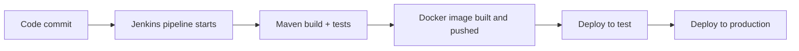

# 🛠️ DevOps Build Tools: Docker, Jenkins, Tomcat, Maven

## 1️⃣ Docker – Basic Conceptual Questions

### ❓ What is Docker and why is it used?

### 📝 Answer

Docker packages an application **with everything it needs** (runtime, libraries, config) into a **container** that runs the same way on any machine.

- **Problem it solves:** "It works on my machine" — different Java versions, missing libraries, different OS settings between laptops, test and production.
- **Why teams prefer it:** the same image goes from laptop → test → production, starts in seconds, and many containers share one server.

```bash
docker run -p 8080:8080 myapp:1.0    # same result on every machine
```

---

### ❓ What is the difference between Docker and a Virtual Machine?

### 📝 Answer

| Virtual machine | Docker container |
|---|---|
| Runs a **full guest operating system** on virtual hardware | **Shares the host's OS kernel**; contains only the app and its libraries |
| Size in GBs, boots in minutes | Size in MBs, starts in seconds |
| Strong isolation | Lighter isolation (process level) |
| A few VMs per server | Dozens or hundreds of containers per server |

Containers start fast because there's **no operating system to boot** — starting one is like starting a process.

---

### ❓ What is a Docker image?

### 📝 Answer

An image is a **read-only template** for creating containers — like a class, while a container is an object.

- **Contains:** a base OS layer (e.g. a slim Linux), the runtime (JRE), your app (JAR), and settings (ports, start command).
- **Immutable:** once built, it never changes. A change means building a **new image** with a new tag (`myapp:1.1`).
- Built in **layers**; unchanged layers are reused (cached).

---

### ❓ What is a Docker container?

### 📝 Answer

A container is a **running instance of an image**, with its own process, network and file system.

- **Created with:** `docker run myapp:1.0` (creates and starts it).
- **When it stops:** the process ends, but the container still exists and can be started again. Files written **inside** it are lost when the container is **removed** — keep important data in a volume or database.

```bash
docker ps          # running containers
docker stop app    # stop
docker rm app      # remove (its internal files are gone)
```

---

### ❓ What is a Dockerfile?

### 📝 Answer

A text file with **step-by-step instructions to build an image**. It makes builds repeatable and lives in Git with the code.

```dockerfile
FROM eclipse-temurin:21-jre      # base image
WORKDIR /app                     # working folder
COPY target/app.jar app.jar      # add the app
EXPOSE 8080                      # document the port
ENTRYPOINT ["java", "-jar", "app.jar"]   # start command
```

Common instructions: `FROM`, `WORKDIR`, `COPY`, `RUN` (run a command at build time), `ENV`, `EXPOSE`, `CMD`/`ENTRYPOINT`.

---

### ❓ Why should applications inside Docker be stateless?

### 📝 Answer

Containers are **replaced all the time** (new version, crash, scaling). If a container stores data locally — uploaded files, sessions — that data **disappears** when it's replaced, and other copies of the app can't see it.

Keep state outside: database, Redis for sessions, S3 or a volume for files. Then any container can serve any request, and you can add or remove containers freely.

---

### ❓ How do you pass configuration to a Docker container?

### 📝 Answer

Build **one image** and change its behaviour per environment from outside:

- **Environment variables** (most common):
  ```bash
  docker run -e SPRING_PROFILES_ACTIVE=prod -e DB_URL=jdbc:postgresql://db/shop myapp:1.0
  ```
- **External config files** mounted as a volume: `-v ./config:/app/config`
- **Secrets** from a secret manager (or Docker/Kubernetes secrets) — never baked into the image.

---

### ❓ What are common benefits of using Docker in projects?

### 📝 Answer

- **Development:** a new developer runs the app and its database with one `docker compose up`.
- **Testing:** tests run against the same image and real services (Testcontainers) as production.
- **Deployment:** the exact tested image is deployed; rollback = run the previous tag.
- Also: better use of servers, easy scaling, and a standard unit for Kubernetes.

---

## 2️⃣ Jenkins + Groovy – CI/CD Basics

### ❓ What is Jenkins?

### 📝 Answer

Jenkins is an open-source **automation server**. It watches your Git repository and automatically **builds, tests and deploys** your code on every change — the engine of CI/CD in many companies.

---

### ❓ What is CI/CD?

### 📝 Answer

- **Continuous Integration (CI):** every push is automatically **built and tested**, so problems are found within minutes, not at release time.
- **Continuous Delivery:** every change that passes is **ready to release**; a person clicks to deploy to production.
- **Continuous Deployment:** every passing change goes to **production automatically**, no manual step.

```text
push → build → unit tests → package → deploy to test → (approve) → deploy to prod
```

---

### ❓ Why do teams use Jenkins for CI/CD?

### 📝 Answer

It removes slow, error-prone manual work:

- No more "build on someone's laptop and copy the JAR".
- Broken code is caught right after the commit, with the author still in context.
- Every release follows the same steps, with logs of what was deployed and when.
- Huge plugin ecosystem (Git, Maven, Docker, Kubernetes, Slack…).

Alternatives: GitHub Actions, GitLab CI, Azure DevOps.

---

### ❓ What is a Jenkins pipeline?

### 📝 Answer

A pipeline describes the **whole build-to-deploy process as code**, in stages. It is preferred over manual "freestyle" jobs because it is version-controlled, reviewable, repeatable, and shows each stage's status clearly.

---

### ❓ What is a Jenkinsfile?

### 📝 Answer

The file that **defines the pipeline**, stored in the **root of the repository** next to the code. Stored in Git so pipeline changes are reviewed and versioned with the code, and every branch can have its own pipeline.

```groovy
pipeline {
  agent any
  stages {
    stage('Build')  { steps { sh 'mvn -B clean package' } }
    stage('Test')   { steps { sh 'mvn test' } }
    stage('Docker') { steps { sh 'docker build -t myapp:${BUILD_NUMBER} .' } }
    stage('Deploy') { when { branch 'main' } steps { sh './deploy.sh' } }
  }
  post { failure { echo 'Build failed' } }
}
```

---

### ❓ Why is Jenkinsfile written in Groovy?

### 📝 Answer

Jenkins itself runs on the **JVM**, and Groovy is a JVM scripting language — so pipelines can use Java libraries and Jenkins internals directly. Compared with plain YAML, Groovy allows **logic** (conditions, loops, functions); compared with Java, it's shorter and needs no compiling.

---

### ❓ What is Groovy?

### 📝 Answer

Groovy is a scripting language **for the JVM**. It's very close to Java — most Java code is valid Groovy — but with shorter syntax (optional semicolons and types, closures, string interpolation). It's used in Jenkins pipelines, Gradle build scripts and Spock tests.

---

### ❓ Is Groovy statically typed or dynamically typed?

### 📝 Answer

**Dynamically typed by default** (`def x = 5`), with optional static typing (`@CompileStatic`). Dynamic typing suits pipelines because scripts are short and work with data whose shape varies (environment variables, JSON from tools), so less boilerplate is needed.

---

### ❓ What are common stages in a Jenkins pipeline?

### 📝 Answer

| Stage | What happens |
|---|---|
| Checkout | Get the code from Git |
| Build | Compile (`mvn compile`, `npm run build`) |
| Test | Unit and integration tests, coverage |
| Code quality | SonarQube, lint, security scan |
| Package | JAR / Docker image, push to a registry |
| Deploy | To test, then (often with approval) to production |

---

### ❓ How does Jenkins trigger a pipeline?

### 📝 Answer

- **Git commit / push** — a webhook from GitHub/GitLab tells Jenkins immediately (better than polling).
- **Pull request** — build and test the PR before merging.
- **Manual trigger** — a "Build Now" button, often with parameters.
- Also: a **schedule** (cron, e.g. nightly builds) or another job finishing.

---

### ❓ What happens when a Jenkins build fails?

### 📝 Answer

The pipeline **stops at the failing stage** (later stages like deploy don't run) and the build is marked red. Developers are notified by **email, Slack/Teams or a PR status check**, which can block merging. The fix is to read the console log, fix the code, and push again.

---

### ❓ What is the difference between Jenkins master and agent?

### 📝 Answer

- **Controller (master):** schedules jobs, stores configuration, shows the UI.
- **Agents:** separate machines/containers that **actually run the builds**.

Agents are needed so builds don't overload the controller, many builds can run in parallel, and builds can run in different environments (Linux, Windows, Java 17, Java 21).

---

### ❓ Where is Groovy mostly used in Jenkins?

### 📝 Answer

- **Pipeline scripts** — the `Jenkinsfile`.
- **Shared libraries** — reusable Groovy functions (e.g. a standard `buildJavaService()` step) shared by many repositories, so each team's Jenkinsfile stays tiny.
- Also: admin scripts in the Jenkins script console.

---

### ❓ What are common problems seen in Jenkins pipelines?

### 📝 Answer

| Problem | Typical fix |
|---|---|
| **Flaky builds** (pass/fail randomly) | Fix unstable tests; avoid shared state and timing waits |
| **Long execution time** | Cache dependencies, run stages in parallel, split slow tests |
| **Environment mismatch** ("works on agent A only") | Build inside Docker containers so every agent is identical |
| Secrets in logs | Use the Jenkins credentials store; mask values |
| Plugin upgrade breakage | Pin and test plugin versions |

---

## 3️⃣ Apache Tomcat

### ❓ What is Apache Tomcat?

### 📝 Answer

Tomcat is an open-source **web server and servlet container** for Java. It accepts HTTP requests and passes them to your Java code (servlets — Spring MVC is built on them).

It's a **web container**, not a full Java EE / Jakarta EE application server like WildFly or WebLogic (which add things like EJB and JMS).

---

### ❓ What kind of applications run on Tomcat?

### 📝 Answer

Java web applications and REST APIs built on **servlets**: Spring MVC / Spring Boot, JSP pages, plain servlet apps. It's common with Java because it's lightweight, free, stable, and the **default embedded server in Spring Boot**.

---

### ❓ How does Tomcat handle incoming requests?

### 📝 Answer

**Thread-per-request:** a connector accepts the connection, then a thread from Tomcat's **thread pool** (200 threads by default) runs the request through filters and the servlet (Spring's `DispatcherServlet`) and writes the response. The thread then returns to the pool.

If all threads are busy (slow database calls), new requests wait in a queue — then time out. That's why slow downstream calls can "freeze" a Tomcat app. Java 21 **virtual threads** remove most of this limit.

---

### ❓ What is a WAR file?

### 📝 Answer

A **Web Application Archive** — a ZIP of a Java web app (classes, libraries, `web.xml`, static files) made to run **inside an external server** like Tomcat.

Deploy it by copying it into Tomcat's `webapps/` folder (Tomcat unpacks and starts it) or via the Tomcat Manager.

Spring Boot apps are usually packaged as an executable **JAR** with Tomcat embedded instead.

---

### ❓ Difference between embedded Tomcat and external Tomcat?

### 📝 Answer

| Embedded Tomcat | External Tomcat |
|---|---|
| Tomcat is **inside your JAR** (`java -jar app.jar`) | You install Tomcat and **deploy WARs** into it |
| One app per process; config in `application.yml` | Several apps can share one server |
| Perfect for Docker and microservices | Traditional/legacy setups |

Spring Boot uses embedded Tomcat because the app becomes **self-contained** — no server to install or configure separately, and the same JAR runs everywhere.

---

### ❓ What are common issues seen in Tomcat?

### 📝 Answer

- **Port conflicts** — "Address already in use: 8080" → stop the other process or change `server.port`.
- **Memory issues** — `OutOfMemoryError` from leaks or too small a heap → heap dumps, `-Xmx`, fix leaks.
- **Thread exhaustion** — all request threads stuck on slow calls → timeouts, more threads, async or virtual threads.
- Also: class-loading conflicts between WAR libraries, and memory leaks on repeated redeploys.

---

### ❓ How do you restart or redeploy applications in Tomcat?

### 📝 Answer

- **Manual:** `shutdown.sh` / `startup.sh`, or replace the WAR in `webapps/` (Tomcat redeploys it), or use the Tomcat Manager UI.
- **Automated (better):** the CI/CD pipeline deploys the new version; with containers, you deploy a new image and the orchestrator (Kubernetes) replaces old containers with a **rolling update** — no manual restarts.

---

## 4️⃣ Maven

### ❓ What is Maven and why is it used?

### 📝 Answer

Maven is a **build and dependency management tool** for Java. It solves:

- **Dependencies:** you list libraries; Maven downloads them (and their dependencies).
- **Standard build:** the same commands (`mvn package`) and folder layout (`src/main/java`) in every project.
- **Repeatable builds** on any machine and in CI.

---

### ❓ What is a `pom.xml` file?

### 📝 Answer

The **Project Object Model** — Maven's configuration file. It contains the project's identity (`groupId`, `artifactId`, `version`), packaging (JAR/WAR), Java version, **dependencies**, plugins and build settings.

```xml
<dependency>
  <groupId>org.springframework.boot</groupId>
  <artifactId>spring-boot-starter-web</artifactId>
</dependency>
```

---

### ❓ What is dependency management in Maven?

### 📝 Answer

You declare **what** you need; Maven fetches it, plus everything **it** needs (**transitive dependencies**), and puts them on the classpath.

How it downloads: checks the local repository (`~/.m2`) → if missing, downloads from **Maven Central** (or your company's repository) → caches it locally.

- **Scopes:** `compile` (default), `test` (only for tests), `provided` (server supplies it), `runtime`.
- **Version conflicts:** the "nearest" declaration wins; inspect with `mvn dependency:tree`, fix with `<dependencyManagement>` or `<exclusions>`.

---

### ❓ What are Maven repositories?

### 📝 Answer

- **Local** — `~/.m2/repository` on your machine; a cache of everything downloaded.
- **Central** — the public Maven Central repository.
- **Remote** — any other server, usually a company repository (Nexus, Artifactory) that stores internal libraries and caches Central.

Lookup order: local → remote/central.

---

### ❓ What is the Maven build lifecycle?

### 📝 Answer

An ordered list of **phases**. Running a phase runs **all phases before it**.

| Phase | Does |
|---|---|
| `validate` | Checks the project is correct |
| `compile` | Compiles main code |
| `test` | Runs unit tests |
| `package` | Builds the JAR/WAR in `target/` |
| `verify` | Runs integration checks |
| `install` | Copies the artifact to your **local** repository |
| `deploy` | Uploads it to a **remote** repository |

`mvn clean package` = delete `target/`, then validate → compile → test → package.

---

### ❓ What is a Maven plugin?

### 📝 Answer

Plugins do the **actual work** of each phase — Maven itself is mostly a framework that runs them. Examples: `maven-compiler-plugin` (compile), `maven-surefire-plugin` (unit tests), `maven-failsafe-plugin` (integration tests), `spring-boot-maven-plugin` (executable JAR), `jacoco-maven-plugin` (coverage).

---

### ❓ What is a multi-module Maven project?

### 📝 Answer

One **parent project with several modules** (sub-projects), built together with one command.

```text
shop-parent/
├── pom.xml          (parent: shared versions and plugins)
├── shop-common/     (shared DTOs, utilities)
├── shop-api/        (REST app, depends on common)
└── shop-batch/      (batch jobs, depends on common)
```

Teams use it to share code and dependency versions, keep clear module boundaries, and build everything in the right order.

---

### ❓ How does Maven help maintain consistency across environments?

### 📝 Answer

**Same build everywhere:** the `pom.xml` pins dependency and plugin versions, and Maven uses the same lifecycle on every laptop and CI agent. The **Maven Wrapper** (`./mvnw`) even pins the Maven version itself. Result: the JAR built in CI is the same one that was tested.

---

## 5️⃣ How the Tools Work Together

### ❓ Typical CI/CD flow using these tools?

### 📝 Answer



1. Developer pushes code → webhook starts Jenkins.
2. **Maven** compiles, tests and packages the JAR.
3. **Docker** builds an image with the JAR and pushes it to a registry.
4. The image is deployed (Docker host or Kubernetes); the Spring Boot app runs with **embedded Tomcat** inside.

---

### ❓ How do Maven, Jenkins, and Docker work together?

### 📝 Answer

Each tool has one responsibility:

- **Jenkins** — the **orchestrator**: decides when to run and runs each step.
- **Maven** — **builds** the Java code into a tested JAR.
- **Docker** — **packages** the JAR with its runtime into an image that runs anywhere.

---

### ❓ Where does Tomcat fit in this flow?

### 📝 Answer

At **runtime**. In modern Spring Boot apps, Tomcat is **embedded in the JAR**, which runs **inside the Docker container** — no separate Tomcat installation. In older setups, Maven builds a WAR that is deployed to a standalone Tomcat server.

---

### ❓ What problems do these tools solve together?

### 📝 Answer

| Problem | Solved by |
|---|---|
| **Environment inconsistency** ("works on my machine") | Docker images + Maven-pinned versions |
| **Manual deployments** (slow, risky, undocumented) | Jenkins pipelines |
| **Build failures found late** | CI builds and tests every commit |
| Hard rollbacks | Versioned Docker images — redeploy the previous tag |
