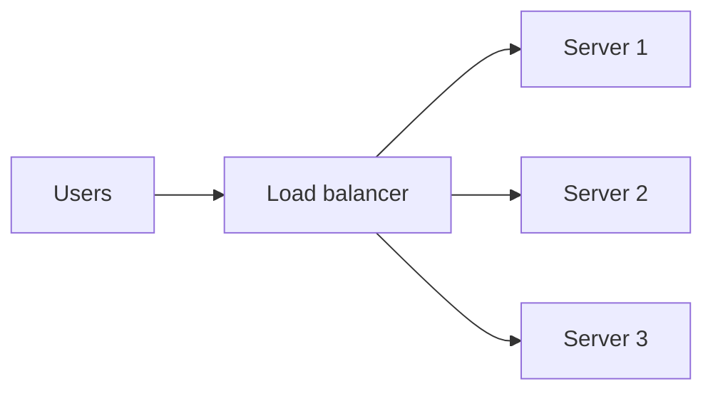
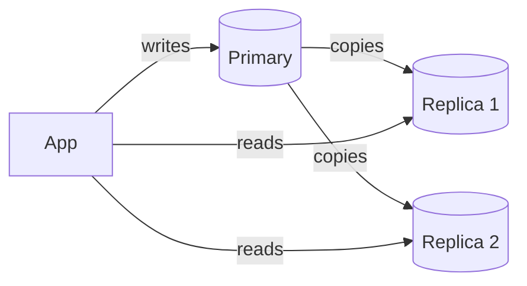
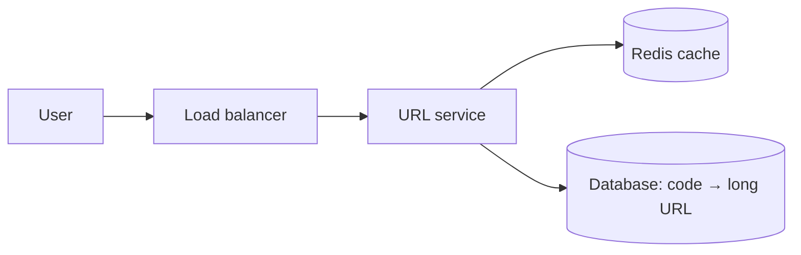
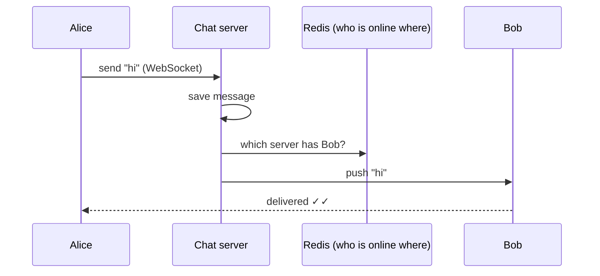
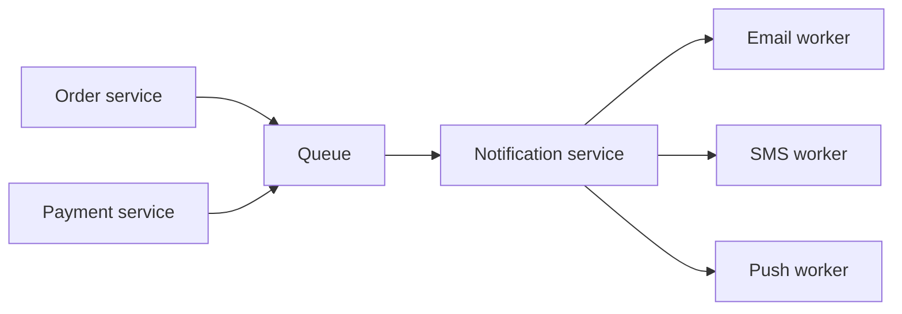
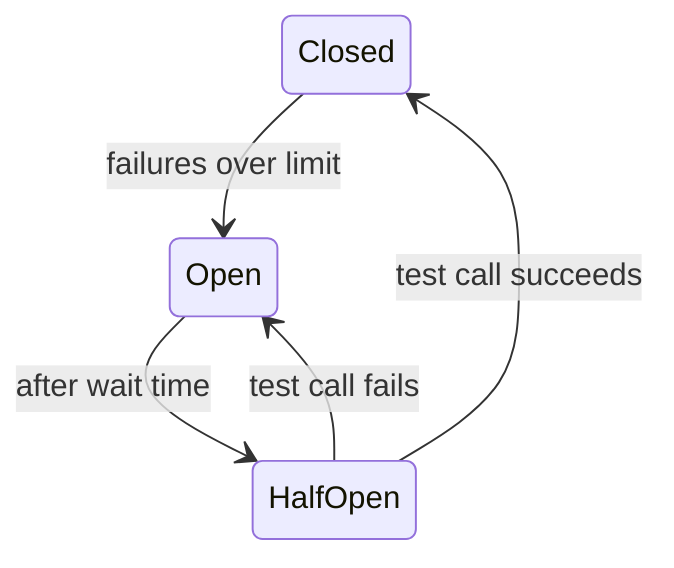

# 🏗️ System Design Interview Preparation

## Part 1 — Basics

### ❓ How do you approach a system design interview?

### 📝 Answer

Follow the same five steps every time, and talk out loud while you do it.

1. **Clarify requirements** — what must it do (features), and how well (users, speed, availability)?
2. **Estimate scale** — users per day, requests per second, data per year.
3. **Draw the high-level design** — client → load balancer → services → database / cache / queue.
4. **Go deep on 1–2 parts** — the database schema, the hardest API, or the bottleneck.
5. **Discuss trade-offs** — what fails, how it scales, what you would do next.


> 💡 **Tip:** Interviewers score how you think, not one "right" diagram. Ask questions before drawing.

#### ↳ Follow-up: What is the difference between functional and non-functional requirements?

↪ Functional = what the system does ("users can post a photo"). Non-functional = how well it does it ("loads in under 200 ms, 99.9% uptime").

#### ↳ Follow-up: How long should each step take in a 45-minute interview?

↪ About 5 min requirements, 5 min estimates, 10–15 min high-level design, 15 min deep dive, 5 min trade-offs.

---

### ❓ How do you do back-of-the-envelope estimation?

### 📝 Answer

Round everything to simple numbers and multiply. The goal is the **order of magnitude**, not an exact answer.

**Handy numbers**

| Fact | Value |
|---|---|
| Seconds in a day | ~100,000 (86,400) |
| 1 million requests/day | ~12 requests/second |
| 1 KB × 1 million | 1 GB |
| Peak traffic | ~2–3× average |

**Example — a photo app with 10 million daily users, each uploading 2 photos of 500 KB:**

- Uploads: 20 M/day ÷ 100,000 s ≈ **200 uploads/s** (peak ~500/s)
- Storage: 20 M × 500 KB = **10 TB per day** → ~3.6 PB per year → needs object storage (like S3), not a database

#### ↳ Follow-up: Why do estimates matter?

↪ They decide the design: 10 requests/s fits one server and one database; 100,000 requests/s needs caching, sharding and many servers.

---

### ❓ What is the difference between vertical and horizontal scaling?

### 📝 Answer

- **Vertical scaling (scale up)** — make one machine bigger (more CPU, RAM). Simple, but there is a maximum size and it is a single point of failure.
- **Horizontal scaling (scale out)** — add more machines and split the work. No real limit, survives a machine failing, but needs a load balancer and stateless services.

```text
Vertical:   [ small server ]  →  [ BIG server ]
Horizontal: [ server ]        →  [ server ][ server ][ server ]  (behind a load balancer)
```

#### ↳ Follow-up: Why must services be stateless to scale horizontally?

↪ Any server may get the next request. If the session lives in one server's memory, other servers don't know the user. Keep state in a shared store (Redis, database) or in a token (JWT).

---

### ❓ What is a load balancer and how does it decide where to send a request?

### 📝 Answer

A load balancer sits in front of several servers and spreads incoming requests across them, so no single server is overloaded. It also stops sending traffic to servers that fail health checks.

**Common algorithms**

| Algorithm | How it picks | Good for |
|---|---|---|
| Round robin | Next server in turn | Servers of equal size |
| Least connections | Server with fewest active requests | Requests of different lengths |
| IP hash | Same client → same server | Simple "sticky" sessions |
| Weighted | Bigger servers get more | Mixed server sizes |



#### ↳ Follow-up: What is the difference between an L4 and an L7 load balancer?

↪ L4 routes by IP and port only (fast, can't read the request). L7 reads HTTP (path, headers, cookies), so it can send `/api` and `/images` to different servers.

#### ↳ Follow-up: Isn't the load balancer itself a single point of failure?

↪ Yes, so run two in active–passive (or active–active) mode with a shared virtual IP, or use a managed one like AWS ALB.

---

### ❓ What is a CDN and when do you use one?

### 📝 Answer

A **CDN (Content Delivery Network)** is a set of servers around the world that keep copies of your static files (images, videos, JS, CSS). Users download from the nearest copy, so pages load faster and your own servers get less traffic.

- Use it for: images, video, scripts, stylesheets, downloads.
- Example: a user in Chennai gets `logo.png` from a Mumbai edge server instead of your server in the US.

#### ↳ Follow-up: How do you update a file that a CDN has cached?

↪ Give the new file a new name (`app.3f9a1.js`, called cache busting) or ask the CDN to invalidate the old path.

---

### ❓ SQL or NoSQL — how do you choose a database?

### 📝 Answer

Start with SQL unless you have a clear reason not to.

| Choose SQL (PostgreSQL, MySQL) when | Choose NoSQL when |
|---|---|
| Data has clear relations (users, orders, payments) | Data shape changes often or is document-like |
| You need transactions (money, stock) | You need huge write volume / easy horizontal scaling |
| You need joins and complex queries | Access is simple: get/put by key |

**NoSQL types with examples**

- Key-value: Redis, DynamoDB — sessions, caches
- Document: MongoDB — product catalogs, user profiles
- Wide-column: Cassandra — time series, chat messages, logs
- Graph: Neo4j — social networks, recommendations

#### ↳ Follow-up: Can NoSQL databases do transactions?

↪ Many now can (MongoDB, DynamoDB support them), but usually with more limits and cost than a relational database.

---

### ❓ What is database replication?

### 📝 Answer

Replication keeps **copies of the same data** on several database servers.

- **Primary–replica (leader–follower):** all writes go to the primary; it copies changes to replicas; reads can go to replicas.
- Benefits: more read capacity, and a replica can take over if the primary dies.
- Catch: replicas may be a little behind (**replication lag**), so a user might not see their own write immediately.



#### ↳ Follow-up: How do you fix "I updated my profile but still see the old one"?

↪ Read-your-own-writes: send that user's reads to the primary for a short time after they write.

---

### ❓ What is sharding (partitioning)?

### 📝 Answer

Sharding splits **one big table across several databases**. Each database (shard) holds part of the rows.

- **Hash sharding:** `shard = hash(userId) % 4` → even spread, but range queries hit all shards.
- **Range sharding:** users A–M on shard 1, N–Z on shard 2 → easy ranges, but can create hot spots.
- **Shard key** choice is the most important decision: pick one that spreads load and is in most queries (e.g. `userId`).

**Downsides:** joins across shards are hard, and adding shards means moving data (consistent hashing helps).

#### ↳ Follow-up: Replication vs sharding?

↪ Replication = same data copied (more reads, safety). Sharding = data split (more storage and writes). Large systems use both.

---

### ❓ What is consistent hashing?

### 📝 Answer

A way to spread keys across servers so that **adding or removing a server moves only a few keys**.

- Normal hashing: `hash(key) % N` — change N from 4 to 5 and almost every key moves.
- Consistent hashing: servers and keys sit on a circle (ring); a key belongs to the next server clockwise. Adding a server only takes keys from its neighbour.

```text
        S1
     k3     k1
   S3   ring   S2      k1 → S2, k3 → S1
        k2             adding S4 between S1 and S2 moves only some of S2's keys
```

Used by: Cassandra, DynamoDB, CDNs, distributed caches.

#### ↳ Follow-up: What are virtual nodes?

↪ Each server is placed on the ring many times, so keys spread more evenly and a failed server's load is shared by many servers.

---

### ❓ What is a message queue and why use one in system design?

### 📝 Answer

A queue lets one service **hand work to another without waiting**. The sender puts a message in the queue and returns at once; a worker processes it later.

- **Faster responses:** "Order placed!" returns immediately; the email is sent in the background.
- **Absorbs spikes:** 10,000 orders in a minute wait in the queue instead of crashing the email service.
- **Decoupling:** services don't need to be up at the same time.

Examples: RabbitMQ, Kafka, AWS SQS. See the RabbitMQ vs Kafka notes for when to use which.

#### ↳ Follow-up: What happens if a message keeps failing?

↪ After a few retries it moves to a **dead-letter queue**, so it doesn't block others and someone can inspect it.

---

## Part 2 — Classic Design Questions

### ❓ Design a URL shortener (like bit.ly).

### 📝 Answer

**Requirements:** long URL → short code; visiting the short URL redirects; very read-heavy (≈100 reads per write).

**Short code:** 7 characters of Base62 (`a–z A–Z 0–9`) gives 62⁷ ≈ 3.5 trillion codes.

- Option 1: auto-increment ID → convert to Base62 (`125` → `"cb"`). Simple, unique, but guessable.
- Option 2: hash the URL (MD5) and take 7 chars → check for collisions.

**Design**



- `POST /shorten {url}` → saves `code → url`, returns `https://sho.rt/abc1234`
- `GET /abc1234` → look up cache, then DB → **HTTP 301/302 redirect**
- Cache popular codes in Redis — most traffic hits a small set of links.

#### ↳ Follow-up: 301 or 302 redirect?

↪ 301 (permanent) lets browsers cache it — less load but you lose click counts. 302 (temporary) hits your server every time, so you can count clicks.

#### ↳ Follow-up: How do you generate unique IDs on many servers?

↪ Give each server its own range of IDs (server 1: 1–1M, server 2: 1M–2M), or use a Snowflake-style ID (time + machine ID + counter).

---

### ❓ Design a rate limiter.

### 📝 Answer

A rate limiter stops a client from sending too many requests (e.g. **100 requests per minute per user**). Extra requests get **HTTP 429 Too Many Requests**.

**Algorithms**

| Algorithm | Idea | Note |
|---|---|---|
| **Token bucket** | Bucket refills N tokens/sec; each request spends one | Allows short bursts — most common |
| Fixed window | Count per minute; reset at :00 | Simple, but 2× burst at window edges |
| Sliding window | Count over the last 60 s | Smoother, slightly more memory |
| Leaky bucket | Requests leave at a fixed rate | Smooth output, like a queue |

**Where:** in the API gateway, with counters in **Redis** so all servers share them.

```text
key = "rate:user42:minute"
INCR key; if first → EXPIRE key 60
if value > 100 → return 429
```

#### ↳ Follow-up: Why Redis and not server memory?

↪ With 5 servers, each one would allow 100 — the user would get 500. A shared Redis counter enforces one limit.

---

### ❓ Design a chat application (like WhatsApp).

### 📝 Answer

**Key needs:** real-time 1-to-1 and group messages, online status, message history, delivery ticks.

- **Connection:** clients keep a **WebSocket** open to a chat server (two-way, real-time).
- **Sending:** A → chat server → looks up which server B is connected to (stored in Redis) → pushes to B.
- **B offline:** store the message; deliver when B reconnects (and send a push notification).
- **Storage:** messages in a write-heavy store like Cassandra, keyed by `chatId`, sorted by time.



#### ↳ Follow-up: Why WebSockets instead of normal HTTP requests?

↪ HTTP needs the client to ask ("any new messages?") again and again. A WebSocket stays open, so the server can push messages instantly.

---

### ❓ Design a news feed (like Twitter/Instagram home).

### 📝 Answer

The main choice is **when** to build each user's feed.

- **Fan-out on write (push):** when Alice posts, add the post to every follower's feed list in Redis. Reading is instant. Bad for celebrities with 50 M followers.
- **Fan-out on read (pull):** when Bob opens the app, fetch latest posts from everyone he follows and merge. Cheap writes, slow reads.
- **Hybrid (used in practice):** push for normal users; pull for celebrities and merge at read time.

```text
Post by normal user  → pushed into followers' feed caches
Post by celebrity    → fetched when a follower opens the feed
```

#### ↳ Follow-up: How do you paginate a feed?

↪ Cursor pagination: "give me 20 posts older than post ID X". Offset pagination breaks when new posts arrive.

---

### ❓ Design a notification service.

### 📝 Answer

Many services ("order shipped", "OTP") need to send email, SMS and push messages.

1. Services publish a notification request to a **queue** (don't call providers directly).
2. A notification service reads it, checks **user preferences** (opted out of SMS?) and templates.
3. Channel workers send via providers (SES for email, Twilio for SMS, FCM/APNs for push).
4. Failures are **retried with backoff**; permanent failures go to a dead-letter queue.



#### ↳ Follow-up: How do you avoid sending the same SMS twice after a retry?

↪ Give each notification a unique ID and record it when sent; skip it if the ID was already sent (idempotency).

---

### ❓ Design a file storage / photo upload service (like Google Drive).

### 📝 Answer

- Store **files in object storage** (S3); store **metadata** (name, owner, size, S3 key) in a database.
- Upload with a **pre-signed URL**: the app asks the server for a temporary upload link, then the browser uploads straight to S3 — your servers never carry the big file.
- Large files: **multipart / chunked upload**, so a failed chunk is retried alone.
- Serve downloads through a **CDN**; create thumbnails in the background (queue + worker).

#### ↳ Follow-up: What is a pre-signed URL?

↪ A link to S3 that includes a signature and expiry time, letting someone upload or download one specific file for a few minutes without your credentials.

---

### ❓ How do you stop two people buying the last item in stock at the same time?

### 📝 Answer

Two requests must not both succeed. Make the **database decide atomically**:

```sql
UPDATE stock SET quantity = quantity - 1
WHERE product_id = 42 AND quantity > 0;
-- 1 row updated → success; 0 rows → sold out
```

- Or use **optimistic locking**: a `version` column; the update fails if someone else changed the row first.
- For flash sales, reserve stock for a few minutes in Redis, then confirm on payment.

#### ↳ Follow-up: Optimistic vs pessimistic locking?

↪ Optimistic: no lock, check a version at save time — best when conflicts are rare. Pessimistic: `SELECT ... FOR UPDATE` locks the row first — best when conflicts are common.

---

## Part 3 — Reliability & Performance

### ❓ What is a single point of failure and how do you remove it?

### 📝 Answer

A **single point of failure (SPOF)** is one part whose failure takes down the whole system — one server, one database, one load balancer.

Remove it with **redundancy**: two or more of everything important, in different availability zones, with automatic failover.

| Part | Redundancy |
|---|---|
| App server | Several servers behind a load balancer |
| Database | Primary + replica with automatic failover |
| Load balancer | Pair of load balancers / managed LB |
| Data centre | Multiple availability zones or regions |

#### ↳ Follow-up: What does "99.9% availability" mean?

↪ Down at most about 8.8 hours per year (43 minutes per month). 99.99% ≈ 53 minutes per year.

---

### ❓ How would you make a slow API fast?

### 📝 Answer

Measure first, then fix the biggest cost.

1. **Find the slow part** — logs, tracing, the database's slow query log.
2. **Database:** add the missing index, fix N+1 queries, fetch only needed columns, paginate.
3. **Cache** results that are read often and change rarely (Redis).
4. **Do less in the request** — move emails, reports, image processing to a queue.
5. **Call other services in parallel**, not one after another; add timeouts.
6. **Compress and use a CDN** for large responses and static files.

#### ↳ Follow-up: What is the N+1 query problem?

↪ Loading 100 orders with 1 query, then running 1 more query per order for its customer = 101 queries. Fix with a join or a batch fetch (`WHERE id IN (...)`).

---

### ❓ What is the difference between latency and throughput?

### 📝 Answer

- **Latency** — how long **one** request takes (e.g. 120 ms).
- **Throughput** — how **many** requests the system handles per second (e.g. 5,000 req/s).

Example: a highway's speed limit is latency; the number of lanes is throughput. Adding lanes (servers) raises throughput but doesn't make one car faster.

#### ↳ Follow-up: Why look at p99 latency instead of the average?

↪ The average hides slow requests. p99 = 99% of requests are faster than this; it shows what your unluckiest users feel.

---

### ❓ What are idempotent APIs and why do they matter?

### 📝 Answer

An operation is **idempotent** if doing it twice has the same effect as doing it once.

- `GET`, `PUT`, `DELETE` should be idempotent; `POST` usually is not.
- Why it matters: networks fail and clients **retry**. A retried "pay ₹500" must not charge twice.
- Fix for POST: the client sends an **Idempotency-Key** header; the server stores the key with the result and returns the same result for a repeat.

```http
POST /payments
Idempotency-Key: 7f1c-42ab
{ "amount": 500 }
```

#### ↳ Follow-up: Is `PUT /users/1 {name: "A"}` idempotent?

↪ Yes — sending it twice still leaves the name "A". `POST /users` twice creates two users, so it is not.

---

### ❓ What is a circuit breaker?

### 📝 Answer

A circuit breaker stops calling a service that keeps failing, so your service doesn't hang waiting and the failing one gets time to recover.

- **Closed:** calls go through normally; failures are counted.
- **Open:** too many failures → calls fail fast (or return a fallback) without trying.
- **Half-open:** after a wait, a few test calls go through; success → closed, failure → open again.



In Java: Resilience4j `@CircuitBreaker(name = "inventory", fallbackMethod = "cachedStock")`.

#### ↳ Follow-up: Circuit breaker vs retry?

↪ Retry helps with short glitches. A circuit breaker protects you when a service is truly down. Use both: a few retries inside a circuit breaker.

---

## Part 4 — Tricky Questions

### ❓ Tricky: "Just add more servers" — when doesn't horizontal scaling help?

### 📝 Answer

When the bottleneck isn't the app servers:

- **One database** taking every write — more app servers make it worse.
- **Shared locks / hot rows** — everyone updates the same counter row.
- **Stateful servers** — sessions stored in memory.
- **Slow downstream service** — more callers just queue up.

Fix the bottleneck (cache, shard, queue, make stateless) before adding servers.

---

### ❓ Tricky: Should you cache everything?

### 📝 Answer

No. Cache data that is **read often, changes rarely, and can be slightly stale** (product pages, user profiles). Avoid caching data that must be exact right now (account balance at payment time) or is rarely read twice. Every cache adds the problem of keeping it fresh.

---

### ❓ Tricky: Monolith or microservices for a new startup product?

### 📝 Answer

Usually a **well-structured monolith** first. It is faster to build, test and deploy with a small team. Split into microservices later, when a part needs to scale or deploy on its own, or the team grows too large to work in one codebase. Microservices add network failures, distributed data and DevOps cost from day one.

#### ↳ Follow-up: What is a modular monolith?

↪ One deployable app whose code is split into clear modules (orders, payments) with strict boundaries — easy to split into services later.
