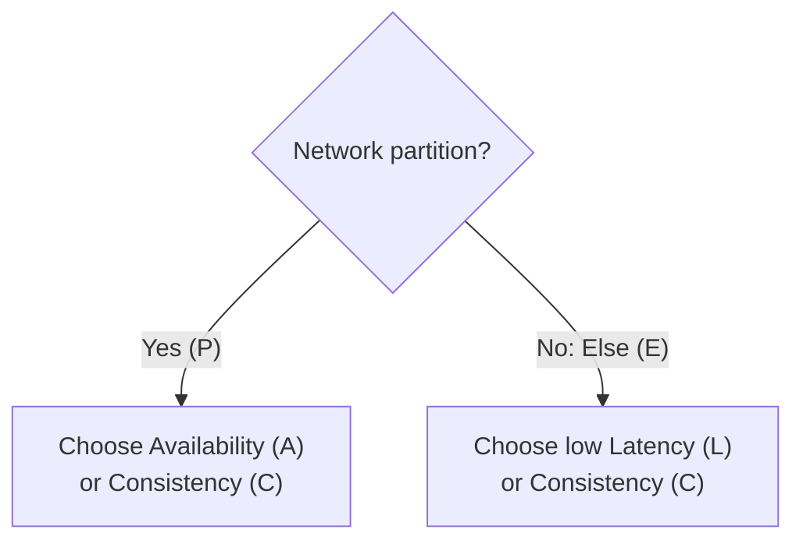
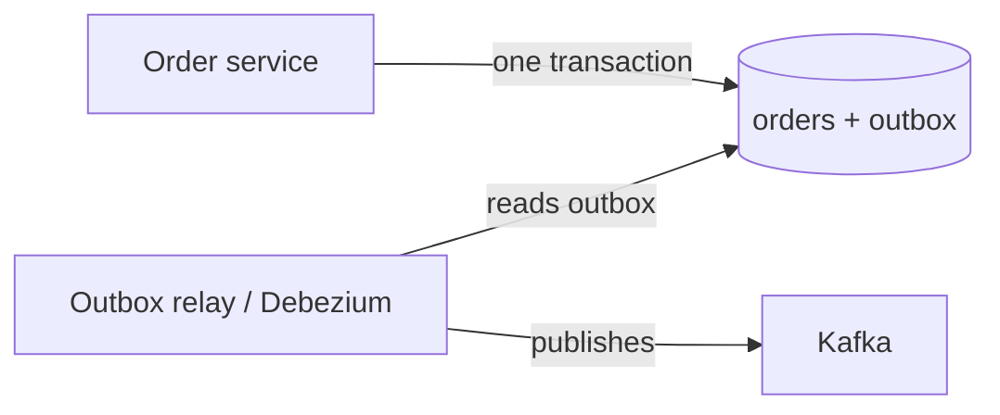

# 🌐 Distributed Systems Interview Preparation

## Part 1 — Consistency

### ❓ What is the CAP theorem?

**Level:** 🟡 Intermediate

### 📝 Answer

When the network between servers breaks (a **partition**), a distributed database must choose between:

- **Consistency (C)** — every read gets the latest write, or an error.
- **Availability (A)** — every request gets an answer, even if it might be old data.

You can't have both during a partition. Since partitions **will** happen, the real choice is **CP or AP**.

| Type | During a network split | Examples |
|---|---|---|
| **CP** | Refuses some requests to stay correct | Banking ledger, ZooKeeper, etcd, HBase |
| **AP** | Keeps answering, may return old data | Cassandra, DynamoDB (default), DNS, shopping carts |

> ⚠️ **Common mistake:** "Pick any 2 of 3." You can't give up P in a real network — you only choose what happens *when* P occurs.

#### ↳ Follow-up: Which would you choose for a bank balance and for a "likes" counter?

↪ Bank balance: CP — better to refuse than show the wrong money. Likes: AP — a slightly old count is fine.

#### ↳ Follow-up: What is PACELC?

↪ An extension of CAP: if Partition → choose A or C; Else (normal times) → choose lower Latency or Consistency.



---

### ❓ What is eventual consistency?

**Level:** 🟡 Intermediate

### 📝 Answer

After a write, replicas may disagree for a short time, but **if no new writes come, they all end up the same**.

Example: you change your profile photo; a friend in another country still sees the old one for a second or two, then the new one.

- **Strong consistency:** everyone sees the write immediately (slower, less available).
- **Eventual consistency:** fast and available; short-lived stale reads.

#### ↳ Follow-up: Where is eventual consistency not acceptable?

↪ Money transfers, stock counts at checkout, unique usernames — anything where reading old data causes a wrong action.

---

### ❓ What are ACID and BASE?

**Level:** 🟡 Intermediate

### 📝 Answer

**ACID** (relational databases):

- **Atomicity** — all steps of a transaction happen, or none do.
- **Consistency** — rules (constraints) are never broken.
- **Isolation** — parallel transactions don't see each other's half-done work.
- **Durability** — once committed, data survives a crash.

**BASE** (many NoSQL systems): **B**asically **A**vailable, **S**oft state, **E**ventually consistent — chooses availability and scale over immediate consistency.

Example: transferring ₹100 — ACID guarantees money is never deducted from A without being added to B.

---

## Part 2 — Transactions Across Services

### ❓ Why can't you use a normal database transaction across microservices?

**Level:** 🟡 Intermediate

### 📝 Answer

Each microservice owns **its own database**. A single `@Transactional` covers one database connection only — it can't roll back another service's database.

Example: Order service saves an order ✅, Payment service charges the card ✅, Inventory service fails ❌. There is no single transaction to undo the first two.

Options: **Saga** (preferred), or **two-phase commit** (rarely used — slow and blocks if the coordinator fails).

---

### ❓ What is the Transactional Outbox pattern?

**Level:** 🟡 Intermediate

### 📝 Answer

**Problem:** you save an order to the database and then publish `OrderCreated` to Kafka. If the app crashes between the two, the order exists but no event is sent (or the reverse).

**Solution:** in the **same database transaction**, save the order **and** an event row in an `outbox` table. A separate relay reads the outbox and publishes to Kafka, marking rows as sent.



Because both rows commit together, an event is never lost. The relay may publish twice, so consumers must be idempotent.

#### ↳ Follow-up: What is CDC?

↪ Change Data Capture — reading the database's change log (e.g. with Debezium) to publish changes as events, instead of polling a table.

---

### ❓ What are "at most once", "at least once" and "exactly once" delivery?

**Level:** 🔴 Advanced

### 📝 Answer

| Guarantee | Meaning | Risk |
|---|---|---|
| At most once | Sent once, never retried | Messages can be **lost** |
| At least once | Retried until acknowledged | Messages can be **duplicated** |
| Exactly once | Each message has effect once | Hard and costly; limited support |

In practice: use **at least once + idempotent consumers** (remember processed message IDs and skip repeats). This gives the same result as exactly once.

#### ↳ Follow-up: How do you make a consumer idempotent?

↪ Store each processed message ID (or use a unique constraint); if the ID is already stored, skip the message.

---

## Part 3 — Coordination

### ❓ What is a quorum?

**Level:** 🔴 Advanced

### 📝 Answer

A **majority** of nodes that must agree before an action counts.

With N replicas: write to W nodes, read from R nodes. If **R + W > N**, every read overlaps with the latest write.

Example: N = 3, W = 2, R = 2 → 2 + 2 > 3, so a read always includes at least one node with the newest value.

---

### ❓ How do you generate unique IDs across many servers?

**Level:** 🟡 Intermediate

### 📝 Answer

| Method | Pros | Cons |
|---|---|---|
| UUID v4 | No coordination | 128 bits, random → poor index order |
| UUID v7 / ULID | Time-ordered, no coordination | Still 128 bits |
| Snowflake (64-bit) | Time + machine ID + counter; sortable, small | Needs unique machine IDs, clock care |
| DB sequence ranges | Simple | Each server must fetch a range |

```text
Snowflake: | 41 bits time (ms) | 10 bits machine | 12 bits counter |
```

---

## Part 4 — Failures

### ❓ What are retries with exponential backoff and jitter?

**Level:** 🟡 Intermediate

### 📝 Answer

When a call fails, wait and try again — waiting **longer each time** (1 s, 2 s, 4 s, 8 s) so a struggling service isn't flooded. **Jitter** adds a little randomness so thousands of clients don't all retry at the same moment.

```java
long wait = (long) (Math.pow(2, attempt) * 100 + Math.random() * 100); // ms
```

Only retry **idempotent** operations and **temporary** errors (timeouts, 503) — not 400 Bad Request.

---

### ❓ What is a timeout and why should every remote call have one?

**Level:** 🟡 Intermediate

### 📝 Answer

A timeout is the longest you will wait for a reply. Without one, a slow service makes your threads wait forever; soon all threads are stuck and your service is down too (**cascading failure**).

Rule of thumb: set connect and read timeouts on every HTTP/database call, a bit above that service's normal p99 latency.

---

### ❓ What is the bulkhead pattern?

**Level:** 🟡 Intermediate

### 📝 Answer

Give each downstream dependency its **own limited pool** of threads/connections, like watertight compartments in a ship. If the payment service hangs, only its pool fills up — calls to inventory still work.

#### ↳ Follow-up: How does it differ from a circuit breaker?

↪ A bulkhead limits how much one dependency can use. A circuit breaker stops calling a dependency that is failing. They are used together.

---

### ❓ Tricky: The network is reliable, right?

**Level:** 🟡 Intermediate

### 📝 Answer

No. The "fallacies of distributed computing" are false assumptions: the network is reliable, latency is zero, bandwidth is infinite, the network is secure, topology doesn't change, there is one admin, transport cost is zero, the network is the same everywhere. Design for every remote call to be slow, fail, or happen twice.

---

### ❓ Tricky: A request timed out — did the operation happen?

**Level:** 🟡 Intermediate

### 📝 Answer

**You don't know.** The server may have done the work and the reply was lost, or it never got the request. That's why retries need **idempotency keys**: the retry is safe either way.
