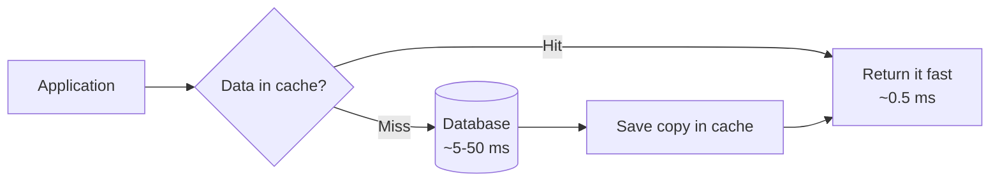
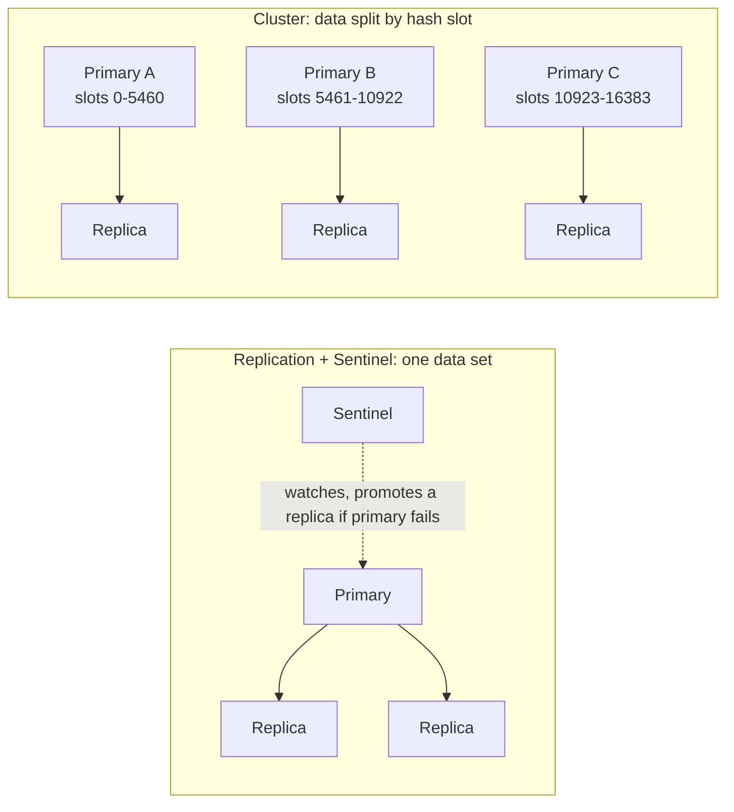
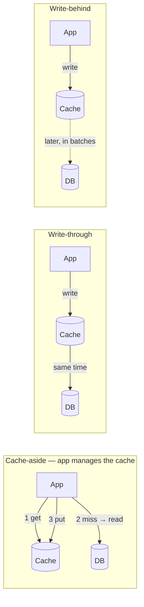

# ⚡ Caching & Redis Interview Preparation

## Caching Basics

### ❓ What is caching and why use it?

### 📝 Answer

A cache keeps a **copy of frequently used data in fast storage** (memory) so you don't fetch or compute it again.

- Database query: ~5–50 ms. Redis: ~0.5 ms. In-process memory: microseconds.
- Benefits: faster responses, less load on the database, lower cost.
- Cost: the copy can become **stale** (out of date) — keeping it fresh is the hard part.

**Where caches live:** browser → CDN → API gateway → application (in-memory or Redis) → database buffer pool.



---

### ❓ What are cache hit, cache miss and hit ratio?

### 📝 Answer

- **Hit** — the data is in the cache → fast.
- **Miss** — not in the cache → read the database (then usually store it).
- **Hit ratio** = hits ÷ total requests. 95% means 95 of 100 requests never touch the database.

A low hit ratio means the cache isn't helping: wrong data cached, TTL too short, or cache too small.

---

### ❓ What are cache eviction policies?

### 📝 Answer

When the cache is full, something must be removed.

| Policy | Removes | Note |
|---|---|---|
| **LRU** — Least Recently Used | Item not used for the longest time | Most common default |
| **LFU** — Least Frequently Used | Item used the fewest times | Keeps long-term popular items |
| **FIFO** | Oldest added item | Simple, ignores usage |
| **TTL** | Items past their expiry time | Combine with any of the above |

Redis setting: `maxmemory-policy allkeys-lru` (or `allkeys-lfu`, `volatile-ttl`...).

---

### ❓ What is cache invalidation and why is it hard?

### 📝 Answer

Invalidation = removing or updating cached data when the source changes. It's hard because the cache and database are **two separate systems**: a crash, a race between two writers, or a missed event can leave old data in the cache.

Practical approach:

1. Always set a **TTL** so stale data eventually expires.
2. **Delete the key** on update (cache-aside).
3. For many app instances, publish change events (Kafka/Redis Pub/Sub) so all of them evict.

> 💡 "There are only two hard things in computer science: cache invalidation and naming things." — Phil Karlton

---

## Cache Problems

### ❓ What are cache stampede, cache penetration and cache avalanche?

**Level:** 🟡 Intermediate

### 📝 Answer

| Problem | What happens | Fix |
|---|---|---|
| **Stampede (thundering herd)** | A popular key expires; 10,000 requests miss at once and all hit the DB | Lock so only one request reloads; or refresh early in the background |
| **Penetration** | Requests for keys that **don't exist** (e.g. id = -1) always miss and hit the DB | Cache the "not found" result briefly; use a Bloom filter; validate input |
| **Avalanche** | Many keys expire at the **same moment** (or the cache restarts) | Add random jitter to TTLs; warm the cache; keep replicas |

```java
Duration ttl = Duration.ofMinutes(10).plusSeconds(random.nextInt(60)); // jitter
```

---

### ❓ Local (in-memory) cache vs distributed cache?

**Level:** 🟡 Intermediate

### 📝 Answer

| Local (Caffeine, Guava, a `Map`) | Distributed (Redis, Memcached) |
|---|---|
| Inside the app process — fastest | Separate server — small network hop |
| Each instance has its **own copy** → may disagree | One shared copy for all instances |
| Lost on restart | Survives app restarts |
| Limited by app memory | Scales on its own |

Common combo: a small local cache (seconds) in front of Redis (minutes) — a **two-level cache**.

---

## Redis

### ❓ What data types does Redis support, with examples?

**Level:** 🟡 Intermediate

### 📝 Answer

| Type | Example use | Commands |
|---|---|---|
| **String** | Cache a JSON value, counters | `SET`, `GET`, `INCR`, `EXPIRE` |
| **Hash** | Object fields (user profile) | `HSET user:1 name Asha`, `HGET` |
| **List** | Queue, latest 10 items | `LPUSH`, `RPOP`, `LRANGE` |
| **Set** | Unique items (tags, online users) | `SADD`, `SISMEMBER` |
| **Sorted set** | Leaderboard by score | `ZADD board 1500 asha`, `ZREVRANGE board 0 9` |
| **Stream** | Event log with consumer groups | `XADD`, `XREADGROUP` |
| Bitmap / HyperLogLog | Daily active flags / approximate unique counts | `SETBIT`, `PFADD`, `PFCOUNT` |

```bash
SET session:abc "{...}" EX 1800      # string with 30-minute expiry
INCR page:home:views                 # atomic counter
ZADD leaderboard 980 "ravi" 1500 "asha"
ZREVRANGE leaderboard 0 2 WITHSCORES # top 3
```

---

### ❓ How does Redis persistence work (RDB vs AOF)?

**Level:** 🟡 Intermediate

### 📝 Answer

| RDB (snapshot) | AOF (append-only file) |
|---|---|
| Saves the whole dataset every N minutes | Logs every write command |
| Compact file, fast restart | More durable (lose ≤ 1 second with `everysec`) |
| Can lose the minutes since the last snapshot | Bigger file, slower restart |

Use both for important data, or none for a pure cache.

---

### ❓ What are TTL and key expiry in Redis?

**Level:** 🟢 Beginner

### 📝 Answer

A **TTL** (time to live) makes a key delete itself after a time.

```bash
SET otp:9876 "4821" EX 300   # expires in 5 minutes
TTL otp:9876                 # seconds left
PERSIST otp:9876             # remove the expiry
```

Perfect for OTPs, sessions, rate-limit windows and cache entries.

---

### ❓ Is Redis single-threaded?

**Level:** 🟡 Intermediate

### 📝 Answer

Commands run **one at a time on one main thread**, which makes each command atomic and avoids locks. Since Redis 6, network I/O can use extra threads, but command execution stays single-threaded.

Consequence: a **slow command blocks everyone** — avoid `KEYS *` on large databases (use `SCAN`), and huge `LRANGE`/`SMEMBERS` calls.

---

### ❓ How do Redis replication, Sentinel and Cluster differ?

**Level:** 🟡 Intermediate

### 📝 Answer

- **Replication** — a primary copies data to replicas (read scaling, backups).
- **Sentinel** — watches the primary and **promotes a replica** automatically if it fails (high availability).
- **Cluster** — **splits data across many primaries** (16,384 hash slots) for more memory and throughput, each with replicas.

Rule: one machine's memory is enough → replication + Sentinel. Too much data → Cluster.



---

### ❓ How do you use Redis with Spring Boot?

**Level:** 🟡 Intermediate

### 📝 Answer

Add `spring-boot-starter-data-redis` and `spring-boot-starter-cache`, then:

```java
@EnableCaching
@SpringBootApplication
class App { }

@Service
class ProductService {
    @Cacheable(value = "products", key = "#id")
    public Product get(Long id) { return repo.findById(id).orElseThrow(); }  // DB only on a miss

    @CacheEvict(value = "products", key = "#p.id")
    public Product update(Product p) { return repo.save(p); }
}
```

```properties
spring.data.redis.host=localhost
spring.cache.redis.time-to-live=10m
```

> ⚠️ **Trap:** like `@Transactional`, `@Cacheable` works through a proxy — calling the method from **inside the same class** skips the cache.

---

## Tricky Questions

### ❓ Tricky: How do you store user sessions when you have many app servers?

**Level:** 🟡 Intermediate

### 📝 Answer

Put sessions in **Redis** (Spring Session) so every server reads the same session, or avoid server sessions entirely with **JWT** tokens. Sticky sessions on the load balancer also work but break when a server dies.

---

### ❓ Tricky: How do you build a leaderboard for millions of players?

**Level:** 🔴 Advanced

### 📝 Answer

A Redis **sorted set**: `ZINCRBY board 50 player42` on each score, `ZREVRANGE board 0 9` for the top 10, `ZREVRANK board player42` for a player's position — all O(log n).

---

### ❓ Tricky: Redis vs Memcached?

**Level:** 🟡 Intermediate

### 📝 Answer

Memcached is a simple, multi-threaded string cache. Redis has rich data types, persistence, replication, Pub/Sub, Lua scripts and transactions. Choose Redis unless you only need a plain cache and want Memcached's simplicity.

---

### ❓ Tricky: Can Redis lose data?

**Level:** 🟡 Intermediate

### 📝 Answer

Yes. Without persistence, a restart loses everything; with AOF `everysec` you can lose about one second; replication is asynchronous, so a failover can lose the latest writes. Treat Redis as a cache or keep the source of truth in a database for anything critical.


---

## Caching Patterns (Intermediate)

### ❓ What are the caching strategies — cache-aside, read-through, write-through, write-behind?

### 📝 Answer



| Strategy | Read | Write | ✅ | ❌ |
|---|---|---|---|---|
| **Cache-aside** (lazy loading) | app checks cache, on miss loads DB and fills cache | app writes DB, **deletes** the key | simple, only caches what's used, cache failure isn't fatal | first read is slow; brief staleness |
| **Read-through** | the **cache** loads from DB on a miss | — | app code stays simple | needs a cache that supports loaders |
| **Write-through** | — | write cache **and** DB together | cache always fresh | slower writes; caches data nobody reads |
| **Write-behind** (write-back) | — | write cache now, DB **later** in batches | very fast writes | data loss if the cache dies first |
| **Write-around** | — | write DB only | no cache pollution | next read is a miss |

**Most common in interviews and real apps:** cache-aside + TTL + delete-on-update.

#### ↳ Follow-up: Why delete the key on update instead of writing the new value?

↪ Two concurrent updates can write cache values in the wrong order and leave stale data; deleting lets the next read load the truth.

---

### ❓ How do you implement a distributed lock with Redis?

### 📝 Answer

A **distributed lock** makes sure only **one instance** in the cluster does something at a time (run a nightly job, process one order).

```text
# acquire: only if nobody holds it, auto-expire after 30 s
SET lock:order:42 <random-token> NX EX 30   → OK  (got it)   / nil (someone else has it)

# ... do the work ...

# release: only if we still own it (Lua keeps check + delete atomic)
if redis.call("GET", KEYS[1]) == ARGV[1] then
  return redis.call("DEL", KEYS[1])
end
return 0
```

**Why each part matters:**
- `NX` — set only if absent (mutual exclusion).
- `EX 30` — expiry, so a crashed holder doesn't lock forever.
- **Random token** — you never delete a lock that expired and was taken by someone else.
- **Lua script** — "check owner" and "delete" happen as one step.

In Java, **Redisson** (`RLock`) handles this plus automatic lock renewal ("watchdog").

**Limits:** if work takes longer than the TTL, two holders can overlap → use **fencing tokens** (an increasing number checked by the database) for critical data. Redlock spreads the lock over several Redis nodes, but its safety is debated.

#### ↳ Follow-up: Alternatives?

↪ A database row lock (`SELECT … FOR UPDATE`), ZooKeeper/etcd locks, or ShedLock for scheduled jobs in Spring.

---
