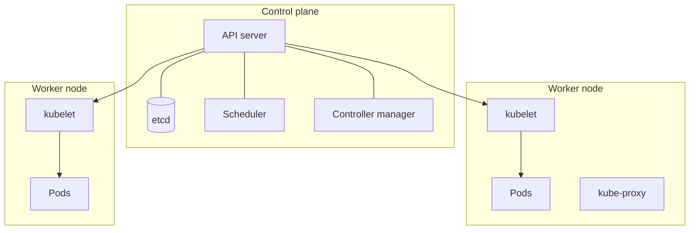
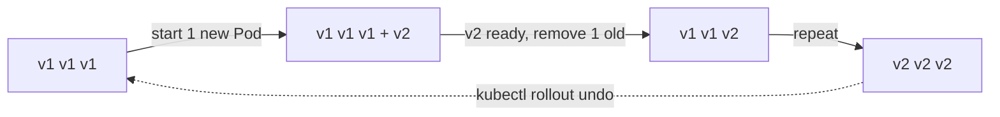
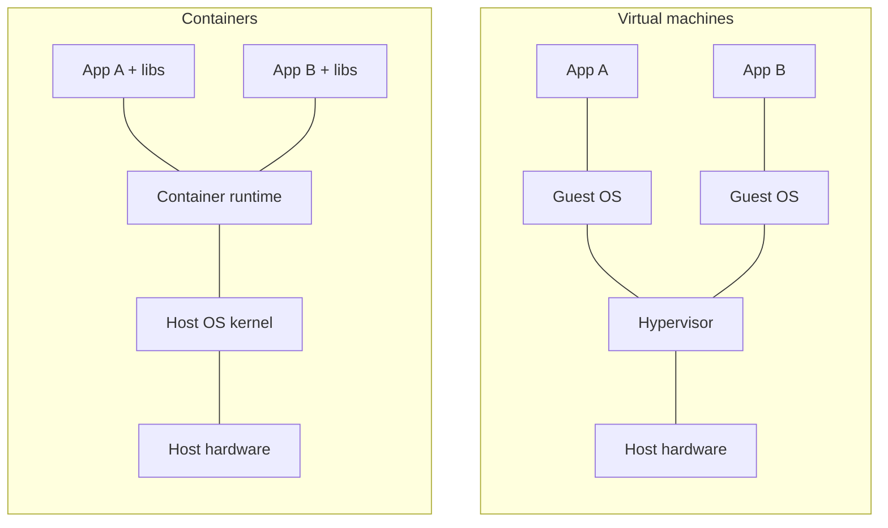
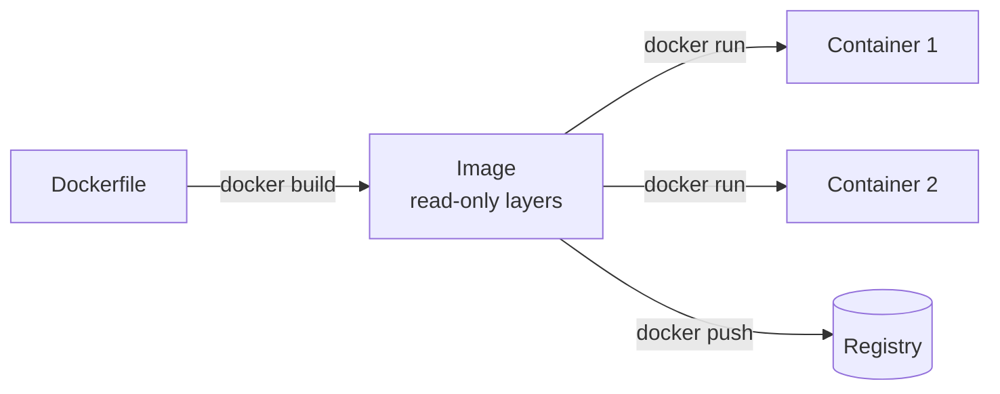
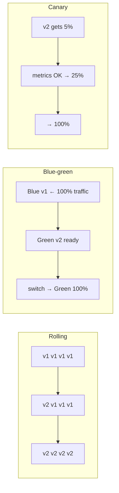
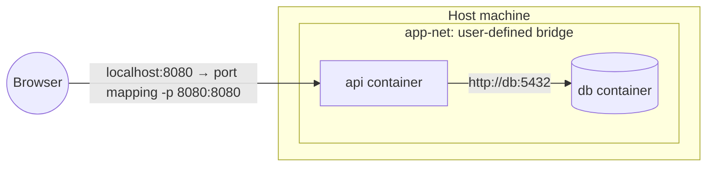

# ☸️ Docker & Kubernetes Interview Preparation

## Docker — Beyond the Basics

### ❓ What does a good Dockerfile for a Spring Boot app look like?

### 📝 Answer

Use a **multi-stage build**: compile in a big image with build tools, then copy only the JAR into a small runtime image.

```dockerfile
# Stage 1: build
FROM maven:3.9-eclipse-temurin-21 AS build
WORKDIR /app
COPY pom.xml .
RUN mvn -q dependency:go-offline          # cached unless pom.xml changes
COPY src ./src
RUN mvn -q package -DskipTests

# Stage 2: run
FROM eclipse-temurin:21-jre
WORKDIR /app
COPY --from=build /app/target/*.jar app.jar
USER 1000                                  # don't run as root
EXPOSE 8080
ENTRYPOINT ["java", "-jar", "app.jar"]
```

Result: a ~200 MB image instead of ~800 MB, with no Maven or source code inside.

---

### ❓ CMD vs ENTRYPOINT?

### 📝 Answer

- `ENTRYPOINT` — the program that always runs.
- `CMD` — default arguments (or a default command), **easy to override** at `docker run`.

```dockerfile
ENTRYPOINT ["java", "-jar", "app.jar"]
CMD ["--spring.profiles.active=prod"]
```

`docker run myapp --spring.profiles.active=dev` replaces only the CMD part.

Use the JSON (exec) form `["java", ...]` so the app receives stop signals properly.

---

### ❓ What are Docker volumes?

### 📝 Answer

A container's own file system is **deleted with the container**. A volume stores data **outside** the container so it survives restarts and upgrades.

```bash
docker run -d -v pgdata:/var/lib/postgresql/data postgres:16
```

- **Named volume** (`pgdata`) — managed by Docker; best for databases.
- **Bind mount** (`./src:/app/src`) — a host folder; handy for live code reload in development.

---

### ❓ What is Docker Compose?

### 📝 Answer

A YAML file that starts **several containers together** with one command — typical for local development.

```yaml
services:
  app:
    build: .
    ports: ["8080:8080"]
    environment:
      SPRING_DATASOURCE_URL: jdbc:postgresql://db:5432/shop
    depends_on: [db]
  db:
    image: postgres:16
    environment:
      POSTGRES_PASSWORD: secret
    volumes: [pgdata:/var/lib/postgresql/data]
volumes:
  pgdata:
```

`docker compose up -d` starts both; containers reach each other by service name (`db`).

---

### ❓ How do you make a Docker image smaller and safer?

### 📝 Answer

- Multi-stage builds; copy only what's needed.
- Small base images (`-jre`, `-alpine`, distroless).
- A `.dockerignore` (exclude `node_modules`, `.git`, `target`).
- Combine `RUN` steps and clean package caches in the same step.
- Run as a **non-root user**; never bake secrets into the image.
- Scan images (Trivy, Docker Scout).

---

## Kubernetes Basics

### ❓ What is Kubernetes and why do we need it?

### 📝 Answer

Kubernetes (K8s) **runs and manages containers across many machines**. You describe what you want ("3 copies of my app, version 2.1"), and Kubernetes keeps it that way.

It handles what Docker alone doesn't:

- **Self-healing** — restarts crashed containers, replaces dead machines.
- **Scaling** — more copies when traffic grows.
- **Rolling updates and rollbacks** — new versions with no downtime.
- **Service discovery and load balancing** — a stable address for a changing set of containers.
- **Config and secrets** management.

---

### ❓ What is the Kubernetes architecture?

### 📝 Answer



| Part | Job |
|---|---|
| **API server** | Front door — every `kubectl` command and component talks to it |
| **etcd** | Key-value store holding the whole cluster state |
| **Scheduler** | Picks a node for each new Pod |
| **Controller manager** | Loops that make actual state match desired state |
| **kubelet** (each node) | Starts and watches the Pods on that node |
| **kube-proxy** (each node) | Network rules so Services reach Pods |

---

### ❓ What is a Pod?

### 📝 Answer

The **smallest unit** Kubernetes runs: one or more containers that share an IP address and storage, scheduled together on one node. Usually **one app container per Pod**, sometimes plus a helper ("sidecar") such as a log shipper or service-mesh proxy.

Pods are **temporary** — they get replaced with new IPs, so you never talk to a Pod directly; you use a Service.

---

### ❓ Deployment vs ReplicaSet vs StatefulSet vs DaemonSet?

### 📝 Answer

| Object | What it does | Example |
|---|---|---|
| **Deployment** | Runs N identical Pods, handles rolling updates (creates ReplicaSets) | Stateless APIs, web apps |
| ReplicaSet | Keeps N Pods running (you rarely create it directly) | — |
| **StatefulSet** | Pods with stable names (`db-0`, `db-1`) and their own disks, started in order | Databases, Kafka, Elasticsearch |
| **DaemonSet** | One Pod on **every** node | Log collectors, monitoring agents |
| Job / CronJob | Run to completion / on a schedule | Batch import, nightly report |

```yaml
apiVersion: apps/v1
kind: Deployment
metadata: { name: orders }
spec:
  replicas: 3
  selector: { matchLabels: { app: orders } }
  template:
    metadata: { labels: { app: orders } }
    spec:
      containers:
        - name: orders
          image: myrepo/orders:2.1
          ports: [{ containerPort: 8080 }]
          resources:
            requests: { cpu: "250m", memory: "512Mi" }
            limits:   { memory: "512Mi" }
```

---

### ❓ What is a Service, and what are its types?

### 📝 Answer

A Service gives a **stable name and IP** for a changing group of Pods (selected by labels) and load-balances between them. Other apps call `http://orders:8080` and never care which Pod answers.

| Type | Reachable from | Use |
|---|---|---|
| **ClusterIP** (default) | Inside the cluster only | Service-to-service calls |
| **NodePort** | `<any-node-IP>:30000–32767` | Simple testing |
| **LoadBalancer** | A cloud load balancer with a public IP | Exposing one service on AWS/GCP/Azure |
| ExternalName | DNS alias to an outside host | Pointing to an external database |

---

### ❓ What is an Ingress?

### 📝 Answer

An Ingress routes outside **HTTP(S) traffic to Services by host and path**, through one entry point — instead of one cloud load balancer per service.

```yaml
rules:
  - host: shop.example.com
    http:
      paths:
        - path: /api/orders
          pathType: Prefix
          backend: { service: { name: orders, port: { number: 8080 } } }
        - path: /
          pathType: Prefix
          backend: { service: { name: web, port: { number: 80 } } }
```

It needs an **Ingress controller** (NGINX, Traefik, AWS ALB controller) to work. TLS certificates are configured here too. The newer **Gateway API** is the successor to Ingress.

---

### ❓ ConfigMap vs Secret?

### 📝 Answer

Both pass configuration into Pods (as environment variables or files) so the **same image** runs in dev, test and prod.

- **ConfigMap** — normal settings (URLs, feature flags).
- **Secret** — passwords, tokens, keys.

> ⚠️ **Trap:** Secrets are only **base64-encoded**, not encrypted, by default. Enable encryption at rest, restrict access with RBAC, or use an external vault (AWS Secrets Manager, HashiCorp Vault).

---

### ❓ Liveness vs readiness vs startup probes?

### 📝 Answer

| Probe | Question | If it fails |
|---|---|---|
| **Liveness** | Is the app alive or stuck? | Container is **restarted** |
| **Readiness** | Can it take traffic right now? | Pod is **removed from the Service** (not restarted) |
| **Startup** | Has it finished starting? | Other probes wait; restart if it never starts |

```yaml
readinessProbe:
  httpGet: { path: /actuator/health/readiness, port: 8080 }
livenessProbe:
  httpGet: { path: /actuator/health/liveness, port: 8080 }
  initialDelaySeconds: 30
```

> ⚠️ **Trap:** don't check the database in the liveness probe — a DB outage would restart every Pod in a loop.

---

### ❓ What are resource requests and limits?

### 📝 Answer

- **Request** — what the container is **guaranteed**; the scheduler uses it to pick a node.
- **Limit** — the **maximum** it may use.

If a container goes over its **memory limit** it is killed (`OOMKilled`). Going over the **CPU limit** only slows it down (throttling).

`cpu: 500m` = half a CPU core. `memory: 512Mi` = 512 mebibytes.

---

### ❓ How does a rolling update work, and how do you roll back?

### 📝 Answer

A Deployment replaces Pods **a few at a time**: start a new-version Pod → wait until it's ready → remove an old one → repeat. Users see no downtime.



```bash
kubectl set image deployment/orders orders=myrepo/orders:2.2
kubectl rollout status deployment/orders
kubectl rollout undo deployment/orders      # roll back to the previous version
```

`maxSurge` (extra Pods allowed) and `maxUnavailable` control the speed.

#### ↳ Follow-up: Blue-green vs canary deployment?

↪ Blue-green: run the full new version next to the old one, then switch all traffic at once. Canary: send a small share (e.g. 5%) to the new version first and increase it if metrics look good.

---

### ❓ How does autoscaling work in Kubernetes?

### 📝 Answer

- **HPA (Horizontal Pod Autoscaler)** — adds/removes **Pods** based on CPU, memory or custom metrics (e.g. "keep CPU around 70%").
- **VPA** — changes a Pod's CPU/memory requests.
- **Cluster Autoscaler / Karpenter** — adds/removes **nodes** when Pods can't fit.

```bash
kubectl autoscale deployment orders --cpu-percent=70 --min=2 --max=10
```

---

### ❓ What is a Namespace?

### 📝 Answer

A **folder inside the cluster** that groups resources — e.g. `dev`, `staging`, `team-payments`. Names only need to be unique within a namespace, and you can set quotas and access rules per namespace.

---

### ❓ What is Helm?

### 📝 Answer

A **package manager for Kubernetes**. A Helm chart is a set of YAML templates with values, so you install a whole app (Deployment, Service, Ingress, ConfigMap) with one command and different settings per environment.

```bash
helm install orders ./orders-chart -f values-prod.yaml
helm upgrade orders ./orders-chart --set image.tag=2.2
helm rollback orders 1
```

---

## Troubleshooting

### ❓ Which kubectl commands do you use every day?

**Level:** 🟡 Intermediate

### 📝 Answer

```bash
kubectl get pods -n shop                  # list Pods and their status
kubectl describe pod orders-7d9f -n shop  # events: why it won't start
kubectl logs orders-7d9f -f               # follow logs (--previous for the crashed one)
kubectl exec -it orders-7d9f -- sh        # shell inside the container
kubectl apply -f deployment.yaml          # create/update from a file
kubectl get events --sort-by=.lastTimestamp
kubectl top pods                          # CPU and memory use
```

---

### ❓ What do CrashLoopBackOff, ImagePullBackOff, Pending and OOMKilled mean?

**Level:** 🟡 Intermediate

### 📝 Answer

| Status | Meaning | First thing to check |
|---|---|---|
| **CrashLoopBackOff** | Container starts, crashes, restarts again and again | `kubectl logs --previous` — app error, bad config, failing liveness probe |
| **ImagePullBackOff** | Can't download the image | Image name/tag typo, private registry credentials |
| **Pending** | No node can run the Pod | `describe` events — not enough CPU/memory, node selector, unbound volume |
| **OOMKilled** | Used more memory than its limit | Raise the limit or fix the leak; set JVM heap below the limit |

---

## Tricky Questions

### ❓ Tricky: Docker vs Kubernetes — do you need both?

**Level:** 🟡 Intermediate

### 📝 Answer

Docker **builds and runs** containers on one machine. Kubernetes **orchestrates** containers across many machines. Kubernetes no longer uses Docker Engine itself (it uses containerd), but images built with Docker run on it unchanged.

---

### ❓ Tricky: Why does my Java app get OOMKilled although the heap is smaller than the limit?

**Level:** 🟡 Intermediate

### 📝 Answer

The JVM uses memory **outside the heap** too: metaspace, thread stacks, direct buffers, code cache. Leave room: e.g. with a 1 GiB limit, use `-XX:MaxRAMPercentage=75` instead of a fixed large `-Xmx`.

---

### ❓ Tricky: A Pod is running but users get 503 errors. Why?

**Level:** 🟡 Intermediate

### 📝 Answer

Likely the Pod is **not ready** (readiness probe failing) so the Service has no endpoints, or the Service's **label selector doesn't match** the Pod labels. Check `kubectl get endpoints <service>` — an empty list confirms it.


---

## Container Fundamentals (Beginner)

### ❓ Container vs virtual machine — what's the difference?

### 📝 Answer



| | Container | Virtual machine |
|---|---|---|
| What's inside | app + its libraries | app + a **full operating system** |
| Shares | the host's **kernel** | only the hardware (via a hypervisor) |
| Size | MBs | GBs |
| Start time | seconds or less | minutes |
| Isolation | process-level (namespaces, cgroups) | stronger (separate kernel) |
| Density | many per host | fewer per host |
| Example | Docker, containerd | VMware, VirtualBox, EC2 |

Containers use Linux **namespaces** (what a process can see) and **cgroups** (how much CPU/memory it can use).

In the cloud you usually run **containers inside VMs** — VMs for strong isolation between customers, containers for packaging apps.

#### ↳ Follow-up: Can a Linux container run on Windows?

↪ Not directly — it needs a Linux kernel. Docker Desktop runs a small Linux VM (WSL 2) underneath.

---

### ❓ What is the difference between a Docker image and a container?

### 📝 Answer

- **Image** — a **read-only template**: your app, its libraries and settings, built in **layers** from a Dockerfile. Like a class, or a recipe.
- **Container** — a **running instance** of an image, with a thin **writable layer** on top. Like an object, or the cake made from the recipe.

```bash
docker build -t shop-api:1.4 .          # Dockerfile → image
docker run -d --name api1 shop-api:1.4  # image → container
docker run -d --name api2 shop-api:1.4  # second container, same image
docker ps                               # running containers
docker images                           # images on this machine
```



Changes inside a container are **lost when it's removed** — use volumes for data that must persist.

#### ↳ Follow-up: Why are images built in layers?

↪ Each Dockerfile step is a cached layer. Unchanged layers are reused, so rebuilds and downloads are fast.

---

## Release Strategies (Intermediate)

### ❓ Blue-green vs canary vs rolling deployments — how do they differ?

### 📝 Answer



| Strategy | How | Rollback | Extra cost | Best for |
|---|---|---|---|---|
| **Rolling** | replace instances a few at a time | roll forward/back gradually | none | most stateless services (Kubernetes default) |
| **Blue-green** | run a full new copy (green), switch all traffic at once | **instant** — switch back | double the infrastructure during release | big releases, easy rollback |
| **Canary** | send a small % of users to the new version, watch metrics, increase | shift traffic back | needs traffic splitting + good monitoring | risky changes at scale |
| **Recreate** | stop all old, start new | redeploy | downtime | dev environments |
| **Feature flags** | deploy code switched off; turn on per user | flip the flag | flag management | separating deploy from release |

#### ↳ Follow-up: What makes blue-green hard with databases?

↪ Both versions share the database, so schema changes must be **backward-compatible** (expand → migrate → contract).

#### ↳ Follow-up: How does a canary decide to continue?

↪ Compare the canary's error rate and latency with the old version; tools like Argo Rollouts or Flagger promote or roll back automatically.

---


## Docker Networking (Intermediate)

### ❓ How does Docker networking work — bridge, host and custom networks?

### 📝 Answer



| Network | What it does | Use for |
|---|---|---|
| **bridge** (default) | private network on the host; containers get internal IPs; reach them from outside with `-p host:container` | single containers |
| **user-defined bridge** | like bridge, plus **DNS by container name** | multi-container apps (Compose does this for you) |
| **host** | container shares the host's network directly, no isolation | max network performance, Linux only |
| **none** | no network | locked-down batch jobs |
| **overlay** | spans several hosts | Docker Swarm |

```bash
docker network create app-net
docker run -d --name db  --network app-net postgres:16
docker run -d --name api --network app-net -p 8080:8080 shop-api
# inside "api", the database is reachable at  db:5432
```

**Must know:**
- Inside a container, `localhost` means **the container itself**, not your machine → call other containers by **name**.
- `-p 8080:80` = host port 8080 → container port 80. `EXPOSE` in a Dockerfile is only documentation.
- From a container to your laptop: `host.docker.internal` (Docker Desktop).

#### ↳ Follow-up: Why can't my API connect to `localhost:5432`?

↪ The database runs in another container. Put both on one network and use the container name (`db:5432`).

---
