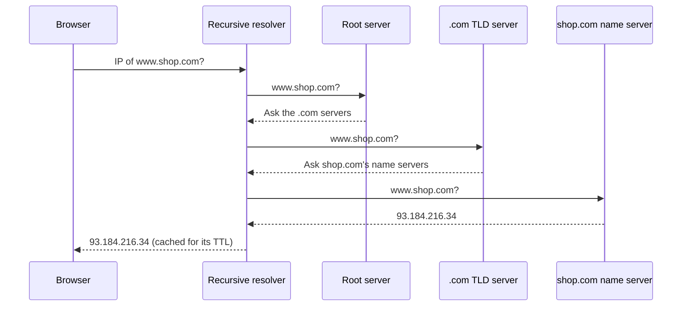
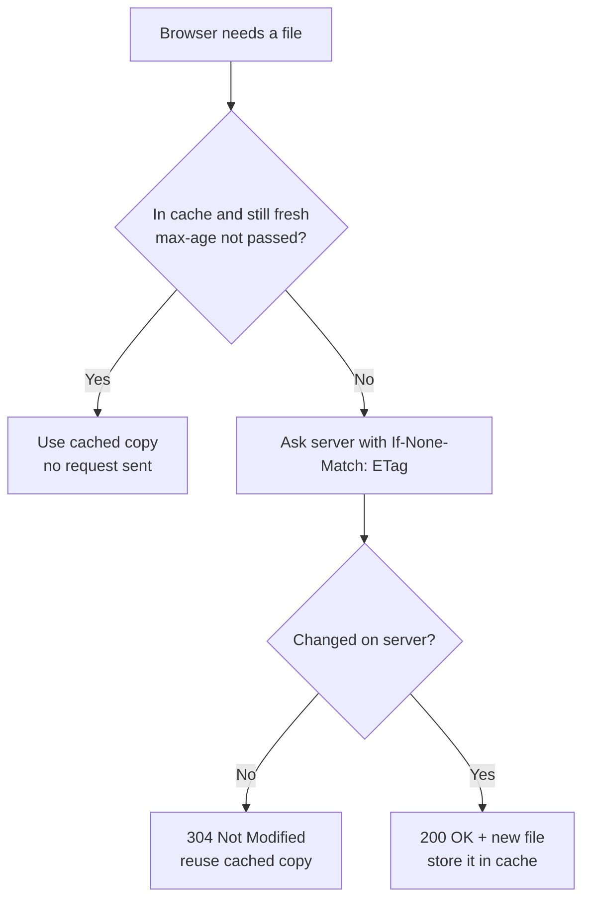
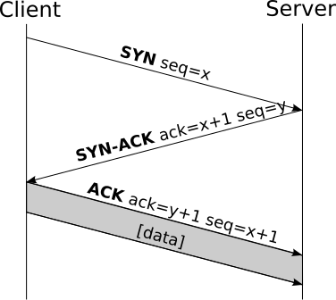
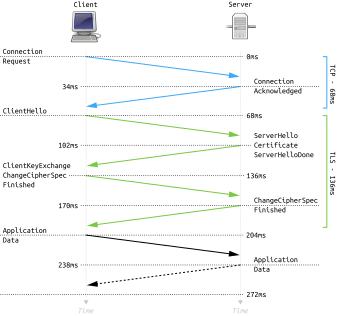
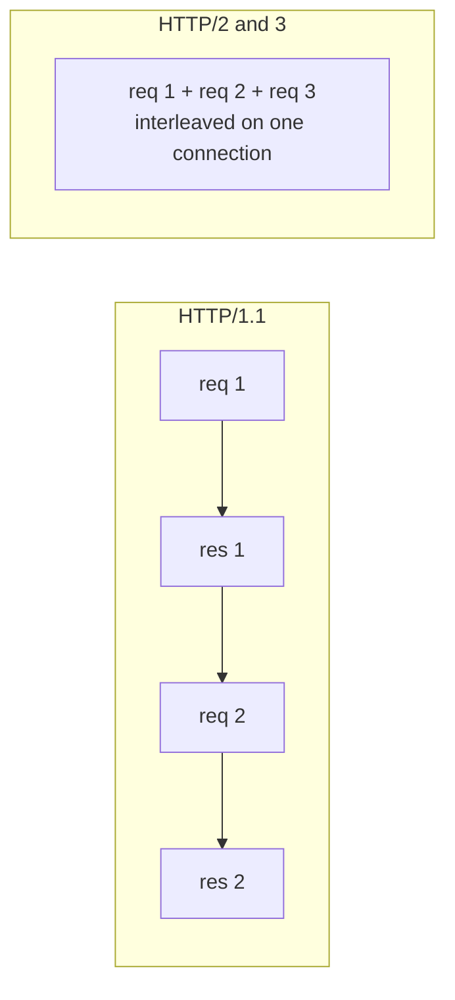
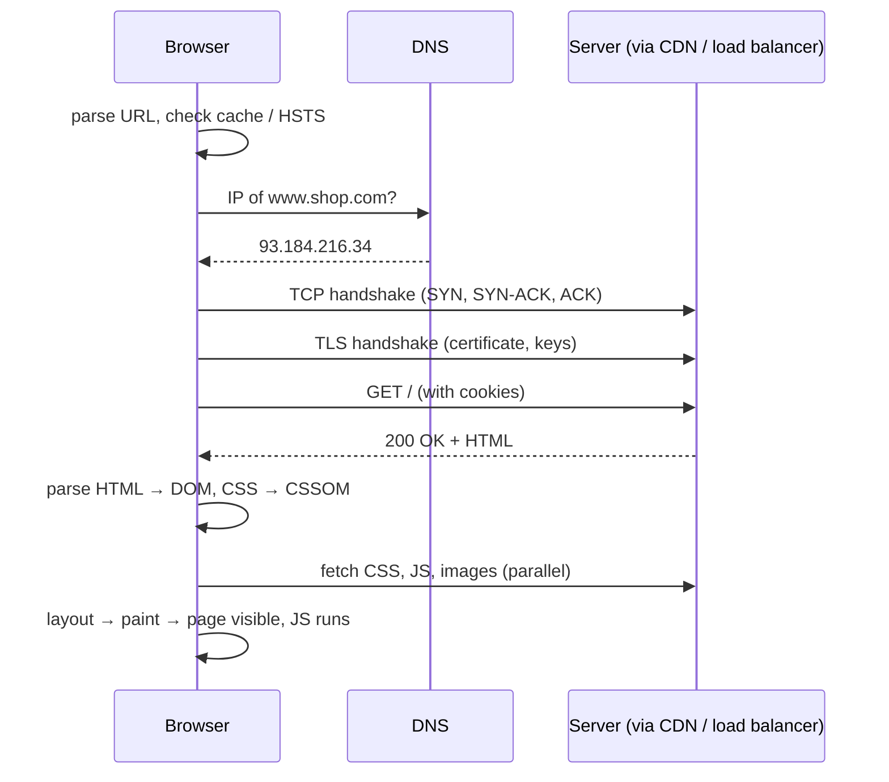

# 🔌 Networking & HTTP Interview Preparation

## How the Web Works

### ❓ How does DNS work?

**Level:** 🟡 Intermediate

### 📝 Answer

DNS is the internet's **phone book**: it turns `www.shop.com` into an IP address.



Lookup order: browser cache → OS cache → your **recursive resolver** (ISP / 8.8.8.8), which asks:

1. A **root** server → "ask the `.com` servers"
2. The **`.com` TLD** server → "ask shop.com's name servers"
3. The **authoritative** server for shop.com → "93.184.216.34"

The answer is cached for its **TTL**.

| Record | Points to |
|---|---|
| `A` / `AAAA` | IPv4 / IPv6 address |
| `CNAME` | Another name (alias) |
| `MX` | Mail servers |
| `TXT` | Text — domain verification, SPF |
| `NS` | The domain's name servers |

#### ↳ Follow-up: Why does a DNS change take time to "propagate"?

↪ Resolvers keep the old answer until its TTL expires. Lower the TTL a day before a planned change.

---

### ❓ What is the TCP three-way handshake?

**Level:** 🟢 Beginner

### 📝 Answer

```text
Client → Server : SYN        ("I want to connect, my sequence starts at x")
Server → Client : SYN-ACK    ("OK, got x; mine starts at y")
Client → Server : ACK        ("Got y") → connection open
```

It costs one round trip before any data — one reason keep-alive connections and HTTP/2 reuse connections.

---

### ❓ What are the OSI and TCP/IP models?

**Level:** 🟢 Beginner

### 📝 Answer

Layers that split networking into jobs, each using the one below.

| OSI layer | Example | TCP/IP layer |
|---|---|---|
| 7 Application | HTTP, DNS, SMTP | Application |
| 6 Presentation | TLS encryption, encoding | Application |
| 5 Session | Session management | Application |
| 4 Transport | TCP, UDP (ports) | Transport |
| 3 Network | IP (addresses, routing) | Internet |
| 2 Data link | Ethernet, Wi-Fi (MAC addresses) | Link |
| 1 Physical | Cables, radio | Link |

Interview use: "an **L4** load balancer routes by IP/port; an **L7** one reads HTTP".

---

## HTTP

### ❓ What are HTTP methods, and which are safe and idempotent?

**Level:** 🟢 Beginner

### 📝 Answer

| Method | Use | Safe (no change) | Idempotent |
|---|---|---|---|
| GET | Read | ✅ | ✅ |
| POST | Create / action | ❌ | ❌ |
| PUT | Replace whole resource | ❌ | ✅ |
| PATCH | Change part of a resource | ❌ | Not guaranteed |
| DELETE | Remove | ❌ | ✅ |
| HEAD | Like GET, headers only | ✅ | ✅ |
| OPTIONS | Which methods are allowed (CORS preflight) | ✅ | ✅ |

**Idempotent** = repeating it gives the same result as doing it once. `DELETE /users/5` twice → user 5 is still gone (the second call may return 404, but the state is the same).

---

### ❓ What do the HTTP status code groups mean?

**Level:** 🟡 Intermediate

### 📝 Answer

| Group | Meaning | Common codes |
|---|---|---|
| 1xx | Informational | 101 Switching Protocols (WebSocket) |
| 2xx | Success | 200 OK, 201 Created, 204 No Content |
| 3xx | Redirect | 301 Moved Permanently, 302 Found, 304 Not Modified |
| 4xx | **Client** made a mistake | 400 Bad Request, 401 Unauthorized, 403 Forbidden, 404 Not Found, 409 Conflict, 429 Too Many Requests |
| 5xx | **Server** failed | 500 Internal Error, 502 Bad Gateway, 503 Service Unavailable, 504 Gateway Timeout |

#### ↳ Follow-up: 401 vs 403?

↪ 401 = "I don't know who you are" (missing/invalid login). 403 = "I know who you are, but you're not allowed".

#### ↳ Follow-up: 502 vs 504?

↪ Both come from a proxy/gateway. 502 = the server behind it sent a bad or no response. 504 = it didn't answer in time.

---

### ❓ What are cookies, and what do HttpOnly, Secure and SameSite do?

**Level:** 🟡 Intermediate

### 📝 Answer

A cookie is a small value the server asks the browser to store and **send back on every request** to that site — used for sessions, preferences.

```http
Set-Cookie: session=abc123; HttpOnly; Secure; SameSite=Lax; Max-Age=3600
```

| Attribute | Protects against |
|---|---|
| `HttpOnly` | JavaScript can't read it → stolen less easily by **XSS** |
| `Secure` | Sent only over HTTPS |
| `SameSite=Lax/Strict` | Not sent on cross-site requests → helps against **CSRF** |
| `Max-Age` / `Expires` | Lifetime |

---

### ❓ What is CORS and why does the browser block my API call?

**Level:** 🟡 Intermediate

### 📝 Answer

The browser's **same-origin policy** blocks a page from reading responses from another **origin** (scheme + host + port). `http://localhost:4200` calling `http://localhost:8080` is cross-origin.

**CORS** lets the server say which origins are allowed:

```http
Access-Control-Allow-Origin: https://shop.com
Access-Control-Allow-Methods: GET, POST
Access-Control-Allow-Headers: Content-Type, Authorization
```

For non-simple requests (PUT, JSON body, custom headers) the browser first sends an **OPTIONS preflight** to check.

> ⚠️ **Trap:** CORS is enforced by **browsers only**. Postman and curl ignore it, and it is not a security feature for your API — it protects users' browsers.

---

### ❓ What are HTTP caching headers?

**Level:** 🟡 Intermediate

### 📝 Answer

| Header | Meaning |
|---|---|
| `Cache-Control: max-age=3600` | Reuse for 1 hour without asking |
| `Cache-Control: no-cache` | May store, but **check with the server** before using |
| `Cache-Control: no-store` | Never store (sensitive data) |
| `ETag: "v5"` + `If-None-Match: "v5"` | Server answers **304 Not Modified** if unchanged — no body sent |
| `Last-Modified` + `If-Modified-Since` | Same idea using dates |

Typical setup: fingerprinted static files (`app.3f9a.js`) → `max-age=31536000, immutable`; HTML → `no-cache`.



---

## Real-time & APIs

### ❓ Polling vs long polling vs WebSockets vs Server-Sent Events?

**Level:** 🟡 Intermediate

### 📝 Answer

| Technique | How | Use |
|---|---|---|
| **Polling** | Client asks every N seconds | Simple, wasteful |
| **Long polling** | Server holds the request until there's news | Old-style real-time |
| **Server-Sent Events (SSE)** | One long HTTP response; server pushes events; **one-way** | Notifications, live scores, AI chat streaming |
| **WebSocket** | Upgraded connection, **two-way**, low overhead | Chat, multiplayer games, collaborative editing |

This tutor streams answers with SSE: the server only needs to push, so SSE is simpler than WebSockets.

---

### ❓ REST vs GraphQL vs gRPC?

**Level:** 🟡 Intermediate

### 📝 Answer

| | REST | GraphQL | gRPC |
|---|---|---|---|
| Shape | Resources + HTTP methods (`GET /users/1`) | One endpoint; client asks for exact fields | Remote functions defined in `.proto` |
| Format | JSON | JSON | Protobuf (binary, small) |
| Strength | Simple, cacheable, everywhere | No over/under-fetching; one call for nested data | Very fast; streaming; strict contracts |
| Best for | Public APIs, CRUD | Rich frontends, mobile apps | Service-to-service calls |

---

### ❓ What is a forward proxy vs a reverse proxy?

**Level:** 🟡 Intermediate

### 📝 Answer

- **Forward proxy** — sits in front of **clients**; the website sees the proxy, not you (corporate proxy, VPN).
- **Reverse proxy** — sits in front of **servers**; clients see one address (NGINX, API gateway, load balancer). It does TLS termination, load balancing, caching, compression and hides internal servers.

---

## Tricky Questions

### ❓ Tricky: Is data in a GET query string secure over HTTPS?

**Level:** 🟡 Intermediate

### 📝 Answer

It's encrypted on the wire, but URLs end up in **browser history, server logs and proxy logs**, and can leak through the `Referer` header. Never put passwords or tokens in a URL — use the body or headers.

---

### ❓ Tricky: What is the difference between a URL and a URI?

**Level:** 🟡 Intermediate

### 📝 Answer

A **URI** identifies a resource; a **URL** is a URI that also tells you **where and how to get it** (`https://shop.com/cart`). Every URL is a URI; `urn:isbn:9780134685991` is a URI but not a URL.

---

### ❓ Tricky: What is latency made of on a slow page load?

**Level:** 🟡 Intermediate

### 📝 Answer

DNS lookup + TCP handshake + TLS handshake + server processing (time to first byte) + download time + browser rendering. Each new domain on the page repeats the first three — that's why fewer domains, `preconnect`, CDNs and HTTP/2 help.


---

## Core Protocols (Intermediate)

### ❓ TCP vs UDP — what's the difference, and when do you use each?

### 📝 Answer



_Image: [Wikimedia Commons](https://commons.wikimedia.org/wiki/File:Tcp-handshake.svg) · CC BY-SA 3.0_

| | TCP | UDP |
|---|---|---|
| Connection | yes (handshake first) | no — just send |
| Delivery | guaranteed, re-sends lost packets | best effort, may lose packets |
| Order | kept | not kept |
| Flow & congestion control | ✅ | ❌ |
| Header size | 20+ bytes | 8 bytes |
| Speed / latency | slower | faster |
| Used by | HTTP/1.1, HTTP/2, databases, email, SSH | DNS, video calls, online games, live streaming, **QUIC (HTTP/3)** |

**Simple picture:** TCP is a phone call (connected, every word heard, in order). UDP is shouting messages across a room (fast, some may be missed).

#### ↳ Follow-up: Why do video calls use UDP?

↪ A late video frame is useless — better to skip it than to wait for a resend.

#### ↳ Follow-up: If UDP is unreliable, how is HTTP/3 reliable?

↪ QUIC builds reliability, ordering and encryption on top of UDP itself.

---

### ❓ How does HTTPS work? Explain the TLS handshake.

### 📝 Answer

HTTPS = HTTP inside **TLS**. TLS gives three things: **encryption** (nobody can read it), **integrity** (nobody can change it), **authentication** (you're really talking to `bank.com`).



_Image: [Wikimedia Commons](https://commons.wikimedia.org/wiki/File:Full_TLS_1.2_Handshake.svg) · Fleshgrinder · Public domain (shows TLS 1.2; TLS 1.3 needs one round trip less)_

**TLS 1.3 in simple steps:**
1. **Client Hello** — supported ciphers + the client's key share.
2. **Server Hello** — chosen cipher + the server's key share + its **certificate** (signed by a trusted Certificate Authority) + proof it owns the private key.
3. The browser **checks the certificate**: right domain, not expired, signed by a CA it trusts.
4. Both sides compute the same **session key** from the key shares (Diffie-Hellman) — it never travels over the network.
5. Everything after is encrypted with that fast **symmetric** key (AES / ChaCha20).

TLS 1.3 needs **one round trip** (TLS 1.2 needed two), and **0-RTT** on resumed connections.

#### ↳ Follow-up: Why use both asymmetric and symmetric encryption?

↪ Asymmetric (public/private keys) safely agrees on a key but is slow; symmetric is fast for the actual data.

#### ↳ Follow-up: What is mTLS?

↪ Mutual TLS — the client also shows a certificate. Used between microservices.

---

### ❓ HTTP/1.1 vs HTTP/2 vs HTTP/3 — what changed?

### 📝 Answer

| | HTTP/1.1 (1997) | HTTP/2 (2015) | HTTP/3 (2022) |
|---|---|---|---|
| Transport | TCP | TCP | **QUIC over UDP** |
| Requests per connection | one at a time (browsers open ~6 connections) | **many at once (multiplexing)** | many at once |
| Format | text | binary frames | binary frames |
| Header compression | ❌ | HPACK | QPACK |
| Head-of-line blocking | at HTTP level | at **TCP** level (one lost packet stalls all streams) | ❌ (streams are independent) |
| Connection setup | TCP + TLS (2–3 round trips) | same | **1 round trip** (0 on resume) |
| Switching networks (Wi-Fi → 4G) | reconnect | reconnect | connection survives |



**Practical impact:** with HTTP/2+, old tricks like domain sharding and huge bundles are no longer needed.

#### ↳ Follow-up: What is head-of-line blocking?

↪ One slow or lost item holds up everything queued behind it.

---

### ❓ What happens when you type a URL in the browser and press Enter?

### 📝 Answer



1. **URL parsing** — scheme, host, path. HSTS may force `https`.
2. **DNS lookup** — browser cache → OS → resolver → root → `.com` → authoritative server.
3. **TCP connection** — three-way handshake (or QUIC for HTTP/3).
4. **TLS handshake** — verify the certificate, agree on keys.
5. **HTTP request** — method, path, headers, cookies.
6. **Server side** — CDN / load balancer → web server → app → cache / DB → response.
7. **Rendering** — HTML → DOM, CSS → CSSOM → render tree → layout → paint → composite; scripts run; more requests for assets.

#### ↳ Follow-up: Which steps can you speed up?

↪ DNS (`dns-prefetch`), connections (`preconnect`, keep-alive, HTTP/2–3), server time (caching, CDN), and rendering (less render-blocking CSS/JS, smaller images).

---
