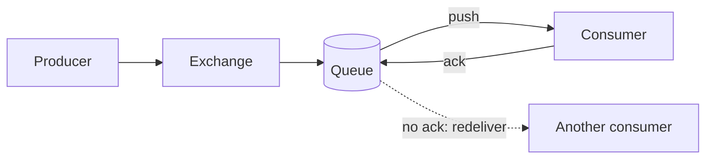
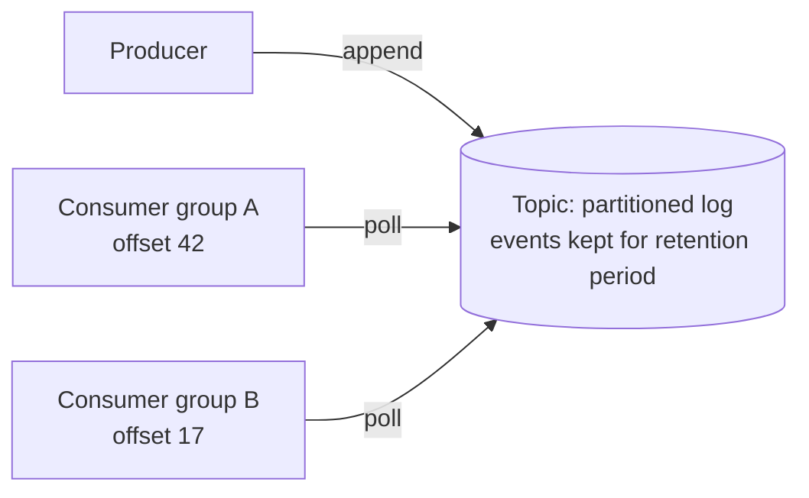
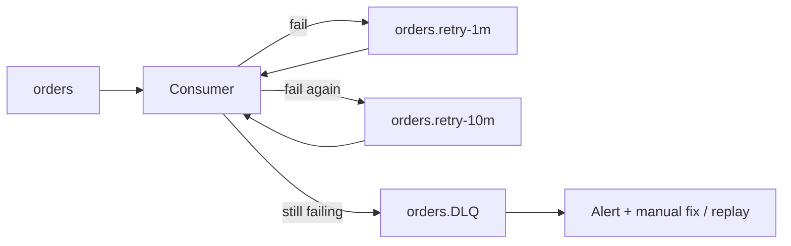
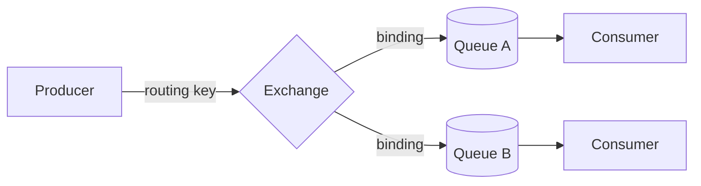

# Messaging: RabbitMQ vs Kafka

## How They Work

### ❓ How does RabbitMQ deliver messages?

**Level:** 🟡 Intermediate

### 📝 Answer

RabbitMQ is a **message broker** that typically **pushes** messages to consumers:

1. A producer sends a message (to an exchange, which routes it to a queue).
2. The queue stores the message.
3. RabbitMQ delivers it to a consumer.
4. The consumer **acknowledges** it → RabbitMQ removes it from the queue.

If the consumer crashes before acknowledging, RabbitMQ **redelivers** the message to another consumer. A message is not deleted just because it was sent — it stays until it is acknowledged (or expires, or is dead-lettered by a configured rule). Queues and messages can be persisted to disk.



---

### ❓ How does Kafka deliver events?

**Level:** 🟡 Intermediate

### 📝 Answer

Kafka is a **distributed event log**; consumers **pull** events:

1. A producer publishes an event to a **topic** (split into partitions).
2. Kafka appends it to the partition's log and stores it.
3. Consumers **poll** Kafka and read events at their own pace.
4. Each consumer group tracks its position with an **offset**.
5. Events stay in Kafka for the configured **retention** period or size — even after they've been read.



Because events aren't removed on read, consumers can **replay** them by moving their offset back.

---

### ❓ What is the difference between RabbitMQ and Kafka?

**Level:** 🟡 Intermediate

### 📝 Answer

| Concept | RabbitMQ | Kafka |
|---|---|---|
| Model | Message broker / queues | Distributed event log |
| Delivery | Typically push | Consumers pull (poll) |
| Stores messages? | Yes, until acknowledged | Yes, for the retention period |
| Removed after consumption? | Normally after acknowledgement | No — governed by retention |
| Several independent consumers of the same message | Yes, by routing copies to separate queues | Yes, with separate consumer groups |
| Replay old messages | Possible in some setups, not the usual model | Core capability |
| Strengths | Flexible routing, per-message acks, task queues | Very high throughput, durable streams, replay |

---

### ❓ What are common misconceptions about RabbitMQ and Kafka?

**Level:** 🟡 Intermediate

### 📝 Answer

| Statement | Correction |
|---|---|
| "RabbitMQ sends the work and forgets it." | It keeps the message until the consumer **acknowledges** it, and redelivers it if the consumer fails. |
| "Kafka passes the producer's event straight to consumers." | The producer publishes to **Kafka**, not to consumers. Consumers independently poll Kafka and read at their own pace. |
| "RabbitMQ doesn't store messages; only Kafka does." | Both store data. RabbitMQ stores messages in queues until acknowledged (and can persist them to disk); Kafka stores events in a log for a retention period, even after they've been read. |

## When to Use Which

### ❓ When should you use RabbitMQ (use cases)?

**Level:** 🟡 Intermediate

### 📝 Answer

Use RabbitMQ for **task-based communication** — one service hands work to another to be processed once.

- **Email and SMS notifications:** the Order Service queues a notification task; the Notification Service processes it; failures are retried or redelivered.
- **Background jobs:** a user uploads a document; a document-processing job is queued; a worker generates the PDF or thumbnail.
- **Payment processing:** payment requests are queued and processed asynchronously; acknowledgements and retries handle temporary failures.
- **Routing work to different workers** by type or priority using exchanges and routing keys.

---

### ❓ When should you use Kafka (use cases)?

**Level:** 🟡 Intermediate

### 📝 Answer

Use Kafka for **event streaming** — business events that must be stored and consumed by several independent systems, often at high volume.

- **E-commerce order events:** an `OrderCreated` event is published once; Inventory updates stock, Notification sends a confirmation, Analytics records the sale — each independently.
- **Real-time transaction monitoring:** banking transactions are published as events; fraud detection and spending analytics consume the same stream; events can be replayed within the retention window.
- **IoT and application logs:** thousands of devices or services publish events; monitoring and analytics process the same high-volume stream.

---

### ❓ How do you choose between RabbitMQ and Kafka for a requirement?

**Level:** 🟡 Intermediate

### 📝 Answer

| Requirement | Choose |
|---|---|
| Send an email task to a worker | RabbitMQ |
| Queue background jobs | RabbitMQ |
| Route tasks to different workers | RabbitMQ |
| Share order events with multiple services | Kafka |
| Process millions of events continuously | Kafka |
| Replay historical events | Kafka |
| Stream logs or IoT data | Kafka |

**Short rule:** RabbitMQ when a **task** should be done once by a worker; Kafka when an **event** should be kept and read by many.

---

## Kafka Basics

### ❓ What are a Kafka topic and a partition?

### 📝 Answer

A **topic** is a named stream of events, like a table name for messages (`orders`). It is split into **partitions** so many machines and consumers can work on it at once.

- Each partition is an **ordered, append-only log**; new events go at the end.
- More partitions → more consumers can read in parallel.

```text
topic "orders"
  partition 0: e1 e4 e7 →
  partition 1: e2 e5 e8 →
  partition 2: e3 e6 e9 →
```

#### ↳ Follow-up: Is order guaranteed across the whole topic?

↪ No — only **within one partition**.

---

### ❓ What is a consumer group?

### 📝 Answer

A set of consumers that **share the work** of reading a topic. Kafka gives each partition to exactly **one** consumer in the group.

- 3 partitions, 3 consumers → each reads one partition.
- 3 partitions, 5 consumers → 2 consumers sit idle.
- **Different groups** each get **all** the events (e.g. a billing group and an email group both read `orders`).

#### ↳ Follow-up: What happens when a consumer in the group crashes?

↪ Kafka **rebalances**: its partitions are handed to the remaining consumers.

---

### ❓ What is an offset, and what does committing it mean?

### 📝 Answer

An **offset** is an event's position number in a partition (0, 1, 2…). **Committing** saves "my group has processed up to here".

- After a restart, the consumer continues from the last committed offset.
- Commit **after** processing → an event may be processed twice if you crash in between (**at-least-once**), so make processing safe to repeat.

---

### ❓ What does the message key do in Kafka?

### 📝 Answer

The **key** decides which partition an event goes to: the same key always lands in the same partition.

- Use the **order ID** or **customer ID** as the key → all events for that order stay **in order**.
- No key → events are spread across partitions, so their order isn't kept.

Example: `OrderCreated`, `OrderPaid`, `OrderShipped` with key `order-42` are always read in that order.

---

### ❓ How does Kafka avoid losing data when a server fails?

### 📝 Answer

Each partition is **copied (replicated)** to several brokers (servers).

- One copy is the **leader** (handles reads and writes); the others are **followers** that keep up.
- If the leader's broker dies, a follower becomes the new leader.
- With `acks=all`, the producer is told "saved" only after the in-sync copies have it.

#### ↳ Follow-up: What is a typical replication factor?

↪ 3 — the data survives one broker failure, and usually two.


---

## Reliability & Delivery (Intermediate)

### ❓ What delivery guarantees does Kafka give, and how do you avoid losing or duplicating messages?

### 📝 Answer


_Image: [Wikimedia Commons](https://commons.wikimedia.org/wiki/File:Overview_of_Apache_Kafka.svg) · Ch.ko123 · CC BY 4.0_

| Guarantee | Can lose? | Can duplicate? | How |
|---|---|---|---|
| **At most once** | ✅ | ❌ | commit the offset **before** processing |
| **At least once** (most common) | ❌ | ✅ | process **then** commit |
| **Exactly once** | ❌ | ❌ | idempotent producer + transactions (Kafka → Kafka) |

**Not losing messages (producer side):**
```properties
acks=all                      # wait until all in-sync replicas have it
enable.idempotence=true       # retries can't create duplicates in the log
retries=2147483647
```
and on the topic: `replication.factor=3`, `min.insync.replicas=2`.

**Not losing messages (consumer side):** turn off auto-commit, commit **after** processing.

**Duplicates still happen** (a consumer crashes after processing but before committing) → make consumers **idempotent**: store processed event ids, or use upserts.

#### ↳ Follow-up: Does exactly-once cover writing to my database?

↪ No — Kafka's transactions cover Kafka-to-Kafka. For an external DB, use idempotent writes or store the offset in the same DB transaction.

---

### ❓ What is a dead letter queue, and how do you handle failed messages?

### 📝 Answer

A **poison message** (bad data, a bug) fails every time. Retrying it forever blocks everything behind it. A **dead letter queue (DLQ)** is where such messages are parked after a few tries.



- **Kafka:** retry topics with delays, then a `.DLT` topic (Spring Kafka `DefaultErrorHandler` + `DeadLetterPublishingRecoverer`).
- **RabbitMQ:** set `x-dead-letter-exchange` on the queue; rejected or expired messages go there. Add a TTL queue for delayed retries.

**Good practice:** retry only **temporary** errors (timeouts, 503) with backoff; send **permanent** errors (invalid data) straight to the DLQ; alert on DLQ size; build a tool to replay fixed messages.

#### ↳ Follow-up: Why not just retry in a loop inside the consumer?

↪ It blocks the partition (Kafka keeps order), so every message behind it waits.

---

### ❓ What is consumer group rebalancing in Kafka?

### 📝 Answer

In a **consumer group**, each partition is read by exactly one consumer. A **rebalance** reassigns partitions when the group changes:

- a consumer **joins** (scale up) or **leaves** (shutdown, crash)
- a consumer misses heartbeats (`session.timeout.ms`) or takes too long between polls (`max.poll.interval.ms`)
- partitions are added to the topic

```text
Before: C1 ← P0, P1    C2 ← P2, P3
C3 joins → rebalance
After:  C1 ← P0, P1    C2 ← P2    C3 ← P3
```

**Problems:** while rebalancing, consumption pauses; uncommitted work may be processed again (duplicates).

**Reduce the pain:**
- **Cooperative sticky** assignor — only moved partitions pause (`partition.assignment.strategy=CooperativeStickyAssignor`).
- **Static membership** (`group.instance.id`) — a quick restart doesn't trigger a rebalance.
- Keep processing per poll short, or lower `max.poll.records`.
- Commit offsets before partitions are revoked.

#### ↳ Follow-up: Why do my consumers keep rebalancing in a loop?

↪ Usually processing a batch takes longer than `max.poll.interval.ms`, so Kafka thinks the consumer died. Process faster or poll fewer records.

---

### ❓ What are RabbitMQ exchange types?

### 📝 Answer

Producers never send straight to a queue — they send to an **exchange**, which routes copies to queues by **bindings**.



| Exchange | Routes to queues whose binding… | Example |
|---|---|---|
| **Direct** | equals the routing key | `payment.failed` → the failed-payments queue |
| **Topic** | matches a pattern (`*` = one word, `#` = zero or more) | `order.*.created`, `order.#` |
| **Fanout** | — sends to **all** bound queues | broadcast "cache cleared" to every service |
| **Headers** | matches message headers | route by `format=pdf` |
| Default (`""`) | equals the queue name | simple "send to this queue" |

#### ↳ Follow-up: Kafka has no exchanges — how does it route?

↪ By **topic** and **key** only. Consumers subscribe to topics; any filtering happens in the consumer or a stream processor.

---

### ❓ What is an idempotent consumer, and how do you build one?

### 📝 Answer

Brokers deliver **at least once**, so the same message can arrive twice (retries, rebalances, network errors). An **idempotent consumer** gives the same result whether it handles a message once or five times.

**Ways to build one:**

1. **Store processed ids** — skip if seen:
```sql
-- in the same transaction as the business change
INSERT INTO processed_events (event_id) VALUES (:id);   -- primary key → duplicate fails
UPDATE accounts SET balance = balance - 500 WHERE id = 7;
```
2. **Naturally idempotent writes** — `UPSERT`, `SET status = 'PAID'` (not `balance = balance - 500`).
3. **Version / sequence checks** — ignore events older than the stored version.

#### ↳ Follow-up: How long do you keep processed ids?

↪ Longer than the longest possible redelivery window (often days), then expire them.

---

### ❓ What ordering guarantees do Kafka and RabbitMQ give?

### 📝 Answer

| | Ordering |
|---|---|
| **Kafka** | guaranteed **within a partition** only. Same **key** → same partition → ordered |
| **RabbitMQ** | FIFO **within a queue**, but several consumers or requeues break it |

```java
kafka.send("orders", order.id(), event);   // all events of one order stay in order
```

**Order can still break when:**
- you use no key (round-robin across partitions)
- the producer retries without idempotence (`max.in.flight.requests` > 1)
- you add partitions (keys move to new partitions)
- RabbitMQ has many consumers on one queue, or a message is requeued

**Need global order?** One partition / one consumer — at the cost of throughput. Usually **per-entity order** (per order, per account) is enough.

#### ↳ Follow-up: An event arrives out of order anyway. What can the consumer do?

↪ Carry a version or sequence number and ignore or buffer older events.

---
