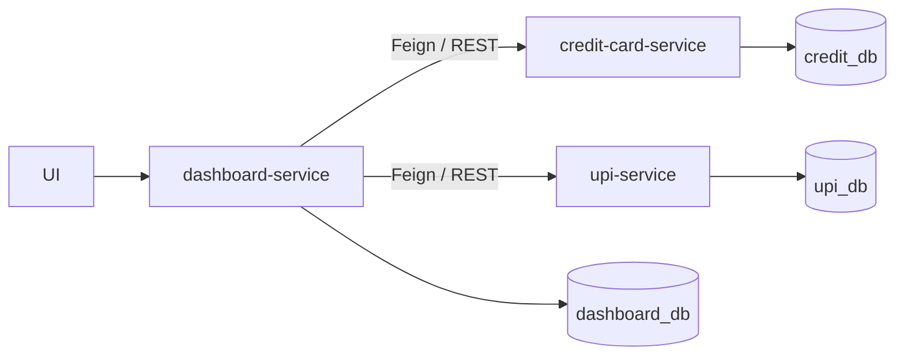
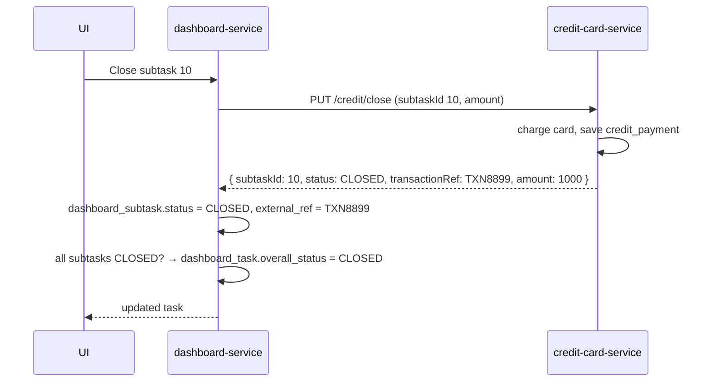

# 🧱 Microservice Design Walkthrough: Payment Dashboard

### ❓ Design a payment dashboard with microservices: a task has subtasks paid by credit card or UPI, and the task closes when every subtask is paid. How do you structure the services and databases?

### 📝 Answer

**Idea:** one service per payment type, each with **its own database**, and a **dashboard service** that orchestrates them and tracks the overall task.



**Each service, same layers:**

```text
dashboard-service:     DashboardController → DashboardService (orchestrator) → Feign clients + DashboardRepository
credit-card-service:   CreditCardController → CreditCardService → CreditCardRepository (credit_db)
upi-service:           UpiController → UpiService → UpiRepository (upi_db)
```

**Why separate databases?** Each service can change its schema, scale and deploy independently. No service reads another service's tables — it asks through an API.

---

### ❓ What tables does each service own in the payment dashboard design?

### 📝 Answer

**dashboard_db** — the task and its subtasks

| Table | Key columns |
|---|---|
| `dashboard_task` | `id` (PK), `task_name`, `overall_status` (OPEN / CLOSED), `created_at`, `updated_at` |
| `dashboard_subtask` | `id` (PK), `task_id` (FK → dashboard_task), `subtask_type` (CREDIT / UPI / WALLET), `status` (OPEN / CLOSED), `amount`, `external_ref`, `updated_at` |

**credit_db**

| Table | Key columns |
|---|---|
| `credit_payment` | `id` (PK), `dashboard_subtask_id` (**logical** reference), `card_token`, `card_last4`, `amount`, `transaction_ref`, `status` (SUCCESS / FAILED), `processed_at` |

**upi_db**

| Table | Key columns |
|---|---|
| `upi_payment` | `id` (PK), `dashboard_subtask_id` (logical reference), `upi_id`, `amount DECIMAL(15,2)`, `transaction_ref`, `status`, `processed_at` |

> ⚠️ **Never store the full card number.** Card data falls under **PCI-DSS** rules; store a **token** from the payment gateway and the last 4 digits for display.

**Logical reference** = the column holds the dashboard subtask's ID, but there is **no database foreign key**, because the tables live in different databases. Consistency is kept by the services, not by the database.

---

### ❓ What happens step by step when a user closes a credit-card subtask?

### 📝 Answer



UPI works the same way through `upi-service`.

---

### ❓ How do you add a Wallet payment type to the payment dashboard later?

### 📝 Answer

Add a new **wallet-service** with its own `wallet_db` — **no changes** to the credit or UPI services:

| Table | Key columns |
|---|---|
| `wallet_payment` | `id` (PK), `dashboard_subtask_id`, `wallet_id`, `amount`, `balance_before`, `balance_after`, `transaction_ref`, `status`, `processed_at` |

In the dashboard service, add `WALLET` as a `subtask_type` and a new client. Using a **Strategy** (one `PaymentClient` interface, one implementation per type) means adding a type is a new class, not a bigger `if/else`.

---

### ❓ What are the weak points of the payment dashboard design and how would you improve them?

### 📝 Answer

| Risk | Improvement |
|---|---|
| Payment succeeds, but the dashboard update fails → states disagree | Make the call **idempotent** (send the subtask ID as an idempotency key), retry safely, and run a reconciliation job; or use a **Saga** with events |
| A slow payment service blocks the dashboard | **Timeouts**, **circuit breaker** (Resilience4j), and return "PENDING" instead of waiting |
| Dashboard knows about every payment type | Publish `PaymentCompleted` events (Kafka); the dashboard listens — **choreography** instead of orchestration |
| Two clicks charge twice | Idempotency key + unique constraint on `dashboard_subtask_id` in each payment table |
| `amount` as a floating type | Use `DECIMAL` in the database and `BigDecimal` in Java — never `double` for money |

#### ↳ Follow-up: Orchestration or choreography here?

↪ Orchestration (the dashboard calls each service) is simple and easy to follow for 2–3 services. As payment types grow, events (choreography) reduce coupling.
