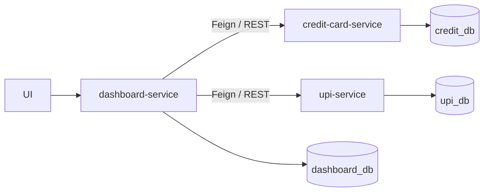
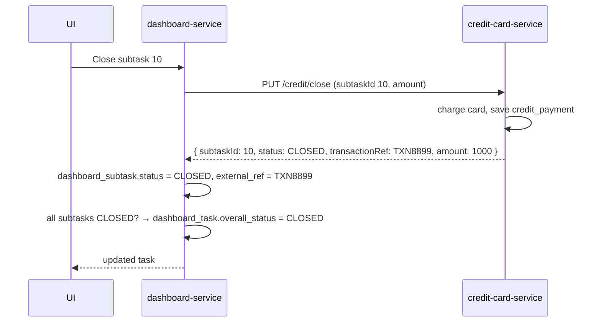
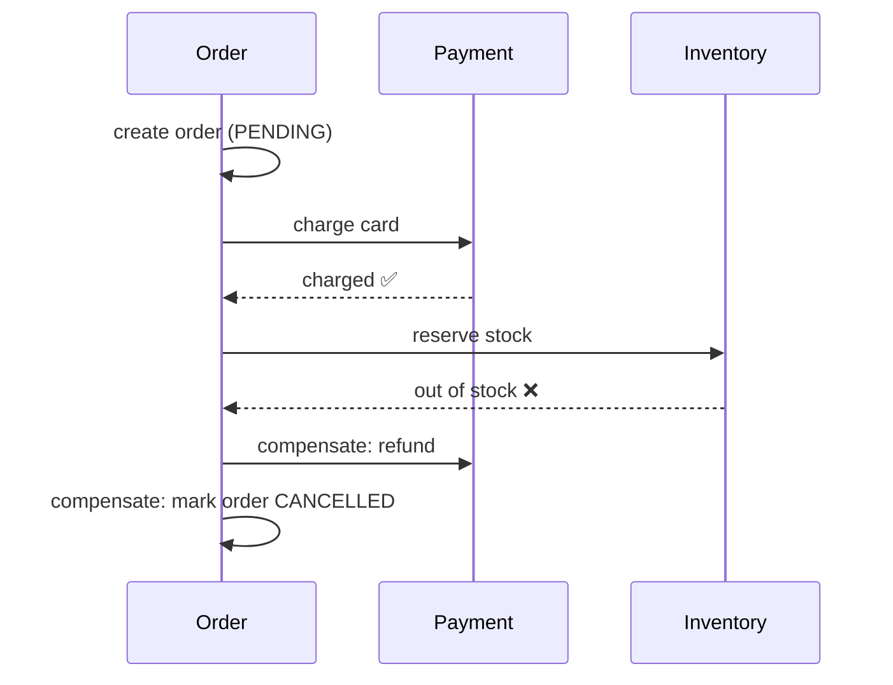
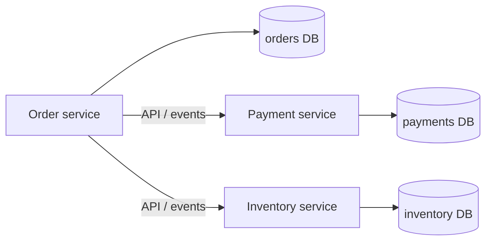
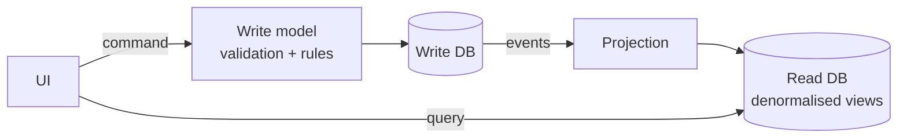
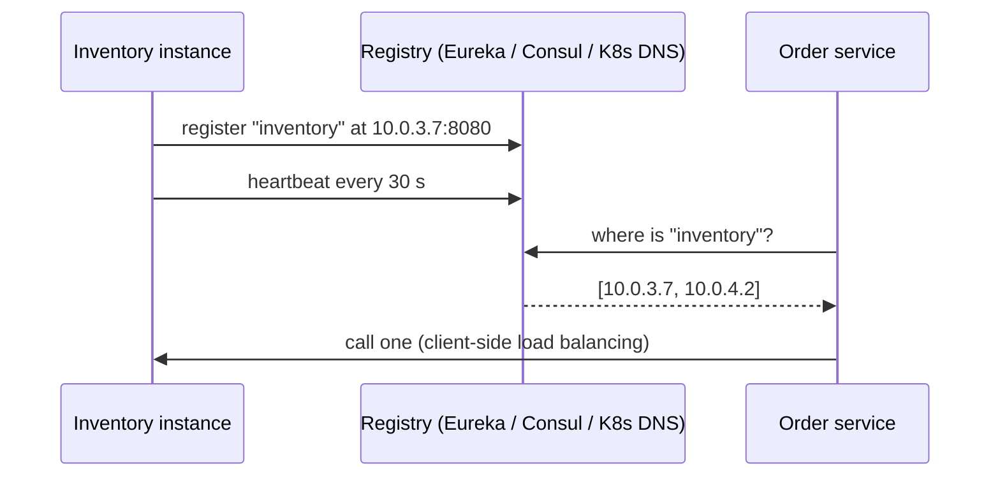
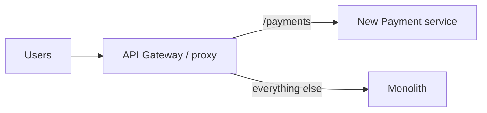

# 🧱 Microservice Design Walkthrough: Payment Dashboard

### ❓ Design a payment dashboard with microservices: a task has subtasks paid by credit card or UPI, and the task closes when every subtask is paid. How do you structure the services and databases?

**Level:** 🔴 Advanced

### 📝 Answer

**Idea:** one service per payment type, each with **its own database**, and a **dashboard service** that orchestrates them and tracks the overall task.



**Each service, same layers:**

```text
dashboard-service:     DashboardController → DashboardService (orchestrator) → Feign clients + DashboardRepository
credit-card-service:   CreditCardController → CreditCardService → CreditCardRepository (credit_db)
upi-service:           UpiController → UpiService → UpiRepository (upi_db)
```

**Why separate databases?** Each service can change its schema, scale and deploy independently. No service reads another service's tables — it asks through an API.

---

### ❓ What tables does each service own in the payment dashboard design?

**Level:** 🟡 Intermediate

### 📝 Answer

**dashboard_db** — the task and its subtasks

| Table | Key columns |
|---|---|
| `dashboard_task` | `id` (PK), `task_name`, `overall_status` (OPEN / CLOSED), `created_at`, `updated_at` |
| `dashboard_subtask` | `id` (PK), `task_id` (FK → dashboard_task), `subtask_type` (CREDIT / UPI / WALLET), `status` (OPEN / CLOSED), `amount`, `external_ref`, `updated_at` |

**credit_db**

| Table | Key columns |
|---|---|
| `credit_payment` | `id` (PK), `dashboard_subtask_id` (**logical** reference), `card_token`, `card_last4`, `amount`, `transaction_ref`, `status` (SUCCESS / FAILED), `processed_at` |

**upi_db**

| Table | Key columns |
|---|---|
| `upi_payment` | `id` (PK), `dashboard_subtask_id` (logical reference), `upi_id`, `amount DECIMAL(15,2)`, `transaction_ref`, `status`, `processed_at` |

> ⚠️ **Never store the full card number.** Card data falls under **PCI-DSS** rules; store a **token** from the payment gateway and the last 4 digits for display.

**Logical reference** = the column holds the dashboard subtask's ID, but there is **no database foreign key**, because the tables live in different databases. Consistency is kept by the services, not by the database.

---

### ❓ What happens step by step when a user closes a credit-card subtask?

**Level:** 🟡 Intermediate

### 📝 Answer



UPI works the same way through `upi-service`.

---

### ❓ How do you add a Wallet payment type to the payment dashboard later?

**Level:** 🟡 Intermediate

### 📝 Answer

Add a new **wallet-service** with its own `wallet_db` — **no changes** to the credit or UPI services:

| Table | Key columns |
|---|---|
| `wallet_payment` | `id` (PK), `dashboard_subtask_id`, `wallet_id`, `amount`, `balance_before`, `balance_after`, `transaction_ref`, `status`, `processed_at` |

In the dashboard service, add `WALLET` as a `subtask_type` and a new client. Using a **Strategy** (one `PaymentClient` interface, one implementation per type) means adding a type is a new class, not a bigger `if/else`.

---

### ❓ What are the weak points of the payment dashboard design and how would you improve them?

**Level:** 🟡 Intermediate

### 📝 Answer

| Risk | Improvement |
|---|---|
| Payment succeeds, but the dashboard update fails → states disagree | Make the call **idempotent** (send the subtask ID as an idempotency key), retry safely, and run a reconciliation job; or use a **Saga** with events |
| A slow payment service blocks the dashboard | **Timeouts**, **circuit breaker** (Resilience4j), and return "PENDING" instead of waiting |
| Dashboard knows about every payment type | Publish `PaymentCompleted` events (Kafka); the dashboard listens — **choreography** instead of orchestration |
| Two clicks charge twice | Idempotency key + unique constraint on `dashboard_subtask_id` in each payment table |
| `amount` as a floating type | Use `DECIMAL` in the database and `BigDecimal` in Java — never `double` for money |

#### ↳ Follow-up: Orchestration or choreography here?

↪ Orchestration (the dashboard calls each service) is simple and easy to follow for 2–3 services. As payment types grow, events (choreography) reduce coupling.


---

## Core Microservice Patterns (Intermediate)

### ❓ What is the Saga pattern? Choreography vs orchestration?

### 📝 Answer

In microservices each service has its own database, so one business action (place an order) can't use a single DB transaction. A **Saga** splits it into **local transactions**, one per service. If a step fails, earlier steps are undone with **compensating actions**.



| | Choreography | Orchestration |
|---|---|---|
| How | each service listens for events and reacts (`OrderCreated` → Payment charges → `PaymentDone` → Inventory reserves) | a central **orchestrator** tells each service what to do next |
| Central control | ❌ | ✅ |
| Easy to follow / debug | ❌ hard with many steps | ✅ one place shows the flow |
| Coupling | loose | services depend on the orchestrator |
| Good for | 2–4 simple steps | longer, business-critical flows |
| Tools | Kafka/RabbitMQ events | Temporal, Camunda, AWS Step Functions, a custom orchestrator |

**Rules for sagas:** every step and compensation must be **idempotent** (they may be retried); publish events with the **outbox pattern**; compensation is a new business action (a refund), not a database rollback.

#### ↳ Follow-up: What if a compensation itself fails?

↪ Retry it with backoff; if it still fails, park it in a dead letter queue and alert a person — never silently drop it.

---

### ❓ Why should each microservice have its own database?

### 📝 Answer

**Database per service** means only the owning service reads and writes its tables. Others ask through its **API** or listen to its **events**.



**Why:**
- Teams can change their schema without breaking anyone.
- Each service can pick the right database (Postgres for orders, Redis for carts, Elasticsearch for search).
- A slow query in one service can't lock another service's tables.
- Services scale and deploy independently.

**Costs and fixes:**

| Problem | Fix |
|---|---|
| No cross-service joins | API composition, or a read model built from events (CQRS) |
| No cross-service transactions | Saga |
| Duplicate data | accept it; keep it in sync with events |

#### ↳ Follow-up: Is a shared database ever acceptable?

↪ As a temporary step while splitting a monolith, or for a few tightly coupled services owned by one team — with separate schemas and clear ownership.

---

### ❓ What is CQRS?

### 📝 Answer

**CQRS (Command Query Responsibility Segregation)** = use **separate models for writes and reads**.

- **Commands** change data (`PlaceOrder`) — the write model enforces business rules.
- **Queries** read data — a read model shaped exactly for the screen, often denormalised.



**When it helps:** reads and writes look very different (complex dashboards over many services), reads vastly outnumber writes, or you need a view combining data from several services.

**Costs:** more moving parts, and the read side is **eventually consistent** (a short delay after a write).

#### ↳ Follow-up: Does CQRS require event sourcing?

↪ No. They're often used together, but CQRS can simply use two tables or a read replica.

---

### ❓ What is event sourcing?

### 📝 Answer

Instead of storing only the **current state**, store **every change as an event**. The current state is rebuilt by replaying the events.

```text
Account 42 events:
1. AccountOpened(balance=0)
2. MoneyDeposited(1000)
3. MoneyWithdrawn(300)
→ current balance = 700
```

| ✅ Benefits | ❌ Costs |
|---|---|
| full audit trail ("how did we get here?") | harder to query → needs read models (CQRS) |
| rebuild state at any point in time | events can never change → schema versioning |
| new read models from old events | snapshots needed when streams get long |
| natural fit for event-driven systems | steeper learning curve |

**Good fit:** banking ledgers, orders, audit-heavy domains. **Overkill** for simple CRUD.

#### ↳ Follow-up: How do you fix a wrong event?

↪ You don't edit it. You add a **correcting event** (e.g. `DepositReversed`), like an accountant's journal.

---

### ❓ How does service discovery work?

### 📝 Answer

Instances start, stop and move all the time, so their IPs change. **Service discovery** lets a service find a healthy instance **by name**.



| Type | How | Example |
|---|---|---|
| **Client-side** | the caller asks the registry, picks an instance | Eureka + Spring Cloud LoadBalancer |
| **Server-side** | the caller hits a fixed address; a load balancer picks | Kubernetes Service, AWS ALB |

On **Kubernetes**, a `Service` gives a stable DNS name (`http://inventory`) — no Eureka needed.

#### ↳ Follow-up: What happens when an instance dies?

↪ It stops sending heartbeats (or fails health checks) and the registry removes it after a timeout; callers should also retry another instance.

---

### ❓ How do you migrate a monolith to microservices? (Strangler fig pattern)

### 📝 Answer

Don't rewrite everything at once. **Strangle** the monolith: build new services around it and move features out **one at a time**, until the monolith can be switched off.



**Steps:**
1. Put a **gateway/proxy** in front of the monolith.
2. Pick a feature with **clear boundaries** and real value (e.g. notifications, payments).
3. Build it as a service with **its own data**; sync data during the transition (events or CDC).
4. Route that path to the new service; keep a quick rollback.
5. Delete the old code from the monolith. Repeat.

#### ↳ Follow-up: Which part should you extract first?

↪ Something loosely coupled and frequently changed or scaled differently — not the most tangled core on day one.

---
