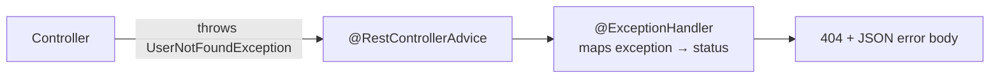

# 🌐 REST API & Exception Handling (Spring Boot)

## Exception Handling

### ❓ How do you design exception handling in large Java applications?

### 📝 Answer

Three simple rules:

1. **Throw meaningful exceptions** — wrap low-level errors (SQL, IO) in business exceptions so callers don't see database details.
2. **Handle them in one place** — a global `@RestControllerAdvice`, not try/catch in every controller.
3. **Return a consistent error shape** with the right HTTP status; **log** the details, never send stack traces to clients.

```java
// 1. Business exception
public class ResourceNotFoundException extends RuntimeException {
    public ResourceNotFoundException(String message) { super(message); }
}

// Wrapping a technical error
try {
    orderRepository.save(order);
} catch (DataAccessException e) {
    throw new OrderPersistenceException("Unable to save order", e);   // keep the cause for logs
}

// 2 + 3. One global handler
@RestControllerAdvice
public class GlobalExceptionHandler {
    private static final Logger log = LoggerFactory.getLogger(GlobalExceptionHandler.class);

    @ExceptionHandler(ResourceNotFoundException.class)
    public ProblemDetail notFound(ResourceNotFoundException ex) {
        return ProblemDetail.forStatusAndDetail(HttpStatus.NOT_FOUND, ex.getMessage());
    }

    @ExceptionHandler(Exception.class)
    public ProblemDetail unexpected(Exception ex) {
        log.error("Unexpected error", ex);                       // full details in the logs
        return ProblemDetail.forStatusAndDetail(HttpStatus.INTERNAL_SERVER_ERROR, "Something went wrong");
    }
}
```

`ProblemDetail` (Spring 6 / Boot 3) produces the standard RFC 9457 JSON error format:

```json
{ "type": "about:blank", "title": "Not Found", "status": 404, "detail": "User 42 not found", "instance": "/users/42" }
```

---

### ❓ Checked vs unchecked exceptions – what is your strategy?

### 📝 Answer

**The difference:** the compiler **forces** you to handle or declare a **checked** exception; it doesn't for an **unchecked** one. Both happen at runtime.

| Checked | Unchecked |
|---|---|
| Extends `Exception` (not `RuntimeException`) | Extends `RuntimeException` |
| Must `catch` it or declare `throws` | No compiler check |
| `IOException`, `SQLException`, `ClassNotFoundException` | `NullPointerException`, `IllegalArgumentException`, `ArithmeticException` |
| For problems a caller can **reasonably recover** from | For **programming errors** and business rule violations |

```java
void readFile() throws IOException { ... }        // checked: callers must deal with it

void setAge(int age) {
    if (age < 0) throw new IllegalArgumentException("age must be >= 0");   // unchecked
}
```

**Strategy in a Spring app:**

- Use **unchecked custom exceptions** for business errors (`OrderNotFoundException`) — they don't clutter every method signature, and a global handler turns them into HTTP responses.
- **Wrap checked exceptions** from libraries at the boundary into unchecked ones, keeping the cause.
- Catch an exception only where you can **do something** (retry, fallback, add context) — never catch and ignore.

#### ↳ Follow-up: Why does `@Transactional` matter here?

↪ By default Spring rolls back only on **unchecked** exceptions. A checked exception commits the transaction unless you set `rollbackFor = Exception.class`.

---

### ❓ How do you implement global HTTP status handling in Spring Boot without setting the status code in each controller method?

### 📝 Answer

Three options, from most to least common:

1. **`@RestControllerAdvice` + `@ExceptionHandler`** — one class maps each exception to a status (see above).
2. **`@ResponseStatus` on the exception class** — simplest for fixed cases:
   ```java
   @ResponseStatus(HttpStatus.NOT_FOUND)
   public class UserNotFoundException extends RuntimeException { ... }
   ```
3. **`ResponseStatusException`** — throw a status directly in rare one-off cases:
   ```java
   throw new ResponseStatusException(HttpStatus.CONFLICT, "Email already used");
   ```

Controllers then just return the happy-path result; errors are handled centrally.



---

## HTTP & REST

### ❓ Important HTTP Status Codes to Know

### 📝 Answer

| Code | Meaning | Typical use |
|---|---|---|
| **200** OK | Success with a body | GET, PUT |
| **201** Created | New resource created | POST (add a `Location` header) |
| **204** No Content | Success, no body | DELETE |
| **301** Moved Permanently | URL changed for good | Old URLs |
| **302** Found | Temporary redirect | Login redirects |
| **304** Not Modified | Use your cached copy | ETag / If-None-Match |
| **400** Bad Request | Invalid input | Validation errors |
| **401** Unauthorized | Not logged in / bad token | Missing or expired JWT |
| **403** Forbidden | Logged in, but not allowed | User calling an admin API |
| **404** Not Found | Resource doesn't exist | Unknown ID |
| **409** Conflict | Clashes with current state | Duplicate email, version conflict |
| **422** Unprocessable Content | Well-formed but breaks a business rule | Some teams use it for validation |
| **429** Too Many Requests | Rate limit hit | API throttling |
| **500** Internal Server Error | Unexpected server bug | Unhandled exception |
| **502** Bad Gateway | Proxy got a bad answer from upstream | Backend crashed behind a gateway |
| **503** Service Unavailable | Temporarily down/overloaded | Maintenance, no healthy instances |
| **504** Gateway Timeout | Upstream didn't answer in time | Slow backend behind a gateway |

**Remember:** 4xx = the **client** must change something; 5xx = the **server** failed.

---

### ❓ If I replace GET with PUT, can I still fetch records?

### 📝 Answer

Technically **yes** — the method just returns data. But it's **wrong for REST**:

- `GET` is **safe** (changes nothing) and **cacheable**; browsers, CDNs and proxies rely on that.
- `PUT` means "**replace** this resource" — clients, caches and API tools treat it as a write.

Using PUT to read loses caching, confuses API consumers and documentation (OpenAPI), and may trigger CSRF protection meant for writes. Use the method that matches the action.

---

### ❓ Can we get Request Body in GET?

### 📝 Answer

**Avoid it.** The HTTP spec (RFC 9110) says a body on GET has **no defined meaning**, so different tools treat it differently:

- Browsers' `fetch()` / `XMLHttpRequest` **can't send** a GET body at all.
- Some proxies, CDNs and HTTP clients **drop** it; caches ignore it (so results may be cached wrongly).
- Spring MVC will actually bind `@RequestBody` on a GET **if a body arrives**, but if it's missing you get `HttpMessageNotReadableException: Required request body is missing`.

✅ **Use query parameters** for filters:

```java
@GetMapping("/users")
public List<User> search(@RequestParam String name, @RequestParam(defaultValue = "0") int page) { ... }
```

For very complex searches, use `POST /users/search` with a JSON body.

---

### ❓ Without @Controller, can we receive API?

### 📝 Answer

Yes. `@Controller` is the most common way, but not the only one:

1. **`@RestController`** — `@Controller` + `@ResponseBody`: return values are written as JSON. (Still a controller, just the REST flavour.)
2. **Functional endpoints** — routes defined as beans, available in both **WebFlux** and **Spring MVC** (`RouterFunctions`):
   ```java
   @Bean
   RouterFunction<ServerResponse> routes() {
       return RouterFunctions.route()
           .GET("/hello", req -> ServerResponse.ok().body("Hi"))
           .build();
   }
   ```
3. **A plain servlet** — extend `HttpServlet` and register it (low level, rarely needed).
