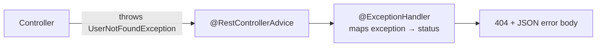

# 🌐 REST API & Exception Handling (Spring Boot)

## Exception Handling

### ❓ How do you design exception handling in large Java applications?

### 📝 Answer

Three simple rules:

1. **Throw meaningful exceptions** — wrap low-level errors (SQL, IO) in business exceptions so callers don't see database details.
2. **Handle them in one place** — a global `@RestControllerAdvice`, not try/catch in every controller.
3. **Return a consistent error shape** with the right HTTP status; **log** the details, never send stack traces to clients.

```java
// 1. Business exception
public class ResourceNotFoundException extends RuntimeException {
    public ResourceNotFoundException(String message) { super(message); }
}

// Wrapping a technical error
try {
    orderRepository.save(order);
} catch (DataAccessException e) {
    throw new OrderPersistenceException("Unable to save order", e);   // keep the cause for logs
}

// 2 + 3. One global handler
@RestControllerAdvice
public class GlobalExceptionHandler {
    private static final Logger log = LoggerFactory.getLogger(GlobalExceptionHandler.class);

    @ExceptionHandler(ResourceNotFoundException.class)
    public ProblemDetail notFound(ResourceNotFoundException ex) {
        return ProblemDetail.forStatusAndDetail(HttpStatus.NOT_FOUND, ex.getMessage());
    }

    @ExceptionHandler(Exception.class)
    public ProblemDetail unexpected(Exception ex) {
        log.error("Unexpected error", ex);                       // full details in the logs
        return ProblemDetail.forStatusAndDetail(HttpStatus.INTERNAL_SERVER_ERROR, "Something went wrong");
    }
}
```

`ProblemDetail` (Spring 6 / Boot 3) produces the standard RFC 9457 JSON error format:

```json
{ "type": "about:blank", "title": "Not Found", "status": 404, "detail": "User 42 not found", "instance": "/users/42" }
```

---

### ❓ Checked vs unchecked exceptions – what is your strategy?

### 📝 Answer

**The difference:** the compiler **forces** you to handle or declare a **checked** exception; it doesn't for an **unchecked** one. Both happen at runtime.

| Checked | Unchecked |
|---|---|
| Extends `Exception` (not `RuntimeException`) | Extends `RuntimeException` |
| Must `catch` it or declare `throws` | No compiler check |
| `IOException`, `SQLException`, `ClassNotFoundException` | `NullPointerException`, `IllegalArgumentException`, `ArithmeticException` |
| For problems a caller can **reasonably recover** from | For **programming errors** and business rule violations |

```java
void readFile() throws IOException { ... }        // checked: callers must deal with it

void setAge(int age) {
    if (age < 0) throw new IllegalArgumentException("age must be >= 0");   // unchecked
}
```

**Strategy in a Spring app:**

- Use **unchecked custom exceptions** for business errors (`OrderNotFoundException`) — they don't clutter every method signature, and a global handler turns them into HTTP responses.
- **Wrap checked exceptions** from libraries at the boundary into unchecked ones, keeping the cause.
- Catch an exception only where you can **do something** (retry, fallback, add context) — never catch and ignore.

#### ↳ Follow-up: Why does `@Transactional` matter here?

↪ By default Spring rolls back only on **unchecked** exceptions. A checked exception commits the transaction unless you set `rollbackFor = Exception.class`.

---

### ❓ How do you implement global HTTP status handling in Spring Boot without setting the status code in each controller method?

### 📝 Answer

Three options, from most to least common:

1. **`@RestControllerAdvice` + `@ExceptionHandler`** — one class maps each exception to a status (see above).
2. **`@ResponseStatus` on the exception class** — simplest for fixed cases:
   ```java
   @ResponseStatus(HttpStatus.NOT_FOUND)
   public class UserNotFoundException extends RuntimeException { ... }
   ```
3. **`ResponseStatusException`** — throw a status directly in rare one-off cases:
   ```java
   throw new ResponseStatusException(HttpStatus.CONFLICT, "Email already used");
   ```

Controllers then just return the happy-path result; errors are handled centrally.



---

## HTTP & REST

### ❓ Important HTTP Status Codes to Know

### 📝 Answer

| Code | Meaning | Typical use |
|---|---|---|
| **200** OK | Success with a body | GET, PUT |
| **201** Created | New resource created | POST (add a `Location` header) |
| **204** No Content | Success, no body | DELETE |
| **301** Moved Permanently | URL changed for good | Old URLs |
| **302** Found | Temporary redirect | Login redirects |
| **304** Not Modified | Use your cached copy | ETag / If-None-Match |
| **400** Bad Request | Invalid input | Validation errors |
| **401** Unauthorized | Not logged in / bad token | Missing or expired JWT |
| **403** Forbidden | Logged in, but not allowed | User calling an admin API |
| **404** Not Found | Resource doesn't exist | Unknown ID |
| **409** Conflict | Clashes with current state | Duplicate email, version conflict |
| **422** Unprocessable Content | Well-formed but breaks a business rule | Some teams use it for validation |
| **429** Too Many Requests | Rate limit hit | API throttling |
| **500** Internal Server Error | Unexpected server bug | Unhandled exception |
| **502** Bad Gateway | Proxy got a bad answer from upstream | Backend crashed behind a gateway |
| **503** Service Unavailable | Temporarily down/overloaded | Maintenance, no healthy instances |
| **504** Gateway Timeout | Upstream didn't answer in time | Slow backend behind a gateway |

**Remember:** 4xx = the **client** must change something; 5xx = the **server** failed.

---

### ❓ If I replace GET with PUT, can I still fetch records?

### 📝 Answer

Technically **yes** — the method just returns data. But it's **wrong for REST**:

- `GET` is **safe** (changes nothing) and **cacheable**; browsers, CDNs and proxies rely on that.
- `PUT` means "**replace** this resource" — clients, caches and API tools treat it as a write.

Using PUT to read loses caching, confuses API consumers and documentation (OpenAPI), and may trigger CSRF protection meant for writes. Use the method that matches the action.

---

### ❓ Can we get Request Body in GET?

### 📝 Answer

**Avoid it.** The HTTP spec (RFC 9110) says a body on GET has **no defined meaning**, so different tools treat it differently:

- Browsers' `fetch()` / `XMLHttpRequest` **can't send** a GET body at all.
- Some proxies, CDNs and HTTP clients **drop** it; caches ignore it (so results may be cached wrongly).
- Spring MVC will actually bind `@RequestBody` on a GET **if a body arrives**, but if it's missing you get `HttpMessageNotReadableException: Required request body is missing`.

✅ **Use query parameters** for filters:

```java
@GetMapping("/users")
public List<User> search(@RequestParam String name, @RequestParam(defaultValue = "0") int page) { ... }
```

For very complex searches, use `POST /users/search` with a JSON body.

---

### ❓ Without @Controller, can we receive API?

### 📝 Answer

Yes. `@Controller` is the most common way, but not the only one:

1. **`@RestController`** — `@Controller` + `@ResponseBody`: return values are written as JSON. (Still a controller, just the REST flavour.)
2. **Functional endpoints** — routes defined as beans, available in both **WebFlux** and **Spring MVC** (`RouterFunctions`):
   ```java
   @Bean
   RouterFunction<ServerResponse> routes() {
       return RouterFunctions.route()
           .GET("/hello", req -> ServerResponse.ok().body("Hi"))
           .build();
   }
   ```
3. **A plain servlet** — extend `HttpServlet` and register it (low level, rarely needed).

---

## REST API Design

### ❓ What makes an API RESTful?

REST is an architectural style where everything is a **resource** with a URL, and standard HTTP methods say what to do with it. Key ideas:

- **Resources, not actions:** `/orders/42`, not `/getOrder?id=42`.
- **Standard methods:** GET reads, POST creates, PUT replaces, PATCH updates part, DELETE removes.
- **Stateless:** each request carries everything needed (e.g. a token); the server keeps no session between calls, so any server can handle it.
- **Standard status codes and representations** (usually JSON), and cacheable responses where possible.

**Example:** `GET /customers/7/orders?status=PAID` → `200 OK` with a JSON list.

---

### ❓ What is the difference between PUT, PATCH and POST? Which are idempotent?

| Method | Meaning | Idempotent? | Safe (read-only)? |
|---|---|---|---|
| GET | Read | Yes | Yes |
| POST | Create / trigger an action | **No** | No |
| PUT | Replace the whole resource | Yes | No |
| PATCH | Change some fields | Not guaranteed | No |
| DELETE | Remove | Yes | No |

**Idempotent** = sending the same request twice leaves the same result as once — safe to retry after a timeout. To make POST retry-safe (e.g. payments), accept an **`Idempotency-Key`** header and return the first result for repeats.

---

### ❓ How do you name REST endpoints well?

- Plural nouns for collections: `/orders`, `/orders/{id}`.
- Nest only for clear ownership, one level deep: `/customers/{id}/orders`.
- Lowercase with hyphens: `/payment-methods`.
- Filters, sorting and paging as query parameters: `/orders?status=PAID&sort=-createdAt&page=2`.
- Actions that don't fit CRUD become sub-resources: `POST /orders/{id}/cancel`.

---

### ❓ How do you paginate large lists?

| Style | Request | Pros | Cons |
|---|---|---|---|
| **Offset** | `?page=3&size=20` | Simple, can jump to any page | Slow on deep pages; items shift when data changes |
| **Cursor (keyset)** | `?after=eyJpZCI6MTAwfQ&limit=20` | Fast at any depth, stable | Only next/previous, no page numbers |

Return metadata so clients know what's next:

```json
{ "items": [], "nextCursor": "eyJpZCI6MTIwfQ", "hasMore": true }
```

Use cursor pagination for feeds and big tables; offset is fine for small admin lists. Always cap the page size.

---

### ❓ How do you version a REST API?

Version only for **breaking changes** (removing or renaming fields, changing meaning). Adding optional fields is not breaking.

- **URL path:** `/api/v1/orders` — the most common, and the easiest to see and route.
- **Header:** `Accept: application/vnd.shop.v2+json` or a custom header — cleaner URLs, harder to test.
- Run old and new versions side by side, announce a deprecation date (`Deprecation` / `Sunset` headers), and watch traffic before removing the old one.

---

### ❓ What should an API error response look like?

A consistent JSON body with the right status code. A common standard is **Problem Details** (RFC 9457, `application/problem+json`):

```json
{
  "type": "https://api.shop.com/errors/insufficient-stock",
  "title": "Insufficient stock",
  "status": 409,
  "detail": "Only 2 units of SKU-881 are left.",
  "instance": "/orders/A1043"
}
```

- 400 bad input (list which fields), 401 not logged in, 403 not allowed, 404 not found, 409 conflict, 422 validation failed, 429 too many requests, 500 server error.
- Never expose stack traces or SQL errors to clients. Spring Boot 3 supports Problem Details through `ProblemDetail`.

---

### ❓ How do you cache REST responses?

- **`Cache-Control`** tells clients and CDNs how long to keep a response: `Cache-Control: public, max-age=300`.
- **`ETag`** + **`If-None-Match`**: the client sends the version it has; if nothing changed, the server replies **304 Not Modified** with no body, saving bandwidth.
- Cache only safe GETs; never cache personal data publicly (use `private` or `no-store`).

**Example:** a product catalogue cached at the CDN for 5 minutes takes most of the load off the database during a sale.

---

### ❓ How do you secure a REST API?

- **HTTPS only.**
- **Authentication:** OAuth 2.0 / OpenID Connect with short-lived JWT access tokens for users; API keys or client credentials for server-to-server calls.
- **Authorization on every endpoint** — check the caller owns the resource (prevents IDOR).
- **Validate input** and limit request size; use parameterised queries.
- **Rate limiting** per client (return 429 with `Retry-After`).
- Don't put secrets or tokens in URLs (they end up in logs); allow CORS only for known origins.

See also: [Web application security (OWASP)](../../security/01-Web-Security-OWASP.md)

---

### ❓ REST vs GraphQL vs gRPC — when would you use each?

| | REST | GraphQL | gRPC |
|---|---|---|---|
| Shape | Many URLs, fixed responses | One endpoint, client chooses fields | Methods from a `.proto` contract |
| Format | JSON over HTTP | JSON over HTTP | Binary (Protocol Buffers) over HTTP/2 |
| Best for | Public APIs, simple CRUD, caching | Many UIs needing different data shapes | Fast service-to-service calls, streaming |
| Watch out | Over- or under-fetching | Caching, query cost limits | Browsers need a proxy; harder to debug by hand |

Many systems use **REST outside, gRPC inside**.
