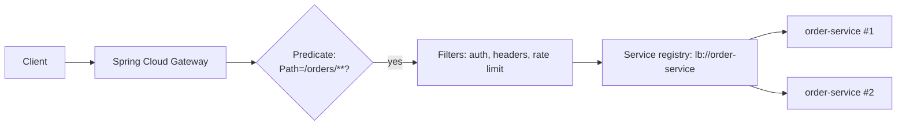
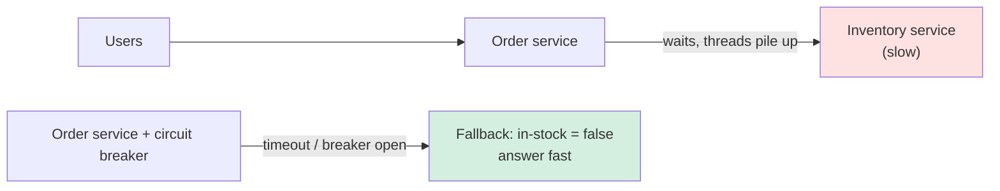
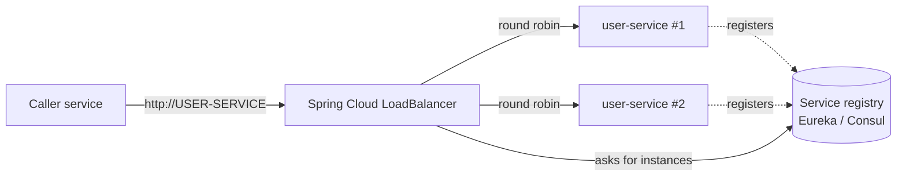
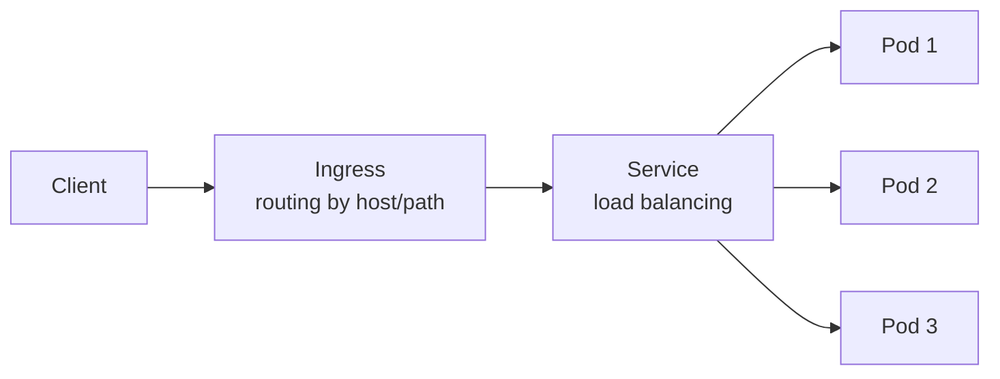
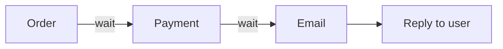
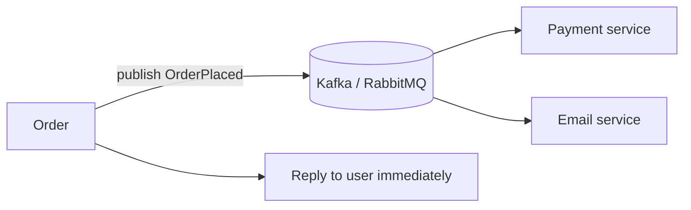

### ❓ Why did your team choose microservices over monolith?

### 📝 Answer

> We chose microservices to align system boundaries with business domains, enable independent deployments, and allow teams to scale autonomously.

📐 Architecture Diagram (mental model)

```
[ Order Service ] → DB
[ Payment Service ] → DB
[ Inventory Service ] → DB
         |
     Async Events
```

🧠 RULES TO ALWAYS REMEMBER

✔ Microservices are **team-scaling architecture**
✔ Business capability > technical layers
✔ If deployment is not independent → NOT microservices

---

### ❓ What problems does a microservices architecture introduce, and how does Spring Cloud address those problems?

### 📝 Answer

**Microservices** introduce problems _because they are distributed_.
**Spring Cloud** exists to handle those distributed-system problems.

1️⃣ _PROBLEM: SERVICE LOCATION & DISCOVERY_

In microservices, **service location is dynamic**, not fixed.

- Services run on multiple machines/containers
- Containers restart → IP and port change
- Services scale up/down dynamically

**In Monolith**

```java
inventoryService.checkStock();
```

✔ Same JVM
✔ No network

**In Microservices**

```
Order Service → Network → Inventory Service
```

❌ Where is Inventory Service running?

✅ How Spring Cloud Solves It: **Service Discovery**

- Services register themselves
- Other services discover them using **logical names**

```yaml
spring:
  application:
    name: inventory-service
```

```java
@FeignClient(name = "inventory-service")
public interface InventoryClient {

  @GetMapping("/inventory/{id}")
  InventoryResponse check(@PathVariable Long id);
}
```

🧠 Rules to Remember

✔ Never use hardcoded URLs
✔ Service name is stable, IP is not
✔ Discovery enables load balancing

#### ↳ Follow-up: What is @FeignClient?

✖️ Problem before Feign:

1. `RestTemplate` (older, blocking)

```java
RestTemplate restTemplate = new RestTemplate();
InventoryResponse res =
  restTemplate.getForObject("http://inventory-service/inventory/1", InventoryResponse.class);
```

- Every call is hand-written: URL strings, conversions, error handling
- In **maintenance mode** (not deprecated) — for new blocking code Spring 6.1+ recommends **`RestClient`**:

```java
RestClient client = RestClient.create("http://inventory-service");
InventoryResponse res = client.get().uri("/inventory/{id}", 1).retrieve().body(InventoryResponse.class);
```

2. WebClient (reactive, non-blocking)

```java
WebClient webClient = WebClient.create();

InventoryResponse res =
  webClient.get()
           .uri("http://inventory-service/inventory/1")
           .retrieve()
           .bodyToMono(InventoryResponse.class)
           .block();
```

✔ Non-blocking
✔ High performance
✖️ More code
✖️ Overkill for simple sync calls

✔️ `@FeignClient` is a Spring Cloud annotation used to declare a **type-safe HTTP client** for calling another microservice **by service name**, not by URL.

- It lets you call a remote REST API as if it were a local Java method.

`@EnableFeignClients` - Enables Feign in the application.

```java
@SpringBootApplication
@EnableFeignClients
public class OrderServiceApplication { }

@FeignClient(
  name = "inventory-service",        // ALWAYS - Without this, Feign is useless in microservices.
  path = "/inventory",               // SOMETIMES - Avoid repeating /inventory in every method
  configuration = InventoryFeignConfig.class, // SOMETIMES - Don’t overuse — keep configs minimal.
  fallback = InventoryFallback.class,          // RARE - Never use fallback and fallbackFactory together.
  fallbackFactory = InventoryFallbackFactory.class // PREFERRED - Always prefer this for production
)
public interface InventoryClient {}
```

> **`Feign`** is blocking. For high-throughput or streaming use cases, **`WebClient`** is more suitable.
>
> 💡 Spring Cloud OpenFeign is now feature-complete (maintenance mode). Spring's own alternative is the **HTTP interface client**: an interface with `@GetExchange("/inventory/{id}")` methods, backed by `RestClient` or `WebClient`.

2️⃣ _PROBLEM: CONFIGURATION MANAGEMENT_

In microservices, **configuration grows faster than code**.

❌ Without central config:

- Rebuild required
- Inconsistent configs
- Manual errors

✅ How Spring Cloud Solves It: **Config Server**

- Centralized configuration
- Environment-based configs
- Same binary everywhere

```yaml
spring:
  cloud:
    config:
      uri: http://config-server:8888
```

Config stored in Git:

```
order-service-dev.yml
order-service-prod.yml
```

#### ↳ Follow-up: Explain Spring Cloud Config Server. Don’t define it — explain how it works.

> Spring Cloud Config Server provides centralized external configuration for distributed microservices. It stores configuration in a version-controlled repository (usually Git) and allows client services to fetch environment-specific configuration at startup or runtime.

🔁 Flow Explanation

```
Microservice → Config Server → Git Repo
```

- Client requests config
- Config Server fetches from Git
- Config is injected into the application context

#### ↳ Follow-up: What annotations are required to create a Config Server?

```java
@SpringBootApplication
@EnableConfigServer
public class ConfigServerApplication {
  public static void main(String[] args) {
    SpringApplication.run(ConfigServerApplication.class, args);
  }
}
```

🧠 Rules to Remember

✔ `@EnableConfigServer` is mandatory
✔ Config Server is a normal Spring Boot app
✔ Runs independently from clients

#### ↳ Follow-up: How does a microservice connect to Config Server?

Modern way (Spring Cloud 2020+ / Boot 2.4+): import it in **`application.yml`**:

```yaml
spring:
  application:
    name: order-service          # decides which files the server returns (order-service-*.yml)
  config:
    import: "optional:configserver:http://localhost:8888"   # drop "optional:" to fail if the server is down
```

✔ Config is loaded **before beans are created**
✔ App name + active profile map to config file names

> Older apps used `spring.cloud.config.uri` in `bootstrap.yml`. Since Spring Cloud 2020 that only works if you add `spring-cloud-starter-bootstrap`.

#### ↳ Follow-up: How does Config Server know which config file to load?

Config Server uses:

- `spring.application.name`
- Active profile
- Label (branch)

```
order-service-dev.yml
order-service-prod.yml
```

#### ↳ Follow-up: What happens if Config Server is down?

> If Config Server is down and no fallback is configured, the microservice fails to start because configuration is required during bootstrap.

```yaml
spring:
  cloud:
    config:
      fail-fast: false
```

#### ↳ Follow-up: Can configuration be refreshed without restarting the service?

Yes, using **Spring Cloud Bus** or **Actuator refresh**.

```java
@RefreshScope
```

✔ Only `@RefreshScope` beans are refreshed
✔ Not all beans should be refreshable
✔ Avoid frequent refresh in production

#### ↳ Follow-up: Where should secrets be stored? In Git?

> Secrets should never be stored in plain Git. Use **encrypted values**, Vault, or cloud-native secret managers.

```yaml
password: "{cipher}ENCRYPTED_VALUE"
```

#### ↳ Follow-up: What is the difference between bootstrap.yml and application.yml?

✔️ Expected Answer

| bootstrap.yml      | application.yml |
| ------------------ | --------------- |
| Loaded first, by a separate "bootstrap" context | The normal app config |
| Held Config Server / Vault connection info | App settings |
| **Legacy** — disabled by default since Spring Cloud 2020 (needs `spring-cloud-starter-bootstrap`) | Now also holds `spring.config.import: configserver:...` |

#### ↳ Follow-up: How to externalize application properties?

Ways:

- `application.properties`
- `application.yml`
- Environment variables
- Command line args
- Spring Cloud Config Server
- `@Value`
- `@ConfigurationProperties`

Example:

```java
@Value("${db.url}")
private String url;
```

3️⃣ _PROBLEM: NETWORK FAILURES & CASCADING FAILURES_

❌ In microservices, **network calls are unreliable by default**.

- Network latency
- Service downtime
- Slow responses block threads

Without protection:

```java
inventoryClient.checkStock(id); // blocks indefinitely
```

✖️ Thread pool exhaustion
✖️ System-wide slowdown

✅ How Spring Cloud Solves It: **Resilience**

- Detect failures
- Stop repeated calls
- Degrade gracefully

```java
@CircuitBreaker(name = "inventory", fallbackMethod = "fallback")
public InventoryResponse checkStock(Long productId) {
    return inventoryClient.checkStock(productId);
}

public InventoryResponse fallback(Long productId, Throwable ex) {
    return new InventoryResponse(productId, false);
}
```

#### ↳ Follow-up: What do you mean by resilience in a microservices system?

> Resilience is the ability of a system to continue functioning gracefully in the presence of partial failures, slow dependencies, or transient network issues.

- Failures are **expected**, not exceptional
- Resilience is about **containing failures**
- Goal is **system stability**, not perfect success

#### ↳ Follow-up: Why do we need resilience patterns in microservices but not in monoliths?

In a **monolith**:

- Method calls are in-process
- No network latency
- Failures are centralized

In **microservices**:

- Remote calls over network
- Independent scaling
- Partial failures are common

> Microservices fail independently, monoliths fail together.

#### ↳ Follow-up: Which resilience patterns do you commonly use?

- **Timeout** – always
- **Retry** – transient failures
- **Circuit Breaker** – persistent failures
- **Bulkhead** – isolate resources
- **Fallback** – graceful degradation

✔ Timeout is non-negotiable
✔ Retry without breaker is dangerous
✔ Fallback must be meaningful

#### ↳ Follow-up: Explain Circuit Breaker using a real scenario.

- Detects failure rate
- Opens circuit after threshold
- Prevents repeated calls to failing service
- Moves to half-open to test recovery

#### ↳ Follow-up: Which annotation is used to define a fallback method in a microservices architecture when a service call fails?

Using Resilience4j:

```java
@CircuitBreaker(name = "myService", fallbackMethod = "fallback")
```

Fallback method runs when service fails.

Earlier → Netflix Hystrix (deprecated).

---

🧠 Circuit States

```
CLOSED → OPEN → HALF-OPEN → CLOSED
```

```java
@CircuitBreaker(name = "inventoryService", fallbackMethod = "fallback")
public InventoryResponse checkStock(Long productId) {
    return inventoryClient.checkStock(productId);
}

public InventoryResponse fallback(Long productId, Throwable ex) {
    return new InventoryResponse(productId, false);
}
```

#### ↳ Follow-up: What is the difference between Retry and Circuit Breaker?

| Retry                    | Circuit Breaker           |
| ------------------------ | ------------------------- |
| Handles temporary issues | Handles persistent issues |
| Reattempts calls         | Stops calls               |
| Increases load           | Reduces load              |
| Short-lived failures     | Long-lasting failures     |

🧠 Rule

✖️ Retry alone can **kill your system**
✔ Always combine retry with breaker

#### ↳ Follow-up: What happens if you configure retries incorrectly?

> Retries amplify failures if not controlled.

🧠 Rules

✔ Small retry count
✔ Exponential backoff
✔ Retry only on idempotent calls

#### ↳ Follow-up: What is `Bulkhead` pattern and why is it important?

- Isolates resources
- Prevents one slow dependency from blocking others

```java
// SEMAPHORE (default): limits how many calls run at once; works with normal synchronous methods
@Bulkhead(name = "inventoryService")
public InventoryResponse checkStock(Long productId) {
    return inventoryClient.checkStock(productId);
}

// THREADPOOL: runs the call in its own small thread pool; the method must return a CompletableFuture
@Bulkhead(name = "inventoryService", type = Bulkhead.Type.THREADPOOL)
public CompletableFuture<InventoryResponse> checkStockAsync(Long productId) {
    return CompletableFuture.completedFuture(inventoryClient.checkStock(productId));
}
```

🧠 Rules

✔ Isolate critical dependencies
✔ Protect thread pools
✔ Bulkhead + Circuit Breaker = strong resilience

#### ↳ Follow-up: How do you configure resilience without annotations?

Using **application.yml** (preferred for production)

```yaml
resilience4j:
  circuitbreaker:
    instances:
      inventoryService:
        failureRateThreshold: 50
        waitDurationInOpenState: 10s
        slidingWindowSize: 10
```

#### ↳ Follow-up: Where should resilience be applied?

> At every remote call boundary.
> 📌 Boundaries

✔ Service-to-service REST
✔ External APIs
✔ Messaging consumers

#### ↳ Follow-up: What are common mistakes teams make with resilience?

✖️ Mistakes

- No timeout
- Unlimited retries
- Same fallback calling same service
- One global circuit breaker

> Resilience must be fine-grained and dependency-specific.

4️⃣ _PROBLEM: MULTIPLE ENTRY POINTS FOR CLIENTS_

❌ Microservices expose **many APIs**, but clients need **one entry point**.

- Each service exposes endpoints
- Clients must manage routing & security

Without gateway:

```
Client → Order
Client → Inventory
Client → Payment
```

✖️ Duplicate security
✖️ Client tightly coupled

✅ How Spring Cloud Solves It: **API Gateway**

- Single entry point
- Routing & security
- Cross-cutting concerns

```yaml
spring:
  cloud:
    gateway:
      routes:
        - id: order
          uri: lb://order-service
          predicates:
            - Path=/orders/**
```

🧠 Rules to Remember

✔ Gateway handles security
❌ No business logic in gateway
✔ Backend APIs stay clean

#### ↳ Follow-up: Why do we need an API Gateway in a microservices architecture?

✔️ Expected Senior Answer

> In microservices, multiple backend services expose APIs. An API Gateway provides a single entry point to handle cross-cutting concerns like routing, authentication, authorization, rate limiting, and logging, while keeping backend services focused on business logic.

🧠 Key Understanding

- Gateway = **edge service**
- Backend services = **business logic only**

#### ↳ Follow-up: What are the responsibilities of an API Gateway?

✔️ Correct Responsibilities

✔ Routing
✔ Authentication / Authorization
✔ Rate limiting
✔ Request/Response filtering
✔ API aggregation (lightweight)

✖️ NOT responsibilities

- Business logic
- Database access
- Long-running workflows

🧠 Rule to Remember

> **If logic belongs to a domain, it does NOT belong in Gateway.**

#### ↳ Follow-up: How does Spring Cloud Gateway route requests?

✔️ Explanation

Spring Cloud Gateway uses:

- **Predicates** → decide _when_ to route
- **Filters** → modify request/response
- **URI** → target service

💻 Code Example (Routing)

```yaml
spring:
  cloud:
    gateway:
      routes:
        - id: order-service
          uri: lb://order-service
          predicates:
            - Path=/orders/**
```

🧠 Key Understanding

- `lb://` → load-balanced via service discovery
- Gateway never uses hardcoded IPs



#### ↳ Follow-up: What annotations are commonly used in API Gateway?

✔️ Important Note (Senior Insight)

Spring Cloud Gateway is **configuration-driven**, not annotation-heavy.

Commonly Seen

- `@SpringBootApplication`
- `@EnableDiscoveryClient` (optional)
- Custom filters (no controller annotations)

```java
@SpringBootApplication
public class ApiGatewayApplication {
  public static void main(String[] args) {
    SpringApplication.run(ApiGatewayApplication.class, args);
  }
}
```

🧠 Rule

✔ No `@RestController` for routing
✔ Gateway ≠ REST API service

#### ↳ Follow-up: How do services connect through API Gateway?

✔️ Flow Explanation

```
Client → API Gateway → Service Discovery → Target Service
```

Connection Example

```yaml
uri: lb://inventory-service
```

🧠 Rule

✔ Gateway talks to **service names**, not instances
✔ Discovery + Load Balancer handle actual routing

#### ↳ Follow-up: Where should authentication and authorization happen?

✔️ Senior Answer

> Authentication should happen at the Gateway. Authorization can happen at both Gateway and downstream services depending on sensitivity.

Example (JWT at Gateway)

```java
http
  .authorizeHttpRequests(auth -> auth.anyRequest().authenticated())
  .oauth2ResourceServer(OAuth2ResourceServerConfigurer::jwt);
```

🧠 Rules

✔ Gateway validates token
✔ Token propagated downstream
✔ Zero trust between services

#### ↳ Follow-up: Can API Gateway aggregate responses from multiple services?

✔️ Correct Answer

> Yes, but only for lightweight aggregation. Complex orchestration should be handled by a dedicated service.

✖️ Bad Practice

- Calling 5 services
- Complex transformations
- Long response times

🧠 Rules

✔ Gateway aggregation must be fast
❌ Gateway ≠ orchestration engine

#### ↳ Follow-up: How do you implement rate limiting in API Gateway?

Example (Conceptual)

```yaml
filters:
  - name: RequestRateLimiter
    args:
      redis-rate-limiter.replenishRate: 10
      redis-rate-limiter.burstCapacity: 20
```

🧠 Rules

✔ Rate limiting belongs in Gateway
✔ Protect backend services
✔ Prevent abuse

#### ↳ Follow-up: What happens if API Gateway goes down?

✔️ Senior Answer

> API Gateway is a critical component and must be deployed in a highly available and scalable manner. Usually, multiple instances are deployed behind a load balancer.

🧠 Rules

✔ Gateway must be stateless
✔ Horizontal scaling is mandatory
✔ No local session storage

#### ↳ Follow-up: What are common mistakes teams make with API Gateway?

✖️ Anti-Patterns

- Business logic in Gateway
- Database calls in Gateway
- Blocking I/O
- Large payload transformations

✔️ Best Practice

- Thin gateway
- Fast routing
- Fail fast

5️⃣ _PROBLEM: DEBUGGING & OBSERVABILITY_

❌ You don’t debug **services** in microservices — you debug **flows**.

- One request spans many services
- Logs are distributed

Without tracing:

```
Request failed ✖️
Where? Unknown.
```

✅ How Spring Cloud Solves It: **Distributed Tracing**

```yaml
management:
  tracing:
    sampling:
      probability: 1.0
```

Each request carries:

```
traceId → service → service → service
```

🧠 Rules to Remember

✔ Logs without traceId are useless
✔ Metrics show symptoms
✔ Traces show root cause

#### ↳ Follow-up: How is trace context propagated between services?

- Trace context travels via **HTTP headers**
- Automatically handled by Spring

```
traceparent
X-B3-TraceId
X-B3-SpanId
```

> As long as services use supported HTTP clients (Feign, RestTemplate, WebClient), propagation is automatic.

🧠 RULES

✔ Never manually generate traceId
✔ Propagation must be end-to-end
✔ Custom HTTP clients must be instrumented

#### ↳ Follow-up: What annotations are used in Spring for tracing?

> In modern Spring Boot (3+), tracing is mostly automatic. Annotations are optional and used for custom spans.

```java
@Observed(name = "inventory.check")
public InventoryResponse checkStock(Long productId) {
    ...
}
```

🧠 RULES

✔ Automatic instrumentation first
✔ Custom spans only where needed
❌ Don’t over-instrument

#### ↳ Follow-up: How do you enable distributed tracing in Spring Boot?

In Spring Boot 3, **Micrometer Tracing** replaced Spring Cloud Sleuth. Add Actuator, a tracer bridge and an exporter:

```xml
<dependency><groupId>org.springframework.boot</groupId><artifactId>spring-boot-starter-actuator</artifactId></dependency>
<dependency><groupId>io.micrometer</groupId><artifactId>micrometer-tracing-bridge-brave</artifactId></dependency>   <!-- or -bridge-otel -->
<dependency><groupId>io.zipkin.reporter2</groupId><artifactId>zipkin-reporter-brave</artifactId></dependency>
```

Then set the sampling rate:

```yaml
management:
  tracing:
    sampling:
      probability: 1.0
```

- Sampling controls overhead
- `1.0` → trace everything (dev/test)
- Lower in production

🧠 RULES

✔ Full sampling in non-prod
✔ Reduced sampling in prod
✔ Tracing has overhead

#### ↳ Follow-up: How do you connect Spring Boot with Zipkin or Jaeger?

- Spring Boot sends trace data
- Tracing backend stores & visualizes

Example (Zipkin)

```yaml
management:
  zipkin:
    tracing:
      endpoint: http://zipkin:9411/api/v2/spans
```

🧠 RULES

✔ Tracing backend ≠ tracing itself
✔ App sends spans, backend visualizes
✔ Backend failure should not break app

#### ↳ Follow-up: How do logs relate to distributed tracing?

> Logs become useful only when correlated with traceId.

```text
[traceId=abc123, spanId=def456] Order created
```

- Same traceId across services
- Enables log correlation

🧠 RULES

✔ Logs must include traceId
✔ Centralized logging is required
✔ Tracing without logs is incomplete

#### ↳ Follow-up: What happens if one service is not instrumented?

> The trace breaks at that service. Downstream calls will start a new trace.

- Partial instrumentation = partial visibility
- All services must participate

🧠 RULES

✔ Tracing is end-to-end
✔ One missing service breaks trace
✔ Infrastructure components must be instrumented

#### ↳ Follow-up: How is distributed tracing different from logging and metrics?

| Aspect    | Logging        | Metrics    | Tracing         |
| --------- | -------------- | ---------- | --------------- |
| Purpose   | What happened  | How often  | Why it happened |
| Scope     | Single service | Aggregated | End-to-end      |
| Debugging | Limited        | Symptoms   | Root cause      |

> Metrics show that a problem exists; traces show where and why.

#### ↳ Follow-up: What are common mistakes teams make with distributed tracing?

- Sampling too high in prod
- Missing async propagation
- Not correlating logs
- Ignoring security headers

🧠 RULES

✔ Instrument async calls
✔ Propagate trace across events
✔ Secure trace headers

> Distributed tracing allows us to track a request end-to-end across multiple microservices using a traceId and spans. In Spring Boot, tracing is mostly automatic using Micrometer Tracing, with optional custom spans. It relies on context propagation via HTTP headers and integrates with backends like Zipkin or Jaeger. Tracing is essential for debugging latency and failures in distributed systems.

---

## Service Boundaries (DDD)

### ❓ How do you decide where to split services?

### 📝 Answer

- Use **Bounded Context**
- Split where **business language changes**
- Data ownership is the strongest boundary

✖️ Anti-pattern

```
User Service → Order DB
```

✔️ Correct

```
User Service → User DB
Order Service → Order DB
```

🧠 RULES

✔ One service → One domain
✔ One service → One database
❌ Never share DB tables

---

### ❓ How do you design REST APIs for microservices?

### 📝 Answer

```java
@RestController
@RequestMapping("/orders")
public class OrderController {

  @PostMapping
  public ResponseEntity<Order> create(@RequestBody @Valid Order order) {
    return ResponseEntity.status(HttpStatus.CREATED).body(service.create(order));
  }

  @GetMapping("/{id}")
  public ResponseEntity<Order> get(@PathVariable Long id) {
    return ResponseEntity.ok(service.getById(id));
  }
}
```

🧠 RULES

✔ HTTP verbs must match intent
✔ Proper status codes matter
✔ APIs are contracts — breaking changes require versioning

---

## Service Discovery

### ❓ Why can’t we use static URLs?

### 📝 Answer

- Containers restart
- IPs change
- Scaling creates multiple instances

Correct Flow:

```
Service → Eureka → Service Registry
```

```yaml
spring:
  application:
    name: order-service
```

🧠 RULES

✔ Never hardcode hostnames
✔ Use logical service names
✔ Discovery enables resilience

## Synchronous vs Asynchronous Communication

### ❓ When would you avoid REST between services?

### 📝 Answer

REST causes:

- Latency
- Cascading failures
- Tight coupling

```java
@EventListener
public void handleOrderCreated(OrderCreatedEvent event) {
  inventoryService.reserve(event.getProductId());
}
```

🧠 RULES

✔ Sync = simple but risky
✔ Async = scalable and resilient
✔ Critical workflows → events

---

## Configuration Management (Production Critical)

### ❓ How do you change config without redeploying?

### 📝 Answer

- Externalized config
- Central management
- Environment-based overrides

```yaml
spring:
  cloud:
    config:
      uri: http://config-server:8888
```

🧠 RULES

✔ Config ≠ Code
✔ No environment-specific logic in code
✔ Git-backed configs

---

## Fault Tolerance

### ❓ Inventory service is slow. What happens?

### 📝 Answer

Without protection → Thread exhaustion → System down



```java
@CircuitBreaker(name = "inventory", fallbackMethod = "fallback")
public InventoryResponse check(Long productId) {
    return client.checkStock(productId);
}

public InventoryResponse fallback(Long productId, Throwable ex) {
    return new InventoryResponse(productId, false);
}
```

🧠 RULES

✔ Timeouts are mandatory
✔ Retry ≠ Circuit Breaker
✔ Fail fast, not slow

---

## API Gateway (Not Just Routing)

### ❓ Why do we need a gateway?

### 📝 Answer

- Centralized security
- Traffic control
- Routing & aggregation

```yaml
spring:
  cloud:
    gateway:
      routes:
        - id: order
          uri: lb://order-service
          predicates:
            - Path=/orders/**
```

🧠 RULES

❌ No business logic
✔ Security belongs here
✔ Rate limiting belongs here

---

## Security (Zero Trust Model)

### ❓ How do services trust each other?

### 📝 Answer

- OAuth2
- JWT
- Token propagation

```java
http
  .authorizeHttpRequests(a -> a.anyRequest().authenticated())
  .oauth2ResourceServer(OAuth2ResourceServerConfigurer::jwt);
```

🧠 RULES

✔ Gateway validates token
✔ Downstream services trust token
✔ No shared secrets in code

---

## Data Consistency

## Observability (Production Reality)

### ❓ How do you debug prod issues?

### 📝 Answer

You never debug single service — you debug **flows**.

```yaml
management:
  tracing:
    sampling:
      probability: 1.0
```

🧠 RULES

✔ Logs without traceId are useless
✔ Metrics show symptoms
✔ Traces show root cause

---

## Fundamentals (Architecture Thinking)

### ❓ You are asked to split a monolith into microservices. What criteria do you use to identify service boundaries?

### 📝 Answer

- Use **Domain-Driven Design (DDD)**
- Identify **bounded contexts**
- High cohesion, low coupling
- Separate by **business capability**, not technical layers
- Data ownership per service (no shared DB)

#### ↳ Follow-up: Can two microservices share the same database?

No. Each service owns its data. Sharing DB causes tight coupling, schema lockstep, and breaks independent deployment.

---

### ❓ How does Spring Boot help microservices compared to plain Spring?

### 📝 Answer

- Auto-configuration
- Embedded server
- Externalized config
- Production readiness

```java
@SpringBootApplication
public class OrderServiceApplication {
  public static void main(String[] args) {
    SpringApplication.run(OrderServiceApplication.class, args);
  }
}
```

> Spring Boot reduces _time-to-market_, not _architectural complexity_. Microservices complexity is operational, not coding.

---

### ❓ How Load Balancing Works in Spring Boot?

### 📝 Answer

> **Spring Boot = Business Logic**
> **Spring Cloud / Platform = Load Balancing**

🧠 Case 1: Using Spring Cloud

Spring Boot uses **Spring Cloud LoadBalancer** when:

- You call another service using **service name** instead of IP
- A **Service Registry** is present

Example registries:

- **Eureka**
- **Consul**
- **Kubernetes Service Discovery**

✅ Flow

1. Service instances register themselves
2. Client asks for `USER-SERVICE`
3. LoadBalancer picks **one healthy instance**
4. Request is forwarded



🔹 **Simple Code Example (Client-Side Load Balancing)**

✅ Dependency

```xml
<dependency>
    <groupId>org.springframework.cloud</groupId>
    <artifactId>spring-cloud-starter-loadbalancer</artifactId>
</dependency>
```

✅ RestTemplate with Load Balancer

```java
@Bean
@LoadBalanced
public RestTemplate restTemplate() {
    return new RestTemplate();
}
```

✅ Calling Another Service

```java
String response = restTemplate.getForObject(
    "http://ORDER-SERVICE/orders", String.class);
```

👉 **ORDER-SERVICE** is resolved dynamically to:

```
10.0.1.2
10.0.1.3
10.0.1.4
```

🔹 **Load Balancing Strategy**

Default strategy:

```
Round Robin
```

Other strategies:

- Random
- Weighted
- Custom

---

### ❓ How Router Traffic Is Handled (API Gateway)

### 📝 Answer

Routing decides:

> **Which request goes to which microservice**

✅ Using Spring Cloud Gateway (Most Common)

Spring Cloud Gateway sits **in front of all services**.

🔹 Gateway Routing Example

```yaml
spring:
  cloud:
    gateway:
      routes:
        - id: user-service
          uri: lb://USER-SERVICE
          predicates:
            - Path=/users/**
```

```
Client → Gateway → USER-SERVICE
```

Gateway:

- Routes traffic
- Load balances
- Handles security
- Applies filters

---

### ❓ How Traffic Routing Works in Kubernetes

### 📝 Answer

If running on Kubernetes:

🚀 Traffic Flow



- **Ingress** → Routing
- **Service** → Load Balancing
- **Pods** → Actual application

👉 Spring Boot **does nothing special here**
Kubernetes handles everything.

---

## Service Communication & Discovery

### ❓ When would you avoid synchronous REST calls between services?

### 📝 Answer

Avoid a synchronous call when the caller **doesn't need the answer right now**, or when waiting would make one slow service slow everyone:

| Situation | Why REST hurts |
|---|---|
| Long chains (A → B → C → D) | Latencies add up; any failure breaks the whole request |
| Fan-out to many services | One slow service delays the response |
| Work that can happen later (emails, reports, analytics) | The user waits for something they don't need yet |
| Spiky traffic | A sudden burst overloads the downstream service |

Use **events or a queue** instead (Kafka / RabbitMQ):

**Sync (slow, fragile):**



**Async (fast, independent):**



Keep REST for **queries that need an immediate answer** ("is this item in stock?"), with timeouts and a circuit breaker.

---

## Configuration Management

### ❓ How do you manage configuration across environments for 20+ microservices?

### 📝 Answer

**Spring Cloud Config**

```yaml
spring:
  cloud:
    config:
      uri: http://config-server:8888
```

- Config externalization
- Git-based versioning
- Environment-specific overrides
- Immutable containers

#### ↳ Follow-up: Why not use application.yml inside the jar?

It breaks 12-factor principles and requires rebuild for config change.

---

## Fault Tolerance & Resilience

### ❓ Difference between Retry and Circuit Breaker?

### 📝 Answer

| Retry                 | Circuit Breaker             |
| --------------------- | --------------------------- |
| Reattempt failed call | Stops calls after threshold |
| Short failures        | Persistent failures         |
| Can worsen load       | Protects system             |

---

## API Gateway

### ❓ Why do we need an API Gateway in microservices?

### 📝 Answer

- Single entry point
- Security
- Rate limiting
- Request routing
- Aggregation

```yaml
spring:
  cloud:
    gateway:
      routes:
        - id: order-service
          uri: lb://order-service
          predicates:
            - Path=/orders/**
```

#### ↳ Follow-up: Should business logic be in Gateway?

No. Gateway handles cross-cutting concerns only.

---

## Security

### ❓ How do you secure communication between microservices?

### 📝 Answer

- OAuth2 / OpenID Connect
- JWT
- mTLS (internal)

```java
@EnableWebSecurity
public class SecurityConfig {
  @Bean
  SecurityFilterChain filterChain(HttpSecurity http) throws Exception {
    http
      .authorizeHttpRequests(a -> a.anyRequest().authenticated())
      .oauth2ResourceServer(OAuth2ResourceServerConfigurer::jwt);
    return http.build();
  }
}
```

- Gateway validates token
- Downstream services trust propagated token
- Zero trust inside cluster

## Data Consistency

## Observability & Monitoring

### ❓ How do you debug issues in production across 15 microservices?

### 📝 Answer

- Centralized logging (ELK)
- Distributed tracing (Zipkin / Jaeger)
- Metrics (Micrometer + Prometheus)

```yaml
management:
  tracing:
    sampling:
      probability: 1.0
```

**Senior point:**
Logs without traceId are useless in microservices.

---

## Deployment & Scalability

### ❓ How does Kubernetes change microservices design?

### 📝 Answer

- Stateless services
- Health probes
- Horizontal scaling
- ConfigMaps & Secrets

```yaml
livenessProbe:
  httpGet:
    path: /actuator/health
    port: 8080
```
