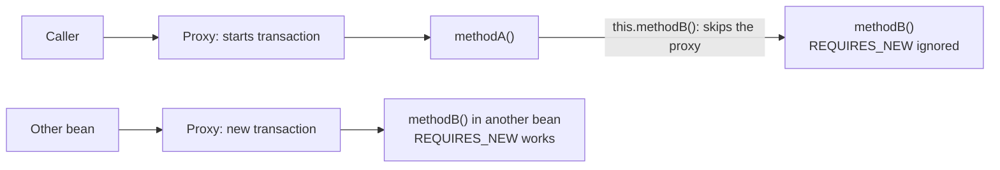

# Spring Transactions (@Transactional)

## Transaction Basics

### ❓ What is a Spring proxy?

**Problem:** Spring has to start and finish a transaction around your method without you writing that code inside the method.

### 📝 Answer

A proxy is an object Spring creates **in front of your bean**. Other beans receive the proxy, not the real object. Every call goes through it:

```text
Caller → Proxy (TransactionInterceptor) → your real OrderService method
           │  begin / join transaction
           │  call the real method
           └─ commit or roll back
```

| Proxy type | How it works | When used |
|---|---|---|
| JDK dynamic proxy | Implements the bean's interfaces | Bean has interfaces and `proxyTargetClass=false` |
| CGLIB proxy | Generated subclass that overrides methods | Spring Boot's default |

Conceptually, the proxy does this:

```java
// What the proxy does for a @Transactional method (simplified)
public void placeOrder() {
    TransactionStatus tx = transactionManager.getTransaction(definition);
    try {
        target.placeOrder();               // the real method
    } catch (RuntimeException | Error e) {
        transactionManager.rollback(tx);
        throw e;
    }
    transactionManager.commit(tx);
}
```

Consequences: `private` and `final` methods can't be intercepted, and calls **inside** the same object never pass through the proxy.

---

### ❓ In a Spring service, what can go wrong when using @Transactional?

**Problem:** A method is annotated with `@Transactional`, yet data is still partly saved, or nothing rolls back.

### 📝 Answer

| Pitfall | What happens | Fix |
|---|---|---|
| Self-invocation | `this.method()` bypasses the proxy, so the annotation on the called method is ignored | Move the method to another bean |
| `private` / `final` methods | The proxy can't intercept them | Put `@Transactional` on public methods |
| Checked exception thrown | Spring **commits** by default | `@Transactional(rollbackFor = Exception.class)` |
| Exception caught and swallowed | The proxy never sees it, so it commits | Rethrow, or call `TransactionAspectSupport.currentTransactionStatus().setRollbackOnly()` |
| Object created with `new` | Not a Spring bean, so there's no proxy | Let Spring inject the bean |
| Work started in another thread (`@Async`, executors) | Transactions are bound to the thread; the new thread doesn't share it | Give the async method its own transaction |
| Inner `REQUIRED` method fails but the outer method catches the exception | The shared transaction is marked rollback-only; the outer commit throws `UnexpectedRollbackException` | Let it propagate, or use `REQUIRES_NEW` for independent work |
| Slow remote calls inside the transaction | Locks and the DB connection are held for the whole call | Keep transactions short; call remote services outside them |

---

### ❓ A method calls another transactional method on the same instance. Is the second transaction boundary applied?

**Problem:** `methodA()` calls `methodB()` in the same class. `methodB()` has its own `@Transactional` settings (for example `REQUIRES_NEW` or `readOnly`). Are they used?

### 📝 Answer

**No, not with Spring's default proxy-based transactions.** The call `this.methodB()` goes straight to the real object; the proxy never sees it. `methodB()` simply runs inside whatever transaction `methodA()` already has, and its own settings are ignored.



```java
@Service
public class ReportService {

    @Transactional
    public void methodA() {
        methodB();   // same as this.methodB(): no proxy, methodB's settings are ignored
    }

    @Transactional(propagation = Propagation.REQUIRES_NEW)
    public void methodB() { }
}
```

Ways to get a real boundary:

1. **Move `methodB()` to another bean** and inject it (the cleanest fix).
2. Use `TransactionTemplate` for programmatic control.
3. Inject the bean's own proxy (`@Lazy` self-injection) — works, but is easy to misuse.
4. Switch to AspectJ weaving (`@EnableTransactionManagement(mode = AdviceMode.ASPECTJ)`), which also intercepts self-calls.

## Rollback Rules and Propagation

### ❓ Which exceptions make @Transactional roll back?

**Problem:** A method throws `IOException` (a checked exception), but the database changes are committed anyway.

### 📝 Answer

| Exception type | Compiler | Default @Transactional behaviour |
|---|---|---|
| Checked (`IOException`, `SQLException`…) | Forces you to handle or declare it | **Commit** |
| Unchecked (`RuntimeException` and subclasses) | Doesn't force handling | **Rollback** |
| `Error` | Doesn't force handling | **Rollback** |

To roll back on checked exceptions too:

```java
@Transactional(rollbackFor = Exception.class)
public void importFile(Path file) throws IOException {
    // an IOException here now rolls back the inserts
}
```

`noRollbackFor` does the opposite for chosen unchecked exceptions.

---

### ❓ What are REQUIRED and REQUIRES_NEW propagation?

**Problem:** One `@Transactional` method calls another `@Transactional` method in a different bean. Should the second one share the first one's transaction, or have its own?

### 📝 Answer

Think of a transaction as a **database work session**:

- `REQUIRED` (default) — **join** the current session if there is one; otherwise start a new one. One failure rolls back everything.
- `REQUIRES_NEW` — **pause** the current session and start a separate one. It commits or rolls back on its own, then the outer session resumes.

| Propagation | Existing transaction | No transaction |
|---|---|---|
| `REQUIRED` | Join it | Start one |
| `REQUIRES_NEW` | Suspend it, start a new one | Start one |
| `SUPPORTS` | Join it | Run without one |
| `MANDATORY` | Join it | Throw an exception |
| `NOT_SUPPORTED` | Suspend it, run without one | Run without one |
| `NEVER` | Throw an exception | Run without one |
| `NESTED` | Savepoint inside it (JDBC) | Start one |

Use `REQUIRES_NEW` for work that must survive the outer transaction's rollback, such as audit logs.

---

### ❓ What happens when both methods are in the same service and one uses REQUIRES_NEW?

**Problem:** The audit log should be saved even when the order fails:

```java
@Service
public class OrderService {

    @Transactional
    public void placeOrder() {
        saveAuditLog();
        throw new RuntimeException("Order failed");
    }

    @Transactional(propagation = Propagation.REQUIRES_NEW)
    public void saveAuditLog() {
        // Insert audit log into database
    }
}
```

### 📝 Answer

**The audit log is lost.** `saveAuditLog()` is a self-invocation, so `REQUIRES_NEW` is ignored. The insert joins `placeOrder()`'s transaction, and the `RuntimeException` rolls back **both**.

**Fix:** move the audit log into its own bean so the call goes through a proxy:

```java
@Service
public class AuditService {

    @Transactional(propagation = Propagation.REQUIRES_NEW)
    public void saveAuditLog() {
        // Insert audit log: commits in its own transaction
    }
}

@Service
public class OrderService {

    private final AuditService auditService;

    public OrderService(AuditService auditService) {
        this.auditService = auditService;
    }

    @Transactional
    public void placeOrder() {
        auditService.saveAuditLog();   // proxy: outer transaction suspended, audit committed
        throw new RuntimeException("Order failed");   // only the order work rolls back
    }
}
```

| Setup | Audit log | Order |
|---|---|---|
| Both methods in `OrderService` | Rolled back | Rolled back |
| `saveAuditLog()` in `AuditService` | **Committed** | Rolled back |

---

### ❓ How does Spring know when to commit or roll back?

**Problem:** Nothing in the method body says "commit" or "rollback", yet Spring does one or the other.

### 📝 Answer

Two mechanisms work together:

1. **Java controls the order of execution.** The next statement runs only after the previous call returns — unless an exception interrupts the flow.
2. **The Spring proxy controls the transaction boundaries.** It starts, suspends, resumes, commits or rolls back the transaction based on the annotation and **how the method ends**:

| How the method ends | Proxy decision |
|---|---|
| Returns normally | Commit (unless already marked rollback-only) |
| Throws `RuntimeException` or `Error` | Rollback |
| Throws a checked exception | Commit, unless `rollbackFor` includes it |
| Marked rollback-only (e.g. by an inner `REQUIRED` method that failed) | Rollback; the outer commit attempt throws `UnexpectedRollbackException` |

The decision is made **after** the method finishes, in the proxy — not at the line where the exception occurs.

---

### ❓ What is the difference between save and commit?

**Problem:** `repository.save(order)` returned without error, but another connection can't see the order yet — and later it disappears after an exception.

### 📝 Answer

| | `save()` | flush | commit |
|---|---|---|---|
| What it does | Puts the entity in the persistence context (first-level cache) | Sends pending SQL to the database | Makes the transaction's changes permanent |
| SQL executed? | Not necessarily (often deferred) | Yes | Yes (anything not yet flushed) |
| Visible to other transactions? | No | No (still uncommitted) | **Yes** |
| Can still roll back? | Yes | Yes | No |

```java
@Transactional
public void createOrder(Order order) {
    orderRepository.save(order);          // managed entity; INSERT may be deferred
    orderRepository.flush();              // INSERT sent now, still uncommitted
    // ... more work; an exception here rolls the INSERT back
}                                         // method returns: proxy commits
```

`saveAndFlush()` = `save()` + `flush()`. Only the **commit** at the end of the transaction makes the data durable and visible to others.
