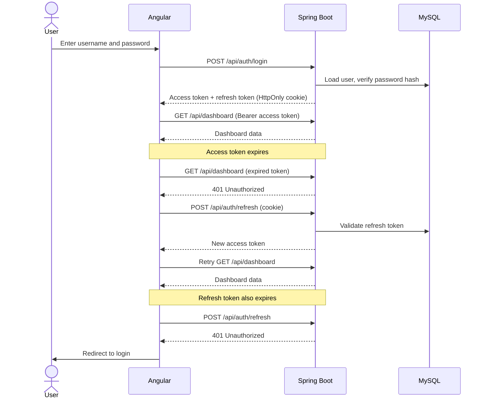
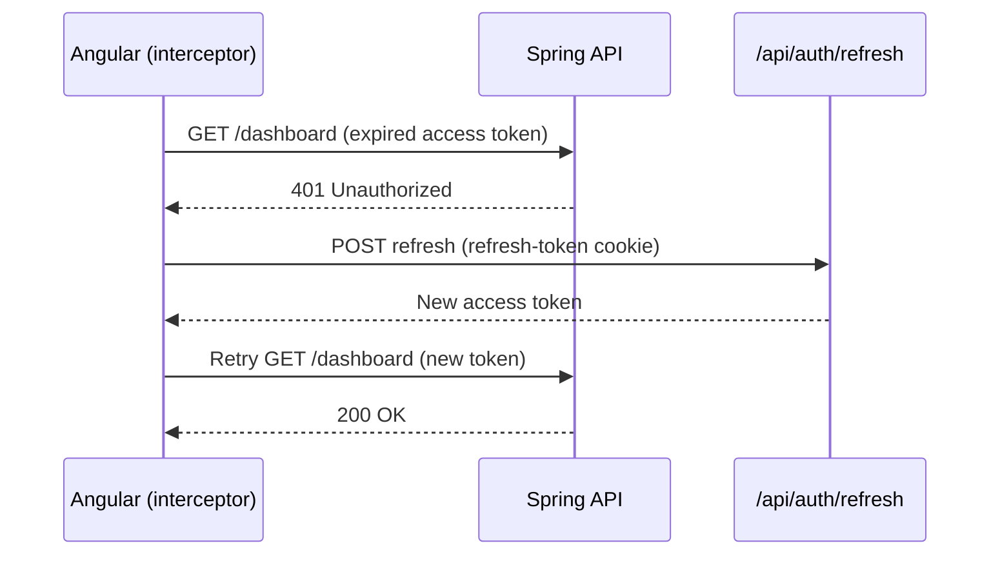
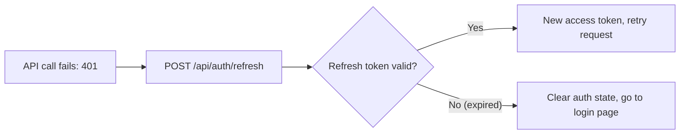

# JWT: Access Tokens and Refresh Tokens

Setup used in the examples: Angular front end, Spring Boot REST APIs, MySQL, JWT access token and refresh token.

## Authentication Flow

### ❓ What are access tokens and refresh tokens, and why use both?

### 📝 Answer

| | Access token | Refresh token |
|---|---|---|
| Purpose | Call protected APIs | Get a new access token |
| Lifetime (example) | Short — 15 minutes | Long — 7 days |
| Sent with | Every API request (`Authorization: Bearer …`) | Only `POST /api/auth/refresh` |
| Typical format | Signed JWT, validated by signature and claims | Opaque random value, stored **hashed** in the database |
| Revocable? | Not easily (stateless) | Yes — delete or mark it revoked |
| Recommended storage | In memory in the app | `HttpOnly`, `Secure`, `SameSite` cookie |

A short-lived access token limits the damage if it leaks; the refresh token keeps the user logged in without asking for the password every 15 minutes.

---

### ❓ What is the complete login-to-dashboard flow with JWT?

### 📝 Answer

1. **User opens the app** — Angular shows the login page.
2. **User submits credentials** — `POST /api/auth/login` with `{"username": "user1", "password": "…"}`.
3. **Spring Boot validates them** — loads the user, verifies the password hash (e.g. BCrypt), checks the account is active.
4. **Backend issues two tokens** — an access token (15 min) and a refresh token (7 days). The refresh token is set as an `HttpOnly`, `Secure` cookie.
5. **Angular opens the dashboard** — calls `GET /api/dashboard` with `Authorization: Bearer <access_token>`.
6. **Spring Security validates the access token** — signature, expiry (`exp`), issuer and audience if configured, then roles/claims for authorization.
7. **Dashboard data is returned** and Angular renders it.



---

### ❓ What happens when the access token expires?

### 📝 Answer

Example: login at 10:00, access token expires at 10:15, refresh token valid for 7 days. At 10:16 the user clicks a dashboard feature:

1. Angular calls the API with the expired access token.
2. Spring Security sees that `exp` has passed and returns `401 Unauthorized`.
3. An Angular HTTP interceptor catches the 401 and calls `POST /api/auth/refresh` (the browser sends the refresh-token cookie).
4. The backend validates the refresh token and returns a new access token (and, with rotation, a new refresh token).
5. The interceptor retries the original request with the new access token.

The user stays logged in and notices nothing.



If several requests fail at the same moment, only **one** refresh call should be made; the others wait for it:

```ts
let refresh$: Observable<string> | null = null;

export const authInterceptor: HttpInterceptorFn = (req, next) => {
  const auth = inject(AuthService);
  const withToken = (token: string | null) =>
    token ? req.clone({ setHeaders: { Authorization: `Bearer ${token}` } }) : req;

  return next(withToken(auth.accessToken())).pipe(
    catchError((error: HttpErrorResponse) => {
      // Never refresh for the auth endpoints themselves (avoids infinite loops).
      if (error.status !== 401 || req.url.includes('/api/auth/')) {
        return throwError(() => error);
      }
      // One shared refresh for every request that failed at the same time.
      refresh$ ??= auth.refresh().pipe(
        finalize(() => (refresh$ = null)),
        shareReplay(1),
      );
      return refresh$.pipe(switchMap(token => next(withToken(token))));
    }),
  );
};
```

---

### ❓ What happens when the refresh token expires?

### 📝 Answer

Example: the user comes back after 8 days; the 7-day refresh token has expired.

1. Angular calls an API; the access token is expired or missing.
2. Angular calls `POST /api/auth/refresh`.
3. The backend finds the refresh token expired and returns `401 Unauthorized`.
4. Angular clears its authentication state and redirects to the login page.
5. The user must enter credentials again.



| Scenario | Access token | Refresh token | Can refresh? | Must log in? |
|---|---|---|---|---|
| Access token expires | Expired | Valid | Yes | No |
| Refresh token expires | Usually expired too | Expired | No | **Yes** |

---

### ❓ How do you implement the token refresh API in Spring Boot?

### 📝 Answer

| API | Purpose | Authenticated with |
|---|---|---|
| `POST /api/auth/login` | Issue tokens | Username and password |
| `POST /api/auth/refresh` | Issue a new access token | Refresh token (cookie) |
| `GET /api/dashboard` | Protected data | Access token |
| `POST /api/auth/logout` | Revoke the refresh token | Refresh token / session |

Refresh with **rotation** and **reuse detection** (each refresh token works once; seeing a used one again suggests theft):

```java
@Transactional
public TokenPair refresh(String rawRefreshToken) {
    RefreshToken stored = refreshTokens.findByTokenHash(sha256(rawRefreshToken))
        .orElseThrow(UnauthorizedException::new);

    if (stored.isRevoked()) {
        // A rotated token was used again: possible theft. End every session of this user.
        refreshTokens.revokeAllForUser(stored.getUser());
        throw new UnauthorizedException();
    }
    if (stored.isExpired() || !stored.getUser().isEnabled()) {
        throw new UnauthorizedException();
    }

    stored.revoke();                                   // rotation: this token is now used up
    String newRefreshToken = tokenGenerator.randomToken();
    refreshTokens.save(RefreshToken.issue(stored.getUser(), sha256(newRefreshToken), Duration.ofDays(7)));

    String newAccessToken = jwtService.generateAccessToken(stored.getUser());
    return new TokenPair(newAccessToken, newRefreshToken);   // refresh token goes back as an HttpOnly cookie
}
```

Design points:

- The access token is a short-lived JWT, checked by signature and claims.
- The refresh token can be an opaque random value stored only as a **hash**.
- Refresh tokens must be revocable (logout, password change, disabled account).
- An expired access token is never accepted in place of a valid refresh token.

## Tricky Interview Questions

### ❓ Can an expired access token be used to get a new access token?

No. Only a valid refresh token can. Otherwise anyone holding an old, leaked access token could stay logged in forever.

---

### ❓ Does the refresh API need a valid access token?

No. It authenticates with the refresh token — the access token is usually already expired when refresh is called.

---

### ❓ What happens if five API calls return 401 at the same time?

Each would start its own refresh. With rotation, only the first succeeds and the others fail (and may even trigger reuse detection). Make **one** refresh call, queue the other requests, and retry them all with the new token.

---

### ❓ What happens if a refresh token is stolen?

The attacker can mint new access tokens until it expires. Mitigations: `HttpOnly` cookie storage, rotation with reuse detection (revoke the whole token family), binding to device or session metadata, short absolute lifetime, and revoking on logout or password change.

---

### ❓ Can a JWT be invalidated immediately?

Not with purely stateless validation — a signed JWT stays valid until `exp`. Options: short expiry, a denylist of token IDs (`jti`) until expiry, or a per-user token version checked on each request.

---

### ❓ What should happen when the user logs out?

Revoke the refresh token on the server (delete it or mark it revoked), clear the refresh-token cookie, and discard the access token in the app. The access token may remain technically valid until it expires — another reason to keep it short-lived.

---

### ❓ What is the difference between 401 and 403?

`401 Unauthorized` = not authenticated (missing, invalid or expired token). `403 Forbidden` = authenticated but not allowed to perform this action.

---

### ❓ What happens if a user's role changes while their JWT is still valid?

The token still carries the old role claims until it expires. If immediate effect matters, check current roles in the database for sensitive actions, use a token version, or force a refresh.

---

### ❓ Should a JWT be stored in localStorage?

It's risky: any XSS script can read localStorage and steal the token. Prefer keeping the access token in memory and the refresh token in an `HttpOnly`, `Secure`, `SameSite` cookie that JavaScript can't read.

---

### ❓ Can two refresh requests with the same refresh token both succeed?

With rotation, no — the second finds the token already used and fails (or triggers reuse detection). Handle concurrency on the client (one refresh at a time) and consider a short grace period on the server for lost responses.

---

### ❓ What if the refresh token is valid but the user account has been disabled?

Refresh must fail. Always check the account status during refresh, not only at login.

---

### ❓ What if a refresh token is revoked before its expiry date?

The backend rejects it. Revocation is checked in the database, independently of the expiry date.

---

### ❓ Can the refresh token's expiry be extended every time the user is active?

Yes — sliding expiration. Enforce an **absolute maximum** session lifetime as well, so a stolen token can't be kept alive forever.

---

### ❓ What happens if the access token expires while a long request is running?

Nothing. The token is validated when the request enters the API; a request already authorized is not cancelled midway.

---

### ❓ If the refresh token is in an HttpOnly cookie, how does Angular send it?

It doesn't read it at all — the browser attaches the cookie automatically to requests for the matching domain and path (use `withCredentials: true` for cross-origin calls).

---

### ❓ What if the refresh token expires while the user is actively using the app?

The next refresh attempt fails with 401, and the user has to log in again. Sliding expiration or a warning before the session ends improves the experience.

---

### ❓ What if the backend issues a new token but the response never reaches Angular?

The client still holds the old refresh token, which rotation has already marked as used, so the retry fails. Handle it with a short reuse grace window, idempotent refresh within a few seconds, or by sending the user back to login.

---

### ❓ Should every 401 response trigger a token refresh?

No. Exclude the login, refresh and logout endpoints, refresh at most once per failed request, and never retry in a loop — otherwise a bad refresh token causes endless 401 → refresh → 401 cycles.

---

### ❓ How do you prevent CSRF when tokens are stored in cookies?

Cookies are sent automatically, so a malicious site could trigger requests. Use `SameSite=Strict` or `Lax` cookies, restrict the refresh cookie's `Path` to `/api/auth/refresh`, and add CSRF tokens (Spring Security's `CsrfTokenRepository`) where state-changing requests rely on cookies.

---

### ❓ What should a senior Spring Boot developer know about JWT authentication?

| Area | Topics |
|---|---|
| Spring Security | `SecurityFilterChain`, JWT authentication filter, `AuthenticationManager` |
| JWT | Signature, claims, expiry, issuer, audience |
| Refresh mechanism | Rotation, revocation, reuse detection |
| Angular | HTTP interceptor, handling concurrent refreshes |
| Security | XSS, CSRF, cookie flags, session management |
