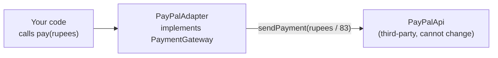
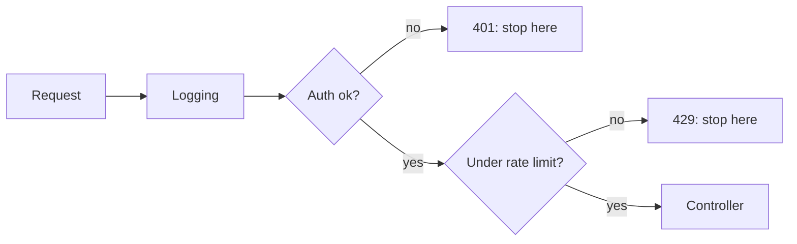

# 🧩 Design Patterns & SOLID Interview Preparation

## Part 1 — SOLID Principles

### ❓ What are the SOLID principles?

**Level:** 🟢 Beginner

### 📝 Answer

Five rules that keep code easy to change:

| Letter | Principle | In one line |
|---|---|---|
| **S** | Single Responsibility | A class has one reason to change |
| **O** | Open/Closed | Add new behaviour without editing old code |
| **L** | Liskov Substitution | A subclass must work wherever its parent works |
| **I** | Interface Segregation | Many small interfaces beat one fat interface |
| **D** | Dependency Inversion | Depend on interfaces, not concrete classes |

#### ↳ Follow-up: Which one do you use most in Spring?

↪ Dependency Inversion — services depend on interfaces (`PaymentGateway`) and Spring injects the implementation.

---

### ❓ Explain the Single Responsibility Principle with an example.

**Level:** 🟡 Intermediate

### 📝 Answer

A class should do **one job**, so it has only one reason to change.

❌ **Bad** — one class calculates, saves and emails:

```java
class InvoiceService {
    double total(Invoice i) { ... }
    void saveToDb(Invoice i) { ... }
    void emailCustomer(Invoice i) { ... }
}
```

✅ **Good** — one job each:

```java
class InvoiceCalculator  { double total(Invoice i) { ... } }
class InvoiceRepository  { void save(Invoice i) { ... } }
class InvoiceMailer      { void send(Invoice i) { ... } }
```

Now a change to the email template never touches the tax calculation.

---

### ❓ Explain the Open/Closed Principle with an example.

**Level:** 🟡 Intermediate

### 📝 Answer

Code should be **open for extension, closed for modification**: add a new case by adding a class, not by editing a growing `if/else`.

❌ **Bad** — every new payment type edits this method:

```java
double fee(String type, double amount) {
    if (type.equals("CARD")) return amount * 0.02;
    else if (type.equals("UPI")) return 0;
    // add NETBANKING here... and again... and again
}
```

✅ **Good** — new type = new class:

```java
interface PaymentFee { double fee(double amount); }
class CardFee implements PaymentFee { public double fee(double a) { return a * 0.02; } }
class UpiFee  implements PaymentFee { public double fee(double a) { return 0; } }
```

---

### ❓ Explain the Liskov Substitution Principle with an example.

**Level:** 🟡 Intermediate

### 📝 Answer

If `B extends A`, you must be able to use a `B` anywhere an `A` is expected **without surprises**.

Classic violation — Square extends Rectangle:

```java
Rectangle r = new Square();
r.setWidth(5);
r.setHeight(10);
r.area(); // expected 50, Square gives 100 → surprise!
```

A square isn't a "rectangle whose sides change independently". Fix: don't inherit; both implement a `Shape` interface with `area()`.

Another sign of a violation: a subclass that throws `UnsupportedOperationException` for a parent method.

---

### ❓ Explain the Interface Segregation Principle with an example.

**Level:** 🟡 Intermediate

### 📝 Answer

Don't force classes to implement methods they don't need.

❌ **Bad:**

```java
interface Worker { void work(); void eat(); }
class Robot implements Worker {
    public void work() { ... }
    public void eat() { throw new UnsupportedOperationException(); } // robots don't eat
}
```

✅ **Good:**

```java
interface Workable { void work(); }
interface Eatable  { void eat(); }
class Robot implements Workable { public void work() { ... } }
class Human implements Workable, Eatable { ... }
```

---

### ❓ Explain the Dependency Inversion Principle with an example.

**Level:** 🟡 Intermediate

### 📝 Answer

High-level code should depend on an **interface**, not on a concrete class. Then you can swap the implementation (or mock it in tests).

```java
interface PaymentGateway { void pay(double amount); }

@Service
class OrderService {
    private final PaymentGateway gateway;           // depends on the interface
    OrderService(PaymentGateway gateway) { this.gateway = gateway; } // injected
}

@Component class RazorpayGateway implements PaymentGateway { ... }
```

Switching from Razorpay to Stripe = a new class; `OrderService` doesn't change.

#### ↳ Follow-up: Dependency Inversion vs Dependency Injection?

↪ Inversion is the principle (depend on abstractions). Injection is the technique (someone else, like Spring, passes the dependency in).

---

## Part 2 — Creational Patterns

### ❓ What are design patterns and what are the three types?

**Level:** 🟢 Beginner

### 📝 Answer

Design patterns are **proven solutions to common design problems** — named, so developers can talk about them quickly.

| Type | Solves | Examples |
|---|---|---|
| Creational | How objects are created | Singleton, Factory, Builder, Prototype |
| Structural | How objects are combined | Adapter, Decorator, Proxy, Facade |
| Behavioral | How objects talk and share work | Strategy, Observer, Template Method, Chain of Responsibility |

---

### ❓ What is the Singleton pattern and how do you write a thread-safe one?

**Level:** 🟡 Intermediate

### 📝 Answer

Singleton = **only one instance** of a class in the whole app (e.g. a config holder).

**Simplest thread-safe version — enum (recommended):**

```java
public enum AppConfig {
    INSTANCE;
    public String url() { return "https://api.example.com"; }
}
// AppConfig.INSTANCE.url()
```

**Lazy version — holder class:**

```java
public class AppConfig {
    private AppConfig() {}
    private static class Holder { static final AppConfig INSTANCE = new AppConfig(); }
    public static AppConfig getInstance() { return Holder.INSTANCE; }
}
```

The JVM loads `Holder` only on first use, and class loading is thread-safe.

#### ↳ Follow-up: How can a Singleton be broken?

↪ By reflection (calling the private constructor), serialization (creates a new copy on deserialize — add `readResolve()`), and cloning. An enum singleton is safe against all three.

#### ↳ Follow-up: Is a Spring bean a Singleton pattern?

↪ Not exactly. Spring's default scope gives one instance **per Spring container**, not per JVM, and the class itself has a normal public constructor.

#### ↳ Follow-up: Why is double-checked locking written with `volatile`?

↪ Without `volatile`, another thread may see the reference before the object is fully built. `volatile` prevents that reordering.

---

### ❓ What is the Factory pattern?

**Level:** 🟢 Beginner

### 📝 Answer

A factory **creates objects for you**, so callers don't use `new` with concrete classes or know which one to pick.

```java
interface Notification { void send(String msg); }
class EmailNotification implements Notification { ... }
class SmsNotification implements Notification { ... }

class NotificationFactory {
    static Notification of(String channel) {
        return switch (channel) {
            case "EMAIL" -> new EmailNotification();
            case "SMS"   -> new SmsNotification();
            default -> throw new IllegalArgumentException(channel);
        };
    }
}
NotificationFactory.of("SMS").send("Your OTP is 4821");
```

JDK examples: `List.of()`, `Calendar.getInstance()`, `NumberFormat.getInstance()`.

#### ↳ Follow-up: Factory Method vs Abstract Factory?

↪ Factory Method creates one product. Abstract Factory creates a family of related products (e.g. `DarkThemeFactory` makes a dark button and a dark checkbox).

---

### ❓ What is the Builder pattern?

**Level:** 🟢 Beginner

### 📝 Answer

Builder creates an object **step by step**, which is clearer than a constructor with many parameters (especially optional ones).

```java
User user = User.builder()
        .name("Asha")
        .email("asha@mail.com")
        .age(28)          // optional fields can be skipped
        .build();
```

Without it: `new User("Asha", "asha@mail.com", null, 28, null, true)` — hard to read and easy to mix up.

In Java projects, Lombok's `@Builder` generates it. JDK example: `StringBuilder`, `HttpRequest.newBuilder()`.

---

### ❓ What is the Prototype pattern?

**Level:** 🟡 Intermediate

### 📝 Answer

Create new objects by **copying an existing one** instead of building from scratch — useful when setup is expensive.

```java
Report copy = template.copy(); // then change only what differs
```

Watch for **shallow vs deep copy**: a shallow copy shares inner lists/objects with the original.

---

## Part 3 — Structural Patterns

### ❓ What is the Adapter pattern?

**Level:** 🟢 Beginner

### 📝 Answer

An adapter makes **one interface fit another**, like a travel plug adapter.

```java
interface PaymentGateway { void pay(double rupees); }

class PayPalApi { void sendPayment(double dollars) { ... } } // third-party, can't change

class PayPalAdapter implements PaymentGateway {
    private final PayPalApi api = new PayPalApi();
    public void pay(double rupees) { api.sendPayment(rupees / 83); }
}
```



JDK example: `Arrays.asList()` (array → List), `InputStreamReader` (bytes → characters).

---

### ❓ What is the Decorator pattern?

**Level:** 🟡 Intermediate

### 📝 Answer

A decorator **wraps an object to add behaviour** without changing its class — and wrappers can be stacked.

```java
Coffee c = new MilkDecorator(new SugarDecorator(new BasicCoffee()));
c.cost(); // basic + sugar + milk
```

JDK example: `new BufferedReader(new InputStreamReader(new FileInputStream("a.txt")))` — each layer adds a feature.

#### ↳ Follow-up: Decorator vs inheritance?

↪ Inheritance fixes features at compile time and needs a subclass per combination. Decorators combine features at runtime.

---

### ❓ What is the Proxy pattern?

**Level:** 🟡 Intermediate

### 📝 Answer

A proxy is a **stand-in object** that controls access to the real one — adding checks, caching, lazy loading or logging before passing the call on.

Spring uses proxies everywhere: `@Transactional`, `@Cacheable` and `@Async` work because Spring wraps your bean in a proxy that starts the transaction / checks the cache, then calls your method.

#### ↳ Follow-up: Why doesn't `@Transactional` work when a method calls another method in the same class?

↪ The internal call `this.method()` skips the proxy, so the transaction logic never runs.

#### ↳ Follow-up: Proxy vs Decorator?

↪ Same structure; different intent. A proxy controls access to an object; a decorator adds features to it.

---

### ❓ What is the Facade pattern?

**Level:** 🟢 Beginner

### 📝 Answer

A facade gives **one simple method** in front of a complicated set of classes.

```java
class CheckoutFacade {
    void checkout(Cart cart) {
        inventory.reserve(cart);
        payment.charge(cart.total());
        shipping.schedule(cart);
        email.sendConfirmation(cart);
    }
}
```

The controller calls `checkout()` and doesn't need to know the four services.

---

## Part 4 — Behavioral Patterns

### ❓ What is the Strategy pattern?

**Level:** 🟢 Beginner

### 📝 Answer

Strategy puts **interchangeable algorithms behind one interface** and picks one at runtime — the cure for long `if/else` chains.

```java
interface DiscountStrategy { double apply(double price); }
class NoDiscount      implements DiscountStrategy { public double apply(double p) { return p; } }
class FestiveDiscount implements DiscountStrategy { public double apply(double p) { return p * 0.8; } }

class Checkout {
    private final DiscountStrategy discount;
    Checkout(DiscountStrategy discount) { this.discount = discount; }
    double pay(double price) { return discount.apply(price); }
}
```

JDK example: `Comparator` passed to `list.sort(...)`.

**Spring trick:** inject all implementations as a map and pick by name:

```java
@Autowired Map<String, DiscountStrategy> strategies; // bean name → bean
strategies.get("festiveDiscount").apply(1000);
```

#### ↳ Follow-up: Strategy vs Factory?

↪ Factory decides **which object to create**. Strategy decides **which behaviour to run**. They are often used together.

---

### ❓ What is the Observer pattern?

**Level:** 🟢 Beginner

### 📝 Answer

When one object changes, **all its subscribers are notified automatically** — like YouTube subscribers getting a new-video alert.

```java
interface OrderListener { void onOrderPlaced(Order o); }

class OrderService {
    private final List<OrderListener> listeners = new ArrayList<>();
    void subscribe(OrderListener l) { listeners.add(l); }
    void place(Order o) { save(o); listeners.forEach(l -> l.onOrderPlaced(o)); }
}
```

Real uses: Spring `ApplicationEventPublisher` + `@EventListener`, RxJS Observables, Kafka consumers (at system level), DOM `addEventListener`.

---

### ❓ What is the Template Method pattern?

**Level:** 🟡 Intermediate

### 📝 Answer

A base class defines the **fixed steps** of an algorithm; subclasses fill in some steps.

```java
abstract class DataExporter {
    final void export() { var d = read(); var f = format(d); write(f); } // fixed order
    abstract String format(List<Row> rows);                              // varies
}
class CsvExporter extends DataExporter { String format(List<Row> r) { ... } }
```

Spring examples: `JdbcTemplate`, `RestTemplate` — they handle connections and errors; you supply the query and mapping.

---

### ❓ What is the Chain of Responsibility pattern?

**Level:** 🟡 Intermediate

### 📝 Answer

A request passes **along a chain of handlers**; each one handles it or passes it to the next.

Real examples: Servlet **filters** and the **Spring Security filter chain** (CORS → authentication → authorization), Express/NestJS middleware, Angular HTTP interceptors.



---

### ❓ What is the Command pattern?

**Level:** 🟡 Intermediate

### 📝 Answer

Wrap an action as an **object**, so it can be queued, logged, retried or undone.

Example: a text editor stores each edit as a `Command` with `execute()` and `undo()`; Ctrl+Z calls `undo()` on the last one. `Runnable` passed to an executor is also a command.

---

## Part 5 — Tricky Questions

### ❓ Tricky: Which design patterns does Spring use?

**Level:** 🟡 Intermediate

### 📝 Answer

| Pattern | Where in Spring |
|---|---|
| Singleton | Default bean scope |
| Factory | `BeanFactory`, `ApplicationContext`, `@Bean` methods |
| Proxy | `@Transactional`, `@Cacheable`, `@Async`, AOP |
| Template Method | `JdbcTemplate`, `RestTemplate`, `KafkaTemplate` |
| Observer | `ApplicationEvent` + `@EventListener` |
| Chain of Responsibility | Security filter chain, interceptors |
| Front Controller | `DispatcherServlet` |
| Strategy | Injecting one of several implementations of an interface |

---

### ❓ Tricky: Is Singleton an anti-pattern?

**Level:** 🟡 Intermediate

### 📝 Answer

It can be. A hand-written static singleton is **global state**: hidden dependencies, hard to mock in tests, and risky with threads. Prefer letting a framework (Spring) manage one instance and inject it — you get one object without the downsides.

---

### ❓ Tricky: What is composition over inheritance?

**Level:** 🟡 Intermediate

### 📝 Answer

Build classes by **holding other objects** ("has-a") rather than extending them ("is-a").

```java
class Car { private final Engine engine; } // composition: swap the engine easily
class Car extends Engine { }               // inheritance: a car is not an engine
```

Inheritance tightly couples to the parent and breaks easily when the parent changes. Use it only for real "is-a" relationships.

---

### ❓ Tricky: What are DRY, KISS and YAGNI?

**Level:** 🟡 Intermediate

### 📝 Answer

- **DRY — Don't Repeat Yourself:** one place for each piece of logic.
- **KISS — Keep It Simple:** the simplest solution that works.
- **YAGNI — You Aren't Gonna Need It:** don't build features "for later".

Balance them: forcing DRY too early can create the wrong abstraction.
