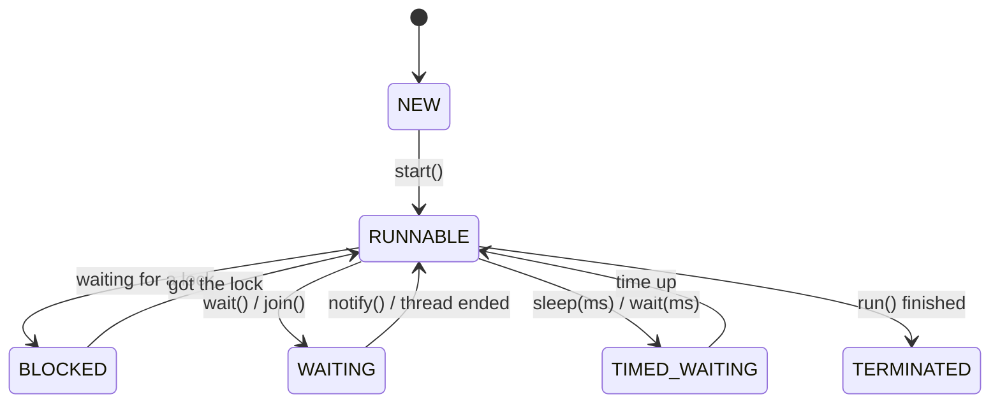
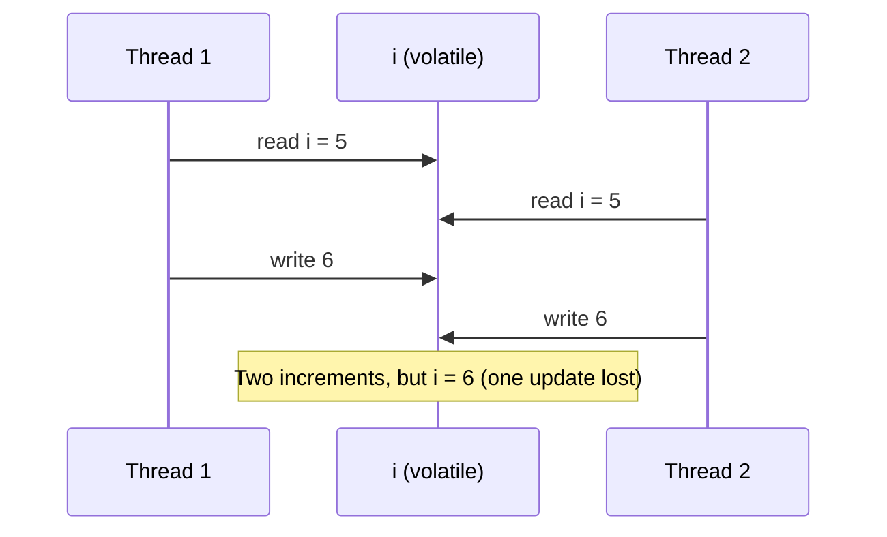

# 🧵 Java Concurrency Interview Preparation

## Part 1 — Threads Basics

### ❓ What are the ways to create a thread in Java?

### 📝 Answer

1. **Extend `Thread`** — override `run()`.
2. **Implement `Runnable`** — pass it to a `Thread` (preferred; your class can still extend something else).
3. **Implement `Callable`** — like `Runnable` but returns a value; run it with an `ExecutorService`.
4. **Executors / `CompletableFuture`** — the modern way; you submit tasks, a pool runs them.

```java
new Thread(() -> System.out.println("Hi from " + Thread.currentThread().getName())).start();

ExecutorService pool = Executors.newFixedThreadPool(4);
Future<Integer> f = pool.submit(() -> 21 * 2);   // Callable
System.out.println(f.get());                      // 42
pool.shutdown();
```

#### ↳ Follow-up: What is the difference between `start()` and `run()`?

↪ `start()` creates a new thread that then calls `run()`. Calling `run()` directly just runs it on the current thread — no new thread.

#### ↳ Follow-up: Can you call `start()` twice on the same thread?

↪ No — the second call throws `IllegalThreadStateException`.

---

### ❓ What are the thread states (lifecycle)?

### 📝 Answer



`NEW` → `RUNNABLE` → (`BLOCKED` / `WAITING` / `TIMED_WAITING`) → `TERMINATED`.

---

### ❓ What is a race condition? Show an example.

### 📝 Answer

A race condition happens when **two threads change shared data at the same time** and the result depends on timing.

```java
class Counter {
    int count = 0;
    void increment() { count++; } // read, add, write — 3 steps, not atomic!
}
// 2 threads × 1000 increments → often prints less than 2000
```

Both threads read `5`, both write `6` — one increment is lost.

**Fixes:**

```java
synchronized void increment() { count++; }           // lock
AtomicInteger count = new AtomicInteger(); count.incrementAndGet(); // lock-free atomic
```

---

### ❓ What does `synchronized` do?

### 📝 Answer

It lets **only one thread at a time** run a block of code for the same lock object, and makes changes visible to the next thread that takes the lock.

```java
synchronized void deposit(int amt) { balance += amt; }      // locks "this"
static synchronized void log() { }                          // locks the Class object
void transfer() { synchronized (lock) { /* critical part */ } } // locks "lock"
```

#### ↳ Follow-up: Can two threads call two different `synchronized` methods of the same object at the same time?

↪ No — both lock `this`. But a `static synchronized` and a normal `synchronized` method can run together (different locks).

---

### ❓ What does `volatile` do? Is it enough for a counter?

### 📝 Answer

`volatile` makes a variable's latest value **visible to all threads** (no stale cached copy) and stops reordering around it. It does **not** make operations atomic.

```java
volatile boolean running = true;   // ✅ good: one thread sets false, another stops its loop
volatile int count; count++;       // ❌ still a race: read-add-write is 3 steps
```

For counters use `AtomicInteger` or `synchronized`.

---

### ❓ `synchronized` vs `ReentrantLock` — what's the difference?

### 📝 Answer

| `synchronized` | `ReentrantLock` |
|---|---|
| Built into the language; auto-released | Must call `unlock()` in `finally` |
| Can't time out or be interrupted while waiting | `tryLock(timeout)`, interruptible waits |
| No fairness option | Optional fair ordering |
| One wait set (`wait/notify`) | Many `Condition`s |

```java
lock.lock();
try { balance += amt; } finally { lock.unlock(); }
```

Use `synchronized` by default; use `ReentrantLock` when you need `tryLock` or timeouts.

#### ↳ Follow-up: What does "reentrant" mean?

↪ A thread that already holds the lock can take it again (e.g. a synchronized method calling another synchronized method) without deadlocking itself.

---

### ❓ `wait()` vs `sleep()`?

### 📝 Answer

| `wait()` | `sleep()` |
|---|---|
| Method of `Object` | Static method of `Thread` |
| Must be inside `synchronized` | Can be called anywhere |
| **Releases** the lock | **Keeps** the lock |
| Wakes on `notify()`/`notifyAll()` (or timeout) | Wakes after the time |

Always call `wait()` inside a `while` loop that re-checks the condition — threads can wake up spuriously.

---

## Part 2 — Deadlock & Friends

### ❓ What is a deadlock? Show an example and how to prevent it.

**Level:** 🟡 Intermediate

### 📝 Answer

Two threads each hold a lock the other needs, so both **wait forever**.

```java
// Thread 1                       // Thread 2
synchronized (a) {                synchronized (b) {
  synchronized (b) { ... }          synchronized (a) { ... }
}                                 }
```

```text
Thread 1 holds A, wants B  ⇄  Thread 2 holds B, wants A   → stuck
```

**Prevent it:**

- **Lock in the same order everywhere** (always A then B) — the usual fix.
- Use `tryLock(timeout)` and back off if you can't get the second lock.
- Hold locks for as short as possible; avoid calling unknown code while holding a lock.

#### ↳ Follow-up: How do you find a deadlock in a running app?

↪ Take a thread dump (`jstack <pid>` or VisualVM); the JVM reports "Found one Java-level deadlock" with the threads and locks involved.

#### ↳ Follow-up: What are livelock and starvation?

↪ Livelock: threads keep reacting to each other and make no progress (two people stepping aside in a corridor). Starvation: one thread never gets CPU or a lock because others always win.

---

## Part 3 — Executors & Thread Pools

### ❓ Why use a thread pool instead of creating threads?

**Level:** 🟡 Intermediate

### 📝 Answer

Creating a thread is expensive (memory for its stack, OS work). A pool **reuses a fixed set of threads** and queues extra tasks, so 10,000 tasks don't create 10,000 threads and crash the app.

```java
ExecutorService pool = Executors.newFixedThreadPool(8);
for (Order o : orders) pool.submit(() -> process(o));
pool.shutdown();
pool.awaitTermination(1, TimeUnit.MINUTES);
```

---

### ❓ What are the types of thread pools in `Executors`?

**Level:** 🟡 Intermediate

### 📝 Answer

| Factory method | Behaviour | Watch out |
|---|---|---|
| `newFixedThreadPool(n)` | n threads, unbounded queue | Queue can grow until out of memory |
| `newCachedThreadPool()` | Creates threads as needed, reuses idle ones | Can create thousands of threads |
| `newSingleThreadExecutor()` | One thread, tasks run in order | — |
| `newScheduledThreadPool(n)` | Run later or repeatedly | — |
| `newVirtualThreadPerTaskExecutor()` (Java 21) | One cheap virtual thread per task | Best for I/O-heavy work |

In production, prefer a `ThreadPoolExecutor` with a **bounded queue** and a rejection policy.

#### ↳ Follow-up: How many threads should a pool have?

↪ CPU-heavy work: about the number of cores. I/O-heavy work (DB, HTTP): more, roughly cores × (1 + wait time / compute time).

---

### ❓ `Runnable` vs `Callable`?

**Level:** 🟡 Intermediate

### 📝 Answer

| `Runnable` | `Callable<T>` |
|---|---|
| `void run()` | `T call()` — returns a result |
| Can't throw checked exceptions | Can throw checked exceptions |
| `execute()` or `submit()` | `submit()` → `Future<T>` |

---

### ❓ What is `Future` and what is its limitation?

**Level:** 🟡 Intermediate

### 📝 Answer

A `Future` is a **placeholder for a result** that will be ready later.

```java
Future<User> f = pool.submit(() -> loadUser(42));
User u = f.get(); // blocks until ready
```

Limitation: `get()` **blocks**, and you can't chain steps ("when ready, then do X") or combine several futures easily. `CompletableFuture` solves this.

---

### ❓ What is `CompletableFuture`? Show an example.

**Level:** 🟡 Intermediate

### 📝 Answer

A `Future` you can **chain and combine without blocking**.

```java
CompletableFuture<User>  user  = CompletableFuture.supplyAsync(() -> userService.get(42));
CompletableFuture<List<Order>> orders = CompletableFuture.supplyAsync(() -> orderService.forUser(42));

CompletableFuture<Dashboard> dashboard = user
        .thenCombine(orders, Dashboard::new)        // both run in parallel, then combine
        .exceptionally(ex -> Dashboard.empty());    // fallback on error

Dashboard d = dashboard.join();
```

| Method | Use |
|---|---|
| `thenApply` | Transform the result (like `map`) |
| `thenCompose` | Next step is itself async (like `flatMap`) |
| `thenCombine` | Combine two independent futures |
| `allOf` / `anyOf` | Wait for all / the first |
| `exceptionally` / `handle` | Handle errors |

#### ↳ Follow-up: Which thread pool does `supplyAsync` use by default?

↪ The shared `ForkJoinPool.commonPool()`. For blocking I/O, pass your own executor so you don't starve the common pool.

---

### ❓ What are virtual threads (Java 21)?

**Level:** 🟡 Intermediate

### 📝 Answer

Very **lightweight threads managed by the JVM**, not the OS. You can run millions. When a virtual thread waits on I/O, it frees its carrier (OS) thread for others.

```java
try (var exec = Executors.newVirtualThreadPerTaskExecutor()) {
    for (int i = 0; i < 10_000; i++) exec.submit(() -> callSlowApi());
}
```

Great for apps that mostly **wait** (HTTP, DB). No gain for CPU-heavy work. In Spring Boot 3.2+: `spring.threads.virtual.enabled=true`.

#### ↳ Follow-up: What is "pinning"?

↪ A virtual thread stuck to its carrier thread (e.g. waiting inside some `synchronized` blocks on older JDKs), which loses the benefit. JDK 24 removed most `synchronized` pinning.

---

## Part 4 — Concurrent Collections & Utilities

### ❓ Why is `HashMap` not thread-safe, and what should you use instead?

**Level:** 🟡 Intermediate

### 📝 Answer

Two threads writing a `HashMap` at once can **lose entries** or corrupt its internal structure.

| Option | Notes |
|---|---|
| `ConcurrentHashMap` | ✅ Best choice: fine-grained locking, fast reads |
| `Collections.synchronizedMap` | Locks the whole map for every call — slower |
| `Hashtable` | Legacy; locks everything |

```java
ConcurrentHashMap<String, Integer> hits = new ConcurrentHashMap<>();
hits.merge("home", 1, Integer::sum); // atomic increment
```

> ⚠️ **Trap:** `if (!map.containsKey(k)) map.put(k, v);` is **not** atomic even on `ConcurrentHashMap`. Use `putIfAbsent` or `computeIfAbsent`.

---

### ❓ What are `CountDownLatch`, `CyclicBarrier` and `Semaphore`?

**Level:** 🟡 Intermediate

### 📝 Answer

| Tool | What it does | Example |
|---|---|---|
| `CountDownLatch(n)` | Wait until n events happen; one-time | Main thread waits for 3 services to start |
| `CyclicBarrier(n)` | n threads wait for each other, then continue; reusable | Simulation steps that move in lockstep |
| `Semaphore(n)` | At most n threads at once | Allow only 5 parallel calls to a slow API |

```java
Semaphore permits = new Semaphore(5);
permits.acquire();
try { callApi(); } finally { permits.release(); }
```

---

### ❓ What is `ThreadLocal` and what is the risk?

**Level:** 🟡 Intermediate

### 📝 Answer

`ThreadLocal` gives **each thread its own copy** of a variable — e.g. the current user or a request ID.

```java
static final ThreadLocal<String> REQUEST_ID = new ThreadLocal<>();
REQUEST_ID.set("req-42");
```

Risk: in a **thread pool**, threads are reused, so a value can leak into the next request — and cause memory leaks. Always `remove()` in a `finally`.

---

## Part 5 — Tricky Questions

### ❓ Tricky: Is `i++` thread-safe if `i` is `volatile`?

**Level:** 🟡 Intermediate

### 📝 Answer

No. `volatile` gives visibility, not atomicity. `i++` is read → add → write; two threads can still interleave. Use `AtomicInteger.incrementAndGet()`.



---

### ❓ Tricky: What is printed?

**Level:** 🟡 Intermediate

### 📝 Answer

```java
Thread t = new Thread(() -> System.out.print("A"));
t.run();
System.out.print("B");
```

Always **`AB`** — `run()` executes on the main thread (no new thread). With `t.start()` the order of A and B would not be guaranteed.

---

### ❓ Tricky: What happens if you forget `shutdown()` on an `ExecutorService`?

**Level:** 🟡 Intermediate

### 📝 Answer

Its threads are non-daemon, so the **JVM may never exit** after `main` ends. Use `shutdown()` (finish queued tasks) or `shutdownNow()` (interrupt), or try-with-resources on Java 19+ (`ExecutorService` is `AutoCloseable`).

---

### ❓ Tricky: Why is `ConcurrentModificationException` thrown in a single-threaded loop?

**Level:** 🟡 Intermediate

### 📝 Answer

It's about changing a collection **while iterating** it, not about threads:

```java
for (String s : list) if (s.isEmpty()) list.remove(s); // ❌ CME
list.removeIf(String::isEmpty);                       // ✅
```

The iterator detects the change (its "modCount" check) and fails fast.

---

### ❓ Tricky: Concurrency vs parallelism?

**Level:** 🟡 Intermediate

### 📝 Answer

- **Concurrency** — dealing with many tasks at once by switching between them (one cook handling 3 dishes).
- **Parallelism** — doing many tasks at the same instant on multiple cores (3 cooks, 3 dishes).

Concurrency is about structure; parallelism is about execution.
