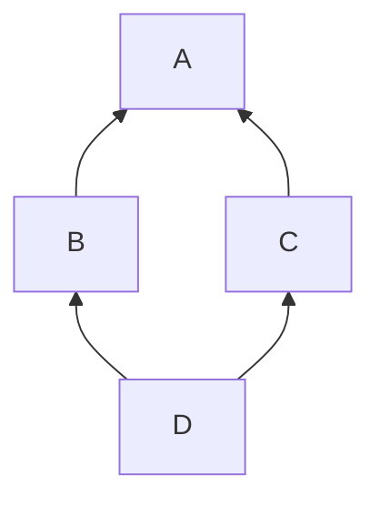

# 🐍 Python Interview Preparation

## Basics

### ❓ What is Python, and where is it used?

Python is a general-purpose, high-level language known for readable code and a huge library ecosystem. It runs your code through an interpreter (CPython is the standard one), so there is no separate compile step for you.

- **Used for:** AI and machine learning, data analysis, automation and scripting, backend APIs, testing tools, DevOps.
- **Why teams pick it:** fast to write, easy to read, and libraries for almost everything (NumPy, pandas, PyTorch, FastAPI, Django).
- **Trade-off:** slower than Java or Go for CPU-heavy work, so heavy lifting is often done by libraries written in C, C++ or Rust.

**Example:** a data team uses pandas to clean data, scikit-learn to train a model, and FastAPI to serve predictions — all in Python.

---

### ❓ What does "dynamically typed" mean in Python?

Types belong to **values**, not variables, and they are checked while the program runs. A variable can point to an int now and a string later.

```python
x = 10        # x refers to an int
x = "ten"     # now x refers to a str — allowed
len(5)        # TypeError only when this line runs
```

Python is also **strongly typed**: it won't silently mix types (`"1" + 1` is an error). For safety in big codebases, add **type hints** and check them with mypy or Pyright.

---

### ❓ What is the difference between a list, tuple, set and dict?

| Type | Ordered | Mutable | Duplicates | Example | Use for |
|---|---|---|---|---|---|
| `list` | Yes | Yes | Yes | `[1, 2, 2]` | A sequence you change |
| `tuple` | Yes | No | Yes | `(1, 2)` | Fixed records, dict keys |
| `set` | No | Yes | No | `{1, 2}` | Fast membership, removing duplicates |
| `dict` | Yes (insertion order) | Yes | Keys unique | `{"a": 1}` | Key → value lookup |

`x in my_set` and `my_dict[key]` are O(1) on average; `x in my_list` is O(n).

---

### ❓ What is the difference between mutable and immutable types?

**Immutable** objects can't change after creation: `int`, `float`, `str`, `tuple`, `frozenset`. **Mutable** ones can: `list`, `dict`, `set`, most custom objects.

```python
name = "dev"
name.upper()      # returns a NEW string; name is still "dev"
items = [1, 2]
items.append(3)   # changes the same list in place
```

Only hashable (usually immutable) objects can be dict keys or set members.

#### ↳ Follow-up: What is the mutable default argument trap?

↪ Default values are created once, when the function is defined, so a default list is shared between calls.

```python
def add(item, bucket=[]):      # ❌ the same list every call
    bucket.append(item)
    return bucket

def add(item, bucket=None):    # ✅
    bucket = [] if bucket is None else bucket
    bucket.append(item)
    return bucket
```

---

### ❓ What is the difference between `is` and `==`?

`==` compares **values**; `is` compares **identity** (the same object in memory).

```python
a = [1, 2]; b = [1, 2]
a == b   # True  — same contents
a is b   # False — two different lists
```

Use `is` only for singletons: `if x is None:`.

---

### ❓ What are list comprehensions and generator expressions?

A compact way to build a list (or set or dict) from another iterable.

```python
squares = [n * n for n in range(10) if n % 2 == 0]   # list, built now
by_id = {u.id: u for u in users}                     # dict comprehension
total = sum(n * n for n in range(10_000_000))         # generator: one value at a time
```

A **generator expression** (round brackets) produces items lazily, so it uses almost no memory for huge ranges. Keep comprehensions short — use a normal loop when the logic gets complex.

---

## Functions

### ❓ What are `*args` and `**kwargs`?

**Level:** 🟢 Beginner

They let a function accept any number of extra arguments: `*args` collects extra **positional** arguments into a tuple, `**kwargs` collects extra **keyword** arguments into a dict.

```python
def log(level, *args, **kwargs):
    print(level, args, kwargs)

log("INFO", "started", 3, user="priya")   # INFO ('started', 3) {'user': 'priya'}
```

They are common in wrappers and decorators that pass arguments through unchanged: `func(*args, **kwargs)`.

---

### ❓ What is a decorator?

**Level:** 🟡 Intermediate

A function that takes a function and returns a new one, adding behaviour **around** it without changing its code. Written with `@` above the function.

```python
import functools, time

def timed(func):
    @functools.wraps(func)            # keep the original name and docstring
    def wrapper(*args, **kwargs):
        start = time.perf_counter()
        try:
            return func(*args, **kwargs)
        finally:
            print(f"{func.__name__} took {time.perf_counter() - start:.3f}s")
    return wrapper

@timed
def load_report(): ...
```

Real uses: `@app.get("/orders")` in FastAPI, `@pytest.fixture`, `@functools.lru_cache`, login checks, retries.

---

### ❓ What is a generator, and what does `yield` do?

**Level:** 🟡 Intermediate

A generator is a function that produces values **one at a time**, pausing at each `yield` and resuming where it left off. It doesn't build the whole result in memory.

```python
def read_lines(path):
    with open(path) as f:
        for line in f:
            yield line.rstrip()

for line in read_lines("huge.log"):   # memory stays small even for a 10 GB file
    if "ERROR" in line:
        print(line)
```

Use generators for large files, streams and pipelines.

---

### ❓ What is a context manager (the `with` statement)?

**Level:** 🟢 Beginner

An object that sets something up and **always** cleans it up, even if an error happens — closing files, releasing locks, committing or rolling back transactions.

```python
with open("data.csv") as f:      # file closes automatically
    rows = f.readlines()

from contextlib import contextmanager

@contextmanager
def timer(label):
    start = time.perf_counter()
    yield
    print(label, time.perf_counter() - start)
```

It works through the `__enter__` and `__exit__` methods.

---

### ❓ How does exception handling work in Python?

**Level:** 🟡 Intermediate

```python
try:
    amount = int(user_input)
except ValueError as e:              # catch specific errors, not bare except
    log.warning("Bad amount: %s", e)
    amount = 0
else:
    log.info("Parsed %s", amount)    # runs only if no exception
finally:
    cleanup()                        # always runs
```

- Catch the most specific exception you can; never use a bare `except:` that hides bugs.
- Raise your own: `raise InsufficientFunds("balance too low") from original_error`.
- Python style is **EAFP** — "easier to ask forgiveness than permission": try it and handle the error.

---

## Object-Oriented Python

### ❓ How do classes work in Python? What are `__init__`, `self` and dunder methods?

**Level:** 🟡 Intermediate

- `__init__` sets up a new object's attributes; `self` is the object itself, passed automatically.
- **Dunder** ("double underscore") methods let your objects work with built-in syntax: `__str__`/`__repr__` (printing), `__eq__` (`==`), `__len__` (`len()`), `__lt__` (sorting).

```python
class Money:
    def __init__(self, amount, currency="INR"):
        self.amount = amount
        self.currency = currency

    def __add__(self, other):
        return Money(self.amount + other.amount, self.currency)

    def __repr__(self):
        return f"Money({self.amount}, {self.currency!r})"

Money(100) + Money(50)   # Money(150, 'INR')
```

Python has no `private` keyword: a leading `_name` means "internal, please don't use".

---

### ❓ What is a dataclass?

**Level:** 🟢 Beginner

`@dataclass` writes `__init__`, `__repr__` and `__eq__` for you from the field list — ideal for simple data objects.

```python
from dataclasses import dataclass

@dataclass(frozen=True)          # frozen = immutable and hashable
class Order:
    id: str
    amount: float
    status: str = "NEW"

Order("A1", 499.0)   # Order(id='A1', amount=499.0, status='NEW')
```

For input validation (e.g. API bodies), use **Pydantic** models instead.

---

### ❓ What is the difference between `@staticmethod`, `@classmethod` and an instance method?

**Level:** 🟡 Intermediate

- **Instance method** — gets `self`; works with one object's data.
- **`@classmethod`** — gets `cls`; often used as an alternative constructor.
- **`@staticmethod`** — gets neither; a plain function kept inside the class for organisation.

```python
class User:
    def __init__(self, name): self.name = name
    @classmethod
    def from_email(cls, email): return cls(email.split("@")[0])
    @staticmethod
    def is_valid_name(name): return name.isalnum()
```

---

## Concurrency & Performance

### ❓ What is the GIL?

**Level:** 🟡 Intermediate

The **Global Interpreter Lock** in CPython lets only one thread run Python bytecode at a time. So threads don't speed up **CPU-bound** Python code, but they work fine for **I/O-bound** work, because a thread releases the GIL while waiting for the network or disk.

- CPU-bound → use `multiprocessing` / `ProcessPoolExecutor` (separate processes, separate GILs), or libraries like NumPy that run in C.
- I/O-bound → use threads or `asyncio`.
- Python 3.13+ offers an optional **free-threaded** build without the GIL; the default build still has it.

---

### ❓ When do you use threading, multiprocessing or asyncio?

**Level:** 🟡 Intermediate

| Tool | Best for | Example |
|---|---|---|
| `threading` / `ThreadPoolExecutor` | I/O-bound work with blocking libraries | Download 100 files with `requests` |
| `multiprocessing` / `ProcessPoolExecutor` | CPU-bound work | Resize 10,000 images |
| `asyncio` | Many concurrent I/O tasks, async libraries | An API calling 50 services at once with `httpx` |

```python
import asyncio, httpx

async def fetch_all(urls):
    async with httpx.AsyncClient() as client:
        responses = await asyncio.gather(*(client.get(u) for u in urls))
    return [r.status_code for r in responses]
```

Never call a blocking function (like `time.sleep` or `requests.get`) inside async code — it freezes the event loop.

---

### ❓ How does Python manage memory?

**Level:** 🟡 Intermediate

CPython uses **reference counting**: each object counts how many references point to it and is freed when the count hits zero. A **cyclic garbage collector** cleans up groups of objects that only reference each other.

**Practical tips:** use generators for big data, `del` large objects you no longer need, and profile with `tracemalloc` or `memory_profiler`.

---

### ❓ What is the difference between a shallow copy and a deep copy?

**Level:** 🟡 Intermediate

A **shallow copy** makes a new outer container but shares the inner objects; a **deep copy** copies everything recursively.

```python
import copy
orig = [[1, 2], [3]]
shallow = copy.copy(orig)      # or orig[:] / list(orig)
deep = copy.deepcopy(orig)
orig[0].append(99)
shallow[0]   # [1, 2, 99] — shared inner list
deep[0]      # [1, 2]     — independent
```

---

## Ecosystem & Web

### ❓ What are virtual environments, pip and requirements files?

**Level:** 🟡 Intermediate

A **virtual environment** is a per-project folder of installed packages, so projects don't clash over versions.

```bash
python -m venv .venv
source .venv/bin/activate          # Windows: .venv\Scripts\activate
pip install fastapi uvicorn
pip freeze > requirements.txt      # pin exact versions
pip install -r requirements.txt    # recreate elsewhere
```

Modern projects often use `pyproject.toml` with tools like **uv** or **Poetry** for faster installs and lock files.

---

### ❓ What is FastAPI, and why is it popular?

**Level:** 🟡 Intermediate

FastAPI is a Python web framework for building APIs from **type hints**. It validates requests with Pydantic, generates OpenAPI (Swagger) docs automatically, and supports `async` for high concurrency.

```python
from fastapi import FastAPI, HTTPException
from pydantic import BaseModel, Field

app = FastAPI()

class OrderIn(BaseModel):
    item: str
    quantity: int = Field(gt=0)

@app.post("/orders", status_code=201)
async def create_order(order: OrderIn):
    if order.item == "out-of-stock":
        raise HTTPException(status_code=409, detail="Out of stock")
    return {"item": order.item, "quantity": order.quantity}
```

Run with `uvicorn main:app --reload`; docs appear at `/docs`. A body with `quantity: 0` is rejected with a 422 automatically.

---

### ❓ What is the difference between Django, Flask and FastAPI?

**Level:** 🟡 Intermediate

| | Django | Flask | FastAPI |
|---|---|---|---|
| Style | "Batteries included" full framework | Minimal micro-framework | Modern API framework |
| Includes | ORM, admin panel, auth, templates | Routing; add the rest yourself | Validation, OpenAPI docs, async |
| Best for | Full web apps with a database and admin | Small apps, full control | REST APIs, ML model serving |

---

### ❓ How do you test Python code with pytest?

**Level:** 🟡 Intermediate

pytest finds functions starting with `test_` and uses plain `assert`.

```python
# test_pricing.py
import pytest
from pricing import apply_discount

def test_ten_percent_discount():
    assert apply_discount(1000, 10) == 900

@pytest.mark.parametrize("price,pct,expected", [(100, 0, 100), (100, 50, 50)])
def test_many_cases(price, pct, expected):
    assert apply_discount(price, pct) == expected

def test_rejects_negative_percent():
    with pytest.raises(ValueError):
        apply_discount(100, -5)
```

Use **fixtures** for shared setup and `unittest.mock` / `pytest-mock` to fake external calls.

---

### ❓ What is pandas used for?

**Level:** 🟢 Beginner

pandas is the standard library for working with **tabular data** in Python — loading, cleaning, joining and summarising data in a `DataFrame` (like a spreadsheet or SQL table in memory).

```python
import pandas as pd

orders = pd.read_csv("orders.csv", parse_dates=["created_at"])
paid = orders[orders["status"] == "PAID"]
daily = paid.groupby(paid["created_at"].dt.date)["amount"].sum()
print(daily.tail())
```

For data larger than memory, use Polars, DuckDB or Spark.


---

## Language Internals (Intermediate)

### ❓ What is the LEGB rule, and how do closures work in Python?

### 📝 Answer

When Python looks up a name, it searches four scopes in order — **LEGB**:

1. **L**ocal — inside the current function
2. **E**nclosing — inside outer functions
3. **G**lobal — the module
4. **B**uilt-in — `len`, `print`, …

```python
x = "global"

def outer():
    x = "enclosing"
    def inner():
        return x            # finds the enclosing x
    return inner

print(outer()())            # enclosing
```

A **closure** is an inner function that **remembers** variables from its enclosing function, even after it returned:

```python
def make_counter():
    count = 0
    def inc():
        nonlocal count      # needed to *change* an enclosing variable
        count += 1
        return count
    return inc

c = make_counter()
c(); c()                    # 2
```

`global x` changes a module variable; `nonlocal x` changes an enclosing one.

#### ↳ Follow-up: Why does `count += 1` fail without `nonlocal`?

↪ Assigning makes `count` local to `inc`, so reading it first raises `UnboundLocalError`.

---

### ❓ Why is a mutable default argument a bug?

### 📝 Answer

Default values are created **once**, when the function is defined — not on every call. A mutable default (list, dict, set) is **shared** by all calls.

```python
def add_item(item, cart=[]):        # ❌ one list for every call
    cart.append(item)
    return cart

add_item("pen")      # ['pen']
add_item("book")     # ['pen', 'book']  ← surprise
```

```python
def add_item(item, cart=None):      # ✅
    if cart is None:
        cart = []
    cart.append(item)
    return cart
```

Same rule for dataclasses: `tags: list = field(default_factory=list)`.

#### ↳ Follow-up: Is it ever useful?

↪ Rarely, as a tiny cache — but `functools.lru_cache` is clearer.

---

### ❓ Iterator vs iterable — what's the difference?

### 📝 Answer

- **Iterable** — anything you can loop over; has `__iter__()` that returns an iterator (`list`, `str`, `dict`, files).
- **Iterator** — the object doing the walking; has `__next__()` and remembers its position. Raises `StopIteration` at the end. Used up after one pass.

```python
nums = [1, 2]          # iterable
it = iter(nums)        # iterator
next(it)               # 1
next(it)               # 2
next(it)               # StopIteration
```

`for x in nums` is just `iter()` + repeated `next()` until `StopIteration`.

```python
class Countdown:                      # a custom iterable
    def __init__(self, start): self.start = start
    def __iter__(self):
        n = self.start
        while n > 0:
            yield n                   # a generator is the easy way to write an iterator
            n -= 1

list(Countdown(3))                    # [3, 2, 1]
```

#### ↳ Follow-up: Why can you loop over a list twice but not a generator?

↪ A list makes a fresh iterator each time; a generator **is** an iterator, so it's exhausted after one pass.

---

### ❓ How does multiple inheritance and the MRO work in Python?

### 📝 Answer

A class can inherit from several parents. The **Method Resolution Order (MRO)** is the order Python searches for a method — computed with the **C3 linearization** (children before parents, left-to-right order kept).

```python
class A:
    def hello(self): return "A"
class B(A):
    def hello(self): return "B → " + super().hello()
class C(A):
    def hello(self): return "C → " + super().hello()
class D(B, C):
    pass

print(D().hello())                 # B → C → A
print([k.__name__ for k in D.__mro__])   # ['D', 'B', 'C', 'A', 'object']
```



`super()` means "**next class in the MRO**", not "my parent" — that's why `B`'s `super()` calls `C`. This solves the **diamond problem**: `A` runs only once.

#### ↳ Follow-up: What is a mixin?

↪ A small class that adds one feature (e.g. `JsonMixin` with `to_json()`) and is combined with others through multiple inheritance.

---

### ❓ `__new__` vs `__init__` — what's the difference?

### 📝 Answer

| | `__new__` | `__init__` |
|---|---|---|
| Job | **creates** the object | **sets up** the object |
| Receives | the class (`cls`) | the new object (`self`) |
| Returns | the new instance | nothing (`None`) |
| Runs | first | second |

```python
class Point:
    def __new__(cls, *args):
        print("creating")
        return super().__new__(cls)
    def __init__(self, x, y):
        print("initialising")
        self.x, self.y = x, y

Point(1, 2)    # creating → initialising
```

You almost always only write `__init__`. Override `__new__` for **immutable types** (subclassing `int`, `str`, `tuple`) or to control instance creation (e.g. a singleton).

```python
class Celsius(float):
    def __new__(cls, value):
        return super().__new__(cls, round(value, 1))   # value must be set at creation
```

#### ↳ Follow-up: If `__new__` returns an object of another class, does `__init__` run?

↪ No — `__init__` only runs when `__new__` returns an instance of `cls`.

---
