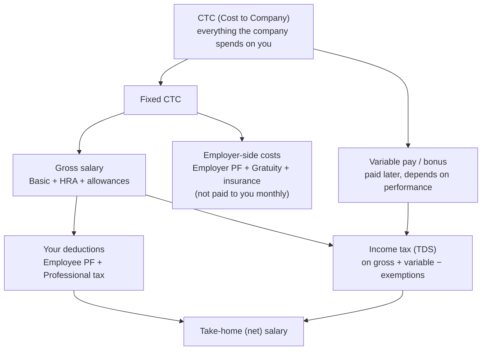
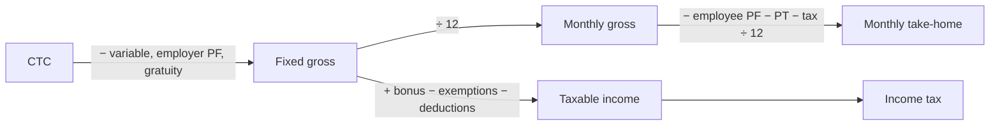

# 💰 Salary, Payslips & Compensation in India

> **Applies to:** Financial Year (Tax Year) **2026-27** — 1 April 2026 to 31 March 2027. **Last checked:** November 2026.
>
> From 1 April 2026 the **Income-tax Act, 2025** and **Income-tax Rules, 2026** replaced the 1961 Act and 1962 Rules. Payslips and HR teams still use the old section names (80C, 80D, 10(13A)); the new Act renumbered them (for example 80C is now Section 123 and 80D is Section 126). The **labour codes** took effect on 21 November 2025, and the **EPF wage ceiling** rose from ₹15,000 to ₹25,000 per month from 17 September 2026.
>
> **Try your own numbers:** the IT Roles Atlas **Pay & Tax** tab has a take-home calculator (old vs new regime), an offer comparison and income tax for the countries Indians move to.
>
> All salary figures below are **worked examples with stated assumptions**, not what every company pays. Check your own offer letter, your payroll team and the official sources listed at the end.

## How Salary Flows

### ❓ How does CTC become my take-home salary?

**CTC** is everything the company spends on you in a year. Your **take-home** is what reaches your bank account after taking out the parts you never receive monthly (variable pay, employer PF, gratuity) and the deductions (your PF, professional tax, income tax).

In one line: **Take-home = Gross salary − Employee PF − Professional tax − Income tax (TDS)**, and variable pay arrives separately (after tax) when it is paid.

**Quick example (₹15 LPA, new regime, details in the worked examples below):** CTC ₹15,00,000 → gross ₹12,83,140 → monthly take-home about **₹96,500**, plus a variable payout once a year.

#### ↳ Follow-up: Why is my in-hand so much lower than CTC ÷ 12?

↪ Because CTC includes money you don't get every month: variable pay (paid yearly, and only if earned), employer PF (goes to your PF account), gratuity (paid only after 5 years) and sometimes insurance. Then your own PF, professional tax and income tax are deducted. A take-home of **75–85% of CTC ÷ 12** is normal.

---

## Salary Structure & Compensation Terms

### ❓ What is CTC?

CTC (Cost to Company) is the **total yearly amount a company spends on one employee** — salary, bonus, employer PF, gratuity, insurance and other benefits added together. It is the number written in your offer letter, but it is **not** what you receive in hand.

- CTC = Fixed salary (gross) + Variable pay + Employer PF + Gratuity + Benefits (insurance, meal card, etc.)
- Two offers with the same CTC can give very different take-home pay, because the split differs.

**Example:** "₹12 LPA CTC" might contain ₹1.2 lakh of variable pay and ₹60,000 of employer PF + gratuity — so the fixed gross is only about ₹10.2 lakh.

---

### ❓ What is the difference between Fixed Pay and Variable Pay?

**Fixed pay** is guaranteed and paid every month. **Variable pay** depends on your performance and the company's results, and is usually paid quarterly or once a year.

| | Fixed pay | Variable pay |
|---|---|---|
| Paid | Every month | Quarterly / yearly |
| Guaranteed? | Yes | No — can be 0–100% (sometimes more) |
| Includes | Basic, HRA, allowances | Performance bonus, incentives |

**Example:** CTC ₹20 LPA with 10% variable → ₹18 LPA fixed + ₹2 LPA "target" variable. If you get a 70% rating payout, you receive ₹1.4 lakh, not ₹2 lakh.

When comparing offers, compare **fixed pay** first — it is the part you can count on.

---

### ❓ What is Annual Gross Salary?

Gross salary is your **total yearly earnings before any deductions** — Basic + HRA + all allowances (and bonus when it is paid). It does **not** include employer PF or gratuity, because those are not paid to you.

- Gross = CTC − Employer PF − Gratuity − Insurance/benefits (− variable, if you mean fixed gross)
- Income tax is calculated starting from the gross.

**Example:** CTC ₹15,00,000 − variable ₹1,50,000 − employer PF ₹36,000 − gratuity ₹30,860 = **fixed gross ₹12,83,140**.

---

### ❓ What is Monthly Gross Salary?

Monthly gross is simply the **fixed annual gross ÷ 12** — the "Total Earnings" line at the top of your payslip before deductions.

**Example:** Annual fixed gross ₹12,83,140 ÷ 12 = **₹1,06,928 per month**. In a month you get a bonus or arrears, the payslip's gross is higher for that month only.

---

### ❓ What is Basic Salary?

Basic is the **core fixed part of your salary**, and many other amounts are calculated from it — PF, HRA, gratuity and sometimes the bonus. It is fully taxable.

- Usually **40–50% of gross**. Under the labour codes (from 21 November 2025), "wages" (basic + DA + retaining allowance) must be **at least 50% of total pay**, so many companies have raised basic to 50%.
- Higher basic → more PF and gratuity (good for savings) but slightly lower monthly take-home.

**Example:** Gross ₹1,06,928/month → Basic at 50% = **₹53,464**. PF (12%) and HRA (50% of basic) are worked out from this number.

---

### ❓ What is Net Salary / Take-Home Salary?

Net (take-home or in-hand) salary is **what is actually credited to your bank account** after all deductions.

**Net pay = Gross earnings − Employee PF − Professional tax − Income tax (TDS) − other deductions (loan, LOP, etc.)**

**Example:** Gross ₹1,06,928 − PF ₹3,000 − PT ₹200 − TDS ₹7,256 = **₹96,472** credited for the month.

---

### ❓ What does LPA mean?

**LPA = Lakhs Per Annum** — salary per year in lakhs (1 lakh = ₹1,00,000). "12 LPA" means ₹12,00,000 per year, and it almost always refers to **CTC**, not take-home.

Always ask whether a quoted LPA is CTC, fixed, or in-hand — "15 LPA in-hand" and "15 LPA CTC" are very different offers.

---

### ❓ What is Total Compensation?

Total compensation (often called **TC** in product companies) is **CTC plus the yearly value of stock** (ESOPs/RSUs) and one-time bonuses.

- TC = Fixed + Variable + Stock vesting this year + Joining/retention bonus (if any)
- Stock value changes with the share price, so TC can go up or down.

**Example:** Fixed ₹30 L + bonus ₹3 L + RSUs worth ₹16 L vesting over 4 years (₹4 L/year) → **year-1 TC ≈ ₹37 L**. A ₹5 L joining bonus in year 1 makes it ₹42 L — but year 2 drops back unless stock grows.

---

### ❓ What is Employer Cost?

Employer cost is **what the company pays on top of (or as part of) your salary just because it employs you** — employer PF, EPS, EDLI and PF admin charges, ESI (if applicable), gratuity provision, group insurance, and sometimes Labour Welfare Fund.

- Most Indian companies **include these inside CTC**, so they reduce your gross.
- Some companies keep them **outside CTC** — then the same CTC gives a higher gross. Check the offer's breakup.

---

### ❓ What is a Performance Bonus?

A performance bonus is **money paid for meeting targets** — your rating, your team's and the company's results. It is the most common form of variable pay.

- Usually a % of CTC or fixed pay (5–20% is common; higher for senior or sales roles).
- **Fully taxable** in the year you receive it, through TDS in the payout month.
- Read the policy: payout schedule, whether you must be on the rolls on the payout date, and the rating-to-payout table.

**Example:** Target bonus ₹1,50,000 × 80% payout = ₹1,20,000 before tax. In the 30% slab, about ₹37,440 (30% + 4% cess) goes as TDS.

---

### ❓ What is a Joining Bonus?

A one-time payment for joining — often to **cover the bonus or notice-period buyout you lose by leaving your old job**.

- Fully taxable, paid in the first month or after a few months.
- Usually has a **clawback**: if you leave within 12 months (sometimes 24), you must return it fully or pro-rata.
- It is **not** part of your yearly CTC — don't let it inflate the "hike" you think you are getting.

---

### ❓ What is a Retention Bonus?

Money paid to **keep you** — for staying a set time (e.g. 12–24 months), during a project, merger or after you get a competing offer.

- Paid at the end of the period (or in parts), and only if you are still employed.
- Fully taxable as salary in the year it is paid.

**Example:** "₹3 lakh retention bonus payable on 31 March 2028" — resign before that date and you usually get nothing.

---

### ❓ What is an ESOP (Employee Stock Option)?

An ESOP is the **right to buy company shares later at a fixed low price** (the exercise or strike price). Common in startups.

- **Grant:** you are given options. **Vesting:** you earn them over time — typically 4 years with a 1-year **cliff** (nothing vests before 12 months). **Exercise:** you pay the strike price to get real shares.
- **Tax 1 — at exercise:** (Fair market value − exercise price) × shares is taxed as **salary** (a perquisite). Employees of eligible DPIIT-recognised startups can defer this tax (up to 5 years, or until they leave or sell, whichever is first).
- **Tax 2 — at sale:** the gain over the exercise-date value is taxed as **capital gains**.
- In unlisted startups you may not be able to sell until a buyback, acquisition or IPO.

**Example:** 1,000 options, strike ₹10, value ₹110 at exercise → you pay ₹10,000 and ₹1,00,000 is taxed as salary that year, even though you sold nothing.

---

### ❓ What is an RSU (Restricted Stock Unit)?

An RSU is a **promise of free company shares** that you receive as they vest. Common at listed companies (Google, Microsoft, Amazon, Indian listed firms).

- No purchase price — at vesting you simply get shares.
- **Taxed as salary at vesting** on the share's market value; employers often sell some shares ("sell to cover") to pay the TDS.
- When you later sell, the gain after vesting is capital gains. Shares of a **foreign** company are treated as unlisted in India: long-term after 24 months (12.5%), otherwise taxed at your slab rate. Foreign shares must also be reported in your ITR (Schedule FA).

**Example:** 100 RSUs vest when the share is ₹8,000 → ₹8,00,000 is added to your salary income for that year.

---

### ❓ What is Gratuity?

Gratuity is a **lump sum the employer pays when you leave after long service** — a "thank you" for years worked. It is shown in CTC as a yearly provision but paid only on exit.

- **Eligibility:** 5 years of continuous service (fixed-term employees: 1 year, under the Code on Social Security from 21 November 2025). Death or disability: no minimum.
- **Formula:** Last drawn (Basic + DA) × 15 ÷ 26 × years of service. A final part-year of more than 6 months counts as a full year.
- **CTC provision:** 4.81% of basic per year (15 ÷ 26 ÷ 12).
- **Tax:** exempt up to **₹20 lakh** (lifetime limit) for private-sector employees.

**Example:** Basic ₹50,000/month, 7 years 8 months → 8 years → 50,000 × 15 ÷ 26 × 8 = **₹2,30,769**, tax-free.

---

### ❓ What are Employer PF and Employee PF contributions?

Both you and your employer put **12% of your PF wages** (Basic + DA, under the labour codes "wages") into the Employees' Provident Fund every month.

| | Employee share (12%) | Employer share (12%) |
|---|---|---|
| Where it goes | All to your EPF account | 8.33% to pension (EPS, capped) + 3.67% to EPF |
| Shown in | Payslip deductions | CTC (usually), not deducted from you |
| Tax | Deductible under old-regime 80C | Not taxable (unless employer PF + NPS + superannuation > ₹7.5 lakh/year) |

- **Wage ceiling:** ₹25,000/month from 17 September 2026 (₹15,000 before). Many companies calculate PF on the ceiling (12% × ₹25,000 = **₹3,000/month** each side); others use your full basic. Both are legal for salaries above the ceiling.
- EPS is capped at 8.33% of ₹25,000 = **₹2,083/month** (was ₹1,250).
- The employer also pays EDLI insurance (0.5%) and admin charges (0.5%), often inside CTC.

**Example:** Basic ₹53,464. Ceiling method → you ₹3,000 + employer ₹3,000. Full-basic method → you ₹6,416 + employer ₹6,416 (more savings, less in-hand).

---

## Salary Allowances

### ❓ What is HRA (House Rent Allowance) and how is the HRA exemption calculated?

HRA is an allowance to **help pay rent**. Under the **old tax regime** part of it is tax-free if you actually pay rent; under the **new regime** it is fully taxable.

**Tax-free HRA = the lowest of:**

1. Actual HRA received
2. Rent paid − 10% of (Basic + DA)
3. 50% of (Basic + DA) in **Mumbai, Delhi, Kolkata, Chennai, Bengaluru, Hyderabad, Pune, Ahmedabad** (the last four added from 1 April 2026); 40% elsewhere

**Example (old regime, Bengaluru):** Basic ₹6,41,570/yr, HRA ₹3,20,785/yr, rent ₹3,00,000/yr.
1) ₹3,20,785 · 2) 3,00,000 − 64,157 = ₹2,35,843 · 3) 50% × 6,41,570 = ₹3,20,785 → **₹2,35,843 tax-free**; the remaining ₹84,942 is taxed.

- Usually set at 40–50% of basic. Rent above ₹1 lakh/year needs the landlord's PAN.
- Paying rent to parents is allowed if it is genuine (they must show it as income). Paying a spouse is usually not accepted.
- **Take-home impact:** none on gross, but in the old regime it lowers TDS, so in-hand goes up.

---

### ❓ What is DA (Dearness Allowance)?

DA is an allowance that **adjusts pay for inflation**, revised regularly. It is standard in government and PSU jobs and rare in private IT companies.

- **Fully taxable** in both regimes.
- When the terms of employment say so, DA counts with basic for PF, HRA and gratuity calculations.

**Example:** A central-government employee's DA is a % of basic pay, revised twice a year based on the consumer price index.

---

### ❓ What is Special Allowance?

Special allowance is the **balancing figure** — whatever is left of the fixed gross after basic, HRA and other named allowances. It is often the biggest component in private-sector payslips.

- **Fully taxable** in both regimes.
- Not part of PF wages — which is why companies used it to keep basic (and PF) low. The labour codes' 50% wage rule limits that.

**Example:** Gross ₹1,06,928 − Basic ₹53,464 − HRA ₹26,732 = **Special allowance ₹26,732**.

---

### ❓ What is Conveyance Allowance?

A fixed amount for **travel between home and office**.

- A fixed conveyance allowance is **fully taxable** for regular employees (the old ₹1,600/month exemption was removed in 2018 when the standard deduction came in).
- **Reimbursement of actual official travel** (client visits, office errands), backed by bills, is **not taxed** — in both regimes.

---

### ❓ What is Transport Allowance?

Similar to conveyance — a fixed monthly amount for commuting.

- **Fully taxable** for most employees.
- **₹3,200/month is exempt for employees with disabilities** (blind, deaf-mute, or orthopedically disabled) — this exemption is allowed in **both** regimes.

---

### ❓ What is Medical Allowance?

A fixed monthly amount towards medical costs.

- **Fully taxable** in both regimes (the ₹15,000 medical-reimbursement exemption ended in 2018).
- What *is* tax-free: **group health insurance** paid by the employer, and treatment in employer-run or approved hospitals.

**Example:** ₹1,250/month medical allowance = ₹15,000/year, all added to taxable income.

---

### ❓ What is LTA (Leave Travel Allowance)?

LTA covers **travel tickets when you go on leave within India**. Old regime only.

- Exempt for **2 journeys in a block of 4 calendar years** (current block: 2026–2029); an unused journey can be carried to the first year of the next block.
- Only the **fare** counts (economy air, AC first-class rail, or bus), by the shortest route — not hotels or food. You, your spouse, children (max 2 born after 1 October 1998) and dependent parents/siblings.
- Not claimed → fully taxable. **New regime:** fully taxable.

**Example:** LTA ₹40,000; you spend ₹32,000 on flights → ₹32,000 tax-free, ₹8,000 taxed.

---

### ❓ What is Meal / Food Allowance?

Meals provided through **meal cards or vouchers** (Pluxee/Sodexo, Zeta, etc.) are tax-free up to a limit; a meal allowance paid **in cash** is fully taxable.

- From **1 April 2026** (Income-tax Rules, 2026) the limit rose from **₹50 to ₹200 per meal**. With 2 meals × 22 working days, that is up to about **₹1,05,600 a year**.
- **Regime:** the old rules denied this benefit in the new regime. Tax experts disagree on whether the new rules still deny it, and no official clarification has settled it yet. Ask your payroll team how they apply it.
- Free food in the office canteen during working hours is not taxed.

---

### ❓ What is Telephone and Internet Allowance?

An amount for **mobile, broadband and data** used for work.

- **Reimbursement against bills** for phone/internet used for work is generally **not taxed** — in both regimes.
- A **fixed allowance** paid without bills is fully taxable.

**Example:** Claim ₹1,500/month with your broadband bill → tax-free. A flat ₹1,500 "internet allowance" with no bills → taxable.

---

### ❓ What other allowances and reimbursements are common?

| Component | Tax treatment (FY 2026-27) |
|---|---|
| Children education allowance | ₹3,000/month per child (max 2) exempt — **old regime only** (raised from ₹100 by the 2026 Rules) |
| Hostel allowance | ₹9,000/month per child (max 2) exempt — **old regime only** (raised from ₹300) |
| Employer NPS contribution | Deductible up to **14%** of Basic + DA (new regime) / **10%** (old regime, private sector) |
| Gifts and vouchers from employer | Up to **₹15,000/year** tax-free (raised from ₹5,000) |
| Interest-free / low-interest loan | Not taxed if total loans are up to **₹2 lakh**, or for specified medical treatment |
| Books, periodicals, uniform | Exempt when reimbursed against bills for work use |
| Car / fuel for official use | Taxed as a perquisite at fixed monthly values, depending on engine size and official/personal use |
| Relocation and travel for work | Reimbursements for official travel are not taxed |

The flexible part of your pay that you can split among these is often called a **Flexi Benefit Plan (FBP)**. In the old regime, using it well can cut your tax; in the new regime most of these give no tax benefit.

---

### ❓ Which salary components are taxable, exempt or partly exempt?

| Component | New regime | Old regime |
|---|---|---|
| Basic, DA, special allowance, bonus | Taxable | Taxable |
| HRA | Taxable | **Partly exempt** (formula) |
| LTA | Taxable | **Exempt** for 2 trips in 4 years |
| Conveyance / transport / medical allowance (fixed) | Taxable | Taxable |
| Transport allowance for employees with disabilities | ₹3,200/month exempt | ₹3,200/month exempt |
| Bill-based reimbursements for work (phone, internet, travel, books) | Not taxed | Not taxed |
| Meal vouchers | Up to ₹200/meal — applicability **disputed** | Up to ₹200/meal exempt |
| Children education / hostel allowance | Taxable | Exempt up to limits |
| Employer PF (12%) | Not taxed* | Not taxed* |
| Employer NPS | Deductible up to 14% of basic* | Deductible up to 10% of basic* |
| Gratuity on exit | Exempt up to ₹20 lakh | Exempt up to ₹20 lakh |

\*Employer PF + NPS + superannuation together above **₹7.5 lakh a year** is taxable.

---

## Payslip Components

### ❓ What does a typical monthly payslip look like?

A payslip has two halves — **Earnings** (what you earned) and **Deductions** (what was taken out) — and ends with **Net Pay**.

**Example: ₹15 LPA CTC, new regime, a normal month (assumptions as in the ₹15 LPA worked example):**

| Earnings | ₹ | Deductions | ₹ |
|---|---|---|---|
| Basic | 53,464 | Employee PF | 3,000 |
| HRA | 26,732 | Professional tax | 200 |
| Special allowance | 26,732 | Income tax (TDS) | 7,256 |
| **Gross earnings** | **1,06,928** | **Total deductions** | **10,456** |
| | | **Net pay** | **96,472** |

Shown "for information" (not paid to you, not deducted): **Employer PF ₹3,000**, **Gratuity provision ₹2,572**.

Other lines you may see: paid days and LOP days, UAN (PF number), PAN, the tax regime chosen, year-to-date (YTD) totals, and the projected yearly tax.

---

### ❓ How are Basic, HRA, DA and special allowance calculated on the payslip?

They follow the percentages in your offer letter's salary breakup, and are paid for the days you worked in the month.

- **Basic** = a fixed % of gross (often 50%).
- **HRA** = a % of basic (often 40–50%).
- **DA** = a % of basic, if your employer pays it.
- **Special allowance** = gross − everything above.
- **Proration:** if you join mid-month or take unpaid leave, each component is cut by the same ratio: amount × paid days ÷ days in the month.

**Example:** 2 days of loss of pay (LOP) in a 30-day month → each earning × 28/30. Basic ₹53,464 becomes ₹49,900.

---

### ❓ How are Employee PF and Employer PF shown on the payslip?

**Employee PF** appears under deductions — it reduces your take-home but goes into your own EPF account (it is your savings, not a cost). **Employer PF** is usually not on the deductions side; it is part of CTC and is often shown separately for information.

- Calculation: 12% × PF wages (Basic + DA), on the full amount or capped at ₹25,000/month, depending on company policy.
- You can contribute **more** than 12% as **VPF** (Voluntary PF) — your employer doesn't have to match it.
- Track both shares on the EPFO member passbook using your UAN.

---

### ❓ What is Professional Tax?

Professional tax (PT) is a **state government tax on salaried and self-employed people**. Your employer deducts it from your salary and pays it to the state.

- The amount depends on your **state and salary**, with a maximum of **₹2,500 a year** (set by the Constitution). Example: Maharashtra deducts ₹200 a month and ₹300 in February; Karnataka works out to ₹2,500 a year for most salaried staff. Some states (e.g. Delhi, Uttar Pradesh) don't charge it.
- **Tax:** deductible from salary income in the **old regime only**; no benefit in the new regime.

---

### ❓ What is Income Tax / TDS on the payslip?

TDS (Tax Deducted at Source) is the **income tax your employer deducts every month** and pays to the government on your behalf.

1. At the start of the year (and after any change), payroll estimates your **full-year taxable income**: salary + expected bonus − exemptions and deductions you declared.
2. It works out the yearly tax under your chosen regime (the **new regime is the default** — tell HR if you want the old one).
3. It divides what is still due by the months left, and deducts that each month.

- Old-regime claims (HRA, 80C, etc.) need **investment proofs**, usually by January–February; missing proofs increase TDS in the last months.
- At year-end you get your TDS certificate — **Form 130** under the new Act (earlier called Form 16) — to file your return.

**Example:** Estimated yearly tax ₹87,070 → about **₹7,256 per month**.

---

### ❓ What is ESI (Employee State Insurance)?

ESI is a **government health-insurance scheme for lower-paid employees**. It covers medical care, sickness pay and maternity benefit at ESIC hospitals.

- Applies when your gross wages are **₹21,000 a month or less**.
- **Employee pays 0.75%**, **employer pays 3.25%** of wages.
- Most IT professionals earn above this limit, so ESI is usually 0 on their payslip.

**Example:** Gross ₹20,000 → you pay ₹150, the employer pays ₹650 each month.

---

### ❓ Why is gratuity in the salary package but not in my monthly pay?

Because gratuity is **earned every year but paid only when you leave** after the qualifying period (5 years; 1 year for fixed-term employees). The company sets aside about **4.81% of basic** each year and counts that in your CTC.

If you leave before you qualify, you don't receive it — so treat the gratuity line in CTC as "maybe later" money, not salary.

---

### ❓ What other deductions can appear on a payslip?

- **Loss of pay (LOP):** unpaid leave days, cut from earnings.
- **Voluntary PF (VPF):** extra PF you chose to contribute.
- **Employee NPS:** if you opted in through payroll.
- **Labour Welfare Fund (LWF):** a small state levy (a few rupees to about ₹50, monthly or half-yearly), in some states.
- **Insurance premium:** for extra cover for parents or a spouse beyond the group policy.
- **Loan or advance recovery**, **notice-period recovery**, **canteen or transport charges**, and **donations** you approved.

None of these (except VPF/NPS) increase your savings — they simply reduce net pay.

---

### ❓ What is Net Pay on a payslip?

Net pay is the **amount credited to your bank account** for that month.

**Net pay = Gross earnings (for days paid) + reimbursements/arrears − Employee PF − Professional tax − TDS − other deductions**

It changes month to month with LOP, bonus payouts, tax adjustments after investment proofs, and PT in February in some states.

---

## Deductions & Taxation

### ❓ What is EPF (Employee Provident Fund)?

EPF is a **retirement savings account** run by EPFO. You and your employer each add 12% of your PF wages every month, and the balance earns interest declared every year (8.25% for FY 2024-25).

- Your **UAN** (Universal Account Number) stays the same across jobs — transfer the balance when you switch.
- Withdrawals after **5 years of continuous service** are tax-free. Partial withdrawals are allowed for a house, education, marriage, medical needs and unemployment.
- Interest on **your** contributions above ₹2.5 lakh a year is taxable.
- **Take-home impact:** employee PF reduces in-hand pay; it is forced savings, not a cost.

---

### ❓ How is income tax calculated on salary?

Income tax is calculated on your **taxable income** for the whole year using **slabs** — each slice of income is taxed at its own rate — and then 4% cess is added.

**Steps:**

1. Add up gross salary, bonus, RSU/ESOP perquisites and other income.
2. Subtract exempt allowances (old regime).
3. Subtract the standard deduction.
4. Subtract eligible deductions.
5. Apply the slab rates, then the rebate, surcharge and 4% cess.

---

### ❓ What are the income tax slabs for FY 2026-27?

Budget 2026 did **not** change the slabs; the rates from Budget 2025 continue (for individuals below 60).

| New regime (default) | Rate | Old regime | Rate |
|---|---|---|---|
| Up to ₹4,00,000 | Nil | Up to ₹2,50,000 | Nil |
| ₹4–8 lakh | 5% | ₹2.5–5 lakh | 5% |
| ₹8–12 lakh | 10% | ₹5–10 lakh | 20% |
| ₹12–16 lakh | 15% | Above ₹10 lakh | 30% |
| ₹16–20 lakh | 20% | | |
| ₹20–24 lakh | 25% | | |
| Above ₹24 lakh | 30% | | |

- **4% Health & Education cess** on the tax, in both regimes.
- **Surcharge** above ₹50 lakh: 10%; above ₹1 crore: 15%; above ₹2 crore: 25% (the old regime goes up to 37% above ₹5 crore).
- Old regime: senior citizens (60–80) have ₹3 lakh tax-free, super seniors (80+) ₹5 lakh.

---

### ❓ What is the Old Tax Regime vs the New Tax Regime?

| | New regime (default) | Old regime |
|---|---|---|
| Slabs | More slabs, lower rates | Fewer slabs, higher rates |
| Standard deduction | ₹75,000 | ₹50,000 |
| Rebate (87A) | Zero tax up to ₹12 lakh taxable income | Zero tax up to ₹5 lakh |
| HRA, LTA, 80C, 80D, home-loan interest, PT | **Not allowed** | Allowed |
| Employer NPS | Up to 14% of basic | Up to 10% of basic |

- Salaried people can **choose every year** — tell your employer at the start of the year, and you can still switch when filing your return.
- **Rule of thumb:** the old regime wins only when your deductions are large — typically HRA on high rent + full ₹1.5 lakh 80C + 80D + home-loan interest. In the worked examples below (₹3 lakh rent + 80C + 80D), the **new regime gives more take-home at every level**.

---

### ❓ What is the Standard Deduction?

A **flat amount every salaried person can subtract** from salary income, without bills or proof.

- **₹75,000** in the new regime, **₹50,000** in the old regime.
- It replaced the old transport and medical exemptions in 2018.

**Example:** Gross ₹13,58,140 (salary + bonus) − ₹75,000 = ₹12,83,140 taxable income (new regime).

---

### ❓ What is the Section 87A rebate and marginal relief?

The 87A rebate **cancels the tax for lower incomes**. Marginal relief stops a small rise above the limit from causing a big jump in tax.

- **New regime:** rebate up to ₹60,000 → **no tax up to ₹12 lakh taxable income** (₹12.75 lakh salary with the standard deduction).
- **Old regime:** rebate up to ₹12,500 → no tax up to ₹5 lakh taxable income.
- **Marginal relief (new regime):** just above ₹12 lakh, your tax can't be more than the amount by which you crossed ₹12 lakh.
- The rebate doesn't apply to special-rate income such as capital gains on shares.

**Example:** Taxable income ₹12,10,000. Slab tax = ₹61,500, but you crossed ₹12 lakh by only ₹10,000 → tax is limited to **₹10,000** (+ cess = ₹10,400).

---

### ❓ Which tax exemptions and deductions can salaried employees claim?

| Deduction (old Act name) | What it covers | Limit | Regime |
|---|---|---|---|
| Standard deduction | Flat, for salary | ₹75,000 / ₹50,000 | Both |
| 80CCD(2) | Employer's NPS contribution | 14% / 10% of Basic + DA | Both |
| 80C (now Section 123) | Employee PF, VPF, PPF, ELSS, life insurance, home-loan principal, children's tuition fees | ₹1,50,000 | Old only |
| 80CCD(1B) | Your own extra NPS | ₹50,000 | Old only |
| 80D (now Section 126) | Health insurance: self/family ₹25,000; parents ₹25,000 (₹50,000 if senior citizens) | up to ₹1,00,000 | Old only |
| 24(b) | Home-loan interest, self-occupied house | ₹2,00,000 | Old only |
| HRA, LTA, PT | See the allowances section | Formula | Old only |

---

### ❓ How do I calculate taxable income from salary?

**Taxable income = Gross salary + bonus − exempt allowances − standard deduction − Chapter VI-A deductions (80C, 80D, NPS…)**

**Example (₹15 LPA CTC, old regime, rent ₹25,000/month in Bengaluru):**

| Step | ₹ |
|---|---|
| Gross salary + bonus (12,83,140 + 1,50,000) | 14,33,140 |
| − HRA exemption | 2,35,843 |
| − Standard deduction | 50,000 |
| − Professional tax | 2,500 |
| − 80C (PF 36,000 + other investments) | 1,50,000 |
| − 80D health insurance | 25,000 |
| **Taxable income** | **9,69,797** |
| Tax: 12,500 + 20% × 4,69,797 = 1,06,459 + 4% cess | **1,10,718** |

The same salary in the **new regime**: 14,33,140 − 75,000 = 13,58,140 taxable → tax **₹87,070**. Here the new regime saves about ₹23,600.

---

### ❓ Which deductions reduce taxable income, which reduce take-home, and which are employer costs?

| Item | Reduces taxable income? | Reduces take-home? | Who pays |
|---|---|---|---|
| Employee PF | Old regime only (80C) | Yes (but it is your savings) | You |
| Employer PF, gratuity, insurance | No (not counted as your income) | No — it was never in your gross | Employer (inside CTC) |
| Professional tax | Old regime only | Yes | You |
| Income tax (TDS) | — | Yes | You |
| HRA / LTA exemptions | Old regime only | No — they *increase* take-home by lowering TDS | — |
| Standard deduction | Yes, both regimes | No — it lowers TDS | — |
| Employer NPS | Yes (both regimes) | No — comes out of CTC | Employer (inside CTC) |
| ESI (employee 0.75%) | No | Yes | You (+ employer 3.25%) |
| LOP, loan recovery | — | Yes | You |

---

### ❓ What is the TDS certificate and the investment declaration?

- **Investment declaration (start of year):** you tell payroll your regime and planned old-regime claims (rent, 80C, etc.) so TDS is lower from month one. Under the new Act the form is **Form 124** (earlier Form 12BB); HRA claims now also ask about your relationship with the landlord.
- **Proof submission (Jan–Feb):** rent receipts, premium receipts, investment statements. No proof → the claim is dropped and the extra tax is taken from the last salaries.
- **TDS certificate (after year-end, by mid-June):** **Form 130** (earlier Form 16) — shows salary, exemptions and tax deducted. Use it, along with your AIS/Form 26AS, to file your return by 31 July.

---

## CTC vs Gross vs Take-Home

### ❓ What is the difference between CTC, Gross, Taxable and Take-Home salary?

| Term | What it means | How to get it |
|---|---|---|
| **CTC** | Everything the company spends on you in a year | Fixed + variable + employer PF + gratuity + benefits |
| **Annual gross salary** | Yearly earnings before deductions | CTC − employer PF − gratuity − benefits (fixed gross also leaves out variable pay) |
| **Monthly gross salary** | Earnings per month before deductions | Fixed annual gross ÷ 12 |
| **Taxable salary** | The part income tax is charged on | Gross + bonus − exemptions − standard deduction − deductions |
| **Net annual salary** | What you receive in the year | Gross + bonus − employee PF − PT − income tax |
| **Monthly take-home** | Monthly bank credit | (Fixed gross − employee PF − PT − yearly tax) ÷ 12 |

---

### ❓ What assumptions do the ₹10, ₹15, ₹20 and ₹25 LPA examples use?

Every example below uses the **same assumptions**. Change any of them and the numbers change — so use these to learn the method, not as what every company pays.

- **Year:** FY / Tax Year 2026-27, resident individual under 60, salary is the only income.
- **Variable pay:** 10% of CTC, paid at 100%, taxed in the same year.
- **Basic:** 50% of fixed gross (in line with the labour codes' 50% wage rule). **HRA:** 50% of basic. **Special allowance:** the balance. No DA.
- **PF:** 12% on the ₹25,000/month wage ceiling = ₹3,000/month each for you and the employer (₹36,000/year each). If your company uses full basic, PF is higher and take-home lower.
- **Gratuity:** 4.81% of basic, inside CTC. No insurance or other benefits inside CTC.
- **Professional tax:** ₹2,500/year (₹200/month, ₹300 in February).
- **New regime:** standard deduction ₹75,000 only.
- **Old regime:** standard deduction ₹50,000, PT, rent ₹25,000/month in Bengaluru (an HRA metro city), 80C fully used (₹1.5 lakh including PF), 80D ₹25,000.
- **Monthly take-home** spreads the year's tax evenly over 12 months. The variable payout is shown separately (already covered by that tax).

---

### ❓ How is a ₹10 LPA CTC broken down into take-home salary?

**1. CTC breakdown (yearly)**

| Component | ₹/year | ₹/month |
|---|---|---|
| Basic | 4,21,855 | 35,155 |
| HRA | 2,10,928 | 17,577 |
| Special allowance | 2,10,926 | 17,577 |
| **Fixed gross** | **8,43,709** | **70,309** |
| Employer PF | 36,000 | 3,000 |
| Gratuity (4.81% of basic) | 20,291 | — |
| **Fixed CTC** | **9,00,000** | |
| Variable pay (10%) | 1,00,000 | once a year |
| **Total CTC** | **10,00,000** | |

**2. Fixed vs variable:** ₹9,00,000 fixed + ₹1,00,000 variable.

**3. Employer PF + gratuity:** ₹56,291 — part of CTC, not paid monthly.

**4. Gross:** ₹8,43,709/year · ₹70,309/month.

**5. Your deductions:** Employee PF ₹36,000 + PT ₹2,500 = ₹38,500.

**6. Income tax:**
- **New regime:** 8,43,709 + 1,00,000 − 75,000 = ₹8,68,709 taxable → slab tax ₹26,871, fully cancelled by the 87A rebate → **₹0**.
- Old regime: taxable ₹5,05,282 → **₹14,099**.

**7. Take-home (new regime):** **₹67,101/month** + ₹1,00,000 variable → **₹9,05,209 a year** (old regime: ₹65,926/month, ₹8,91,110/year).

---

### ❓ How is a ₹15 LPA CTC broken down into take-home salary?

**1. CTC breakdown (yearly)**

| Component | ₹/year | ₹/month |
|---|---|---|
| Basic | 6,41,570 | 53,464 |
| HRA | 3,20,785 | 26,732 |
| Special allowance | 3,20,785 | 26,732 |
| **Fixed gross** | **12,83,140** | **1,06,928** |
| Employer PF | 36,000 | 3,000 |
| Gratuity | 30,860 | — |
| **Fixed CTC** | **13,50,000** | |
| Variable pay | 1,50,000 | once a year |
| **Total CTC** | **15,00,000** | |

**2–3.** ₹13.5 lakh fixed + ₹1.5 lakh variable; employer PF + gratuity = ₹66,860.

**4. Gross:** ₹12,83,140/year · ₹1,06,928/month.

**5. Your deductions:** PF ₹36,000 + PT ₹2,500.

**6. Income tax:**
- **New regime:** 14,33,140 − 75,000 = ₹13,58,140 taxable. Tax = 20,000 (5% of 4–8 L) + 40,000 (10% of 8–12 L) + 23,721 (15% of 1,58,140) = ₹83,721 + 4% cess = **₹87,070** (no rebate — above ₹12 lakh).
- Old regime: taxable ₹9,69,797 → **₹1,10,718**.

**7. Take-home (new regime):** **₹96,464/month** + ₹1,50,000 variable → **₹13,07,570 a year** (old regime: ₹94,494/month, ₹12,83,922/year).

---

### ❓ How is a ₹20 LPA CTC broken down into take-home salary?

**1. CTC breakdown (yearly)**

| Component | ₹/year | ₹/month |
|---|---|---|
| Basic | 8,61,286 | 71,774 |
| HRA | 4,30,643 | 35,887 |
| Special allowance | 4,30,643 | 35,887 |
| **Fixed gross** | **17,22,572** | **1,43,548** |
| Employer PF | 36,000 | 3,000 |
| Gratuity | 41,428 | — |
| **Fixed CTC** | **18,00,000** | |
| Variable pay | 2,00,000 | once a year |
| **Total CTC** | **20,00,000** | |

**2–3.** ₹18 lakh fixed + ₹2 lakh variable; employer PF + gratuity = ₹77,428.

**4. Gross:** ₹17,22,572/year · ₹1,43,548/month.

**5. Your deductions:** PF ₹36,000 + PT ₹2,500.

**6. Income tax:**
- **New regime:** 19,22,572 − 75,000 = ₹18,47,572 taxable. Tax = 20,000 + 40,000 + 60,000 (15% of 12–16 L) + 49,514 (20% of 2,47,572) = ₹1,69,514 + cess = **₹1,76,295**.
- Old regime: taxable ₹14,81,201 → **₹2,67,135**.

**7. Take-home (new regime):** **₹1,25,648/month** + ₹2,00,000 variable → **₹17,07,777 a year** (old regime: ₹1,18,078/month, ₹16,16,937/year).

---

### ❓ How is a ₹25 LPA CTC broken down into take-home salary?

**1. CTC breakdown (yearly)**

| Component | ₹/year | ₹/month |
|---|---|---|
| Basic | 10,81,002 | 90,084 |
| HRA | 5,40,501 | 45,042 |
| Special allowance | 5,40,501 | 45,042 |
| **Fixed gross** | **21,62,004** | **1,80,167** |
| Employer PF | 36,000 | 3,000 |
| Gratuity | 51,996 | — |
| **Fixed CTC** | **22,50,000** | |
| Variable pay | 2,50,000 | once a year |
| **Total CTC** | **25,00,000** | |

**2–3.** ₹22.5 lakh fixed + ₹2.5 lakh variable; employer PF + gratuity = ₹87,996.

**4. Gross:** ₹21,62,004/year · ₹1,80,167/month.

**5. Your deductions:** PF ₹36,000 + PT ₹2,500.

**6. Income tax:**
- **New regime:** 24,12,004 − 75,000 = ₹23,37,004 taxable. Tax = 20,000 + 40,000 + 60,000 + 80,000 (20% of 16–20 L) + 84,251 (25% of 3,37,004) = ₹2,84,251 + cess = **₹2,95,621**.
- Old regime: taxable ₹19,92,604 → **₹4,26,693**.

**7. Take-home (new regime):** **₹1,52,324/month** + ₹2,50,000 variable → **₹20,77,883 a year** (old regime: ₹1,41,401/month, ₹19,46,811/year).

---

### ❓ How do the four salary examples compare side by side?

| CTC | Fixed gross / month | Yearly tax (new) | Monthly take-home (new) | Yearly take-home incl. variable | Take-home ÷ CTC |
|---|---|---|---|---|---|
| ₹10 LPA | ₹70,309 | ₹0 | ₹67,101 | ₹9,05,209 | 91% |
| ₹15 LPA | ₹1,06,928 | ₹87,070 | ₹96,464 | ₹13,07,570 | 87% |
| ₹20 LPA | ₹1,43,548 | ₹1,76,295 | ₹1,25,648 | ₹17,07,777 | 85% |
| ₹25 LPA | ₹1,80,167 | ₹2,95,621 | ₹1,52,324 | ₹20,77,883 | 83% |

- The share you keep falls as CTC rises, because more income falls in higher slabs.
- In these examples the **new regime wins at every level**. The old regime can win with much higher deductions (e.g. a home loan with ₹2 lakh interest plus high rent).
- If the company calculates PF on full basic instead of the ₹25,000 ceiling, monthly take-home drops (₹20 LPA: about ₹5,600 less a month), but your PF savings grow by the same amount.

---

### ❓ How do variable pay, allowances and the tax regime change my take-home?

- **Variable pay:** a higher variable share means a lower guaranteed monthly salary. Getting only 60% of a ₹2 lakh target cuts the year's take-home by about ₹55,000 (₹80,000 less bonus, minus the 31.2% tax you no longer pay on it, in the 30% slab).
- **Basic %:** higher basic → more PF and gratuity, slightly less in-hand. Under the labour codes basic is now usually 50%.
- **Allowances:** in the old regime HRA, LTA, meal cards and children's allowances lower your tax. In the new regime most of them make no difference — only the standard deduction, employer NPS and bill-based reimbursements help.
- **Regime:** below ₹12.75 lakh salary the new regime makes tax zero. Above that, compare both using your real rent, investments and home loan.
- **Employer NPS:** asking for part of your CTC as employer NPS (up to 14% of basic) cuts tax in **both** regimes — the money is locked until retirement.

---

## Offer Letters & HR Terms

### ❓ What should I check in an offer letter's salary breakup?

1. **Fixed vs variable** — how much is guaranteed, and the payout rules.
2. **What is inside CTC** — employer PF, gratuity, insurance, meal card, one-time bonuses. One-time items shouldn't count as yearly CTC.
3. **Basic %** and the PF method (full basic or capped at ₹25,000).
4. **Joining bonus clawback** and **notice-period** terms.
5. **ESOPs/RSUs** — grant size, vesting schedule, cliff, strike price, and how and when you can sell.
6. **Insurance** — cover amount, whether it includes parents, top-up costs.
7. **Location** — it affects HRA (metro vs non-metro) and professional tax.

**Tip:** compare offers using **fixed gross and monthly take-home**, not headline CTC.

---

### ❓ What HR and payroll terms come up during salary discussions?

| Term | Meaning |
|---|---|
| **In-hand / take-home** | Monthly amount credited after deductions |
| **Hike %** | Increase over current CTC (ask: fixed or total?) |
| **Appraisal cycle** | When raises and ratings happen (often April) |
| **Pay band / grade** | Salary range fixed for a level (e.g. L4: ₹18–26 L) |
| **Expected CTC (ECTC) / Current CTC (CCTC)** | What you ask for / what you earn now |
| **Notice period** | Days you must work after resigning (30–90) |
| **Notice buyout** | Paying (you or the new employer) to leave early |
| **Counter-offer** | Your current employer's offer to keep you |
| **Clawback** | Returning a bonus if you leave early |
| **LOP (Loss of Pay)** | Unpaid leave days deducted from salary |
| **Arrears** | Past amounts paid late, e.g. a backdated hike |
| **Full & Final settlement (F&F)** | Last payout on exit: pending salary, leave encashment, gratuity, minus recoveries. Under the labour codes it is due within 2 working days of the last day. |
| **Leave encashment** | Payment for unused earned leave |
| **Relieving / experience letter** | Proof you left properly — needed by the next employer |
| **UAN** | Your permanent PF number across jobs |
| **Form 130 (earlier Form 16)** | Yearly TDS certificate from your employer |

---

### ❓ How do I negotiate salary better?

- **Know your number:** research the role's band (Atlas salary tab, offers from peers) and work out the **monthly take-home** you need.
- **Negotiate fixed pay first**, then the joining bonus (to cover your lost bonus or notice buyout), then stock.
- **Use facts:** competing offers, the impact you've made, skills that are scarce.
- **Ask for the full breakup** before accepting — "₹18 L CTC" can hide a 20% variable.
- **Get everything in writing** — the hike, joining bonus, relocation and stock.

See also: [How do you answer salary expectation questions?](../behavioral/01-Behavioral-HR.md)

---

## Sources & Updates

### ❓ Where can I verify salary, tax and PF rules?

Check these official sources — rules change with every Budget and labour notification:

- **Income Tax Department** — slabs, deductions, forms and the Income-tax Act, 2025: https://www.incometax.gov.in
- **CBDT / Income-tax Rules, 2026** (notified 20 March 2026, effective 1 April 2026): https://incometaxindia.gov.in
- **EPFO** — PF, EPS, the wage ceiling (₹25,000 from 17 September 2026, Gazette S.O. 5109(E)): https://www.epfindia.gov.in
- **ESIC** — ESI rates and wage limit: https://www.esic.gov.in
- **Ministry of Labour & Employment** — labour codes, gratuity, wage definition: https://labour.gov.in
- **Press Information Bureau** — official announcements: https://pib.gov.in
- **Your state's commercial tax department** — professional tax rates.

**When to update this page:** after each Union Budget (February), when the Income-tax Rules or labour codes change, and when EPFO announces the interest rate or wage ceiling. The figures here are for **FY / Tax Year 2026-27**, checked in **November 2026**.
