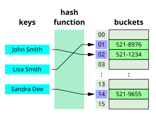
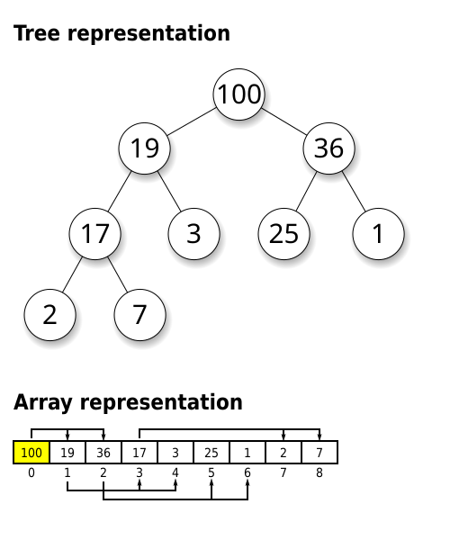
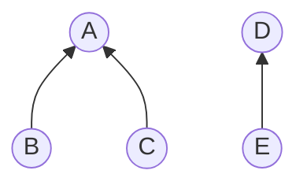

# 🧠 Data Structures & Coding Patterns (Python)

## Data Structures

### ❓ Array vs linked list — when do you use which?

**Level:** 🟡 Intermediate

### 📝 Answer

| Operation | Array (Python `list`) | Linked list |
|---|---|---|
| Access by index `a[i]` | **O(1)** | O(n) — walk from the head |
| Insert/delete at end | O(1) amortized | O(1) with a tail pointer |
| Insert/delete at start or middle | O(n) — shift elements | **O(1)** once you're at the node |
| Memory | Compact, cache-friendly | Extra pointer per node |

Use an array by default. Use a linked list when you insert/remove in the middle a lot and already hold the node (e.g. an LRU cache).

---

### ❓ Stack vs queue vs deque?

**Level:** 🟡 Intermediate

### 📝 Answer

- **Stack — LIFO** (last in, first out), like a pile of plates. Undo, matching brackets, DFS.
- **Queue — FIFO** (first in, first out), like a ticket line. BFS, task scheduling.
- **Deque** — add/remove at both ends in O(1).

```python
stack = []; stack.append(1); stack.pop()          # O(1)

from collections import deque
q = deque(); q.append(1); q.popleft()             # O(1)  (list.pop(0) is O(n)!)
```

---

### ❓ What are a binary tree and a binary search tree (BST)?

**Level:** 🟢 Beginner

### 📝 Answer

- **Binary tree:** each node has at most 2 children.
- **BST:** for every node, **left subtree < node < right subtree**. Search, insert, delete are **O(log n)** when balanced, O(n) if it degrades into a line.

```text
        8
      /   \
     3     10        in-order traversal of a BST gives sorted order: 1 3 6 8 10 14
    / \      \
   1   6      14
```

**Traversals**

| Order | Visit | Use |
|---|---|---|
| Pre-order | node, left, right | Copy a tree |
| In-order | left, node, right | Sorted output of a BST |
| Post-order | left, right, node | Delete a tree, evaluate expressions |
| Level-order | level by level (BFS) | Shortest path in a tree, print by level |

### ❓ How do you represent a graph?

**Level:** 🟡 Intermediate

### 📝 Answer

```python
# Adjacency list — most common, O(V + E) space
graph = {"A": ["B", "C"], "B": ["D"], "C": ["D"], "D": []}

# Adjacency matrix — O(V²) space, O(1) "is there an edge?"
#     A B C D
# A [ 0 1 1 0 ]
```

Use an **adjacency list** for most problems (graphs are usually sparse).

---

### ❓ What is a trie?

**Level:** 🟡 Intermediate

### 📝 Answer

A tree where each edge is a **character**, so words with the same prefix share a path. Great for autocomplete and prefix search: lookup is **O(length of the word)**.

```python
class Trie:
    def __init__(self): self.root = {}
    def insert(self, word):
        node = self.root
        for ch in word:
            node = node.setdefault(ch, {})
        node["$"] = True                      # end of word
    def starts_with(self, prefix):
        node = self.root
        for ch in prefix:
            if ch not in node: return False
            node = node[ch]
        return True
```

---

## Patterns with Templates

### ❓ What is the sliding window pattern? Give a template.

**Level:** 🟡 Intermediate

### 📝 Answer

Keep a **window** `[left, right]` over an array/string and slide it, instead of re-checking every subarray. Turns O(n²) into **O(n)**.

**Fixed size — max sum of any 3 consecutive numbers:**

```python
def max_sum(nums, k):
    window = sum(nums[:k]); best = window
    for i in range(k, len(nums)):
        window += nums[i] - nums[i - k]   # add new, drop old
        best = max(best, window)
    return best

print(max_sum([2, 1, 5, 1, 3, 2], 3))
```

**Input and output:**

| Input (`nums`) | `k` | Output |
|---|---|---|
| `[2, 1, 5, 1, 3, 2]` | `3` | `9` |

**Variable size — Minimum Size Subarray Sum (LeetCode 209): shortest subarray with sum ≥ target:**

_In simple words:_ find the shortest run of neighbouring numbers whose sum reaches the target. Grow the window to the right until the sum is big enough, then shrink it from the left while it still is.

```python
def min_sub_array_len(target, nums):
    left = total = 0; best = float("inf")
    for right, x in enumerate(nums):
        total += x                          # grow
        while total >= target:              # shrink while valid
            best = min(best, right - left + 1)
            total -= nums[left]; left += 1
    return 0 if best == float("inf") else best

print(min_sub_array_len(7, [2, 3, 1, 2, 4, 3]))
```

**Input and output:**

| Input (`target`) | `nums` | Output |
|---|---|---|
| `7` | `[2, 3, 1, 2, 4, 3]` | `2` |

**Spot it:** "longest/shortest/max subarray or substring that…".

---

### ❓ What is the two pointers pattern?

**Level:** 🟡 Intermediate

### 📝 Answer

Use two indexes that move toward each other (or at different speeds), usually on a **sorted** array or a string.

_In simple words (Two Sum II):_ the list is sorted; find two numbers that add up to the target. Start with one pointer at each end: if the sum is too small, move the left one up; if too big, move the right one down.

```python
# Two Sum II — sorted input (LeetCode 167)
def two_sum_sorted(nums, target):
    l, r = 0, len(nums) - 1
    while l < r:
        s = nums[l] + nums[r]
        if s == target: return [l + 1, r + 1]
        if s < target: l += 1      # need bigger
        else: r -= 1               # need smaller

print(two_sum_sorted([2, 7, 11, 15], 9))
```

**Input and output:**

| Input (`nums`) | `target` | Output |
|---|---|---|
| `[2, 7, 11, 15]` | `9` | `[1, 2]` |

Also used for: reversing, removing duplicates in place, palindromes, 3Sum.

---

### ❓ What is the fast and slow pointer pattern?

**Level:** 🟡 Intermediate

### 📝 Answer

One pointer moves 1 step, the other 2 steps.

- **Middle of a linked list (LeetCode 876):** when fast reaches the end, slow is in the middle.
- **Cycle detection (LeetCode 141):** if there is a loop, fast eventually meets slow.

```python
def middle(head):
    slow = fast = head
    while fast and fast.next:
        slow, fast = slow.next, fast.next.next
    return slow

# from_list / to_list build and print linked lists (see the LeetCode notes)
print(middle(from_list([1, 2, 3, 4, 5])).val)
```

**Input and output:**

| Input (`head`) | Output |
|---|---|
| `[1, 2, 3, 4, 5]` | `3` |

---

### ❓ What is the prefix sum pattern?

**Level:** 🟡 Intermediate

### 📝 Answer

Pre-compute running totals so any range sum is **O(1)**: `sum(i..j) = prefix[j+1] - prefix[i]`.

**Subarray Sum Equals K (LeetCode 560)** — count subarrays summing to k (works with negatives):

_In simple words:_ count the runs of consecutive numbers that add up to exactly `k`. If the running total is now `T` and was `T - k` earlier, the numbers in between sum to `k` — so count how often each running total has appeared.

```python
def subarray_sum(nums, k):
    count = total = 0
    seen = {0: 1}                         # prefix sum → how many times seen
    for x in nums:
        total += x
        count += seen.get(total - k, 0)   # an earlier prefix that leaves exactly k
        seen[total] = seen.get(total, 0) + 1
    return count

print(subarray_sum([1, 1, 1], 2))
print(subarray_sum([1, 2, 3], 3))
```

**Input and output:**

| Input (`nums`) | `k` | Output |
|---|---|---|
| `[1, 1, 1]` | `2` | `2` |
| `[1, 2, 3]` | `3` | `2` |

---

### ❓ What is a binary search template that avoids off-by-one bugs?

**Level:** 🟡 Intermediate

### 📝 Answer

Search on a **sorted** range by halving it: **O(log n)**.

```python
def lower_bound(nums, target):     # first index with nums[i] >= target
    lo, hi = 0, len(nums)          # hi is exclusive
    while lo < hi:
        mid = (lo + hi) // 2
        if nums[mid] < target: lo = mid + 1
        else: hi = mid
    return lo

print(lower_bound([1, 3, 5, 6], 5))
print(lower_bound([1, 3, 5, 6], 2))
```

**Input and output:**

| Input (`nums`) | `target` | Output |
|---|---|---|
| `[1, 3, 5, 6]` | `5` | `2` |
| `[1, 3, 5, 6]` | `2` | `1` |

Python has it built in: `bisect.bisect_left(nums, target)`.

**Binary search on the answer:** "smallest speed/capacity that works" — search over the answer range and test each guess (e.g. Koko Eating Bananas, LeetCode 875).

---

### ❓ What is the monotonic stack pattern?

**Level:** 🟡 Intermediate

### 📝 Answer

A stack kept in increasing or decreasing order. Answers "**next greater/smaller element**" in **O(n)**.

**Daily Temperatures (LeetCode 739)** — days to wait for a warmer day:

_In simple words:_ for each day, how many days until a warmer one? Keep a stack of the days still waiting; when a warmer day arrives, it answers every cooler day on top of the stack.

```python
def daily_temperatures(t):
    ans = [0] * len(t); stack = []        # indexes, temps decreasing
    for i, temp in enumerate(t):
        while stack and t[stack[-1]] < temp:
            j = stack.pop(); ans[j] = i - j
        stack.append(i)
    return ans

print(daily_temperatures([73, 74, 75, 71, 69, 72, 76, 73]))
```

**Input and output:**

| Input (`t`) | Output |
|---|---|
| `[73, 74, 75, 71, 69, 72, 76, 73]` | `[1, 1, 4, 2, 1, 1, 0, 0]` |

---

### ❓ How do BFS and DFS work, and when do you use each?

**Level:** 🟡 Intermediate

### 📝 Answer

- **BFS (breadth-first):** explore level by level with a **queue**. Finds the **shortest path** in an unweighted graph.
- **DFS (depth-first):** go as deep as possible, then backtrack, with **recursion or a stack**. Good for exploring everything, cycles, paths, islands.

```python
from collections import deque

def bfs(graph, start):
    seen, q = {start}, deque([start])
    while q:
        node = q.popleft()
        for nxt in graph[node]:
            if nxt not in seen:
                seen.add(nxt); q.append(nxt)
    return seen

def dfs(graph, node, seen=None):
    seen = seen or set()
    seen.add(node)
    for nxt in graph[node]:
        if nxt not in seen: dfs(graph, nxt, seen)
    return seen
```

Both are **O(V + E)**.

---

### ❓ Binary Tree Level Order Traversal (LeetCode 102)

**Level:** 🟡 Intermediate

### 📝 Answer

**In simple words:** Return the tree's values level by level: first the root, then its children, then their children.

**How to approach it:**

1. Use a queue (BFS), starting with the root.
2. Each round, take exactly the nodes now in the queue — that is one level.
3. Add their children to the queue for the next round.

BFS, processing one level at a time.

```python
def level_order(root):
    if not root: return []
    result, q = [], deque([root])
    while q:
        level = []
        for _ in range(len(q)):            # exactly this level's nodes
            node = q.popleft(); level.append(node.val)
            if node.left: q.append(node.left)
            if node.right: q.append(node.right)
        result.append(level)
    return result

root = TreeNode(3, TreeNode(9), TreeNode(20, TreeNode(15), TreeNode(7)))
print(level_order(root))
```

**Input and output:**

| Input (`root`) | Output |
|---|---|
| `[3, 9, 20, null, null, 15, 7]` | `[[3], [9, 20], [15, 7]]` |

---

### ❓ Validate Binary Search Tree (LeetCode 98)

**Level:** 🟡 Intermediate

### 📝 Answer

**In simple words:** Check that every node's left side holds only smaller values and its right side only bigger ones — all the way down, not just its direct children.

**How to approach it:**

1. Give each node an allowed range (low, high); the root can be anything.
2. Going left, the node's value becomes the new upper limit; going right, the new lower limit.
3. Any value outside its range → not a valid BST.

Each node must be inside a **range** that narrows as you go down — checking only the direct children is a common bug.

```python
def is_valid_bst(node, low=float("-inf"), high=float("inf")):
    if not node: return True
    if not (low < node.val < high): return False
    return is_valid_bst(node.left, low, node.val) and is_valid_bst(node.right, node.val, high)

print(is_valid_bst(TreeNode(2, TreeNode(1), TreeNode(3))))
print(is_valid_bst(TreeNode(5, TreeNode(1), TreeNode(4, TreeNode(3), TreeNode(6)))))
```

**Input and output:**

| Input (`node`) | Output |
|---|---|
| `[2, 1, 3]` | `True` |
| `[5, 1, 4, null, null, 3, 6]` | `False` |

> ⚠️ **Trap:** a right grandchild smaller than the root breaks the BST even if it's bigger than its own parent.

---

### ❓ Lowest Common Ancestor of a Binary Tree (LeetCode 236)

**Level:** 🟡 Intermediate

### 📝 Answer

**In simple words:** Find the lowest node that has both `p` and `q` below it (a node can be its own ancestor).

**How to approach it:**

1. Search for `p` and `q` in the left and right subtrees.
2. If one is found on each side, the current node is where they split — that's the answer.
3. If both are on one side, the answer is on that side.

Search both sides; the node where `p` and `q` come from different sides is the LCA.

```python
def lca(root, p, q):
    if not root or root in (p, q): return root
    left, right = lca(root.left, p, q), lca(root.right, p, q)
    if left and right: return root        # one on each side
    return left or right

p, q = TreeNode(5), TreeNode(1)
root = TreeNode(3, p, q)
print(lca(root, p, q).val)
```

**Input and output:**

| Input (`root`) | `p` | `q` | Output |
|---|---|---|---|
| `[3, 5, 1]` | `5` | `1` | `3` |

---

### ❓ What is topological sort? (Course Schedule, LeetCode 207)

**Level:** 🟡 Intermediate

### 📝 Answer

**In simple words:** Some courses need others first. Can you finish all of them, or do the requirements go round in a circle?

**How to approach it:**

1. Count each course's unmet prerequisites.
2. Start with the courses that need nothing; "take" them and lower the count of the courses that depend on them.
3. If you take every course, it's possible; if some are left over, there's a circle.

An order of tasks where every task comes **after its prerequisites**. Only possible if there is **no cycle**.

**Kahn's algorithm:** start with tasks that have no prerequisites, remove them, repeat.

```python
def can_finish(n, prerequisites):
    graph = [[] for _ in range(n)]; indegree = [0] * n
    for course, pre in prerequisites:
        graph[pre].append(course); indegree[course] += 1
    q = deque(i for i in range(n) if indegree[i] == 0)
    done = 0
    while q:
        c = q.popleft(); done += 1
        for nxt in graph[c]:
            indegree[nxt] -= 1
            if indegree[nxt] == 0: q.append(nxt)
    return done == n          # False → there is a cycle

print(can_finish(2, [[1, 0]]))            # take 0, then 1
print(can_finish(2, [[1, 0], [0, 1]]))    # each needs the other: a cycle
```

**Input and output:**

| Input (`n`) | `prerequisites` | Output |
|---|---|---|
| `2` | `[[1, 0]]` | `True` |
| `2` | `[[1, 0], [0, 1]]` | `False` |

Real use: build systems, package installs, the study-path order in this repository.

---

### ❓ What is Dijkstra's algorithm?

**Level:** 🟡 Intermediate

### 📝 Answer

Finds the **shortest path from one node** in a graph with **non-negative weights**. Always expand the closest unvisited node, using a min-heap.

```python
def dijkstra(graph, start):           # graph[u] = [(v, weight), ...]
    dist = {start: 0}; heap = [(0, start)]
    while heap:
        d, u = heapq.heappop(heap)
        if d > dist.get(u, float("inf")): continue
        for v, w in graph[u]:
            if d + w < dist.get(v, float("inf")):
                dist[v] = d + w; heapq.heappush(heap, (d + w, v))
    return dist
```

O((V + E) log V). Negative weights → use Bellman-Ford.

---

### ❓ What is backtracking? (Subsets and Permutations)

**Level:** 🟡 Intermediate

### 📝 Answer

Build a solution step by step; when a choice is done (or fails), **undo it and try the next**.

_In simple words:_ **subsets** — for each number, choose "take it" or "skip it"; **permutations** — choose which number goes first, then arrange the rest the same way.

```python
def subsets(nums):                         # LeetCode 78 → 2ⁿ results
    result, path = [], []
    def go(i):
        if i == len(nums): result.append(path[:]); return
        path.append(nums[i]); go(i + 1)    # take it
        path.pop();           go(i + 1)    # skip it
    go(0); return result

def permutations(nums):                    # LeetCode 46 → n! results
    result = []
    def go(path, rest):
        if not rest: result.append(path); return
        for i in range(len(rest)):
            go(path + [rest[i]], rest[:i] + rest[i+1:])
    go([], nums); return result

print(subsets([1, 2, 3]))
print(permutations([1, 2, 3]))
```

**Input and output:**

_`subsets`_

| Input (`nums`) | Output |
|---|---|
| `[1, 2, 3]` | `[[1, 2, 3], [1, 2], [1, 3], [1], [2, 3], [2], [3], []]` |

_`permutations`_

| Input (`nums`) | Output |
|---|---|
| `[1, 2, 3]` | `[[1, 2, 3], [1, 3, 2], [2, 1, 3], [2, 3, 1], [3, 1, 2], [3, 2, 1]]` |

Used for: subsets, permutations, combinations, N-Queens, Sudoku, word search.

---

### ❓ How do you approach a dynamic programming problem?

**Level:** 🟡 Intermediate

### 📝 Answer

DP = solve small subproblems once, **save the answers**, build up the big one. Use it when a problem has **overlapping subproblems** (same calls repeat).

Steps:

1. Define the state: `dp[i]` = best answer for the first i items.
2. Write the choice: `dp[i] = max(dp[i-1], dp[i-2] + nums[i])`.
3. Set base cases.
4. Fill in order (bottom-up) or recurse with a cache (top-down, `@lru_cache`).

**House Robber (LeetCode 198)** — can't rob two neighbours:

_In simple words:_ rob houses for the most money, but never two next to each other. At each house, either skip it (keep the best so far) or rob it (the best from two houses back + this one).

```python
def rob(nums):
    prev2 = prev1 = 0
    for x in nums:
        prev2, prev1 = prev1, max(prev1, prev2 + x)   # skip it, or take it
    return prev1
print(rob([2, 7, 9, 3, 1]))          # 2 + 9 + 1
```

**Input and output:**

| Input (`nums`) | Output |
|---|---|
| `[2, 7, 9, 3, 1]` | `12` |

#### ↳ Follow-up: Memoization vs tabulation?

↪ Memoization = top-down recursion with a cache. Tabulation = bottom-up loop filling a table. Same complexity; tabulation avoids recursion limits.

---

### ❓ Longest Common Subsequence (LeetCode 1143)

**Level:** 🟡 Intermediate

### 📝 Answer

**In simple words:** Find the length of the longest sequence of letters that appears in both words in the same order, not necessarily side by side. "abcde" and "ace" share "ace" → 3.

**How to approach it:**

1. Build a table where `dp[i][j]` = the answer for the first `i` letters of one word and the first `j` of the other.
2. If the current letters match, take the answer without both letters, plus 1.
3. If not, take the better of dropping a letter from either word.

Classic 2-D DP: compare the last characters.

```python
def lcs(a, b):
    dp = [[0] * (len(b) + 1) for _ in range(len(a) + 1)]
    for i in range(1, len(a) + 1):
        for j in range(1, len(b) + 1):
            if a[i-1] == b[j-1]: dp[i][j] = dp[i-1][j-1] + 1
            else:                dp[i][j] = max(dp[i-1][j], dp[i][j-1])
    return dp[-1][-1]
print(lcs("abcde", "ace"))          # "ace"
```

**Input and output:**

| Input (`a`) | `b` | Output |
|---|---|---|
| `"abcde"` | `"ace"` | `3` |

O(m × n) time and space.

---

### ❓ LRU Cache (LeetCode 146)

**Level:** 🟡 Intermediate

### 📝 Answer

**In simple words:** Build a cache with a size limit that, when full, throws out the item used longest ago. Both `get` and `put` must be fast (`O(1)`).

**How to approach it:**

1. A dictionary finds items quickly; an ordering tracks which were used recently.
2. On every `get` or `put`, move that key to the "recently used" end.
3. When over capacity, remove the item at the "oldest" end. Python's `OrderedDict` gives you both.

Keep items in **use order**; when full, evict the **least recently used**. Both `get` and `put` must be O(1): a hash map + a doubly linked list. In Python, `OrderedDict` does both.

```python
from collections import OrderedDict

class LRUCache:
    def __init__(self, capacity):
        self.cap, self.data = capacity, OrderedDict()
    def get(self, key):
        if key not in self.data: return -1
        self.data.move_to_end(key)          # mark as recently used
        return self.data[key]
    def put(self, key, value):
        self.data[key] = value; self.data.move_to_end(key)
        if len(self.data) > self.cap:
            self.data.popitem(last=False)   # remove the oldest

cache = LRUCache(2)
cache.put(1, "a")
cache.put(2, "b")
print(cache.get(1))      # 1 is now the most recent
cache.put(3, "c")         # full: evicts 2, the least recently used
print(cache.get(2))
print(cache.get(3))
```

**Input and output:**

| Operation | Output |
|---|---|
| `cache = LRUCache(2)` | — |
| `cache.put(1, "a")` | — |
| `cache.put(2, "b")` | — |
| `cache.get(1)` | `"a"` |
| `cache.put(3, "c")` | — |
| `cache.get(2)` | `-1` |
| `cache.get(3)` | `"c"` |

---

### ❓ Merge K Sorted Lists (LeetCode 23)

**Level:** 🟡 Intermediate

### 📝 Answer

**In simple words:** Join `k` sorted chains into one sorted chain.

**How to approach it:**

1. The next smallest node is always at the front of one of the lists.
2. Keep the `k` front nodes in a min-heap; take the smallest and attach it.
3. Push that node's next node into the heap, and repeat until the heap is empty.

Put the head of each list in a **min-heap**; repeatedly take the smallest and push its next node. O(N log k).

```python
def merge_k_lists(lists):
    heap = [(node.val, i, node) for i, node in enumerate(lists) if node]
    heapq.heapify(heap)
    dummy = tail = ListNode()
    while heap:
        _, i, node = heapq.heappop(heap)    # i breaks ties (nodes can't be compared)
        tail.next = tail = node
        if node.next: heapq.heappush(heap, (node.next.val, i, node.next))
    return dummy.next

print(to_list(merge_k_lists([from_list([1, 4, 5]), from_list([1, 3, 4]), from_list([2, 6])])))
```

**Input and output:**

| Input (`lists`) | Output |
|---|---|
| `[[1, 4, 5], [1, 3, 4], [2, 6]]` | `[1, 1, 2, 3, 4, 4, 5, 6]` |

---

## Sorting

### ❓ How do the main sorting algorithms compare?

**Level:** 🟡 Intermediate

### 📝 Answer

| Algorithm | Best | Average | Worst | Space | Stable |
|---|---|---|---|---|---|
| Bubble / Insertion | O(n) | O(n²) | O(n²) | O(1) | Yes |
| Merge sort | O(n log n) | O(n log n) | O(n log n) | O(n) | Yes |
| Quick sort | O(n log n) | O(n log n) | **O(n²)** | O(log n) | No |
| Heap sort | O(n log n) | O(n log n) | O(n log n) | O(1) | No |
| Python `sorted` (Timsort) | O(n) | O(n log n) | O(n log n) | O(n) | Yes |

**Stable** = equal items keep their original order (matters when sorting by one field after another).

#### ↳ Follow-up: Why is quick sort fast in practice despite the O(n²) worst case?

↪ It sorts in place with good cache use; a random pivot makes the worst case extremely unlikely.

#### ↳ Follow-up: Explain merge sort in one line.

↪ Split the list in half, sort each half, then merge the two sorted halves.

---

## Interview Tricks

### ❓ How do you approach a coding problem you haven't seen before?

**Level:** 🟡 Intermediate

### 📝 Answer

1. **Restate** the problem and ask about input size, duplicates, negatives, empty input.
2. **Work an example** by hand.
3. Say the **brute force** and its Big O.
4. **Match a pattern** from the clues:

| Clue in the question | Try |
|---|---|
| Sorted array | Binary search, two pointers |
| Subarray / substring | Sliding window, prefix sum |
| "Top K", "smallest/largest K" | Heap |
| Pairs that sum to X / "seen before" | Hash map |
| Tree or graph, shortest path | BFS |
| All combinations / permutations | Backtracking |
| Count ways / min cost / max profit with choices | Dynamic programming |
| Next greater element | Monotonic stack |
| Dependencies / order of tasks | Topological sort |

5. Code it, then **test** with the example and edge cases.
6. State the final time and space complexity.

---

### ❓ Tricky: What is the time complexity of `x in my_list` vs `x in my_set`?

**Level:** 🟡 Intermediate

### 📝 Answer

`x in list` is **O(n)** — it checks each item. `x in set` (and `dict`) is **O(1)** on average — a hash lookup. Converting a list to a set before many lookups is a common easy speed-up.


---

## More Core Patterns (Intermediate)

### ❓ How does a hash table handle collisions?

### 📝 Answer

A hash table turns a key into an array index with a **hash function**. A **collision** is when two keys get the **same index** — unavoidable, since there are more possible keys than slots.



_Image: [Wikimedia Commons](https://commons.wikimedia.org/wiki/File:Hash_table_3_1_1_0_1_0_0_SP.svg) · Jorge Stolfi · CC BY-SA 3.0_

| Method | How | Used by |
|---|---|---|
| **Separate chaining** | each slot holds a small list; colliding keys go in the list | Java `HashMap` (list → tree after 8) |
| **Open addressing** | on a collision, probe for another free slot (linear, quadratic, double hashing) | Python `dict` and `set` |

**Keeping it O(1):** a good hash spreads keys evenly, and when the table gets too full (**load factor** ~0.66–0.75) it **resizes** (usually doubles) and re-inserts everything. Average O(1); worst case O(n) if everything collides.

#### ↳ Follow-up: Why is resizing still O(1) "on average"?

↪ Doubling is rare: n inserts cause total copying work of about 2n, so each insert costs O(1) **amortized**.

---

### ❓ What is a heap / priority queue, and when do you use it?

### 📝 Answer

A **heap** is a complete binary tree where every parent is ≤ its children (**min-heap**) or ≥ them (**max-heap**). The smallest (or largest) item is always at the top. It's stored compactly in an array: children of index `i` are `2i+1` and `2i+2`.



_Image: [Wikimedia Commons](https://commons.wikimedia.org/wiki/File:Max-Heap.svg) · Ermishin · CC BY-SA 3.0_

| Operation | Cost |
|---|---|
| peek min/max | O(1) |
| push | O(log n) — add at the end, "bubble up" |
| pop | O(log n) — move last to top, "sift down" |
| build from a list | O(n) — `heapify` |

```python
import heapq
tasks = []
heapq.heappush(tasks, (2, "write report"))     # (priority, item)
heapq.heappush(tasks, (1, "fix prod bug"))
heapq.heappop(tasks)                            # (1, 'fix prod bug')

# Max-heap trick: push negatives
heapq.heappush(h, -score)
```

**Use it for:** top-K / K-th largest, merging K sorted lists, Dijkstra, scheduling by priority, a running median (two heaps).

#### ↳ Follow-up: K-th largest of n numbers — sort or heap?

↪ A min-heap of size K: O(n log K), better than sorting's O(n log n) when K is small.

---

### ❓ What is the greedy approach, and when does it work?

### 📝 Answer

A **greedy** algorithm makes the **best choice right now** and never goes back. It's fast and simple — but only correct when local best choices add up to the global best.

**Example — schedule the most meetings in one room:** always pick the meeting that **ends earliest**.

```python
def max_meetings(meetings):            # [(start, end), ...]
    count, last_end = 0, float("-inf")
    for start, end in sorted(meetings, key=lambda m: m[1]):   # earliest end first
        if start >= last_end:
            count += 1
            last_end = end
    return count

print(max_meetings([(1, 3), (2, 5), (4, 6), (6, 8)]))   # 3
```

**Classic greedy problems:** interval scheduling, Jump Game, Gas Station, assigning cookies, Huffman coding, Dijkstra, Kruskal/Prim minimum spanning tree.

**When greedy fails:** coin change with coins `[1, 3, 4]` and amount 6 — greedy takes 4+1+1 (3 coins), the best is 3+3 (2 coins). Use **DP** there.

#### ↳ Follow-up: How do you know greedy is safe?

↪ Find a counter-example first. If none, argue that swapping any other choice for the greedy one never makes the answer worse ("exchange argument").

---

### ❓ What is union-find (disjoint set union), and where is it used?

### 📝 Answer

**Union-find** tracks which items belong to the **same group**, with two fast operations:
- `find(x)` — which group (its root) is x in?
- `union(a, b)` — merge the groups of a and b.


Two groups: {A, B, C} with root A, and {D, E} with root D. `union(C, E)` links root D under A.

```python
class UnionFind:
    def __init__(self, n):
        self.parent = list(range(n))
        self.size = [1] * n

    def find(self, x):
        while self.parent[x] != x:
            self.parent[x] = self.parent[self.parent[x]]   # path compression (halving)
            x = self.parent[x]
        return x

    def union(self, a, b):
        ra, rb = self.find(a), self.find(b)
        if ra == rb:
            return False                  # already connected → would form a cycle
        if self.size[ra] < self.size[rb]:
            ra, rb = rb, ra
        self.parent[rb] = ra              # union by size: small tree under big tree
        self.size[ra] += self.size[rb]
        return True

uf = UnionFind(5)
uf.union(0, 1); uf.union(3, 4)
print(uf.find(1) == uf.find(0), uf.find(1) == uf.find(4))   # True False
```

With path compression + union by size, each operation is almost O(1) (inverse Ackermann).

**Use for:** number of connected components, detecting a cycle in an undirected graph, Kruskal's minimum spanning tree, "accounts merge", friend circles.

#### ↳ Follow-up: Union-find or BFS for connected components?

↪ Either works for a fixed graph. Union-find shines when edges arrive **one by one** and you must answer "connected?" after each.

---

### ❓ What bit manipulation tricks should you know for interviews?

### 📝 Answer

| Trick | Code | Example |
|---|---|---|
| Is bit `i` set? | `(n >> i) & 1` | `(5 >> 0) & 1` → 1 (5 = `101`) |
| Set bit `i` | `n \| (1 << i)` | |
| Clear bit `i` | `n & ~(1 << i)` | |
| Remove lowest set bit | `n & (n - 1)` | `12 & 11` → 8 (`1100` → `1000`) |
| Power of two? | `n > 0 and n & (n - 1) == 0` | 16 → True |
| Count set bits | loop `n &= n - 1`, or `bin(n).count("1")` | 7 → 3 |
| Odd? | `n & 1` | |
| Swap without temp | `a ^= b; b ^= a; a ^= b` | |

**XOR facts:** `x ^ x = 0`, `x ^ 0 = x`, order doesn't matter. So XOR-ing a list cancels pairs:

```python
def single_number(nums):          # LeetCode 136: every number appears twice except one
    result = 0
    for n in nums:
        result ^= n
    return result

print(single_number([4, 1, 2, 1, 2]))   # 4
```

**Other classics:** Missing Number (XOR 0..n with the list), Counting Bits (`dp[i] = dp[i >> 1] + (i & 1)`), Subsets with bitmasks (`for mask in range(1 << n)`).

#### ↳ Follow-up: Why is `n & (n - 1)` so useful?

↪ Subtracting 1 flips the lowest set bit and every 0 below it, so the AND removes exactly that bit.

---

## More LeetCode Classics (Advanced)

### ❓ Trapping Rain Water (LeetCode 42)

### 📝 Answer

**In simple words:** Bars of different heights stand in a row. After rain, how much water is trapped between them? Water above a bar = `min(tallest on the left, tallest on the right) − its height`.

**How to approach it:**

1. Use two pointers, one at each end, and remember the tallest bar seen from each side.
2. Move the side with the **lower** bar: its water level is decided by its own side's maximum.
3. Add `max_so_far − height` at each step.

```python
def trap(height):
    left, right = 0, len(height) - 1
    left_max = right_max = water = 0
    while left < right:
        if height[left] < height[right]:
            left_max = max(left_max, height[left])
            water += left_max - height[left]
            left += 1
        else:
            right_max = max(right_max, height[right])
            water += right_max - height[right]
            right -= 1
    return water

print(trap([0, 1, 0, 2, 1, 0, 1, 3, 2, 1, 2, 1]))   # 6
```

**Input and output:**

| Input | Output |
|---|---|
| `[0,1,0,2,1,0,1,3,2,1,2,1]` | `6` |
| `[4,2,0,3,2,5]` | `9` |

O(n) time, O(1) space.

---

### ❓ Word Break (LeetCode 139)

### 📝 Answer

**In simple words:** Can the string be split into words that are all in the dictionary? `"leetcode"` with `["leet", "code"]` → yes.

**How to approach it:**

1. `dp[i]` = can the first `i` letters be split into dictionary words?
2. `dp[0]` is True (empty string).
3. `dp[i]` is True if some earlier `dp[j]` is True and `s[j:i]` is a word.

```python
def word_break(s, words):
    words = set(words)
    dp = [True] + [False] * len(s)
    for i in range(1, len(s) + 1):
        for j in range(i):
            if dp[j] and s[j:i] in words:
                dp[i] = True
                break
    return dp[-1]

print(word_break("leetcode", ["leet", "code"]))                          # True
print(word_break("catsandog", ["cats", "dog", "sand", "and", "cat"]))    # False
```

**Input and output:**

| `s` | Dictionary | Output |
|---|---|---|
| `"leetcode"` | `["leet","code"]` | `True` |
| `"applepenapple"` | `["apple","pen"]` | `True` |
| `"catsandog"` | `["cats","dog","sand","and","cat"]` | `False` |

O(n²) time (plus substring cost), O(n) space.

---

### ❓ House Robber (LeetCode 198)

### 📝 Answer

**In simple words:** Houses in a row hold money. You can't rob two neighbours. What's the most you can take?

**How to approach it:**

1. At each house choose: **rob it** (money + best total up to two houses back) or **skip it** (best total up to the previous house).
2. Keep only two running numbers instead of a whole table.

```python
def rob(nums):
    take, skip = 0, 0           # best total if we rob / don't rob the previous house
    for n in nums:
        take, skip = skip + n, max(take, skip)
    return max(take, skip)

print(rob([2, 7, 9, 3, 1]))     # 12  (2 + 9 + 1)
```

**Input and output:**

| Input | Output |
|---|---|
| `[1,2,3,1]` | `4` |
| `[2,7,9,3,1]` | `12` |

O(n) time, O(1) space.

---

### ❓ Longest Palindromic Substring (LeetCode 5)

### 📝 Answer

**In simple words:** Find the longest part of the string that reads the same backwards. `"babad"` → `"bab"`.

**How to approach it:**

1. Every palindrome has a centre: one letter (odd length) or between two letters (even length).
2. For each centre, expand outwards while both sides match.
3. Keep the longest found.

```python
def longest_palindrome(s):
    best = ""
    for centre in range(len(s)):
        for left, right in ((centre, centre), (centre, centre + 1)):   # odd and even
            while left >= 0 and right < len(s) and s[left] == s[right]:
                left -= 1
                right += 1
            if right - left - 1 > len(best):
                best = s[left + 1:right]
    return best

print(longest_palindrome("babad"))   # bab
print(longest_palindrome("cbbd"))    # bb
```

**Input and output:**

| Input | Output |
|---|---|
| `"babad"` | `"bab"` (`"aba"` is also correct) |
| `"cbbd"` | `"bb"` |

O(n²) time, O(1) space.

---

### ❓ Rotting Oranges (LeetCode 994)

### 📝 Answer

**In simple words:** In a grid, `2` is a rotten orange, `1` fresh, `0` empty. Each minute, rot spreads to the 4 neighbours. How many minutes until no fresh orange is left (or −1 if impossible)?

**How to approach it:**

1. **Multi-source BFS:** put **all** rotten oranges in the queue at the start.
2. Process the queue **level by level** — one level = one minute.
3. Count fresh oranges; when it reaches 0, return the minutes.

```python
from collections import deque

def oranges_rotting(grid):
    rows, cols = len(grid), len(grid[0])
    queue, fresh = deque(), 0
    for r in range(rows):
        for c in range(cols):
            if grid[r][c] == 2:
                queue.append((r, c))
            elif grid[r][c] == 1:
                fresh += 1
    minutes = 0
    while queue and fresh:
        for _ in range(len(queue)):                 # one minute
            r, c = queue.popleft()
            for nr, nc in ((r + 1, c), (r - 1, c), (r, c + 1), (r, c - 1)):
                if 0 <= nr < rows and 0 <= nc < cols and grid[nr][nc] == 1:
                    grid[nr][nc] = 2
                    fresh -= 1
                    queue.append((nr, nc))
        minutes += 1
    return minutes if fresh == 0 else -1

print(oranges_rotting([[2, 1, 1], [1, 1, 0], [0, 1, 1]]))   # 4
```

**Input and output:**

| Input | Output |
|---|---|
| `[[2,1,1],[1,1,0],[0,1,1]]` | `4` |
| `[[2,1,1],[0,1,1],[1,0,1]]` | `-1` (bottom-left can't be reached) |
| `[[0,2]]` | `0` |

O(rows × cols) time and space.

---
