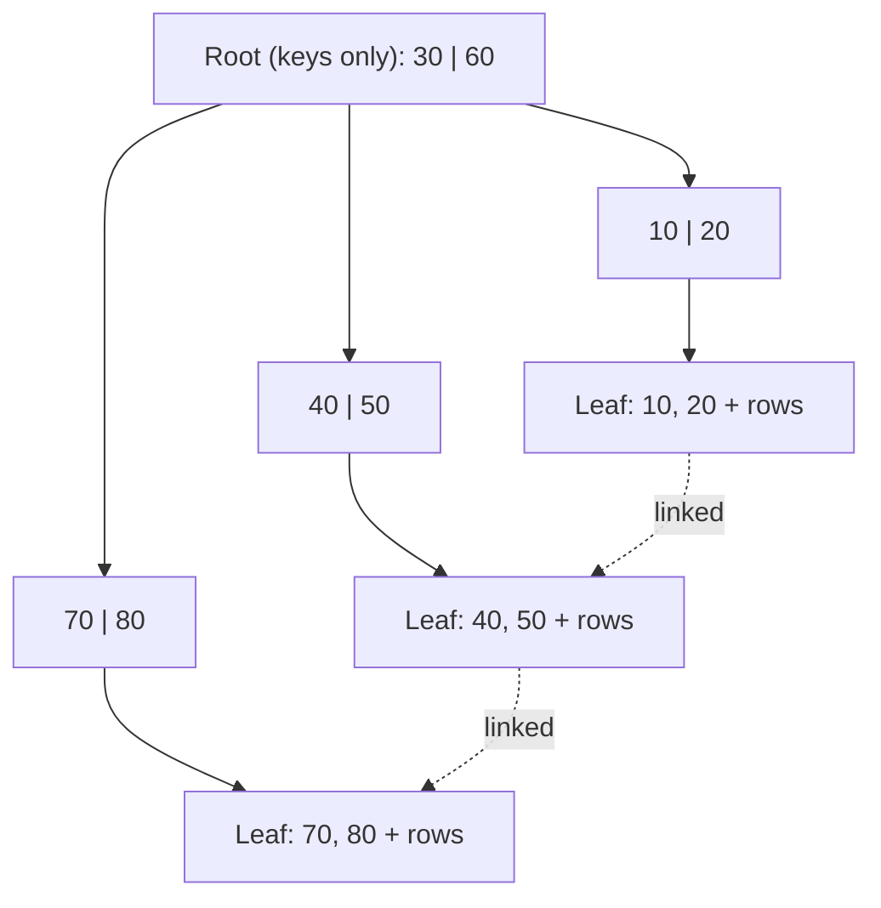
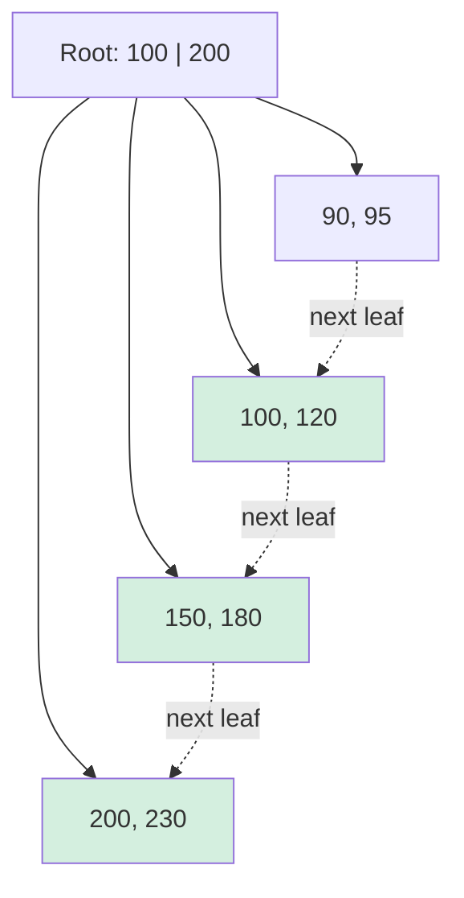

# B-Tree and B+ Tree (Database Indexing)

## Tree Types

### ❓ What is a Binary Search Tree (BST), and what is its limitation?

### 📝 Answer

Rules:

1. Each node has at most 2 children.
2. The left subtree holds smaller values; the right subtree holds larger values.
3. No balancing is guaranteed.

```text
       20
      /  \
    10    30
```

**Limitation:** inserting values in sorted order makes the tree **skewed** (a linked list). Search is `O(log n)` when reasonably balanced, but `O(n)` in the worst case.

---

### ❓ What is an M-way search tree?

### 📝 Answer

A generalisation of the BST where a node can have many children:

1. At most **M** children.
2. At most **M − 1** keys per node.
3. Keys inside a node are sorted.
4. Each child covers the range between two keys.
5. No balancing is guaranteed.

Example, order 4:

```text
       20 | 40 | 60
      /    |    |   \
    C1    C2   C3   C4
```

C1: < 20 · C2: 20–40 · C3: 40–60 · C4: > 60

---

### ❓ What is a B-Tree?

### 📝 Answer

A **self-balancing** M-way search tree. For order M:

| Rule | Value |
|---|---|
| Maximum children | M |
| Maximum keys | M − 1 |
| Minimum children (non-root internal node) | ⌈M/2⌉ |
| Minimum keys (non-root node) | ⌈M/2⌉ − 1 |
| Root | At least 2 children unless it is a leaf |
| Leaves | All at the **same level** |
| Data | Stored with keys in **internal and leaf** nodes |

---

### ❓ What is a B+ Tree?

### 📝 Answer

A variant of the B-Tree designed for database indexes:

1. Same order rules (max M children, max M − 1 keys).
2. **Internal nodes hold only separator keys** that guide the search.
3. **All data entries (or row pointers) are in the leaves.**
4. All leaves are at the same level.
5. **Leaves are linked** to each other, in key order.
6. Splits and merges keep the tree balanced.



---

### ❓ Why must all leaf nodes be at the same level?

### 📝 Answer

To keep the tree **balanced**. If one leaf were at depth 2 and another at depth 5, some searches would take far longer than others. With all leaves at the same depth, every search costs the same number of node visits — the tree height, `O(log n)` — so performance is predictable.

---

### ❓ Where does a search start in a B-Tree or B+ Tree?

### 📝 Answer

Always at the **root**: Root → internal nodes → leaf.

| | B-Tree | B+ Tree |
|---|---|---|
| Starts at | Root | Root |
| Can find the data in an internal node | Yes | No |
| Always reaches a leaf | No (may stop early) | **Yes** |

---

### ❓ Why are B+ Tree leaves (leaf nodes) linked?

### 📝 Answer

For fast **range scans** and sequential reads:

```sql
SELECT * FROM employees WHERE employee_id BETWEEN 100 AND 200;
```



Green leaves are read for `BETWEEN 100 AND 200`: go down once to 100, then follow the leaf links.

1. Search from the root down to the leaf containing 100.
2. Read the matching entries.
3. Follow the **next-leaf pointer** instead of going back up the tree.
4. Stop after 200.

Benefits: efficient `BETWEEN`, `>`, `<` and `ORDER BY`, and no repeated tree traversals.

---

### ❓ What is the difference between multilevel indexing and a B+ Tree?

### 📝 Answer

**Multilevel indexing** is a general idea: an index over an index over the data, so the database narrows down step by step instead of scanning everything.

```text
Top-level index → second-level index → data
```

A **B+ Tree is one specific, self-balancing implementation** of that idea.

| Multilevel indexing | B+ Tree |
|---|---|
| General concept | Specific data structure |
| No inherent balancing | Self-balancing |
| No inherent linked leaves | Linked leaves |
| Structure depends on the implementation | Defined rules for splits and merges |

## B-Tree vs B+ Tree

### ❓ What is the difference between a B-Tree and a B+ Tree?

### 📝 Answer

| Feature | B-Tree | B+ Tree |
|---|---|---|
| Where data lives | Internal and leaf nodes | Leaf nodes only |
| Internal nodes | Keys + data/pointers | Separator keys only |
| Leaf nodes linked | No | Yes |
| Search can end at an internal node | Yes | No |
| Range queries | Less convenient | Efficient |
| Fan-out | Lower | **Higher** (internal nodes hold only keys) |
| Use in databases | Less common | Very common |

**Remember:** B-Tree → data at every level, search may stop early. B+ Tree → data only in leaves, search always reaches a leaf, leaves form a linked list.

---

### ❓ Which is faster for SQL queries: B-Tree or B+ Tree?

### 📝 Answer

**Range query** (`WHERE id BETWEEN 100 AND 200`): **B+ Tree** — find the first leaf, then follow the linked leaves. A B-Tree has to move up and down the tree to visit the keys in order.

**Equality query** (`WHERE id = 100`): **no universal winner.** A B-Tree may find the key in an internal node and stop early. But a B+ Tree's higher fan-out often makes it **shorter**, so it may need fewer disk reads overall.

| SQL condition | General advantage |
|---|---|
| `WHERE id = 100` | No universal winner |
| `WHERE id BETWEEN 100 AND 200` | B+ Tree |
| `WHERE id > 100` / `WHERE id < 100` | B+ Tree |
| `ORDER BY id` | B+ Tree |

**Interview answer:** "B+ Trees are particularly good for range queries because their leaves are linked. For equality searches both are logarithmic; the real cost depends on tree height, fan-out and disk I/O."

---

### ❓ Which index structure do SQL databases use?

### 📝 Answer

| Database | Standard index |
|---|---|
| MySQL (InnoDB) | B+ Tree (clustered primary key + secondary indexes) |
| PostgreSQL | "B-tree" index type — structurally a B+ Tree variant (Lehman–Yao) |
| SQL Server | B+ Tree |
| Oracle | "B-tree" indexes — structurally B+ Tree-like (row IDs in linked leaf blocks) |

Most databases call it a "B-tree", but the implementation keeps entries in linked leaves like a B+ Tree.

```sql
CREATE INDEX idx_employee_id ON employees (employee_id);
```

In InnoDB this index supports equality lookups, range scans, sorting and filtering.

## Insertion

### ❓ How does insertion work in a B-Tree? (Order 6 example)

### 📝 Answer

Order 6: **max 5 keys**, min 2 keys in non-root nodes. When a node reaches 6 keys it **splits**, and the middle key **moves up** to the parent (here the lower median, the 3rd of 6 keys).

Insert: `10, 15, 18, 20, 22, 23, 25, 28, 30, 31, 32, 35, 40, 50`

**1. Insert 10, 15, 18, 20, 22** — one node, full (5 keys):

```text
[10 | 15 | 18 | 20 | 22]
```

**2. Insert 23** — 6 keys: overflow. Split and move 18 up:

```text
          [18]
         /    \
   [10,15]    [20,22,23]
```

**3. Insert 25, 28** — the right node fills to 5 keys (no split yet):

```text
          [18]
         /    \
   [10,15]    [20,22,23,25,28]
```

**4. Insert 30** — the right node overflows. Split and move 23 up:

```text
          [18 | 23]
         /    |    \
   [10,15] [20,22] [25,28,30]
```

**5. Insert 31, 32, 35** — `35` makes `[25,28,30,31,32,35]` overflow. Split and move 30 up:

```text
             [18 | 23 | 30]
            /    |    |    \
     [10,15] [20,22] [25,28] [31,32,35]
```

**6. Insert 40, 50** — they fit in the last node:

```text
               [18 | 23 | 30]
              /    |    |    \
       [10,15] [20,22] [25,28] [31,32,35,40,50]
```

Keys are sorted, no node exceeds 5 keys, every non-root node has at least 2, and all leaves are at the same level.

---

### ❓ How does insertion work in a B+ Tree? (Order 6 example)

### 📝 Answer

Order 6: leaves hold **max 5 keys**. A leaf that reaches 6 keys splits 3 + 3, and the first key of the right leaf is **copied** up to the parent — it **stays in the leaf** too (unlike a B-Tree, where it moves).

Insert the same keys: `10, 15, 18, 20, 22, 23, 25, 28, 30, 31, 32, 35, 40, 50`

**1. Insert 10, 15, 18, 20, 22:**

```text
[10 | 15 | 18 | 20 | 22]
```

**2. Insert 23** — split into `[10,15,18]` and `[20,22,23]`; copy 20 up:

```text
             [20]
            /    \
   [10,15,18] → [20,22,23]
```

**3. Insert 25, 28, 30** — `30` makes the right leaf overflow; split into `[20,22,23]` and `[25,28,30]`; copy 25 up:

```text
               [20 | 25]
              /    |    \
   [10,15,18] → [20,22,23] → [25,28,30]
```

**4. Insert 31, 32, 35** — `35` makes the last leaf overflow; split into `[25,28,30]` and `[31,32,35]`; copy 31 up.

**5. Insert 40, 50** — they fit in the last leaf (5 keys, the maximum, still valid):

```text
                       [20 | 25 | 31]
                  /       |        |        \
   [10,15,18] → [20,22,23] → [25,28,30] → [31,32,35,40,50]
```

Separator keys (20, 25, 31) appear in the root **and** in the leaves; every data entry is in a leaf; the leaves are linked. Inserting one more key (e.g. 60) into the last leaf would split it into `[31,32,35]` and `[40,50,60]` and copy 40 up.

## Deletion

### ❓ How does deletion work in a B-Tree?

### 📝 Answer

Order 6: max 5 keys, **min 2 keys** in non-root nodes. After deleting, if a node drops below 2 keys it **underflows** and is fixed by borrowing or merging.

**A. Borrow from a sibling** (the sibling has more than the minimum):

```text
Before:          [20 | 40]
               /     |     \
        [10,15]  [25,30,35]  [50,60]
```

Delete 10 → `[15]` underflows. The right sibling has 3 keys, so: move the parent separator **20 down** into the left node and the sibling's smallest key **25 up** into the parent.

```text
After:           [25 | 40]
               /     |     \
        [15,20]   [30,35]   [50,60]
```

**B. Merge** (siblings are at the minimum):

```text
Before:          [20 | 40]
               /     |     \
        [10,15]   [25,30]   [50,60]
```

Delete 10 → `[15]` underflows, and the sibling `[25,30]` can't lend. Merge the node, the parent separator **20** and the sibling:

```text
After:              [40]
                   /    \
       [15,20,25,30]    [50,60]
```

**C. Delete a key from an internal node** — replace it with its in-order **successor** (smallest key of the right subtree) or **predecessor**, then delete that key from its leaf:

```text
Before:            [20 | 40]
                 /     |     \
        [10,15,18] [25,30,35] [50,60]
```

Delete 20 → replace it with its successor 25 → remove 25 from the leaf:

```text
After:             [25 | 40]
                 /     |     \
        [10,15,18]  [30,35]   [50,60]
```

If removing the successor made its leaf underflow, fix it by borrowing or merging as above. If the root ends up with no keys, its only child becomes the new root and the tree gets one level shorter.

---

### ❓ How does deletion work in a B+ Tree?

### 📝 Answer

Order 6: leaves hold 3–5 keys (min 3); internal nodes have 3–6 children (the root may have 2).

**A. Simple deletion** (the leaf stays at or above the minimum):

```text
Before:            [20 | 40]
                 /     |     \
      [10,15,18] [20,22,25,28] [40,50,60]
```

Delete 22 → `[20,25,28]` still has 3 keys. Nothing else changes. (Deleting 20 instead would leave `[22,25,28]`; the separator 20 can stay — it still correctly divides the ranges — or be updated to 22.)

**B. Borrow from a sibling:**

```text
Before:            [20 | 40]
                 /     |     \
      [10,15,18] [20,25,30,35] [40,50,60]
```

Delete 10 → `[15,18]` underflows. Move 20 from the right sibling into it and **update the parent separator** to the right leaf's new first key, 25:

```text
After:             [25 | 40]
                 /     |     \
      [15,18,20]  [25,30,35]  [40,50,60]
```

**C. Merge leaves:**

```text
Before:            [20 | 40]
                 /     |     \
      [10,15,18]  [20,25,30]  [40,50,60]
```

Delete 10 → `[15,18]` underflows, and the sibling `[20,25,30]` has only the minimum. Merge the two leaves and **remove the separator 20** from the parent; update the leaf links:

```text
After:                [40]
                     /    \
   [15,18,20,25,30]   →   [40,50,60]
```

If the parent then underflows, the same borrow/merge rules apply one level up; if the root is left with a single child, that child becomes the root.

---

### ❓ How does B-Tree deletion differ from B+ Tree deletion?

### 📝 Answer

| Situation | B-Tree | B+ Tree |
|---|---|---|
| Delete from a leaf | Delete, rebalance if needed | Delete, rebalance if needed |
| Delete an internal key | Replace with predecessor/successor | Internal keys are only separators; data is always deleted from a leaf |
| Borrowing | Parent separator moves down, sibling key moves up | Entries move between leaves; parent separator is updated |
| Merging | Parent separator moves into the merged node | Parent separator is removed |
| Leaf links | Not needed | Must be kept up to date |
| Root becomes empty | Its child becomes the root | Its child becomes the root |

## Quick Revision

### ❓ What are the most important B-Tree and B+ Tree interview questions?

### 📝 Answer

| Question | Key point |
|---|---|
| Why are B-Trees balanced? | Predictable search performance |
| Why are all leaves at the same level? | That is what keeps the tree balanced |
| Where does a search start? | At the root |
| Why are B+ Tree leaves linked? | Range queries and sequential scans |
| What is fan-out? | The number of children per node |
| Why does a B+ Tree have higher fan-out? | Internal nodes store only separator keys |
| What happens when a node overflows? | It splits |
| What happens when a node underflows? | Borrow from a sibling, otherwise merge |
| Main B-Tree vs B+ Tree difference? | Where the data is stored |
| Better for range queries? | Generally B+ Tree |
| Faster for equality searches? | No universal winner |
| What is multilevel indexing? | Indexes pointing to other indexes |
| Why do databases use B+ Trees? | Shallow trees (few disk reads) and efficient range scans |
| What happens when the root becomes empty? | The tree's height decreases |

**10 things to remember:**

1. BST: at most 2 children, can become skewed.
2. M-way tree: many children, not necessarily balanced.
3. B-Tree: balanced M-way search tree.
4. B+ Tree: balanced, data entries only in leaves.
5. Search always starts at the root.
6. All leaves are at the same level.
7. Linked leaves make range queries efficient.
8. B-Tree insertion: the middle key **moves** up on a split.
9. B+ Tree insertion: the separator is **copied** up and stays in the leaf.
10. Deletion: borrow when a sibling can spare a key; otherwise merge.
