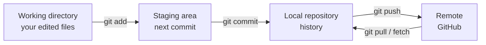

# 🌿 Git Interview Preparation

## Basics

### ❓ What is Git, and how is it different from GitHub?

### 📝 Answer

- **Git** — a version control tool on your computer. It records snapshots (commits) of your code so you can go back, compare and work in branches.
- **GitHub / GitLab / Bitbucket** — websites that **host** Git repositories and add pull requests, reviews, issues and CI.

Git is **distributed**: every clone has the full history, so you can commit offline.

---

### ❓ What are the working directory, staging area and repository?

### 📝 Answer



- **Working directory** — files as you edit them.
- **Staging area (index)** — changes you've chosen for the next commit (`git add`).
- **Repository** — saved commits (`git commit`).

The staging area lets you commit only part of your changes.

---

### ❓ What are the most used Git commands?

### 📝 Answer

| Command | Does |
|---|---|
| `git clone <url>` | Copy a remote repository |
| `git status` | What changed / what's staged |
| `git add file` / `git add -p` | Stage a file / stage chunks interactively |
| `git commit -m "msg"` | Save staged changes |
| `git switch -c feature` | Create and move to a new branch |
| `git pull` | Fetch + merge remote changes |
| `git push` | Send commits to the remote |
| `git log --oneline --graph` | Compact history |
| `git diff` / `git diff --staged` | Unstaged / staged changes |

---

## Branching & Merging

### ❓ git fetch vs git pull?

### 📝 Answer

- `git fetch` — **downloads** new commits from the remote but doesn't change your files. Safe; lets you look first.
- `git pull` — `fetch` **+ merge** (or rebase) into your current branch.

```bash
git fetch origin
git log HEAD..origin/main --oneline   # see what's new before merging
```

---

### ❓ git merge vs git rebase?

### 📝 Answer

Both bring changes from `main` into your feature branch.

```text
Before:          A---B---C  main
                      \
                       D---E  feature

merge:           A---B---C-------M  feature   (M = merge commit, history kept as it happened)
                      \         /
                       D-------E

rebase:          A---B---C---D'---E'  feature  (D, E replayed on top of C — straight line)
```

| Merge | Rebase |
|---|---|
| Keeps the true history, adds a merge commit | Clean, linear history |
| Safe on shared branches | **Rewrites** commits (new IDs) |

> ⚠️ **Golden rule:** never rebase commits others already pulled (e.g. `main`). Rebase only your own local/feature branch.

#### ↳ Follow-up: What is a fast-forward merge?

↪ If `main` has no new commits since you branched, Git just moves the `main` pointer forward to your last commit — no merge commit.

#### ↳ Follow-up: What does `git rebase -i` do?

↪ Interactive rebase lets you squash, reorder, rename or drop your commits before sharing them.

---

### ❓ How do you resolve a merge conflict?

### 📝 Answer

A conflict happens when both branches changed the **same lines**. Git marks them:

```text
<<<<<<< HEAD
const timeout = 30;
=======
const timeout = 60;
>>>>>>> feature
```

1. Open the file, choose or combine the right code, delete the markers.
2. `git add file`
3. `git commit` (merge) or `git rebase --continue` (rebase).

To give up: `git merge --abort` / `git rebase --abort`.

---

### ❓ What is squashing commits?

### 📝 Answer

Combining several small commits ("fix typo", "wip", "fix again") into **one clean commit**. Done with `git rebase -i` or the "Squash and merge" button on a pull request.

---

### ❓ What are common branching strategies?

### 📝 Answer

| Strategy | How it works | Good for |
|---|---|---|
| **GitHub Flow** | `main` is always deployable; short feature branches → PR → merge → deploy | Web apps with continuous deployment |
| **Trunk-based** | Everyone merges small changes to `main` daily; unfinished work hidden behind feature flags | Fast teams with strong CI |
| **Git Flow** | `main`, `develop`, `feature/*`, `release/*`, `hotfix/*` | Scheduled releases, multiple versions |

Most teams today use GitHub Flow or trunk-based development.

---

## Undoing Things

### ❓ git reset vs git revert?

### 📝 Answer

- `git revert <commit>` — makes a **new commit that undoes** an old one. History is kept → **safe on shared branches**.
- `git reset` — **moves the branch pointer back**, dropping commits from the branch. Rewrites history → use only on local commits.

| `git reset` mode | Commits removed | Changes kept? |
|---|---|---|
| `--soft HEAD~1` | Yes | Yes, still **staged** |
| `--mixed HEAD~1` (default) | Yes | Yes, **unstaged** |
| `--hard HEAD~1` | Yes | **No — deleted** ⚠️ |

---

### ❓ How do you undo common mistakes?

### 📝 Answer

| Mistake | Fix |
|---|---|
| Typo in the last commit message | `git commit --amend -m "new message"` |
| Forgot a file in the last commit | `git add file && git commit --amend --no-edit` |
| Staged a file by mistake | `git restore --staged file` |
| Discard local edits in a file | `git restore file` |
| Committed to `main` instead of a branch | `git branch feature && git reset --hard HEAD~1` (on main), then `git switch feature` |
| Need to undo a pushed commit | `git revert <hash>` |

---

### ❓ What is git reflog and how does it save you?

### 📝 Answer

`git reflog` lists **every place `HEAD` has been** — even commits no longer on any branch. After a bad `reset --hard` or a messy rebase:

```bash
git reflog                 # find the hash before the mistake, e.g. a1b2c3d
git reset --hard a1b2c3d   # go back to it
```

Lost commits stay recoverable for about 90 days by default.

---

### ❓ What is git stash?

### 📝 Answer

It **saves your uncommitted changes aside** and gives you a clean working directory — useful when you must switch branches quickly.

```bash
git stash            # put changes away
git switch hotfix    # do urgent work
git switch feature
git stash pop        # bring changes back
```

`git stash list` shows saved stashes; `git stash -u` includes new (untracked) files.

---

### ❓ What is git cherry-pick?

### 📝 Answer

Copies **one specific commit** from another branch onto your current branch.

```bash
git switch release-1.2
git cherry-pick 4f2a9c1    # apply just that bug fix
```

Use it for back-porting a fix to a release branch. The copied commit gets a new ID.

---

## Collaboration

### ❓ What is a pull request, and what makes a good one?

### 📝 Answer

A pull request (PR) asks to merge your branch into another, with a **code review** and automatic checks (tests, lint).

A good PR is: **small** (easy to review), has a clear title and description (what and why), includes tests, passes CI, and does **one** thing.

---

### ❓ What is .gitignore?

### 📝 Answer

A file listing paths Git should **not track**: build output, dependencies, secrets, IDE files.

```text
node_modules/
target/
dist/
.env
*.log
.idea/
```

> ⚠️ **Trap:** `.gitignore` doesn't affect files already committed. Remove them with `git rm --cached file`.

#### ↳ Follow-up: You accidentally committed a password. What do you do?

↪ **Rotate the secret first** (assume it is leaked), then remove it from history with `git filter-repo` or BFG and force-push. Deleting it in a new commit is not enough.

---

### ❓ What is a Git tag?

### 📝 Answer

A name pointing to a specific commit, used to mark **releases**.

```bash
git tag -a v1.4.0 -m "Release 1.4.0"
git push origin v1.4.0
```

Annotated tags (`-a`) store author, date and message; lightweight tags are just a name.

---

## Tricky Questions

### ❓ Tricky: What is a detached HEAD?

### 📝 Answer

`HEAD` points directly to a **commit instead of a branch** (e.g. after `git checkout a1b2c3d` or a tag). You can look around and even commit, but new commits belong to no branch and are easy to lose. Keep them with `git switch -c new-branch`.

---

### ❓ Tricky: What does `git push --force` risk, and what's safer?

### 📝 Answer

`--force` overwrites the remote branch — **deleting teammates' commits** pushed in the meantime. Use `git push --force-with-lease`: it refuses if the remote has commits you haven't seen.

---

### ❓ Tricky: What is HEAD~1 vs HEAD^?

### 📝 Answer

Both mean "the parent of HEAD". They differ only on merge commits: `HEAD^2` is the **second parent** (the merged branch), while `HEAD~2` is the **grandparent** along the first-parent line.

---

### ❓ Tricky: How do you find which commit introduced a bug?

### 📝 Answer

`git bisect` does a binary search over history:

```bash
git bisect start
git bisect bad            # current version has the bug
git bisect good v1.3.0    # this version was fine
# Git checks out a middle commit; you test and mark good/bad until it names the culprit
git bisect reset
```

`git blame file` shows who last changed each line.
