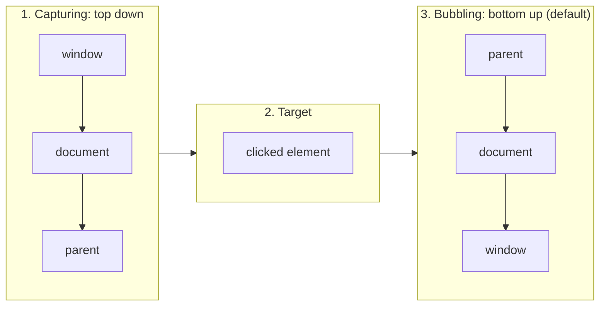
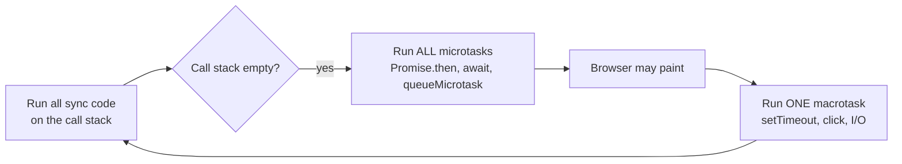
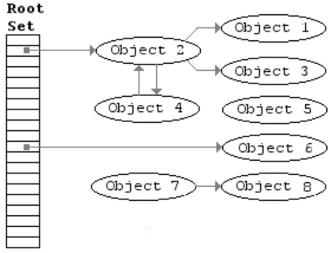

# 🟨 JavaScript Interview Preparation

---

# 🧱 Part 1 — Functions & Scope

### ❓ Can you walk me through `call()`, `apply()`, and `bind()` — how they differ and when you'd use each?

**Level:** 🟡 Intermediate

### 📝 Answer

All three set the value of `this` for a function — they differ in **how arguments are passed and when the function runs**.

| Method   | Invokes immediately? | Arguments format         |
| -------- | -------------------- | ------------------------ |
| `call`   | ✅ Yes               | Comma-separated values   |
| `apply`  | ✅ Yes               | Array of values          |
| `bind`   | ❌ No (returns new fn) | Comma-separated values |

```js
function greet(city, country) {
  console.log(`Hi, I am ${this.name} from ${city}, ${country}`);
}

const person = { name: "Dev" };

// call — args one by one
greet.call(person, "Chennai", "India");
// → "Hi, I am Dev from Chennai, India"

// apply — args as array
greet.apply(person, ["Mumbai", "India"]);
// → "Hi, I am Dev from Mumbai, India"

// bind — returns a NEW function (doesn't run yet)
const greetDev = greet.bind(person, "Bangalore");
greetDev("India");
// → "Hi, I am Dev from Bangalore, India"
```

> 💡 **Mnemonic**: **C**all = **C**omma, **A**pply = **A**rray, **B**ind = **B**ound (later).

---

### ❓ How would you explain closures to someone new to JavaScript, and can you give a real-world use case?

**Level:** 🟡 Intermediate

### 📝 Answer

A **closure** is a function that **remembers variables** from the scope where it was created, even after that scope has finished executing.

```js
function outer() {
  let count = 0;                  // local to outer()

  return function inner() {
    count++;                       // inner() can still access count
    console.log(count);
  };
}

const counter = outer();           // outer() runs once; count=0 stays alive
counter();                         // 1
counter();                         // 2
counter();                         // 3
```

**Classic loop trap (`var` vs `let`):**

```js
// ❌ Using var — same binding for all iterations
for (var i = 0; i < 3; i++) {
  setTimeout(() => console.log(i), 100);
}
// Output: 3 3 3

// ✅ Using let — fresh binding per iteration
for (let i = 0; i < 3; i++) {
  setTimeout(() => console.log(i), 100);
}
// Output: 0 1 2
```

> 💡 **Real-world uses**: data privacy (private vars), function factories, memoization, partial application, event handlers.

---

### ❓ Can you explain currying and walk through how you'd implement it?

**Level:** 🟡 Intermediate

### 📝 Answer

**Currying** = converting a function that takes multiple arguments into a sequence of functions, each taking ONE argument at a time.

```js
// Normal function
function normalAdd(a, b, c) {
  return a + b + c;
}

// Curried version
function curriedAdd(a) {
  return function (b) {
    return function (c) {
      return a + b + c;
    };
  };
}

// Or with arrows (cleaner)
const curriedAddArrow = a => b => c => a + b + c;

console.log(curriedAdd(1)(2)(3));        // 6
console.log(curriedAddArrow(1)(2)(3));   // 6

// Step-by-step (partial application)
const add1 = curriedAdd(1);
const add1and2 = add1(2);
console.log(add1and2(3));                // 6
```

> 💡 **Use cases**: configuring functions in advance (`const log = curry((level, msg) => ...); const error = log("ERROR");`), functional programming pipelines.

---

### ❓ What are higher-order functions?

**Level:** 🟢 Beginner

### 📝 Answer

A **Higher Order Function (HOF)** is a function that:

1. **Accepts** another function as an argument, **OR**
2. **Returns** a function

```js
// Accepts a function
function calculate(a, b, operation) {
  return operation(a, b);
}

const add = (x, y) => x + y;
const multiply = (x, y) => x * y;

console.log(calculate(3, 4, add));       // 7
console.log(calculate(3, 4, multiply));  // 12

// Returns a function
function multiplier(factor) {
  return (n) => n * factor;
}

const double = multiplier(2);
console.log(double(5));                  // 10
```

✅ **Built-in HOFs you use daily**: `map`, `filter`, `reduce`, `forEach`, `sort`, `find`, `every`, `some`.

---

# 🎭 Part 2 — `this` and Prototypes

### ❓ How does JavaScript prototype inheritance work?

**Level:** 🟡 Intermediate

### 📝 Answer

Every JavaScript object has a hidden link (`__proto__`) to another object called its **prototype**. When you access a property, JS searches up the prototype chain until it finds it.

```js
function Person(name) {
  this.name = name;
}

Person.prototype.sayHi = function () {
  console.log("Hi, I am " + this.name);
};

const p1 = new Person("Dev");
const p2 = new Person("Raj");

p1.sayHi();   // "Hi, I am Dev"
p2.sayHi();   // "Hi, I am Raj"
// Both share the SAME sayHi function — saves memory
```

**Built-in prototype examples**

```js
[1, 2, 3].map;        // defined on Array.prototype
"hello".toUpperCase;  // defined on String.prototype
```

> 💡 Modern syntax — `class` is just **syntactic sugar** over prototypes:
> ```js
> class Person {
>   constructor(name) { this.name = name; }
>   sayHi() { console.log("Hi, I am " + this.name); }
> }
> ```

---

### ❓ Why does `this` behave differently in arrow vs normal functions?

**Level:** 🟡 Intermediate

### 📝 Answer

```js
const obj = {
  value: 10,
  normal() {
    console.log(this.value);
  },
  arrow: () => {
    console.log(this.value);
  },
};

obj.normal();   // 10
obj.arrow();    // undefined
```

**Normal function:**

- `this` is determined **at call time** (dynamic binding)
- When called as `obj.normal()`, `this = obj`

**Arrow function:**

- Arrow functions **don't have their own `this`**
- They **inherit** `this` from their **lexical (outer) scope**
- Here, the outer scope is the top level of the file, not `obj` → `this` is **not** `obj`:
  - classic browser script: `this` is `window` → `this.value` is `undefined`
  - **ES module** (`type="module"`, `.mjs`): `this` is `undefined` → `obj.arrow()` **throws a TypeError**

> ⚠️ An object literal `{ ... }` does **not** create a scope for `this` — that's why arrow functions make poor object methods.

> 💡 **Rule of thumb**:
> - Use **normal functions** for object methods that need `this`
> - Use **arrow functions** for callbacks where you want to keep the outer `this` (e.g., inside class methods, in array methods inside React components)

---

# 🪜 Part 3 — Hoisting & TDZ

### ❓ Can you walk me through how hoisting works in JavaScript and where it can catch developers off guard?

**Level:** 🟡 Intermediate

### 📝 Answer

**Hoisting** = JavaScript moves **declarations** (not initializations) to the top of their scope before execution.

```js
// Function declarations are FULLY hoisted
sayHello();                       // ✅ Works
function sayHello() {
  console.log("Hello!");
}

// var: declaration hoisted, initialized to undefined
console.log(num);                  // undefined (no error)
var num = 10;

// let / const: hoisted but in "Temporal Dead Zone" (TDZ)
console.log(x);                    // ❌ ReferenceError
let x = 20;
```

**Quick Summary Table**

| Type                          | Hoisted?                                        | Default Value |
| ----------------------------- | ----------------------------------------------- | ------------- |
| Function Declaration          | ✅ Fully (definition included)                  | The function  |
| `var` variable                | ✅ Declaration only                             | `undefined`   |
| `let` / `const` variable      | ✅ Declaration only — but in TDZ                | Inaccessible (throws) |
| Function Expression (`var fn = function() {}`) | ✅ Var hoisted as `undefined` | `undefined` — calling `fn()` early throws `TypeError: fn is not a function` |
| Arrow Function (`const fn = () => {}`) | ✅ Declaration in TDZ                  | Inaccessible  |
| `class`                       | ✅ Hoisted but in TDZ                           | Inaccessible  |

---

#### ↳ Follow-up: Can you explain the Temporal Dead Zone and how variable shadowing interacts with it?

### 📝 Answer

**TDZ** = the period between entering a scope and the actual `let`/`const` declaration line. Accessing the variable in this zone throws a `ReferenceError`.

```js
var a = 1;                         // global

function outer() {
  console.log(a);                  // ❌ ReferenceError (TDZ)
  let a = 4;                       // local 'a' shadows global 'a'

  return function inner() {
    console.log(a);                // ❌ ReferenceError again
    let a = 2;                     // local to inner()
  };
}

const f = outer();                 // Error happens here
f();                               // Never reached
```

> 💡 **Why TDZ exists**: helps catch bugs by enforcing "declare before use" — much safer than `var`'s `undefined` default.

---

# ⚖️ Part 4 — Type Coercion & Equality

### ❓ Explain why `[] == ![]` is `true`

**Level:** 🟡 Intermediate

### 📝 Answer

This is a famous JavaScript quirk that catches everyone.

**1️⃣ Why `[]` is truthy?**

```js
if ([]) { /* runs */ }
```

- `[]` is an **object**
- All objects are truthy in JS

**2️⃣ Why `![]` is `false`?**

```js
![]   // → false
```

`!truthy` → `false`.

**3️⃣ Why `[] == ![]` is `true`?**

```js
[] == ![];
```

Step-by-step:

1. `![]` → `false`
2. Expression becomes: `[] == false`
3. `false` → `0` (numeric coercion)
4. `[]` → `""` (string coercion) → `0` (numeric coercion)
5. Final: `0 == 0` → ✅ `true`

> 💡 **Lesson**: ALWAYS use `===` (strict equality) to avoid these traps.

**Falsy values in JavaScript**

```js
false
0
-0
0n            // BigInt zero
""            // empty string
null
undefined
NaN
```

Everything else is truthy — including `[]`, `{}`, `"0"`, `"false"`.

---

### ❓ Why does `typeof null === "object"`?

**Level:** 🟡 Intermediate

### 📝 Answer

This is a **historical bug in JavaScript**, not a design decision.

In the original implementation, values were stored using **type tags**:

| Type    | Tag (binary) |
| ------- | ------------ |
| Object  | `000`        |
| Integer | `001`        |
| Double  | `010`        |
| String  | `100`        |
| Boolean | `110`        |

- `null` was represented as **all zero bits** (`000`)
- `000` matched the object tag → `typeof null` returned `"object"`

```js
typeof null;             // "object"   ← BUG
typeof undefined;        // "undefined"
null === null;           // true
null instanceof Object;  // false  ← actually NOT an object
```

> ⚠️ This was never fixed because it would break massive amounts of existing code.

✅ **Correct way to check for null**:

```js
if (value === null) { ... }
```

---

# 🔄 Part 5 — Event Loop & Async

### ❓ What will this code output, and why?

**Level:** 🟡 Intermediate

### 📝 Answer

```js
console.log("script-start");

setTimeout(() => console.log("setTimeout-0ms"), 0);

Promise.resolve().then(() => console.log("promise-then"));

queueMicrotask(() => console.log("queueMicrotask"));

(async function asyncFn() {
  console.log("asyncFn-before-await");
  await null;                                 // queues a microtask
  console.log("asyncFn-after-await");
})();

console.log("script-end");
```

**Expected Output:**

```text
script-start
asyncFn-before-await
script-end
promise-then
queueMicrotask
asyncFn-after-await
setTimeout-0ms
```

**Why?**

1. Synchronous code first: `script-start`, `asyncFn-before-await`, `script-end`
2. Microtasks drain in order they were queued: `promise-then`, `queueMicrotask`, `asyncFn-after-await`
3. Then macrotasks: `setTimeout-0ms`

> 💡 **Node.js extras**: `process.nextTick` runs BEFORE other microtasks. `setImmediate` vs `setTimeout(0)` from the main script can run in **either order** (it depends on timing); inside an I/O callback, `setImmediate` always runs first.

---

### ❓ Difference between `Promise.all`, `allSettled`, `race`, and `any`?

**Level:** 🟡 Intermediate

### 📝 Answer

| Method                | Resolves When                  | Rejects When                  | Use Case |
| --------------------- | ------------------------------ | ----------------------------- | -------- |
| `Promise.all`         | **All** resolve                | **Any** rejects (fail-fast)   | All required (load profile + permissions + config) |
| `Promise.allSettled`  | **All** settle (any outcome)   | Never rejects                 | Partial success OK (batch processing, analytics) |
| `Promise.race`        | **First** to settle (resolve OR reject) | First to reject       | Timeouts, "first response wins" |
| `Promise.any` (ES2021)| **First** to resolve           | **All** reject (`AggregateError`) | Fallback APIs, first success wins |

---

#### 1️⃣ `Promise.all()` — All-or-nothing

```js
const p1 = Promise.resolve(10);
const p2 = Promise.resolve(20);
const p3 = Promise.resolve(30);

Promise.all([p1, p2, p3])
  .then(result => console.log(result))    // [10, 20, 30]
  .catch(err => console.error(err));
```

❌ **Failure case** (any rejection fails the whole batch):

```js
const p2 = Promise.reject("Error in p2");

Promise.all([p1, p2, p3])
  .catch(err => console.error(err));      // "Error in p2"
```

---

#### 2️⃣ `Promise.allSettled()` — Wait for everyone

```js
const p1 = Promise.resolve(10);
const p2 = Promise.reject("Failed");
const p3 = Promise.resolve(30);

Promise.allSettled([p1, p2, p3]).then(result => console.log(result));
/*
[
  { status: 'fulfilled', value: 10 },
  { status: 'rejected',  reason: 'Failed' },
  { status: 'fulfilled', value: 30 }
]
*/
```

---

#### 3️⃣ `Promise.race()` — First settled wins

```js
const fast = new Promise(res => setTimeout(() => res("Fast"), 100));
const slow = new Promise(res => setTimeout(() => res("Slow"), 500));

Promise.race([fast, slow]).then(result => console.log(result));   // "Fast"
```

❌ Reject case (first **rejection** also wins):

```js
const failed = new Promise((_, rej) => setTimeout(() => rej("Timeout"), 50));

Promise.race([failed, slow]).catch(err => console.error(err));    // "Timeout"
```

---

#### 4️⃣ `Promise.any()` — First success wins

```js
const p1 = Promise.reject("Error 1");
const p2 = Promise.resolve("Success");
const p3 = Promise.reject("Error 3");

Promise.any([p1, p2, p3]).then(result => console.log(result));    // "Success"
```

❌ All rejected → `AggregateError`:

```js
Promise.any([p1, p3]).catch(err => console.error(err.errors));
// ["Error 1", "Error 3"]
```

---

#### ↳ **Follow-up:** You're calling three backend APIs in parallel. One critical, two optional. Which do you use?

↪ **`Promise.allSettled`** — get all results regardless, then check the critical one's status.

#### ↳ **Follow-up:** Implement an API timeout using Promises.

↪ **`Promise.race`** — race the API call against `setTimeout`-based rejection.

```js
const timeout = (ms) => new Promise((_, rej) =>
  setTimeout(() => rej(new Error("Timeout")), ms)
);

Promise.race([fetch("/api"), timeout(5000)]);
```

#### ↳ **Follow-up:** You have 3 CDN URLs for the same resource. Use the fastest. Which?

↪ **`Promise.any`** — first **successful** response wins, ignores failures.

---

# 🛠️ Part 6 — Implementing Built-in Methods

### ❓ If `Array.prototype.map` is removed, how do you recreate it?

**Level:** 🟡 Intermediate

### 📝 Answer

```js
Array.prototype.myMap = function (callback) {
  const result = [];

  for (let i = 0; i < this.length; i++) {
    if (i in this) {                       // skip sparse holes
      result.push(callback(this[i], i, this));
    }
  }

  return result;
};

const arr = [1, 2, 3];
console.log(arr.myMap(v => v * 2));        // [2, 4, 6]
```

**Why does the callback receive 3 parameters?** `callback(value, index, array)`

- `value` → current element
- `index` → useful for position-based logic
- `array` → reference to the original array (allows comparison)

This makes `map`/`filter` **flexible and self-contained** without external state.

**Why return a new array (immutable)?**

- Pure functions (no side effects)
- Doesn't mutate input
- Enables chaining: `arr.map(...).filter(...).reduce(...)`

**How does `this` get the array value inside `myMap`?**

When you call `arr.myMap(...)`:

- `myMap` runs as a **method** of `arr`
- JavaScript binds `this` to the object before the dot → `this === arr`
- `this.length`, `this[i]` all refer to the array

---

#### ↳ Follow-up: How would you implement `Array.prototype.filter` from scratch?
### 📝 Answer

```js
Array.prototype.myFilter = function (predicate) {
  const result = [];
  for (let i = 0; i < this.length; i++) {
    if (i in this && predicate(this[i], i, this)) {
      result.push(this[i]);
    }
  }
  return result;
};

console.log([1, 2, 3, 4].myFilter(n => n % 2 === 0));   // [2, 4]
```

---

#### ↳ Follow-up: How would you implement `Array.prototype.reduce` from scratch?
### 📝 Answer

```js
Array.prototype.myReduce = function (callback, initialValue) {
  let acc = initialValue;
  let startIndex = 0;

  // Check how many arguments were passed, not whether initialValue is undefined:
  // [1, 2].reduce(fn, undefined) is a valid call with an explicit start value.
  if (arguments.length < 2) {
    if (this.length === 0) throw new TypeError("Reduce of empty array with no initial value");
    acc = this[0];
    startIndex = 1;
  }

  for (let i = startIndex; i < this.length; i++) {
    acc = callback(acc, this[i], i, this);
  }
  return acc;
};

console.log([1, 2, 3, 4].myReduce((sum, n) => sum + n, 0));   // 10
```

---

### ❓ How would you implement a debounce function?

**Level:** 🟡 Intermediate
### 📝 Answer

**Debounce** = wait until user **stops** firing events for X ms, then execute.

```js
function debounce(fn, delay) {
  let timer;
  return function (...args) {
    clearTimeout(timer);
    timer = setTimeout(() => fn.apply(this, args), delay);
  };
}

// Usage
const handleSearch = debounce((query) => {
  console.log("Searching:", query);
}, 300);

input.addEventListener("input", (e) => handleSearch(e.target.value));
```

> 💡 **Use cases**: search input, window resize, autosave on type.

---

#### ↳ Follow-up: How would you implement a throttle function?
### 📝 Answer

**Throttle** = execute at most **once every X ms**, even if events fire continuously.

```js
function throttle(fn, limit) {
  let inThrottle;
  return function (...args) {
    if (!inThrottle) {
      fn.apply(this, args);
      inThrottle = true;
      setTimeout(() => (inThrottle = false), limit);
    }
  };
}

// Usage
window.addEventListener("scroll", throttle(() => {
  console.log("Scroll position:", window.scrollY);
}, 200));
```

> 💡 **Debounce vs Throttle**:
> - **Debounce** → "wait for the user to stop" (search, autosave)
> - **Throttle** → "fire periodically while busy" (scroll, mousemove, resize)

---

# ✨ Part 7 — Modern JS Features
### ❓ How does optional chaining work and when would you reach for it over a manual null check?

**Level:** 🟡 Intermediate
### 📝 Answer

`?.` safely accesses nested properties. If any link is `null`/`undefined`, the expression returns `undefined` instead of throwing.

```js
const user = { profile: null };

// ❌ Old way
const city = user && user.profile && user.profile.address && user.profile.address.city;

// ✅ Modern
const city = user?.profile?.address?.city;   // undefined (no error)

// Works with function calls
user.greet?.();                              // calls only if exists
arr?.[0];                                    // safe array access
```

---

#### ↳ Follow-up: How does nullish coalescing differ from the OR operator, and when does that distinction matter?
### 📝 Answer

`??` returns the right-hand value **only if** left is `null` or `undefined` — unlike `||` which checks all falsy values.

```js
0 || "default"          // "default"   (0 is falsy)
0 ?? "default"          // 0           (0 is NOT null/undefined)

"" || "default"         // "default"
"" ?? "default"         // ""

null ?? "default"       // "default"
undefined ?? "default"  // "default"
```

> 💡 **Use `??` when `0`, `""`, or `false` are valid values** you want to keep.

---

### ❓ Difference between `Map` and `Object`?

**Level:** 🟡 Intermediate
### 📝 Answer

| Feature             | `Object`               | `Map`                       |
| ------------------- | ---------------------- | --------------------------- |
| Key types           | Strings, Symbols       | **Any** (objects, functions, primitives) |
| Order               | Insertion order (mostly) | Guaranteed insertion order |
| Size                | `Object.keys(obj).length` | `map.size`               |
| Iteration           | `for...in`, `Object.entries` | `for...of`, `.forEach()` directly |
| Performance (frequent add/remove) | Slower      | Faster                      |
| Default keys        | Has prototype keys     | Truly empty                 |

```js
const map = new Map();
const keyObj = { id: 1 };
map.set(keyObj, "user data");        // object as key!
map.set("name", "Dev");

map.get(keyObj);                     // "user data"
map.size;                            // 2
```

> 💡 Use `Map` for frequent additions/deletions or non-string keys. Use `Object` for static data and JSON-like structures.

---

### ❓ What are Generators (`function*`)?

**Level:** 🟡 Intermediate
### 📝 Answer

Generators produce values **lazily**, one at a time, and can pause/resume execution.

```js
function* counter() {
  let i = 0;
  while (true) {
    yield i++;                       // pause, return value
  }
}

const c = counter();
console.log(c.next().value);         // 0
console.log(c.next().value);         // 1
console.log(c.next().value);         // 2
```

> 💡 **Use cases**: infinite sequences, async iteration, building custom iterators, Redux-Saga.

---

### ❓ Can you explain the difference between shallow and deep copies — and what pitfalls come with each?

**Level:** 🟡 Intermediate
### 📝 Answer

```js
const original = { a: 1, b: { c: 2 } };

// SHALLOW copies (top level only)
const shallow1 = { ...original };
const shallow2 = Object.assign({}, original);

shallow1.b.c = 99;
console.log(original.b.c);           // 99 ❌ inner object shared!

// DEEP copy (start from a fresh object)
const source = { a: 1, b: { c: 2 } };
const deep = structuredClone(source);     // ✅ Modern (built-in)
deep.b.c = 99;
console.log(source.b.c);                  // 2 ✅ unaffected

// Older fallback (loses functions, dates, undefined)
const deep2 = JSON.parse(JSON.stringify(original));
```

> 💡 `structuredClone()` is the modern, native deep-clone. Handles dates, maps, sets, typed arrays and circular references — but throws on functions and DOM nodes, and class instances come back as plain objects.

---

### ❓ What's the difference between `for...in` and `for...of`?

**Level:** 🟡 Intermediate
### 📝 Answer

| Loop       | Iterates over     | Use for                         |
| ---------- | ----------------- | ------------------------------- |
| `for...in` | **Keys** (strings) | Object properties (rarely arrays) |
| `for...of` | **Values**        | Arrays, Maps, Sets, Strings, generators |

```js
const arr = ["a", "b", "c"];

for (const i in arr) console.log(i);   // "0", "1", "2"  (keys as strings!)
for (const v of arr) console.log(v);   // "a", "b", "c"  (values)

const obj = { x: 1, y: 2 };
for (const key in obj) console.log(key, obj[key]);   // x 1, y 2
```

> ⚠️ **Avoid `for...in` for arrays** — it includes inherited enumerable props and treats indices as strings.

---

# 🧩 Part 8 — Must-Know Basics

### ❓ What is the difference between `var`, `let` and `const`?

### 📝 Answer

| | `var` | `let` | `const` |
|---|---|---|---|
| Scope | **Function** | **Block** `{ }` | **Block** `{ }` |
| Re-declare in same scope | ✅ Allowed | ❌ Error | ❌ Error |
| Re-assign | ✅ | ✅ | ❌ |
| Before declaration | `undefined` (hoisted) | `ReferenceError` (TDZ) | `ReferenceError` (TDZ) |
| Creates `window` property at top level | ✅ | ❌ | ❌ |

```js
if (true) {
  var a = 1;
  let b = 2;
}
console.log(a);   // 1  — var ignores the block
console.log(b);   // ReferenceError: b is not defined

const user = { name: "Asha" };
user.name = "Ravi";   // ✅ allowed — const stops re-assignment, not changes inside the object
// user = {};         // ❌ TypeError: Assignment to constant variable
```

> 💡 **Rule:** use `const` by default, `let` when the value must change, and avoid `var`.

---

### ❓ What is the difference between `==` and `===`?

### 📝 Answer

- `===` (**strict**) compares **value and type** — no conversion.
- `==` (**loose**) **converts** the values to a common type first, then compares.

```js
5 === "5";          // false — different types
5 == "5";           // true  — "5" converted to 5
0 == false;         // true
"" == 0;            // true
null == undefined;  // true  (special rule)
null === undefined; // false
NaN === NaN;        // false — NaN equals nothing; use Number.isNaN(x)
```

> 💡 Always use `===`. The one common exception: `x == null` checks for **both** `null` and `undefined`.

---

### ❓ What are event bubbling, capturing and delegation?

### 📝 Answer

When you click an element, the event travels in **three phases**:



```js
parent.addEventListener("click", () => console.log("parent"));
child.addEventListener("click", () => console.log("child"));
// click child → "child", then "parent" (bubbling)

parent.addEventListener("click", () => console.log("parent first"), { capture: true });
// a capturing listener runs before the child's

child.addEventListener("click", (e) => e.stopPropagation());   // stops it reaching parents
```

**Event delegation** = one listener on a parent handles events for all its children (even ones added later), using bubbling:

```js
list.addEventListener("click", (e) => {
  const item = e.target.closest("li");
  if (item) console.log("clicked", item.dataset.id);
});
```

Fewer listeners, and new `<li>` items work automatically.

---

### ❓ How is the value of `this` decided?

### 📝 Answer

For normal functions, `this` depends on **how the function is called** (checked in this order):

| How it's called | `this` is | Example |
|---|---|---|
| With `new` | The new object | `new User()` |
| With `call` / `apply` / `bind` | The given object | `fn.call(obj)` |
| As a method `obj.fn()` | The object before the dot | `user.greet()` → `user` |
| Plain call `fn()` | `undefined` in strict mode / modules; `window` in old sloppy scripts | `const f = user.greet; f()` |

**Arrow functions** ignore all of this — they use `this` from the surrounding code.

```js
const user = {
  name: "Asha",
  greet() { return this.name; },
};
user.greet();             // "Asha"
const g = user.greet;
g();                      // undefined / TypeError — the method lost its object
setTimeout(user.greet);   // same problem; fix: setTimeout(() => user.greet()) or user.greet.bind(user)
```

---

### ❓ How do you handle errors with Promises and async/await?

### 📝 Answer

```js
// Promises: .catch handles any error in the chain above it
fetch("/api/user")
  .then((res) => res.json())
  .then((user) => show(user))
  .catch((err) => showError(err))
  .finally(() => hideSpinner());

// async/await: use try / catch / finally
async function loadUser() {
  try {
    const res = await fetch("/api/user");
    if (!res.ok) throw new Error(`HTTP ${res.status}`);   // fetch does NOT reject on 404/500!
    return await res.json();
  } catch (err) {
    showError(err);
  } finally {
    hideSpinner();
  }
}
```

> ⚠️ **Traps:**
> - `fetch` only rejects on **network** failure; check `res.ok` for HTTP errors.
> - A promise with no `.catch` (or an `async` call without `await`/`try`) causes an **unhandled rejection** — in Node.js this crashes the process by default.
> - `await` in a `for` loop runs requests **one after another**; use `Promise.all` to run them in parallel.

---

### ❓ What is the difference between ES Modules and CommonJS?

### 📝 Answer

| | CommonJS (CJS) | ES Modules (ESM) |
|---|---|---|
| Syntax | `const x = require("x")`, `module.exports = ...` | `import x from "x"`, `export default ...` |
| Loading | Synchronous, at runtime | Static, analysed before running (enables **tree-shaking**) |
| Where | Node.js (traditional) | Browsers and modern Node.js |
| Top-level `await` | ❌ | ✅ |
| `this` at top level | `module.exports` | `undefined` |

Node.js treats `.mjs` files (or `"type": "module"` in `package.json`) as ESM, and `.cjs` as CommonJS. New code should use **ESM**.

---

### ❓ Tricky: What do these print?

### 📝 Answer

```js
console.log(0.1 + 0.2 === 0.3);     // false — floating point: 0.30000000000000004
console.log(typeof NaN);            // "number"
console.log([1, 2, 3] + [4, 5]);    // "1,2,34,5" — arrays become strings, then join
console.log("5" - 2);               // 3  — minus converts to number
console.log("5" + 2);               // "52" — plus with a string concatenates
console.log([10, 1, 2].sort());     // [1, 10, 2] — default sort compares as strings!
console.log(Math.max());            // -Infinity
console.log([] + {});               // "[object Object]"
```

**Fixes to remember:** compare decimals with `Math.abs(a - b) < Number.EPSILON`; sort numbers with `arr.sort((a, b) => a - b)`.

---

### ❓ Tricky: What does this closure-in-a-loop print, and how do you fix it?

### 📝 Answer

```js
const fns = [];
for (var i = 0; i < 3; i++) {
  fns.push(() => i);
}
console.log(fns.map((f) => f()));   // [3, 3, 3]
```

All three functions share **one** `var i`, which is 3 when they run. Fix with `let` (a new `i` per iteration) → `[0, 1, 2]`.


## Must-Know Internals (Intermediate)

### ❓ Explain the JavaScript event loop — call stack, microtasks and macrotasks.

### 📝 Answer

JavaScript runs **one thing at a time** on one thread. The event loop decides **what runs next** when the current code finishes.



- **Call stack** — the function running right now.
- **Microtask queue** — promise callbacks. Emptied **completely** after each task.
- **Macrotask (task) queue** — timers, events, network callbacks. **One** per loop turn.

```js
console.log("A");
setTimeout(() => console.log("B"), 0);
Promise.resolve().then(() => console.log("C"));
console.log("D");
// A D C B
```

`setTimeout(fn, 0)` means "after the current code and all microtasks" — not "right now".

#### ↳ Follow-up: Why does `await` let other code run?

↪ Everything after `await` becomes a microtask. The function pauses, the caller continues, and the rest resumes later.

#### ↳ Follow-up: Can microtasks block the page?

↪ Yes. A promise chain that keeps adding microtasks never lets the loop reach rendering or clicks — the page freezes.

#### ↳ Follow-up: Where do Web APIs fit?

↪ `setTimeout`, `fetch` and DOM events are handled by the browser outside the JS thread; when ready, their callbacks are queued as tasks.

---

### ❓ What causes memory leaks in JavaScript, and how do you find them?

### 📝 Answer

The garbage collector frees objects **nothing points to** (mark-and-sweep). A leak is memory you no longer need but still **point to**, so it's never freed.



_Image: [Wikimedia Commons](https://commons.wikimedia.org/wiki/File:Animation_of_the_Naive_Mark_and_Sweep_Garbage_Collector_Algorithm.gif) · M17 · CC0_

| Common leak | Example | Fix |
|---|---|---|
| Forgotten timers | `setInterval` in a component never cleared | `clearInterval` on unmount/destroy |
| Event listeners | `window.addEventListener` never removed | `removeEventListener`, or `AbortController` |
| Detached DOM nodes | removed element still stored in a variable/array | drop the reference |
| Growing caches | a `Map` that only ever grows | size limit, or `WeakMap` for object keys |
| Closures | a long-lived callback holding a big object | keep only what you need |
| Accidental globals | `leak = []` without `let` (non-strict) | strict mode, modules |

```js
// ✅ remove listeners in one go
const controller = new AbortController();
window.addEventListener("resize", onResize, { signal: controller.signal });
controller.abort();   // removes it
```

**Finding leaks:** Chrome DevTools → **Memory** → take a heap snapshot, repeat the action a few times, take another, compare. Look for **Detached** DOM trees and objects that keep growing.

#### ↳ Follow-up: Why does `WeakMap` help?

↪ Its keys are held weakly: when nothing else references the key object, the entry can be garbage-collected.

#### ↳ Follow-up: Do single-page apps leak more?

↪ Yes — the page never reloads, so un-cleaned subscriptions and listeners pile up over hours of use.

---
