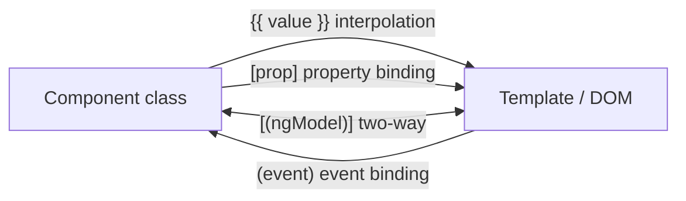
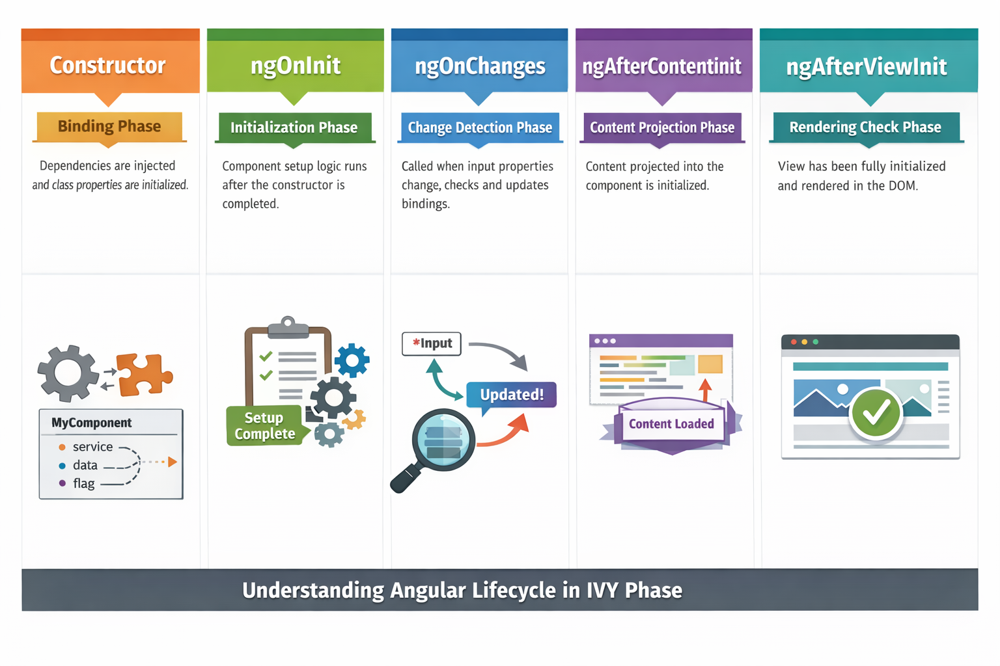
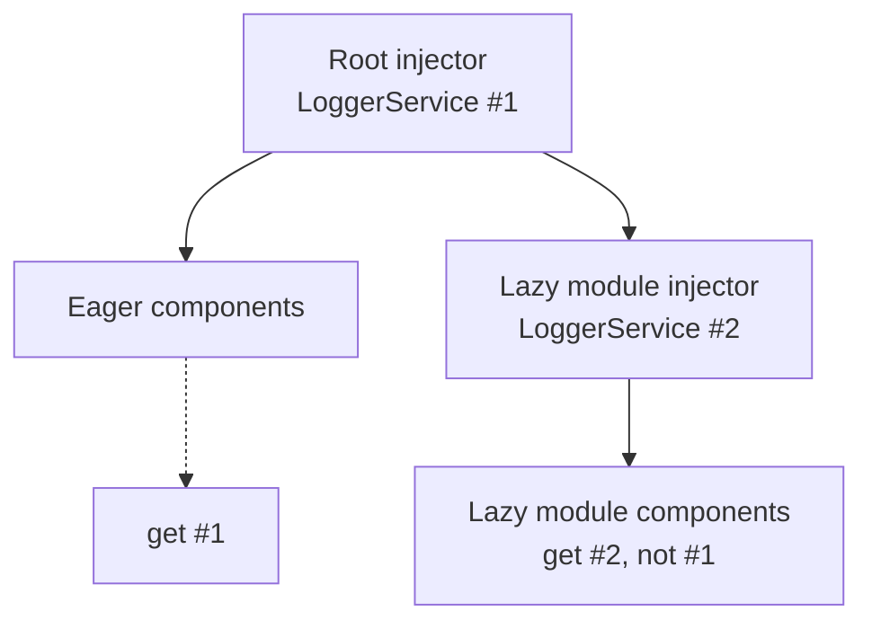
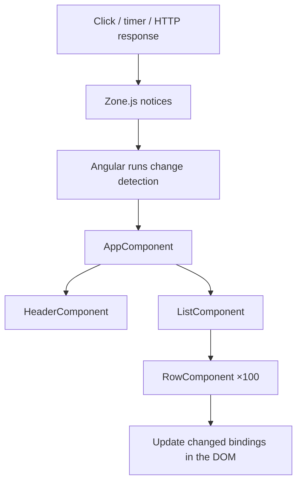
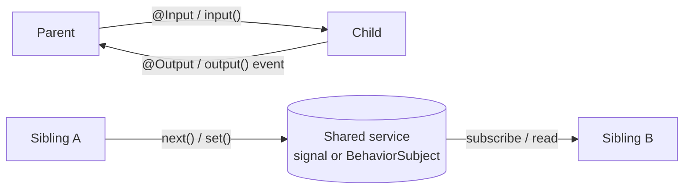
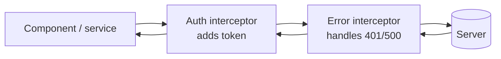

# 🅰️ Angular Interview Preparation — Part 1


---

# 🏛️ Part 1 — Angular Basics & Architecture

### ❓ How would you describe Angular to someone coming from AngularJS — what are the fundamental differences?

### 📝 Answer

| Feature         | **AngularJS (1.x)**         | **Angular (2+)**                          |
| --------------- | --------------------------- | ----------------------------------------- |
| Language        | JavaScript                  | TypeScript                                |
| Architecture    | MVC (Controllers + Scopes)  | Component-based                           |
| Change Detection| Dirty checking ($digest)    | Zone.js + Ivy (signals in v16+)           |
| Modules         | Angular modules + DI        | NgModules / Standalone Components         |
| Data Binding    | Two-way by default          | One-way + opt-in two-way                  |
| Performance     | Slower for large apps       | AOT compilation, tree-shakable            |
| Mobile          | Limited                     | Full mobile + SSR support                 |

> 💡 **Key takeaway**: Angular is a complete rewrite — not a version upgrade.

---

# 🧩 Part 2 — Components, Templates & Data Binding

### ❓ What types of data binding does Angular support?

**Level:** 🟡 Intermediate

### 📝 Answer

Angular has **four primary types of binding**, plus a custom two-way pattern.



#### 1️⃣ Interpolation `{{ }}` — Component → View

Display a value as text.

```ts
name = "Dev";
```

```html
<p>Hello {{ name }}</p>
```

#### 2️⃣ Property Binding `[prop]` — Component → View

Set DOM/component properties.

```ts
isDisabled = true;
```

```html
<button [disabled]="isDisabled">Submit</button>
```

#### 3️⃣ Event Binding `(event)` — View → Component

Listen to events.

```ts
handleClick() { console.log("Clicked"); }
```

```html
<button (click)="handleClick()">Click</button>
```

#### 4️⃣ Two-Way Binding `[(ngModel)]` — Both directions

Combines property + event binding (banana-in-a-box). Requires `FormsModule`.

```ts
username = "";
```

```html
<input [(ngModel)]="username" />
<p>{{ username }}</p>
```

#### 5️⃣ Custom Two-Way Binding `[(value)]` — `@Input` + `@Output`

For reusable components.

```ts
@Component({
  selector: "app-input",
  standalone: true,
  template: `<input [value]="value" (input)="onInput($event)" />`,
})
export class InputComponent {
  @Input() value!: string;
  @Output() valueChange = new EventEmitter<string>();

  onInput(event: Event) {
    this.valueChange.emit((event.target as HTMLInputElement).value);
  }
}
```

```html
<app-input [(value)]="username"></app-input>
```

> 💡 Angular recognizes `[(name)]` automatically when there's an `@Input() name` paired with `@Output() nameChange`.

**Quick Summary**

| Syntax           | Direction          | Use            |
| ---------------- | ------------------ | -------------- |
| `{{ }}`          | Comp → View        | Display data   |
| `[prop]`         | Comp → View        | Set property   |
| `(event)`        | View → Comp        | Handle event   |
| `[(ngModel)]`    | Two-way            | Form sync      |
| `[(value)]`      | Two-way (custom)   | Custom comp    |

---

### ❓ Can you walk me through the difference between Components and Directives in Angular?

**Level:** 🟡 Intermediate

### 📝 Answer

A **Component** is essentially a **Directive with a template** — it controls a piece of UI.
A **Directive** modifies behavior or appearance of an existing element — **no template**.

| Feature              | Component             | Directive                   |
| -------------------- | --------------------- | --------------------------- |
| Has template         | ✅ Yes                | ❌ No                       |
| Creates UI           | ✅ Yes                | ❌ Modifies existing        |
| Decorator            | `@Component`          | `@Directive`                |
| Can use `<ng-content>` | ✅ Yes              | ❌ No                       |
| Always has selector  | ✅ Yes                | ✅ As attribute or `*`      |

**Component**

```ts
@Component({
  selector: "app-user",
  template: `<h2>Hello {{ name }}</h2>`,
})
export class UserComponent {
  name = "Dev";
}
```

**Directive (Attribute)**

```ts
@Directive({ selector: "[appHighlight]" })
export class HighlightDirective {
  constructor(el: ElementRef) {
    el.nativeElement.style.backgroundColor = "yellow";
  }
}
```

```html
<p appHighlight>Highlighted</p>
```

**Directive (Structural)**

```html
<div *ngIf="isLoggedIn">Welcome</div>
<li *ngFor="let item of items">{{ item }}</li>
```

#### ↳ **Follow-up:** Is every component a directive?

↪ ✅ Yes — a component is a directive with a template.

#### ↳ **Follow-up:** Can directives have lifecycle hooks?

↪ ✅ Yes (`ngOnInit`, `ngOnChanges`, etc.)

#### ↳ **Follow-up:** Which directive manipulates DOM structure?

↪ Structural directives (`*ngIf`, `*ngFor`, `*ngSwitch`).

---

### ❓ Can you explain ViewEncapsulation in Angular and the trade-offs between the available modes?

**Level:** 🟡 Intermediate

### 📝 Answer

`ViewEncapsulation` controls **how component styles are scoped and applied to the DOM**.

#### 1️⃣ Emulated (Default)

Angular **simulates** Shadow DOM by adding generated attributes.

```css
/* Source */
h1 { color: red; }

/* Compiled */
h1[_ngcontent-c0] { color: red; }
```

✅ Scoped to component
✅ Best balance of isolation + compatibility
❌ Not real Shadow DOM

#### 2️⃣ None

No encapsulation — styles are **global**.

✅ Useful for themes, layout overrides
❌ Risk of leaking and conflicts

#### 3️⃣ ShadowDom

Uses **real browser Shadow DOM**.

✅ True isolation — global styles can't penetrate
❌ Styling must be intentional (CSS variables, `::part()`)

---

#### 🤔 Common confusions

**↳ If two components use `h1 { color: red }`, will they conflict?**

| Encapsulation | Conflict? |
| ------------- | --------- |
| Emulated      | ❌ No     |
| None          | ✅ Yes    |
| ShadowDom     | ❌ No     |

**↳ Can `::ng-deep` override ShadowDom styles?**

↪ ❌ **No, never.** ShadowDom is enforced by the **browser**. Angular cannot bypass browser isolation.

**↳ Does `!important` or global CSS override ShadowDom?**

↪ ❌ **No.**

**↳ What ARE the ways to style a ShadowDom component from outside?**

1. **CSS Custom Properties** ✅ (recommended)
   ```css
   :root { --primary-color: red; }
   ```
2. **`::part()`** (if component exposes parts)
   ```css
   my-comp::part(button) { color: red; }
   ```
3. **`::slotted()`** (for projected content only)

---

### ❓ When would you use `::ng-deep` in Angular, and what are the risks of relying on it?

**Level:** 🟡 Intermediate

### 📝 Answer

To **override styles of child or third-party components** that use Emulated encapsulation.

| Fact                        | Status |
| --------------------------- | ------ |
| Breaks encapsulation        | ✅     |
| Officially deprecated       | ⚠️     |
| Still works in current Angular | ✅  |
| Works with ShadowDom        | ❌     |

**Common use cases**: Angular Material overrides, third-party UI libraries.

> 💡 Modern alternative: use library-provided theming APIs (CSS variables) instead of `::ng-deep`.

---

# ♻️ Part 3 — Lifecycle Hooks

### ❓ Can you walk through a comprehensive Angular lifecycle example?

**Level:** 🟡 Intermediate

### 📝 Answer

The hooks run in this order: constructor → `ngOnChanges` → `ngOnInit` → `ngDoCheck` → content hooks → view hooks → `ngOnDestroy`.



**`child.component.ts`**

```ts
@Component({
  selector: "app-child",
  templateUrl: "./child.component.html",
})
export class ChildComponent
  implements OnChanges, OnInit, DoCheck, AfterContentInit,
             AfterContentChecked, AfterViewInit, AfterViewChecked, OnDestroy {

  @Input() value!: number;

  // static: true → available in ngOnInit
  @ViewChild("box", { static: true }) box!: ElementRef;

  // Projected content queries
  @ContentChild("title") title!: ElementRef;

  private intervalId!: number;
  private subscription!: Subscription;

  ngOnChanges(changes: SimpleChanges) {
    console.log("Input changed:", changes["value"].currentValue);
  }

  ngOnInit() {
    // ✅ Correct place for: HTTP calls, NgRx dispatch, init state
    // this.http.get(...).subscribe(...);
    this.intervalId = window.setInterval(() => {}, 1000);
  }

  ngDoCheck() {
    // Runs every CD cycle — use for CUSTOM change detection only
  }

  ngAfterContentInit() {
    console.log(this.title.nativeElement.textContent);
    // Projected content via <ng-content> is now accessible
  }

  ngAfterViewInit() {
    // ✅ Safe DOM access for component template + child views
    console.log(this.box.nativeElement);
  }

  ngOnDestroy() {
    clearInterval(this.intervalId);
    this.subscription?.unsubscribe();
    // Cleanup: intervals, subscriptions, event listeners
  }
}
```

**`child.component.html`**

```html
<div #box>Child View Element</div>

<ng-content select="h1"></ng-content>      <!-- element selector -->
<ng-content select=".desc"></ng-content>   <!-- class selector -->
<ng-content select="#footer"></ng-content> <!-- id selector -->

<p>Input value: {{ value }}</p>
```

**`parent.component.html`**

```html
<app-child [value]="count">
  <h1 #title>Projected Title from Parent</h1>
  <p class="desc">Projected Description</p>
  <div id="footer">Projected Footer</div>
</app-child>
```

> ⚠️ **Important Rules**
>
> - Do DOM access only in `ngAfterViewInit` (view is fully initialized)
> - HTTP calls, dispatch actions in `ngOnInit`
> - **Always clean up** subscriptions/intervals in `ngOnDestroy`

---

# 🎯 Part 4 — Directives

### ❓ How do `*ngIf` and `*ngFor` work conceptually?

**Level:** 🟡 Intermediate

### 📝 Answer

Both are **structural directives** — they manipulate the DOM by adding/removing elements.

The `*` is syntactic sugar for `<ng-template>`:

```html
<div *ngIf="show">Hello</div>

<!-- desugars to -->
<ng-template [ngIf]="show">
  <div>Hello</div>
</ng-template>
```

#### Internal mechanism

- They use `TemplateRef` (the template) + `ViewContainerRef` (where to insert)
- `*ngIf` adds/removes a single view
- `*ngFor` creates one view per item in the collection

---

#### ↳ Follow-up: Why is `trackBy` important when rendering lists with `*ngFor`?

### 📝 Answer

**Without `trackBy`**, Angular tracks items by **object identity**. When the array reference changes (e.g., after API call), Angular destroys ALL DOM nodes and recreates them.

**With `trackBy`**, Angular uses a **stable identifier** to know which items truly changed and reuses unchanged DOM nodes.

```html
<li *ngFor="let user of users; trackBy: trackById">
  {{ user.name }}
</li>
```

```ts
trackById(index: number, user: User): number {
  return user.id;
}
```

> 💡 **Performance impact**: HUGE for long lists (1000+ items) or frequently-updated data (live feeds, dashboards).

**Comparison Summary**

| Feature          | `*ngIf`                         | `*ngFor`                |
| ---------------- | ------------------------------- | ----------------------- |
| Type             | Structural directive            | Structural directive    |
| DOM behavior     | Add/remove single view          | Create one view per item |
| Lifecycle impact | Destroy & recreate              | Recreate unless `trackBy` |
| Change detection | Condition-based                 | Collection-based         |

---

### ❓ How do attribute directives work internally?

**Level:** 🔴 Advanced

### 📝 Answer

Attribute directives modify an element's appearance or behavior — they don't change the DOM structure.

```ts
@Directive({ selector: "[appHighlight]" })
export class HighlightDirective {
  @Input("appHighlight") color!: string;

  constructor(private el: ElementRef, private renderer: Renderer2) {}

  ngOnInit() {
    this.renderer.setStyle(this.el.nativeElement, "backgroundColor", this.color);
  }
}
```

```html
<p appHighlight="yellow">Highlighted Text</p>
```

> 💡 **Use `Renderer2` over `ElementRef.nativeElement`** for safe, platform-independent DOM access (works in SSR, Web Workers).

---

### ❓ What are the new control flow blocks `@if`, `@for`, `@switch`?

**Level:** 🟡 Intermediate
### 📝 Answer

Angular 17+ introduced **built-in control flow** — replacing `*ngIf`, `*ngFor`, and `*ngSwitch` with cleaner syntax.

```html
<!-- New @if block -->
@if (user) {
  <p>Hello {{ user.name }}</p>
} @else if (loading) {
  <p>Loading...</p>
} @else {
  <p>Please log in</p>
}

<!-- New @for block (trackBy is required) -->
@for (item of items; track item.id) {
  <li>{{ item.name }}</li>
} @empty {
  <li>No items</li>
}

<!-- New @switch block -->
@switch (status) {
  @case ("loading") { <spinner /> }
  @case ("error")   { <error-msg /> }
  @default          { <content /> }
}
```

✅ **Advantages**

- No need to import `CommonModule`
- ~30-90% faster runtime than `*ngIf` / `*ngFor`
- Better type narrowing in templates
- Built-in `@empty` block for empty collections

---

# 📦 Part 5 — Modules & Standalone APIs

### ❓ How do Standalone Components differ from NgModules?

**Level:** 🟡 Intermediate

### 📝 Answer

| Feature              | NgModules                         | Standalone Components            |
| -------------------- | --------------------------------- | -------------------------------- |
| Boilerplate          | Module file + declarations array  | Just the component               |
| Imports              | At module level                   | At component level (per file)    |
| Lazy loading         | Module-based (`loadChildren`)     | Component-based (`loadComponent`) |
| Tree-shaking         | OK                                | ✅ Better                        |
| Default in new apps  | ❌ (since v17)                    | ✅                               |

**Standalone example:**

```ts
@Component({
  selector: "app-user",
  standalone: true,
  imports: [CommonModule, FormsModule, OtherComponent],
  template: `<input [(ngModel)]="name" />`,
})
export class UserComponent {
  name = "";
}
```

> 💡 **Recommendation (2024+)**: use standalone components by default. Use NgModules only for large legacy apps or when grouping is genuinely useful.

---

# 👁️ Part 6 — View & DOM Interaction

### ❓ How does `@ViewChild` work, and when would you use it over other approaches to access child elements?

**Level:** 🟡 Intermediate

### 📝 Answer

`@ViewChild` lets a component directly access something in its **own template** — a DOM element, child component, or directive.

> 💡 **Use it only when data binding isn't enough** and you need imperative control (focus, scroll, third-party library integration).

```ts
@Component({
  template: `
    <input #emailInput />
    <input #nameInput />
  `,
})
export class MyComponent {
  // static: true → available in ngOnInit (only if not inside @if/@for)
  @ViewChild("emailInput", { static: true })
  emailInput!: ElementRef<HTMLInputElement>;

  // static: false (default) → available in ngAfterViewInit
  @ViewChild("nameInput")
  nameInput!: ElementRef<HTMLInputElement>;

  ngOnInit() {
    this.emailInput.nativeElement.focus();    // ✅ Works (static: true)
    // this.nameInput.nativeElement.focus();   // ❌ undefined
  }

  ngAfterViewInit() {
    this.nameInput.nativeElement.focus();     // ✅ Works
    this.emailInput.nativeElement.focus();    // ✅ Also works here
  }
}
```

> 📌 **Rule**:
>
> - `static: true` → resolved before change detection → use in `ngOnInit`
> - `static: false` → resolved after view init → use in `ngAfterViewInit`

---

### ❓ Why is direct DOM manipulation via `ElementRef` discouraged? Use `Renderer2` instead?

**Level:** 🟡 Intermediate

### 📝 Answer

**Problems with `el.nativeElement.style.color = "red"`:**

- ❌ Tightly coupled to the browser DOM — breaks with **Server-Side Rendering** (no real DOM on the server) and Web Workers
- ❌ Bypasses Angular's sanitization: setting `innerHTML` this way can open **XSS** holes (a template `[innerHTML]` binding is sanitized; direct DOM writes are not)
- ❌ Angular doesn't know about the change, so it can be overwritten by the next render

**`Renderer2`** provides a **safe, platform-independent** abstraction.

```ts
@Directive({ selector: "[appHighlight]" })
export class HighlightDirective {
  constructor(private el: ElementRef, private renderer: Renderer2) {}

  ngOnInit() {
    this.renderer.setStyle(this.el.nativeElement, "color", "red");
    this.renderer.addClass(this.el.nativeElement, "active");
    this.renderer.listen(this.el.nativeElement, "click", () => { /* ... */ });
  }
}
```

> 💡 Renderer2 is an **abstraction layer** — Angular decides how/where DOM updates happen, keeping the app secure and platform-independent.

---

# 🔄 Part 7 — Pipes

### ❓ What are Angular pipes? Pure vs Impure?

**Level:** 🟡 Intermediate

### 📝 Answer

**Pipes** transform data in templates without changing the original value.

| Type        | When It Runs                                 | Performance |
| ----------- | -------------------------------------------- | ----------- |
| **Pure** (default) | Only when input **reference** changes | ✅ Fast     |
| **Impure**  | On **every** change detection cycle          | ⚠️ Slow     |

**Pure pipe example:**

```ts
@Pipe({ name: "double", pure: true })
export class DoublePipe implements PipeTransform {
  transform(value: number) {
    return value * 2;
  }
}
```

```html
{{ 5 | double }}    <!-- 10 -->
```

---

#### ↳ Follow-up: Why are pure pipes preferred?

### 📝 Answer

Pure pipes are **skipped unless Angular detects a reference change** — making them cheap and predictable.

```ts
numbers = [1, 2, 3];

// ❌ Pipe NOT triggered (mutation, not reference change)
this.numbers.push(4);

// ✅ Pipe IS triggered (new reference)
this.numbers = [...this.numbers, 4];
```

> 💡 Pure pipes work best with **immutable patterns** (spread, `Object.assign`, `Array.from`).

---

#### ↳ Follow-up: When would you use an impure pipe?

### 📝 Answer

Use impure pipes when data is **mutated directly** or depends on external values like time, locale, or storage.

```ts
@Pipe({ name: "now", pure: false })
export class NowPipe implements PipeTransform {
  transform() {
    return Date.now();
  }
}
```

> ⚠️ **Performance risk**: impure pipes execute on **every** change detection cycle, similar to `ngDoCheck`.

---

#### ↳ Follow-up: How do you create a custom pipe?

### 📝 Answer

```ts
@Pipe({ name: "capitalize", standalone: true })
export class CapitalizePipe implements PipeTransform {
  transform(value: string): string {
    if (!value) return "";
    return value[0].toUpperCase() + value.slice(1);
  }
}
```

```html
{{ 'angular' | capitalize }}    <!-- Angular -->
```

> 💡 By default, all custom pipes are **pure** unless explicitly marked `pure: false`.

---

#### ↳ Follow-up: Should pipes perform async operations or API calls?

### 📝 Answer

❌ **No.** Pipes must be **synchronous and side-effect free**.

For async logic:
- Handle in **services** with Observables
- Use the **`async` pipe** in templates

```html
{{ users$ | async }}
```

---

#### ↳ Follow-up: Is the `async` pipe pure or impure, and why is it safe?

### 📝 Answer

**`AsyncPipe` is impure** (`pure: false`) — it must react to Observable/Promise emissions that happen without reference changes.

```html
{{ users$ | async }}
```

```ts
users$ = this.userService.getUsers();   // Observable
```

**Why it must be impure:**

- The `users$` reference never changes
- The Observable emits values **over time**
- Angular has no other way to know when emissions happen

If `AsyncPipe` were pure → it would run only once → UI would never update.

✅ **Safety**: `async` pipe automatically subscribes AND unsubscribes on component destroy → **no memory leaks**.

---

# 🏗️ Part 8 — Dependency Injection (DI)

### ❓ Difference between `providedIn: 'root'` vs `'any'` vs `'platform'`?

**Level:** 🟡 Intermediate

### 📝 Answer

| Scope        | Behavior                                                |
| ------------ | ------------------------------------------------------- |
| `'root'`     | **Single instance** shared across the entire app (eager + lazy parts) — the normal choice |
| `'any'`      | Eager modules share one instance; **each lazy module gets its own** (deprecated since v15) |
| `'platform'` | Single instance shared across **multiple Angular apps** on the same page |

> `'self'` is **not** a `providedIn` value. To get one instance per component, list the service in that component's `providers: [...]`. (`@Self()` is a different thing — an injection flag that only looks in the current injector.)

```ts
@Injectable({ providedIn: "root" })
export class UserService { /* ... */ }
```

---

### ❓ Can you explain multi-providers in Angular and give a real-world scenario where you'd use one?

**Level:** 🟡 Intermediate

### 📝 Answer

A provider with `multi: true` tells Angular's DI to **collect all providers for a token into an array** instead of replacing them.

```ts
import { InjectionToken } from "@angular/core";

export const VALIDATORS = new InjectionToken<Validator[]>("validators");

// Register multiple validators with multi: true
providers: [
  { provide: VALIDATORS, useClass: EmailValidator,    multi: true },
  { provide: VALIDATORS, useClass: PasswordValidator, multi: true },
]

// Inject as array
constructor(@Inject(VALIDATORS) private validators: Validator[]) {
  console.log(this.validators);   // [EmailValidator, PasswordValidator]
}
```

> 💡 **Common use cases**: HTTP_INTERCEPTORS, ROUTES, NG_VALUE_ACCESSOR.

---

### ❓ What are Injection Tokens, and why are they required?

**Level:** 🟡 Intermediate

### 📝 Answer

`InjectionToken` provides a **DI key for non-class dependencies** (config objects, primitives, interfaces).

You can't inject an interface directly because **interfaces don't exist at runtime** (they're erased after compilation).

```ts
import { InjectionToken } from "@angular/core";

export interface AppConfig {
  apiUrl: string;
  timeout: number;
}

export const APP_CONFIG = new InjectionToken<AppConfig>("APP_CONFIG");

// Provide
providers: [
  { provide: APP_CONFIG, useValue: { apiUrl: "https://api.com", timeout: 5000 } },
]

// Inject
constructor(@Inject(APP_CONFIG) private config: AppConfig) {}
```

---

### ❓ If a service is provided in both root and a lazy-loaded module, how many instances exist?

**Level:** 🟡 Intermediate

### 📝 Answer

👉 **Two instances.**

Angular has **hierarchical DI**:

- `providedIn: 'root'` → one application-wide singleton
- A **lazy-loaded module** has its **own injector**
- If the same service is also provided in that lazy module → Angular creates **another instance** scoped to that module



❌ **Example: Two instances**

```ts
@Injectable({ providedIn: "root" })
export class LoggerService { id = Math.random(); }

@NgModule({
  providers: [LoggerService],          // ❌ creates a SECOND instance
})
export class LazyModule {}
```

✅ **Best Practice**: Don't provide root services in lazy modules.

```ts
@NgModule({
  // No providers array — uses the singleton from root
})
export class LazyModule {}
```

---

# 🚦 Part 9 — Routing

### ❓ What are the core concepts of Angular routing?

**Level:** 🟢 Beginner

### 📝 Answer

- **Routes config** — array of route objects
- **`<router-outlet>`** — placeholder where matched component renders
- **`routerLink`** / **`routerLinkActive`** — navigation directives
- **Route guards** — control navigation
- **Lazy loading** — load modules/components on demand
- **Resolvers** — pre-fetch data before navigation
- **`ActivatedRoute`** — access current route info

```ts
const routes: Routes = [
  { path: "users",         component: UserListComponent },
  { path: "users/:id",     component: UserDetailsComponent },
  { path: "admin", canMatch: [adminGuard],
    loadComponent: () => import("./admin").then(m => m.AdminComponent) },
  { path: "",     redirectTo: "users", pathMatch: "full" },
  { path: "**",   component: NotFoundComponent },
];
```

---

#### ↳ Follow-up: What are route guards and what types exist?

### 📝 Answer

Guards control navigation by returning `boolean | UrlTree | Promise<...> | Observable<...>`.

| Guard           | Purpose                                       |
| --------------- | --------------------------------------------- |
| `CanActivate`   | Allow/deny entering a route                   |
| `CanDeactivate` | Allow/deny leaving a route (unsaved changes)  |
| `CanActivateChild` | Apply to all child routes                  |
| `Resolve`       | Pre-fetch data before route activates         |
| `CanMatch` (replaces `CanLoad`) | Decide if a route's config even matches |

---

#### ↳ Follow-up: Difference between `CanActivate`, `CanLoad`, and `CanMatch`?

### 📝 Answer

| Guard         | When It Runs                                | Effect on Lazy Module |
| ------------- | ------------------------------------------- | --------------------- |
| `CanActivate` | After module loads, before activation       | Module IS loaded      |
| `CanLoad` (deprecated) | Before lazy module loads          | Module NOT loaded     |
| `CanMatch` | Before the route is even considered a match | Module NOT loaded; allows alternate route to match |

> 💡 **`CanMatch`** is more powerful — if it returns false, the router moves on to try the **next route** in the config (great for role-based routing).

```ts
export const adminGuard: CanMatchFn = () => {
  const auth = inject(AuthService);
  return auth.isAdmin() ? true : inject(Router).parseUrl("/users");
};
```

---

#### ↳ Follow-up: How do you configure lazy-loaded modules or routes?

### 📝 Answer

**Module-based (older):**

```ts
{ path: "admin", loadChildren: () => import("./admin/admin.module").then(m => m.AdminModule) }
```

**Standalone component (modern):**

```ts
{ path: "admin", loadComponent: () => import("./admin/admin.component").then(c => c.AdminComponent) }
```

Code is loaded **on demand** when user navigates to that route.

---

#### ↳ Follow-up: How do you access route parameters and query parameters?

### 📝 Answer

Using `ActivatedRoute`:

```ts
constructor(private route: ActivatedRoute) {}

ngOnInit() {
  // Snapshot (one-time read)
  const id = this.route.snapshot.paramMap.get("id");

  // Observable (reacts to changes)
  this.route.paramMap.subscribe(params => {
    const id = params.get("id");
  });

  // Query params: ?search=foo
  this.route.queryParamMap.subscribe(params => {
    const search = params.get("search");
  });
}
```

> 💡 **Snapshot vs Observable**: Use snapshot when you don't expect the URL params to change while the component is alive. Use Observable when navigating between `/users/1` → `/users/2` reuses the same component instance.

---

# 📋 Part 10 — Angular Forms

### ❓ Differences between Template-driven and Reactive forms?

**Level:** 🟡 Intermediate

### 📝 Answer

| Feature             | Template-driven           | Reactive                    |
| ------------------- | ------------------------- | --------------------------- |
| Source of truth     | Template (HTML)           | Component class (TS)        |
| Setup               | `FormsModule` + `ngModel` | `ReactiveFormsModule` + `FormGroup` |
| Validation          | Directives in template    | Validators in component     |
| Async validation    | Awkward                   | First-class                 |
| Dynamic forms       | Hard                      | Easy                        |
| Testing             | Hard (DOM-dependent)      | Easy (pure TS)              |
| Best for            | Simple forms              | Complex/dynamic forms       |

**Reactive form example:**

```ts
form = new FormGroup({
  name:  new FormControl("", Validators.required),
  email: new FormControl("", [Validators.required, Validators.email]),
});

submit() {
  if (this.form.invalid) return;
  this.userService.save(this.form.value);
}
```

```html
<form [formGroup]="form" (ngSubmit)="submit()">
  <input formControlName="name" />
  <input formControlName="email" />
  <button type="submit" [disabled]="form.invalid">Save</button>
</form>
```

---

### ❓ What happens when you mix `[(ngModel)]` with Reactive Forms?

**Level:** 🟡 Intermediate

### 📝 Answer

❌ **Don't do it.** It mixes paradigms and causes:
- Confusing data flow (two sources of truth)
- Unexpected validation behavior
- Difficult debugging

> 💡 **Stick to one approach** per form. Use Reactive for complex forms.

---

### ❓ How do you create a custom form control in Angular? (`ControlValueAccessor`)

**Level:** 🟡 Intermediate

### 📝 Answer

`ControlValueAccessor (CVA)` is the **bridge** between Angular's Forms API and your custom UI component.

**Without CVA**, Angular **cannot read from or write to** your custom component when used with `formControlName`.

#### What CVA must implement

| Method                         | Purpose                                   |
| ------------------------------ | ----------------------------------------- |
| `writeValue(value)`            | Angular → Component (set value from form) |
| `registerOnChange(fn)`         | Component → Angular (notify value change) |
| `registerOnTouched(fn)`        | Component → Angular (mark as touched)     |
| `setDisabledState(isDisabled)` | Enable/disable control                    |

#### When to use CVA

When building **custom form components**: dropdowns, date pickers, toggles, OTP inputs, rich text editors, multi-selects.

#### 💻 Complete Example

**`custom-input.component.ts`**

```ts
@Component({
  selector: "app-custom-input",
  standalone: true,
  template: `
    <input
      [value]="value"
      [disabled]="isDisabled"
      (input)="onInput($event)"
      (blur)="onTouched()" />
  `,
  providers: [{
    provide: NG_VALUE_ACCESSOR,
    useExisting: forwardRef(() => CustomInputComponent),
    multi: true,
  }],
})
export class CustomInputComponent implements ControlValueAccessor {
  value = "";
  isDisabled = false;

  private onChange: (value: any) => void = () => {};
  onTouched: () => void = () => {};

  // Angular calls this when the form sets a value
  writeValue(value: any): void {
    this.value = value ?? "";
  }

  registerOnChange(fn: any): void { this.onChange = fn; }
  registerOnTouched(fn: any): void { this.onTouched = fn; }

  setDisabledState(isDisabled: boolean): void {
    this.isDisabled = isDisabled;
  }

  onInput(event: Event) {
    this.value = (event.target as HTMLInputElement).value;
    this.onChange(this.value);
  }
}
```

**Usage:**

```html
<form [formGroup]="form">
  <app-custom-input formControlName="name"></app-custom-input>
</form>

<p>{{ form.value | json }}</p>
```

---

#### 🤔 Why each piece of the CVA boilerplate?

**1️⃣ Why `NG_VALUE_ACCESSOR`?**

When Angular sees `<app-custom-input formControlName="name">`, it asks:
> "Does this element know how to behave like a form control?"

It looks for a provider with the token `NG_VALUE_ACCESSOR`. If not found:
```text
Error: No value accessor for form control with name 'name'
```

**2️⃣ Why `useExisting`?**

Tells Angular to use **this component instance itself** as the value accessor — not a new instance, not some other class.

**3️⃣ Why `forwardRef()`?**

At the moment Angular processes `providers`, the class isn't fully defined yet:

```ts
useExisting: CustomInputComponent;          // ❌ class not ready yet
useExisting: forwardRef(() => CustomInputComponent);   // ✅ delayed
```

**4️⃣ Why `multi: true`? (CRITICAL)**

`NG_VALUE_ACCESSOR` is a **multi-provider token** — Angular expects an array of accessors (built-in `input`, `select`, `textarea`, plus your custom ones).

```ts
{
  provide: NG_VALUE_ACCESSOR,
  useExisting: forwardRef(() => CustomInputComponent),
  // ❌ multi missing → would OVERWRITE Angular's entire list
}
```

> 🚨 **Without `multi: true`** → you replace Angular's entire accessor list, breaking other form controls.

---

### ❓ How would you globally trim leading and trailing spaces from user input?

**Level:** 🟡 Intermediate

### 📝 Answer

**Approach 1: Sanitize in NgRx effect (if using NgRx):**

```ts
saveUser$ = createEffect(() =>
  this.actions$.pipe(
    ofType(saveUser),
    map(action => ({ ...action, user: trimStringsDeep(action.user) })),
    switchMap(action => this.userService.save(action.user)),
  )
);
```

**Approach 2: HTTP Interceptor (global, framework-agnostic):**

```ts
@Injectable()
export class TrimInterceptor implements HttpInterceptor {
  intercept(req: HttpRequest<any>, next: HttpHandler) {
    if (req.body) {
      const sanitizedBody = trimStringsDeep(req.body);
      req = req.clone({ body: sanitizedBody });
    }
    return next.handle(req);
  }
}
```

```ts
providers: [
  { provide: HTTP_INTERCEPTORS, useClass: TrimInterceptor, multi: true },
]
```

**Approach 3 (modern Angular 15+): a functional interceptor**

```ts
export const trimInterceptor: HttpInterceptorFn = (req, next) =>
  next(req.body ? req.clone({ body: trimStringsDeep(req.body) }) : req);

// app.config.ts
providers: [provideHttpClient(withInterceptors([trimInterceptor]))]
```

> ⚠️ Skip fields that must keep their spaces — especially **passwords**, where trimming silently changes what the user typed.

---

### ❓ Which newer Angular APIs return signals (input, output, model, httpResource)?

**Level:** 🟡 Intermediate

### 📝 Answer

A **signal** is a reactive value: `count = signal(0)`, read it with `count()`, change it with `count.set(1)`, and everything that read it updates automatically. Modern Angular (17.1+) replaces many decorators with functions that return signals:

| API | Replaces / does | Example |
|---|---|---|
| `input()` / `input.required()` | `@Input()` — a read-only signal | `name = input.required<string>();` → `{{ name() }}` |
| `output()` | `@Output()` + `EventEmitter` | `saved = output<User>(); this.saved.emit(user);` |
| `model()` | Two-way binding `[(value)]` in one line | `value = model(0);` |
| `viewChild()` / `contentChild()` | `@ViewChild` / `@ContentChild` as signals | `box = viewChild<ElementRef>('box');` |
| `linkedSignal()` | A writable signal that **resets** when its source changes | Selected item resets when the list changes |
| `resource()` / `httpResource()` | Load async data into signals (value, loading, error) | `user = httpResource(() => \`/api/users/${id()}\`);` |

Because inputs are signals, you can use them in `computed()` directly instead of writing `ngOnChanges`.

---


## Must-Know Angular Concepts (Intermediate)

### ❓ How does change detection work in Angular?

### 📝 Answer

**Change detection** is how Angular keeps the screen in sync with your data: it walks the component tree and updates any binding whose value changed.

**What starts it (classic apps):** **Zone.js** patches browser async APIs — clicks, timers, HTTP, promises. When one finishes, Zone tells Angular "something may have changed", and Angular checks the tree from the root down.



- Each check compares the old and new value of every binding (`{{ }}`, `[prop]`).
- In dev mode it runs twice to catch values that change during a check (`ExpressionChangedAfterItHasBeenCheckedError`).
- **Zoneless Angular** (v18+, stable in v20) drops Zone.js: changes are triggered by **signals**, events and `markForCheck()` instead.

#### ↳ Follow-up: How do you run code without triggering change detection?

↪ `inject(NgZone).runOutsideAngular(() => …)` — useful for scroll listeners, animations and polling that don't change bindings.

#### ↳ Follow-up: Why is calling a method in a template slow?

↪ It runs on **every** check. Use a pure pipe, a `computed()` signal or a precomputed field.

---

### ❓ What is the difference between Default and OnPush change detection?

### 📝 Answer

| | Default | OnPush |
|---|---|---|
| When the component is checked | on every change detection run | only when something relevant happens |
| Triggers | any event anywhere in the app | a new **input reference**, an event **inside** it, an `async` pipe emission, a **signal** it reads changing, `markForCheck()` |
| Speed in big apps | slower | much faster (skips whole subtrees) |
| Requires | nothing | immutable updates |

```ts
@Component({
  selector: 'app-user-list',
  changeDetection: ChangeDetectionStrategy.OnPush,
  template: `@for (u of users; track u.id) { <li>{{ u.name }}</li> }`,
})
export class UserListComponent { @Input() users: User[] = []; }
```

```ts
// Parent
this.users.push(newUser);               // ❌ same array reference → OnPush child does NOT update
this.users = [...this.users, newUser];  // ✅ new reference → updates
```

#### ↳ Follow-up: Data arrives from a service subscription inside an OnPush component. Why doesn't it show?

↪ The subscription isn't an input, event or async pipe. Use the `async` pipe, a signal, or call `cdr.markForCheck()`.

---

### ❓ What are Angular signals — `signal`, `computed` and `effect`?

### 📝 Answer

A **signal** is a value that tells Angular exactly who uses it, so only those parts update.

```ts
export class CartComponent {
  items = signal<Item[]>([]);                                    // writable
  total = computed(() => this.items().reduce((s, i) => s + i.price, 0));   // derived, cached
  count = computed(() => this.items().length);

  constructor() {
    effect(() => localStorage.setItem('cart', JSON.stringify(this.items())));   // side effect
  }

  add(item: Item) { this.items.update(list => [...list, item]); }
  clear() { this.items.set([]); }
}
```

```html
<p>{{ count() }} items · ₹{{ total() }}</p>
```

| API | Use for |
|---|---|
| `signal()` | state you change (`set`, `update`) |
| `computed()` | values derived from other signals — recalculated only when they change |
| `effect()` | side effects (logging, storage, syncing) — not for setting other state |
| `input()`, `output()`, `model()` | signal-based component inputs/outputs |
| `toSignal()` / `toObservable()` | bridge to RxJS |

**Why signals:** fine-grained updates, no subscriptions to clean up, works with OnPush and zoneless apps.

#### ↳ Follow-up: Signals or RxJS?

↪ Signals for **state** (what is true now). RxJS for **events over time** (typing, WebSockets, retries, cancellation). They work together via `toSignal`.

---

### ❓ How do Angular components communicate with each other?

### 📝 Answer



| Relationship | Way |
|---|---|
| Parent → child | `@Input()` / `input()` |
| Child → parent | `@Output()` + `EventEmitter` / `output()` |
| Parent reads child | `@ViewChild` / `viewChild()` |
| Unrelated components | a shared **service** holding a signal or `BehaviorSubject` |
| Across routes | route params, query params, router state |
| Large apps | a store (NgRx, NgRx Signal Store) |

```ts
// child
name = input.required<string>();
saved = output<string>();
save() { this.saved.emit(this.name()); }
```

```html
<!-- parent -->
<app-editor [name]="user.name" (saved)="onSaved($event)" />
```

#### ↳ Follow-up: Why not just use a global variable?

↪ No change detection, no typing, hard to test. A service with a signal gives the same sharing safely.

---

### ❓ What is an HTTP interceptor, and what is it used for?

### 📝 Answer

An **interceptor** is code that runs on **every** HTTP request and response, in one place.



Common uses: add the auth token, show a loading spinner, handle errors globally, retry, logging, add headers.

```ts
export const authInterceptor: HttpInterceptorFn = (req, next) => {
  const token = inject(AuthService).token();
  const router = inject(Router);              // inject() only works here, not inside callbacks
  const authReq = token ? req.clone({ setHeaders: { Authorization: `Bearer ${token}` } }) : req;
  return next(authReq).pipe(
    catchError((err: HttpErrorResponse) => {
      if (err.status === 401) router.navigate(['/login']);
      return throwError(() => err);
    }),
  );
};

// app.config.ts
provideHttpClient(withInterceptors([authInterceptor]))
```

Requests are **immutable** — always `req.clone(...)`.

#### ↳ Follow-up: In what order do interceptors run?

↪ Requests go through them in the order listed; responses come back in reverse order.

---

### ❓ How does lazy loading work in Angular routing?

### 📝 Answer

**Lazy loading** downloads a page's code only when the user first visits it, so the first load is smaller and faster.

```ts
export const routes: Routes = [
  { path: '', component: HomeComponent },                         // eager
  {
    path: 'admin',
    canMatch: [adminGuard],                                        // don't even download if not allowed
    loadChildren: () => import('./admin/admin.routes').then(m => m.ADMIN_ROUTES),
  },
  { path: 'reports', loadComponent: () => import('./reports/reports.component').then(m => m.ReportsComponent) },
];
```

The build creates a separate **chunk** for each lazy route.

**Preloading:** `withPreloading(PreloadAllModules)` downloads lazy chunks in the background after the app starts, so later navigation is instant.

#### ↳ Follow-up: `canActivate` vs `canMatch`?

↪ `canMatch` runs before the code is downloaded, so unauthorised users never fetch the chunk. `canActivate` runs after.

---

### ❓ What is `@defer` in Angular templates?

### 📝 Answer

`@defer` lazy-loads **part of a template** (and its components' code) until a trigger fires.

```html
@defer (on viewport; prefetch on idle) {
  <app-comments [postId]="post.id" />
} @placeholder {
  <p>Comments</p>
} @loading (minimum 300ms) {
  <app-spinner />
} @error {
  <p>Couldn't load comments.</p>
}
```

| Trigger | Loads when |
|---|---|
| `on idle` (default) | the browser is idle |
| `on viewport` | the placeholder scrolls into view |
| `on interaction` | the user clicks/focuses the placeholder |
| `on hover` | the user hovers it |
| `on timer(2s)` | after a delay |
| `when condition` | an expression becomes true |

Good for heavy below-the-fold parts: charts, comments, maps, editors.

#### ↳ Follow-up: `@defer` vs lazy routes?

↪ Lazy routes split code per **page**; `@defer` splits code **inside** a page.

---
