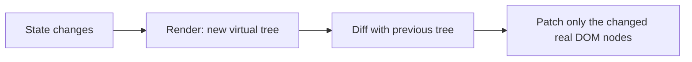

### ❓ What are the main differences between React class components and function components?

**Level:** 🟢 Beginner

### 📝 Answer

- Function components are simpler, use hooks, and are now the recommended approach.
- Class components use `this`, lifecycle methods (`componentDidMount`, etc.).
- Hooks let you share logic more easily than HOCs/render props.

💻 **Code Example**

```jsx
// Function component with hook
function Counter() {
  const [count, setCount] = React.useState(0);
  return <button onClick={() => setCount((c) => c + 1)}>{count}</button>;
}
```

---

### ❓ Explain React Hooks rules. What happens if you break them?

**Level:** 🟡 Intermediate

### 📝 Answer

- Only call hooks:

  1. At the top level (not in loops, conditions, nested functions).
  2. Only inside React function components or custom hooks.

- If you break them, hook order changes between renders and React will read wrong internal state → bugs or runtime errors.

💻 **Code Example**

React doesn't know hooks by name — it remembers them **by call order** (1st `useState`, 2nd `useState`…). A condition can change that order.

```jsx
// ❌ Wrong: when `show` changes, the 2nd hook becomes the 1st
function MyComponent({ show }) {
  if (show) {
    const [value, setValue] = React.useState(0);
  }
  const [text, setText] = React.useState("");   // reads the wrong slot after show flips
}

// ✅ Correct: same hooks, same order, every render — put the condition inside
function MyComponent({ show }) {
  const [value, setValue] = React.useState(0);
  const [text, setText] = React.useState("");
  if (!show) return null;
  // ...
}
```

The `eslint-plugin-react-hooks` rule catches these mistakes.

---

### ❓ Why are keys important in lists? What are bad keys?

**Level:** 🟡 Intermediate

### 📝 Answer

- Keys tell React **which item is which** between renders, so each item keeps its own state and DOM node.
- **Bad keys:**
  - **Random values** (`Math.random()`) — a new key every render, so every item is destroyed and re-created.
  - **Array index** when items can be **added, removed or reordered** — after deleting item 0, item 1 gets key 0 and inherits item 0's state (e.g. a typed input value appears in the wrong row).
- **Good keys:** a stable ID from the data. (Index is acceptable only for static lists that never change order.)

💻 **Code Example**

```jsx
// ❌ Bad
items.map((item, index) => <Row key={index} />);

// ✅ Good
items.map((item) => <Row key={item.id} />);
```

---

### ❓ What is `useEffect` and common pitfalls?

**Level:** 🟡 Intermediate

### 📝 Answer

- `useEffect` runs side-effects after render (API calls, subscriptions, DOM, timers).
- Pitfalls:

  - Missing dependencies (stale values).
  - Too many dependencies → unnecessary calls.
  - Not cleaning up (memory leaks).

💻 **Code Example**

```jsx
useEffect(() => {
  const id = setInterval(() => {
    console.log("tick");
  }, 1000);
  return () => clearInterval(id); // cleanup
}, []); // run once
```

---

### ❓ What’s the difference between `useEffect` and `useLayoutEffect`?

**Level:** 🟡 Intermediate

### 📝 Answer

- `useEffect` runs after paint (async, non-blocking).
- `useLayoutEffect` runs synchronously after DOM mutation but before paint (blocks painting).
- Use `useLayoutEffect` only when you must measure DOM or avoid flicker.

💻 **Code Example**

```jsx
useLayoutEffect(() => {
  const rect = ref.current.getBoundingClientRect();
  // sync layout calculations
}, []);
```

---

### ❓ Explain `useMemo` and `useCallback`. When to use them?

**Level:** 🟡 Intermediate

### 📝 Answer

- `useMemo`: memoizes expensive computed values.
- `useCallback`: memoizes function references.
- Use when:

  - Expensive calculations.
  - Passing functions/objects to children that depend on reference equality.

💻 **Code Example**

```jsx
const filtered = useMemo(() => list.filter((item) => item.active), [list]);

const handleClick = useCallback(() => {
  console.log("clicked");
}, []);
```

---

### ❓ What is React’s Strict Mode and why might effects run twice in dev?

**Level:** 🟡 Intermediate

### 📝 Answer

- `<React.StrictMode>` helps find side-effect bugs early.
- In development (React 18+), React intentionally **renders components twice** and **mounts → unmounts → re-mounts** them, so effects without proper cleanup show their bugs (e.g. a subscription opened twice).
- So `useEffect` runs twice in dev — **never in production**. The fix is a correct cleanup function, not removing StrictMode.

💻 **Code Example**

```jsx
const root = ReactDOM.createRoot(document.getElementById("root"));
root.render(
  <React.StrictMode>
    <App />
  </React.StrictMode>
);
```

---

### ❓ Explain React 18 concurrent rendering in simple terms.

**Level:** 🟡 Intermediate

### 📝 Answer

- Concurrent rendering lets React pause, resume, and discard renders.
- It makes updates more responsive by splitting work and prioritizing urgent updates (like typing) over non-urgent ones.
- You opt in with features like `startTransition`, `Suspense` for data, etc.

💻 **Code Example**

```jsx
import { startTransition, useState } from "react";

const [value, setValue] = useState("");
const [results, setResults] = useState([]);

function onChange(e) {
  const next = e.target.value;
  setValue(next); // urgent
  startTransition(() => {
    setResults(expensiveSearch(next)); // non-urgent
  });
}
```

---

### ❓ What is `Suspense` and how is it used?

**Level:** 🟡 Intermediate

### 📝 Answer

- `Suspense` shows a **fallback** (spinner, skeleton) while something inside it isn't ready yet: a lazy-loaded component, or data loaded with a Suspense-aware tool (React 19 `use(promise)`, React Query, Next.js).
- When a child isn't ready it "suspends"; React shows the nearest `<Suspense>` fallback and renders the child again once its data/code has arrived.

💻 **Code Example**

```jsx
const UserProfile = React.lazy(() => import("./UserProfile"));

<Suspense fallback={<div>Loading...</div>}>
  <UserProfile />
</Suspense>;
```

---

### ❓ How does server-side rendering (SSR) work with React?

**Level:** 🟡 Intermediate

### 📝 Answer

- Server renders React components to HTML.
- Client hydrates that HTML with event listeners.
- Benefits: faster first paint, SEO.
- Tools: Next.js, Remix, or `react-dom/server` directly.

💻 **Code Example**

```js
import { renderToString } from "react-dom/server";

const html = renderToString(<App />);
res.send(`<!doctype html><div id="root">${html}</div>`);
```

---

### ❓ What is hydration and what can go wrong?

**Level:** 🟡 Intermediate

### 📝 Answer

- Hydration attaches event listeners to existing server-rendered HTML.
- Problems when server-rendered markup doesn’t match client render (different data, random IDs, time-based values).
- React logs hydration mismatch warnings.

💻 **Code Example**

```jsx
// Avoid non-deterministic values at render time on server
function Now() {
  const [now] = useState(() => Date.now()); // initialized once
  return <span>{now}</span>;
}
```

---

### ❓ How do you manage global state in a large React app?

**Level:** 🟡 Intermediate

### 📝 Answer

- Options:

  - React Context for simple global state.
  - Libraries: Redux Toolkit, Zustand, Jotai, Recoil, etc.

- Choose based on complexity, dev tooling, and performance needs.

💻 **Code Example**

```jsx
const ThemeContext = React.createContext();

function App() {
  const [theme, setTheme] = useState("dark");
  return (
    <ThemeContext.Provider value={{ theme, setTheme }}>
      <Layout />
    </ThemeContext.Provider>
  );
}

function Button() {
  const { theme } = React.useContext(ThemeContext);
  return <button className={theme}>Click</button>;
}
```

---

### ❓ What are common performance optimization techniques in React?

**Level:** 🟡 Intermediate

### 📝 Answer

- Memoization: `React.memo`, `useMemo`, `useCallback`.
- Split code: `React.lazy`, dynamic imports.
- Virtualize long lists.
- Avoid unnecessary re-renders by proper props structure and `key`.
- Use `useTransition` for non-urgent updates.

💻 **Code Example**

```jsx
const ListItem = React.memo(function ListItem({ item }) {
  console.log("render", item.id);
  return <li>{item.label}</li>;
});
```

---

### ❓ Explain controlled vs uncontrolled components in forms.

**Level:** 🟡 Intermediate

### 📝 Answer

- Controlled: React state is the single source of truth; input value comes from state.
- Uncontrolled: DOM holds value; use refs to read it.
- Controlled gives better validation and control; uncontrolled is simpler for basic forms.

💻 **Code Example**

```jsx
// Controlled
const [name, setName] = useState("");
<input value={name} onChange={(e) => setName(e.target.value)} />;

// Uncontrolled
const ref = useRef();
<input ref={ref} defaultValue="John" />;
```

---

### ❓ How do you handle errors in React components?

**Level:** 🟡 Intermediate

### 📝 Answer

- Use error boundaries (class components) to catch render/runtime errors in child components.
- For async (e.g., fetch), handle in promises/try-catch and show fallback UI.

💻 **Code Example**

```jsx
class ErrorBoundary extends React.Component {
  state = { hasError: false };
  static getDerivedStateFromError() {
    return { hasError: true };
  }
  componentDidCatch(error, info) {
    console.error(error, info);
  }
  render() {
    if (this.state.hasError) return <h1>Something went wrong.</h1>;
    return this.props.children;
  }
}
```

---

### ❓ How do you test React components?

**Level:** 🟡 Intermediate

### 📝 Answer

- Unit/integration tests with:

  - React Testing Library (preferred).
  - Jest/Vitest as test runner.

- Focus on behavior and output, not implementation details.

💻 **Code Example**

```jsx
// Component
function Greeting({ name }) {
  return <h1>Hello {name}</h1>;
}

// Test
import { render, screen } from "@testing-library/react";

test("shows greeting", () => {
  render(<Greeting name="Dev" />);
  expect(screen.getByText(/Hello Dev/i)).toBeInTheDocument();
});
```

---

### ❓ What are custom hooks and why use them?

**Level:** 🟢 Beginner

### 📝 Answer

- Custom hooks are functions that use hooks and start with `use`.
- They encapsulate reusable stateful logic (fetching, subscriptions).
- They keep components smaller and easier to test.

💻 **Code Example**

```jsx
function useWindowWidth() {
  const [width, setWidth] = useState(window.innerWidth);
  useEffect(() => {
    const onResize = () => setWidth(window.innerWidth);
    window.addEventListener("resize", onResize);
    return () => window.removeEventListener("resize", onResize);
  }, []);
  return width;
}
```

---

### ❓ How do you handle authentication flows in React?

**Level:** 🟡 Intermediate

### 📝 Answer

- Store auth state (token/user) in context or global store.
- Protect routes with wrappers (e.g., `<PrivateRoute>`).
- Avoid putting tokens in localStorage if possible; prefer http-only cookies.

💻 **Code Example**

```jsx
function PrivateRoute({ children }) {
  const { user } = useAuth();
  if (!user) return <Navigate to="/login" replace />;
  return children;
}
```

---

### ❓ How to avoid prop drilling?

**Level:** 🟡 Intermediate

### 📝 Answer

- Use:

  - Context API.
  - Global state libraries.
  - Colocate state closer to where it’s used.
  - Component composition instead of deep nesting.

💻 **Code Example**

```jsx
const UserContext = React.createContext();

function App() {
  const [user] = useState({ name: "Dev" });
  return (
    <UserContext.Provider value={user}>
      <Page />
    </UserContext.Provider>
  );
}

function Header() {
  const user = useContext(UserContext);
  return <div>{user.name}</div>;
}
```

---

### ❓ Explain “lifting state up” with an example.

**Level:** 🟡 Intermediate

### 📝 Answer

- When two or more components need to share state, move that state to their closest common parent and pass down via props.

💻 **Code Example**

```jsx
function Parent() {
  const [value, setValue] = useState("");
  return (
    <>
      <Input value={value} onChange={setValue} />
      <Preview value={value} />
    </>
  );
}
```

---

### ❓ What is `React.forwardRef` and when to use it?

**Level:** 🟡 Intermediate

### 📝 Answer

- `forwardRef` lets a component pass a ref to a child DOM node or another component.
- Useful for reusable input components, focusing, imperative APIs.

💻 **Code Example**

```jsx
// React 18 and earlier
const TextInput = React.forwardRef(function TextInput(props, ref) {
  return <input ref={ref} {...props} />;
});

// React 19+: ref is a normal prop — forwardRef is no longer needed
function TextInput({ ref, ...props }) {
  return <input ref={ref} {...props} />;
}

const ref = useRef(null);
<TextInput ref={ref} />;      // parent can now call ref.current.focus()
```

---

### ❓ What is the difference between `useRef` and `useState`?

**Level:** 🟢 Beginner

### 📝 Answer

- `useRef`:

  - Stores a mutable value `.current`.
  - Updating it doesn’t trigger re-render.

- `useState`:

  - Stores state.
  - Updating triggers re-render.

💻 **Code Example**

```jsx
const countRef = useRef(0);

function handleClick() {
  countRef.current += 1; // no re-render
}
```

---

### ❓ How do you handle large lists efficiently in React?

**Level:** 🟡 Intermediate

### 📝 Answer

- Use **windowing/virtualization**: render only the rows on screen (plus a few extra), and swap them as the user scrolls. 10,000 items → ~20 DOM rows.
- Libraries: `react-window`, `@tanstack/react-virtual`, `react-virtuoso`.
- Also: paginate or "load more", and memoize row components.

(The example uses the `react-window` v1 API.)

💻 **Code Example**

```jsx
import { FixedSizeList as List } from "react-window";

<List height={400} itemCount={10000} itemSize={35} width={300}>
  {({ index, style }) => <div style={style}>Row {index}</div>}
</List>;
```

---

### ❓ How do you ensure accessibility (a11y) in React apps?

**Level:** 🟡 Intermediate

### 📝 Answer

- Use semantic HTML (`<button>`, `<nav>`, `<header>`).
- Add ARIA attributes only when necessary.
- Manage focus properly.
- Ensure keyboard navigation and proper labels.

💻 **Code Example**

```jsx
<button aria-label="Close dialog" onClick={onClose}>
  ✕
</button>
```

---

### ❓ How do you prevent unnecessary re-renders in child components?

**Level:** 🟡 Intermediate

### 📝 Answer

- Use `React.memo` to memoize child component.
- Use stable props (memoized callbacks/objects).
- Avoid creating new objects/functions in JSX without memo if performance is an issue.

💻 **Code Example**

```jsx
const Child = React.memo(function Child({ onClick }) {
  return <button onClick={onClick}>Child</button>;
});

const onClick = useCallback(() => {
  console.log("click");
}, []);
```

---

### ❓ What’s the difference between `ReactDOM.render` and `createRoot`?

**Level:** 🟡 Intermediate

### 📝 Answer

- `ReactDOM.render` is the old API (React 17). It was deprecated in 18 and **removed in React 19**.
- `createRoot` (React 18+) enables concurrent features (transitions, Suspense streaming) and automatic batching of all updates.
- For server-rendered HTML, use `hydrateRoot` instead of the old `ReactDOM.hydrate`.

💻 **Code Example**

```jsx
// React 18
import { createRoot } from "react-dom/client";

const root = createRoot(document.getElementById("root"));
root.render(<App />);
```

---

### ❓ How do you organize a large-scale React project?

**Level:** 🟡 Intermediate

### 📝 Answer

- Feature-based folder structure (by domain, not by type).
- Separate UI components, hooks, services, and types.
- Use index files for re-exports.
- Keep components small and focused.

💻 **Code Example**

```text
src/
  features/
    auth/
      components/
      hooks/
      api/
      authSlice.ts
```

---

### ❓ How do you handle side effects like API calls in React?

**Level:** 🟡 Intermediate

### 📝 Answer

- Use `useEffect` for fire-and-forget.
- Or use data fetching libraries (React Query, SWR) for caching, retries, and stale data.
- Keep side effects outside of render logic.

💻 **Code Example**

```jsx
useEffect(() => {
  let ignore = false;
  async function fetchData() {
    const res = await fetch("/api/users");
    const data = await res.json();
    if (!ignore) setUsers(data);
  }
  fetchData();
  return () => {
    ignore = true;
  };
}, []);
```

---

### ❓ Explain a “trick” question: Why doesn’t this state update immediately?

**Level:** 🟡 Intermediate

```jsx
const [count, setCount] = useState(0);
setCount(count + 1);
console.log(count); // ?
```

### 📝 Answer

- `setCount` schedules an update; it doesn’t change `count` immediately in the same render.
- `console.log` prints the old value.
- React batches updates and re-renders with new state afterward.

💻 **Code Example**

```jsx
useEffect(() => {
  console.log("count changed", count);
}, [count]);
```

---

### ❓ Trick: What’s wrong with this effect?

**Level:** 🟡 Intermediate

```jsx
useEffect(() => {
  setCount(count + 1);
}, [count]);
```

### 📝 Answer

- Infinite loop: `setCount` updates `count`, which re-triggers the effect, forever.
- Use conditional logic or remove `setCount` from `useEffect` if not needed.

💻 **Code Example**

```jsx
useEffect(() => {
  if (count === 0) setCount(1);
}, [count]);
```

---

### ❓ Trick: Why is this component re-rendering even with `React.memo`?

**Level:** 🟡 Intermediate

```jsx
const List = React.memo(function List({ items }) { ... });
<List items={[]} />
```

### 📝 Answer

- `items={[]}` creates a new array every render; shallow compare sees a new reference, so memo fails.
- Fix: memoize the array or pass stable data.

💻 **Code Example**

```jsx
const memoItems = useMemo(() => [], []);
<List items={memoItems} />;
```

---

### ❓ How do you type React components and hooks with TypeScript?

**Level:** 🟡 Intermediate

### 📝 Answer

- Type the **props parameter** directly (the common style today; `React.FC` is optional and no longer adds `children` automatically).
- Let hooks infer types; give a type only when the start value doesn't say enough (`useState<User | null>(null)`).
- Use generics for reusable components (a `List<T>`).

💻 **Code Example**

```tsx
type ButtonProps = {
  label: string;
  onClick: () => void;
  variant?: "primary" | "secondary";      // optional prop
  children?: React.ReactNode;             // declare children explicitly when you accept them
};

function Button({ label, onClick, variant = "primary" }: ButtonProps) {
  return <button className={variant} onClick={onClick}>{label}</button>;
}

const [user, setUser] = useState<User | null>(null);
const inputRef = useRef<HTMLInputElement>(null);

// Generic component
function List<T>({ items, render }: { items: T[]; render: (item: T) => React.ReactNode }) {
  return <ul>{items.map(render)}</ul>;
}
```

---

### ❓ How do you implement code-splitting in React?

**Level:** 🟡 Intermediate

### 📝 Answer

- Use `React.lazy` and `Suspense` to lazy-load components.
- Or dynamic imports in routing (e.g., React Router, Next.js).

💻 **Code Example**

```jsx
const Settings = React.lazy(() => import("./Settings"));

<Suspense fallback={<div>Loading...</div>}>
  <Settings />
</Suspense>;
```

---

### ❓ How do you debounce or throttle events in React?

**Level:** 🟡 Intermediate

### 📝 Answer

- Create the debounced function **once** (with `useMemo`), otherwise every render makes a new one with its own timer and debouncing never happens.
- **Cancel** it on unmount so a late call doesn't update an unmounted component.

💻 **Code Example**

```jsx
import { debounce } from "lodash-es";

function Search() {
  const search = useMemo(
    () => debounce((term) => fetch(`/api/search?q=${encodeURIComponent(term)}`), 300),
    []
  );
  useEffect(() => () => search.cancel(), [search]);   // cleanup

  return <input onChange={(e) => search(e.target.value)} />;
}
```

Alternative without a library: keep the input in state and debounce the **value** with a small `useDebouncedValue(value, 300)` hook (a `setTimeout` in `useEffect` with cleanup).

---

### ❓ How do you make a reusable modal component in React?

**Level:** 🟡 Intermediate

### 📝 Answer

- Create a `Modal` component with props (`isOpen`, `onClose`).
- Use portals to render on top-level.
- Control visibility from parent.

💻 **Code Example**

```jsx
import ReactDOM from "react-dom";

function Modal({ isOpen, onClose, children }) {
  if (!isOpen) return null;
  return ReactDOM.createPortal(
    <div className="backdrop" onClick={onClose}>
      <div className="modal" onClick={(e) => e.stopPropagation()}>
        {children}
      </div>
    </div>,
    document.body
  );
}
```

---

### ❓ How do you implement dark/light theme toggling?

**Level:** 🟡 Intermediate

### 📝 Answer

- Store `theme` in context or global store.
- Apply class on `html/body`.
- Persist in localStorage if needed.

💻 **Code Example**

```jsx
const [theme, setTheme] = useState("light");

useEffect(() => {
  document.documentElement.dataset.theme = theme;
}, [theme]);

<button onClick={() => setTheme((t) => (t === "light" ? "dark" : "light"))}>
  Toggle
</button>;
```

---

### ❓ How do you handle file uploads in React?

**Level:** 🟡 Intermediate

### 📝 Answer

- Use `<input type="file" />`.
- Read `event.target.files`.
- Send `FormData` via fetch/axios.

💻 **Code Example**

```jsx
function Upload() {
  const handleChange = async (e) => {
    const file = e.target.files[0];
    const formData = new FormData();
    formData.append("file", file);
    await fetch("/upload", { method: "POST", body: formData });
  };
  return <input type="file" onChange={handleChange} />;
}
```

---

### ❓ How do you secure a React app against XSS?

**Level:** 🟡 Intermediate

### 📝 Answer

- Never inject unsanitized HTML.
- Avoid `dangerouslySetInnerHTML` unless content is sanitized.
- Rely on React’s default escaping of values.

💻 **Code Example**

```jsx
// Safe: React escapes
<div>{userInput}</div>;

// Dangerous: ensure `sanitizedHtml` is sanitized
<div dangerouslySetInnerHTML={{ __html: sanitizedHtml }} />;
```

---

### ❓ What's new in React 19?

**Level:** 🟡 Intermediate

### 📝 Answer

| Feature | What it does |
|---|---|
| **Actions** | Pass an `async` function to `<form action={...}>` or `startTransition`; React tracks pending state, errors and resets for you |
| `useActionState` | State + pending flag for a form action (replaces hand-written `isLoading` flags) |
| `useOptimistic` | Show the expected result immediately, roll back if the request fails |
| `use(promise / context)` | Read a promise (with Suspense) or context — and it can be called conditionally |
| `ref` as a prop | No more `forwardRef` |
| Document metadata | `<title>` and `<meta>` inside components are moved to `<head>` |
| Removed APIs | `ReactDOM.render`, `hydrate`, string refs, `propTypes` checks |

```jsx
function AddTodo() {
  const [error, submit, isPending] = useActionState(async (prev, formData) => {
    const res = await fetch("/api/todos", { method: "POST", body: formData });
    return res.ok ? null : "Could not save";
  }, null);

  return (
    <form action={submit}>
      <input name="title" />
      <button disabled={isPending}>{isPending ? "Saving…" : "Add"}</button>
      {error && <p>{error}</p>}
    </form>
  );
}
```

#### ↳ Follow-up: What is the React Compiler?

↪ A build-time tool (stable since late 2025) that **memoizes components and values automatically**, so most manual `useMemo`, `useCallback` and `React.memo` become unnecessary.

---

### ❓ How do you debug React performance issues?

**Level:** 🟡 Intermediate

### 📝 Answer

- Use React DevTools Profiler to see slow components.
- Check frequent re-renders (high commit count).
- Optimize with memoization, splitting components, virtualization.
- Check for unnecessary computations in render.

💻 **Code Example**

```jsx
// Add <React.Profiler> around suspicious subtree in dev
<React.Profiler
  id="App"
  onRender={(id, phase, actualDuration) => {
    console.log(id, phase, actualDuration);
  }}
>
  <App />
</React.Profiler>
```

---


## Rendering Internals (Intermediate)

### ❓ What is the virtual DOM, and how does reconciliation work?

### 📝 Answer

The **virtual DOM** is a plain JavaScript copy of what the UI should look like. On every render React builds a new copy, **compares** it with the previous one (**reconciliation** / "diffing"), and changes only the real DOM nodes that differ.



React's diffing rules (they keep it fast, O(n)):

1. **Different element type** (`<div>` → `<span>`, or `ComponentA` → `ComponentB`) → throw away the old subtree and build a new one (state is lost).
2. **Same type** → keep the node, update only changed attributes/props.
3. **Lists** → match children by **`key`**. Stable keys let React move items instead of recreating them.

```jsx
{items.map(item => <Row key={item.id} item={item} />)}   // ✅ stable keys
```

**Fiber** (React 16+) splits this work into small units so React can pause, prioritise urgent updates (typing) and resume — the base of concurrent rendering.

#### ↳ Follow-up: Is the virtual DOM always faster than direct DOM updates?

↪ No — hand-written DOM updates can be faster. The virtual DOM's win is that you write simple "UI = f(state)" code and still get reasonably minimal updates.

#### ↳ Follow-up: Render phase vs commit phase?

↪ Render: React calls components and diffs (no DOM changes, can be interrupted). Commit: React applies the changes to the DOM and runs effects (cannot be interrupted).

---

### ❓ What are React Server Components?

### 📝 Answer

**Server Components** run **only on the server**. They can read the database or files directly, and they send **rendered output, not JavaScript**, to the browser. **Client Components** (marked `"use client"`) are the interactive ones.

```jsx
// app/products/page.jsx — Server Component (default in Next.js App Router)
import { db } from "@/lib/db";
import AddToCart from "./AddToCart";

export default async function ProductsPage() {
  const products = await db.product.findMany();      // runs on the server
  return products.map(p => (
    <div key={p.id}>
      {p.name} — ₹{p.price}
      <AddToCart id={p.id} />                         {/* client island */}
    </div>
  ));
}
```

```jsx
// AddToCart.jsx
"use client";
export default function AddToCart({ id }) {
  const [added, setAdded] = useState(false);
  return <button onClick={() => setAdded(true)}>{added ? "Added" : "Add"}</button>;
}
```

| | Server Component | Client Component |
|---|---|---|
| Runs | server only | server (SSR) + browser |
| `useState`, `useEffect`, `onClick` | ❌ | ✅ |
| Direct DB / secrets | ✅ | ❌ |
| JS sent to browser | none | yes |

#### ↳ Follow-up: Server Components vs SSR?

↪ SSR renders **client** components to HTML and then ships their JS for hydration. Server Components never ship their JS at all.

---

### ❓ When would you use `useReducer` instead of `useState`?

### 📝 Answer

Use **`useReducer`** when state has **several related fields** or **many ways to change**. All changes go through one pure function, which is easier to read and test.

```jsx
const initial = { items: [], status: "idle", error: null };

function reducer(state, action) {
  switch (action.type) {
    case "loading": return { ...state, status: "loading", error: null };
    case "loaded":  return { ...state, status: "done", items: action.items };
    case "failed":  return { ...state, status: "error", error: action.error };
    default: return state;
  }
}

function Products() {
  const [state, dispatch] = useReducer(reducer, initial);
  useEffect(() => {
    dispatch({ type: "loading" });
    fetchProducts()
      .then(items => dispatch({ type: "loaded", items }))
      .catch(error => dispatch({ type: "failed", error }));
  }, []);
  …
}
```

| `useState` | `useReducer` |
|---|---|
| one simple value | related values that change together |
| logic in event handlers | logic in one reducer (testable alone) |

#### ↳ Follow-up: Is `dispatch` stable?

↪ Yes — it never changes, so it's safe to pass to children or effect dependencies.

---

### ❓ What are React portals, and when do you use them?

### 📝 Answer

A **portal** renders a component into a **different DOM node** (often `document.body`) while it stays in the same React tree — props, context and events still work.

```jsx
import { createPortal } from "react-dom";

function Modal({ open, onClose, children }) {
  if (!open) return null;
  return createPortal(
    <div className="overlay" onClick={onClose}>
      <div role="dialog" aria-modal="true" onClick={e => e.stopPropagation()}>{children}</div>
    </div>,
    document.body,
  );
}
```

**Use for:** modals, tooltips, dropdowns and toasts that must escape a parent with `overflow: hidden` or a low `z-index`.

#### ↳ Follow-up: Do events from a portal bubble to its React parent?

↪ Yes — events bubble through the **React** tree, not the DOM tree.

---
