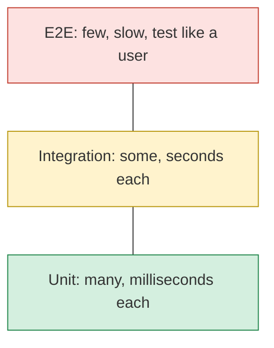
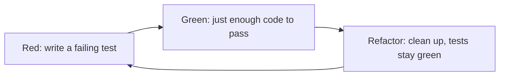

# ✅ Testing Interview Preparation

## Part 1 — Basics

### ❓ What are the types of software tests?

### 📝 Answer

| Type | What it checks | Example | Speed |
|---|---|---|---|
| **Unit** | One class/function alone, dependencies mocked | `PriceCalculator.total()` | Milliseconds |
| **Integration** | Parts working together (DB, HTTP, Kafka) | Repository saves to a real Postgres | Seconds |
| **End-to-end (E2E)** | The whole app like a user | Log in → add to cart → pay, in a browser | Minutes |
| Contract | Two services agree on an API | Consumer-driven contract (Pact) | Fast |
| Performance / load | Speed under load | 1,000 users with JMeter / k6 | Long |
| Smoke | "Does it start and respond at all?" | Health check after deploy | Fast |
| Regression | Old features still work after changes | Re-run the suite on every PR | — |

**Test pyramid:** many fast unit tests at the bottom, fewer slow E2E tests at the top.



---

### ❓ What is the test pyramid?

### 📝 Answer

Write **many unit tests, fewer integration tests, very few E2E tests**.

```text
        /\        E2E        – few, slow, brittle
       /  \
      /----\      Integration – some
     /      \
    /--------\    Unit        – many, fast, cheap
```

Why: unit tests are fast and point at the exact bug; E2E tests are slow and break for unrelated reasons (timing, test data).

#### ↳ Follow-up: What is the "ice-cream cone" anti-pattern?

↪ The pyramid upside down — mostly manual and E2E tests, few unit tests. The suite becomes slow and flaky.

---

### ❓ What makes a good unit test?

### 📝 Answer

Follow **FIRST** and **Arrange–Act–Assert**:

- **F**ast, **I**ndependent (no order dependence), **R**epeatable (same result every run), **S**elf-validating (pass/fail, no reading logs), **T**imely (written with the code).
- One behaviour per test, with a name that says it: `returnsZeroWhenCartIsEmpty`.

```java
@Test
void appliesTenPercentDiscountAboveThousand() {
    // Arrange
    var calc = new PriceCalculator();
    // Act
    double total = calc.total(1200);
    // Assert
    assertEquals(1080, total);
}
```

---

### ❓ What are TDD and BDD?

### 📝 Answer

- **TDD (Test-Driven Development):** write a failing test → write just enough code to pass → refactor. Repeat. (**Red → Green → Refactor**.)
- **BDD (Behaviour-Driven Development):** describe behaviour in plain language that business people can read, often as **Given / When / Then** (Cucumber).

```gherkin
Given a cart with items worth ₹1200
When the customer checks out
Then a 10% discount is applied
```

**TDD cycle:**



---

### ❓ What is code coverage, and is 100% coverage the goal?

### 📝 Answer

Coverage = the percentage of lines/branches **executed** by tests (tool: JaCoCo for Java, Istanbul for JS).

100% is **not** the goal: a test can run a line without checking anything. Aim for good coverage (often 70–80%) of important logic, with real assertions. Branch coverage is more useful than line coverage.

#### ↳ Follow-up: What is mutation testing?

↪ A tool (PIT) makes small changes to your code (e.g. `>` to `>=`); if no test fails, your tests aren't really checking that logic.

---

## Part 2 — JUnit 5 & Mockito

### ❓ What are the main JUnit 5 annotations?

### 📝 Answer

| Annotation | Purpose |
|---|---|
| `@Test` | A test method |
| `@BeforeEach` / `@AfterEach` | Run before/after **each** test |
| `@BeforeAll` / `@AfterAll` | Run once for the class (static methods) |
| `@DisplayName` | Readable test name |
| `@ParameterizedTest` + `@ValueSource` / `@CsvSource` | Same test with many inputs |
| `@Disabled` | Skip a test |
| `@Nested` | Group related tests |

```java
@ParameterizedTest
@CsvSource({"0,0", "500,500", "1200,1080"})
void total(double price, double expected) {
    assertEquals(expected, new PriceCalculator().total(price));
}

@Test
void rejectsNegativePrice() {
    assertThrows(IllegalArgumentException.class, () -> calc.total(-1));
}
```

---

### ❓ What is mocking and why do we need it?

### 📝 Answer

A **mock** is a fake object that stands in for a real dependency (database, payment API) in a unit test. It lets you test one class **alone, fast, and without side effects**, and lets you control what the dependency returns.

```java
@ExtendWith(MockitoExtension.class)
class OrderServiceTest {
    @Mock PaymentGateway gateway;          // fake
    @InjectMocks OrderService service;     // real class, mocks injected

    @Test
    void marksOrderPaidWhenPaymentSucceeds() {
        when(gateway.charge(500)).thenReturn(true);       // stub

        Order order = service.place(500);

        assertEquals(Status.PAID, order.status());
        verify(gateway).charge(500);                      // was it called?
    }
}
```

---

### ❓ Mock vs stub vs spy vs fake?

### 📝 Answer

| Double | What it is | Example |
|---|---|---|
| **Stub** | Returns canned answers | `when(repo.find(1)).thenReturn(user)` |
| **Mock** | Stub + you **verify** calls | `verify(mailer).send(any())` |
| **Spy** | Wraps a **real** object; real methods run unless stubbed | `spy(new ArrayList<>())` |
| **Fake** | Simple working version | In-memory repository, H2 database |

#### ↳ Follow-up: `when(...).thenReturn(...)` vs `doReturn(...).when(...)` on a spy?

↪ `when(spy.method())` calls the real method first. `doReturn(x).when(spy).method()` doesn't — use it for spies and `void` methods.

---

### ❓ How do you test a method that throws an exception or a `void` method?

### 📝 Answer

```java
// exception
var ex = assertThrows(NotFoundException.class, () -> service.get(99));
assertEquals("User 99 not found", ex.getMessage());

// void method that calls a dependency
service.register(user);
verify(mailer, times(1)).sendWelcome(user.email());

// make a mocked void method throw
doThrow(new MailException("down")).when(mailer).sendWelcome(any());
```

---

### ❓ What is an `ArgumentCaptor`?

### 📝 Answer

It **captures the argument** passed to a mock so you can check its details.

```java
ArgumentCaptor<Email> captor = ArgumentCaptor.forClass(Email.class);
verify(mailer).send(captor.capture());
assertEquals("Welcome, Asha!", captor.getValue().subject());
```

---

### ❓ Can Mockito mock static methods, final classes and private methods?

### 📝 Answer

- **Final classes/methods:** yes, with Mockito 5 (inline mock maker is default).
- **Static methods:** yes, with `mockStatic` inside try-with-resources.
- **Private methods:** no — test them through the public method that uses them.

```java
try (MockedStatic<LocalDate> date = mockStatic(LocalDate.class, CALLS_REAL_METHODS)) {
    date.when(LocalDate::now).thenReturn(LocalDate.of(2026, 1, 1));
    ...
}
```

Better design: inject a `Clock` instead of calling `LocalDate.now()` directly.

---

## Part 3 — Spring Boot Testing

### ❓ `@SpringBootTest` vs `@WebMvcTest` vs `@DataJpaTest`?

### 📝 Answer

| Annotation | Loads | Use for |
|---|---|---|
| `@SpringBootTest` | The **whole** application context | Full integration tests (slow) |
| `@WebMvcTest(UserController.class)` | Only the web layer (controllers, filters, JSON) | Controller tests with `MockMvc`; services are `@MockBean` |
| `@DataJpaTest` | Only JPA (entities, repositories), in-memory DB, rolls back each test | Repository queries |

```java
@WebMvcTest(UserController.class)
class UserControllerTest {
    @Autowired MockMvc mvc;
    @MockitoBean UserService service;   // @MockBean before Spring Boot 3.4

    @Test
    void returnsUser() throws Exception {
        when(service.get(1L)).thenReturn(new User(1L, "Asha"));
        mvc.perform(get("/users/1"))
           .andExpect(status().isOk())
           .andExpect(jsonPath("$.name").value("Asha"));
    }
}
```

#### ↳ Follow-up: `@Mock` vs `@MockBean`/`@MockitoBean`?

↪ `@Mock` is plain Mockito (no Spring). `@MockitoBean` puts the mock **into the Spring context**, replacing the real bean.

---

### ❓ What is Testcontainers?

### 📝 Answer

A library that starts **real services in Docker** (Postgres, Kafka, Redis) for your tests, then removes them.

```java
@Testcontainers
@SpringBootTest
class OrderRepositoryIT {
    @Container @ServiceConnection
    static PostgreSQLContainer<?> db = new PostgreSQLContainer<>("postgres:16");
}
```

Better than H2 because you test against the **same database as production** — no surprises from SQL differences.

---

## Part 4 — Frontend Testing

### ❓ How do you test a React component?

### 📝 Answer

Use **React Testing Library + Jest (or Vitest)**. Test what the **user sees and does**, not internal state.

```jsx
test("shows a greeting after clicking", async () => {
  render(<Greeting />);
  await userEvent.click(screen.getByRole("button", { name: /say hi/i }));
  expect(screen.getByText("Hello!")).toBeInTheDocument();
});
```

Prefer queries in this order: `getByRole` → `getByLabelText` → `getByText` → `getByTestId` (last resort).

#### ↳ Follow-up: `getBy` vs `queryBy` vs `findBy`?

↪ `getBy` throws if not found. `queryBy` returns `null` (use to assert something is absent). `findBy` waits (async) for it to appear.

---

### ❓ How do you test an Angular service that makes HTTP calls?

### 📝 Answer

Use `HttpTestingController` to intercept requests and send fake responses.

```ts
it("loads users", () => {
  service.getUsers().subscribe(users => expect(users.length).toBe(2));
  const req = http.expectOne("/api/users");
  expect(req.request.method).toBe("GET");
  req.flush([{ id: 1 }, { id: 2 }]);   // fake response
  http.verify();                         // no unexpected requests
});
```

Setup: `provideHttpClient()` and `provideHttpClientTesting()` in `TestBed`.

---

### ❓ What are E2E testing tools for web apps?

### 📝 Answer

**Playwright** and **Cypress** run the real app in a browser and act like a user (click, type, check text). Playwright supports Chromium, Firefox and WebKit and runs tests in parallel; Cypress has a very friendly debugging UI. Selenium is the older standard.

---

## Part 5 — Tricky Questions

### ❓ Tricky: What is a flaky test and how do you fix it?

### 📝 Answer

A test that **sometimes passes and sometimes fails** with no code change.

Common causes and fixes:

- **Timing** (`Thread.sleep`, waiting for UI) → wait for a condition, not a fixed time.
- **Shared state / test order** → reset data in `@BeforeEach`; don't depend on other tests.
- **Current time or random values** → inject a `Clock` / fixed seed.
- **Real external services** → mock them or use Testcontainers.

---

### ❓ Tricky: Should you test private methods?

### 📝 Answer

No — test them **through the public methods** that use them. If a private method feels like it needs its own tests, it probably belongs in its own class.

- Tests that call private methods (through reflection) break whenever you refactor, even when the behaviour is still correct.
- Example: `calculateDiscount()` is private inside `OrderService` — test `placeOrder()` with inputs that should get a discount and check the total.
- If the logic is complex, move it to its own class (for example, `DiscountPolicy`) with public methods and test that directly.

---

### ❓ Tricky: Why can too many mocks be a problem?

### 📝 Answer

Tests that mock everything check **how** the code works (which calls happen) instead of **what** it does. They pass even when the real integration is broken, and break on every refactor. Mock only the boundaries (external APIs, time, email) and use real objects for the rest.

---

### ❓ Tricky: Unit test vs integration test — where's the line?

### 📝 Answer

If the test touches something **outside your process** — a database, network, file system, message broker — it is an integration test. A unit test runs entirely in memory and finishes in milliseconds.
