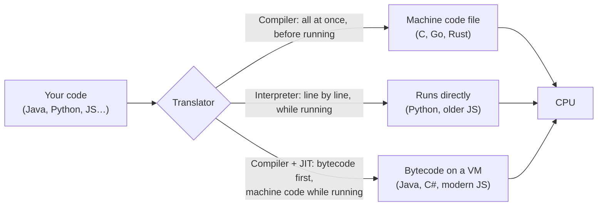
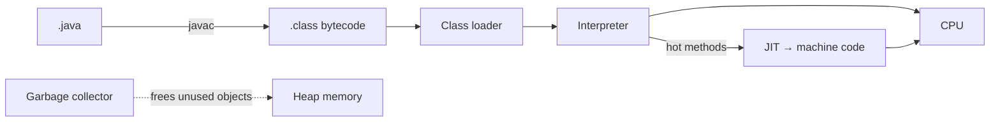

# ⚙️ How Code Runs: From Source Code to the CPU

> **How to read these answers:** each one starts with a **Generic answer** (what you'd say in one breath), then **Under the hood** tells the story — the problem first, then step by step how it is solved inside — and ends with a **Final understanding** that joins the pieces.

## How code becomes something the CPU can run (all languages)

### ❓ What happens between writing code and the computer running it?

**Generic answer:** The CPU understands only machine code, so a translator — a compiler, an interpreter, or both — turns your readable code into machine instructions.

**Under the hood:**

Imagine you write `total = price * qty` in Java, Python or JavaScript.

The CPU can't read that. It only understands **machine code** — tiny numbered instructions like "load this number", "multiply", "store it there". Something has to translate.

**Analogy:** your code is a recipe in English; the CPU is a cook who reads only one strange language. A **compiler** translates the whole recipe book before cooking; an **interpreter** translates one line at a time while cooking.

**Step 1: Read and check the code**

The translator reads your text, splits it into words (`total`, `=`, `price`…), builds a tree of what each line means, and reports errors such as a missing bracket.

**Step 2: Choose when to translate**

There are three strategies:

- **Compiled** (C, Go, Rust): fast to run, but you rebuild for each operating system.
- **Interpreted** (Python): quick to start and change, slower to run.
- **Bytecode + JIT** (Java, C#, JavaScript engines): portable *and* fast.

**Step 3: Run on the CPU**

Whatever the route, the CPU finally receives machine instructions and runs them one after another, billions per second.

_Image: [Wikimedia Commons](https://commons.wikimedia.org/wiki/File:Compiler.svg) · Surachit · CC BY-SA 3.0_

**Final understanding:** every language ends up as machine code; languages differ only in **when** the translation happens. **Readable code → check → translate (before or during the run) → machine code → CPU.**

#### ↳ Follow-up: Is Java compiled or interpreted?

↪ Both. `javac` compiles your code to **bytecode** (`.class` files). The JVM first interprets that bytecode, then its **JIT compiler** turns frequently used methods into fast machine code.

---

### ❓ What is the difference between AOT and JIT compilation?

**Generic answer:** AOT compiles everything to machine code before the program runs; JIT compiles the busy parts while it runs.

**Under the hood:**

Imagine two Spring Boot apps doing the same job. One takes 4 seconds to start but gets faster after a minute. The other starts in 50 milliseconds. Why?

**Step 1: The problem with compiling early**

When you compile before running, you don't yet know which code will be used most. The compiler must guess.

**Step 2: AOT (ahead-of-time)**

Compile everything to machine code **before** the program runs.
- Fast start-up, low memory.
- Examples: C, Go, Rust, GraalVM native images, Angular production builds (templates compiled at build time).

**Step 3: JIT (just-in-time)**

Start running quickly (interpreting), **watch** which methods run most ("hot" code), then compile only those — using real runtime facts, such as which types actually arrive.
- Slower start ("warm-up"), very fast once warmed up.
- Examples: the JVM, .NET, V8 (Chrome/Node.js).

**Step 4: Picking one**

The 4-second app is a normal JVM (JIT warming up). The 50 ms app is the same code built as a GraalVM **native image** (AOT) — good for serverless functions that start often.

**Final understanding:** it's a trade between start-up time and peak speed. **Need to run code → compile early (AOT: fast start) or compile while watching (JIT: fast after warm-up).**

---

## Language runtimes: the JVM and JavaScript engines (Java & JavaScript)

### ❓ How does the JVM run a Java program?

**Generic answer:** `javac` turns Java into bytecode; the JVM loads the classes, interprets the bytecode, compiles hot methods to machine code with the JIT, and frees unused objects with the garbage collector.

**Under the hood:**

Imagine you build one `orders.jar` on Windows and run it on a Linux server. It works unchanged. How?

**Step 1: Compile to bytecode**

`javac` turns `.java` files into **bytecode** (`.class`) — instructions for an imaginary machine, the same on every operating system.

**Step 2: Load classes when needed**

The JVM's **class loader** loads each class the first time it is used, checks the bytecode is safe, and prepares its static fields.

**Step 3: Start running immediately**

The **interpreter** runs the bytecode right away, one instruction at a time.

**Step 4: Speed up the busy parts**

The **JIT compiler** counts how often each method runs. Hot methods are compiled to native machine code for that exact CPU.

**Step 5: Clean up memory**

The **garbage collector** frees objects that nothing references any more.

**Final understanding:** "write once, run anywhere" comes from bytecode, speed from the JIT, memory safety from the GC. **Source → bytecode → class loading → interpret → JIT hot code → GC cleans up.**

---

### ❓ How does a JavaScript engine like V8 run code?

**Generic answer:** V8 parses JavaScript, runs it quickly as bytecode, and compiles hot functions to optimised machine code — undoing that if its type guesses turn out wrong.

**Under the hood:**

Imagine a function `add(a, b)` called a million times with numbers. JavaScript has no declared types, so how can it be fast?

**Step 1: Parse**

V8 reads the code and builds a tree (the **AST**).

**Step 2: Run quickly as bytecode**

**Ignition** (the interpreter) turns the tree into bytecode and starts running at once, recording the types it sees.

**Step 3: Optimise hot code**

**TurboFan** compiles hot functions to machine code, *assuming* the types seen so far ("`a` and `b` are always numbers").

**Step 4: Undo when a guess is wrong**

If `add("x", 1)` suddenly arrives, the assumption breaks. V8 **de-optimises** — throws away the fast code and falls back to bytecode.

**Practical tip:** keep objects the same shape and function arguments the same type — engines optimise predictable code best.

**Final understanding:** V8 is fast because it *guesses* types from real use. **Parse → bytecode (fast start) → watch types → optimise hot code → de-optimise if the guess breaks.** JavaScript itself runs on **one main thread**; the event loop handles waiting (see *Inside the browser*).
