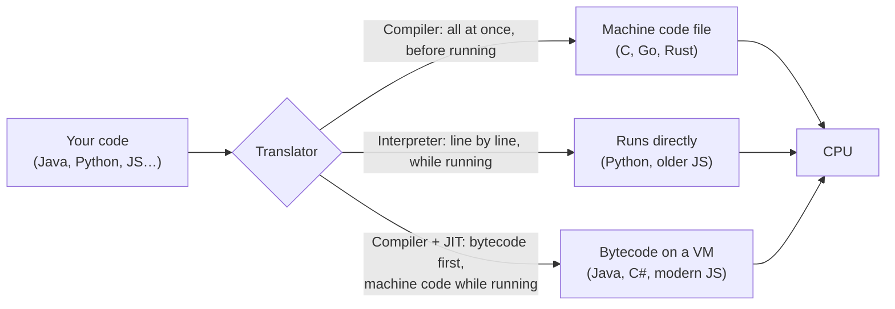
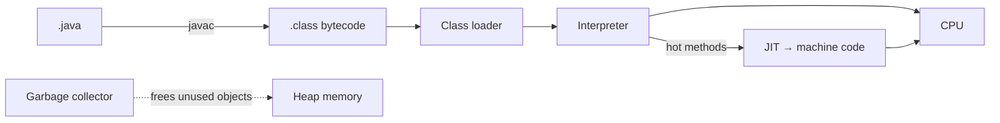

# ⚙️ How Code Runs: From Source Code to the CPU

## How code becomes something the CPU can run (all languages)

### ❓ What happens between writing code and the computer running it?

The CPU only understands **machine code** — simple numbered instructions like "add these two numbers" or "jump here". Every language needs a translator to turn your readable code into those instructions.

**Analogy:** your code is a recipe in English; the CPU is a cook who only reads one strange language. A **compiler** translates the whole recipe book before cooking; an **interpreter** translates one line at a time while cooking.

- **Compiled** (C, Go, Rust): fast to run, but you rebuild for each operating system.
- **Interpreted** (Python): quick to start and change, slower to run.
- **Bytecode + JIT** (Java, C#, JavaScript engines): portable *and* fast, because the hot parts are compiled to machine code while the program runs.

_Image: [Wikimedia Commons](https://commons.wikimedia.org/wiki/File:Compiler.svg) · Surachit · CC BY-SA 3.0_

#### ↳ Follow-up: Is Java compiled or interpreted?

↪ Both. `javac` compiles your code to **bytecode** (`.class` files). The JVM first interprets that bytecode, then its **JIT compiler** turns frequently used methods into fast machine code.

---

### ❓ What is the difference between AOT and JIT compilation?

- **AOT (ahead-of-time):** compile everything to machine code **before** the program runs. Fast start-up, small memory use. Examples: C, Go, Rust, GraalVM native images, Angular production builds (templates compiled at build time).
- **JIT (just-in-time):** compile **while** the program runs, only the parts that run a lot ("hot" code), using what it learns at runtime. Slower start, very fast once warmed up. Examples: the JVM, .NET, V8 (Chrome/Node.js).

**Example:** a Spring Boot app takes a few seconds to start and gets faster in the first minutes (JIT warming up). The same app built as a GraalVM native image (AOT) starts in milliseconds — good for serverless functions.

---

## Language runtimes: the JVM and JavaScript engines (Java & JavaScript)

### ❓ How does the JVM run a Java program?

1. `javac` turns `.java` files into **bytecode** (`.class`), the same on every operating system.
2. The JVM's **class loader** loads classes when they're first needed.
3. The **interpreter** starts running the bytecode immediately.
4. The **JIT compiler** watches which methods run most and compiles them to native machine code.
5. The **garbage collector** frees objects that are no longer used.

**Why it matters in interviews:** "write once, run anywhere" comes from bytecode; performance comes from the JIT; memory safety comes from the garbage collector.

---

### ❓ How does a JavaScript engine like V8 run code?

V8 (Chrome, Node.js) is a JIT engine:

1. **Parse** the code into a tree (AST).
2. **Ignition** (interpreter) turns it into bytecode and starts running quickly.
3. **TurboFan** (optimising compiler) compiles hot functions to machine code, *assuming* the types it has seen so far.
4. If those assumptions break (a function suddenly gets a string instead of a number), V8 **de-optimises** and falls back to bytecode.

**Practical tip:** keep objects the same shape and function arguments the same type — engines optimise predictable code best.

JavaScript itself runs on **one main thread**; the event loop handles waiting (see *Inside the browser*).
