# 🔩 Under the Hood: Programming Languages, Compilers & Execution

How source code becomes instructions the CPU runs, and how each language does it differently.

Every answer follows the same 8 parts: what it is → how it works → picture → implementation → why this design → language differences → example → how to observe it.

## Source Code to Machine Code

### ❓ How does human-readable source code eventually become machine instructions?

### 📝 Answer

**1. What is it?**
The CPU only understands **machine code**: binary instructions for its own architecture (x86-64, ARM64). Source code (`.java`, `.js`, `.c`) is text for humans. A chain of tools translates one into the other.

**2. How does it work internally?**

1. **Lexing** — the text is split into tokens (`int`, `x`, `=`, `5`, `;`).
2. **Parsing** — tokens become an **AST** (Abstract Syntax Tree: the code's structure as a tree).
3. **Semantic analysis** — types and names are checked (compile errors happen here).
4. **IR generation** — the AST becomes an **intermediate representation** that is easy to optimise.
5. **Optimisation** — e.g. remove dead code, inline small functions.
6. **Code generation** — IR becomes machine code (now, or later at runtime).
7. **Linking / loading** — pieces are joined and loaded into RAM; the CPU starts executing.

**3. Visual**

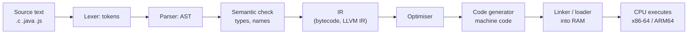

**4. Internal implementation**

- The AST is a tree data structure; each node is a construct (`IfStatement`, `BinaryExpression`).
- Optimisers work on IR in **SSA form** (Static Single Assignment: each variable is assigned once), which makes data flow easy to analyse.
- Code generation does **instruction selection** (which CPU instruction for each IR operation) and **register allocation** (which values live in the CPU's few registers).

**5. Why is it designed this way?**
Splitting into stages lets one compiler support many languages and many CPUs. LLVM is the classic case: many front ends (C, C++, Rust, Swift) → one IR → many back ends (x86, ARM). The cost is complexity and longer build times.

**6. Language differences**
Every language does steps 1–3. They differ in **when** step 6 happens:

| When machine code is made | Languages |
|---|---|
| Before running (AOT) | C, C++, Rust, Go |
| While running (JIT) | Java, C#, JavaScript |
| Mostly never for your code (interpreted bytecode) | CPython, Ruby (without YJIT), PHP (without JIT) |

**7. Practical example**

```c
int square(int x) { return x * x; }
```

`gcc -O2` turns it into roughly two x86-64 instructions: `imul edi, edi` then `mov eax, edi` / `ret`. Compile time does all the work; at runtime the CPU just runs them.

**8. How can I observe it?**

- **Compiler Explorer** (godbolt.org): type C, Rust, Go or Java code and see the generated assembly line by line.
- `gcc -S file.c` writes the assembly to `file.s`; `objdump -d a.out` shows the machine code bytes.
- `javap -c MyClass` shows Java bytecode; `node --print-bytecode file.js` shows V8 bytecode.

---

### ❓ What are the differences between Compiler, Interpreter, Assembler, Linker and Runtime?

### 📝 Answer

**1. What is it?**
Five different tools in the path from source code to a running program:

| Tool | Input → Output | When |
|---|---|---|
| **Compiler** | Source → lower-level code (assembly, bytecode, IR) | Build time (or runtime for a JIT) |
| **Interpreter** | Source or bytecode → executes it directly, one step at a time | Runtime |
| **Assembler** | Assembly text (`.s`) → machine code object file (`.o`) | Build time |
| **Linker** | Object files + libraries → one executable or library | Build time (static) or load time (dynamic) |
| **Runtime** | Support code that runs alongside your program: memory management, threads, class loading | Runtime |

**2. How does it work internally?**

- **Compiler** — translates the whole unit at once, can optimise across functions.
- **Interpreter** — a loop: read next instruction → `switch` on its type → do it → repeat.
- **Assembler** — mostly a 1:1 mapping from mnemonics (`mov`, `add`) to binary opcodes.
- **Linker** — resolves **symbols**: a call to `printf` in `main.o` is patched with the real address of `printf` from the C library.
- **Runtime** — e.g. the JVM, .NET CLR, Go runtime: GC, thread scheduler, JIT.

**3. Visual**

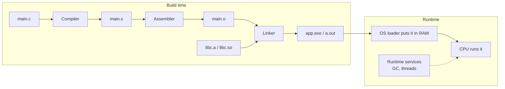

**4. Internal implementation**

- Object files have **sections** (`.text` = code, `.data` = initialised globals, `.bss` = zeroed globals) and a **symbol table** (names → offsets).
- **Static linking** copies library code into the executable. **Dynamic linking** leaves a reference; the OS loader maps the shared library (`.so`, `.dll`, `.dylib`) at load time.
- An interpreter's core is a **dispatch loop**; fast ones use "threaded code" (jump straight to the next handler instead of going back through one `switch`).

**5. Why is it designed this way?**

- Separate compile and link → recompile only the changed files; reuse prebuilt libraries.
- Interpreters start instantly and run anywhere the interpreter runs, but are slower per instruction.
- Runtimes make languages safer (GC, bounds checks) at some CPU and memory cost.

**6. Language differences**

| Language | Compiler | Assembler + linker | Runtime |
|---|---|---|---|
| C / C++ | gcc, clang | Yes (`as`, `ld`) | Tiny (C runtime start-up code) |
| Rust | rustc (LLVM) | Yes | Small, no GC |
| Go | `go build` | Go's own assembler and linker | Yes: GC + goroutine scheduler, built into the binary |
| Java | javac → bytecode | No native linking; JVM loads classes | JVM (JIT, GC) |
| C# | Roslyn → IL | No native linking (unless Native AOT) | CLR (JIT, GC) |
| Python | Built into CPython (→ bytecode) | No | CPython interpreter |
| JavaScript | Built into the engine (V8) | No | Engine + event loop |

**7. Practical example**

```bash
gcc -c util.c        # compile + assemble → util.o
gcc -c main.c        # → main.o
gcc main.o util.o -o app   # link → app
```

If `main.c` calls `add()` but `util.c` doesn't define it, compiling works but **linking fails**: `undefined reference to 'add'`. That shows the two steps are separate.

**8. How can I observe it?**

- `gcc -v main.c` prints every stage it runs (compiler, assembler, linker).
- `nm main.o` lists symbols; `U` means "undefined here, the linker must find it".
- `ldd ./app` (Linux) lists shared libraries loaded at runtime.

---

### ❓ What are Bytecode, Intermediate Representation (IR), Assembly Language and Machine Code?

### 📝 Answer

**1. What is it?**
Four levels of code, from most portable to most CPU-specific:

| Level | Who reads it | Portable? | Example |
|---|---|---|---|
| **Bytecode** | A virtual machine (JVM, CPython, V8) | Yes, any OS/CPU with that VM | Java `.class`, Python `.pyc` |
| **IR** | The compiler's optimiser | Yes (internal to the compiler) | LLVM IR, V8 TurboFan graph |
| **Assembly** | Humans, the assembler | No, one CPU family | `mov eax, 5` |
| **Machine code** | The CPU | No | `B8 05 00 00 00` |

**2. How does it work internally?**

- **Bytecode** is a compact instruction set for an imaginary CPU. Most VMs are **stack-based**: `iload_1` pushes a value, `iadd` pops two and pushes the sum.
- **IR** sits inside a compiler between parsing and code generation; it is designed for analysis (SSA form, control-flow graphs).
- **Assembly** is machine code written as words: one line ≈ one CPU instruction.
- **Machine code** is the bytes the CPU decodes: an opcode plus operands (registers, memory addresses, constants).

**3. Visual**

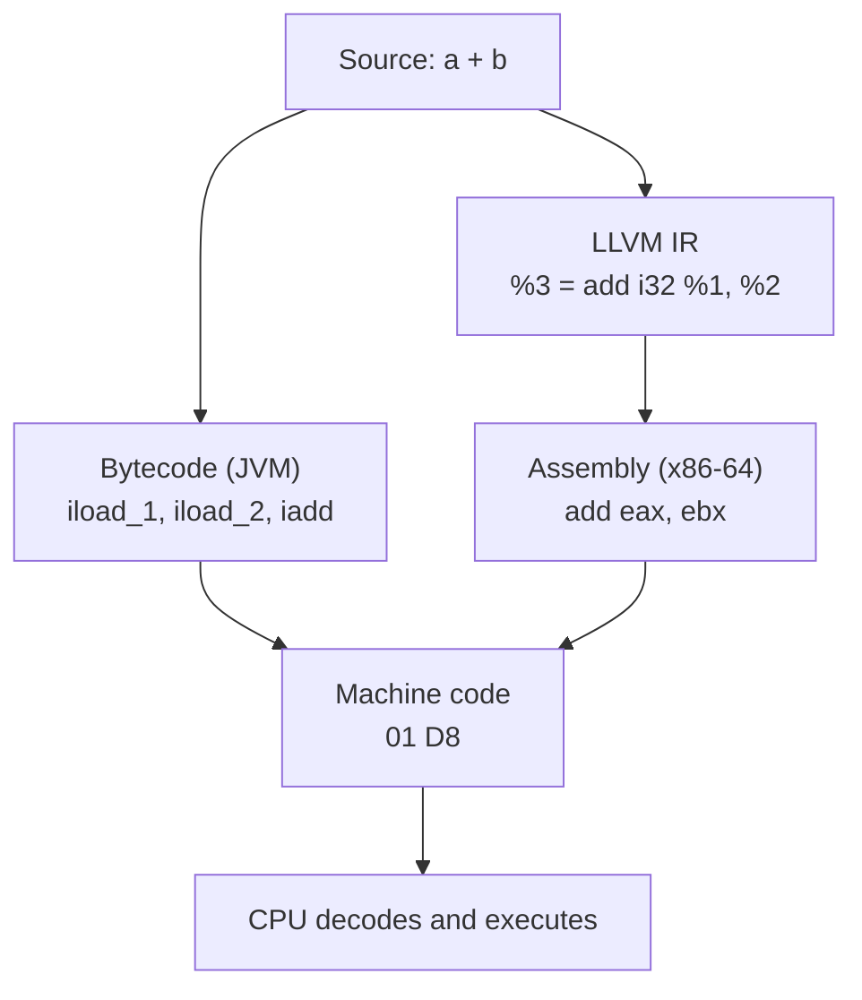

**4. Internal implementation**

- JVM bytecode: 1-byte opcodes (about 200 of them) on an **operand stack** + local variable slots per method frame.
- CPython bytecode: also stack-based; since 3.6 each instruction is 2 bytes ("wordcode"); 3.11+ adds **specialising** instructions (e.g. a fast path for adding two ints).
- LLVM IR: typed, register-based, infinite virtual registers in SSA form; the back end maps them to the CPU's real registers.

**5. Why is it designed this way?**

- **Bytecode** → "compile once, run anywhere"; smaller than source and faster to start than parsing text.
- **IR** → one optimiser serves many languages and CPUs.
- **Machine code** → fastest, but must be produced separately for each CPU and OS.

**6. Language differences**

- Java, Kotlin, Scala → JVM bytecode. C#, F#, VB.NET → CIL (Common Intermediate Language).
- Python → CPython bytecode (an internal detail; it changes between versions).
- JavaScript → V8 makes its own bytecode in memory; it is never shipped as a file.
- C, C++, Rust → LLVM IR or GCC's GIMPLE inside the compiler → machine code. Go → its own SSA IR → machine code.

**7. Practical example**

```java
int add(int a, int b) { return a + b; }
```

`javap -c` shows:

```text
iload_1   // push a
iload_2   // push b
iadd      // pop both, push a + b
ireturn   // return top of stack
```

After the method gets "hot", the JIT turns it into a single x86 `add` instruction.

**8. How can I observe it?**

- Java: `javap -c -p MyClass.class`.
- Python: `python -c "import dis; dis.dis(lambda a, b: a + b)"`.
- LLVM IR: `clang -S -emit-llvm file.c` → `file.ll`; Rust: `rustc --emit=llvm-ir`.
- Assembly and machine code: Compiler Explorer (godbolt.org) with "Output → Compile to binary".

---

### ❓ What are AOT, JIT and interpretation? How do they differ?

### 📝 Answer

**1. What is it?**
Three ways to get from code to CPU instructions:

- **Interpretation** — a program reads your code (or bytecode) and performs each step itself. No machine code for your program is produced.
- **JIT** (Just-In-Time) — while the program runs, frequently used ("hot") code is compiled to machine code.
- **AOT** (Ahead-Of-Time) — everything is compiled to machine code **before** the program runs.

**2. How does it work internally?**

- Interpreter: loop of fetch → decode → execute per bytecode instruction.
- JIT: the runtime **counts** how often each method or loop runs. Past a threshold it compiles it, using **profiling data** (real types and branches seen so far), and swaps the new machine code in.
- If an assumption breaks (e.g. a variable that was always an int becomes a string), the JIT **deoptimises**: it throws the optimised code away and goes back to the interpreter.
- AOT: the compiler optimises using only what it can prove from the source; the output is a native executable.

**3. Visual**

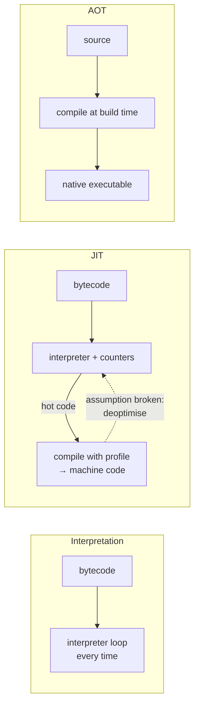

**4. Internal implementation**

- HotSpot JVM uses **tiered compilation**: interpreter → C1 (quick compile) → C2 (heavily optimised) for the hottest code. Compiled code is kept in the **code cache**.
- JIT-only optimisations: **inline caching** (remember the object type at a call site), **speculative inlining**, removing checks that profiling shows never fail.
- AOT cannot see runtime behaviour, so it compiles for all cases; **PGO** (Profile-Guided Optimisation) feeds a recorded profile back into an AOT build.

**5. Why is it designed this way?**

| | Interpretation | JIT | AOT |
|---|---|---|---|
| Start-up | Fast | Slow at first (warm-up) | **Fastest** |
| Peak speed | Slow | **Very fast** (uses real profile) | Fast |
| Memory | Low | Higher (compiler + code cache) | Low |
| Portability | High | High (bytecode) | One binary per OS/CPU |

Long-running servers like JIT (warm-up is paid once). Serverless functions, CLIs and mobile apps like AOT (fast start, less memory).

**6. Language differences**

- **Java** — interpreter + JIT (C1/C2). AOT via **GraalVM Native Image**.
- **C#** — JIT (RyuJIT, tiered since .NET Core 3). AOT via **ReadyToRun** or **Native AOT**.
- **JavaScript (V8)** — Ignition interpreter → Sparkplug → Maglev → TurboFan (more optimised at each tier).
- **Python (CPython)** — interpreter. An experimental JIT exists in 3.13+, **off by default**. PyPy is a separate JIT implementation.
- **PHP 8** — optional JIT in OPcache. **Ruby** — optional YJIT. **Erlang/Elixir** — BEAM JIT since OTP 24.
- **C, C++, Rust, Go** — AOT only.

**7. Practical example**

```java
for (int i = 0; i < 10_000_000; i++) total += i;
```

The first few thousand iterations are interpreted. HotSpot notices the hot loop and compiles it (even replacing it **while it is running**, called On-Stack Replacement), so the rest runs as tight machine code.

**8. How can I observe it?**

- `java -XX:+PrintCompilation MyApp` — prints each method as it is JIT-compiled (`%` marks an on-stack replacement).
- `node --trace-opt --trace-deopt app.js` — shows V8 optimising and deoptimising functions.
- Benchmark the same code twice in one run: the second run is faster on a JIT (warm-up). Use JMH for Java, not hand-written timing.

---

### ❓ How do JVM, CLR and JavaScript engines execute programs internally?

### 📝 Answer

**1. What is it?**
All three are **managed runtimes**: they load portable code (JVM bytecode, .NET IL, JavaScript source), run it with an interpreter and/or JIT, and manage memory with a garbage collector.

**2. How does it work internally?**

**JVM (HotSpot):**
1. **Class loader** finds `.class` files (from JARs) and loads them on first use.
2. **Verifier** checks the bytecode is safe (no stack overflows or illegal casts).
3. **Interpreter** runs the bytecode; counters track hot methods.
4. **JIT** (C1, then C2) compiles hot methods to machine code in the code cache.
5. **GC** (G1 by default) reclaims unreachable objects on the heap.

**CLR (.NET):**
1. Loads assemblies (`.dll`) containing IL + metadata.
2. JIT compiles each method **the first time it is called** (tier 0: quick), recompiling hot methods with full optimisation (tier 1).
3. Generational GC manages the managed heap.

**JavaScript engine (V8):**
1. **Parser** builds an AST (lazily: function bodies are parsed only when first called).
2. **Ignition** turns the AST into bytecode and interprets it, collecting type feedback.
3. **Sparkplug / Maglev / TurboFan** compile hot functions using that feedback.
4. **Orinoco GC** manages the heap; the event loop (from the browser or Node.js) decides what runs next.

**3. Visual**

```mermaid
flowchart TB
  subgraph JVM
    direction LR
    C1[".class files"] --> CL[Class loader] --> V[Verifier] --> INT[Interpreter]
    INT -- hot --> JIT1["JIT: C1 then C2"] --> CC[(Code cache)]
  end
  subgraph CLR
    direction LR
    D1[".dll: IL + metadata"] --> L2[Assembly loader] --> T0["JIT tier 0<br/>on first call"]
    T0 -- hot --> T1["JIT tier 1<br/>optimised"]
  end
  subgraph V8
    direction LR
    JS[".js source"] --> PA[Parser: AST] --> IG["Ignition<br/>bytecode + feedback"]
    IG -- hot --> TF["Maglev / TurboFan<br/>machine code"]
    TF -. deopt .-> IG
  end
```

**4. Internal implementation**

- **Objects in memory:** JVM objects have a header (mark word for locks and GC, plus a class pointer) followed by fields. V8 objects point to a **hidden class** ("map") that records the layout; objects created the same way share a map, so property access becomes a fixed offset.
- **Method calls:** JVM uses **vtables** for virtual calls plus inline caches; V8 uses inline caches keyed on the hidden class.
- **Memory areas (JVM):** heap (objects), one stack per thread (frames with locals), Metaspace (class metadata), code cache (JIT output).

**5. Why is it designed this way?**

- Portable code + JIT → good performance on any platform without shipping per-CPU binaries.
- Verification + GC → memory safety (no dangling pointers).
- Costs: warm-up time, more memory, GC pauses (much smaller with modern collectors such as ZGC).

**6. Language differences**

| | JVM | CLR | V8 |
|---|---|---|---|
| Input | Bytecode `.class` | IL in `.dll` | JavaScript source text |
| Typing | Static | Static | Dynamic: types learned at runtime |
| First execution | Interpreter | JIT tier 0 (no interpreter) | Ignition interpreter |
| AOT option | GraalVM Native Image | Native AOT, ReadyToRun | None for JS (snapshots only) |
| Threads | Real OS threads (plus virtual threads in Java 21) | OS threads + async/await | One JS thread per isolate + event loop |

**7. Practical example**

```js
function area(r) { return r.w * r.h; }
for (let i = 0; i < 1e6; i++) area({ w: i, h: 2 });   // same shape every call → fast
area({ h: 2, w: 3, d: 1 });                          // new shape → may deoptimise
```

V8 optimises `area` for objects with hidden class `{w, h}`. An object with a different shape breaks that assumption.

**8. How can I observe it?**

- JVM: `java -verbose:class` (class loading), `-XX:+PrintCompilation` (JIT), **VisualVM** or **JDK Mission Control** with JFR (heap, GC, threads).
- .NET: `dotnet-counters monitor` (GC, JIT stats), **ILSpy** (view IL).
- V8: `node --trace-opt --trace-deopt`, Chrome DevTools → **Memory** tab (heap snapshot) and **Performance** tab.

---

### ❓ How do programming languages interact with the CPU and memory?

### 📝 Answer

**1. What is it?**
In the end every language becomes CPU instructions that **load** data from memory into **registers**, compute, and **store** results back. Languages differ in how much of this they hide from you.

**2. How does it work internally?**

1. The OS loads the program and gives it a **virtual address space** (its own private view of memory).
2. The CPU runs a **fetch → decode → execute** cycle on instructions at the address in the **instruction pointer** register.
3. A load like `mov rax, [address]` asks for data: the **MMU** translates the virtual address to a physical one (using the **TLB**, a cache of translations), then the data comes from **L1 → L2 → L3 cache → RAM**, whichever has it first.
4. Calling a function pushes a **stack frame** (return address, local variables) onto the thread's stack.
5. `new` / `malloc` asks an **allocator** for a block on the **heap**; you get back an address (a pointer or reference).

**3. Visual**

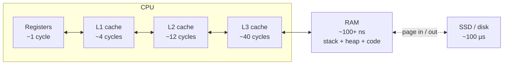

Process memory layout (one program):

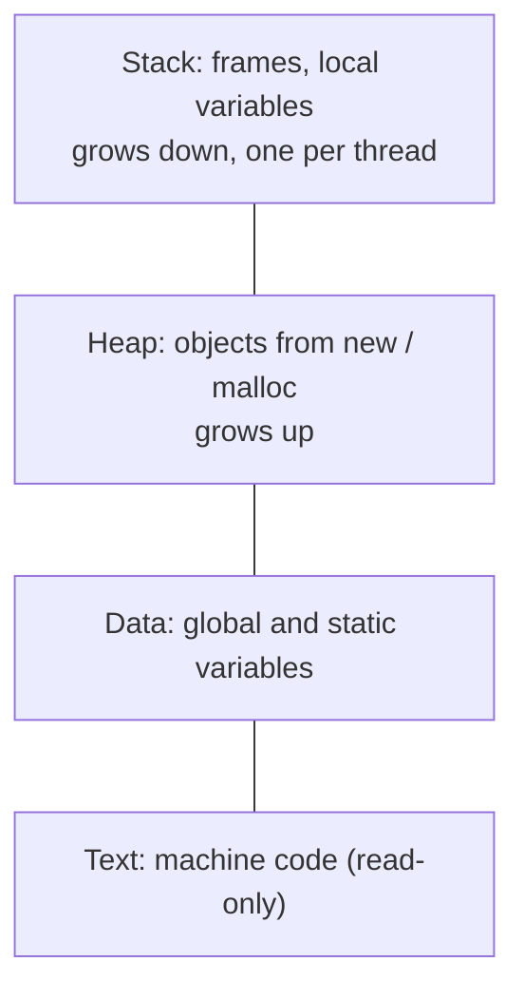

**4. Internal implementation**

- Caches move data in **64-byte lines**; reading one byte brings its neighbours too. That's why arrays (contiguous) are faster to scan than linked lists (scattered).
- The CPU can read **any** mapped address — "stack" and "heap" are just regions of the same virtual memory. The difference is **how** they are managed: the stack by moving a pointer on call/return, the heap by an allocator or GC.
- Memory is mapped in **pages** (usually 4 KB). Touching a page that isn't in RAM causes a **page fault**; the OS loads it, then the instruction retries.

**5. Why is it designed this way?**
RAM is ~100× slower than registers, so CPUs add layers of small, fast caches. Virtual memory isolates programs (one cannot read another's memory) and lets each program act as if it had the whole address space.

**6. Language differences**

| Language | You see addresses? | Who frees heap memory? | Layout control |
|---|---|---|---|
| C | Yes, raw pointers | You (`free`) | Full (structs, arrays) |
| C++ | Yes, plus smart pointers | Destructors (RAII) or you | Full |
| Rust | References checked by the compiler | Compiler-inserted `drop` (ownership) | Full |
| Go | Pointers, no arithmetic | GC | Good (structs are values) |
| Java / C# | References only | GC | Limited (objects on the heap; C# has value-type `struct`s) |
| Python / JavaScript | No | Python: reference counting + cycle GC; JS: GC | None |

**7. Practical example**

```java
void handle() {
    int count = 3;                      // in this frame on the thread's stack
    User u = new User("Asha");          // object on the heap; 'u' (a reference) on the stack
}                                       // frame popped; the User becomes garbage if nothing else points to it
```

**8. How can I observe it?**

- Windows **Task Manager** / **Process Explorer**: a process's working set (RAM in use) and page faults.
- Linux `perf stat -e cache-misses ./app` counts cache misses; compare looping over an array vs a linked list.
- Java: VisualVM heap view; `jcmd <pid> Thread.print` shows each thread's stack frames.

---

### ❓ How does frontend code (JavaScript, TypeScript, Dart, WebAssembly) become machine code in the browser?

### 📝 Answer

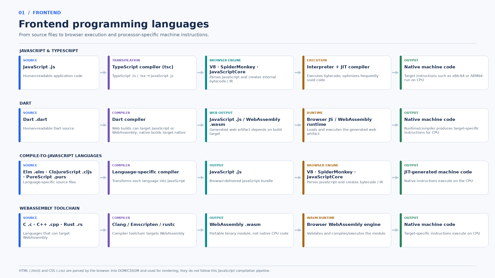

**1. What is it?**
Browsers run only two kinds of code: **JavaScript** and **WebAssembly** (`.wasm`). Every other frontend language is first compiled into one of those. HTML and CSS are **not** compiled this way; the browser parses them into the DOM and CSSOM for rendering.

**2. How does it work internally?**

- **JavaScript** — shipped as text. The engine (V8 in Chrome/Edge, SpiderMonkey in Firefox, JavaScriptCore in Safari) parses it → bytecode → interpreter → JIT for hot code → machine code.
- **TypeScript** — `tsc` (or esbuild/SWC) **removes the types** and outputs plain `.js`. The browser never sees TypeScript.
- **Dart** — compiled to JavaScript or WebAssembly for the web (native machine code for mobile/desktop apps).
- **Elm, ClojureScript, PureScript** — each has its own compiler that outputs JavaScript.
- **C, C++, Rust** — compiled (Clang/Emscripten, rustc) to `.wasm`, a portable binary. The browser validates it and compiles it to machine code.

**3. Visual**
See the image above. In short:

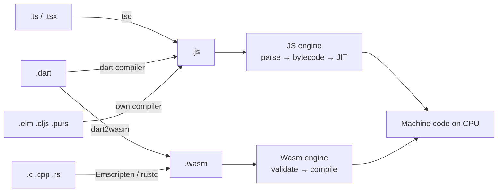

**4. Internal implementation**

- JavaScript is dynamically typed, so engines **learn types at runtime** (type feedback, hidden classes) and optimise for what they see.
- WebAssembly is **statically typed** and already low level, so the engine can compile it quickly with predictable speed: V8 compiles it first with **Liftoff** (fast baseline) and then **TurboFan** (optimised).
- Wasm runs in a sandbox with its own **linear memory** (one big byte array); it calls browser APIs through JavaScript.

**5. Why is it designed this way?**

- One universal target (JS) means every browser runs every language without plugins.
- WebAssembly was added for near-native speed (games, video, image editing) and to reuse existing C/C++/Rust code.
- Trade-off: JS is easier to debug and integrates directly with the DOM; Wasm is faster for heavy computation but can't touch the DOM directly.

**6. Language differences**
TypeScript only removes types: same runtime behaviour as the JS it emits. Dart, Elm and others bring their own runtime libraries in the bundle (bigger downloads). C/C++/Rust → Wasm bring their own memory management inside linear memory (no JS GC).

**7. Practical example**

```ts
const total: number = prices.reduce((sum, p) => sum + p, 0);
```

`tsc` output: `const total = prices.reduce((sum, p) => sum + p, 0);` — the `: number` is gone. V8 then interprets it, and if this line runs a lot, compiles it to machine code that adds numbers directly.

**8. How can I observe it?**

- `npx tsc file.ts` and open the generated `.js`: types are gone.
- Chrome DevTools → **Sources** (original code via source maps) and **Performance** (time spent compiling vs running scripts).
- Wasm: DevTools → Sources shows the module as text (WAT format); `wasm2wat file.wasm` from the WABT tools does the same offline.

---

### ❓ How do frontend frameworks (Angular, React, Vue, Svelte, Next.js) get from source code to running in the browser?

### 📝 Answer

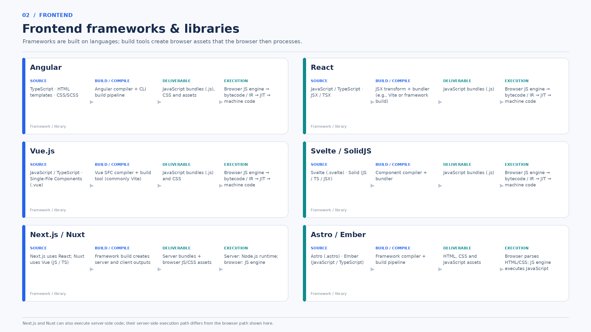

**1. What is it?**
Frameworks are libraries written **in** JavaScript/TypeScript. A **build tool** turns your components (templates, JSX, `.vue`, `.svelte` files) into plain JavaScript **bundles** plus CSS. The browser then runs those bundles like any other JavaScript.

**2. How does it work internally?**

1. **Compile components** — framework-specific step:
   - Angular: the Angular compiler turns HTML templates into JavaScript instructions (AOT, Ivy).
   - React: JSX `<Button />` becomes `jsx(Button, {})` function calls.
   - Vue: the SFC compiler turns `<template>` into a render function.
   - Svelte / SolidJS: compile components into **direct DOM updates** (no virtual DOM).
2. **Bundle** — Vite, esbuild, webpack or the Angular CLI join modules, remove unused code (tree shaking), minify, and split into chunks.
3. **Deliver** — the server sends `index.html`, `.js` bundles and `.css`.
4. **Execute** — the browser's JS engine runs the bundle; the framework's runtime creates the DOM and keeps it updated.

**3. Visual**
See the image above. The shared path:

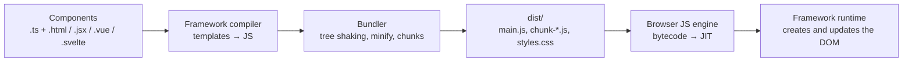

**4. Internal implementation**

| Framework | Compile output | How the page updates at runtime |
|---|---|---|
| Angular | Template instructions (Ivy) | Change detection (zone.js) or Signals |
| React | `jsx()` calls | Virtual DOM diff (reconciliation, Fiber) |
| Vue | Render functions | Proxy-based reactivity + virtual DOM |
| Svelte | Imperative DOM code | Compiled reactive assignments, no virtual DOM |
| SolidJS | Fine-grained DOM bindings | Signals update exact DOM nodes |
| Next.js / Nuxt | Server bundle + client bundle | Server renders HTML (Node.js); client **hydrates** it |

**5. Why is it designed this way?**

- Compiling templates ahead of time → smaller bundles, faster start, errors found at build time.
- Bundling → fewer, smaller requests; unused code removed.
- Virtual DOM (React, Vue) is simple and flexible but does diff work on every update; compile-time approaches (Svelte, Solid) do less runtime work but rely on a smarter compiler.

**6. Language / framework differences**
All of them end up as JavaScript run by the same engines (V8, SpiderMonkey, JavaScriptCore). The differences are **build-time output** and **runtime update strategy** (table above). Next.js and Nuxt also run code on the **server** in Node.js, which is a different execution path from the browser.

**7. Practical example**

```jsx
function Hello({ name }) { return <h1>Hello {name}</h1>; }
```

Build output (simplified): `function Hello({name}) { return jsx("h1", { children: ["Hello ", name] }); }`. At runtime React calls `Hello`, gets a virtual DOM object, compares it with the previous one, and updates only the changed text node.

**8. How can I observe it?**

- `ng build` or `vite build`, then open `dist/`: see the generated chunks and their sizes.
- `npx source-map-explorer dist/*.js` shows what code ended up in each bundle.
- Chrome DevTools → **Network** (what is downloaded), **Performance** (scripting vs rendering time); Angular DevTools / React DevTools show component trees and update timing.

---

### ❓ How do different programming languages implement compilation, execution and memory management?

### 📝 Answer

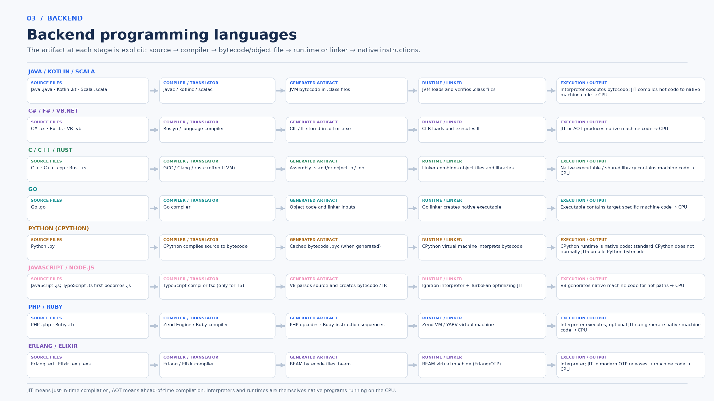

**1. What is it?**
Every language goes **source → translator → artifact → runtime or linker → native instructions**. The image shows the artifact at each stage. Languages differ in **which artifact** they produce, **when** machine code is generated, and **who frees memory**.

**2. How does it work internally?**

- **Java / Kotlin / Scala** → `javac` / `kotlinc` / `scalac` → `.class` bytecode → JVM verifies, interprets, JIT-compiles hot code.
- **C# / F# / VB.NET** → Roslyn / language compiler → IL in `.dll`/`.exe` → CLR JIT (or AOT) → machine code.
- **C / C++ / Rust** → GCC / Clang / rustc (often LLVM) → `.s` / `.o` → linker → native executable.
- **Go** → Go compiler → object code → Go linker → one native executable with the Go runtime inside.
- **Python (CPython)** → bytecode cached as `.pyc` in `__pycache__` → CPython VM interprets it.
- **JavaScript / Node.js** → (TypeScript via `tsc` first) → V8 bytecode → Ignition + TurboFan → machine code.
- **PHP / Ruby** → Zend opcodes / YARV instructions → their VM; optional JIT (PHP OPcache JIT, Ruby YJIT).
- **Erlang / Elixir** → `.beam` bytecode → BEAM VM (JIT since OTP 24).

**3. Visual**
See the image above. Grouped by strategy:

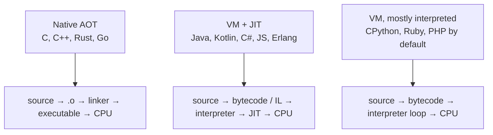

**4. Internal implementation — memory management**

| Language | Strategy | How it decides what to free |
|---|---|---|
| C | Manual | You call `free()`; mistakes → leaks or crashes |
| C++ | RAII + smart pointers | Destructor runs when an owner goes out of scope; `shared_ptr` counts references |
| Rust | Ownership + borrow checker | Compiler proves at **compile time** when a value is dropped; no GC |
| Go | Concurrent mark-and-sweep GC | Traces reachable objects while the program runs; short pauses |
| Java | Generational tracing GC (G1 default; ZGC, Shenandoah) | Marks objects reachable from GC roots |
| C# | Generational tracing GC (gen 0/1/2) | Same idea as Java |
| JavaScript (V8) | Generational GC (Orinoco) | Young generation copied often; old generation marked and compacted |
| Python (CPython) | **Reference counting** + cycle collector | Frees an object the moment its count hits 0; a separate GC finds cycles |
| Erlang / Elixir | Per-process heaps | Each lightweight process is garbage-collected separately |

**5. Why is it designed this way?**

- **Native AOT** (C, Rust, Go): fast start, low memory, predictable — good for systems, CLIs, containers.
- **VM + JIT** (Java, C#): portable, very fast once warm, rich tooling — good for long-running servers.
- **Interpreted VM** (Python, Ruby, PHP): simple, flexible, quick to develop — slower per instruction, so heavy work moves to C extensions.
- **GC vs manual vs ownership**: GC trades some CPU and pause time for safety and productivity; Rust gets safety without GC at the cost of a stricter compiler.

**6. Language differences**
The full comparison is the image plus the table above. Key point: the **same concept is not implemented the same way** — e.g. CPython frees memory by reference counting (deterministic), while Java and JavaScript use tracing GC (objects are freed some time after they become unreachable).

**7. Practical example**
The same "sum a list" function:

- **Rust** → compiled at build time to a loop of machine instructions; memory for the list is freed when it goes out of scope.
- **Java** → bytecode; interpreted first, then JIT-compiled to a similar loop; the list is freed by GC later.
- **Python** → bytecode run by the interpreter loop on every call; the list is freed as soon as its reference count reaches 0.

**8. How can I observe it?**

- See the artifacts: `javap -c` (Java), `python -m py_compile x.py` then look in `__pycache__`, `go build -o app && file app` (native binary), `ildasm` / ILSpy (.NET IL).
- See memory management: Java `-Xlog:gc`, Go `GODEBUG=gctrace=1 ./app`, Python `import sys; sys.getrefcount(obj)`.

---

### ❓ Do backend frameworks (Spring Boot, Django, Express, ASP.NET Core) compile code themselves?

### 📝 Answer

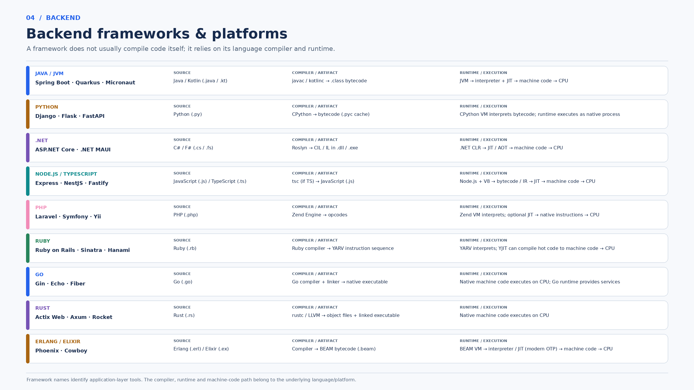

**1. What is it?**
**No.** A framework is a **library** (plus conventions and tools) that runs **on** a language's runtime. Compiling and executing are done by the language's compiler and runtime — Spring Boot uses `javac` and the JVM, Django uses CPython, Express uses Node.js/V8.

**2. How does it work internally?**

1. You write application code in the language (`.java`, `.py`, `.ts`).
2. The **language compiler** produces its normal artifact (`.class`, `.pyc`, `.js`).
3. The **runtime** (JVM, CPython, Node.js) starts and loads the framework's code like any other library.
4. The framework takes control: it reads configuration, creates objects, opens the HTTP port, and **calls your code** when requests arrive ("inversion of control").

**3. Visual**
See the image above. Who does what:

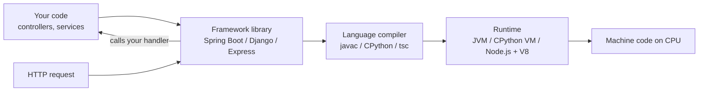

**4. Internal implementation**
Frameworks do their work **at runtime** using language features, not their own compiler:

- **Spring Boot** — scans classes, uses reflection and generated proxies (CGLIB) for `@Transactional`, starts embedded Tomcat.
- **Django / Flask / FastAPI** — Python decorators and URL routing tables map paths to functions; run under a WSGI/ASGI server (Gunicorn, Uvicorn).
- **Express / NestJS** — a middleware chain on Node's `http` module; NestJS adds DI using TypeScript decorators.
- **ASP.NET Core** — middleware pipeline on the Kestrel web server; built-in DI container.

Exceptions that **do** generate code at build time: Quarkus and Micronaut (pre-compute DI at build time), Spring AOT for GraalVM native images, and source generators in .NET.

**5. Why is it designed this way?**
Keeping compilation in the language means frameworks get every compiler and runtime improvement for free, and you can mix libraries freely. Build-time frameworks (Quarkus, Micronaut) move work from start-up to build time → faster start-up and less memory, at the cost of less runtime flexibility.

**6. Language / framework differences**

| Platform | Frameworks | Execution path |
|---|---|---|
| Java / JVM | Spring Boot, Quarkus, Micronaut | `javac` → `.class` → JVM interpreter + JIT |
| Python | Django, Flask, FastAPI | CPython → `.pyc` → interpreter |
| .NET | ASP.NET Core | Roslyn → IL → CLR JIT / AOT |
| Node.js | Express, NestJS, Fastify | `tsc` (if TS) → `.js` → V8 JIT |
| PHP | Laravel, Symfony | Zend opcodes → Zend VM (optional JIT) |
| Ruby | Rails, Sinatra | YARV instructions → VM (optional YJIT) |
| Go | Gin, Echo, Fiber | Native executable |
| Rust | Actix Web, Axum | Native executable |
| Erlang / Elixir | Phoenix, Cowboy | `.beam` → BEAM VM |

**7. Practical example**

```java
@RestController
class HelloController {
    @GetMapping("/hello") String hello() { return "Hi"; }
}
```

`javac` compiles this to `HelloController.class` like any class. At start-up, Spring scans it, sees `@GetMapping`, and registers `/hello` in its handler map. When a request arrives, Tomcat hands it to Spring's `DispatcherServlet`, which calls `hello()` — by then the JVM may have JIT-compiled it.

**8. How can I observe it?**

- `mvn package`, then `jar tf target/app.jar`: only ordinary `.class` files and libraries, no "Spring compiler" output.
- Start with `--debug` (Spring Boot) to see auto-configuration decisions; `java -verbose:class -jar app.jar` shows framework classes being loaded by the JVM.
- Django: `python -X importtime manage.py runserver` shows modules imported at start-up.
