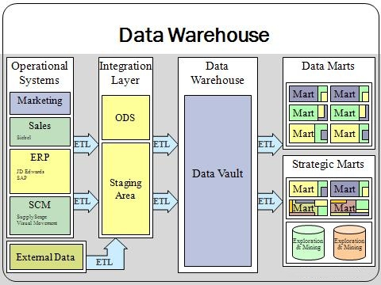
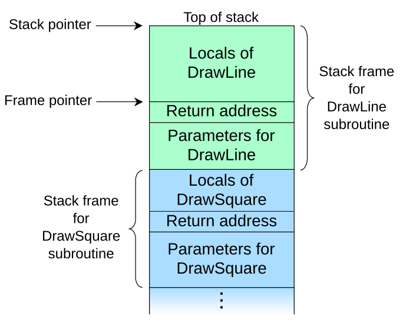
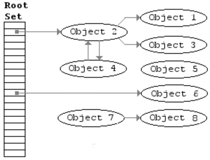
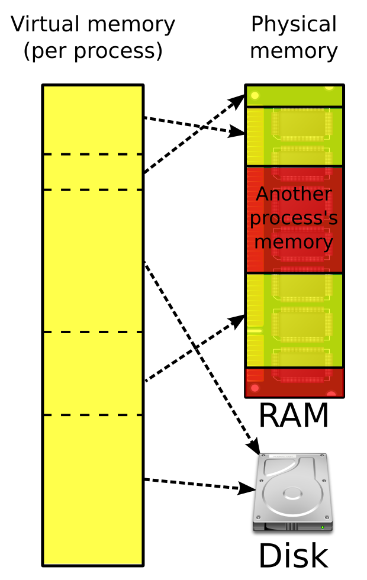

# 🧠 Memory & Data: Where a Program Keeps Its Data

## Where data lives: RAM, disk and many servers (the big picture)

### ❓ What is the difference between data structures, a database and a data warehouse?

**Generic answer:** Data structures organise data in a running program's memory, a database keeps it safely on disk, and a data warehouse collects years of data from many systems for analysis.

**Under the hood:**

Imagine an online shop. While a user is logged in, the app must find their cart in microseconds. Every order must survive a power cut. And once a year, management asks: "Which product sold best in each city over 5 years?" One storage method can't do all three well.

**Step 1: Fast, temporary — data structures in RAM**

The running app keeps live data in **data structures** (arrays, lists, hash maps, trees) in RAM. Very fast, but gone when the program stops. Example: a `HashMap` of logged-in users inside a Spring Boot app.

**Step 2: Safe, permanent — a database on disk**

Orders go to a **database management system** (MySQL, PostgreSQL). It stores tables on disk, adds indexes for fast search and transactions for safety.

**Step 3: Huge, historical — a data warehouse**

Data from the shop, payments and marketing systems is copied every night into a **data warehouse** (Snowflake, BigQuery), in tables built for big reports.

| Where the data lives | What organises it | Lasts | Example |
|---|---|---|---|
| **RAM** of one running program | **Data structures** | Until the program stops | Logged-in users map |
| **Disk/SSD** of a server | **Database (DBMS)** | Permanently | Every order |
| **Many servers**, from many systems | **Data warehouse** | Years of history | 5 years of sales |

**Analogy:** RAM = papers on your desk; database = your office filing cabinet; warehouse = the company's central archive.



_Image: [Wikimedia Commons](https://commons.wikimedia.org/wiki/File:Data_warehouse_overview.JPG) · Hhultgren · Public domain_

**Final understanding:** each layer trades speed for permanence and scale. **Need speed → RAM structures; need safety → database; need history and analysis → warehouse.**

---

### ❓ What is the difference between CPU cache, RAM and disk?

**Generic answer:** They are layers of memory: the closer to the CPU, the faster, smaller and more expensive. The CPU cache keeps recently used data right next to the CPU so it rarely waits for RAM.

**Under the hood:**

Imagine a CPU that can do one step every 0.3 nanoseconds. Reading from RAM takes ~100 ns. If every step had to wait for RAM, the CPU would sit idle 99% of the time.

**Step 1: The speed gap**

| Layer | Typical size | Speed (roughly) | Kept when power is off? |
|---|---|---|---|
| CPU registers | Bytes | Instant | No |
| CPU cache (L1/L2/L3) | KB – MB | ~1–10 ns | No |
| RAM | GBs | ~100 ns | No |
| SSD | 100s of GB – TBs | ~0.1 ms | Yes |
| Hard disk | TBs | ~10 ms | Yes |

**Step 2: Put a small fast memory next to the CPU**

The **CPU cache** keeps copies of recently used data. When the CPU needs a value, it checks L1, then L2, then L3, and only then RAM.

**Step 3: Read in chunks (cache lines)**

The cache never fetches one byte; it fetches a **64-byte cache line**. So reading `array[0]` also brings `array[1..15]` (for `int`s) for free.

**Step 4: Why your code's layout matters**

Programs mostly reuse recent data (**temporal locality**) and read neighbouring data (**spatial locality**). That's why looping over an `int[]` is much faster than walking a `LinkedList` whose nodes are scattered around memory.


_Image: [Wikimedia Commons](https://commons.wikimedia.org/wiki/File:ComputerMemoryHierarchy.svg) · Danlas · Public domain_

**Step 5: The same idea at bigger scale**

RAM is ~1,000× faster than SSD, so apps cache hot data in memory (Redis) and databases keep busy pages in RAM (the buffer pool).

**Final understanding:** caching works because programs reuse nearby and recent data. **Slow memory → keep a small fast copy close → fetch in chunks → most reads hit the fast copy.**

---

## Stack and heap: memory inside a running program (all languages)

### ❓ What are stack and heap memory?

**Generic answer:** The stack holds each method call's local variables and is freed automatically when the method returns; the heap holds objects shared across calls and is freed by the garbage collector (or by hand in C/C++).

**Under the hood:**

Imagine a method that runs, creates an order, and returns it to the caller. Its local counter can vanish when the method ends — but the order must live on. So memory needs two kinds of lifetime.

**Step 1: The stack — short-lived, per call**

Each thread has a **stack**. Every method call pushes a **frame** with its local variables and the return address. When the method returns, the frame is popped — instant cleanup.

**Step 2: The heap — long-lived, shared**

Objects created with `new` go on the **heap**, shared by all threads. They stay as long as something references them.

**Step 3: References connect the two**

```java
void placeOrder() {
    int qty = 2;                    // stack: a simple local value
    Order order = new Order(qty);   // 'order' (the reference) is on the stack;
}                                   // the Order object itself is on the heap
```



_Image: [Wikimedia Commons](https://commons.wikimedia.org/wiki/File:Call_stack_layout.svg) · R. S. Shaw · Public domain_

**Step 4: What goes wrong**

- `StackOverflowError` = too many nested calls (usually endless recursion).
- `OutOfMemoryError: Java heap space` = too many live objects.

**Final understanding:** **Short-lived locals → stack (auto-freed on return); objects that outlive a call → heap (freed by GC); references link them.**

---

### ❓ How does the JVM manage memory when you create an object?

**Generic answer:** The JVM loads the class into Metaspace, gives each method call a stack frame, allocates objects on the heap, and the garbage collector reclaims objects that are no longer reachable.

**Under the hood:**

Imagine you run:

```java
public class Employee {
    private String name;
    public static void main(String[] args) {
        Employee emp = new Employee();
        emp.setName("John");
    }
}
```

What actually happens in memory?

**Step 1: Compile**

`javac` turns the source into bytecode (`Employee.class`). The JVM runs bytecode, not `.java` files.

**Step 2: Load the class**

The first time `Employee` is needed, the **class loader** loads it, checks it (linking) and runs static initialisers. The class's metadata — methods, fields — goes into **Metaspace**.

**Step 3: Give `main` a stack frame**

The `main` thread gets a **stack frame** for `main()`. The local variable `emp` lives in that frame.

**Step 4: Allocate the object on the heap**

`new Employee()` reserves space on the **heap** (usually in a fast per-thread area of the "young" generation). `emp` now holds a **reference** to it.

```text
THREAD STACK            HEAP                     METASPACE
main() frame            Employee object          Employee class metadata
  emp ───────────────▶   name ──▶ "John"          (methods, fields)
```

**Step 5: The object becomes garbage**

If you write `emp = null;` and nothing else points to the object, it is **unreachable** — eligible for garbage collection.

**Step 6: GC reclaims it**

The GC finds unreachable objects and frees their memory for new allocations (see the next question).

**Step 7: Why separate areas?**

| Area | Holds | Lifetime |
|---|---|---|
| Heap | Objects and arrays | Until unreachable |
| Stack | Frames, local variables | Until the method returns |
| Metaspace | Class metadata | Until the class is unloaded |
| PC register | Current instruction per thread | Per thread |

**Final understanding:** each area matches a different lifetime. **Compile → load class (Metaspace) → call method (stack frame) → `new` (heap) → reference dropped → GC frees it.**

---

### ❓ How does garbage collection work?

**Generic answer:** The garbage collector finds objects your program can no longer reach and frees their memory automatically.

**Under the hood:**

Imagine a web app that creates millions of small objects per minute — request DTOs, strings, lists. If nobody freed them, memory would fill in minutes. Freeing by hand (as in C) causes crashes and leaks. So the runtime does it.

**Step 1: Start from the roots**

"Roots" are things that are definitely alive: local variables on thread stacks, static fields, active threads.

**Step 2: Mark**

Follow every reference from the roots, marking each object reached.

**Step 3: Sweep / compact**

Anything not marked is garbage — free it. Often live objects are moved together so free memory is one block (no gaps).



_Image: [Wikimedia Commons](https://commons.wikimedia.org/wiki/File:Animation_of_the_Naive_Mark_and_Sweep_Garbage_Collector_Algorithm.gif) · M17 · CC0_

**Step 4: Be smart — generations**

Most objects die young. So the heap has a **young generation** (collected often and cheaply — a "minor GC") and an **old generation** (collected rarely — a "major/full GC").

**Step 5: Keep pauses short**

Collection can briefly pause the app. Modern collectors (Java's **G1**, **ZGC**) do most work alongside the app, so pauses are a few milliseconds.

**Common trap:** a memory leak in a GC language = objects still referenced by mistake, e.g. a static `Map` that only grows.

**Final understanding:** **Too many objects to free by hand → find what's reachable from roots → free the rest → collect young objects often, old ones rarely.**

---

### ❓ What is virtual memory?

**Generic answer:** Each program gets its own private address space; the operating system maps those addresses to real RAM in pages and can move rarely used pages to disk.

**Under the hood:**

Imagine Chrome, IntelliJ and Spotify all running. If they all used real RAM addresses directly, a bug in one could overwrite another's data — and each would need to know which RAM is free.

**Step 1: Give every program its own address space**

Each process sees memory starting at address 0, as if it had the whole machine to itself.

**Step 2: Split memory into pages**

Memory is managed in fixed-size **pages** (usually 4 KB).

**Step 3: Translate addresses**

A **page table** maps each virtual page to a physical page in RAM. The CPU's MMU does this translation on every access (with a small cache, the TLB).

**Step 4: Use disk as overflow**

Rarely used pages can be moved to disk (the **page file / swap**). If the program touches them again, the OS brings them back (a **page fault**).



_Image: [Wikimedia Commons](https://commons.wikimedia.org/wiki/File:Virtual_memory.svg) · Ehamberg · CC BY-SA 3.0_

**Trap:** when the system keeps moving pages to and from disk ("thrashing"), everything gets very slow.

**Final understanding:** **Programs sharing one RAM → private virtual addresses → page tables map to real RAM → disk as overflow.** Result: isolation, plus more memory than physically free.
