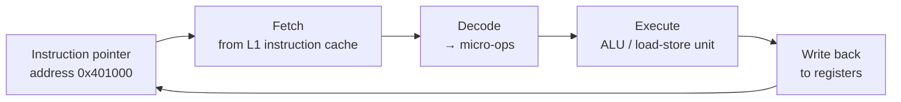
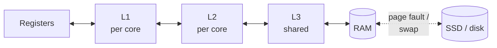
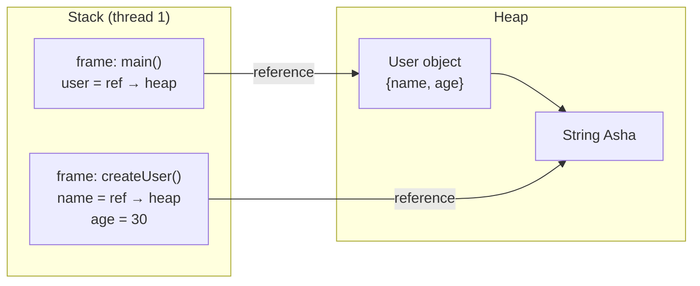
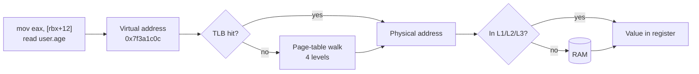
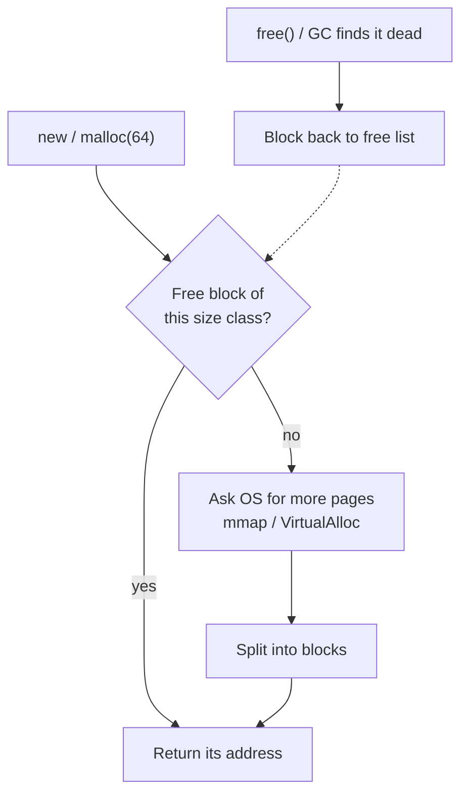
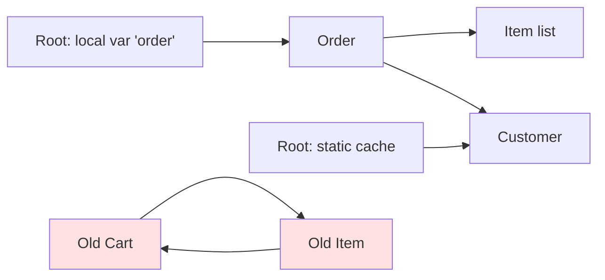
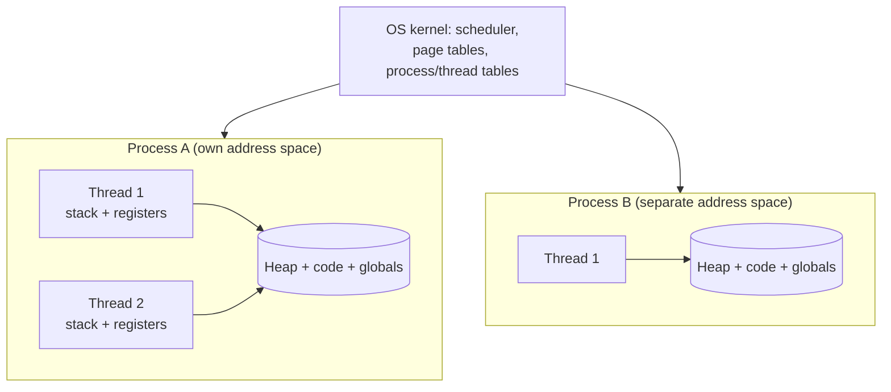
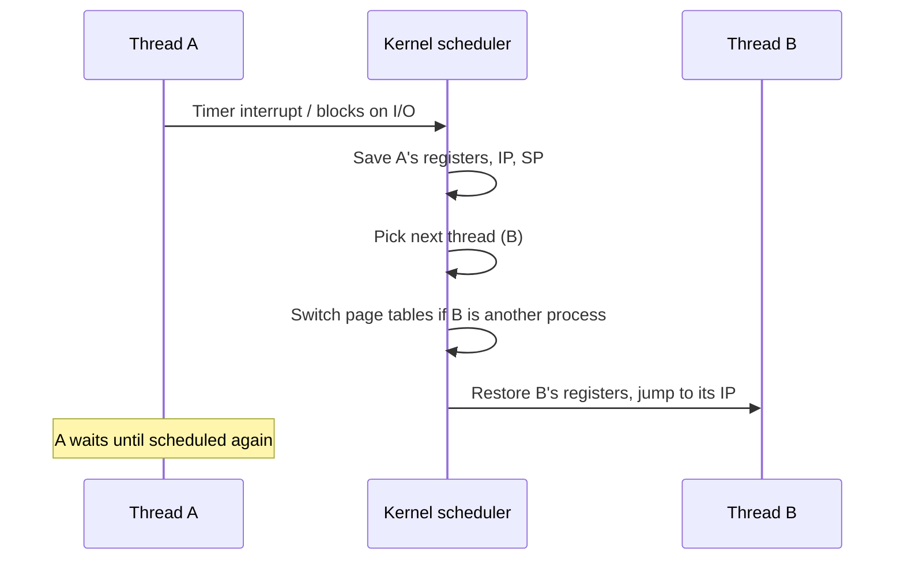
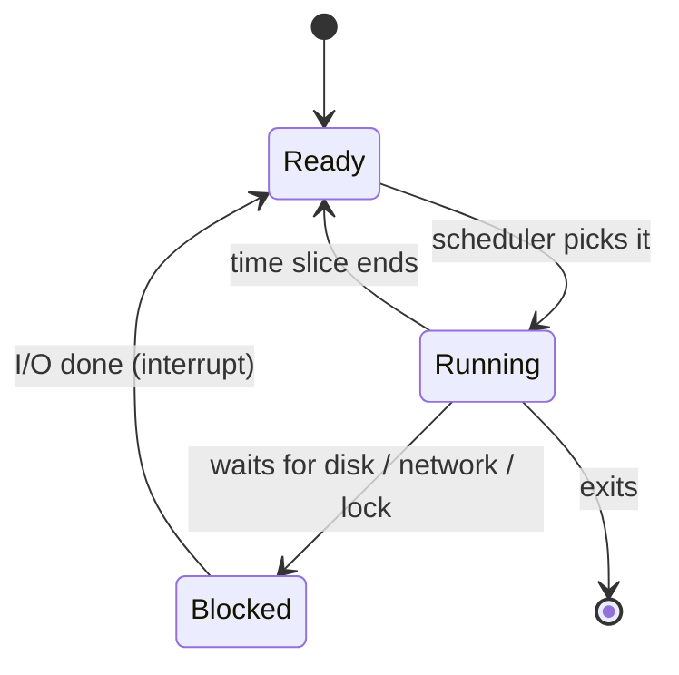
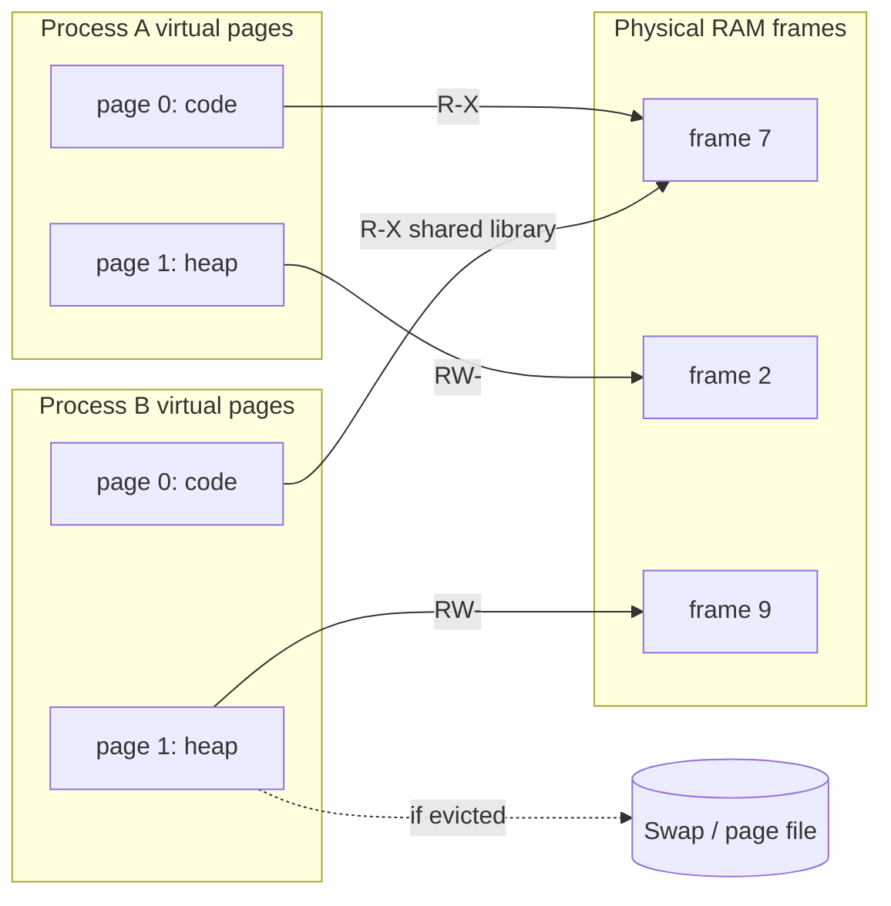

# 🔩 Under the Hood: Operating System, CPU & Memory

How the CPU runs instructions, how memory is organised and protected, and how the OS runs many programs at once.

## CPU and Memory Hierarchy

### ❓ How does a CPU execute instructions?

### 📝 Answer

**1. What is it?**
A CPU repeatedly **fetches** an instruction from memory, **decodes** what it means, and **executes** it (add, compare, load, store, jump). Billions of times per second.

**2. How does it work internally?**

1. **Fetch** — read the instruction at the address in the **instruction pointer** (RIP on x86-64, PC on ARM).
2. **Decode** — work out the operation and operands; x86 instructions are split into simpler **micro-ops**.
3. **Execute** — the **ALU** (arithmetic unit) computes, or the load/store unit talks to memory.
4. **Write back** — the result goes into a **register**.
5. The instruction pointer moves to the next instruction (or jumps, for `if`/loops/calls).

**3. Visual**



**4. Internal implementation**

- **Pipelining** — like an assembly line: while one instruction executes, the next is decoded and the one after is fetched.
- **Out-of-order execution** — the CPU runs later instructions early if their inputs are ready, then commits results in program order (reorder buffer).
- **Branch prediction** — the CPU guesses which way an `if` goes and runs ahead; a wrong guess flushes the pipeline (~15–20 cycles lost).
- **Superscalar** — several execution units, so 4+ instructions can finish per cycle.

**5. Why is it designed this way?**
Clock speeds stopped rising around 4–5 GHz, so CPUs get faster by doing more work per cycle (pipelines, out-of-order, multiple cores). Cost: complex hardware, and speculation enabled security bugs like Spectre.

**6. Language differences**
The CPU doesn't know the language. C, Rust and Go run as native instructions; Java, C# and JavaScript run as JIT-generated native instructions for hot code; CPython's interpreter loop is itself native code that executes your bytecode.

**7. Practical example**

```java
for (int x : data) if (x >= 128) sum += x;
```

On **sorted** data the branch is predictable and the loop is several times faster than on random data — same instructions, different branch prediction.

**8. How can I observe it?**

- Linux `perf stat ./app` → `instructions`, `cycles` (IPC = instructions per cycle), `branch-misses`.
- Compiler Explorer (godbolt.org) shows the instructions; Intel VTune / AMD uProf show pipeline stalls.

---

### ❓ How do CPU registers, L1/L2/L3 cache, RAM and disk interact?

### 📝 Answer

**1. What is it?**
A **memory hierarchy**: small and fast near the CPU, big and slow further away. Data moves up the hierarchy when it is used.

| Level | Typical size | Typical latency |
|---|---|---|
| Registers | ~16 general-purpose (x86-64) | ~0.3 ns |
| L1 cache (per core) | 32–64 KB | ~1 ns |
| L2 cache (per core) | 256 KB–2 MB | ~3–5 ns |
| L3 cache (shared) | 8–64 MB | ~10–20 ns |
| RAM | 8–128 GB | ~80–100 ns |
| SSD | TBs | ~50–100 µs |

**2. How does it work internally?**

1. An instruction needs data at an address.
2. Check **L1** → miss → **L2** → miss → **L3** → miss → **RAM**.
3. The data comes back as a whole **64-byte cache line** and is stored in each level on the way.
4. If the page isn't in RAM at all, a **page fault** makes the OS read it from disk.

**3. Visual**



**4. Internal implementation**

- Caches are **set-associative**: an address maps to a small set of slots; the oldest line in the set is evicted (approximate LRU).
- **Write-back**: writes go to the cache and reach RAM later, when the line is evicted.
- **Cache coherence (MESI protocol)**: when one core writes a line, other cores' copies are invalidated, so all cores see the same value.
- **Prefetchers** detect sequential access and fetch the next lines early.

**5. Why is it designed this way?**
Fast memory is expensive and must be physically close to the core. Most programs reuse recent data (**temporal locality**) and nearby data (**spatial locality**), so small caches catch most accesses (often 95%+ hit rate).

**6. Language differences**
Languages that lay data out **contiguously** (C/C++/Rust/Go structs and arrays, Java `int[]`) use caches well. A Java `ArrayList<Integer>` or Python list holds **pointers** to objects scattered on the heap → more cache misses.

**7. Practical example**

```java
int[][] m = new int[4096][4096];
for (int i...) for (int j...) sum += m[i][j];   // row by row: fast (sequential)
for (int j...) for (int i...) sum += m[i][j];   // column by column: often 5-10x slower (cache misses)
```

**8. How can I observe it?**

- `perf stat -e cache-references,cache-misses ./app` (Linux); Intel VTune memory analysis.
- `lscpu` (Linux) or Task Manager → Performance → CPU shows your L1/L2/L3 sizes.

---

### ❓ What exactly is stored in Stack and Heap memory?

### 📝 Answer

**1. What is it?**
Two regions of a program's memory:

- **Stack** — one per thread. Holds **call frames**: local variables, parameters, return addresses. Freed automatically when a function returns.
- **Heap** — shared by all threads. Holds data whose size or lifetime isn't tied to one function call (objects, arrays, strings).

**2. How does it work internally?**

1. Calling a function pushes a **frame**: the **stack pointer** register just moves down by the frame size.
2. Locals live in that frame (or in registers).
3. `new` / `malloc` asks the heap allocator for a block and returns its **address**.
4. Returning pops the frame (stack pointer moves back). Heap blocks stay until freed (manually, by ownership rules or by GC).

**3. Visual**



**4. Internal implementation**

- Stack allocation = one pointer subtraction: extremely fast, no fragmentation. Size is fixed per thread (e.g. 512 KB–1 MB default for Java threads; `-Xss`). Too deep recursion → **StackOverflowError**.
- Heap allocation needs an allocator (free lists, size classes) or a GC with bump-pointer allocation.
- **Java**: primitives and references in frames live on the stack; all objects on the heap. The JIT's **escape analysis** can avoid heap allocation for objects that never leave a method.

**5. Why is it designed this way?**
Most data is short-lived and tied to a call → the stack handles it for free. Data that must outlive a call or be shared needs the heap, which is flexible but costs allocation time and cleanup.

**6. Language differences**

| Language | Stack | Heap |
|---|---|---|
| C / C++ | Locals, structs, arrays by value | `malloc` / `new`; you free it |
| Rust | Values by default | `Box`, `Vec`, `String`; freed by ownership |
| Go | Compiler decides by **escape analysis** | Escaping values; GC frees |
| Java | Primitives + references | All objects; GC frees |
| C# | Locals, value types (`struct`) | Class instances; GC frees |
| Python / JS | Interpreter's own frames | Essentially every value is a heap object |

**7. Practical example**

```java
int total(int[] prices) {          // 'prices' (a reference) is in this frame
    int sum = 0;                   // 'sum' in this frame (or a register)
    for (int p : prices) sum += p;
    return sum;                    // frame popped; the array stays on the heap while referenced
}
```

**8. How can I observe it?**

- Java: IntelliJ debugger "Frames" (stack) and "Variables"; VisualVM heap dump (heap).
- Chrome DevTools: Sources → Call Stack panel; Memory → heap snapshot.
- Go: `go build -gcflags=-m` prints which variables "escape to heap".

---

### ❓ Can the CPU directly access heap memory? How does a program access objects in RAM?

### 📝 Answer

**1. What is it?**
**Yes.** The heap is ordinary memory; the CPU reads it with normal load/store instructions. But every address a program uses is a **virtual address** that hardware translates to a physical RAM address.

**2. How does it work internally?**

1. Your variable holds a **reference/pointer** = a virtual address (e.g. `0x7f3a1c00`).
2. Reading `user.age` becomes: load from `address + offset of age`.
3. The **MMU** (Memory Management Unit) translates virtual → physical, first checking the **TLB** (a cache of recent translations).
4. TLB miss → the hardware walks the **page tables** (4 levels on x86-64).
5. With the physical address, the data comes from L1/L2/L3 or RAM.

**3. Visual**



**4. Internal implementation**

- An object is a block of bytes; each field sits at a **fixed offset** decided by the compiler/runtime (Java object header ~12–16 bytes, then fields).
- Java uses **compressed oops**: 32-bit references scaled ×8, so heaps up to ~32 GB use half the memory per reference.
- Moving GCs relocate objects and **update every reference** to them, so references stay valid.

**5. Why is it designed this way?**
Virtual addresses give each process a private, protected address space and let the OS place pages anywhere in RAM (or on disk). The TLB keeps translation cheap for the common case.

**6. Language differences**

- **C/C++** — raw pointers; pointer arithmetic allowed; invalid pointers → crashes or security bugs.
- **Rust** — references checked at compile time; raw pointers only in `unsafe`.
- **Java / C# / Go / JS / Python** — references you can't do arithmetic on; runtime prevents invalid access (`NullPointerException` instead of reading random memory).

**7. Practical example**

```java
User u = new User("Asha", 30);   // u = reference (address) to a heap object
int a = u.age;                   // JIT emits: load [u + offset_of_age]
```

**8. How can I observe it?**

- Java: **JOL** (Java Object Layout) prints field offsets and object sizes: `ClassLayout.parseClass(User.class).toPrintable()`.
- C: `printf("%p", &x)` prints virtual addresses; run twice — ASLR changes them.
- Linux `perf stat -e dTLB-load-misses ./app`.

---

### ❓ How does memory allocation and deallocation work?

### 📝 Answer

**1. What is it?**
**Allocation** = finding a free block of memory big enough for new data. **Deallocation** = returning it so it can be reused. Done by an **allocator** (C/C++/Rust) or a **managed runtime** (Java, C#, Go, JS, Python).

**2. How does it work internally?**

1. The program asks for N bytes (`malloc(64)`, `new User()`).
2. The allocator looks in its **free lists** / **size classes** for a fitting block.
3. If none, it asks the OS for more memory (`mmap`/`brk` on Linux, `VirtualAlloc` on Windows), in big chunks.
4. It returns the block's address.
5. On free (or when GC finds it dead), the block goes back to a free list (or the region is reclaimed in bulk).

**3. Visual**



**4. Internal implementation**

- **malloc** (glibc ptmalloc, jemalloc, tcmalloc, mimalloc): size classes, per-thread caches to avoid locks, large blocks straight from `mmap`.
- **JVM**: each thread gets a **TLAB** (Thread-Local Allocation Buffer); allocating is a **bump pointer** — add the size to a pointer. Almost as fast as stack allocation.
- **Fragmentation**: free memory split into small holes. Compacting GCs (Java, .NET, V8) move live objects together to fix it; `malloc` can't move blocks.

**5. Why is it designed this way?**
Asking the OS for every allocation would be very slow (system calls), so allocators grab large chunks and manage them in user space. Bump-pointer + compacting GC makes allocation cheap, at the cost of GC work later.

**6. Language differences**

| Language | Allocate | Free |
|---|---|---|
| C | `malloc` | `free` (manual) |
| C++ | `new`, `make_unique` | `delete` or destructor (RAII) |
| Rust | `Box::new`, `Vec` | Automatic `drop` when owner goes out of scope |
| Java / C# | `new` (TLAB bump pointer) | Tracing GC |
| Go | Compiler escape analysis + size-class allocator | Concurrent GC |
| Python | `pymalloc` for small objects | Reference count hits 0 (+ cycle GC) |

**7. Practical example**

```c
char *buf = malloc(1024);   // allocator returns a block address
strcpy(buf, "hi");
free(buf);                  // block returns to the free list
// using buf now = "use after free" bug
```

**8. How can I observe it?**

- C/C++: **Valgrind** or AddressSanitizer (`-fsanitize=address`) find leaks and use-after-free.
- Java: VisualVM / JFR "Allocation" view; `-Xlog:gc` shows heap before/after each GC.
- Windows: Process Explorer → Private Bytes growing steadily = possible leak.

---

### ❓ How does Garbage Collection identify unused objects?

### 📝 Answer

**1. What is it?**
A **garbage collector** frees heap objects the program can no longer use, so you don't call `free`. "Unused" means **unreachable**: no chain of references leads to it from the running program.

**2. How does it work internally?**
Tracing GC (Java, C#, Go, JavaScript):

1. Start from **GC roots**: local variables in thread stacks, static fields, CPU registers, JNI handles.
2. **Mark** every object reachable by following references.
3. Everything not marked is garbage → **sweep** (add to free list) or **compact/copy** live objects together.

Reference counting (CPython): each object counts references to it; at 0 it is freed immediately; a separate cycle detector handles A↔B loops.

**3. Visual**



Red objects reference each other but nothing reachable points to them → garbage (a tracing GC frees cycles).

**4. Internal implementation**

- **Tri-colour marking**: white (not seen), grey (seen, children not scanned), black (done). Lets marking run **concurrently** with the program.
- **Write barriers**: small code the JIT adds to every reference write, so the GC notices changes made while it marks.
- **Generational GC**: most objects die young, so the **young generation** is collected often by copying survivors; **card tables** track old→young references so the GC doesn't scan the whole old generation.

**5. Why is it designed this way?**
Reachability is safe: an unreachable object can never be used again. Generations make collection cheap because young garbage is cheap to discard. Costs: CPU time, extra memory headroom, and pauses (modern collectors like ZGC keep them to around a millisecond).

**6. Language differences**

| Runtime | Method |
|---|---|
| Java (HotSpot) | Generational tracing: G1 default; ZGC, Shenandoah for low pause |
| C# (.NET) | Generational tracing (gen 0/1/2 + large object heap) |
| Go | Concurrent mark-sweep, **non-generational**, non-moving |
| JavaScript (V8) | Generational: young gen copying (Scavenger), old gen mark-compact (Orinoco) |
| Python (CPython) | Reference counting + generational cycle collector |
| Rust / C / C++ | No GC (ownership / manual / RAII) |

**7. Practical example**

```java
List<byte[]> cache = new ArrayList<>();   // static field → a GC root
void handle() {
    byte[] tmp = new byte[1024];          // unreachable after return → collected
    cache.add(new byte[1024]);            // reachable from the root forever → "memory leak" in Java
}
```

**8. How can I observe it?**

- Java: `-Xlog:gc*` or VisualVM "Monitor" tab (heap sawtooth = normal GC); heap dump → Eclipse MAT "dominator tree" finds what keeps objects alive.
- Chrome DevTools → Memory → compare two heap snapshots to find leaks.
- Python: `import gc; gc.get_count()`; `sys.getrefcount(obj)`.

---

## Processes, Threads and Scheduling

### ❓ How do Processes and Threads work internally?

### 📝 Answer

**1. What is it?**

- **Process** — a running program with its **own** virtual address space, open files and resources. Isolated from other processes.
- **Thread** — a path of execution **inside** a process. Threads share the process's memory (heap, code) but each has its **own stack and registers**.

**2. How does it work internally?**

1. Starting a program: the OS creates a process (`fork`+`exec` on Linux, `CreateProcess` on Windows), sets up its page tables, loads the code, and starts the **main thread**.
2. Creating a thread (`pthread_create`, `new Thread().start()`): the OS allocates a stack and a **thread control block** (saved registers, state, priority).
3. The **scheduler** picks which threads run on which CPU cores.

**3. Visual**



**4. Internal implementation**

- Linux represents both as `task_struct`; threads are tasks that share the same memory map (`clone` with `CLONE_VM`).
- Each process has its own **page tables** → address `0x1000` in A and in B are different physical memory.
- Threads talk through shared memory (needs locks); processes talk through **IPC**: pipes, sockets, shared memory segments.

**5. Why is it designed this way?**
Processes give **isolation** (a crash or bug in one can't corrupt another). Threads give **cheap concurrency** within one program (shared data, no copying). Trade-off: shared memory → race conditions; processes → heavier and slower to communicate.

**6. Language differences**

| Language | Concurrency unit | Maps to |
|---|---|---|
| Java | `Thread` (platform); **virtual threads** (Java 21) | 1 OS thread; many virtual threads on few OS threads |
| C# | Threads + `async/await` tasks on a thread pool | OS threads |
| Go | **Goroutines** | Many goroutines on few OS threads (M:N scheduler) |
| JavaScript | One main thread + event loop; Web Workers / worker_threads | Each worker = separate thread + isolate |
| Python | Threads, but the **GIL** lets one run Python code at a time (optional free-threaded build since 3.13); `multiprocessing` for CPU work | OS threads / processes |
| Rust / C++ | `std::thread` | OS threads |

**7. Practical example**
A Spring Boot app is **one process** (the JVM) with many threads: Tomcat request threads (`http-nio-8080-exec-1…`), GC threads, JIT compiler threads.

**8. How can I observe it?**

- Windows **Process Explorer**: a process → Properties → Threads tab.
- Java: `jcmd <pid> Thread.print` or VisualVM → Threads.
- Linux: `ps -eLf` (threads), `top -H -p <pid>`.

---

### ❓ How does Context Switching happen?

### 📝 Answer

**1. What is it?**
A **context switch** is the OS pausing one thread on a CPU core and resuming another. The "context" is everything needed to continue later: registers, instruction pointer, stack pointer.

**2. How does it work internally?**

1. Trigger: a **timer interrupt** (time slice used up), the thread **blocks** (waiting for I/O or a lock), or a higher-priority thread becomes ready.
2. The CPU jumps into the kernel and saves the current thread's registers into its kernel data.
3. The **scheduler** picks the next thread to run.
4. If it belongs to a **different process**, the CPU switches page tables (CR3 register on x86).
5. The new thread's registers are restored and it continues exactly where it stopped.

**3. Visual**



**4. Internal implementation**

- Linux scheduler: **CFS** (Completely Fair Scheduler) for years, replaced by **EEVDF** in kernel 6.6; it picks the thread that has had the least fair share of CPU.
- Direct cost: ~1–5 µs. Hidden cost: the new thread finds cold **caches and TLB** (PCID on x86 avoids a full TLB flush).
- Switching between threads of the **same** process is cheaper (no page-table switch).

**5. Why is it designed this way?**
Preemption (forced switching) means one busy or stuck thread can't freeze the whole machine. The cost is overhead — which is why thousands of OS threads perform badly, and why runtimes added lightweight threads.

**6. Language differences**
User-space scheduling avoids kernel switches: **Go goroutines**, **Java virtual threads**, **Kotlin coroutines**, **C#/JS/Python async** switch tasks inside the runtime when they wait, which is much cheaper than an OS context switch.

**7. Practical example**
A Tomcat thread calls a slow database. While it waits on the socket, the OS switches that core to another request thread. With Java 21 virtual threads, the JVM instead **unmounts** the virtual thread and runs another one on the same OS thread — no OS context switch.

**8. How can I observe it?**

- Linux: `vmstat 1` (column `cs` = context switches/second), `pidstat -w`.
- Windows: Performance Monitor → "Context Switches/sec"; Process Explorer → thread "Context Switch Delta".

---

### ❓ How does an operating system execute multiple applications simultaneously?

### 📝 Answer

**1. What is it?**
Two mechanisms combined:

- **Parallelism** — different threads run **at the same instant** on different CPU cores.
- **Time-sharing (concurrency)** — each core switches between threads every few milliseconds, so it *looks* simultaneous.

**2. How does it work internally?**

1. Every thread is either **running**, **ready** (waiting for a core) or **blocked** (waiting for I/O, a lock, a timer).
2. The scheduler keeps **run queues** of ready threads per core.
3. Each core runs a thread until its time slice ends, it blocks, or something more important arrives.
4. Blocked threads use no CPU; when their I/O completes, an interrupt moves them back to ready.

**3. Visual**



**4. Internal implementation**

- Per-core run queues + **load balancing** that moves threads between cores.
- **Priorities** and fairness (Linux EEVDF, Windows priority-based preemptive scheduler with boosts for the foreground window).
- **DMA** (Direct Memory Access): disks and network cards copy data into RAM without the CPU, then raise an interrupt.

**5. Why is it designed this way?**
Most programs spend most time **waiting** (user input, disk, network). Giving the CPU to someone else while waiting keeps cores busy and the UI responsive.

**6. Language differences**
At OS level every language's threads are scheduled the same way. The difference is **how many OS threads** a program uses: Node.js uses one main thread plus a small pool; Java/C# traditionally one thread per request; Go multiplexes goroutines onto ~one OS thread per core.

**7. Practical example**
An 8-core laptop running Chrome, IntelliJ and Spotify may have **3,000+ threads**, but at most 8 (or 16 with hyper-threading) run at any instant; the rest are ready or, mostly, blocked.

**8. How can I observe it?**

- Windows Task Manager → Performance → CPU: "Processes", "Threads" counts and per-core graphs.
- Linux `htop`: per-core usage; `uptime` load average = average number of running + ready threads.

---

## Virtual Memory

### ❓ How do Virtual Memory, Paging and Memory Protection work?

### 📝 Answer

**1. What is it?**

- **Virtual memory** — each process sees its own private address space, as if it had all memory to itself.
- **Paging** — that space is split into fixed-size **pages** (usually 4 KB) mapped to physical **frames** in RAM, or not loaded at all.
- **Memory protection** — each page has permissions (read/write/execute, user/kernel), enforced by hardware.

**2. How does it work internally?**

1. The OS builds **page tables** for each process: virtual page → physical frame + permission bits.
2. On every access, the MMU translates the address (cached in the TLB).
3. Page **not present** → **page fault** → the OS loads it (from the executable, a file, or swap), updates the table, retries the instruction.
4. Permission violated (write to read-only, execute data, user touching kernel memory) → the OS kills the access: **segmentation fault** / **access violation**.

**3. Visual**



**4. Internal implementation**

- x86-64 uses **4-level page tables** (5-level on newer CPUs), each level indexed by 9 bits of the address.
- Permission bits: Present, Read/Write, User/Supervisor, **NX** (no-execute — stops running code injected into data).
- **Copy-on-write**: after `fork`, parent and child share pages until one writes.
- **ASLR**: code, stack and heap are placed at random addresses to make exploits harder.

**5. Why is it designed this way?**
Isolation (one program can't read another's memory), simple programming (every process starts from the same layout), sharing (one copy of a library in RAM for all processes), and the ability to use more memory than RAM via swap — though heavy swapping makes everything very slow ("thrashing").

**6. Language differences**
All languages run on top of it. Managed runtimes **reserve** large virtual ranges up front (the JVM reserves `-Xmx` worth of address space) but only touch pages as needed. A C buffer overflow can corrupt memory **within** its own process; protection only stops crossing into pages that are unmapped or forbidden.

**7. Practical example**

```c
int *p = NULL;
*p = 5;   // address 0 is never mapped → page fault → OS sends SIGSEGV → "Segmentation fault"
```

In Java the same mistake becomes a `NullPointerException`: the JVM catches the hardware fault and turns it into an exception.

**8. How can I observe it?**

- Windows Task Manager → Details: "Memory (private working set)" vs "Commit size"; Resource Monitor → "Hard Faults/sec".
- Linux: `cat /proc/<pid>/maps` (memory regions + permissions), `/usr/bin/time -v ./app` (page faults).
