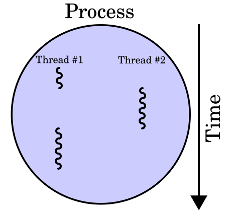
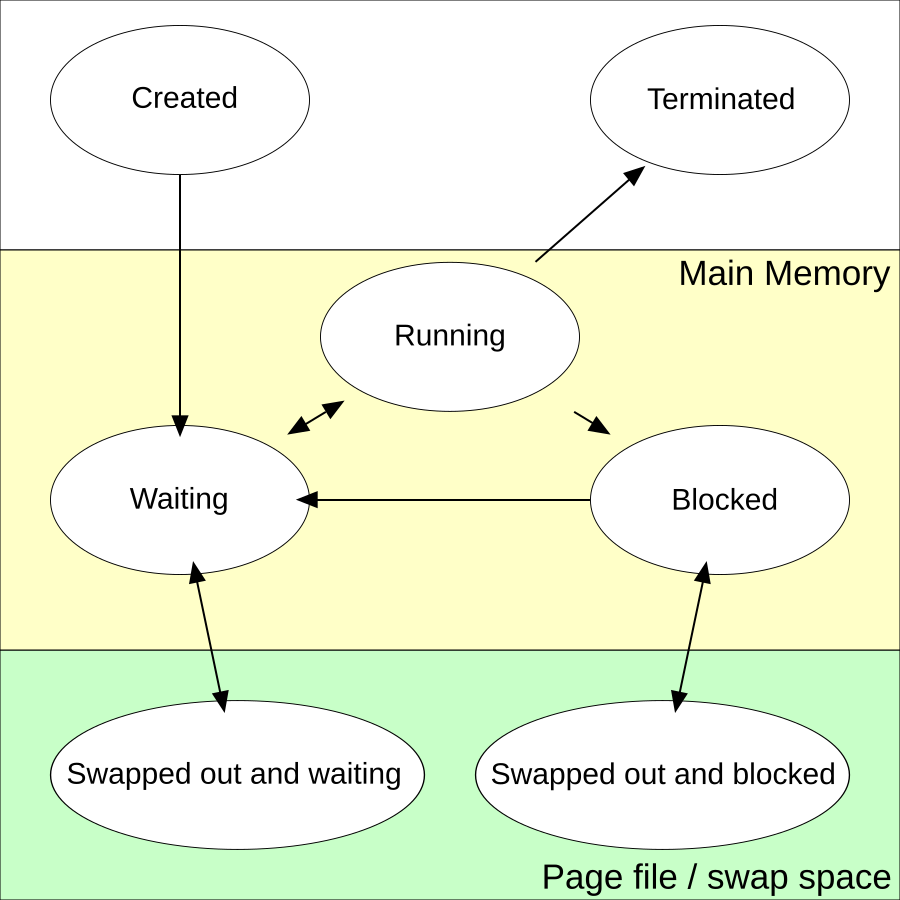

# 🔀 Running Many Things at Once: Processes & Threads

## Processes and threads (operating system, all languages)

### ❓ What is the difference between a process and a thread?

- A **process** is a running program with its **own memory**. Chrome, IntelliJ and your Spring Boot app are separate processes; one crashing doesn't break the others.
- A **thread** is a path of execution **inside** a process. Threads of the same process **share its memory** (the heap) but each has its own stack.

**Analogy:** a process is a **restaurant kitchen**; threads are the **cooks** in it. Cooks share the same fridge and stove (memory), so they work together quickly — but two cooks grabbing the same pan at once causes trouble (a race condition).



_Image: [Wikimedia Commons](https://commons.wikimedia.org/wiki/File:Multithreaded_process.svg) · Cburnett · CC BY-SA 3.0_

| | Process | Thread |
|---|---|---|
| Memory | Its own | Shared with other threads |
| Cost to create | High | Low |
| Crash affects | Only itself | The whole process |
| Talks to others via | Network, files, pipes | Shared variables (needs locking) |

**Example:** Tomcat (inside Spring Boot) is **one process** that serves many requests at once, each on a **thread** from its thread pool.

---

### ❓ What is context switching?

A CPU core runs one thread at a time. To make many threads look simultaneous, the operating system's **scheduler** gives each a short time slice, then **saves** its state (registers, position) and **loads** the next thread's state. That save-and-load is a **context switch**.



_Image: [Wikimedia Commons](https://commons.wikimedia.org/wiki/File:Process_states.svg) · A3r · Public domain_

- Each switch costs a few microseconds and empties useful CPU caches.
- **Too many threads** → the CPU spends more time switching than working. That's why servers use **thread pools** of a sensible size instead of one thread per request forever.
- Java 21 **virtual threads** are very cheap, because the JVM switches them on a few real OS threads.

---

### ❓ What is the difference between concurrency and parallelism?

- **Concurrency:** dealing with many tasks **in overlapping time** — switching between them, even on one core. *One cook preparing three dishes by switching between them.*
- **Parallelism:** doing many tasks **at the same instant** on multiple cores. *Three cooks each making one dish.*

**Examples:**
- Node.js handles thousands of requests **concurrently** on one thread (the event loop switches while waiting for I/O).
- A Java `parallelStream()` sums a huge list **in parallel** across CPU cores.

---

### ❓ What is a race condition, and how do you prevent it?

A race condition happens when two threads change shared data at the same time and the result depends on timing.

```java
count++;   // looks like one step, but is three: read, add 1, write back
```

Two threads both read `5`, both write `6` — one increment is lost.

**Prevent it by:**
- Not sharing data (each thread works on its own copy).
- Atomic types: `AtomicInteger.incrementAndGet()`.
- Locks: `synchronized` or `ReentrantLock` around the critical section.
- Thread-safe collections: `ConcurrentHashMap`.

The same idea applies in databases (two users booking the last seat), where transactions and locks solve it.
