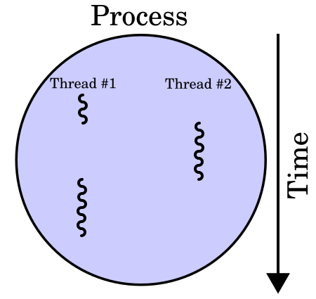
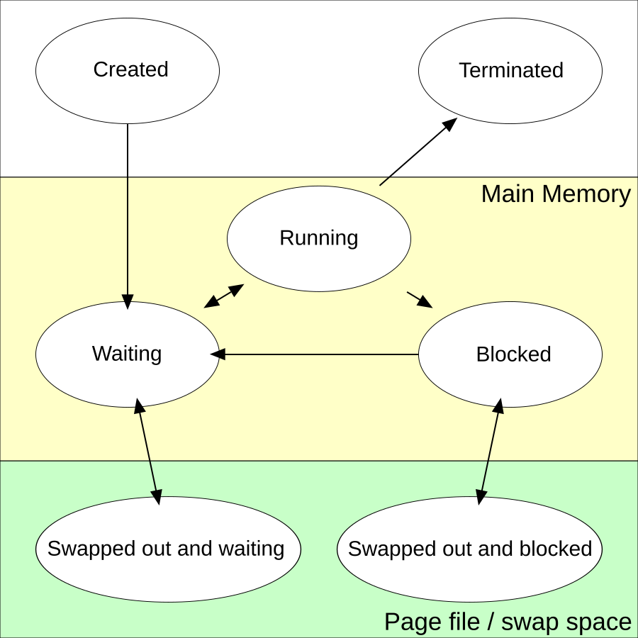

# 🔀 Running Many Things at Once: Processes & Threads

## Processes and threads (operating system, all languages)

### ❓ What is the difference between a process and a thread?

**Generic answer:** A process is a running program with its own memory; a thread is a path of execution inside a process, sharing that memory with the process's other threads.

**Under the hood:**

Imagine Tomcat serving 200 users at once. Starting 200 separate programs would waste memory, and they couldn't easily share a cache. Doing everything in one sequence would make users wait in line. We need "many workers, one shared workspace".

**Step 1: The process — a protected box**

The OS gives each running program (Chrome, IntelliJ, your Spring Boot app) its own **process**: private memory, open files, at least one thread. One process crashing doesn't break the others.

**Step 2: Threads — workers inside the box**

A process can run several **threads**. They share the heap and code but each has its **own stack** and registers.

**Analogy:** a process is a **restaurant kitchen**; threads are the **cooks**. They share the fridge and stove (memory), so they work together quickly — but two cooks grabbing the same pan causes trouble (a race condition).



_Image: [Wikimedia Commons](https://commons.wikimedia.org/wiki/File:Multithreaded_process.svg) · Cburnett · CC BY-SA 3.0_

**Step 3: Compare the costs**

| | Process | Thread |
|---|---|---|
| Memory | Its own | Shared with other threads |
| Cost to create | High | Low |
| Crash affects | Only itself | The whole process |
| Talks to others via | Network, files, pipes | Shared variables (needs locking) |

**Step 4: In practice**

Tomcat (inside Spring Boot) is **one process**; each request runs on a **thread** from its thread pool.

**Final understanding:** **Need isolation → separate processes; need cheap parallel workers sharing data → threads in one process (plus locking).**

---

### ❓ What is context switching?

**Generic answer:** The OS saves one thread's state and loads another's so many threads can share a CPU core; each switch costs time.

**Under the hood:**

Imagine a 4-core laptop running 2,000 threads. Only 4 can run at any instant — yet everything seems to run at once. How?

**Step 1: Time slices**

The OS **scheduler** gives each thread a short slice of CPU time (a few milliseconds).

**Step 2: Save and load**

When a slice ends or a thread waits for I/O, the OS **saves** its registers and position, then **loads** the next thread's. That's a **context switch**.



_Image: [Wikimedia Commons](https://commons.wikimedia.org/wiki/File:Process_states.svg) · A3r · Public domain_

**Step 3: The hidden cost**

Each switch takes microseconds and pushes useful data out of CPU caches. With **too many threads**, the CPU spends more time switching than working — that's why servers use **thread pools** of sensible size.

**Step 4: The modern fix**

Java 21 **virtual threads** are switched by the JVM on a few OS threads, which is far cheaper.

**Final understanding:** **More threads than cores → time slices → save/load state (context switch) → too many switches waste CPU.**

---

### ❓ What is the difference between concurrency and parallelism?

**Generic answer:** Concurrency is handling many tasks in overlapping time (even on one core); parallelism is running many tasks at the same instant on several cores.

**Under the hood:**

Imagine a single cook with three dishes, versus three cooks with one dish each. Both finish three dishes — differently.

**Step 1: Concurrency — switching**

One worker juggles tasks: starts the rice, chops while it boils, stirs the sauce while waiting. Useful when tasks spend time **waiting**.
*Example:* Node.js serves thousands of requests on one thread; the event loop switches while each waits for I/O.

**Step 2: Parallelism — at the same time**

Several workers on several cores each run a task simultaneously. Useful when tasks need **CPU**.
*Example:* Java's `parallelStream()` sums a huge list across all cores.

**Step 3: Combined**

A Spring Boot server is both: many requests concurrently, spread over several cores in parallel.

**Final understanding:** **Waiting-heavy work → concurrency (switch while waiting); CPU-heavy work → parallelism (more cores at once).**

---

### ❓ What is a race condition, and how do you prevent it?

**Generic answer:** Two threads change shared data at the same time and the result depends on timing; prevent it with no sharing, atomic operations, locks or thread-safe collections.

**Under the hood:**

Imagine a page-view counter at 5. Two requests arrive at the same moment and both do `count++`. You expect 7. You get 6.

**Step 1: One line, three steps**

```java
count++;   // read count, add 1, write back
```

**Step 2: The bad interleaving**

Thread A reads 5. Thread B reads 5. A writes 6. B writes 6. One increment is lost.

**Step 3: Make the update safe**

- **Don't share:** each thread works on its own copy.
- **Atomic types:** `AtomicInteger.incrementAndGet()` does read-add-write as one CPU instruction (compare-and-swap).
- **Locks:** `synchronized` or `ReentrantLock` let only one thread into the critical section.
- **Thread-safe collections:** `ConcurrentHashMap`.

**Step 4: Same problem, bigger scale**

Two users booking the last seat is a race condition in the database — transactions and row locks solve it.

**Final understanding:** **Shared data + unsynchronised read-modify-write → lost updates → fix by not sharing, atomics or locks.**
