# 🔩 Under the Hood: Frontend & Browser Internals

What a browser does from the moment you type a URL until pixels appear — and how JavaScript, storage, tabs and workers run inside it.

## Loading and Rendering a Page

### ❓ What happens internally when we enter a URL and open a website?

### 📝 Answer

**1. What is it?**
The browser turns a URL into a running page: find the server, connect securely, download HTML, then download and process everything the HTML needs.

**2. How does it work internally?**

1. **Parse the URL** — scheme, host, path. Check **HSTS** (force HTTPS) and the **HTTP cache**.
2. **DNS** — resolve `shop.com` to an IP (browser cache → OS → resolver).
3. **Connect** — TCP handshake + **TLS** handshake (or **QUIC** for HTTP/3, which combines both).
4. **Request** — `GET /` with headers and cookies.
5. **Response** — status, headers, HTML bytes (often compressed with gzip/brotli).
6. **Render** — the renderer parses HTML, finds CSS/JS/images and fetches them, builds the page and paints it.

**3. Visual**

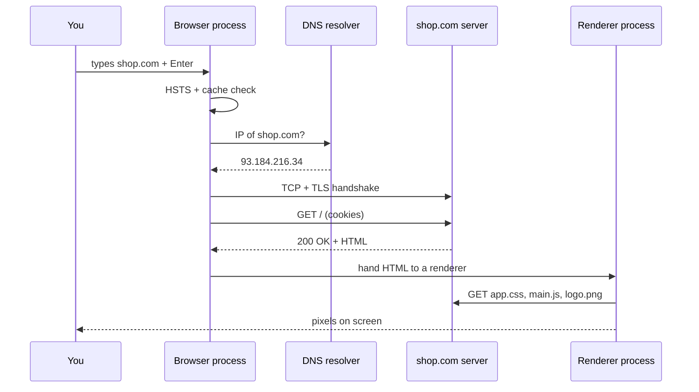

**4. Internal implementation**

- Chrome is **multi-process**: a **browser process** (UI, navigation), a **network service** (all HTTP), **renderer processes** (one per site, sandboxed), and a **GPU process**.
- The **preload scanner** reads ahead in the HTML to start downloading CSS/JS/images early, even while the main parser is blocked.
- Connections are reused (HTTP keep-alive, HTTP/2 multiplexing) so later requests skip the handshakes.

**5. Why is it designed this way?**
Separate processes isolate sites from each other (security) and keep one crashing tab from taking down the browser. Caching at every step (DNS, HTTP, connections) avoids repeating slow network round-trips.

**6. Framework differences**
A **server-rendered** page (Next.js, Spring MVC + Thymeleaf) arrives as ready HTML → fast first paint. A **single-page app** (Angular, React SPA) arrives as an almost empty HTML shell → content appears only after JavaScript downloads and runs.

**7. Practical example**
Opening an Angular app: `index.html` (~1 KB) → `main-HASH.js`, `polyfills-HASH.js`, `styles-HASH.css` → Angular bootstraps → calls `GET /api/products` → renders the product list.

**8. How can I observe it?**
Chrome DevTools → **Network** tab: click a request → **Timing** shows DNS, connect, SSL, waiting (TTFB) and download. `chrome://net-internals/#dns` shows the DNS cache.

---

### ❓ How does a browser convert HTML, CSS and JavaScript into a rendered webpage?

### 📝 Answer

**1. What is it?**
The **critical rendering path**: bytes → structured trees → layout → pixels. HTML and CSS are **parsed**, JavaScript is **executed**, and the results are combined into what you see.

**2. How does it work internally?**

1. **HTML** bytes → characters → **tokens** → **DOM** tree (Document Object Model).
2. **CSS** → **CSSOM** (CSS Object Model): rules with selectors.
3. A `<script>` without `async`/`defer` **pauses HTML parsing** until it downloads and runs (it might change the DOM).
4. Scripts also wait for pending CSS (they might read styles), so CSS indirectly blocks too.
5. DOM + CSSOM → **style** → **layout** → **paint** → **composite** (see the next question).

**3. Visual**

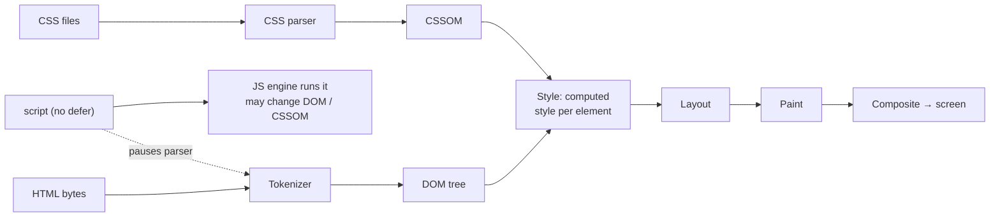

**4. Internal implementation**

- The HTML parser is a **state machine** defined by the HTML standard; it is very forgiving (fixes unclosed tags).
- `defer` scripts run in order **after** parsing; `async` scripts run **as soon as they download**, in any order; `type="module"` is deferred by default.
- CSS is **render-blocking**: the browser won't paint until the CSSOM is ready, to avoid showing unstyled content.

**5. Why is it designed this way?**
JavaScript can call `document.write` or change the DOM, so the parser must stop for classic scripts to stay correct. This is why scripts go at the end of `<body>` or use `defer`.

**6. Framework differences**
SPAs (Angular, React, Vue) put almost everything in JavaScript, so the critical path is mostly "download + run JS". **SSR** frameworks (Next.js, Nuxt, Angular SSR) send ready HTML, then **hydrate** (attach event handlers) when the JS arrives.

**7. Practical example**

```html
<head>
  <link rel="stylesheet" href="app.css">     <!-- render-blocking -->
  <script src="analytics.js"></script>      <!-- parser-blocking: avoid -->
  <script src="main.js" defer></script>     <!-- runs after parsing: good -->
</head>
```

**8. How can I observe it?**
DevTools → **Performance** → record a reload: see "Parse HTML", "Evaluate Script", "Recalculate Style", "Layout", "Paint". **Lighthouse** lists render-blocking resources.

---

### ❓ How do DOM, CSSOM, Render Tree, Layout and Paint work together?

### 📝 Answer

**1. What is it?**
The stages that turn parsed content into pixels:

- **DOM** — what elements exist. **CSSOM** — which styles apply.
- **Render tree / layout tree** — only the **visible** elements, each with its computed style.
- **Layout** (reflow) — exact position and size of each box.
- **Paint** — draw commands (text, colours, borders, images).
- **Composite** — combine painted **layers** on the GPU into the final frame.

**2. How does it work internally?**

1. **Style**: match CSS selectors to each DOM node → computed style.
2. **Layout tree**: skip `display: none` nodes and `<head>`; add pseudo-elements like `::before`.
3. **Layout**: compute geometry top-down (a parent's width decides children's widths; children's heights decide the parent's height).
4. **Paint**: record display lists per layer.
5. **Raster + composite**: turn display lists into pixels (often on the GPU) and stack the layers.

**3. Visual**

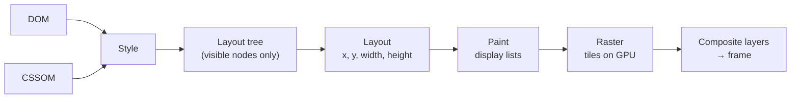

**4. Internal implementation**

- Changing **geometry** (`width`, `top`, adding nodes) → layout + paint + composite (expensive).
- Changing **only colours** (`color`, `background`) → paint + composite.
- Changing **`transform` or `opacity`** on its own layer → **composite only** (cheap, runs on the compositor thread even when the main thread is busy).
- **Layout thrashing**: reading `offsetHeight` right after writing styles forces a synchronous layout; doing it in a loop is very slow.

**5. Why is it designed this way?**
Separating stages lets the browser redo only the stages a change affects. Layers + a separate compositor thread keep scrolling and animations smooth at 60–120 fps.

**6. Framework differences**
Frameworks only change the **DOM**; the browser pipeline after that is identical. Good frameworks **batch** DOM writes to avoid repeated layouts.

**7. Practical example**

```js
// Slow: forces layout on every iteration
items.forEach(el => { el.style.width = box.offsetWidth + "px"; });
// Fast: read once, then write
const w = box.offsetWidth;
items.forEach(el => { el.style.width = w + "px"; });
```

**8. How can I observe it?**
DevTools → **Performance**: purple = style/layout, green = paint. **Rendering** panel → "Paint flashing" (green flashes show repainted areas) and "Layer borders". **Layers** panel shows compositor layers.

---

## JavaScript in the Browser

### ❓ How does JavaScript execute inside a browser?

### 📝 Answer

**1. What is it?**
Each page runs its JavaScript on **one main thread** inside the renderer process, using the JS engine (V8, SpiderMonkey, JavaScriptCore). The same thread also does style, layout and paint, so long JavaScript blocks the page.

**2. How does it work internally?**

1. The engine compiles the script (parse → bytecode; JIT for hot code).
2. It creates a **global execution context** (global object `window`, global scope).
3. Each function call creates an **execution context** pushed on the **call stack**: its scope, `this`, and arguments.
4. Before running a scope, the engine sets up its declarations: `function` declarations and `var` are **hoisted**; `let`/`const` exist but are in the **temporal dead zone** until their line runs.
5. Browser features (`setTimeout`, `fetch`, DOM events) are **Web APIs** provided by the browser, not the engine.

**3. Visual**

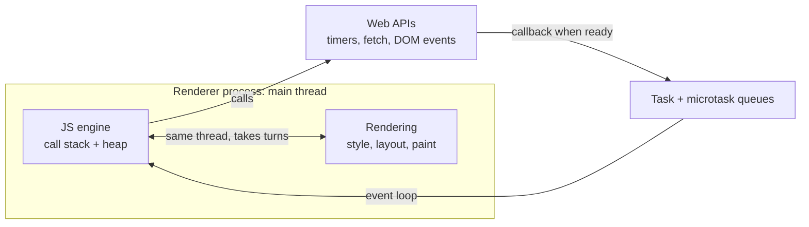

**4. Internal implementation**

- **Scopes** are stored as context objects; closures keep a reference to the outer context, which is why captured variables stay alive.
- DOM objects are C++ objects in the browser; JS gets **wrapper objects** that call into C++ (bindings).
- Each tab/iframe origin has its own **realm** (separate globals) and the engine **isolate** owns the heap.

**5. Why is it designed this way?**
A single thread for DOM access means no locks or race conditions on the page. The cost: CPU-heavy JS freezes the UI, so heavy work belongs in Web Workers.

**6. Language differences**
TypeScript runs exactly like the JavaScript it compiles to. WebAssembly runs on the same main thread (unless in a worker) but can't touch the DOM directly — it calls JS for that.

**7. Practical example**

```js
console.log(typeof greet);   // "function" (hoisted)
console.log(x);              // undefined (var hoisted, value not yet assigned)
console.log(y);              // ReferenceError (let: temporal dead zone)
var x = 1; let y = 2;
function greet() {}
```

**8. How can I observe it?**
DevTools → **Sources**: breakpoints, **Call Stack** and **Scope** panels show execution contexts and closures. **Performance** → long yellow "Task" bars over 50 ms = UI-blocking JavaScript.

---

### ❓ How do Call Stack, Event Loop, Microtask Queue and Task Queue work?

### 📝 Answer

**1. What is it?**

- **Call stack** — the functions currently running.
- **Task queue** (macrotasks) — callbacks from timers, events, network, `MessageChannel`.
- **Microtask queue** — promise callbacks (`.then`, code after `await`), `queueMicrotask`, `MutationObserver`.
- **Event loop** — the rule that decides what runs next.

**2. How does it work internally?**
One turn of the event loop:

1. Take the **oldest task** from a task queue and run it until the call stack is empty.
2. Run **all microtasks** — including ones added while running microtasks — until the queue is empty.
3. If it's time for a new frame (~16.7 ms at 60 Hz): run `requestAnimationFrame` callbacks, then style → layout → paint.
4. Repeat.

**3. Visual**

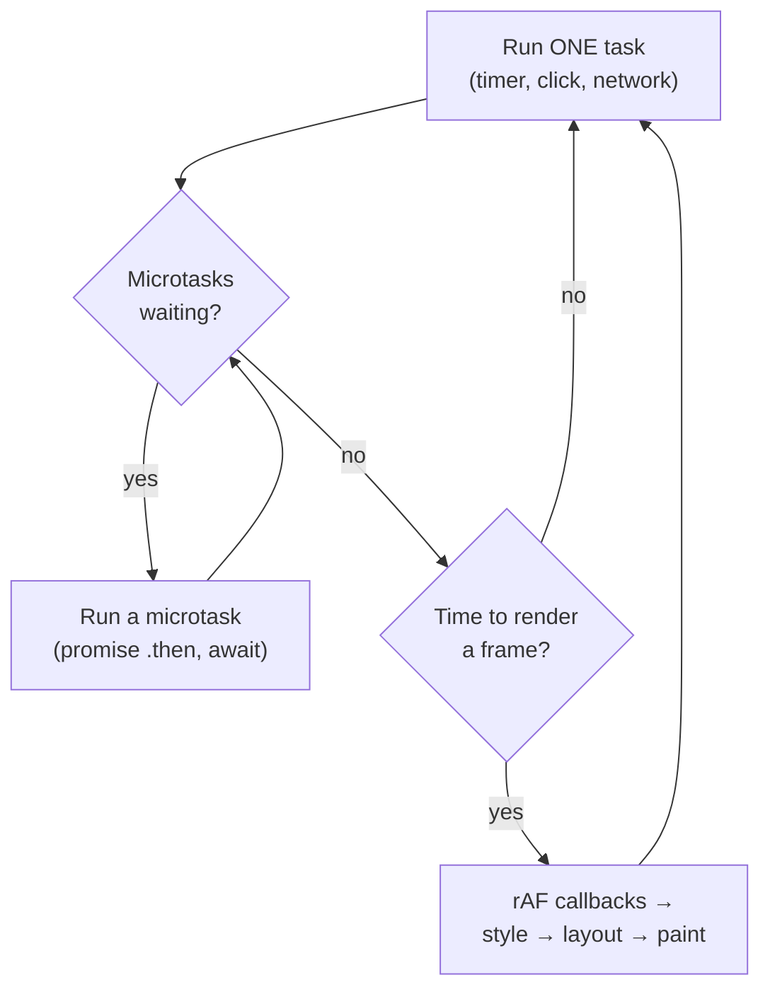

**4. Internal implementation**

- Browsers have **several task queues** (input events, timers, networking) and may prioritise user input.
- `setTimeout(fn, 0)` has a minimum delay (clamped to ≥4 ms after deep nesting) and runs as a **task**.
- Microtasks run **before** rendering, so an endless chain of microtasks freezes the page just like an infinite loop.
- Node.js has the same idea with phases (timers, poll, check) plus `process.nextTick`, which runs before promise microtasks.

**5. Why is it designed this way?**
Microtasks let promise chains finish **consistently** before anything else (no rendering half-way through an update). Tasks give other work (input, rendering) a chance between chunks.

**6. Language differences**
Python's `asyncio`, C#'s `async/await` and Java's `CompletableFuture` also use event loops or thread pools, but usually **multiple threads** exist. JavaScript's model is single-threaded per realm, so ordering is predictable.

**7. Practical example**

```js
console.log("1");
setTimeout(() => console.log("4"), 0);          // task
Promise.resolve().then(() => console.log("3")); // microtask
console.log("2");
// Output: 1 2 3 4
```

**8. How can I observe it?**
DevTools → **Performance** → each "Task" block, with "Run Microtasks" inside it. **loupe** (latentflip.com/loupe) visualises the stack and queues step by step.

---

### ❓ How does asynchronous JavaScript execute without blocking the UI?

### 📝 Answer

**1. What is it?**
JavaScript starts slow work (network, timers, file reads) and **doesn't wait** for it. The browser does that work on **other threads**; when it finishes, a callback is queued and runs later on the main thread.

**2. How does it work internally?**

1. `fetch(url)` hands the request to the browser's **network service** (another process/thread) and immediately returns a **pending Promise**.
2. The main thread continues: handles clicks, renders frames.
3. When the response arrives, the network service queues a task that **resolves the promise**.
4. The promise's `.then` callbacks (or the code after `await`) run as **microtasks**.

**3. Visual**

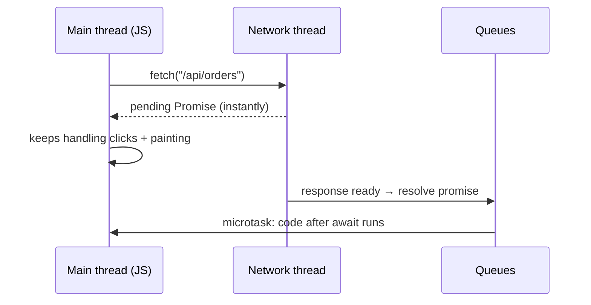

**4. Internal implementation**

- `async` functions are compiled into **state machines**: each `await` saves local state, returns, and resumes in a microtask when the awaited promise settles.
- A Promise stores its state (pending/fulfilled/rejected), value, and a list of reactions to queue when it settles.
- **CPU-heavy** code is not made async by `async` — a long loop still blocks. Use **Web Workers** or split the work into chunks.

**5. Why is it designed this way?**
Most frontend work is waiting for I/O. Doing the waiting outside the main thread keeps one simple, lock-free thread for the UI.

**6. Language differences**

- **Java**: blocking I/O on a thread (or virtual threads); `CompletableFuture` for async.
- **C#**: `async/await` compiled to state machines too, continuations on a thread pool.
- **Python**: `asyncio` event loop, one thread, `await` like JS.
- **Go**: write blocking code; the runtime parks the goroutine and runs others.

**7. Practical example**

```js
async function load() {
  spinner.show();
  const res = await fetch("/api/orders");   // main thread is free while waiting
  render(await res.json());
  spinner.hide();
}
```

**8. How can I observe it?**
DevTools → **Network** (request timing) together with **Performance** (main thread idle while the request is in flight). Throttle the network to "Slow 3G" and confirm the page still scrolls.

---

### ❓ How does a browser determine which UI elements need updating?

### 📝 Answer

**1. What is it?**
The browser tracks **what changed** and redoes only the necessary work for those parts, instead of re-rendering the whole page every frame.

**2. How does it work internally?**

1. A DOM or style change marks the affected nodes **dirty** (e.g. "style needs recalc", "needs layout").
2. At the next frame, **style recalc** runs only for dirty nodes (and descendants affected by inheritance or selectors).
3. **Layout** runs for dirty subtrees; containment can stop it spreading.
4. **Paint invalidation** marks changed rectangles; only those are repainted.
5. The **compositor** re-combines layers; transform/opacity changes skip steps 2–4.

**3. Visual**

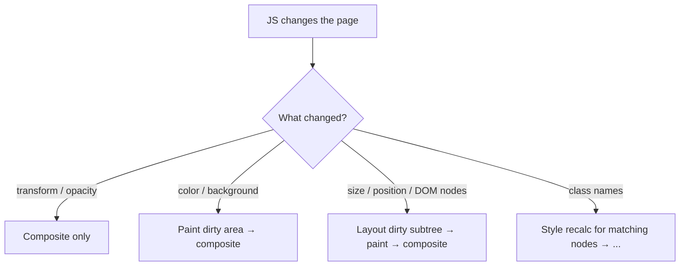

**4. Internal implementation**

- Dirty **bits/flags** on nodes; Blink's "invalidation sets" track which selectors a class change can affect.
- CSS `contain: layout paint` and `content-visibility: auto` tell the browser a subtree is independent, so changes inside don't relayout the rest.
- Raster **tiles**: only tiles covering changed areas are re-rasterised.

**5. Why is it designed this way?**
Redoing everything 60+ times a second is impossible on big pages. Incremental invalidation keeps cost proportional to the size of the change.

**6. Framework differences**
Frameworks decide **which DOM nodes to touch** (next question); the browser then decides **which rendering work** those touches require. Both layers try to do the minimum.

**7. Practical example**
Animating `left: 0 → 300px` relayouts every frame. Animating `transform: translateX(300px)` is composite-only → smooth even if JavaScript is busy.

**8. How can I observe it?**
DevTools → **Rendering** → "Paint flashing" and "Layout Shift Regions"; **Performance** → "Recalculate Style" shows how many elements were affected.

---

### ❓ How do Angular, React and Vue detect changes and update the DOM?

### 📝 Answer

**1. What is it?**
Each framework must answer: "the data changed — which DOM nodes must change?" They use three different strategies.

**2. How does it work internally?**

- **Angular (zone.js default)** — after any async event, walk the component tree **top-down** and compare each template binding's current value with the previous one; update the DOM where they differ. With **Signals**, only views that read a changed signal are marked for checking.
- **React** — calling `setState` re-runs the component function → new **virtual DOM** → **diff** against the previous one → apply the minimal DOM changes.
- **Vue** — data is wrapped in **Proxies** that record which component reads which property; a change re-renders only those components (then a virtual DOM diff inside them).

**3. Visual**

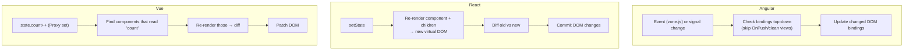

**4. Internal implementation**

| | Angular | React | Vue |
|---|---|---|---|
| Knows **what** changed? | No (zone) / Yes (Signals) | No — re-renders and diffs | Yes — Proxy tracking |
| Unit of re-check | Template bindings | Component subtree | Component |
| DOM update | Direct binding updates (no virtual DOM) | Virtual DOM diff | Virtual DOM diff with compiler hints |

**5. Why is it designed this way?**
Angular's dirty checking is simple and works with plain objects; React's "re-render everything + diff" gives a simple mental model (UI = f(state)); Vue's tracking avoids unnecessary re-renders automatically. All three are moving toward **fine-grained reactivity** (Angular Signals, Vue Vapor mode, React Compiler auto-memoisation).

**6. Framework differences**
Svelte and SolidJS skip the virtual DOM: their compiler or signals update exact DOM nodes. See the framework internals notes for each framework in depth.

**7. Practical example**
A counter increments: Angular checks the bindings in the counter's view (and others in the checked path); React re-runs `Counter()` and diffs; Vue re-runs only `Counter`'s render because only it read `count`.

**8. How can I observe it?**
**Angular DevTools** → Profiler (change detection cycles), **React DevTools** → Profiler + "Highlight updates", **Vue DevTools** → Timeline / component re-render events.

---

## Network, Build and Storage

### ❓ How does a frontend application communicate with a backend?

### 📝 Answer

**1. What is it?**
The frontend sends **HTTP requests** (usually JSON over HTTPS) to backend APIs and updates the UI with the responses. For live updates it can keep a connection open (WebSocket, Server-Sent Events).

**2. How does it work internally?**

1. Code calls `fetch` / `HttpClient` / `axios` → the browser builds an HTTP request.
2. If the API is on another **origin**, the browser applies **CORS**: non-simple requests first send an `OPTIONS` **preflight**; the server must answer with `Access-Control-Allow-*` headers.
3. Cookies for that site are attached automatically (if allowed); tokens go in the `Authorization` header by your code.
4. The request travels over a reused HTTPS connection (HTTP/2 or HTTP/3).
5. The backend responds; JS parses the body (`res.json()`), updates state, the framework updates the DOM.

**3. Visual**

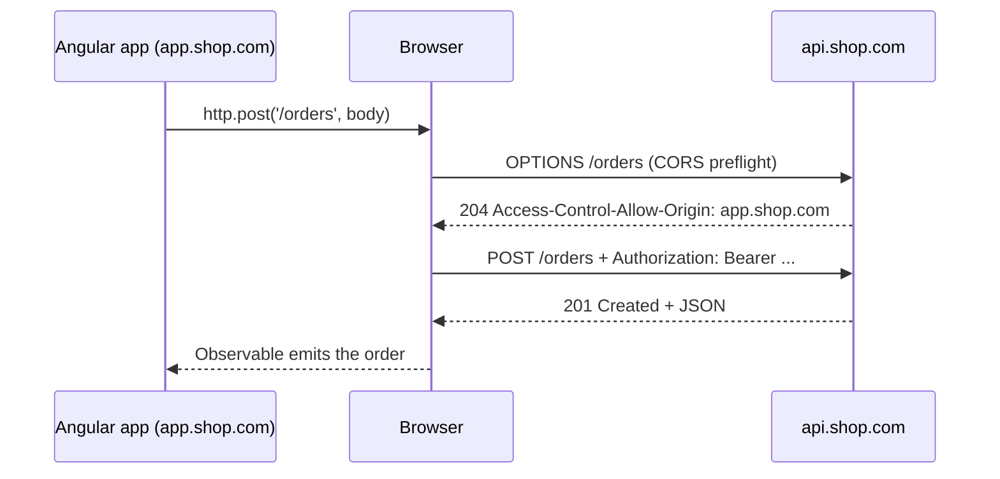

**4. Internal implementation**

- `fetch` and `XMLHttpRequest` are Web APIs; the network service does DNS, connection pooling, TLS, HTTP framing and caching.
- JSON is serialised with `JSON.stringify` and parsed with `JSON.parse` — structured data becomes UTF-8 text on the wire.
- CORS is enforced **by the browser**, not the server: the server only sends permission headers.

**5. Why is it designed this way?**
HTTP + JSON is universal, cacheable and easy to debug. The same-origin policy + CORS stops a malicious site from reading your bank's API with your cookies.

**6. Framework differences**
Angular `HttpClient` returns cold **Observables** (nothing is sent until you subscribe) with interceptors; React/Vue usually use `fetch`/axios with Promises (plus libraries like TanStack Query for caching). All use the same browser networking underneath.

**7. Practical example**

```ts
this.http.get<Order[]>('/api/orders').subscribe(orders => this.orders = orders);
```

**8. How can I observe it?**
DevTools → **Network** → Fetch/XHR filter: headers, preflight requests, payload, response, timing. CORS errors appear in the **Console**.

---

### ❓ How do bundlers, Tree Shaking and Code Splitting work?

### 📝 Answer

**1. What is it?**

- **Bundler** (Vite/Rollup, esbuild, webpack, Angular CLI) — follows `import` statements from your entry file and combines modules into a few optimised files.
- **Tree shaking** — removes exports nobody imports.
- **Code splitting** — splits the bundle into **chunks** loaded only when needed.

**2. How does it work internally?**

1. Start at the entry (`main.ts`), parse it, find `import`s, and build a **module graph**.
2. Transform each module (TypeScript → JS, JSX → JS, CSS imports).
3. **Tree shake**: mark which exports are used; unused ones are dropped (if the module has no side effects).
4. **Split**: each dynamic `import()` starts a new chunk; shared code goes into common chunks.
5. **Minify** (rename variables, remove whitespace and dead code) and add **content hashes** to file names (`main-3f9a.js`) for caching.

**3. Visual**

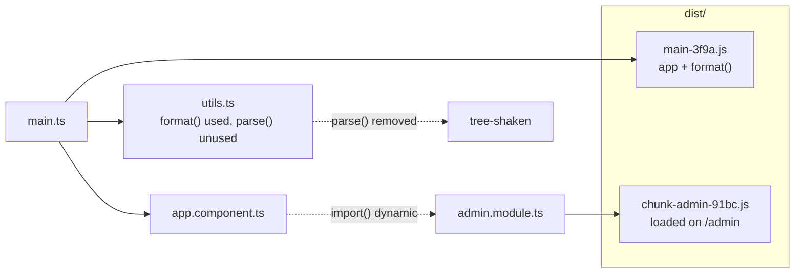

**4. Internal implementation**

- Tree shaking needs **static ES module syntax** (`import`/`export`): imports are known at build time. CommonJS `require()` is dynamic and harder to shake.
- `"sideEffects": false` in a library's `package.json` tells the bundler unused files are safe to drop.
- Dynamic `import()` compiles to code that fetches the chunk file and returns a Promise of the module.

**5. Why is it designed this way?**
Less JavaScript = faster download, parse and execution, especially on mobile. Hashed file names allow "cache forever" headers because any change produces a new name.

**6. Framework differences**
Angular CLI (esbuild-based application builder) splits per lazy route automatically; Vite uses esbuild in dev and Rollup for production builds (newer versions move to Rolldown); Next.js splits per page automatically.

**7. Practical example**

```ts
{ path: 'admin', loadComponent: () => import('./admin/admin.component').then(m => m.AdminComponent) }
```

The admin code is a separate chunk downloaded only when the user opens `/admin`.

**8. How can I observe it?**
`ng build --stats-json` or `npx vite build`, then **source-map-explorer** or **esbuild Bundle Analyzer** / `rollup-plugin-visualizer`. DevTools → **Network**: navigate to `/admin` and watch the new chunk load. **Coverage** tab shows unused bytes.

---

### ❓ How do Browser Cache, Cookies, LocalStorage, SessionStorage and IndexedDB work?

### 📝 Answer

**1. What is it?**
Five ways a browser keeps data, all **separated per origin** (scheme + host + port):

| Storage | Holds | Size (approx.) | Sent to server? | Lifetime |
|---|---|---|---|---|
| **HTTP cache** | Responses (JS, CSS, images, API) | Hundreds of MB | No (it replaces requests) | By `Cache-Control` / eviction |
| **Cookies** | Small key=value strings | ~4 KB each | **Yes, with every matching request** | Session or `Expires` |
| **LocalStorage** | Strings | ~5–10 MB | No | Until cleared |
| **SessionStorage** | Strings | ~5 MB | No | Until the **tab** closes |
| **IndexedDB** | Structured data, files, blobs | Large (% of disk) | No | Until cleared / evicted |

**2. How does it work internally?**

- **HTTP cache**: keyed by URL (+ some headers); fresh → used without a request; stale → revalidated with `ETag`/`If-None-Match` (304).
- **Cookies**: stored by the browser; `Set-Cookie` creates them; attributes `HttpOnly` (no JS access), `Secure` (HTTPS only), `SameSite` (cross-site rules).
- **LocalStorage/SessionStorage**: simple **synchronous** key-value maps on disk/memory; reads block the main thread.
- **IndexedDB**: an **asynchronous**, transactional database of object stores with indexes; values copied with the structured clone algorithm.

**3. Visual**

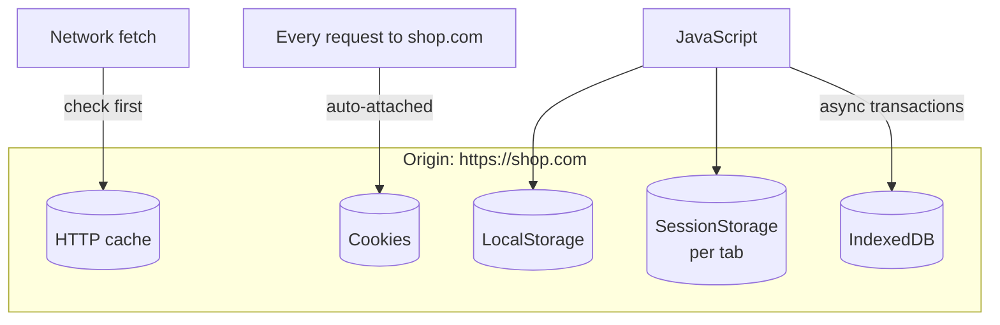

**4. Internal implementation**

- Chrome stores the HTTP cache in disk cache files + an in-memory cache; LocalStorage and IndexedDB live in per-origin storage (LevelDB/SQLite depending on browser).
- Storage is **partitioned**: third-party iframes get separate storage per top-level site (privacy).
- Under storage pressure, browsers evict "best-effort" origins unless `navigator.storage.persist()` was granted.

**5. Why is it designed this way?**
Cookies exist for server sessions (sent automatically). Web Storage gives simple client-side persistence. IndexedDB handles large offline data without blocking the UI. Separation by origin prevents sites reading each other's data.

**6. Framework differences**
Same browser APIs for all frameworks. Security note: storing JWTs in LocalStorage exposes them to XSS; `HttpOnly` cookies can't be read by JS.

**7. Practical example**
Angular app: refresh token in an `HttpOnly; Secure; SameSite=Strict` cookie, UI theme in LocalStorage, form draft in SessionStorage, offline product catalogue in IndexedDB.

**8. How can I observe it?**
DevTools → **Application** tab: Cookies, Local/Session Storage, IndexedDB, Cache Storage, and "Storage" usage per origin. **Network** → "Size" column shows "(disk cache)" / "(memory cache)".

---

### ❓ How do Browser Tabs and Web Workers work internally?

### 📝 Answer

**1. What is it?**

- **Tabs** — modern browsers run sites in separate **renderer processes**, each with its own main thread, JS heap and event loop.
- **Web Workers** — extra **threads** inside a page that run JavaScript in the background, with their own event loop and no DOM access.

**2. How does it work internally?**

1. Opening a tab: the browser process assigns a sandboxed renderer process (**site isolation**: different sites → different processes).
2. `new Worker('worker.js')` starts an OS thread with a separate JS **isolate** (own heap, own globals).
3. Page and worker talk only by **`postMessage`**; data is copied with **structured clone** (or moved with **transferables** like `ArrayBuffer`, without copying).
4. **SharedArrayBuffer** + `Atomics` allow real shared memory (requires cross-origin isolation headers).

**3. Visual**

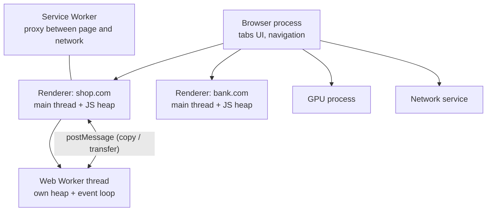

**4. Internal implementation**

- Renderer processes are **sandboxed**: they can't open files or sockets directly; they ask the browser process via IPC.
- Worker types: **Dedicated** (one page), **Shared** (several pages of the same origin), **Service Worker** (intercepts network requests, enables offline and push notifications).
- Background tabs get **timer throttling** and may be frozen to save battery.

**5. Why is it designed this way?**
Process isolation stops a malicious page reading another site's memory (important after Spectre) and contains crashes. Workers give parallelism without the dangers of shared-memory threads on the DOM.

**6. Language differences**
JavaScript workers are like threads that share **nothing** by default (actor-style), unlike Java/C#/C++ threads that share the whole heap. Node.js has the same model with `worker_threads`.

**7. Practical example**

```js
// main.js
const w = new Worker('resize.js');
w.postMessage(imageBuffer, [imageBuffer]);   // transfer, no copy
w.onmessage = e => show(e.data);
// resize.js
onmessage = e => postMessage(resize(e.data)); // heavy work off the main thread
```

**8. How can I observe it?**
Chrome **Task Manager** (Shift+Esc) shows processes per tab/site; `chrome://process-internals`. DevTools → **Sources** → Threads panel lists workers; **Application** → Service Workers.
