# 🔩 Under the Hood: Angular, React and Vue Internals

How the three big frontend frameworks start, create objects, track changes and update the DOM.

## Angular Internals

### ❓ How do Angular application bootstrap and compilation work internally?

### 📝 Answer

**1. What is it?**
**Compilation** turns component templates into JavaScript functions at build time (AOT). **Bootstrap** is what happens in the browser when `main.ts` starts the app and renders the root component.

**2. How does it work internally?**
Build time:

1. The Angular compiler reads `@Component` metadata and the HTML template.
2. It generates a **template function** per component made of Ivy instructions (`ɵɵelementStart`, `ɵɵtext`, `ɵɵproperty`…) with two modes: **create** (build DOM once) and **update** (refresh bindings).
3. The bundler outputs `main-HASH.js`.

Runtime:

4. `bootstrapApplication(AppComponent, appConfig)` creates the **platform injector** and the root **environment injector** with your providers.
5. Angular finds `<app-root>` in `index.html`, creates `AppComponent`, runs its template function in **create** mode.
6. It runs the first **change detection** (update mode) and attaches listeners; after that it reacts to events or signals.

**3. Visual**

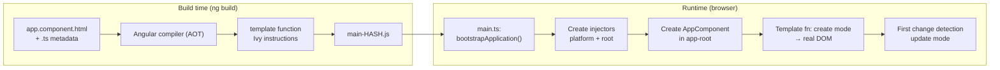

**4. Internal implementation**

- Each component instance has an **LView** (an array holding its DOM nodes, binding values and child views) and a shared **TView** (the static template blueprint).
- Bindings are stored at fixed indexes in the LView, so an update compares `oldValue !== newValue` per slot.
- No virtual DOM: instructions update real DOM nodes directly.

**5. Why is it designed this way?**
AOT finds template errors at build time, removes the compiler from the bundle and enables **tree shaking** of unused Angular features (Ivy's "locality": each component compiles independently). Cost: build step required; templates can't be built dynamically from strings at runtime.

**6. Framework differences**
React compiles only JSX syntax (to function calls) and decides the DOM at runtime via a virtual DOM; Vue compiles templates to render functions with optimisation hints; Svelte compiles to direct DOM code like Angular but without a change detection pass.

**7. Practical example**

```html
<h1>Hello {{ name }}</h1>
```

compiles roughly to: create mode → `ɵɵelementStart(0,'h1'); ɵɵtext(1); ɵɵelementEnd()`; update mode → `ɵɵtextInterpolate1('Hello ', ctx.name, '')`.

**8. How can I observe it?**
`ng build --configuration development` and open `dist/.../main.js`: search for `ɵɵ` to see template functions. **Angular DevTools** → Components shows the tree created at bootstrap.

---

### ❓ How does Angular Dependency Injection work internally?

### 📝 Answer

**1. What is it?**
Angular creates and hands out objects (services) for you. A class **asks** for what it needs (`inject(UserService)` or a constructor parameter); an **injector** finds or creates it.

**2. How does it work internally?**

1. Every **token** (a class or `InjectionToken`) maps to a **provider** recipe: `useClass`, `useValue`, `useFactory`, `useExisting`.
2. Resolution walks **up** a hierarchy: the component's **element injector** → parent elements → the **environment injector** (route / lazy / root) → platform → `NullInjector` (error: "No provider for X").
3. The first injector that has a provider creates the instance (once, then caches it) and returns it.

**3. Visual**

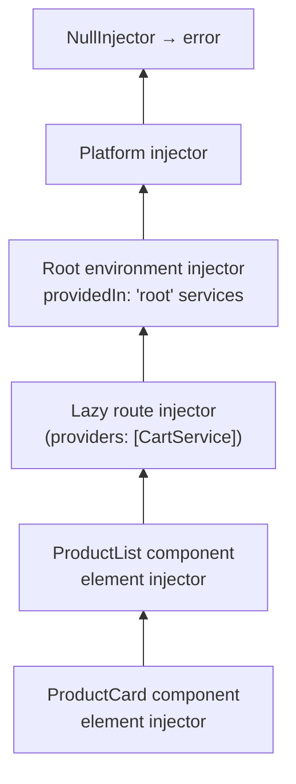

**4. Internal implementation**

- The compiler generates a **factory** per injectable (`ɵfac`) that calls `inject()` for each dependency.
- Injectors store records in a map `token → {factory, value}`; cycles are detected (`NG0200: Circular dependency`).
- `providedIn: 'root'` services are **tree-shakable**: if nothing injects them, they are not bundled.
- Element injectors are stored in the LView using a **bloom filter** to quickly skip elements that can't provide a token.

**5. Why is it designed this way?**
Loose coupling and easy testing (swap a real `HttpClient` for a mock). The hierarchy lets a feature or component get its **own** instance (scoped state). Cost: misconfigured providers can create unexpected duplicate instances.

**6. Framework differences**

| Framework | DI |
|---|---|
| Angular | Full hierarchical injector system, built in |
| Spring (Java) | Container-wide singletons by default, created at start-up |
| ASP.NET Core | Built-in container with singleton / scoped (per request) / transient lifetimes |
| React / Vue | No DI container; **Context** / `provide`-`inject` pass values down the tree |

**7. Practical example**

```ts
@Injectable({ providedIn: 'root' })
export class CartService { items = signal<Item[]>([]); }

@Component({ ... })
export class CartIcon { cart = inject(CartService); }   // same root instance everywhere
```

**8. How can I observe it?**
**Angular DevTools** → select a component → "Injected services" and the **Injector Tree** view (Angular 17+). Add `providers: [CartService]` to a component and watch a second instance appear.

---

### ❓ How does the Angular component lifecycle work internally?

### 📝 Answer

**1. What is it?**
Angular calls **lifecycle hooks** on a component at fixed moments: when it is created, when its inputs change, after its view is checked, and before it is destroyed.

**2. How does it work internally?**
Order for one component:

1. `constructor` — class created (DI happens here). No inputs yet.
2. `ngOnChanges` — inputs set or changed (before `ngOnInit` and on every input change).
3. `ngOnInit` — once, after the first inputs.
4. `ngDoCheck` — every change detection run.
5. `ngAfterContentInit` / `ngAfterContentChecked` — projected `<ng-content>` ready / checked.
6. `ngAfterViewInit` / `ngAfterViewChecked` — own view and children ready / checked.
7. `ngOnDestroy` — before removal (clean up subscriptions, timers).

**3. Visual**

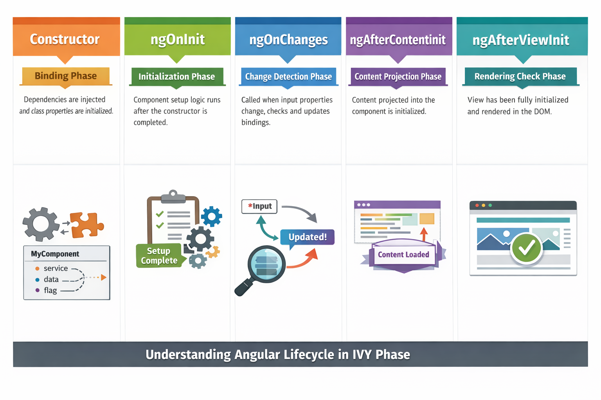

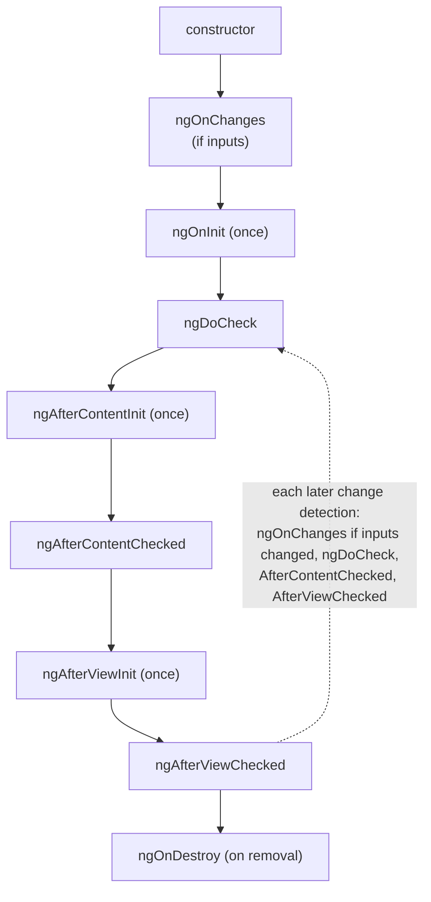

**4. Internal implementation**

- Hooks are registered in the component's **TView** as arrays (`preOrderHooks`, `contentHooks`, `viewHooks`, `destroyHooks`) at first creation.
- During **refreshView**, Angular runs: pre-order hooks (OnChanges/OnInit/DoCheck) → update bindings → content hooks → refresh child views → view hooks.
- `ngOnChanges` receives a `SimpleChanges` object built by comparing previous and current input values.
- Newer APIs `afterNextRender` / `afterRender` run after the DOM is rendered (useful for measuring elements).

**5. Why is it designed this way?**
Hooks tie into the change detection walk, so they cost nothing extra and run in a predictable order (parents before children for init, children before parents for view hooks).

**6. Framework differences**
React uses `useEffect` (after paint), `useLayoutEffect` (before paint) and cleanup functions instead of named hooks. Vue has `onMounted`, `onUpdated`, `onUnmounted` and friends — similar idea to Angular.

**7. Practical example**

```ts
export class PriceTicker implements OnInit, OnDestroy {
  private sub?: Subscription;
  ngOnInit() { this.sub = interval(1000).subscribe(() => this.refresh()); }
  ngOnDestroy() { this.sub?.unsubscribe(); }   // without this: memory leak
}
```

**8. How can I observe it?**
Add `console.log` in each hook and toggle the component with `@if`. **Angular DevTools** → Profiler shows which hooks ran and how long they took.

---

### ❓ What are Signals in Angular, and how does Angular change detection work?

### 📝 Answer

**1. What is it?**
Change detection keeps the DOM in sync with component data. Angular has two triggers: **zone.js** (classic: "something async happened, check everything") and **Signals** (reactive: "this value changed, update what reads it").

**2. How does it work internally?**
Zone-based:

1. **zone.js** patches async APIs (events, `setTimeout`, promises, XHR).
2. When one finishes, `ApplicationRef.tick()` runs.
3. Angular walks the view tree **top-down**, running each template function in update mode and comparing every binding with its previous value.
4. `OnPush` components are skipped unless an input reference changed, an event fired inside them, an `async` pipe emitted, or they were marked dirty.

Signals:

1. A `signal()` is a **producer**; templates, `computed()` and `effect()` that read it become **consumers** (dependencies are recorded automatically).
2. Setting a signal marks its consumers **dirty**; a template consumer marks its view for refresh.
3. In **zoneless** mode (`provideZonelessChangeDetection()`, stable from Angular 20 and the default for new projects from Angular 21), Angular schedules a check only when signals, template events, the `async` pipe or `markForCheck` say something changed.

**3. Visual**

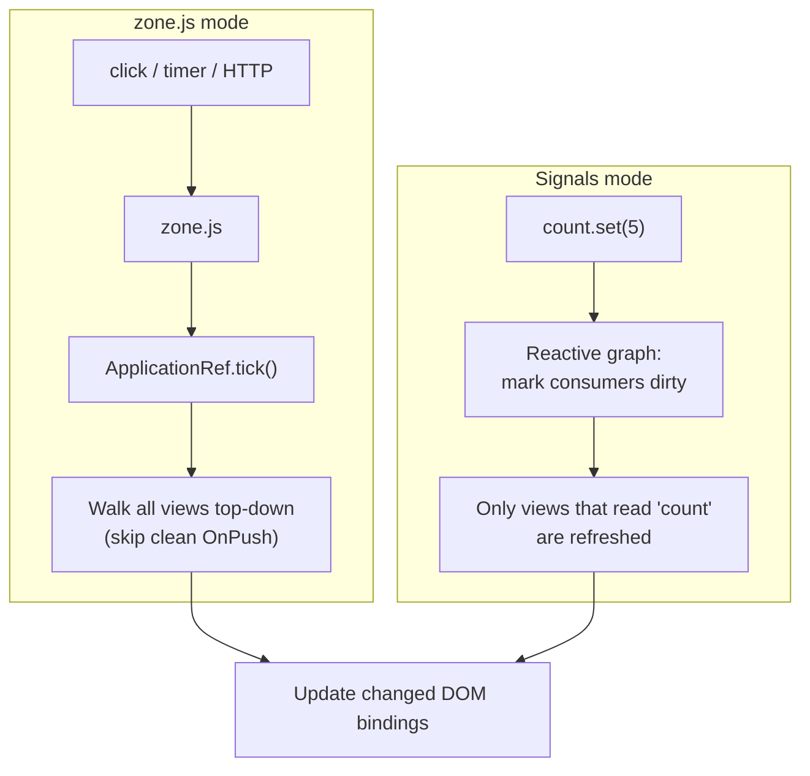

**4. Internal implementation**

- Bindings live at fixed slots in each view's LView; update = `if (!Object.is(old, new)) setDomProperty(...)`.
- In dev mode a second check pass runs and throws **`ExpressionChangedAfterItHasBeenCheckedError`** if a binding changed during the check.
- Signals use **version numbers**: a `computed` recomputes lazily only if a dependency's version changed (push "dirty", pull value).
- zone.js tracks **async events, not mutations**: `this.items.push('C')` or `this.count++` alone triggers nothing — it is only seen because it ran inside a tracked click, timer or HTTP callback. A spread (`this.items = [...this.items, 'C']`) doesn't trigger change detection either; it only gives `OnPush` a **new reference** to notice.

**5. Why is it designed this way?**
Zone.js made change detection automatic with plain objects, but checks far more than needed and adds a dependency. Signals give **fine-grained** updates, better performance and no zone.js — at the cost of writing state as signals.

**Signals vs RxJS:** signals are best for **state** (synchronous reads, no subscriptions); RxJS is still best for **streams of events over time** (HTTP, typing, WebSockets). `toSignal()` / `toObservable()` connect the two.

**6. Framework differences**
React re-renders component functions and diffs a virtual DOM; Vue tracks property reads with Proxies; SolidJS and Preact Signals use the same producer/consumer idea as Angular Signals.

**7. Practical example**

```ts
count = signal(0);
double = computed(() => this.count() * 2);   // recomputed only when count changes
inc() { this.count.update(c => c + 1); }     // marks only this component's view dirty
```

```html
<p>{{ count() }} × 2 = {{ double() }}</p>
```

**8. How can I observe it?**
**Angular DevTools** → Profiler: record, click around, see each change detection cycle and which components were checked. Compare a zone app with a zoneless + Signals app.

---

### ❓ How do the Angular Router and lazy loading work internally?

### 📝 Answer

**1. What is it?**
The **Router** maps the browser URL to components. **Lazy loading** downloads a route's code only when the user first navigates to it.

**2. How does it work internally?**

1. Navigation starts (link click, `router.navigate`, or browser back/forward via the `popstate` event).
2. The URL is parsed into a **UrlTree**.
3. **Route matching**: the router walks the route config to find matching routes (and params like `:id`).
4. For lazy routes, `loadComponent` / `loadChildren` runs a dynamic `import()` → the chunk is fetched.
5. **Guards** (`canActivate`, `canMatch`…) and **resolvers** run.
6. The router creates components in the matching `<router-outlet>`s and updates the address bar with `history.pushState` (no page reload).

**3. Visual**

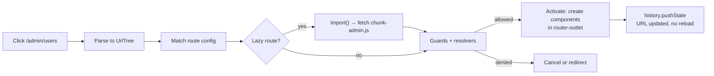

**4. Internal implementation**

- Router state is a tree of **ActivatedRoute** objects (params, data, query params as Observables/signals).
- Navigation is an RxJS pipeline; a new navigation **cancels** an unfinished one.
- Lazy route configs are cached after the first load; **preloading strategies** (e.g. `PreloadAllModules`) fetch chunks in the background after start-up.

**5. Why is it designed this way?**
SPA navigation without reloads is fast and keeps state. Lazy loading keeps the first download small; a large admin area doesn't slow down the home page.

**6. Framework differences**
React Router / TanStack Router and Vue Router follow the same pattern (route table + `history.pushState` + `import()` for lazy routes). Next.js and Nuxt use **file-based routing** and split code per page automatically.

**7. Practical example**

```ts
export const routes: Routes = [
  { path: '', component: HomeComponent },
  { path: 'admin', canMatch: [adminGuard],
    loadChildren: () => import('./admin/admin.routes').then(m => m.ADMIN_ROUTES) },
];
```

**8. How can I observe it?**
DevTools → **Network** → JS filter: navigate to `/admin` and see the chunk load once. `provideRouter(routes, withDebugTracing())` logs every router event (NavigationStart, GuardsCheck, NavigationEnd).

---

### ❓ How do Angular HttpClient and HTTP Interceptors work internally?

### 📝 Answer

**1. What is it?**
`HttpClient` sends HTTP requests and returns **Observables**. **Interceptors** are functions that every request and response pass through — for auth headers, logging, retries, error handling.

**2. How does it work internally?**

1. `http.get('/api/orders')` creates an immutable **HttpRequest** and returns a **cold Observable** — nothing is sent yet.
2. On `subscribe` (or `async` pipe / `toSignal`), the request enters the **interceptor chain** in the order provided.
3. Each interceptor can clone and modify the request, then call `next(req)`.
4. The last handler, **HttpBackend**, sends it using `XMLHttpRequest` (default) or `fetch` (`withFetch()`).
5. The response flows back **through the interceptors in reverse**, as `HttpEvent`s, then to your subscriber.

**3. Visual**

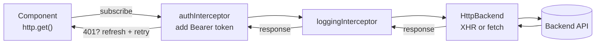

**4. Internal implementation**

- Requests and headers are **immutable**; interceptors use `req.clone({ setHeaders: {...} })`.
- Functional interceptors (`HttpInterceptorFn`) are registered with `provideHttpClient(withInterceptors([...]))` and can use `inject()`.
- Unsubscribing **aborts** the underlying XHR/fetch, so `switchMap` cancels outdated searches automatically.
- JSON is parsed by the backend handler based on `responseType`.

**5. Why is it designed this way?**
Observables give cancellation, retries (`retry`), and composition with RxJS. The interceptor chain (Chain of Responsibility pattern) keeps cross-cutting concerns out of every service.

**6. Framework differences**
React/Vue apps usually use `fetch` or **axios** (axios has request/response interceptors too). Spring's `RestClient`/`WebClient` and OkHttp on the backend use the same interceptor-chain idea.

**7. Practical example**

```ts
export const authInterceptor: HttpInterceptorFn = (req, next) => {
  const token = inject(AuthService).token();
  return next(token ? req.clone({ setHeaders: { Authorization: `Bearer ${token}` } }) : req);
};
```

**8. How can I observe it?**
DevTools → **Network**: confirm the `Authorization` header. Calling `http.get()` without subscribing sends **nothing** — a quick way to see the Observable is cold.

---

## React Internals

### ❓ How do React's Virtual DOM and Reconciliation work internally?

### 📝 Answer

**1. What is it?**
A component returns a description of the UI as plain JavaScript objects (**React elements**, the "virtual DOM"). **Reconciliation** compares the new description with the previous one and changes only the real DOM nodes that differ.

| Real DOM | Virtual DOM |
|---|---|
| The page tree managed by the browser | A lightweight copy of the tree as plain JS objects |
| You change it directly (`el.textContent = ...`) | You describe the UI for the new state; the library works out the changes |
| Changes can trigger layout and paint | Changes are compared in memory first, then applied as a few real DOM updates |

**2. How does it work internally?**

1. State changes → React calls the component function again → new element tree.
2. React compares old and new **node by node**:
   - Different **type** (`div` → `span`, `A` → `B`) → destroy the old subtree, build a new one.
   - Same type → keep the DOM node / component instance, update changed props.
   - Lists → match children by **`key`**; without keys, by position.
3. The resulting changes are applied to the DOM in the **commit** phase.

**3. Visual**

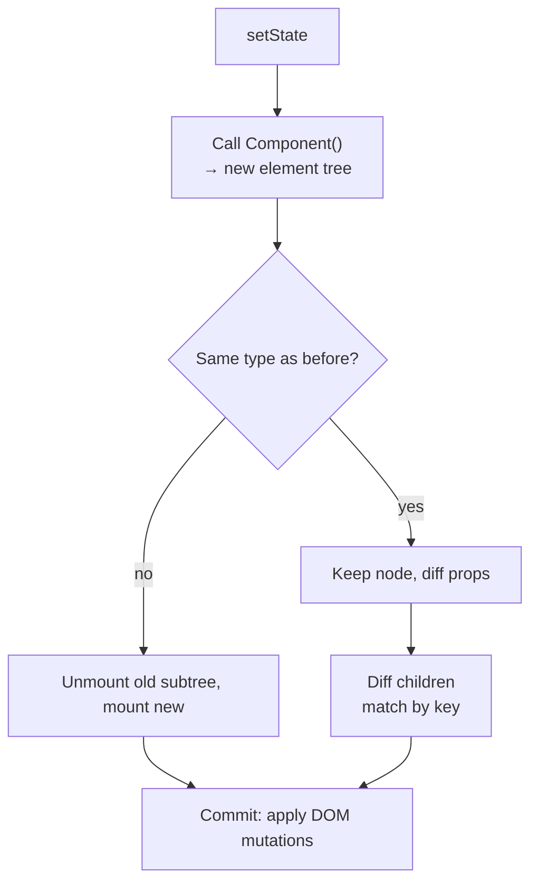

**4. Internal implementation**

- A React element is `{ type, props, key, ref }` — cheap to create.
- The diff is **O(n)** thanks to two heuristics (different type = different tree; keys identify list items). A general tree diff would be O(n³).
- Using **array index as key** in a reorderable list makes React reuse the wrong DOM nodes (inputs keep the wrong values).

**5. Why is it designed this way?**
Developers describe the UI for the current state (`UI = f(state)`) and never write DOM update code. The cost: React re-runs components and diffs even when little changed — mitigated by `memo`, `useMemo` and the React Compiler.

**6. Framework differences**
Vue also diffs a virtual DOM but knows **which components** depend on changed data and uses compiler hints to skip static parts. Angular, Svelte and Solid have **no virtual DOM**.

**7. Practical example**

```jsx
{todos.map(t => <TodoRow key={t.id} todo={t} />)}
```

Removing the first todo: with `key={t.id}` React removes one row; with `key={index}` it would update every row's props and delete the last one.

**8. How can I observe it?**
**React DevTools** → Profiler: record an update to see which components rendered and why. Settings → "Highlight updates when components render".

---

### ❓ How does React's Fiber architecture work internally?

### 📝 Answer

**1. What is it?**
**Fiber** (React 16+) is React's internal engine. It represents the component tree as a linked structure of **fiber** objects so rendering work can be split into small units, **paused**, prioritised and resumed.

**2. How does it work internally?**

1. Each component/element has a **fiber**: `type`, `props`, `stateNode` (DOM node or instance), links to `child`, `sibling`, `return` (parent), and hook state.
2. On an update, React builds a **work-in-progress** tree from the **current** tree (double buffering, linked by `alternate`).
3. **Render phase** (interruptible): process one fiber at a time (`beginWork` / `completeWork`), yielding to the browser about every 5 ms if higher-priority work arrives.
4. **Commit phase** (synchronous, cannot pause): apply DOM changes, run layout effects, swap work-in-progress to current, then schedule `useEffect`s.

**3. Visual**

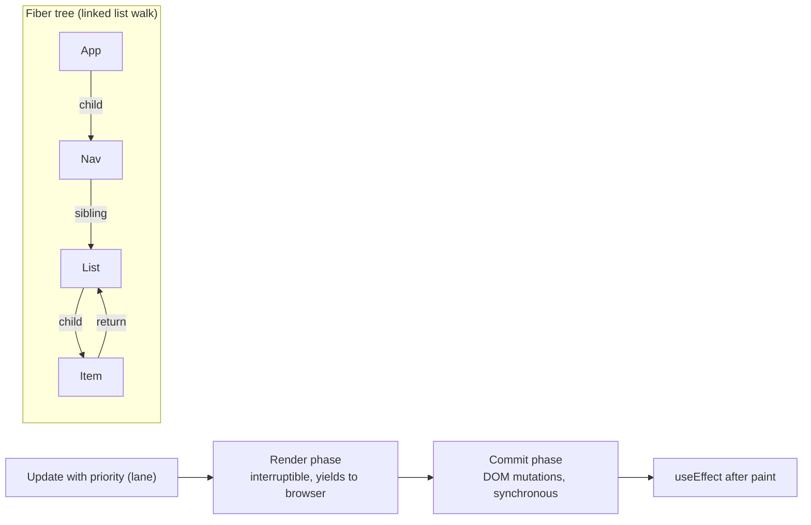

**4. Internal implementation**

- **Lanes**: bitmask priorities (sync input > default > transition > idle). `startTransition` marks updates as low priority.
- The scheduler uses `MessageChannel` tasks to yield control back to the browser between work chunks.
- Because the render phase can run, pause and restart, render functions must be **pure** (no side effects) — this is why Strict Mode double-invokes them in development.

**5. Why is it designed this way?**
The old stack-based reconciler had to finish a whole update in one go, so big updates blocked typing and animations. Fiber enables **concurrent rendering**: urgent updates (typing) interrupt less urgent ones (filtering a big list).

**6. Framework differences**
Angular and Vue update synchronously within a tick (Vue batches to a microtask); they don't have interruptible rendering. Fiber's scheduling is unique to React.

**7. Practical example**

```jsx
const [query, setQuery] = useState('');
const [isPending, startTransition] = useTransition();
onChange={e => { setQuery(e.target.value);                      // urgent: input stays responsive
                 startTransition(() => setFilter(e.target.value)); }}  // can be interrupted
```

**8. How can I observe it?**
**React DevTools** Profiler shows commits and their priority; DevTools **Performance** with React's scheduler tracks (React 19.2+ adds custom tracks) shows render work split into small tasks.

---

### ❓ How do React Hooks and component rendering work internally?

### 📝 Answer

**1. What is it?**
**Hooks** (`useState`, `useEffect`, `useMemo`…) let function components keep state and side effects between renders. **Rendering** = React calling your component function to get its UI.

**2. How does it work internally?**

1. When React renders a component, it sets a pointer to that component's fiber.
2. Each hook call reads the **next item in a linked list** stored on the fiber (`memoizedState`): first call → first hook, second call → second hook…
3. `useState` returns the stored value and a `setState` function.
4. `setState` puts an **update** in that hook's queue and **schedules** a re-render; React 18+ **batches** multiple updates into one render.
5. `useEffect` callbacks run **after** the browser paints; `useLayoutEffect` runs after DOM mutation but **before** paint.

**3. Visual**

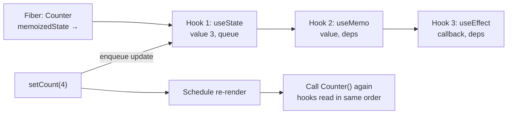

**4. Internal implementation**

- Hooks are matched **by call order**, not by name → the **Rules of Hooks**: never call hooks inside conditions or loops.
- Dependency arrays are compared with `Object.is`; same deps → `useMemo` returns the cached value, `useEffect` is skipped.
- A re-render of a parent re-renders its children unless they are memoised (`React.memo`) or the React Compiler memoises automatically.

**5. Why is it designed this way?**
Order-based storage needs no names or keys and keeps hooks extremely cheap. The trade-off is the strict "same order every render" rule.

**6. Framework differences**
Vue's Composition API (`ref`, `computed`, `watch`) runs **once** at setup and relies on reactive tracking, so it has no call-order rule. Angular uses class fields + Signals; `effect()` / `computed()` are similar ideas.

**7. Practical example**

```jsx
function Counter() {
  const [count, setCount] = useState(0);           // hook #1
  useEffect(() => { document.title = count; }, [count]);   // hook #2, runs after paint when count changes
  return <button onClick={() => { setCount(c => c + 1); setCount(c => c + 1); }}>{count}</button>;
}   // one click → one batched render → +2
```

**8. How can I observe it?**
**React DevTools** → Components → select a component → "hooks" lists each hook's current value in order. Add `console.log` in the body to count renders (Strict Mode doubles them in dev).

---

## Vue Internals

### ❓ How does Vue's reactivity system work internally (dependency tracking and Proxies)?

### 📝 Answer

**1. What is it?**
Vue makes your data **reactive**: when a value changes, everything that used it (templates, `computed`, `watch`) updates automatically. Vue 3 does this with JavaScript **Proxies** and automatic **dependency tracking**.

**2. How does it work internally?**

1. `reactive(obj)` returns a **Proxy** around `obj`; `ref(x)` wraps a value in an object with a `.value` getter/setter.
2. When an **effect** runs (a component's render, a `computed`, a `watchEffect`), it becomes the **active effect**.
3. Every property **read** (Proxy `get` trap) calls `track(target, key)`: "the active effect depends on `target.key`".
4. Every **write** (Proxy `set` trap) calls `trigger(target, key)`: re-run (or schedule) every effect that depends on it.
5. Component re-renders are **batched** into one update per tick (microtask), and `nextTick()` waits for it.

**3. Visual**

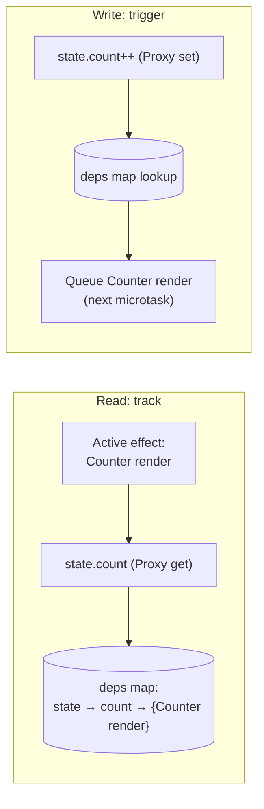

**4. Internal implementation**

- Dependencies are stored as `WeakMap<target, Map<key, Dep>>`, where a Dep is the set of effects using that property (WeakMap lets unused objects be garbage-collected).
- Nested objects become reactive **lazily** when first accessed.
- `computed` is lazy and cached: it recomputes only if a dependency changed since its last read.
- Vue 2 used `Object.defineProperty` getters/setters, which couldn't detect **new properties** or array index assignment — Proxies fixed that.

**5. Why is it designed this way?**
Automatic tracking means no manual subscriptions and no unnecessary re-renders: only components that actually read the changed property update. Costs: Proxy overhead, and destructuring a reactive object loses reactivity (use `toRefs`).

**6. Framework differences**
Same idea as Angular Signals, SolidJS signals and MobX. React has **no** tracking: it re-renders on `setState` and diffs.

**7. Practical example**

```js
const state = reactive({ count: 0, name: 'Asha' });
watchEffect(() => console.log(state.count));   // tracks only 'count'
state.name = 'Ravi';    // nothing logged
state.count++;          // logs 1
```

**8. How can I observe it?**
**Vue DevTools** → Timeline / component inspector. Use `onRenderTracked` and `onRenderTriggered` hooks in a component to log exactly which property was tracked and which change triggered a re-render.

---

### ❓ How do Vue's template compiler and Virtual DOM work internally?

### 📝 Answer

**1. What is it?**
Vue compiles each `<template>` into a **render function** that returns virtual DOM nodes (VNodes). When a component re-renders, Vue **patches** the real DOM by comparing old and new VNodes — using hints from the compiler to skip anything static.

**2. How does it work internally?**

1. Build time: the **SFC compiler** (`@vue/compiler-sfc`, via Vite) parses `.vue` files: template → AST → optimised render function; `<script setup>` → setup function; `<style scoped>` → CSS with attribute selectors.
2. Runtime: the component's render runs inside a reactive effect (so its reads are tracked).
3. On change, render runs again → new VNode tree.
4. The **patch** algorithm compares only **dynamic** nodes and applies DOM operations.

**3. Visual**

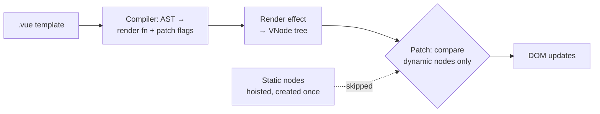

**4. Internal implementation**

- **Patch flags**: the compiler marks each dynamic node with what can change (`TEXT`, `CLASS`, `PROPS`), so the diff checks only that.
- **Static hoisting**: fully static subtrees are created once and reused.
- **Block tree**: each block keeps a flat array of its dynamic descendants, so diffing skips static structure entirely.
- Keyed child lists use a **longest increasing subsequence** algorithm to move as few DOM nodes as possible.

**5. Why is it designed this way?**
Templates are more analysable than hand-written JSX, so the compiler can tell the runtime exactly what can change → faster updates than a plain virtual DOM diff. Vue's experimental **Vapor mode** goes further by compiling to direct DOM updates without a virtual DOM.

**6. Framework differences**
React diffs whole subtrees with no compiler hints (the React Compiler adds memoisation instead). Angular and Svelte compile templates to direct DOM instructions with no virtual DOM.

**7. Practical example**

```html
<div class="card">
  <h2>Static title</h2>              <!-- hoisted: never diffed -->
  <p>{{ price }}</p>                  <!-- patch flag TEXT: only textContent compared -->
</div>
```

**8. How can I observe it?**
Paste a template into the **Vue SFC Playground** (play.vuejs.org) → "JS" tab shows the compiled render function with patch flags and hoisted nodes. Vue DevTools shows component render timings.
