# 🔩 Under the Hood: Backend & Server Internals

What a server really is, how it listens for requests, and what happens inside Tomcat and Spring Boot from start-up to response.

## Servers, Localhost and Ports

### ❓ What exactly is a Server? Is it hardware, software, a process or a computer?

### 📝 Answer

**1. What is it?**
"Server" means **a role**, and the word is used for three things:

- **Server software** — a program that waits for requests and answers them (Tomcat, Nginx, PostgreSQL).
- **Server process** — that program while it runs: a process with threads, memory and an open **listening socket**.
- **Server machine** — the computer (physical, virtual or a container) that runs it.

A laptop running Spring Boot **is** a server machine while the app runs.

**2. How does it work internally?**

1. The OS starts the server program as a **process**.
2. The process opens a **socket**, binds it to an IP + port, and starts listening.
3. The OS network stack delivers incoming connections for that port to the process.
4. The process reads the request, runs code, writes a response, and keeps listening.

**3. Visual**

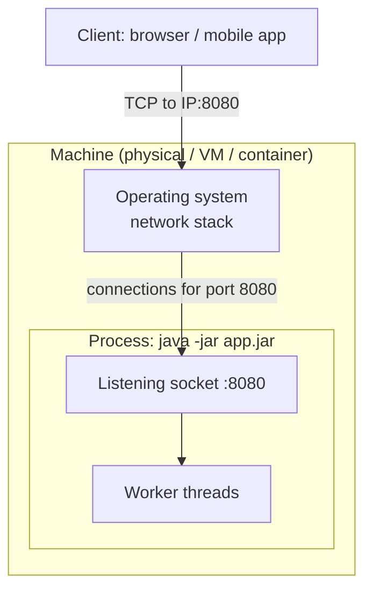

**4. Internal implementation**
The core is a **socket**: a kernel object identified by a file descriptor (Linux) or handle (Windows). The server loops: accept connection → read bytes → parse protocol (HTTP) → handle → write bytes.

**5. Why is it designed this way?**
Separating the role (software) from the hardware lets one machine run many servers (web, DB, cache) and one service run on many machines behind a load balancer.

**6. Language / framework differences**
Every server stack ends at the same OS sockets: Java (Tomcat, Netty), Node.js (libuv), Python (Gunicorn, Uvicorn), Go (`net/http`), .NET (Kestrel). They differ in **threading model** (thread per request vs event loop).

**7. Practical example**
`java -jar shop.jar` → one JVM **process** → Tomcat inside it opens port 8080 → your laptop is now acting as a web server.

**8. How can I observe it?**
Windows: `netstat -ano | findstr :8080` shows the process ID listening; Task Manager → Details finds that PID. Linux/macOS: `ss -ltnp` or `lsof -i :8080`.

---

### ❓ What is Localhost? How is it different from a physical server or virtual machine?

### 📝 Answer

**1. What is it?**
**localhost** is a hostname that means "**this same computer**". It resolves to the **loopback address** `127.0.0.1` (IPv4) or `::1` (IPv6). Traffic to it never leaves the machine.

**2. How does it work internally?**

1. `http://localhost:8080` → name lookup (hosts file) gives `127.0.0.1`.
2. The OS sends packets to the **loopback interface** — a virtual network card in the kernel.
3. The kernel hands them straight back to the receiving socket on the same machine; no network card, cable or router involved.

**3. Visual**

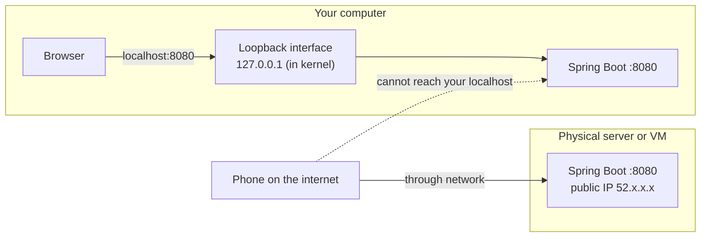

**4. Internal implementation**

- The whole `127.0.0.0/8` range is loopback on Linux.
- A server bound to `127.0.0.1` accepts only local connections; bound to `0.0.0.0` it accepts on **all** interfaces (LAN, Wi-Fi, public).
- Inside a **Docker container**, `localhost` means the **container itself**, not your laptop.

**5. Why is it designed this way?**
Loopback makes local development and inter-process communication fast and safe — nothing is exposed to the network unless you bind to an external interface.

**6. Differences**

| | localhost | Physical server | Virtual machine |
|---|---|---|---|
| What is it? | An **address** on your machine | Real hardware | Software computer on a hypervisor |
| Reachable from others? | No | Yes, by its IP | Yes, by its IP |
| Has its own OS? | — (yours) | Yes | Yes (guest OS) |

**7. Practical example**
Angular dev server on `localhost:4200` calls Spring Boot on `localhost:8080`: two processes on one machine, talking through loopback. Different **ports** → different origins → CORS applies.

**8. How can I observe it?**
`ping localhost` (shows `::1` or `127.0.0.1`); `ipconfig` / `ip addr` lists the loopback adapter; Windows hosts file: `C:\Windows\System32\drivers\etc\hosts`.

---

### ❓ How does a server listen for incoming requests using IP addresses and ports?

### 📝 Answer

**1. What is it?**
An **IP address** identifies a machine (network interface); a **port** (0–65535) identifies a program on it. A server **binds** a socket to an IP + port and **listens**; the OS delivers matching connections to it.

**2. How does it work internally?**

1. `socket()` — create a TCP socket.
2. `bind(0.0.0.0:8080)` — claim the port (fails with "Address already in use" if taken).
3. `listen(backlog)` — mark it as a listening socket; the kernel completes TCP handshakes and keeps them in an **accept queue**.
4. `accept()` — the server takes one connection and gets a **new socket** for it.
5. Each connection is identified by the **4-tuple**: client IP, client port, server IP, server port.

**3. Visual**

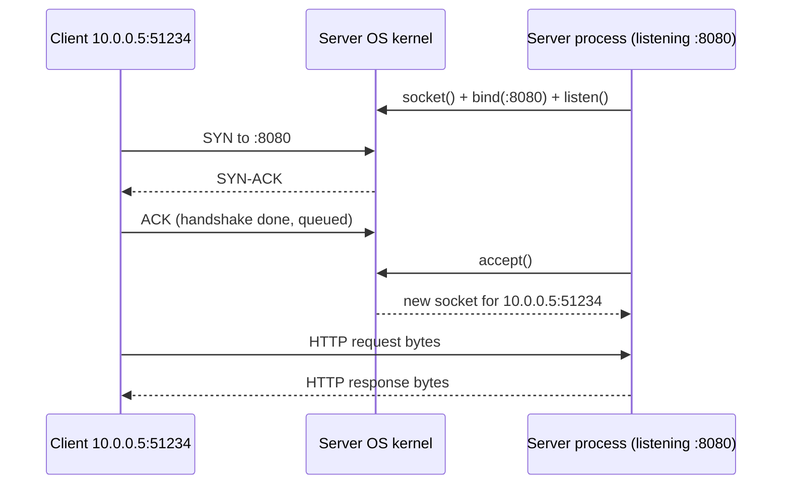

**4. Internal implementation**

- The kernel demultiplexes packets to sockets by the 4-tuple → thousands of clients share port 8080.
- Clients use random **ephemeral ports** (e.g. 49152–65535 on Windows).
- Ports below 1024 need admin/root on Linux. Many accept-queue overflows → connection refused/timeouts under load.

**5. Why is it designed this way?**
Ports let many services share one IP; the listening-socket / connected-socket split lets one server handle many clients at once.

**6. Language / framework differences**
Same system calls underneath. Tomcat NIO, Netty, Node.js (libuv), Go and .NET Kestrel use **non-blocking sockets + epoll (Linux) / IOCP (Windows)** to watch thousands of connections with few threads.

**7. Practical example**

```properties
server.port=8080
server.address=127.0.0.1   # only local clients can connect
```

**8. How can I observe it?**
`netstat -ano` (Windows) / `ss -tan` (Linux): `LISTENING` vs `ESTABLISHED` rows with both IP:port pairs. **Wireshark** on the loopback adapter shows SYN, SYN-ACK, ACK.

---

### ❓ What is the difference between Web Server, Application Server and Reverse Proxy?

### 📝 Answer

**1. What is it?**

- **Web server** — serves HTTP, mainly **static files** (HTML, JS, images); fast and simple. Nginx, Apache httpd.
- **Application server** — runs **your code** to build dynamic responses. Tomcat/Jetty (servlet containers), WildFly/WebLogic (full Jakarta EE), Gunicorn, Kestrel.
- **Reverse proxy** — sits **in front** of servers, receives client requests and forwards them; handles TLS, load balancing, caching, compression. Nginx, HAProxy, Envoy, cloud load balancers.

**2. How does it work internally?**

1. Client connects to the reverse proxy (`https://shop.com`).
2. The proxy terminates TLS, picks a backend by rules (path, host, health), and forwards the request (adding `X-Forwarded-For`).
3. Static paths may be served directly by the web server; API paths go to the application server.
4. The response returns through the proxy to the client.

**3. Visual**

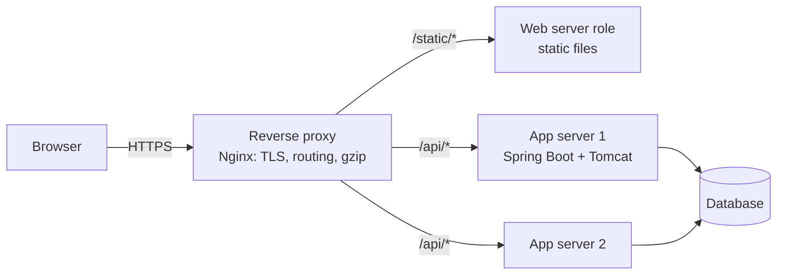

**4. Internal implementation**

- Nginx uses an **event-driven** model: a few worker processes, each handling thousands of connections with `epoll`.
- Tomcat uses a connector + **thread pool**; each request runs your Java code on a worker thread.
- Proxies keep **connection pools** to backends and use health checks to remove dead ones.

**5. Why is it designed this way?**
Each piece does what it's best at: the proxy handles the internet edge (TLS, slow clients, DDoS protection), app servers focus on business logic and can scale horizontally.

**6. Framework differences**
Spring Boot **embeds** Tomcat, so your app *is* an application server. Node.js/Express, Go and ASP.NET Core (Kestrel) also embed their HTTP server; in production all are commonly placed behind a reverse proxy or cloud load balancer.

**7. Practical example**

```nginx
location /api/ { proxy_pass http://localhost:8080; }
location /     { root /var/www/angular-app; try_files $uri /index.html; }
```

**8. How can I observe it?**
Response headers often show `Server: nginx`. In Spring Boot, enable `server.forward-headers-strategy=framework` and log `request.getRemoteAddr()` to see proxy vs real client IP.

---

## Tomcat and Spring Boot

### ❓ How does Tomcat work internally?

### 📝 Answer

**1. What is it?**
Tomcat is a **servlet container**: it accepts HTTP connections, turns raw bytes into `HttpServletRequest` objects, and calls the right **servlet** (in Spring: `DispatcherServlet`).

**2. How does it work internally?**

1. **Connector (Coyote, NIO)**: an **Acceptor** thread accepts TCP connections; a **Poller** thread watches sockets with a selector until data is ready.
2. Ready sockets are handed to a **worker thread** from the executor pool (default max **200** threads).
3. `Http11Processor` parses the HTTP request line and headers.
4. The **CoyoteAdapter** passes it to the **Catalina** container: Engine → Host (virtual host) → Context (web app) → Wrapper (servlet).
5. The request runs the **filter chain**, then `servlet.service()`; the response is written back to the socket.

**3. Visual**

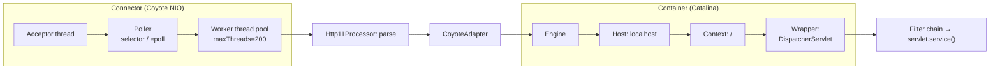

**4. Internal implementation**

- Key settings: `maxThreads` (200), `maxConnections` (8192 for NIO), `acceptCount` (100: OS queue when all connections are busy), `connectionTimeout`.
- Keep-alive connections wait in the Poller **without holding a worker thread**, so 8192 open connections can share 200 threads.
- Each container level has a **pipeline of valves** (e.g. access log valve) before reaching the servlet.

**5. Why is it designed this way?**
NIO + thread pool decouples **connections** (many, mostly idle) from **work** (needs a thread). Thread-per-request keeps your code simple and blocking. Limit: 200 slow requests (e.g. waiting on a DB) exhaust the pool — virtual threads or async help.

**6. Framework differences**
Jetty and Undertow are alternative servlet containers. **Netty** (Spring WebFlux) is event-loop based: few threads, non-blocking code. Node.js is event-loop based; Go uses a goroutine per connection.

**7. Practical example**

```properties
server.tomcat.threads.max=200
server.tomcat.accept-count=100
server.tomcat.max-connections=8192
```

**8. How can I observe it?**
Thread dump (`jcmd <pid> Thread.print`): threads named `http-nio-8080-Acceptor`, `-Poller`, `-exec-N`. Actuator metrics `tomcat.threads.busy` and `tomcat.threads.config.max`.

---

### ❓ How is Tomcat different from the computer's localhost?

### 📝 Answer

**1. What is it?**
They are different kinds of things:

- **localhost** is an **address** (`127.0.0.1`) — "this machine".
- **Tomcat** is a **program** (a Java process, or a library inside your Spring Boot process) that **listens** on a port.

`http://localhost:8080` means: "connect to a program listening on port 8080 **on this machine**" — which happens to be Tomcat.

**2. How does it work internally?**

1. Tomcat starts and binds port 8080 (on all interfaces or only loopback).
2. The browser resolves `localhost` → `127.0.0.1` and connects to port 8080.
3. The OS loopback interface delivers the connection to Tomcat's socket.
4. Stop Tomcat → `localhost` still exists, but `localhost:8080` gives "connection refused" (nobody listening).

**3. Visual**

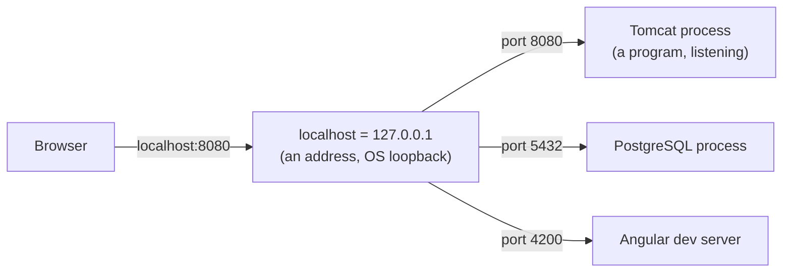

**4. Internal implementation**
The OS keeps a table: port → listening socket → owning process. `localhost` just picks the loopback interface; the **port** picks the program.

**5. Why is it designed this way?**
Addresses and programs are independent so the same Tomcat can be reached as `localhost:8080`, `192.168.1.20:8080` or `shop.com` (behind a proxy) without changes.

**6. Framework differences**
Any server works the same: `localhost:3000` (Express), `localhost:8000` (Django), `localhost:5000` (ASP.NET Core) — the address is always the machine, the port is the program.

**7. Practical example**
Running two Spring Boot apps both on port 8080 fails: the second gets `Port 8080 was already in use`. Same machine (localhost), but only one program can own a port.

**8. How can I observe it?**
`netstat -ano | findstr :8080` → note the PID → Task Manager shows it is `java.exe`. Stop the app and run again: the line disappears, localhost does not.

---

### ❓ How does Spring Boot start its embedded Tomcat server?

### 📝 Answer

**1. What is it?**
Spring Boot includes Tomcat **as a library** (`tomcat-embed-core`) and starts it from Java code during application start-up — no separate Tomcat installation or WAR deployment.

**2. How does it work internally?**

1. `SpringApplication.run()` detects a **servlet** web app (Spring MVC + Tomcat on the classpath).
2. It creates a `ServletWebServerApplicationContext`.
3. During `refresh()`, `onRefresh()` calls `createWebServer()`.
4. Auto-configuration provides a `TomcatServletWebServerFactory` (port, threads, SSL from `server.*` properties).
5. The factory does `new Tomcat()`, configures connector + context, and registers `DispatcherServlet` and filters through `ServletContextInitializer` beans.
6. After all singleton beans are created, the web server **starts** and logs `Tomcat started on port 8080`.

**3. Visual**

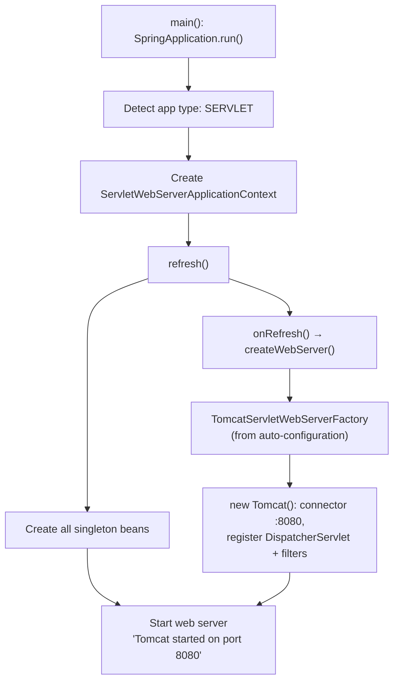

**4. Internal implementation**

- `ServletWebServerFactoryAutoConfiguration` picks Tomcat, Jetty or Undertow based on which is on the classpath (`@ConditionalOnClass`).
- `WebServerFactoryCustomizer` beans apply `server.port`, `server.tomcat.*` etc.
- Starting the server late (after beans are ready) avoids accepting requests before the app can handle them.

**5. Why is it designed this way?**
One self-contained executable JAR ("just run `java -jar`") fits containers and the cloud. The app controls its server version and config. Trade-off: one app per server process instead of many WARs in one shared Tomcat.

**6. Framework differences**
ASP.NET Core starts **Kestrel** in `Program.cs`; Express calls `app.listen(3000)`; Django needs an external WSGI/ASGI server (Gunicorn/Uvicorn). Quarkus/Micronaut embed Vert.x/Netty.

**7. Practical example**
Swap Tomcat for Jetty: exclude `spring-boot-starter-tomcat` and add `spring-boot-starter-jetty` — no code changes; the auto-configuration picks the other factory.

**8. How can I observe it?**
Start with `--debug` → condition report shows `ServletWebServerFactoryConfiguration.EmbeddedTomcat matched`. Logs show `Tomcat initialized with port 8080` then `Tomcat started on port 8080`.

---

### ❓ What happens internally when an HTTP request reaches Spring Boot?

### 📝 Answer

**1. What is it?**
The path a request takes from the network socket to your `@RestController` method and back as a JSON response.

**2. How does it work internally?**

1. **Tomcat** accepts the connection, a worker thread parses HTTP into `HttpServletRequest`.
2. **Filter chain**: encoding, CORS, **Spring Security** (`FilterChainProxy`: authentication, authorization).
3. **DispatcherServlet** receives it.
4. **HandlerMapping** finds the controller method for `GET /orders/42` (`RequestMappingHandlerMapping`).
5. **HandlerAdapter** resolves arguments: `@PathVariable`, `@RequestParam`, `@RequestBody` (JSON → object via **Jackson** `HttpMessageConverter`), runs `@Valid`.
6. **Interceptors** (`preHandle`), then your controller method runs (service → repository → DB).
7. The return value is converted to JSON by Jackson and written to the response; exceptions go to `@ControllerAdvice`.

**3. Visual**

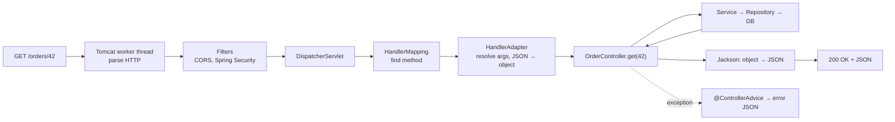

**4. Internal implementation**

- At start-up, `RequestMappingHandlerMapping` scans `@RequestMapping` methods into a lookup map (path patterns + HTTP method + headers).
- `HandlerMethodArgumentResolver` and `HandlerMethodReturnValueHandler` lists decide how each parameter and return value is handled.
- The **same worker thread** runs the whole request (unless async/WebFlux), so `ThreadLocal`s like `SecurityContextHolder` work.

**5. Why is it designed this way?**
The **front controller** pattern (one DispatcherServlet) centralises routing, conversion, validation and error handling, so controllers stay small and testable.

**6. Framework differences**

| Framework | Pipeline |
|---|---|
| ASP.NET Core | Kestrel → middleware pipeline → routing → controller / minimal API |
| Express / NestJS | Node `http` → middleware chain → route handler (Nest adds guards, pipes, interceptors) |
| Django | WSGI/ASGI → middleware → URL resolver → view |
| FastAPI | ASGI (Uvicorn) → Starlette middleware → route → Pydantic validation |

**7. Practical example**

```java
@GetMapping("/orders/{id}")
OrderDto get(@PathVariable long id) { return service.find(id); }   // returned object → JSON
```

**8. How can I observe it?**
`logging.level.org.springframework.web=DEBUG` logs "Mapped to OrderController#get". Put a breakpoint in the controller and look at the **call stack**: you can see Tomcat, filters, DispatcherServlet and the adapter frames.

---

## Spring Container and Request Processing

### ❓ How does Spring Dependency Injection create and manage objects?

### 📝 Answer

**1. What is it?**
The **Spring container** (ApplicationContext) creates your objects (**beans**), wires their dependencies, and manages their lifetime. You declare what you need; Spring builds the object graph.

**2. How does it work internally?**

1. **Find definitions**: component scanning (`@Component`, `@Service`…), `@Bean` methods and auto-configuration → **BeanDefinitions** (class, scope, dependencies).
2. **BeanFactoryPostProcessors** can modify definitions (e.g. resolve `${...}` placeholders).
3. **Instantiate** singletons: choose a constructor; resolve each parameter **by type** (then `@Qualifier` / `@Primary` / parameter name).
4. Dependencies are created first, recursively.
5. **BeanPostProcessors** run (e.g. wrap in AOP proxies), init callbacks (`@PostConstruct`).
6. The finished bean is stored in the **singleton cache** and reused.

**3. Visual**

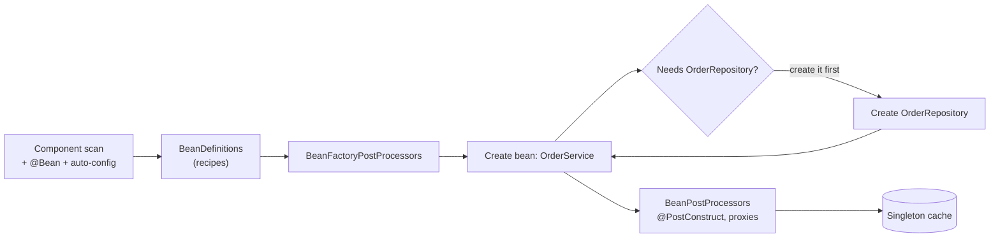

**4. Internal implementation**

- `DefaultListableBeanFactory` holds a map `beanName → BeanDefinition` and the singleton cache.
- Circular dependencies with **constructor injection** fail fast; with field/setter injection Spring could resolve them using **early references** (three-level cache), but since Boot 2.6 circular references are **disallowed by default**.
- Scopes: singleton (default), prototype (new each time), request/session (web).

**5. Why is it designed this way?**
Inversion of Control decouples classes from how their dependencies are built → easy testing (pass mocks) and easy swapping of implementations. Cost: start-up time and "magic" that's harder to trace.

**6. Framework differences**

- **Spring** — reflection-based at runtime (Spring AOT can precompute for native images).
- **Quarkus / Micronaut / Dagger** — DI resolved at **build time** (generated code) → faster start-up.
- **ASP.NET Core** — built-in container with singleton / scoped / transient lifetimes.
- **Angular** — hierarchical injectors (per component tree). **NestJS** — module-based DI similar to Angular.

**7. Practical example**

```java
@Service
class OrderService {
    private final OrderRepository repo;
    OrderService(OrderRepository repo) { this.repo = repo; }   // Spring passes the repository bean
}
```

**8. How can I observe it?**
Actuator `/actuator/beans` lists every bean and its dependencies. `logging.level.org.springframework.beans.factory=DEBUG` logs bean creation. Startup errors like "No qualifying bean of type…" show resolution failures.

---

### ❓ How do Spring AOP, Proxies and @Transactional work internally?

### 📝 Answer

**1. What is it?**
**AOP** (Aspect-Oriented Programming) adds behaviour (transactions, security, logging, caching) **around** your methods without changing them. Spring does it by giving other beans a **proxy** instead of your real object. `@Transactional` is one such aspect.

**2. How does it work internally?**

1. At start-up a `BeanPostProcessor` checks each bean for advised annotations (`@Transactional`, `@Cacheable`, `@PreAuthorize`, custom `@Aspect`s).
2. If found, it creates a **proxy**: a **JDK dynamic proxy** (if proxying by interface) or a **CGLIB subclass** (Spring Boot's default).
3. Other beans receive the proxy. A call goes: proxy → **interceptor chain** → real method.
4. For `@Transactional`, `TransactionInterceptor` asks the **PlatformTransactionManager** to begin a transaction, binds the JDBC connection to the **current thread**, calls the method, then commits or rolls back.

**3. Visual**

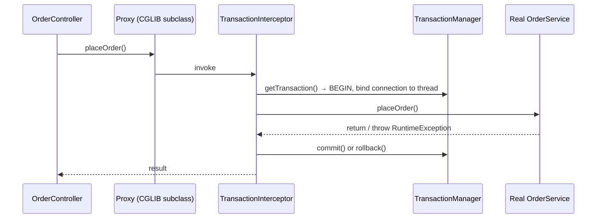

**4. Internal implementation**

- The connection is stored in `TransactionSynchronizationManager` (**ThreadLocal** maps), so repositories on the same thread reuse it.
- Rollback by default only for **unchecked** exceptions (`RuntimeException`, `Error`); configure `rollbackFor` for checked ones.
- **Self-invocation** (`this.otherMethod()`) bypasses the proxy → annotations on the inner method are ignored. CGLIB can't proxy `final` classes/methods; `private` methods are never intercepted.

**5. Why is it designed this way?**
Proxies need no special compiler and work with plain classes. AspectJ **weaving** (compile- or load-time bytecode changes) is more powerful (self-calls, private methods) but adds build complexity.

**6. Framework differences**

- **.NET** — middleware and filters for cross-cutting web concerns; `TransactionScope` for transactions.
- **NestJS** — interceptors and decorators.
- **Python (Django)** — `@transaction.atomic` decorator / context manager.
- **Quarkus** — interceptors generated at build time (no runtime proxy reflection).

**7. Practical example**

```java
@Transactional
public void placeOrder(Order o) {
    orders.save(o);
    stock.decrease(o.items());   // throws → BOTH changes rolled back
}
```

**8. How can I observe it?**
`System.out.println(orderService.getClass())` → `OrderService$$SpringCGLIB$$0`. `logging.level.org.springframework.transaction.interceptor=TRACE` logs "Getting transaction for…" and "Completing transaction for…".

---

### ❓ How does a backend application manage concurrent requests and threads?

### 📝 Answer

**1. What is it?**
Many users send requests at the same time. A backend handles them **concurrently** — usually one thread (or lightweight task) per request — while sharing objects like services and caches safely.

**2. How does it work internally?**

1. Tomcat takes a worker thread from its pool for each request (max 200 by default).
2. That thread runs the whole request: filters → controller → service → DB call (thread **blocks** while waiting).
3. When the response is written, the thread returns to the pool.
4. All threads share the same **singleton beans**, so those beans must be **stateless** or thread-safe.
5. Per-request data lives on each thread's **stack** or in `ThreadLocal`s (security context, transaction).

**3. Visual**

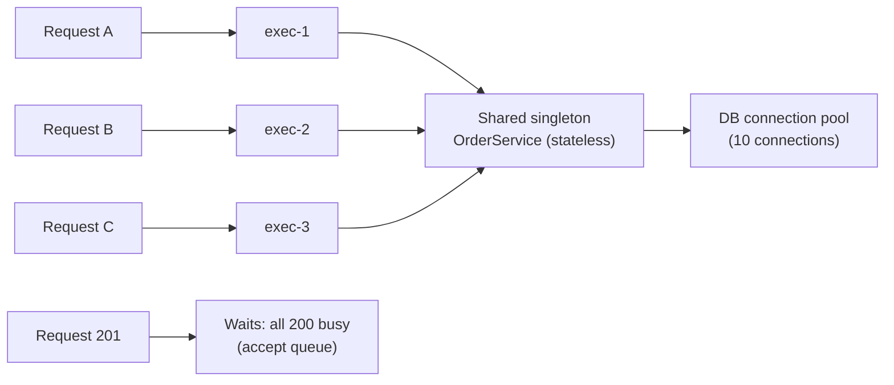

**4. Internal implementation**

- Thread pool = `ThreadPoolExecutor`: core/max threads + a task queue.
- **Java 21 virtual threads** (`spring.threads.virtual.enabled=true`): each request gets a cheap virtual thread; when it blocks on I/O, the JVM unmounts it and reuses the OS thread → thousands of concurrent blocking requests.
- The **real** limit is often downstream: e.g. 200 threads but only 10 DB connections → threads wait for connections.

**5. Why is it designed this way?**
Thread-per-request keeps code simple (normal blocking calls). Costs: each platform thread uses ~1 MB stack and context switches; virtual threads or reactive (WebFlux) remove that limit in different ways.

**6. Language differences**

| Stack | Model |
|---|---|
| Spring MVC | Thread per request (platform or virtual threads) |
| Spring WebFlux / Netty | Event loop + non-blocking I/O, few threads |
| Node.js / Express | Single event loop; async I/O; CPU work blocks everyone |
| Go | Goroutine per request (M:N scheduler) |
| ASP.NET Core | Thread pool + `async/await` (threads freed while awaiting) |
| Python | Gunicorn **processes** (GIL) or async (Uvicorn/FastAPI) |

**7. Practical example**

```java
@Service
class CounterService {
    private int count;                                   // ❌ shared by all threads: race condition
    private final AtomicInteger safe = new AtomicInteger(); // ✅ thread-safe
}
```

**8. How can I observe it?**
Load test with **JMeter** or **k6**; watch Actuator `tomcat.threads.busy` and HikariCP `hikaricp.connections.pending`. A thread dump during load shows how many threads are `WAITING` on the pool or DB.

---

### ❓ How does Connection Pooling work?

### 📝 Answer

**1. What is it?**
Opening a database connection is slow (TCP + TLS + authentication, often 10–100 ms). A **connection pool** opens a set of connections once and **lends** them to requests, then takes them back for reuse.

**2. How does it work internally?**

1. At start-up the pool (HikariCP in Spring Boot) opens `minimumIdle` connections.
2. A request calls `dataSource.getConnection()` → gets an **idle** connection (or waits up to `connectionTimeout`, default 30 s, then fails).
3. The app gets a **proxy** connection; calling `close()` doesn't close the socket — it **returns** the connection to the pool.
4. The pool validates connections, retires them after `maxLifetime` (default 30 min), and keeps at most `maximumPoolSize` (default **10**).

**3. Visual**

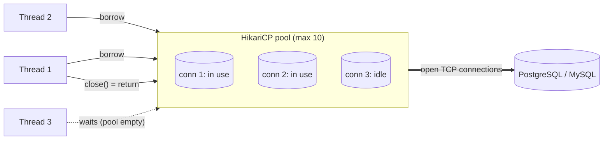

**4. Internal implementation**

- HikariCP uses a lock-free **ConcurrentBag** with thread-local lists so a thread often gets back the same connection it used last.
- Leak detection (`leakDetectionThreshold`) logs a stack trace if a connection is held too long.
- `@Transactional` holds one connection for the whole transaction; long transactions starve the pool.

**5. Why is it designed this way?**
Reusing connections removes connection set-up from every request and **caps** the load on the database (the DB can only handle so many sessions). A small pool is often faster than a big one: the DB has limited CPU cores and disks.

**6. Language differences**
Java: HikariCP, Tomcat JDBC. .NET: pooling built into ADO.NET providers (by connection string). Node.js: `pg.Pool`, mysql2 pool. Python: SQLAlchemy pool. Go: `database/sql` has a built-in pool. Large deployments add a server-side pooler like **PgBouncer**.

**7. Practical example**

```properties
spring.datasource.hikari.maximum-pool-size=10
spring.datasource.hikari.connection-timeout=3000
spring.datasource.hikari.leak-detection-threshold=20000
```

**8. How can I observe it?**
Actuator metrics `hikaricp.connections.active`, `.idle`, `.pending`. Database side: `SELECT * FROM pg_stat_activity;` (PostgreSQL) or `SHOW PROCESSLIST;` (MySQL) shows the pool's open sessions.

---

### ❓ How do Authentication and Authorization work internally?

### 📝 Answer

**1. What is it?**

- **Authentication** — proving **who** the caller is (password, token, certificate).
- **Authorization** — deciding **what** they may do (roles, permissions, ownership).

In Spring Boot both are done by **Spring Security filters** before your controller runs.

**2. How does it work internally?**

1. `FilterChainProxy` picks the matching `SecurityFilterChain` for the URL.
2. An **authentication filter** extracts credentials: form login (`UsernamePasswordAuthenticationFilter`) or a JWT (`BearerTokenAuthenticationFilter`).
3. `AuthenticationManager` → `AuthenticationProvider`:
   - Password: load the user (`UserDetailsService`) and check the hash (`PasswordEncoder`, e.g. BCrypt).
   - JWT: verify the **signature** with the issuer's key and check `exp`, `iss`, `aud`.
4. On success, an `Authentication` (user + authorities) is put in the **SecurityContext** (ThreadLocal).
5. `AuthorizationFilter` checks URL rules; `@PreAuthorize` checks method rules (via an AOP proxy).
6. Failure → `401 Unauthorized` (not authenticated) or `403 Forbidden` (not allowed).

**3. Visual**

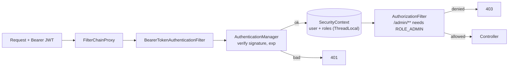

**4. Internal implementation**

- Passwords are never stored; **BCrypt** stores salt + hash and is deliberately slow (cost factor) to resist brute force.
- JWT verification: `base64(header).base64(payload)` is signed with HMAC (shared secret) or RSA/ECDSA (private key); the server recomputes/verifies the signature with the key — no DB lookup needed.
- Sessions (stateful): `JSESSIONID` cookie → server-side session holds the SecurityContext.

**5. Why is it designed this way?**
A filter chain keeps security out of business code and ensures nothing reaches a controller unchecked. Stateless JWTs scale across many servers; sessions are easier to revoke.

**6. Framework differences**
ASP.NET Core: authentication + authorization **middleware** with policies. NestJS: Passport strategies + **guards**. Django: `AuthenticationMiddleware` + permission decorators. Express: Passport.js or custom middleware.

**7. Practical example**

```java
http.authorizeHttpRequests(a -> a
        .requestMatchers("/admin/**").hasRole("ADMIN")
        .anyRequest().authenticated())
    .oauth2ResourceServer(o -> o.jwt(Customizer.withDefaults()));
```

**8. How can I observe it?**
`logging.level.org.springframework.security=TRACE` prints every filter and the decision. Paste a token into **jwt.io** to see its claims. Browser DevTools → Network shows 401 vs 403.

---

### ❓ How do Exception Handling, Retries and Timeouts work internally?

### 📝 Answer

**1. What is it?**

- **Exception handling** — when something fails, an exception object travels **up the call stack** until code catches it.
- **Retries** — repeat a failed call that might succeed next time (temporary network or service errors).
- **Timeouts** — stop waiting after a limit, so one slow dependency can't hold threads forever.

**2. How does it work internally?**
Exceptions (Java):

1. `throw` creates an exception object (capturing the **stack trace**).
2. The JVM looks in the current method's **exception table** for a matching `catch` range; if none, the frame is popped (**stack unwinding**) and it checks the caller, and so on.
3. In Spring MVC, an uncaught exception reaches `DispatcherServlet` → `HandlerExceptionResolver`s → your `@ControllerAdvice` → error response.

Retries and timeouts:

4. A client sets **connect** and **read** timeouts on the socket; the OS/runtime aborts the wait and throws (`SocketTimeoutException`).
5. A retry policy catches retryable errors and tries again after a **backoff** delay (exponential + random jitter), up to N attempts.

**3. Visual**

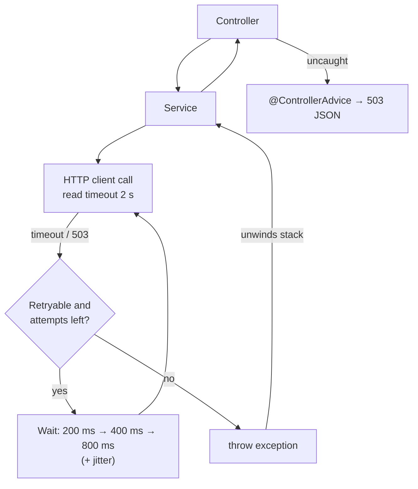

**4. Internal implementation**

- `try` costs almost nothing in Java; **throwing** is expensive mainly because of filling the stack trace.
- Spring Retry / **Resilience4j** wrap calls (often with AOP: `@Retry`, `@TimeLimiter`, `@CircuitBreaker`).
- Only retry **idempotent** operations (or use idempotency keys) — retrying a non-idempotent `POST /payments` can charge twice.

**5. Why is it designed this way?**
Exceptions separate error handling from normal flow. Timeouts + limited retries with backoff recover from brief failures without overloading a struggling service (retry storms).

**6. Language differences**

| Language | Errors |
|---|---|
| Java | Checked + unchecked exceptions |
| C# / Python / JavaScript | Unchecked exceptions only (`try/catch`, `try/except`); JS async errors = rejected promises |
| C++ | Exceptions (zero-cost tables) or error codes |
| Go | No exceptions: errors are **return values** (`if err != nil`); `panic` for fatal cases |
| Rust | `Result<T, E>` + `?` operator; `panic!` for bugs |

**7. Practical example**

```java
RestClient client = RestClient.builder()
    .requestFactory(new JdkClientHttpRequestFactory(
        HttpClient.newBuilder().connectTimeout(Duration.ofSeconds(1)).build()))
    .build();

@Retry(name = "inventory")    // Resilience4j: maxAttempts + exponential backoff in config
public Stock check(long id) { return client.get().uri("/stock/{id}", id).retrieve().body(Stock.class); }
```

**8. How can I observe it?**
Simulate a slow dependency with **WireMock** (fixed delay) or **Toxiproxy**; watch logs for retry attempts and Resilience4j metrics in Actuator (`resilience4j.retry.calls`). IntelliJ "Exception breakpoints" stop where an exception is thrown.
