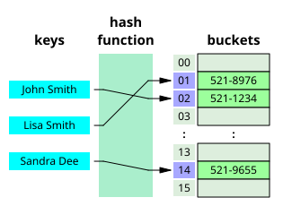
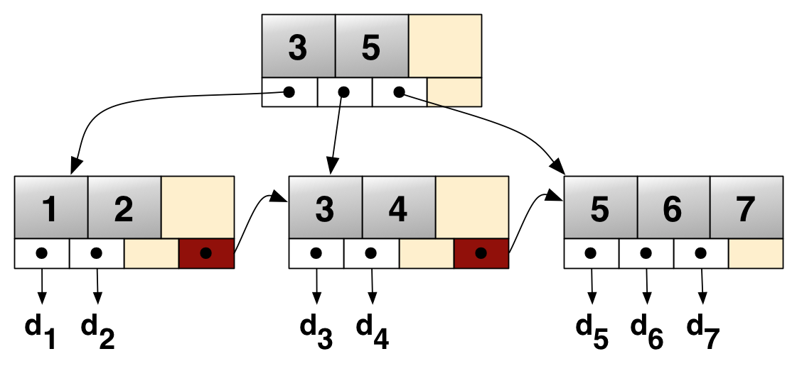

# 🧱 Inside Common Data Structures

## Inside common data structures (ideas apply to every language; Java examples)

### ❓ How does a HashMap work internally?

**Generic answer:** A HashMap stores key–value pairs in an array of buckets and uses the key's hash to jump straight to the right bucket, giving average O(1) lookup.

**Under the hood:**

Imagine one million employee records, and you need the employee with ID `EMP101`. Checking each record one by one is O(n) — up to a million comparisons. We need to jump straight to the answer.

**Step 1: Turn the key into a number (hashing)**

Java calls `"EMP101".hashCode()` and gets a number. The same key always gives the same number.

**Analogy:** a library with 26 shelves labelled A–Z. To find "Harry Potter" you go straight to shelf **H** — the first letter is the "hash".

**Step 2: Turn the number into a bucket**

HashMap keeps an **array of buckets** (16 by default). The hash becomes an index: `hash & (capacity − 1)`.

```text
Index 0 → Entry
Index 1 → Entry
Index 2 → (empty)
Index 3 → Entry
```

`map.put("EMP101", emp)` stores the entry in that bucket.

**Step 3: The collision problem**

Two different keys can land in the same bucket:

```text
EMP101 → bucket 5
EMP205 → bucket 5
```

**Step 4: Handle collisions**

The bucket keeps a small **linked list** of entries. Since Java 8, if one bucket gets more than 8 entries (and the table has at least 64 buckets), the list becomes a **red-black tree**, so the worst case is O(log n), not O(n).



_Image: [Wikimedia Commons](https://commons.wikimedia.org/wiki/File:Hash_table_3_1_1_0_1_0_0_SP.svg) · Jorge Stolfi · CC BY-SA 3.0_

**Step 5: Resize when it gets crowded**

When entries exceed capacity × **load factor 0.75** (12 of 16), the array **doubles** and entries are re-spread ("rehashing"), keeping buckets short.

**Step 6: Retrieval — `map.get("EMP101")`**

1. Compute the key's hash.
2. Find the bucket index.
3. Go to that bucket.
4. Compare entries by hash, then `equals()`.
5. Return the value.

**Trap:** override **both** `equals()` and `hashCode()` for your own key classes, or lookups fail.

**Final understanding:** **Slow linear search → hash the key → jump to a bucket → handle collisions with lists/trees → resize to stay fast → average O(1).**

#### ↳ Follow-up: Why can't you get the key back from its hash?

↪ Hashing is one-way and squeezes many possible keys into a fixed range of numbers, so different keys can share a hash. The map keeps the real key in the bucket for exactly that reason.

---

### ❓ How do ArrayList and LinkedList store data differently?

**Generic answer:** ArrayList keeps elements in one continuous array (fast index access); LinkedList keeps each element in a separate node pointing to the next (fast insert at a known node, slow access by index).

**Under the hood:**

Imagine a list of 1 million orders, and you need order number 500,000. How fast you can get it depends entirely on how the list is laid out in memory.

**Step 1: ArrayList — one block of memory**

Elements sit side by side in an array. The address of element *i* is calculated (`start + i × size`), so `get(i)` is **O(1)**.

**Step 2: The cost of inserting in the middle**

Inserting at position 10 shifts every later element one place right — O(n). When the array is full, ArrayList allocates a bigger one (about 1.5×) and copies everything.

**Step 3: LinkedList — a chain of nodes**

Each element lives in its own **node** with pointers to the next and previous node. Inserting at a node you already hold is O(1) — just change two pointers.


_Image: [Wikimedia Commons](https://commons.wikimedia.org/wiki/File:Singly-linked-list.svg) · Lasindi · Public domain_

**Step 4: The catch**

Finding element *i* means walking the chain — **O(n)**. Nodes are scattered in memory, so the CPU cache helps little (see *CPU cache, RAM and disk*).

**Step 5: In practice**

Use **ArrayList** almost always — continuous memory is cache-friendly and wins even for many inserts. Use `ArrayDeque` for queues and stacks.

**Final understanding:** **Layout decides speed: continuous array → instant index, costly middle inserts; linked nodes → cheap relinking, slow walking.**

---

### ❓ How do stacks, queues and heaps work?

**Generic answer:** A stack is last-in-first-out, a queue is first-in-first-out, and a heap (priority queue) always gives you the smallest (or largest) item first.

**Under the hood:**

Imagine three situations: undoing your last edit, serving customers in arrival order, and treating the most urgent patient first. Each needs a different "who goes next?" rule.

**Step 1: Stack — last in, first out**

Push on top, pop from top, O(1). Used for undo, matching brackets, and the program's **call stack**.

**Step 2: Queue — first in, first out**

Add at the back, take from the front, O(1). Used for task queues and breadth-first search.

**Step 3: Heap — most important first**

A **binary heap** is a tree stored in an array where each parent is smaller than its children. The smallest item is always at the top (peek O(1)); adding or removing re-balances along one path (O(log n)).

| Structure | Order | Main operations | Real use |
|---|---|---|---|
| **Stack** | Last in, first out | push, pop — O(1) | Undo, call stack |
| **Queue** | First in, first out | add, poll — O(1) | Task queues, BFS |
| **Heap / priority queue** | Smallest first | add, poll — O(log n); peek — O(1) | Scheduling, "top K", Dijkstra |

**Example:** a hospital emergency room is a **priority queue** — the most urgent patient goes first. Java: `PriorityQueue`.

**Final understanding:** **The "who's next?" rule picks the structure: latest → stack, earliest → queue, most important → heap.**

---

### ❓ How do trees like the B+ tree speed up searching?

**Generic answer:** A balanced search tree keeps data sorted so each step cuts the search space; a B+ tree holds many keys per node, so even millions of entries are only a few levels deep.

**Under the hood:**

Imagine 1 million sorted entries on disk. Every disk read is slow, so the goal is the **fewest reads** possible.

**Step 1: Binary trees — good in memory**

A binary search tree (or red-black tree, used by `TreeMap`) halves the search at each node: ~20 steps for a million entries. Fine in RAM, but 20 disk reads is too many.

**Step 2: Make each node wide**

A **B-tree** stores many keys per node (sized to one disk page), so each read cuts the search space by ~100, not 2.

```text
                 [40 | 80]
                /    |    \
          [10,20] [50,60] [90,100]
```

Searching 60: compare with 40 and 80 → go to the middle child → found.

**Step 3: B+ tree — data only in the leaves**

Internal nodes only guide the search; all entries sit in the **leaves**, which are **linked** for fast range scans (`BETWEEN`, `ORDER BY`).



_Image: [Wikimedia Commons](https://commons.wikimedia.org/wiki/File:Bplustree.png) · Grundprinzip · CC BY 3.0_

**Step 4: The numbers**

With ~100 keys per node, 3 levels address 100 × 100 × 100 = **1 million** entries — about **3 reads**. This is how database indexes work (see *Inside a database*).

**Final understanding:** **Few disk reads wanted → wide nodes (B-tree) → data in linked leaves (B+ tree) → a few reads find any row, ranges scan easily.**
