# 🔩 Under the Hood: Database Internals

How a relational database stores rows on disk, finds them with indexes, plans queries, runs transactions safely and survives crashes. Examples use MySQL (InnoDB) and PostgreSQL.

## Storage on Disk

### ❓ How does a database physically store records on disk?

### 📝 Answer

**1. What is it?**
A table is stored in **files** on disk. Each file is divided into fixed-size **pages** (InnoDB: 16 KB, PostgreSQL: 8 KB), and rows are packed inside pages. The database always reads and writes **whole pages**, never single rows.

**2. How does it work internally?**

1. `INSERT` → the engine finds a page with free space (or allocates a new one).
2. The row is written into that page **in memory** (the buffer pool), and a change record goes to the **write-ahead log**.
3. The modified ("dirty") page is written back to the data file later, in the background.
4. `SELECT` → the engine locates the right page (via an index or by scanning), loads it into memory if needed, and reads the row.

**3. Visual**

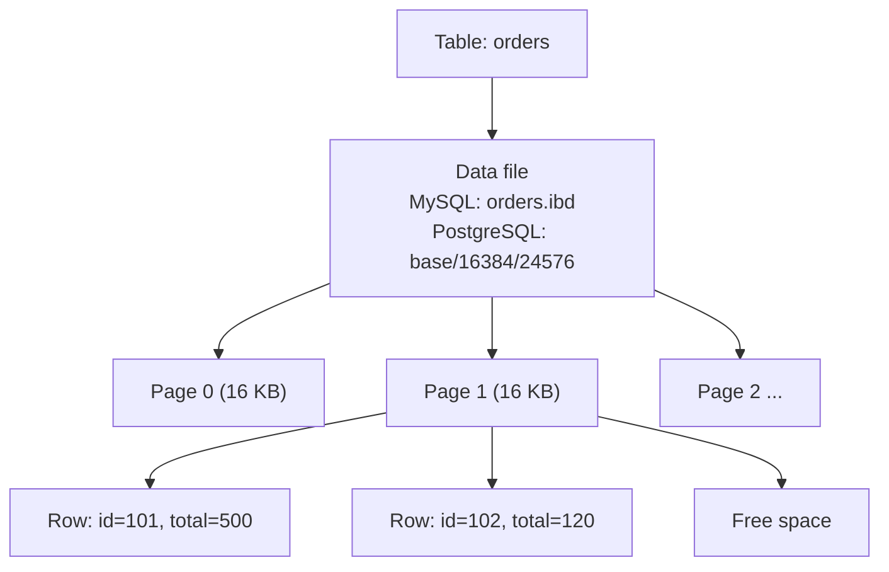

**4. Internal implementation**

- **InnoDB** stores the table **as** its primary-key B+ tree (clustered index): leaf pages contain the full rows, sorted by primary key.
- **PostgreSQL** stores rows in an unordered **heap** file; every index (including the primary key) points to a row's location `(page, slot)` called the **ctid**.
- Large values (long text, JSON) are stored **off-page** (InnoDB overflow pages, PostgreSQL TOAST).

**5. Why is it designed this way?**
Disks and SSDs transfer data in blocks, so reading 16 KB costs about the same as reading 100 bytes. Grouping rows into pages and caching pages makes I/O efficient.

**6. Database differences**

| | MySQL InnoDB | PostgreSQL | SQL Server |
|---|---|---|---|
| Page size | 16 KB | 8 KB | 8 KB |
| Table layout | Clustered by primary key | Heap (unordered) | Clustered index or heap |
| Old row versions | Undo log | Stored in the table (dead tuples, needs VACUUM) | tempdb version store (with snapshot isolation) |

**7. Practical example**
`orders` with 1 million rows of ~200 bytes → about 80 rows per 16 KB page → ~12,500 pages ≈ 200 MB file.

**8. How can I observe it?**
MySQL: look in the data directory for `orders.ibd`; `SHOW TABLE STATUS LIKE 'orders'` (rows, data length). PostgreSQL: `SELECT pg_relation_filepath('orders'), pg_relation_size('orders');` and `SELECT ctid, * FROM orders LIMIT 5;`.

---

### ❓ What are Database Pages, Blocks and Rows?

### 📝 Answer

**1. What is it?**

- **Block** — the unit the OS/disk reads (often 4 KB).
- **Page** — the database's unit of storage and I/O (8 KB or 16 KB), made of one or more blocks.
- **Row** (tuple/record) — one record of a table, stored inside a page with a small header.

**2. How does it work internally?**

1. Each page has a **header** (page ID, LSN of the last change, checksum, free-space pointers).
2. A **slot directory** (PostgreSQL: line pointers) lists where each row starts in the page.
3. Rows grow from one end, the slot array from the other; free space sits in between.
4. Reading a row: page ID → load page → slot number → offset → row bytes → decode columns using the table schema.

**3. Visual**

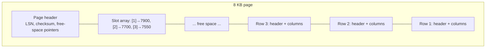

**4. Internal implementation**

- PostgreSQL row header (~23 bytes) stores **xmin/xmax** (which transactions created/deleted it) for MVCC.
- InnoDB row header stores the **transaction ID** and a **roll pointer** to the undo log.
- **NULLs** are tracked in a null bitmap, so they take almost no space.
- **Fill factor** leaves free space in pages for future updates (fewer page splits / allows HOT updates in PostgreSQL).

**5. Why is it designed this way?**
Fixed-size pages make caching, writing and checksumming simple. The slot directory lets rows move within a page (e.g. during compaction) without changing their external address.

**6. Database differences**
Column stores (ClickHouse, Redshift, Snowflake) store **columns** together instead of rows → great for analytics (`SUM(price)` reads only one column), worse for single-row updates.

**7. Practical example**
Updating one `INT` column in one row still makes the engine write the whole 16 KB page eventually (plus a small WAL record now).

**8. How can I observe it?**
PostgreSQL `pageinspect` extension: `SELECT * FROM heap_page_items(get_raw_page('orders', 0));` shows each row's offset, xmin and xmax. MySQL: `innodb_page_size` variable; `information_schema.INNODB_BUFFER_PAGE`.

---

## Indexes

### ❓ How does Database Indexing work internally?

### 📝 Answer

**1. What is it?**
An **index** is a separate, sorted data structure (usually a **B+ tree**) that maps column values to row locations — like a book's index mapping words to page numbers. It turns "scan every row" into "jump to the right rows".

**2. How does it work internally?**

1. `CREATE INDEX idx_email ON users(email)` sorts all `(email, row pointer)` pairs into a B+ tree.
2. `WHERE email = 'a@x.com'`: start at the root page, compare keys, follow child pointers down to a leaf (3–4 page reads for millions of rows).
3. The leaf entry gives the row location; read the row from the table (unless the index already has every needed column).
4. Every `INSERT`/`UPDATE`/`DELETE` also updates every index on the table.

**3. Visual**

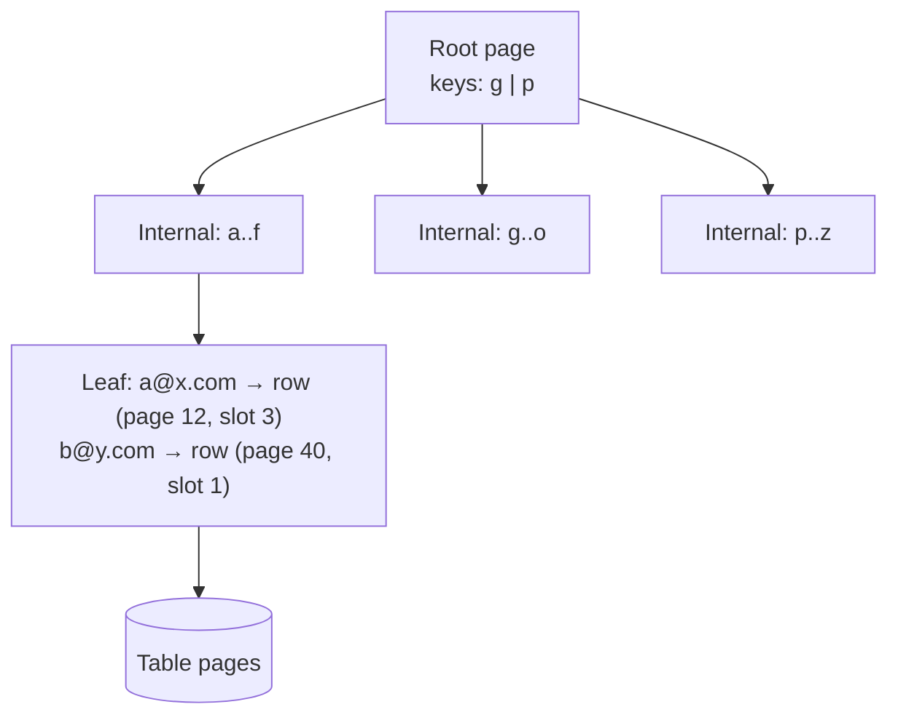

**4. Internal implementation**

- Each B+ tree node **is a page**; one 16 KB page holds hundreds of keys (**high fan-out**), so a tree with 3 levels covers ~10–100 million rows.
- Leaves are **linked** in key order → range scans (`BETWEEN`, `ORDER BY`) walk sideways.
- Inserting into a full page causes a **page split**; random keys (UUIDv4) split pages everywhere, sequential keys (auto-increment, UUIDv7) append at the right edge.

**5. Why is it designed this way?**
Disk reads are the main cost; a shallow, wide tree minimises them. The trade-off: extra storage and slower writes for every index.

**6. Other index types**
**Hash** indexes (equality only), **GIN** (PostgreSQL: arrays, JSONB, full-text), **GiST** (geometry, ranges), **BRIN** (huge naturally ordered tables), **bitmap** indexes (Oracle, data warehouses).

**7. Practical example**

```sql
CREATE INDEX idx_orders_customer ON orders(customer_id);
SELECT * FROM orders WHERE customer_id = 42;   -- now an index lookup instead of a full scan
```

**8. How can I observe it?**
`EXPLAIN SELECT ...` before and after creating the index: MySQL `type: ALL` → `ref`, PostgreSQL `Seq Scan` → `Index Scan`. `EXPLAIN ANALYZE` shows real time and rows.

---

### ❓ How do B-Tree and B+ Tree work? Why are B+ Trees commonly used?

### 📝 Answer

**1. What is it?**
Both are **balanced search trees** designed for disks: each node holds many sorted keys and has many children, so the tree stays very shallow.

- **B-Tree**: keys **and data** can be in any node.
- **B+ Tree**: internal nodes hold **only keys** (signposts); **all data is in the leaves**, and leaves are **linked**.

**2. How does it work internally?**
Search: start at the root, binary-search the keys in the node, follow the right child pointer, repeat until the leaf.
Insert:

1. Find the leaf and insert the key in sorted position.
2. If the leaf overflows, **split** it in two and push the middle key up to the parent.
3. Splits can go up to the root; a root split adds a level — the tree grows **from the top**, so all leaves stay at the same depth.

Delete: remove from the leaf; if it becomes too empty, **borrow** from a sibling or **merge** with it.

**3. Visual**

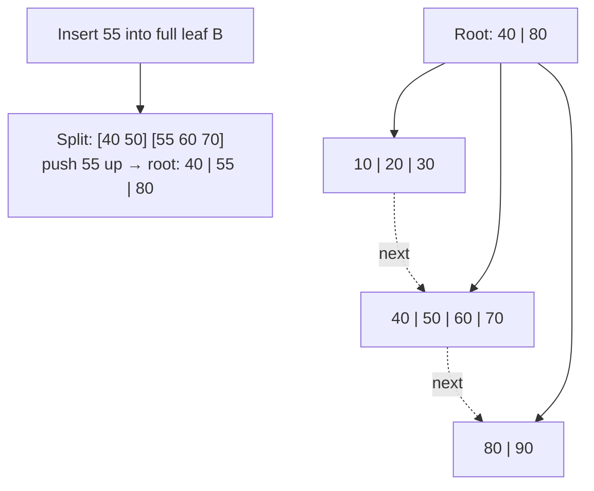

**4. Internal implementation**

- Node size = one page; order (max children) is in the hundreds.
- Height for N keys ≈ log_fanout(N): with fan-out 500, 3 levels ≈ 125 million keys.
- Concurrency: databases use **latch crabbing** (lock a child before releasing its parent) or B-link trees so many threads can read and write at once.

**5. Why is it designed this way? Why B+?**

- Internal nodes without data hold **more keys** → higher fan-out → fewer levels → fewer disk reads.
- **Linked leaves** → range scans and `ORDER BY` without going back up the tree.
- Every lookup ends at a leaf → **predictable** cost.
- Alternatives: hash indexes (no ranges), **LSM trees** (RocksDB, Cassandra: faster writes, slower reads).

**6. Database differences**
MySQL InnoDB, PostgreSQL, SQL Server, Oracle all use B+ tree variants for normal indexes. MongoDB (WiredTiger) also uses B-trees. Cassandra, RocksDB and many time-series DBs use LSM trees.

**7. Practical example**
`SELECT * FROM orders WHERE id BETWEEN 1000 AND 1100;` → one root-to-leaf descent to 1000, then follow leaf links until 1100.

**8. How can I observe it?**
Online visualiser: "B+ Tree Visualization" (cs.usfca.edu/~galles/visualization/BPlusTree.html) — insert keys and watch splits. PostgreSQL `pageinspect`: `bt_metap('idx_name')` shows tree height (level).

---

### ❓ How do Clustered, Non-Clustered and Composite Indexes work?

### 📝 Answer

**1. What is it?**

- **Clustered index** — the table **itself** is stored sorted by this key; leaf pages contain the full rows. Only one per table.
- **Non-clustered (secondary) index** — a separate tree whose leaves store the key + a **pointer** to the row.
- **Composite index** — an index on **several columns**, sorted by the first column, then the second, and so on.

**2. How does it work internally?**

1. **InnoDB**: the primary key is the clustered index. A secondary index leaf stores `(email, primary key)`.
2. Lookup by a secondary index: search the secondary tree → get the primary key → search the clustered tree → get the row (**two tree lookups**, a "bookmark lookup").
3. If the secondary index already contains every column the query needs, step 2's second lookup is skipped: a **covering index**.
4. Composite `(last_name, first_name)`: usable for `last_name = ?` or `last_name = ? AND first_name = ?`, but **not** for `first_name = ?` alone (**leftmost prefix rule**).

**3. Visual**

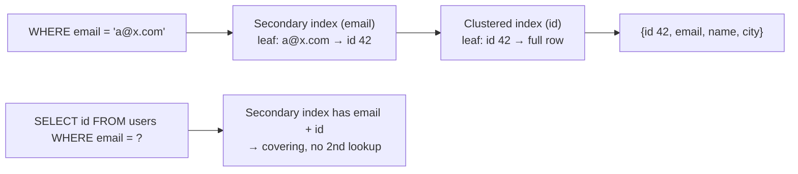

**4. Internal implementation**

- InnoDB secondary indexes store the **primary key**, so a wide primary key (e.g. a long string) makes every secondary index bigger.
- PostgreSQL has no clustered index in this sense: all indexes point to the heap by `ctid`; `INCLUDE (cols)` adds payload columns for covering; index-only scans need the visibility map.
- Composite indexes order: put **equality** columns first, then the **range/sort** column.

**5. Why is it designed this way?**
Clustering makes primary-key lookups and PK range scans very fast (rows are physically together). Secondary indexes give flexibility at the cost of an extra hop and extra writes.

**6. Database differences**
SQL Server: choose any clustered index (default = PK) and `INCLUDE` columns. MySQL InnoDB: always clustered by PK (or a hidden row ID). PostgreSQL: heap + `CLUSTER` command does a one-time reorder only.

**7. Practical example**

```sql
CREATE INDEX idx_orders_cust_date ON orders(customer_id, created_at);
SELECT * FROM orders WHERE customer_id = 42 ORDER BY created_at DESC LIMIT 10;
-- uses the index for both the filter and the sort: no extra sorting step
```

**8. How can I observe it?**
MySQL `EXPLAIN`: `Extra: Using index` = covering; `key_len` shows how many columns of a composite index were used. PostgreSQL: `Index Only Scan` vs `Index Scan` in `EXPLAIN`.

---

### ❓ How does a database decide between Index Seek and Table Scan?

### 📝 Answer

**1. What is it?**

- **Index seek** — use the index to jump to matching rows.
- **Table scan** — read every page of the table sequentially.

The **optimizer** estimates the cost of each and picks the cheaper one. An index is **not always** faster.

**2. How does it work internally?**

1. Estimate **selectivity**: what fraction of rows match (from statistics: histograms, distinct counts).
2. Index cost ≈ tree descent + one **random** page read per matching row (worse if rows are scattered).
3. Scan cost ≈ number of pages × **sequential** read cost (cheap per page, read-ahead helps).
4. Compare; few matching rows → index seek; a large share (often roughly 5–20%, depends on data) → full scan.

**3. Visual**

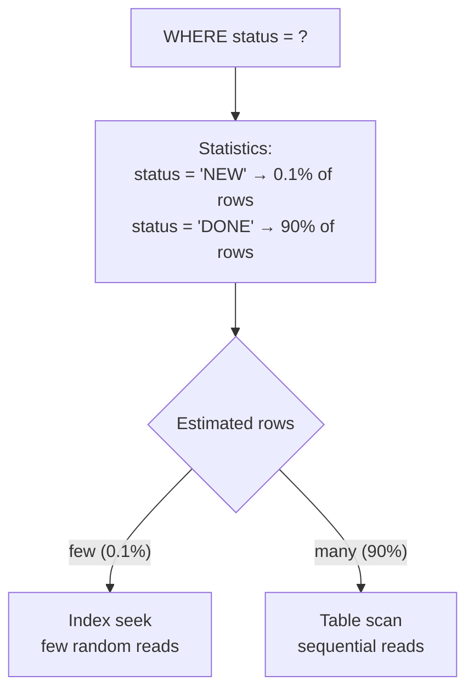

**4. Internal implementation**

- PostgreSQL cost constants: `seq_page_cost = 1`, `random_page_cost = 4` (often lowered to ~1.1 on SSDs), `cpu_tuple_cost`.
- **Bitmap index scan** (PostgreSQL) is a middle path: collect matching row locations, sort them by page, then read pages in order.
- **Correlation** matters: if the table is physically ordered like the index, index range reads are nearly sequential.

**5. Why is it designed this way?**
Random reads cost more than sequential reads (especially on HDDs). Reading 90% of rows through an index means jumping around for almost every row — slower than just reading the whole table once.

**6. Database differences**
All cost-based optimizers do this (MySQL, PostgreSQL, SQL Server, Oracle). Wrong decisions usually come from **stale statistics** or functions on the column (`WHERE LOWER(email) = ?` can't use a plain index on `email`).

**7. Practical example**

```sql
EXPLAIN SELECT * FROM orders WHERE status = 'NEW';    -- Index Scan (rare value)
EXPLAIN SELECT * FROM orders WHERE status = 'DONE';   -- Seq Scan (most rows)
```

**8. How can I observe it?**
`EXPLAIN ANALYZE` shows estimated vs actual rows — big differences mean bad statistics; run `ANALYZE orders;` (PostgreSQL) or `ANALYZE TABLE orders;` (MySQL). SQL Server: execution plan "Index Seek" vs "Clustered Index Scan" and `SET STATISTICS IO ON` (logical reads).

---

## Query Processing

### ❓ How does the SQL Query Optimizer select an execution plan?

### 📝 Answer

**1. What is it?**
SQL says **what** you want, not **how** to get it. The **optimizer** turns a query into an **execution plan** (which indexes, which join order, which join algorithm) and picks the plan with the lowest **estimated cost**.

**2. How does it work internally?**

1. **Parse** — SQL text → syntax tree; check tables and columns exist.
2. **Rewrite** — simplify: expand views, flatten subqueries, push filters down, remove redundant conditions.
3. **Enumerate plans** — access paths per table (scan, index, bitmap) × join orders × join algorithms.
4. **Estimate cost** of each using **statistics** (row counts, distinct values, histograms, most-common values) → estimated rows → estimated I/O and CPU.
5. **Pick the cheapest** and hand it to the executor.

**3. Visual**

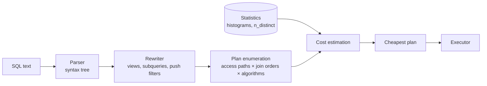

**4. Internal implementation**

- Join order search uses **dynamic programming** (best plan for each subset of tables); with many tables PostgreSQL switches to a genetic algorithm (GEQO, default from 12 tables).
- Estimates assume column **independence** by default — correlated columns (city + zip code) cause bad estimates; extended statistics fix that.
- Plans are cached for **prepared statements** (risk: a plan good for one parameter value is bad for another — "parameter sniffing" in SQL Server).

**5. Why is it designed this way?**
The number of possible plans grows exponentially; a cost model with statistics finds a good plan quickly without running every option. It is only as good as its statistics.

**6. Database differences**
PostgreSQL: no query hints (extension `pg_hint_plan` exists). MySQL, SQL Server, Oracle support hints (`USE INDEX`, `OPTION (RECOMPILE)`). Oracle and SQL Server can adapt plans at runtime (adaptive joins).

**7. Practical example**

```sql
EXPLAIN ANALYZE
SELECT c.name, COUNT(*) FROM customers c JOIN orders o ON o.customer_id = c.id
WHERE c.city = 'Pune' GROUP BY c.name;
```

The plan shows: filter customers by city first (small), then join orders via `idx_orders_customer` — not the other way round.

**8. How can I observe it?**
PostgreSQL `EXPLAIN (ANALYZE, BUFFERS)`; MySQL `EXPLAIN FORMAT=TREE` / `EXPLAIN ANALYZE`; SQL Server "Include Actual Execution Plan" in SSMS. Visualise PostgreSQL plans at **explain.dalibo.com**.

---

### ❓ How do JOIN operations work internally?

### 📝 Answer

**1. What is it?**
A JOIN combines rows from two inputs where a condition matches (`o.customer_id = c.id`). Internally it is an **operator** in the execution plan that receives rows from two child operators and outputs matched pairs.

**2. How does it work internally?**

1. The optimizer picks a **join order** (which table first) and an **algorithm** for each join: nested loop, hash join or merge join.
2. The executor runs plans as a tree of operators using the **iterator (Volcano) model**: each operator asks its children for "next row".
3. For a 3-table join, the result of the first join becomes the input of the second.
4. Filters are applied as early as possible so joins process fewer rows.

**3. Visual**

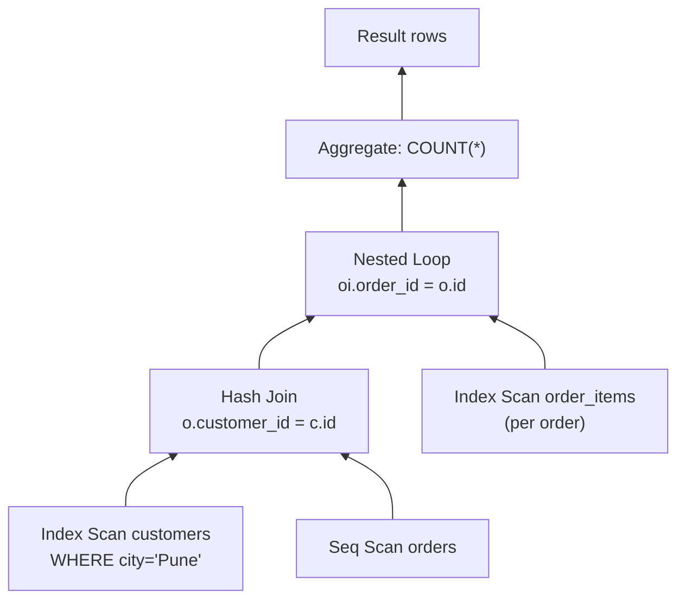

**4. Internal implementation**

- **INNER JOIN**: output only matches. **LEFT JOIN**: also output unmatched left rows with NULLs (the algorithm tracks which left rows matched).
- **Semi-join** (`EXISTS`, `IN`): stop at the first match per row. **Anti-join** (`NOT EXISTS`): output rows with no match.
- Join order matters hugely: joining the smallest filtered sets first keeps intermediate results small.

**5. Why is it designed this way?**
Composable operators let the database build any query from a few building blocks and stream rows without materialising everything in memory.

**6. Database differences**
MySQL supported only nested-loop joins until **8.0.18** added hash joins; PostgreSQL, SQL Server and Oracle have all three algorithms. Distributed databases add **broadcast** and **shuffle** joins across nodes.

**7. Practical example**

```sql
SELECT c.name, o.total
FROM customers c JOIN orders o ON o.customer_id = c.id
WHERE c.city = 'Pune';
```

**8. How can I observe it?**
`EXPLAIN` shows the operator tree (indentation = parent/child). Look for `Hash Join`, `Nested Loop`, `Merge Join` and the estimated vs actual row counts at each level.

---

### ❓ How do Nested Loop, Hash Join and Merge Join differ?

### 📝 Answer

**1. What is it?**
Three algorithms for matching rows between two inputs:

| Algorithm | Idea | Best when |
|---|---|---|
| **Nested loop** | For each outer row, look up matching inner rows | Outer side is small and inner has an index |
| **Hash join** | Build a hash table on the smaller input, probe it with the other | Large inputs, equality condition, no useful index |
| **Merge join** | Walk two **sorted** inputs side by side | Both inputs already sorted (indexes) or large range joins |

**2. How does it work internally?**

- **Nested loop**: `for o in outer: for i in inner where i.key = o.key: emit`. With an index on the inner key, each lookup is a B+ tree descent.
- **Hash join**: (1) **build**: read the smaller input into a hash table keyed by the join column; (2) **probe**: read the other input, hash each key, look up matches.
- **Merge join**: both inputs sorted by the key; advance two pointers; equal keys → emit; smaller key → advance that side.

**3. Visual**

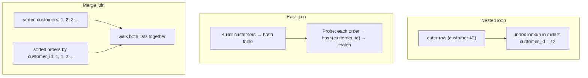

**4. Internal implementation**

- Costs: nested loop ≈ outer rows × lookup cost; hash join ≈ O(N + M) but needs memory (`work_mem` in PostgreSQL, `join_buffer_size` in MySQL) — too big → **spills to disk** in batches; merge join ≈ O(N + M) plus sorting cost if not already sorted.
- Hash join only works for **equality** (`=`); merge join also handles range-like conditions efficiently with sorted data.

**5. Why is it designed this way?**
No single algorithm wins everywhere: nested loop is unbeatable for "few rows + index", hash join for big unsorted sets, merge join when order already exists. The optimizer chooses per join using estimated sizes.

**6. Database differences**
MySQL: nested loop (+ block nested loop) only before 8.0.18; hash join since. PostgreSQL / SQL Server / Oracle: all three. SQL Server also has **adaptive joins** that choose between nested loop and hash at runtime.

**7. Practical example**
`customers` (10 rows after filter) ⋈ `orders` (10 million, indexed on `customer_id`) → **nested loop** (10 index lookups). Join two 5-million-row tables without indexes → **hash join**.

**8. How can I observe it?**
PostgreSQL: `SET enable_hashjoin = off;` then `EXPLAIN ANALYZE` again to compare plans and timings (for learning only). `EXPLAIN (ANALYZE, BUFFERS)` shows `Batches: 4` when a hash join spilled to disk.

---

## Transactions, Logging and Recovery

### ❓ How does a database manage concurrent transactions?

### 📝 Answer

**1. What is it?**
Many transactions run at the same time. The database must make each one behave **as if it ran alone** (to a configurable degree — the **isolation level**) while still running them in parallel.

**2. How does it work internally?**

1. Each transaction gets an **ID** and, depending on isolation level, a **snapshot** of what data it may see.
2. **Reads** see a consistent version of each row (via **MVCC**) without blocking writers.
3. **Writes** take **row locks**; a second writer of the same row waits until the first commits or rolls back.
4. Waiting cycles are detected as **deadlocks**; one transaction is aborted.
5. At commit, changes become visible to new snapshots.

**3. Visual**

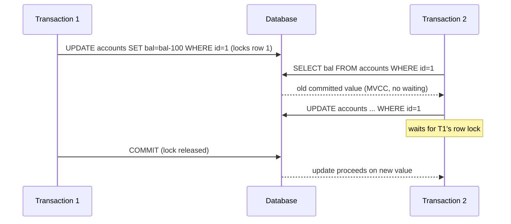

**4. Internal implementation**

| Isolation level | Prevents | Typical implementation |
|---|---|---|
| Read Uncommitted | — | Rarely used |
| **Read Committed** (PostgreSQL, SQL Server, Oracle default) | Dirty reads | New snapshot per statement |
| **Repeatable Read** (MySQL InnoDB default) | + non-repeatable reads | One snapshot per transaction (+ gap locks in InnoDB) |
| Serializable | + phantoms, write skew | PostgreSQL SSI (detects conflicts), InnoDB locking reads |

**5. Why is it designed this way?**
Full serial execution would be correct but slow. Isolation levels let applications trade strictness for throughput; MVCC removes most reader/writer blocking.

**6. Database differences**
PostgreSQL Serializable uses **SSI** (optimistic: abort on detected conflict, retry needed). MySQL InnoDB uses **next-key locks** to prevent phantoms in Repeatable Read. SQL Server defaults to locking reads unless `READ_COMMITTED_SNAPSHOT` is enabled.

**7. Practical example**
Two users book the last seat: `SELECT ... FOR UPDATE` on the seat row makes the second transaction wait, then see it is taken — no double booking.

**8. How can I observe it?**
Open two SQL sessions and run the sequence above by hand. PostgreSQL: `SELECT * FROM pg_locks;`; MySQL: `SHOW ENGINE INNODB STATUS` (latest deadlock), `performance_schema.data_locks`.

---

### ❓ How do ACID, Locks and MVCC work internally?

### 📝 Answer

**1. What is it?**

- **ACID** — guarantees of a transaction: **A**tomicity (all or nothing), **C**onsistency (constraints hold), **I**solation (transactions don't see each other's partial work), **D**urability (committed = survives crashes).
- **Locks** — stop two transactions changing the same data at once.
- **MVCC** (Multi-Version Concurrency Control) — keep **several versions** of a row so readers see a consistent snapshot without locking.

**2. How does it work internally?**

| Property | Mechanism |
|---|---|
| Atomicity | Undo information to roll back; commit record in the log |
| Consistency | Constraint checks (PK, FK, CHECK, unique) at statement/commit time |
| Isolation | MVCC snapshots + row locks |
| Durability | Write-ahead log flushed to disk (`fsync`) at commit |

MVCC read:

1. Each row version records the transaction that created it (and deleted/replaced it).
2. A transaction's **snapshot** lists which transactions were committed when it started.
3. A reader walks the versions and returns the newest one **visible** to its snapshot.

**3. Visual**

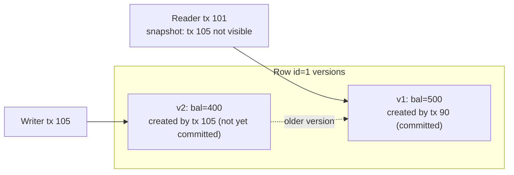

**4. Internal implementation**

- **PostgreSQL**: an update writes a **new tuple** in the table; the old one gets `xmax` set. Old versions are removed later by **VACUUM**.
- **InnoDB**: the row is updated **in place**; the old version is copied to the **undo log**, and readers rebuild old versions by following the roll pointer. Purge threads clean up undo.
- Locks: row locks (shared/exclusive), InnoDB **gap/next-key locks** on index ranges, table-level intention locks.

**5. Why is it designed this way?**
MVCC gives "readers never block writers, writers never block readers", which is ideal for read-heavy apps. Costs: storage for old versions and background cleanup (VACUUM / purge); long-running transactions keep old versions alive and bloat tables.

**6. Database differences**
PostgreSQL (versions in table), MySQL InnoDB and Oracle (undo segments), SQL Server (optional version store in tempdb). SQLite uses database-level locking (WAL mode allows readers during a write).

**7. Practical example**

```sql
BEGIN;
UPDATE accounts SET bal = bal - 100 WHERE id = 1;
UPDATE accounts SET bal = bal + 100 WHERE id = 2;
COMMIT;   -- both or neither; other sessions see old balances until this moment
```

**8. How can I observe it?**
PostgreSQL: `SELECT xmin, xmax, * FROM accounts;` before and after an update in another session; `pg_stat_user_tables.n_dead_tup` shows old versions waiting for VACUUM. MySQL: `SHOW ENGINE INNODB STATUS` → "History list length" (undo not yet purged).

---

### ❓ How does Write-Ahead Logging (WAL) work?

### 📝 Answer

**1. What is it?**
**Write-Ahead Logging**: before a changed data page is written to disk, a **log record** describing the change must be safely on disk first. Commit only waits for the **log**, not the data pages.

**2. How does it work internally?**

1. A transaction changes a row → the page is changed **in memory** (buffer pool) and marked dirty.
2. A log record ("page 77, offset 120: bal 500 → 400") is appended to the **WAL buffer** with an increasing **LSN** (Log Sequence Number).
3. On `COMMIT`, the WAL is written **sequentially** and `fsync`ed → the commit is durable.
4. Dirty data pages are written later by background writers and **checkpoints** (in any order, at a convenient time).
5. A page may be written only after the log up to its LSN is on disk ("write-ahead" rule).

**3. Visual**

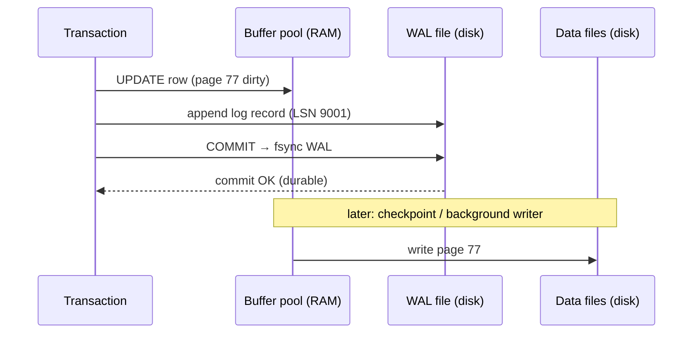

**4. Internal implementation**

- **PostgreSQL**: WAL segment files in `pg_wal/` (16 MB each). **InnoDB**: **redo log** files + the **binlog** (used for replication), coordinated by two-phase commit.
- **Group commit**: many transactions share one `fsync` → high throughput.
- **Checkpoints** bound recovery time: after a checkpoint, older WAL isn't needed for crash recovery.
- The same log feeds **replication** (streaming WAL / binlog to replicas) and point-in-time recovery.

**5. Why is it designed this way?**
Appending to one log file sequentially is much faster than writing random data pages on every commit. Durability comes from the log; data pages can be written lazily in big batches.

**6. Database differences**
PostgreSQL WAL, InnoDB redo log (+ binlog), SQL Server transaction log, SQLite WAL mode, Kafka (the whole system is a log). LSM-tree databases (RocksDB, Cassandra) also write a WAL before their in-memory table.

**7. Practical example**
`synchronous_commit = off` (PostgreSQL) or `innodb_flush_log_at_trx_commit = 2` (MySQL) skip the fsync per commit → faster writes, but the last ~second of commits can be lost on a crash.

**8. How can I observe it?**
PostgreSQL: `SELECT pg_current_wal_lsn();` before and after an update; `pg_waldump` decodes WAL records. MySQL: `SHOW ENGINE INNODB STATUS` → "Log sequence number" and "Last checkpoint at".

---

### ❓ How does a database recover after a crash?

### 📝 Answer

**1. What is it?**
After power loss or a crash, data files may contain some changes from unfinished transactions and miss some changes from committed ones. **Crash recovery** uses the write-ahead log to bring the database back to a correct state: every committed transaction present, every uncommitted one gone.

**2. How does it work internally?**
Classic **ARIES** approach:

1. **Analysis** — read the log from the last **checkpoint**; find which transactions were active and which pages may be dirty.
2. **Redo** — replay logged changes onto pages whose on-disk LSN is older than the log record ("repeat history"), including uncommitted ones.
3. **Undo** — roll back transactions that never committed, using undo records.
4. Open for connections.

**3. Visual**

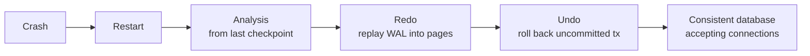

**4. Internal implementation**

- Each page stores the **LSN** of the last change applied → redo is **idempotent** (skip records already applied).
- **PostgreSQL** needs only redo: uncommitted rows are simply invisible (their transaction is marked aborted in the commit log), and VACUUM cleans them later.
- **InnoDB**: redo from the redo log, then rolls back incomplete transactions from the undo log (in the background).
- **Torn pages** (half-written 16 KB page): PostgreSQL writes **full page images** after each checkpoint; InnoDB uses the **doublewrite buffer**.

**5. Why is it designed this way?**
Logging every change makes it possible to reconstruct any state without forcing data pages to disk at commit. Frequent checkpoints = faster recovery but more I/O during normal running.

**6. Database differences**
PostgreSQL: redo-only + commit log. InnoDB, SQL Server, DB2: ARIES-style redo + undo. Redis: AOF replay or RDB snapshot load. SQLite: rollback journal or WAL replay.

**7. Practical example**
A transfer transaction debited account 1 but crashed before crediting account 2 and before COMMIT → on restart the debit is undone; a fully committed transfer is replayed even if its pages were never written.

**8. How can I observe it?**
In a test environment, kill the database process (`kill -9`) during a write load, restart, and read the logs: PostgreSQL logs "database system was not properly shut down; automatic recovery in progress" and "redo starts at …"; MySQL logs "Starting crash recovery".

---

## Caching and Scaling

### ❓ How does Database Caching work?

### 📝 Answer

**1. What is it?**
Databases keep recently used **pages** in RAM so most reads never touch the disk. MySQL InnoDB calls it the **buffer pool**; PostgreSQL calls it **shared buffers** (plus the OS page cache).

**2. How does it work internally?**

1. A query needs page 77 → look it up in the buffer pool's **hash table** (page ID → memory frame).
2. **Hit** → use it from RAM. **Miss** → read it from disk into a free frame (evicting an old page if needed).
3. Writes change the cached page (dirty) + WAL; dirty pages are flushed later.
4. An eviction policy decides which page to throw out when memory is full.

**3. Visual**


**4. Internal implementation**

- **InnoDB**: LRU list split into **young** and **old** sublists; new pages enter the old part, so one big table scan doesn't flush out the hot pages. Typical size: 50–75% of RAM (`innodb_buffer_pool_size`).
- **PostgreSQL**: `shared_buffers` (often ~25% of RAM) with a **clock-sweep** algorithm (usage counters); the OS page cache is a second layer (double buffering).
- MySQL's old **query cache** (caching whole result sets) was removed in 8.0 — it scaled poorly because any write invalidated it.

**5. Why is it designed this way?**
RAM is ~1000× faster than SSD for random access, and most workloads touch a small "hot" set repeatedly. Page caching is transparent and works for every query.

**6. Database differences**
Application-level caches (Redis, Caffeine, Hibernate second-level cache) sit **outside** the database and cache objects/results — faster still, but you must handle invalidation yourself.

**7. Practical example**
Run the same `SELECT` twice: the first may take 50 ms (disk reads), the second 2 ms (all pages in the buffer pool).

**8. How can I observe it?**
PostgreSQL: `EXPLAIN (ANALYZE, BUFFERS)` → `shared hit` vs `read`; `pg_buffercache` extension. MySQL: `SHOW GLOBAL STATUS LIKE 'Innodb_buffer_pool_read%';` hit ratio = 1 − reads / read_requests.

---

### ❓ How do Replication, Partitioning and Sharding work?

### 📝 Answer

**1. What is it?**

- **Replication** — **copies** of the same data on several servers (for read scaling and failover).
- **Partitioning** — splitting one big table into pieces **inside one database server** (by date, range, list or hash).
- **Sharding** — splitting data across **several database servers**, each holding a subset.

**2. How does it work internally?**
Replication:

1. The primary writes changes to its log (PostgreSQL WAL, MySQL binlog).
2. Replicas stream that log and **replay** it.
3. **Asynchronous**: primary commits without waiting (replicas may lag, data loss possible on failover). **Synchronous**: commit waits for at least one replica.

Partitioning: the planner uses the partition key in `WHERE` to scan only matching partitions (**partition pruning**); old partitions can be dropped instantly.

Sharding: a **shard key** (e.g. `customer_id`) decides the server: `hash(key) % N` or a lookup directory; the application or a proxy routes each query.

**3. Visual**

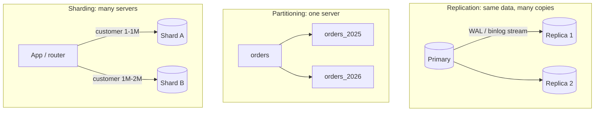

**4. Internal implementation**

- PostgreSQL: physical streaming replication (byte-level WAL) and logical replication (row changes). MySQL: binlog in row format; GTIDs track position.
- PostgreSQL declarative partitioning: each partition is a real table; MySQL partitions are internal to one table.
- Resharding moves data between servers; **consistent hashing** reduces how much moves. Tools: Vitess (MySQL), Citus (PostgreSQL); distributed SQL (CockroachDB, YugabyteDB, Spanner) shard automatically.

**5. Why is it designed this way?**
Replication handles **read** load and availability; partitioning handles **big tables** on one server; sharding handles **write** load and data larger than one machine. Each adds complexity: replica lag, cross-partition queries, cross-shard joins and transactions.

**6. Database differences**
MongoDB and Cassandra have built-in sharding; classic PostgreSQL/MySQL need extensions or proxies for sharding but have mature replication and partitioning.

**7. Practical example**

```sql
CREATE TABLE orders (id bigint, created_at date, total numeric) PARTITION BY RANGE (created_at);
CREATE TABLE orders_2026 PARTITION OF orders FOR VALUES FROM ('2026-01-01') TO ('2027-01-01');
-- WHERE created_at >= '2026-06-01' scans only orders_2026
```

**8. How can I observe it?**
PostgreSQL: `SELECT * FROM pg_stat_replication;` (replica lag); `EXPLAIN` shows pruned partitions. MySQL: `SHOW REPLICA STATUS\G` → `Seconds_Behind_Source`.
