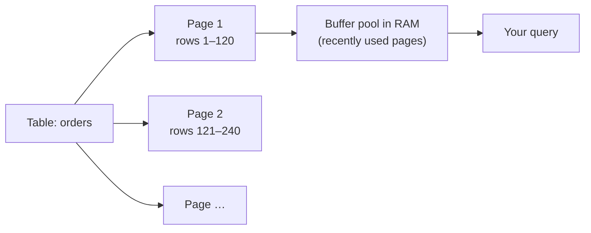
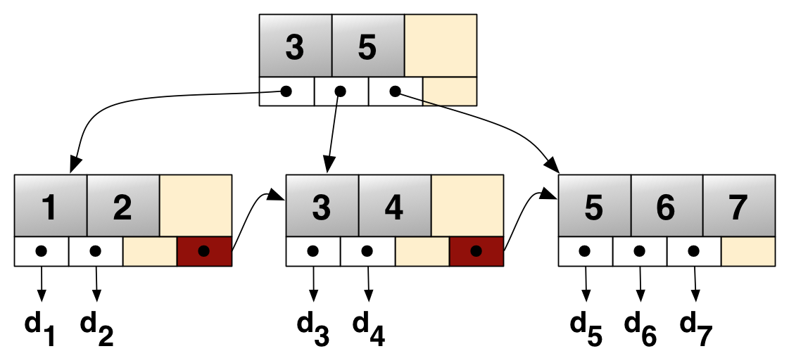
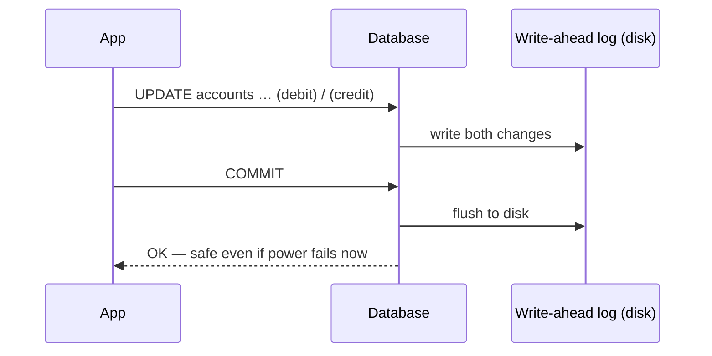
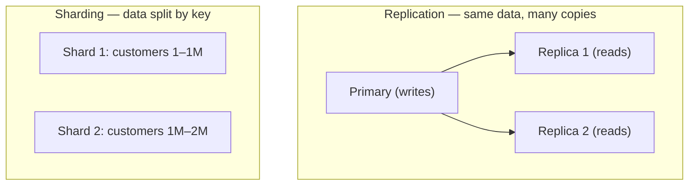

# 🗄 Inside a Database

## Inside a SQL database: storage, indexes and transactions (MySQL, PostgreSQL, Oracle…)

### ❓ How does a database store data on disk?

**Generic answer:** A database groups rows into fixed-size pages (8 KB in PostgreSQL, 16 KB in MySQL InnoDB), reads and writes whole pages, and keeps recently used pages in RAM.

**Under the hood:**

Imagine a table of 10 million orders. Disks are slow at many tiny reads but good at reading whole blocks. Reading row by row would take forever.

**Step 1: Group rows into pages**

Rows are packed into fixed-size **pages**. If a page is 8 KB and a row ~100 bytes, one page holds ~80 rows.

**Analogy:** a **book** — rows are lines, pages are pages, and you always read a whole page even for one line.

**Step 2: Read whole pages**

To read one row, the database loads its whole page.



**Step 3: Keep hot pages in RAM**

Recently used pages stay in the **buffer pool**, so popular data is served from memory.

**Step 4: Why this matters to you**

A query touching 10 rows on 10 different pages costs 10 page reads. That's why indexes and "select only the columns you need" matter.

**Final understanding:** **Slow disk → pack rows into pages → read whole pages → cache hot pages in RAM → count page reads, not rows.**

---

### ❓ How does a database index work?

**Generic answer:** An index is a separate, sorted structure (usually a B+ tree) that lets the database find rows without scanning the whole table.

**Under the hood:**

Imagine a table of 10 million customers, and you run `WHERE customer_id = 500012`.

Without an index, the database must check page after page — a **full table scan**.

**Analogy:** a 1,000-page book. To find a topic you don't read every page; you use the index at the back.

**Step 1: How data is stored**

Rows live in pages (say 4 KB each, ~40 rows per page). 10 million rows → 250,000 pages to scan.

**Step 2: Add an index**

The database keeps a separate structure with entries like:

| Customer ID | Row locator |
|---|---|
| 1001 | Page 1, Row 1 |
| 1002 | Page 1, Row 2 |

Each entry = search key + where the row is (or its primary key).

**Step 3: Why not just a sorted list?**

A sorted list of millions of entries still needs many steps and many page reads. We need something that shrinks the search space fast with few reads.

**Step 4: A tree with wide nodes (B-tree)**

Each node holds many keys and child pointers, so every read cuts the search space ~100×.

**Step 5: B+ tree — what databases use**

- Internal nodes hold only keys and child pointers.
- All entries sit in the **leaf** level, all leaves at the same depth.
- Leaves are **linked** for range scans.

```text
              ROOT [300 | 700]
             /       |        \
        NODE       NODE        NODE
                     |
              LEAF: 500012 → row location → actual record
```



_Image: [Wikimedia Commons](https://commons.wikimedia.org/wiki/File:Bplustree.png) · Grundprinzip · CC BY 3.0_

**Step 6: Why it's fast**

With ~100 pointers per node, 3–4 levels cover millions of entries — so **3–4 page reads** instead of 250,000. O(log n) instead of O(n).

**Step 7: Benefits and trade-offs**

- Faster `SELECT`, `WHERE`, `JOIN`, `ORDER BY` and range searches.
- **Cost:** extra disk space, and every `INSERT`/`UPDATE`/`DELETE` must also update each index. Index the columns you **filter, join and sort** by — not everything.
- **Composite index `(customer_id, created_at)`:** works for `customer_id`, or both — **not** `created_at` alone (leftmost-prefix rule).

**Final understanding:** **Problem (full scan) → pages on disk → separate index → wide B+ tree → root-to-leaf walk → a few reads → faster reads, slower writes.**

---

### ❓ How do transactions keep data safe (ACID)?

**Generic answer:** A transaction groups changes so they all happen or none do; ACID — Atomicity, Consistency, Isolation, Durability — is delivered by transaction management, locking/MVCC and a write-ahead log.

**Under the hood:**

Imagine transferring ₹10,000 from Account A (₹50,000) to Account B (₹20,000):

1. Deduct ₹10,000 from A.
2. Add ₹10,000 to B.

The server deducts from A — and crashes before crediting B. ₹10,000 has vanished. The database must prevent this.

**Step 1: Atomicity — all or nothing**

Both changes succeed or neither is kept. If step 2 fails, step 1 is **rolled back**.

**Step 2: Consistency — rules still hold**

Constraints (no negative balance, valid foreign keys) are true before and after the transaction.

**Step 3: Isolation — no interference**

Two people withdrawing from the same account at once could both read ₹50,000 and both succeed. **Locks** or **MVCC** make concurrent transactions behave safely (next question).

**Step 4: Durability — committed means kept**

The transaction commits; one second later the power fails. The transfer must still be there after restart.

**Step 5: How durability works — the write-ahead log (WAL / redo log)**

1. Before changing data pages, the database writes the change to an **append-only log** on disk.
2. On `COMMIT`, it makes sure the log is safely on disk, then says "done". Data pages are written later.
3. After a crash, it **replays the log**: committed changes are redone, unfinished ones are undone.



**Final understanding:** ACID isn't four definitions — it's guarantees built from **transaction management** (atomicity), **constraints** (consistency), **locks/MVCC** (isolation) and the **WAL** (durability). **Partial failure risk → group changes → log first → commit → replay after crash.**

---

### ❓ How does a database let many users read and write at the same time?

**Generic answer:** With locks (writers block conflicting writers) and MVCC (readers see a snapshot of old row versions, so they don't block writers).

**Under the hood:**

Imagine a long monthly report reading all orders while customers keep checking out. If the report locked the table, checkout would freeze. If it didn't, the report might count half-finished orders.

**Step 1: Locks for writers**

A writer locks the rows it changes, so two people can't book the same seat at once.

**Step 2: Versions for readers (MVCC)**

Instead of blocking readers, the database keeps **old versions** of changed rows. Each transaction sees a consistent **snapshot** from when it started. Readers don't block writers, writers don't block readers. Used by PostgreSQL, MySQL InnoDB and Oracle.

**Step 3: Choose the safety level (isolation levels)**

- *Read committed* — default in PostgreSQL and Oracle.
- *Repeatable read* — MySQL default.
- *Serializable* — safest, slowest.

**Step 4: Back to the report**

MVCC gives the report a stable snapshot without stopping checkout.

**Final understanding:** **Many users at once → lock rows for conflicting writes → keep old versions for readers → pick an isolation level for the safety/speed trade-off.**

---

### ❓ What is the difference between replication and sharding?

**Generic answer:** Replication keeps copies of the same data on several servers (availability, more reads); sharding splits the data across servers (more writes and storage).

**Under the hood:**

Imagine your one database server is struggling. Two different problems can cause it: too many **reads**, or too much **data and writes**. Each needs a different fix.

**Step 1: Too many reads → replication**

One **primary** takes writes; **replicas** copy its log and serve reads. If the primary dies, a replica takes over. Replicas can lag slightly behind.

**Step 2: Too much data or writes → sharding**

Split the data by a key: customers 1–1M on shard 1, 1M–2M on shard 2. Each shard handles its part.



**Step 3: The costs**

Replication: stale reads from lagging replicas. Sharding: queries across shards and rebalancing get hard.

**Final understanding:** **Read overload → copy the data (replication); write/size overload → split the data (sharding).** Most systems replicate first and shard only when one primary can't keep up.
