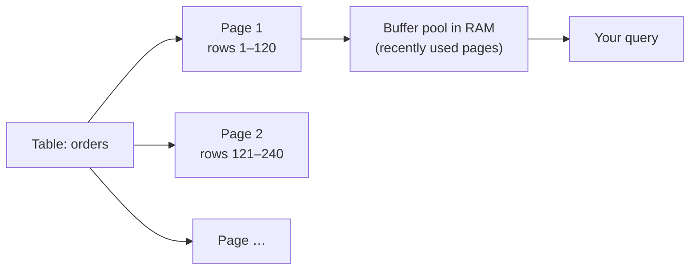
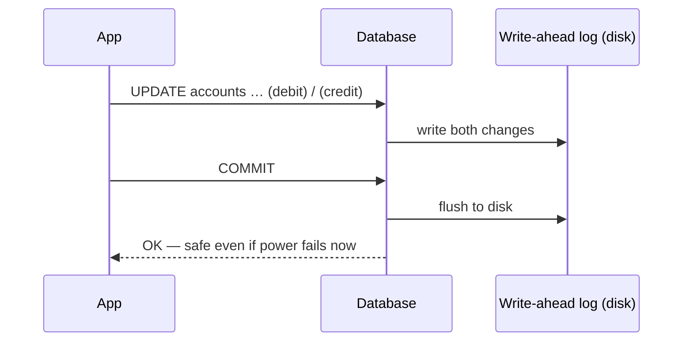
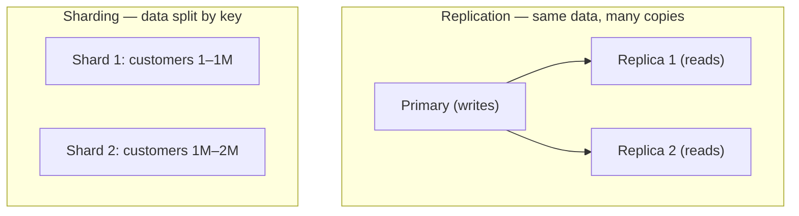

# 🗄 Inside a Database

## Inside a SQL database: storage, indexes and transactions (MySQL, PostgreSQL, Oracle…)

### ❓ How does a database store data on disk?

A database doesn't write rows one by one to the disk. It groups them into fixed-size **pages** (blocks) — usually 8 KB in PostgreSQL, 16 KB in MySQL InnoDB — and reads or writes whole pages.

**Analogy:** a **book**. Rows are lines of text, pages are pages, and the database reads a whole page even when you need one line.

- Recently used pages stay in RAM in the **buffer pool**, so popular data is read from memory, not disk.
- A query that touches 10 rows spread over 10 pages costs 10 page reads — that's why indexes and "select only the columns you need" matter.

---

### ❓ How does a database index work?

An index is a separate, **sorted** structure (a **B+ tree**) that points to where each row lives — like the index at the back of a book.

- **Without an index:** `WHERE email = 'a@x.com'` checks every row — a **full table scan**, O(n).
- **With an index on `email`:** walk down the B+ tree in about 3–4 page reads, then fetch the row — O(log n).

_Image: [Wikimedia Commons](https://commons.wikimedia.org/wiki/File:Bplustree.png) · Grundprinzip · CC BY 3.0_

**Trade-offs:** every insert or update must also update each index, and indexes use disk space. Index the columns you **filter, join and sort** by — not everything.

**Composite index `(customer_id, created_at)`:** works for queries on `customer_id`, or `customer_id` + `created_at`, but **not** `created_at` alone (the leftmost-prefix rule).

---

### ❓ How do transactions keep data safe (ACID)?

A transaction groups changes so that they all happen or none do — **A**tomic, **C**onsistent, **I**solated, **D**urable.

**How durability works — the write-ahead log (WAL / redo log):**
1. Before changing data pages, the database writes the change to an **append-only log** on disk.
2. On `COMMIT`, it makes sure the log is safely on disk, then says "done". Data pages are written later.
3. After a crash, it **replays the log**: committed changes are redone, unfinished ones are undone.

**Example:** a ₹500 transfer debits one account and credits another. If the server crashes in between, the log ensures you never see money vanish or appear.

---

### ❓ How does a database let many users read and write at the same time?

Two main tools:

- **Locks:** a writer locks the rows it changes, so two people can't book the same seat at once.
- **MVCC (multi-version concurrency control):** instead of blocking readers, the database keeps **old versions** of changed rows. Each transaction sees a consistent **snapshot** from when it started. Readers don't block writers, and writers don't block readers. Used by PostgreSQL, MySQL InnoDB and Oracle.

**Isolation levels** choose the trade-off between safety and speed: *read committed* (the default in PostgreSQL and Oracle), *repeatable read* (the MySQL default), *serializable* (safest, slowest).

**Example:** while a long report reads yesterday's totals, new orders keep coming in — MVCC gives the report a stable snapshot without stopping checkout.

---

### ❓ What is the difference between replication and sharding?

- **Replication** = **copies** of the same data on several servers. One primary takes writes; replicas copy them and serve reads. Gives availability (fail over if the primary dies) and more read capacity. Replicas can lag slightly behind.
- **Sharding** = **splitting** the data across servers, each holding a part (e.g. customers A–M on server 1, N–Z on server 2). Scales writes and storage, but queries across shards and rebalancing get harder.

Most systems add replication first and shard only when one primary can't keep up with writes.
