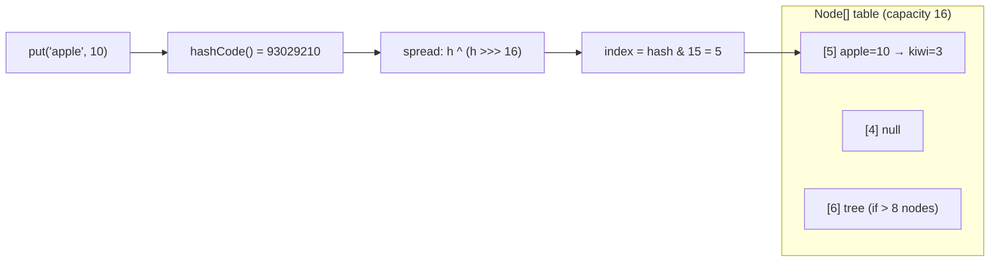
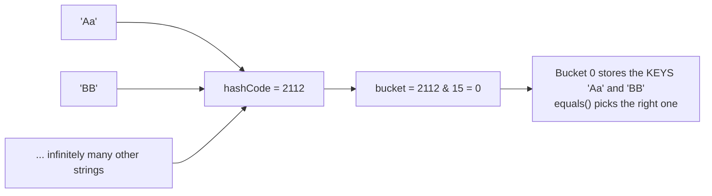
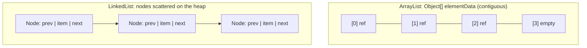
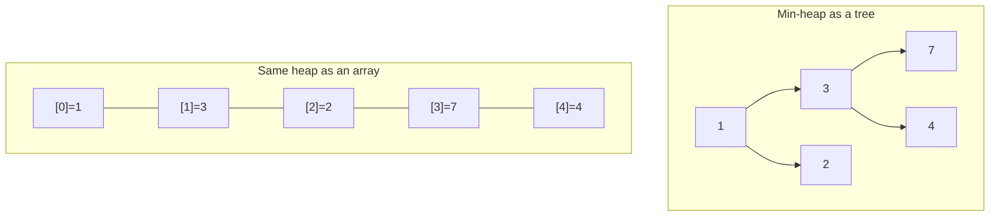
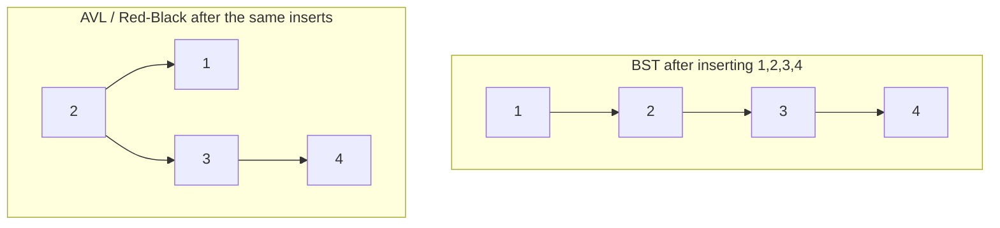
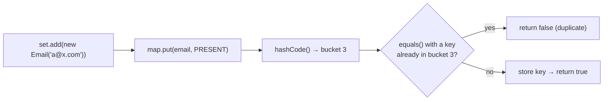
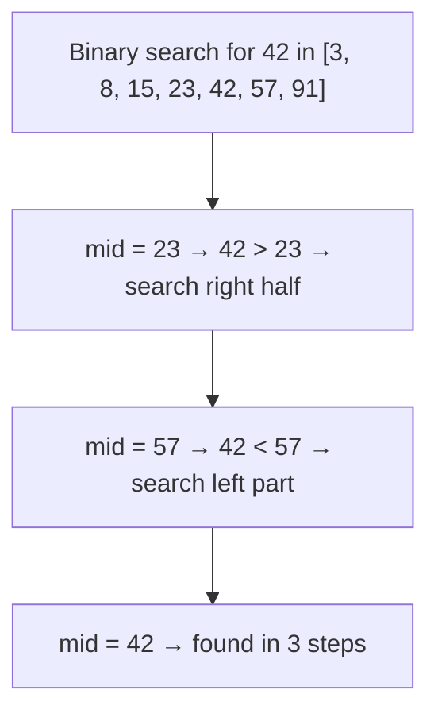
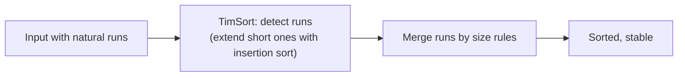
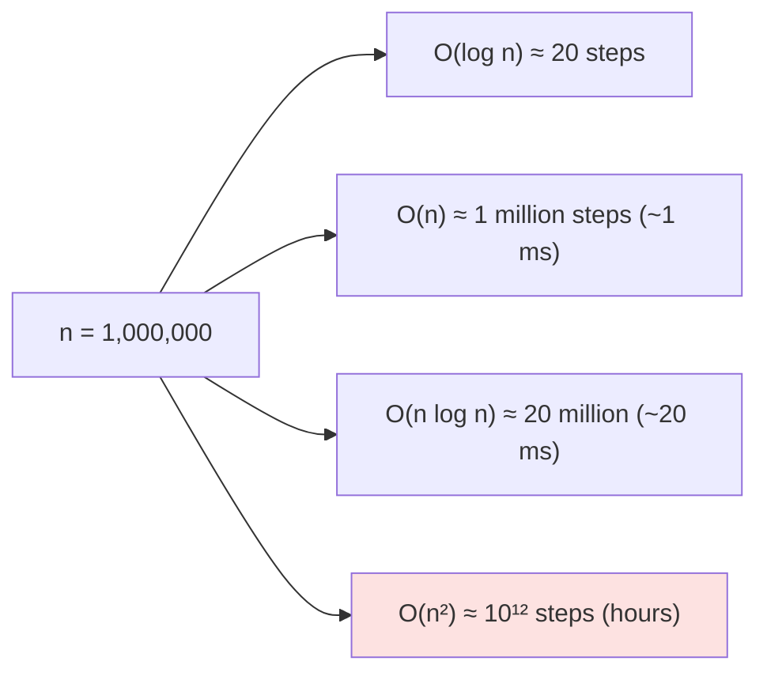

# 🔩 Under the Hood: Data Structures & Algorithms Internals

How common data structures are really implemented in memory, and why the same Big-O can perform very differently in practice.

## Hashing

### ❓ How does HashMap work internally, including hashing, buckets and collision handling?

### 📝 Answer

**1. What is it?**
A HashMap stores key → value pairs in an **array of buckets**. A **hash function** turns the key into an array index, so `get` and `put` take **O(1) on average** instead of searching.

**2. How does it work internally?** (Java `HashMap`)

1. `put(key, value)`: call `key.hashCode()`, then **spread** it: `h ^ (h >>> 16)` (mixes high bits into low bits).
2. Index = `hash & (capacity - 1)` (capacity is always a power of two, default 16).
3. Empty bucket → store a new node. Occupied → walk the bucket; if a node has the same hash **and** `equals()` → replace the value; otherwise append (a **collision**).
4. A bucket with more than **8** nodes becomes a **red-black tree** (only if capacity ≥ 64; otherwise the table resizes); it turns back into a list at 6.
5. When size > capacity × **load factor 0.75**, the table **doubles** and every node moves to either its old index or old index + old capacity.

**3. Visual**



**4. Internal implementation**

- `Node<K,V> { int hash; K key; V value; Node next; }` stored in `Node[] table` (created lazily on first put).
- `get` compares the stored hash first (cheap), then `equals()` only on hash matches.
- Resize = O(n) but rare → **amortised** O(1) put. Worst case with all keys colliding: O(n) per lookup, or O(log n) once treeified.

**5. Why is it designed this way?**
Power-of-two sizes make the index a fast bit-mask instead of `%`; spreading compensates for weak `hashCode()`s that differ only in high bits. Chaining + treeification keeps bad cases bounded. Cost: memory for nodes and pointers.

**6. Language differences**

| Language | Map implementation |
|---|---|
| Java `HashMap` | Chaining with lists → red-black trees |
| Python `dict` | **Open addressing** (probing within one array) + compact entries array; keeps insertion order (3.7+) |
| JavaScript `Map` | Deterministic hash table that preserves insertion order (V8: OrderedHashMap) |
| C++ `std::unordered_map` | Chaining (node per element) |
| Rust `HashMap` | SwissTable (open addressing with SIMD group probing), DoS-resistant SipHash by default |
| Go `map` | Buckets of 8 entries; SwissTable-based since Go 1.24 |

**7. Practical example**

```java
Map<String, Integer> stock = new HashMap<>(64);   // presize to avoid resizes
stock.put("apple", 10);
stock.get("apple");   // hash → bucket 5 → compare hash → equals → 10
```

**8. How can I observe it?**
IntelliJ debugger → expand a `HashMap` and choose "Show as Object" to see `table`, bucket lists and `threshold`. Use a key class with `hashCode()` returning a constant and time lookups to see collisions hurt.

---

### ❓ Why is HashMap not reversible? Why can't the original key be reconstructed from its hash?

### 📝 Answer

**1. What is it?**
A hash function maps a **huge** set of possible keys to a **small** set of numbers. Many different keys share the same hash, so a hash alone can't tell you which key produced it. A HashMap doesn't need to reverse anything: it **stores the key itself** next to the value.

**2. How does it work internally?**

1. `"apple".hashCode()` produces a 32-bit `int` — only about 4.3 billion possible values.
2. The number of possible strings is unlimited → by the **pigeonhole principle**, infinitely many strings share each hash code.
3. The bucket index uses even fewer bits (`hash & 15` keeps 4 bits) → more information thrown away.
4. On `get`, the map uses the hash only to find the bucket, then compares the **stored keys** with `equals()`.

**3. Visual**



**4. Internal implementation**

- Java `String.hashCode()` = `s[0]*31^(n-1) + ... + s[n-1]` with integer overflow — information is lost by overflow and by masking.
- `"Aa"` and `"BB"` really have the same hash code (2112) — a classic collision.
- **Cryptographic hashes** (SHA-256) are also one-way, but additionally designed so finding any input for a given hash (**preimage**) is computationally infeasible.

**5. Why is it designed this way?**
A hash's job is to spread keys **quickly and evenly** over a fixed number of buckets — compression is the point. Storing the key makes lookups exact despite collisions.

**6. Language differences**
Every language's hash tables store keys (Python dict entries hold hash, key, value; Java nodes hold hash, key, value). Python randomises string hashing per process (`PYTHONHASHSEED`) to prevent collision attacks; Rust uses keyed SipHash by default.

**7. Practical example**

```java
System.out.println("Aa".hashCode());   // 2112
System.out.println("BB".hashCode());   // 2112 — same hash, different keys
```

**8. How can I observe it?**
Print hash codes of many strings and find duplicates. In the debugger, put `"Aa"` and `"BB"` in a HashMap and see both nodes chained in the same bucket.

---

## Lists, Stacks, Queues and Heaps

### ❓ How do ArrayList, LinkedList and Arrays store and retrieve elements differently?

### 📝 Answer

**1. What is it?**

- **Array** — a fixed-size block of **contiguous** memory slots.
- **ArrayList** (dynamic array) — an array that **grows** by copying into a bigger array when full.
- **LinkedList** — separate **nodes** scattered in memory, each pointing to the next (and previous).

**2. How does it work internally?**

- Array / ArrayList `get(i)`: address = base + i × element size → **one** memory access, O(1).
- ArrayList `add(x)`: if full, allocate a new array **1.5×** bigger (Java: `old + old >> 1`), copy, then add → amortised O(1).
- ArrayList insert in the middle: shift all later elements → O(n) (but a fast memory copy).
- LinkedList `get(i)`: follow `next` pointers i times (Java starts from the nearer end) → O(n).
- LinkedList insert at a known node: change 2–4 pointers → O(1).

**3. Visual**



**4. Internal implementation**

- `ArrayList<Integer>` stores **references** to `Integer` objects; `int[]` stores the numbers themselves (no per-element object, much better for cache).
- Each `LinkedList` node is a separate object (~24 bytes + the element) → more memory, more GC work, and **cache misses** when walking.
- CPU caches load 64-byte lines and prefetch sequential memory — arrays benefit, linked lists don't.

**5. Why is it designed this way?**
Arrays give fast random access and great cache behaviour; linked lists give cheap insert/remove when you already hold a node. In practice ArrayList (or `ArrayDeque`) wins almost every benchmark.

**6. Language differences**

| Language | Dynamic array | Linked list |
|---|---|---|
| Java | `ArrayList` (1.5× growth) | `LinkedList` |
| Python | `list` (array of pointers, ~1.125× growth) | none built in (`collections.deque` is a linked list of blocks) |
| JavaScript | `Array` (V8 uses packed arrays when possible) | none built in |
| C++ | `std::vector` (usually 2× or 1.5×) | `std::list` |
| Go | slices (`append`, ~2× for small, ~1.25× for large) | `container/list` |
| Rust | `Vec` (2×) | `LinkedList` (rarely used) |

**7. Practical example**

```java
List<Integer> list = new ArrayList<>(10_000);   // presize: no regrowth copies
for (int i = 0; i < 10_000; i++) list.add(i);
int x = list.get(5_000);                         // one array access
```

**8. How can I observe it?**
**JMH** benchmark: iterate 1 million elements in `ArrayList` vs `LinkedList`. **JOL** (Java Object Layout) shows bytes per node. VisualVM heap histogram counts `LinkedList$Node` objects.

---

### ❓ How do Stack, Queue, Heap and Priority Queue work?

### 📝 Answer

**1. What is it?**

- **Stack** — LIFO (last in, first out): `push`, `pop`.
- **Queue** — FIFO (first in, first out): `offer`, `poll`.
- **Heap (binary heap)** — a tree where every parent is ≤ its children (min-heap), stored in an **array**.
- **Priority queue** — a queue that always returns the smallest (or highest-priority) item; usually built on a binary heap.

Note: this "heap" data structure is unrelated to heap **memory**.

**2. How does it work internally?**

- Stack/queue in Java: `ArrayDeque` — a **circular array** with `head` and `tail` indexes; both ends O(1), doubles when full.
- Binary heap in an array: children of index `i` are `2i+1` and `2i+2`; parent is `(i-1)/2`.
- `offer(x)`: put at the end, **sift up** (swap with parent while smaller) → O(log n).
- `poll()`: take the root, move the last element to the root, **sift down** (swap with smaller child) → O(log n).
- `peek()`: the root → O(1).

**3. Visual**



**4. Internal implementation**

- `PriorityQueue` in Java is a min-heap in `Object[] queue`, ordered by `Comparable` or a `Comparator`; iteration order is **not** sorted.
- Building a heap from n items with "heapify" is O(n), not O(n log n).
- `java.util.Stack` is an old synchronized `Vector` subclass — use `ArrayDeque` instead.

**5. Why is it designed this way?**
A heap keeps only "partial order" (parent vs children), which is cheaper to maintain than full sorting yet gives the minimum instantly. Arrays avoid pointer overhead and are cache-friendly.

**6. Language differences**
Python: `list` as stack, `collections.deque` as queue, `heapq` functions on a list (min-heap). JavaScript: arrays as stacks (`push`/`pop`); `shift()` is O(n), so real queues need a custom ring buffer; no built-in heap. C++: `std::stack`, `std::queue`, `std::priority_queue` (max-heap by default). Go: `container/heap` interface.

**7. Practical example**

```java
PriorityQueue<Task> pq = new PriorityQueue<>(Comparator.comparingInt(Task::priority));
pq.offer(new Task("email", 3));
pq.offer(new Task("payment", 1));
pq.poll();   // "payment" — lowest number first
```

**8. How can I observe it?**
Debugger: inspect `PriorityQueue.queue` after each `offer` to watch sift-up reorder the array. Print the queue with `toString()` — it's heap order, not sorted order.

---

## Trees and Sets

### ❓ How do Binary Search Trees, AVL Trees, Red-Black Trees and B+ Trees differ?

### 📝 Answer

**1. What is it?**
All are **sorted trees** for fast search, insert and delete. They differ in **how they stay balanced** and **where they live** (memory vs disk).

| Tree | Balance rule | Worst-case height | Used in |
|---|---|---|---|
| **BST** | None | O(n) (degrades to a list) | Teaching, simple cases |
| **AVL** | Child heights differ by ≤ 1 | ~1.44 log n | Read-heavy in-memory indexes |
| **Red-Black** | Colour rules: no two reds in a row, equal black height | ~2 log n | Java `TreeMap`, C++ `std::map`, Linux scheduler |
| **B+ Tree** | Nodes half-full, all leaves same depth, many keys per node | log_fanout n (very shallow) | Database and file-system indexes |

**2. How does it work internally?**

- **BST**: left < node < right; insert sorted data → a straight line.
- **AVL**: after each insert/delete, check balance factors up the path; fix with **rotations** (single or double).
- **Red-Black**: new nodes are red; fix violations with **recolouring** and at most 2 rotations per insert.
- **B+ tree**: wide nodes (one disk page each); overflow → **split** and push a key up.

**3. Visual**



**4. Internal implementation**

- A **rotation** re-links three nodes in O(1) while keeping sorted order.
- AVL stores a height per node; Red-Black stores one colour bit — cheap, fewer rotations on writes.
- B+ trees put data only in leaves and link the leaves for range scans; node size matches the disk page.

**5. Why is it designed this way?**
Balance guarantees O(log n). AVL is stricter (faster lookups, more rotations); Red-Black is looser (faster writes) — a good general-purpose trade-off. B+ trees minimise **disk reads**, which matter more than CPU comparisons for databases.

**6. Language differences**
Java `TreeMap` / `TreeSet` and C++ `std::map` / `std::set` are red-black trees. Rust's `BTreeMap` uses an **in-memory B-tree** (better cache use than node-per-key trees). Python has no built-in sorted tree (third-party `sortedcontainers` uses sorted lists of lists).

**7. Practical example**

```java
TreeMap<Integer, String> prices = new TreeMap<>();
prices.put(500, "A"); prices.put(120, "B"); prices.put(900, "C");
prices.ceilingKey(300);   // 500 — sorted lookups a HashMap can't do
```

**8. How can I observe it?**
Visualisations at cs.usfca.edu/~galles/visualization (BST, AVL, Red-Black, B+ tree): insert 1..10 in order and watch the rotations and splits.

---

### ❓ How does HashSet ensure uniqueness?

### 📝 Answer

**1. What is it?**
A `HashSet` keeps each element at most once. In Java it is literally a **`HashMap` in disguise**: elements are stored as **keys**, and every key maps to the same dummy value.

**2. How does it work internally?**

1. `set.add(x)` calls `map.put(x, PRESENT)`.
2. The map hashes `x`, finds the bucket, and compares existing keys with `hashCode` + `equals()`.
3. Equal key already there → `put` returns the old value → `add` returns **false** (nothing added).
4. Otherwise a new entry is created → `add` returns **true**.

**3. Visual**



**4. Internal implementation**

- `private transient HashMap<E,Object> map;` and `private static final Object PRESENT = new Object();`.
- Uniqueness depends **entirely** on your `equals()` and `hashCode()`. Rule: equal objects **must** have equal hash codes.
- Mutating an object **after** adding it (changing fields used in `hashCode`) "loses" it in the wrong bucket.

**5. Why is it designed this way?**
Reusing HashMap gives O(1) average membership checks with no duplicated code. `LinkedHashSet` adds insertion order; `TreeSet` uses `compareTo` instead of `equals` for uniqueness.

**6. Language differences**
Python `set`: its own open-addressing table using `__hash__` and `__eq__`. JavaScript `Set`: uses **SameValueZero** equality — two different objects with the same fields are both kept. C++ `std::unordered_set`: `std::hash` + `operator==`. Rust `HashSet<T>` is a `HashMap<T, ()>`.

**7. Practical example**

```java
record Email(String value) {}            // records generate equals() and hashCode()
Set<Email> s = new HashSet<>();
s.add(new Email("a@x.com"));
s.add(new Email("a@x.com"));             // false: equal by value
s.size();                                // 1
```

Without proper `equals/hashCode` (a plain class), the size would be **2**.

**8. How can I observe it?**
Debug into `HashSet.add` (JDK sources) to see it call `map.put`. Remove `hashCode()` from a class, add two equal objects, and print `size()`.

---

## Algorithms and Performance

### ❓ How do searching and sorting algorithms work internally?

### 📝 Answer

**1. What is it?**

- **Searching**: linear search (check each element, O(n)) or **binary search** on sorted data (halve the range each step, O(log n)).
- **Sorting**: put elements in order. Real libraries use **hybrid** algorithms tuned for real data, not textbook ones.

**2. How does it work internally?**
Binary search: compare with the middle element → discard the half that can't contain the target → repeat.

Library sorts:

- **Java `Arrays.sort(int[])`** — **dual-pivot quicksort** (not stable; fine for primitives).
- **Java `Arrays.sort(Object[])`, `List.sort`** — **TimSort**: finds already-sorted "runs" and merges them; stable; O(n log n) worst case, O(n) on nearly sorted data.
- **Python `sorted`** — TimSort-based (powersort merge policy since 3.11).
- **JavaScript `Array.prototype.sort`** — V8 uses TimSort (stable since 2019).
- **C++ `std::sort`** — **introsort** (quicksort → heapsort if recursion gets too deep, insertion sort for small parts).

**3. Visual**





**4. Internal implementation**

- Small sub-arrays (< ~32–64 elements) use **insertion sort** — it beats O(n log n) algorithms at small sizes because of low overhead and cache friendliness.
- **Stability** (equal elements keep their order) matters when sorting objects by one field after another.
- Binary search must avoid overflow: `mid = low + (high - low) / 2` (or `>>> 1` in Java).

**5. Why is it designed this way?**
Real data is often partly sorted; TimSort exploits that. Quicksort has excellent cache behaviour and no extra memory for primitives, where stability doesn't matter.

**6. Language differences**
Rust: `sort` (stable, driftsort) and `sort_unstable` (pattern-defeating quicksort family). Go: `slices.Sort` uses pdqsort. All guarantee O(n log n) in practice; differences are stability and constant factors.

**7. Practical example**

```java
int[] ids = {42, 7, 19};
Arrays.sort(ids);                                   // dual-pivot quicksort
int pos = Arrays.binarySearch(ids, 19);             // O(log n): index 1
orders.sort(Comparator.comparing(Order::date));     // TimSort, stable
```

**8. How can I observe it?**
Step through `Arrays.sort` in the debugger (JDK sources: `DualPivotQuicksort`, `TimSort`). Benchmark sorting already-sorted vs random lists with **JMH** to see TimSort's advantage. **VisuAlgo.net** animates sorting algorithms.

---

### ❓ How do time and space complexities affect actual application performance?

### 📝 Answer

**1. What is it?**
**Big-O** describes how cost **grows** as input grows (O(1), O(log n), O(n), O(n²)). It predicts **scalability**, but real speed also depends on constants, memory layout, caches, allocation and I/O, which Big-O ignores.

**2. How does it work internally?**

1. For large n, a worse complexity always loses: O(n²) on 1 million items ≈ 10¹² steps — hours instead of milliseconds.
2. For small n, **constants** dominate: an O(n) scan of 20 array elements can beat an O(1) hash lookup (hashing + pointer chasing).
3. **Memory access** dominates many workloads: a cache miss (~100 ns) costs as much as hundreds of simple instructions.
4. **Space** complexity affects speed too: more memory → more GC work and more cache misses.

**3. Visual**



**4. Internal implementation**

- Same Big-O, very different speed: iterating `ArrayList` vs `LinkedList` are both O(n), but the array is often **several times faster** (contiguous memory, prefetching).
- `HashMap` is O(1) average, but a bad `hashCode` turns it into O(n) or O(log n).
- Hidden complexity: `list.contains()` inside a loop = O(n²); `String +=` in a loop copies the string each time; N+1 database queries turn one query into thousands of network round-trips.

**5. Why is it designed this way?**
Big-O is a model for comparing algorithms independent of hardware. Use it to avoid algorithms that can't scale, then **measure** to choose between options with similar complexity.

**6. Language differences**
Interpreted languages (CPython) have high constant factors per operation, so pushing loops into built-ins (`sum`, `sorted`, NumPy in C) matters more. JIT-compiled languages (Java, JS) optimise hot loops, so measuring after **warm-up** matters.

**7. Practical example**

```java
// O(n²): contains() scans the list each time
for (String id : incoming) if (!seen.contains(id)) seen.add(id);    // seen is a List
// O(n): HashSet lookups
Set<String> seenSet = new HashSet<>(incoming);
```

With 100,000 ids: seconds vs milliseconds.

**8. How can I observe it?**
**JMH** for Java micro-benchmarks (handles JIT warm-up); profilers (**async-profiler**, VisualVM, IntelliJ Profiler) show where time actually goes; Chrome DevTools Performance for JavaScript. Measure with growing input sizes (1k, 10k, 100k) and see whether time grows linearly or quadratically.
