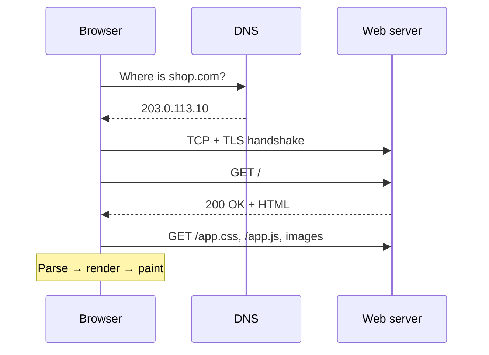
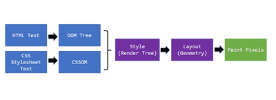
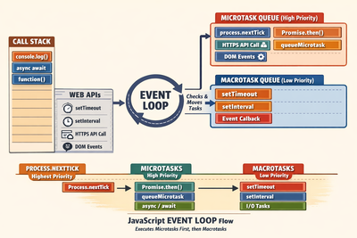
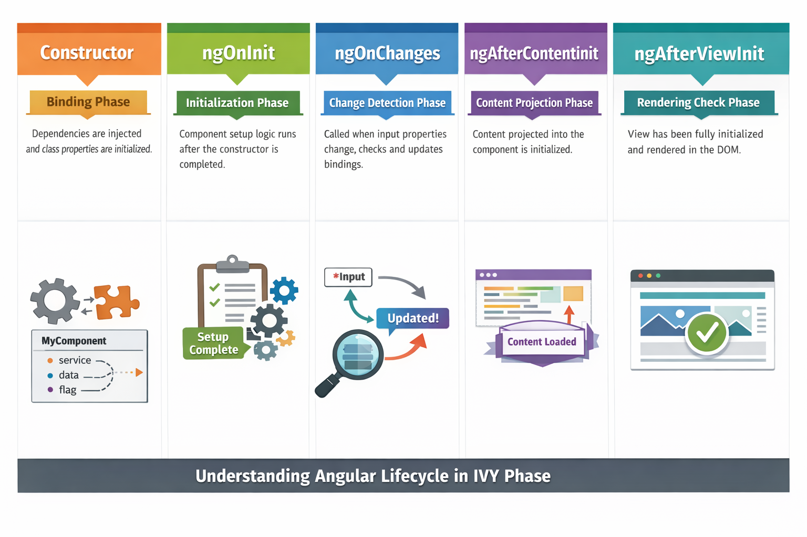

# 🌐 Inside the Browser

## Inside the browser: from a URL to pixels on screen (frontend)

### ❓ What happens when you type a URL and press Enter?

1. **DNS lookup:** the browser asks DNS for the server's IP address (`shop.com` → `203.0.113.10`). Cached answers make this instant next time.
2. **Connect:** open a TCP connection (or QUIC for HTTP/3) and do the **TLS handshake** for HTTPS.
3. **Request:** send `GET /` with headers and cookies.
4. **Server work:** the server (often behind a CDN and a load balancer) builds or returns the HTML.
5. **Response:** HTML arrives; the browser starts parsing it right away and requests CSS, JavaScript and images it finds.
6. **Render:** build the page and paint it on screen (next question).



This is one of the most common interview questions — explain it at this level, then go deeper wherever the interviewer asks.

---

### ❓ How does a browser turn HTML, CSS and JavaScript into a page?

The **critical rendering path**:

1. **HTML → DOM:** a tree of elements.
2. **CSS → CSSOM:** a tree of style rules.
3. **Render tree:** DOM + CSSOM, only the visible elements.
4. **Layout:** calculate each element's size and position.
5. **Paint:** fill in pixels — text, colours, images.
6. **Composite:** combine layers on screen (the GPU helps here).



**Why it matters:**
- CSS **blocks rendering** and `<script>` without `defer` **blocks parsing** — slow first paint.
- Changing an element's size triggers **layout** again (expensive); changing `transform` or `opacity` only re-composites (cheap) — that's why smooth animations use transforms.

---

### ❓ How does the JavaScript event loop work?

JavaScript runs on **one main thread**, so it can't wait for a slow network call without freezing the page. Instead, slow work is handed to the browser (or Node.js), and its callback waits in a queue until the main thread is free.

- **Call stack:** the code running right now.
- **Web APIs:** timers, `fetch`, DOM events — handled outside the main thread.
- **Microtask queue:** promise callbacks (`.then`, `await` continuations) — run **first**, all of them.
- **Task (macrotask) queue:** `setTimeout`, events — **one** per loop turn.
- **Event loop:** when the stack is empty → run all microtasks → maybe render → run the next task.



```js
console.log("A");
setTimeout(() => console.log("B"), 0);
Promise.resolve().then(() => console.log("C"));
console.log("D");
// A, D, C, B — microtasks (C) beat tasks (B)
```

**Practical tip:** a long loop on the main thread blocks clicks and scrolling (bad INP) — split it up or move it to a Web Worker.

---

### ❓ How do frameworks like Angular and React update the screen efficiently?

Touching the real DOM is slow, so frameworks work out the **smallest change** first:

- **React:** each render produces a new **virtual DOM** (plain JS objects). React **diffs** it against the previous one and applies only the differences (reconciliation). `key` props help it match list items.
- **Angular:** **change detection** checks component bindings after events, timers and HTTP calls. With **OnPush** or **signals**, Angular checks only the components whose inputs or signals actually changed.
- **Vue / Svelte / Solid:** fine-grained reactivity — they know exactly which value each piece of the page depends on.



**Interview line:** "All of them avoid re-rendering the whole page — React by diffing a virtual DOM, Angular by checking bindings (now targeted with signals), and Vue/Svelte by tracking dependencies."

---

### ❓ How do cookies, localStorage, sessionStorage and IndexedDB differ?

| Storage | Size | Lasts | Sent to server? | Use for |
|---|---|---|---|---|
| **Cookie** | ~4 KB | Until expiry | **Yes**, with every request | Session ID (set `HttpOnly; Secure; SameSite`) |
| **localStorage** | ~5–10 MB | Until cleared | No | User settings, theme |
| **sessionStorage** | ~5 MB | Until the tab closes | No | A form draft in one tab |
| **IndexedDB** | Large (GBs) | Until cleared | No | Offline data, big caches |

**Security tip:** never put tokens or secrets in localStorage — any XSS script can read it. `HttpOnly` cookies can't be read by JavaScript.
