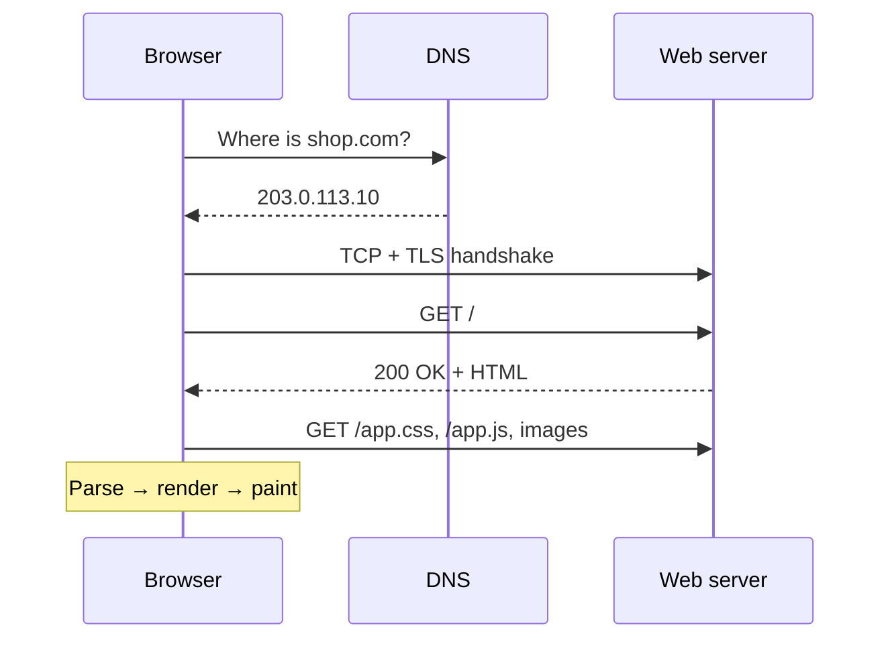
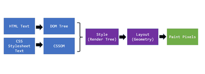
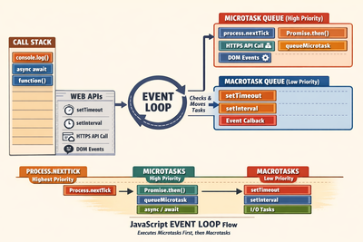
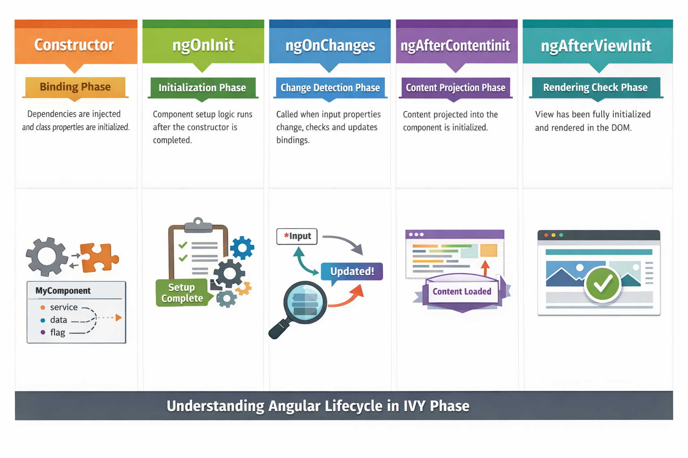

# 🌐 Inside the Browser

## Inside the browser: from a URL to pixels on screen (frontend)

### ❓ What happens when you type a URL and press Enter?

**Generic answer:** The browser finds the server's IP with DNS, connects (TCP + TLS), sends an HTTP request, receives HTML, fetches the CSS/JS/images it references, and renders the page.

**Under the hood:**

Imagine you type `shop.com` and press Enter. Half a second later the page is on screen. In between, at least six systems worked together.

**Step 1: Find the server (DNS)**

The browser asks DNS for the IP address: `shop.com` → `203.0.113.10`. Cached answers make this instant next time.

**Step 2: Connect**

Open a TCP connection (or QUIC for HTTP/3) and do the **TLS handshake** for HTTPS.

**Step 3: Ask (HTTP request)**

Send `GET /` with headers and cookies.

**Step 4: Server work**

The server — often behind a CDN and a load balancer — builds or returns the HTML.

**Step 5: Response and more requests**

HTML arrives; the browser parses it right away and requests the CSS, JavaScript and images it finds.

**Step 6: Render**

Build the page and paint it (next question).



**Final understanding:** **Name → IP (DNS) → connection (TCP/TLS) → request → server → response → sub-resources → render.** Explain it at this level, then go deeper wherever the interviewer asks.

---

### ❓ How does a browser turn HTML, CSS and JavaScript into a page?

**Generic answer:** It builds the DOM from HTML and the CSSOM from CSS, combines them into a render tree, calculates layout, paints pixels and composites layers — the critical rendering path.

**Under the hood:**

Imagine the browser has just received a page of text: tags, style rules and scripts. None of it is pixels yet.

**Step 1: HTML → DOM** — a tree of elements.

**Step 2: CSS → CSSOM** — a tree of style rules.

**Step 3: Render tree** — DOM + CSSOM, only visible elements (`display: none` is dropped).

**Step 4: Layout** — calculate each element's size and position.

**Step 5: Paint** — fill in pixels: text, colours, images.

**Step 6: Composite** — combine layers on screen (the GPU helps).



**Step 7: Why it matters**

- CSS **blocks rendering** and `<script>` without `defer` **blocks parsing** — slow first paint.
- Changing an element's size re-runs **layout** (expensive); changing `transform` or `opacity` only re-composites (cheap) — that's why smooth animations use transforms.

**Final understanding:** **Text → two trees (DOM, CSSOM) → render tree → layout → paint → composite.** Faster pages skip as many of these steps as possible on each change.

---

### ❓ How does the JavaScript event loop work?

**Generic answer:** JavaScript runs on one thread; slow work is handed to the browser or Node.js, and its callback waits in a queue until the call stack is empty — microtasks (promises) first, then one task (timers, events).

**Under the hood:**

Imagine a button that fetches data taking 2 seconds. If JavaScript simply waited, the page would freeze — no scrolling, no clicks — because there is only **one main thread**.

**Step 1: Run the current code (call stack)**

Code runs on the **call stack**, one function at a time.

**Step 2: Hand slow work away (Web APIs)**

Timers, `fetch` and DOM events are handled by the browser outside the main thread.

**Step 3: Queue the callbacks**

- **Microtask queue:** promise callbacks (`.then`, `await` continuations).
- **Task (macrotask) queue:** `setTimeout`, events.

**Step 4: The loop**

When the stack is empty → run **all** microtasks → maybe render → run **one** task → repeat.



```js
console.log("A");
setTimeout(() => console.log("B"), 0);
Promise.resolve().then(() => console.log("C"));
console.log("D");
// A, D, C, B — microtasks (C) beat tasks (B)
```

**Practical tip:** a long loop on the main thread blocks clicks and scrolling (bad INP) — split it up or move it to a Web Worker.

**Final understanding:** **One thread can't wait → hand waiting to the browser → callbacks queue up → loop runs them when the stack is empty, microtasks first.**

---

### ❓ How does Angular change detection work internally?

**Generic answer:** Change detection is how Angular notices that component data changed and updates the matching parts of the DOM.

**Under the hood:**

Imagine this component:

```typescript
export class EmployeeComponent {
  employeeName = "John";
  updateName() { this.employeeName = "David"; }
}
```

```html
<h1>{{ employeeName }}</h1>
<button (click)="updateName()">Update</button>
```

The screen shows John. You click; the property becomes David. But a plain JavaScript property change tells the browser nothing. How does the `<h1>` know to change?

**Step 1: Application state**

Data lives in component properties, services and signals. Templates **bind** to it (`{{ employeeName }}`).

**Step 2: Knowing *when* to check**

Something must say "state may have changed". Traditionally **Zone.js** patches async APIs (clicks, timers, HTTP) and tells Angular after each one finishes.

**Step 3: Checking bindings**

Angular walks the component tree and evaluates each binding, comparing with the previous value. Only changed values touch the DOM.

```text
employeeName = "David" → change detection → binding differs → DOM updated → shows David
```

**Step 4: OnPush — check less**

In big apps, checking every component after every event is wasteful. With `ChangeDetectionStrategy.OnPush`, a component is checked only when its `@Input` reference changes, an event happens inside it, an `async` pipe emits, or it is marked manually.

**Step 5: Signals — know exactly what changed**

With **signals** (`signal()`, `computed()`), Angular records which template reads which signal. When a signal changes, only the components that read it are marked — and apps can run **zoneless**, without Zone.js.

**Final understanding:** **State changes silently → something signals "maybe changed" (Zone.js or signals) → Angular checks bindings → only changed values update the DOM.** OnPush and signals shrink how much is checked.

---

### ❓ How do frameworks like Angular and React update the screen efficiently?

**Generic answer:** They work out the smallest DOM change first — React by diffing a virtual DOM, Angular by checking bindings (now targeted with signals), Vue/Svelte by tracking exactly which values each part depends on.

**Under the hood:**

Imagine a list of 1,000 rows where one price changes. Rebuilding the whole DOM is slow (layout, paint). Frameworks must change just that one cell.

**Step 1: React — virtual DOM + diff**

Each render produces a new **virtual DOM** (plain JS objects). React **diffs** it against the previous one and applies only the differences (reconciliation). `key` props help it match list items.

**Step 2: Angular — check bindings**

**Change detection** compares each binding's value after events, timers and HTTP calls. With **OnPush** or **signals**, only affected components are checked.

**Step 3: Vue / Svelte / Solid — fine-grained reactivity**

They track which DOM node depends on which value, so a change updates exactly that node — no diffing.



**Final understanding:** **Real DOM is slow → find the minimal change (diff, binding check or dependency tracking) → patch only that.**

---

### ❓ How do cookies, localStorage, sessionStorage and IndexedDB differ?

**Generic answer:** Cookies are small and sent to the server with every request; localStorage, sessionStorage and IndexedDB stay in the browser, differing in size and lifetime.

**Under the hood:**

Imagine you need to remember four things: the user's session, their dark-mode choice, a half-filled form in one tab, and 200 MB of offline data. One storage can't fit all.

**Step 1: Something the server must see → cookie**

The browser attaches cookies to every request to that site automatically. Small (~4 KB). Good for a session ID.

**Step 2: Small, long-lived, browser-only → localStorage**

~5–10 MB of strings, kept until cleared. Good for settings.

**Step 3: Only for this tab → sessionStorage**

Same API, but cleared when the tab closes.

**Step 4: Large or structured → IndexedDB**

An async database in the browser, GBs in size. Good for offline apps.

| Storage | Size | Lasts | Sent to server? | Use for |
|---|---|---|---|---|
| **Cookie** | ~4 KB | Until expiry | **Yes** | Session ID (`HttpOnly; Secure; SameSite`) |
| **localStorage** | ~5–10 MB | Until cleared | No | User settings |
| **sessionStorage** | ~5 MB | Until tab closes | No | Form draft |
| **IndexedDB** | GBs | Until cleared | No | Offline data |

**Security tip:** never put tokens in localStorage — any XSS script can read it. `HttpOnly` cookies can't be read by JavaScript.

**Final understanding:** **Server needs it → cookie; browser-only → pick by size and lifetime (local, session, IndexedDB).**
