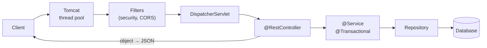

# 🖥 Inside a Web Server

## Servers, localhost and ports (all backends)

### ❓ What exactly is a server — hardware or software?

Both words are used:

- **Server software** is a **program (process)** that waits for requests and answers them — Tomcat, Nginx, Node.js, your Spring Boot app.
- **A server machine** is the **computer** (physical or a cloud VM) that runs such programs.

One machine can run many server programs, each listening on its own **port**.

**Analogy:** the machine is an **apartment building** (one street address = IP address); each server program is a **flat** with its own number (the port). A letter needs both: `203.0.113.10:8080`.

- **Common ports:** 80 HTTP, 443 HTTPS, 22 SSH, 3306 MySQL, 5432 PostgreSQL, 8080 typical app server.
- **localhost** (`127.0.0.1`) means "this same machine" — requests never leave your computer. `http://localhost:8080` reaches the Spring Boot app running on your laptop.

---

### ❓ What is the difference between a web server, an application server and a reverse proxy?

| | Web server | Application server | Reverse proxy |
|---|---|---|---|
| Job | Serve static files fast | Run your application code | Sit in front of servers and forward requests |
| Examples | Nginx, Apache | Tomcat, Jetty (inside Spring Boot), Node.js | Nginx, HAProxy, cloud load balancers |
| Adds | Caching, compression | Business logic, DB access | TLS, load balancing, routing, rate limits |

A typical setup: **browser → reverse proxy / load balancer (TLS) → several app servers → database.**

---

## What happens inside Spring Boot when a request arrives (Java / Spring)

### ❓ What happens when an HTTP request reaches a Spring Boot app?

1. **Embedded Tomcat** accepts the connection and gives the request to a thread from its **thread pool** (200 threads by default).
2. The **filter chain** runs — logging, CORS, **Spring Security** (authentication and authorisation).
3. **DispatcherServlet** — Spring's front controller — finds the controller method that matches the URL and HTTP method.
4. Spring **converts** the JSON body into your Java object and **validates** it (`@Valid`).
5. Your **controller → service → repository** code runs, often inside a `@Transactional` proxy.
6. The return value is converted to **JSON** (Jackson), and the response goes back through the filters.



**Why it matters:** if every Tomcat thread waits on a slow database, new requests queue — the app looks "down" even though the CPU is idle. Fix the slow query, add timeouts, or size the thread and connection pools together.

---

### ❓ How does Spring's dependency injection (inversion of control) create and connect objects?

At start-up, Spring:

1. **Scans** your packages for classes marked `@Component`, `@Service`, `@Repository`, `@Controller` and `@Configuration`/`@Bean`.
2. Builds a **plan of dependencies** (which bean needs which).
3. **Creates each bean once** (singleton by default) in the right order, passing dependencies into constructors.
4. Wraps beans in **proxies** where needed — for `@Transactional`, `@Async`, caching or security.

```java
@Service
class OrderService {
    private final PaymentClient payments;
    OrderService(PaymentClient payments) {   // Spring passes the PaymentClient bean in
        this.payments = payments;
    }
}
```

**Analogy:** a film set's **props department** — actors (your classes) don't make their own props; they're handed exactly what they need before the scene starts. In tests you hand in a fake instead.

This is **inversion of control**: the framework creates and wires objects, not your code.

---

### ❓ How does a database connection pool work?

Opening a database connection is slow (network round trips, authentication). A **connection pool** opens a fixed number of connections at start-up and **lends** them to requests, which return them when done.

- Spring Boot uses **HikariCP** by default (10 connections unless configured).
- If all connections are busy, the next request **waits**, and after the timeout fails with "Connection is not available".
- Size it with the database's limits in mind: 5 app instances × 20 connections = 100 connections on the database.

**Analogy:** a bike-sharing stand — bikes are reused, not built for every trip.
