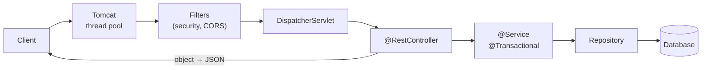

# 🖥 Inside a Web Server

## Servers, localhost and ports (all backends)

### ❓ What exactly is a server — hardware or software?

**Generic answer:** Both: server software is a program that waits for requests and answers them; a server machine is the computer that runs such programs.

**Under the hood:**

Imagine your laptop runs a Spring Boot app, MySQL and an Angular dev server — all at once. Requests arrive for each. How does each request reach the right program?

**Step 1: Server software**

A server is a **process** that **listens** for requests — Tomcat, Nginx, Node.js, your Spring Boot app.

**Step 2: The machine**

The physical or cloud computer (VM) running those programs is also called "a server".

**Step 3: Ports pick the program**

Each program listens on its own **port**.

**Analogy:** the machine is an **apartment building** (IP address); each program is a **flat** (port). A letter needs both: `203.0.113.10:8080`.

- Common ports: 80 HTTP, 443 HTTPS, 22 SSH, 3306 MySQL, 5432 PostgreSQL, 8080 app servers.

**Step 4: localhost**

`localhost` (`127.0.0.1`) means "this same machine" — the request never leaves your computer. `http://localhost:8080` reaches the Spring Boot app on your laptop.

**Final understanding:** **Machine (IP) + listening program (port) = a server address.**

---

### ❓ What is the difference between a web server, an application server and a reverse proxy?

**Generic answer:** A web server serves static files, an application server runs your code, and a reverse proxy sits in front of servers forwarding requests and adding TLS, load balancing and routing.

**Under the hood:**

Imagine your app grows: thousands of images and JS files, business logic that needs a database, several app instances, and HTTPS. Putting all that in one program is wasteful.

**Step 1: Static files → web server**

Nginx or Apache serves files from disk very fast, with caching and compression.

**Step 2: Business logic → application server**

Tomcat/Jetty (inside Spring Boot) or Node.js runs your code and talks to the database.

**Step 3: One entry point → reverse proxy**

Nginx, HAProxy or a cloud load balancer receives all traffic, ends TLS, spreads requests across app servers, and applies rate limits.

| | Web server | Application server | Reverse proxy |
|---|---|---|---|
| Job | Serve static files | Run app code | Forward requests |
| Examples | Nginx, Apache | Tomcat, Node.js | Nginx, HAProxy, cloud LB |
| Adds | Caching, compression | Business logic | TLS, load balancing, routing |

**Final understanding:** **Browser → reverse proxy (TLS, balancing) → app servers (logic) → database**, with static files served separately.

---

## What happens inside Spring Boot when a request arrives (Java / Spring)

### ❓ What happens when an HTTP request reaches a Spring Boot app?

**Generic answer:** Tomcat gives the request a thread, filters (including Spring Security) run, DispatcherServlet finds the controller method, your code runs, and the result is converted to JSON.

**Under the hood:**

Imagine `POST /api/orders` with a JSON body arrives. Somewhere a method `createOrder(OrderRequest req)` must run with a Java object — not raw bytes.

**Step 1: Accept and assign a thread**

**Embedded Tomcat** accepts the connection and hands the request to a thread from its **thread pool** (200 by default).

**Step 2: Filters**

The **filter chain** runs: logging, CORS, **Spring Security** (who are you, are you allowed?).

**Step 3: Find the method**

**DispatcherServlet** asks its handler mappings which controller method matches the URL and HTTP method.

**Step 4: Build the arguments**

Jackson **converts** the JSON into `OrderRequest`; `@Valid` **validates** it.

**Step 5: Run your code**

Controller → service → repository, often inside a `@Transactional` proxy.

**Step 6: Respond**

The return value becomes JSON, and the response passes back out through the filters.



**Why it matters:** if every Tomcat thread waits on a slow database, new requests queue — the app looks "down" while the CPU is idle. Fix the slow query, add timeouts, size thread and connection pools together.

**Final understanding:** **Bytes in → thread → filters → DispatcherServlet → JSON to object → your code → object to JSON → bytes out.** (Deeper: *Inside Spring Boot*.)

---

### ❓ What happens, end to end, when an Angular app calls a REST API?

**Generic answer:** The browser resolves the server's address, opens a secure connection, sends the HTTP request; the server's Spring Boot app processes it and returns a response that Angular renders.

**Under the hood:**

Imagine you click **Login** in an Angular app. It sends:

```http
POST https://example.com/api/login
```

What happens between the click and the "Welcome" message?

**Step 1: DNS**

The browser resolves `example.com` → `192.0.2.10` (often from cache).

**Step 2: TCP connection**

For HTTP/1.1 or HTTP/2, a TCP three-way handshake:

```text
Client  SYN      ─────▶  Server
        ◀─────  SYN-ACK
        ACK      ─────▶
```

**Step 3: TLS handshake**

Because it's HTTPS, the browser checks the server's certificate and both agree on encryption keys.

**Step 4: Send the request**

Angular's `HttpClient` (through any interceptors that add a token) sends the request over the encrypted connection.

**Step 5: Server processing**

Usually via a load balancer or reverse proxy:

```text
Tomcat → Spring Security filters → DispatcherServlet → Controller → Service → Repository → Database
```

**Step 6: Response**

```http
HTTP/1.1 200 OK
Content-Type: application/json
```

The `Observable` emits, the component updates its state, and change detection updates the screen.

**Final understanding:** a "simple" API call is **DNS → TCP → TLS → HTTP → server pipeline → database → response → UI update** — each step a place where latency or errors can appear.

---

### ❓ How does Spring's dependency injection (inversion of control) create and connect objects?

**Generic answer:** Spring's IoC container creates your objects (beans) and passes each one the dependencies it needs, instead of your classes creating them with `new`.

**Under the hood:**

Imagine three classes: `EmployeeController` needs `EmployeeService`, which needs `EmployeeRepository`. Without Spring:

```java
EmployeeRepository repo = new EmployeeRepository();
EmployeeService service = new EmployeeService(repo);
EmployeeController controller = new EmployeeController(service);
```

Now imagine hundreds of classes, plus test versions and transaction wrappers. Wiring by hand becomes tightly coupled and unmanageable.

**Step 1: Invert the control**

Your classes stop creating their dependencies. The **container** takes that job — **Inversion of Control**.

**Step 2: Find the classes (component scanning)**

At start-up Spring scans packages for `@Component`, `@Service`, `@Repository`, `@Controller` and `@Bean` methods.

**Step 3: Plan the dependencies**

It records each class as a **bean definition** and works out who needs whom.

**Step 4: Create and inject**

Beans are created once (singleton by default) in the right order; dependencies are passed into constructors.

```java
@Service
class EmployeeService {
    private final EmployeeRepository repository;
    EmployeeService(EmployeeRepository repository) {   // Spring passes the repository bean in
        this.repository = repository;
    }
}
```

**Step 5: Add proxies where needed**

Beans with `@Transactional`, `@Async` or caching are wrapped in **proxies**.

**Step 6: Ready**

When a request hits `EmployeeController`, its service and repository are already wired.

**Analogy:** a film set's props department — actors don't make their own props; they're handed what they need. In tests you hand in a fake.

**Final understanding:** IoC is the principle (the container controls object creation); dependency injection is how Spring does it. **Hand wiring doesn't scale → scan → plan → create → inject → proxy → ready.**

---

### ❓ How does a database connection pool work?

**Generic answer:** A pool keeps a set of open database connections and lends them to requests, which return them when done, instead of opening a new connection each time.

**Under the hood:**

Imagine 1,000 users hit your Spring Boot app at once, and each request needs the database. Opening a connection means:

1. A network connection (TCP, maybe TLS).
2. Authentication.
3. Database-side memory and a session.

That's slow — and 1,000 simultaneous connections could overload the database.

**Step 1: Open a few connections up front**

The pool (Spring Boot uses **HikariCP**, 10 connections by default) creates connections at start-up or as needed.

**Step 2: Borrow**

A request needing the database takes a free connection from the pool.

**Step 3: Use**

It runs its SQL.

**Step 4: Return, don't close**

`connection.close()` on a pooled connection just **returns** it to the pool.

**Step 5: Reuse**

The next request gets the same, already-open connection.

**Step 6: When the pool is empty**

The next request **waits**; after the timeout it fails with "Connection is not available". Size the pool with the database's limits in mind: 5 app instances × 20 connections = 100 connections on the database.

**Analogy:** a bike-sharing stand — bikes are reused, not built for every trip.

**Final understanding:** **Connections are expensive → open a fixed set → borrow → use → return → reuse**, which also caps load on the database.
