# 🔩 Under the Hood: Networking & Communication

How bytes travel between computers, how TCP, HTTP and TLS really work, and how trust is established with keys and certificates.

## How Data Travels

### ❓ How does data travel from one computer to another?

### 📝 Answer

**1. What is it?**
Data is cut into **packets** and wrapped in layers of headers (**encapsulation**). Each layer has one job: the application says *what*, TCP/UDP says *which program*, IP says *which computer*, Ethernet/Wi-Fi says *which next device on this local link*.

**2. How does it work internally?**

1. **Application** creates data (an HTTP request).
2. **Transport (TCP)** splits it into **segments**, adds ports and sequence numbers.
3. **Network (IP)** adds source and destination **IP addresses** → a **packet**.
4. **Link (Ethernet/Wi-Fi)** adds **MAC addresses** of this hop → a **frame**, sent as electrical/radio/light signals.
5. Each **router** reads the IP header, picks the next hop from its routing table, re-wraps it in a new frame, and forwards it.
6. The receiver unwraps layer by layer and hands the data to the program listening on the destination port.

**3. Visual**

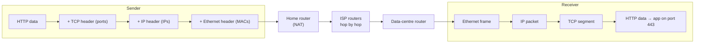

**4. Internal implementation**

- The OS **network stack** (kernel) implements TCP/IP; the **NIC** (network card) sends and receives frames, often offloading checksums and segmentation.
- Typical max frame payload (**MTU**) is 1500 bytes, so a 1 MB response becomes ~700+ packets.
- **NAT** on your home router rewrites private IPs (192.168.x.x) to one public IP and tracks connections by port.

**5. Why is it designed this way?**
Layering lets each part change independently (Wi-Fi → fibre without changing HTTP). Packet switching shares links between millions of users and routes around failures.

**6. Language differences**
Applications only see the top: **sockets**. Java (`Socket`, `HttpClient`), Node (`net`, `http`), Python (`socket`, `requests`), Go (`net`) all call the same OS socket API.

**7. Practical example**
Loading `https://shop.com` from Pune to a server in Mumbai: ~10–15 router hops, each adding a little delay; the TLS + HTTP data rides inside TCP segments inside IP packets.

**8. How can I observe it?**
`tracert shop.com` (Windows) / `traceroute` shows each router hop. **Wireshark** shows every layer of each packet (Ethernet → IP → TCP → TLS).

---

### ❓ How do IP Addresses, MAC Addresses, DNS, Ports and Routing work together?

### 📝 Answer

**1. What is it?**

| Piece | Identifies | Scope |
|---|---|---|
| **DNS** | Name → IP (`shop.com` → 93.184.216.34) | Global lookup |
| **IP address** | A device's network interface | End to end (whole journey) |
| **MAC address** | A network card | **One local link** (one hop) |
| **Port** | A program on the device | End to end |
| **Routing** | Which next hop to send a packet to | Each router |

**2. How does it work internally?**

1. **DNS** resolves the name to the destination IP.
2. Your OS checks its **routing table**: is the IP on my local network? If not, send to the **default gateway** (router).
3. **ARP** (IPv4) or Neighbor Discovery (IPv6) finds the gateway's **MAC address** on the LAN.
4. The frame goes to the gateway's MAC with the **final** IP inside.
5. Each router repeats: look up the destination IP (longest prefix match), find the next hop's MAC, forward. **MACs change at every hop; IPs stay the same** (except NAT).
6. At the destination, the **port** selects the program (443 → web server).

**3. Visual**

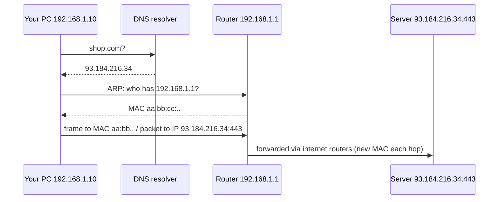

**4. Internal implementation**

- Routing table entries: network prefix (e.g. `10.0.0.0/8`) → interface / next hop; the **most specific** match wins.
- Internet routers learn routes with **BGP** between networks.
- ARP results are cached (`arp -a`); DNS results are cached by TTL.

**5. Why is it designed this way?**
Separating **identity** (IP, stays end to end) from **delivery on each link** (MAC, changes per hop) lets any link technology carry IP. DNS lets servers change IPs without users noticing.

**6. Language differences**
Programs work with names, IPs and ports only. MAC and routing are handled entirely by the OS and network devices.

**7. Practical example**
Spring Boot calling `http://inventory:8080` in Docker Compose: Docker's DNS resolves `inventory` → container IP (172.18.0.3); the bridge network delivers it; port 8080 reaches the Tomcat inside that container.

**8. How can I observe it?**
`ipconfig /all` (your IP, MAC, gateway, DNS), `route print` / `ip route` (routing table), `arp -a` (MAC cache), `nslookup shop.com` (DNS), `netstat -ano` (ports).

---

## TCP, UDP and HTTP

### ❓ How do TCP and UDP work internally?

### 📝 Answer

**1. What is it?**

- **TCP** — a **reliable, ordered byte stream** between two programs. Lost data is resent, order is restored, speed adapts to the network.
- **UDP** — **independent datagrams**, no connection, no guarantee of delivery or order. Minimal overhead.

**2. How does it work internally?**
TCP:

1. Every byte has a **sequence number**; the receiver sends **ACKs** for what it got.
2. Missing ACK after a timeout (or 3 duplicate ACKs) → **retransmit**.
3. **Flow control**: the receiver advertises a **window** (how much buffer it has left).
4. **Congestion control** (CUBIC, BBR): start slow, increase the sending rate until loss/delay appears, then back off.

UDP: add an 8-byte header (ports, length, checksum) and send. The application deals with loss.

**3. Visual**

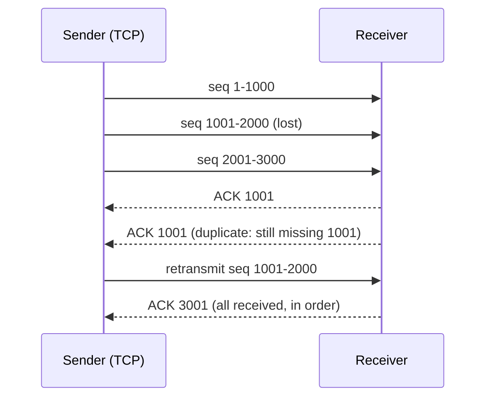

**4. Internal implementation**

- TCP header: 20+ bytes (ports, seq, ack, flags SYN/ACK/FIN/RST, window, checksum).
- The kernel keeps **send and receive buffers** per socket; your `write()` copies into the send buffer and may return before data is delivered.
- **Nagle's algorithm** batches small writes (disable with `TCP_NODELAY` for low-latency apps).

**5. Why is it designed this way?**
TCP makes networks look like a reliable pipe, which most apps need (web, DB, email). UDP avoids TCP's handshake and **head-of-line blocking** (one lost packet delays everything after it) — better for real-time voice/video, games, DNS, and as the base for **QUIC**.

**6. Language differences**
Java: `Socket` (TCP) / `DatagramSocket` (UDP); Node: `net` / `dgram`; Python and Go: `socket` with `SOCK_STREAM` / `SOCK_DGRAM`.

**7. Practical example**
A video call drops a UDP packet → a tiny glitch, call continues. A TCP-based file download drops a packet → it is resent, and the file is complete and correct.

**8. How can I observe it?**
**Wireshark**: filter `tcp.analysis.retransmission` or `udp`; "Statistics → TCP Stream Graphs" shows congestion control at work. `netstat -s` shows retransmission counters.

---

### ❓ How does TCP establish and maintain connections?

### 📝 Answer

**1. What is it?**
Before sending data, TCP sets up a **connection**: both sides agree on starting sequence numbers and confirm they can reach each other. The connection then stays open until one side closes it.

**2. How does it work internally?**
Open (**3-way handshake**):

1. Client → `SYN` (my starting sequence number is x).
2. Server → `SYN-ACK` (mine is y; I received x).
3. Client → `ACK` (I received y). Connection **ESTABLISHED**.

Maintain: data + ACKs flow both ways; idle connections can send **keep-alive** probes.
Close (**4-way**): `FIN` → `ACK`, then `FIN` → `ACK`. The side that closed first waits in **TIME_WAIT** (2 × max segment lifetime) so late packets don't confuse a new connection.

**3. Visual**

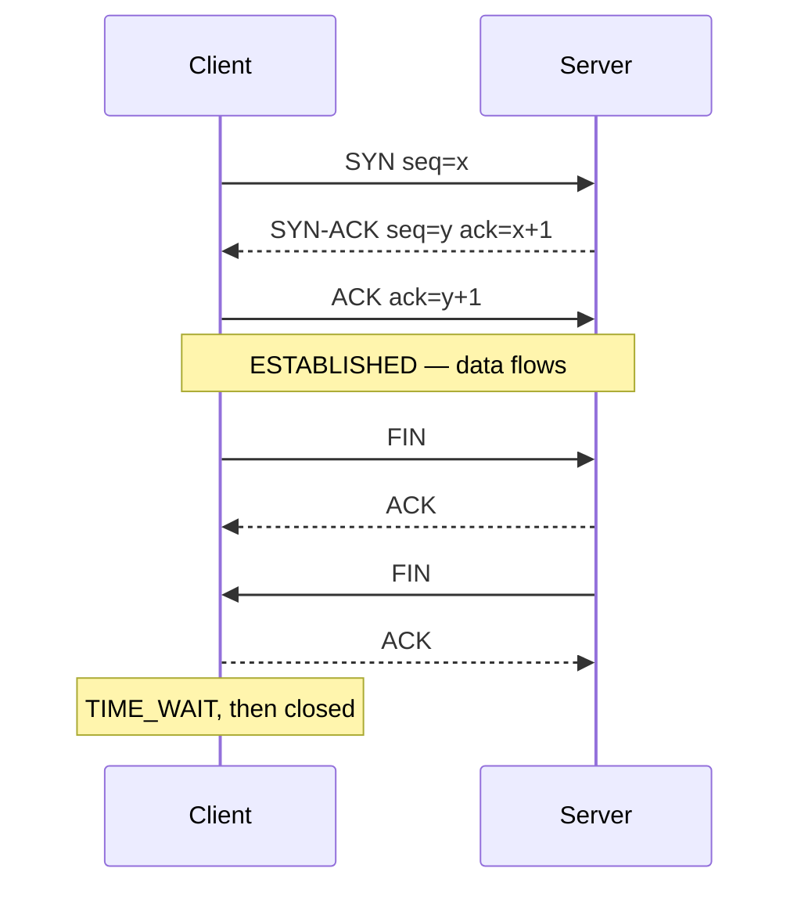

**4. Internal implementation**

- Random **initial sequence numbers** prevent spoofing and confusion with old connections.
- The kernel keeps a **TCB** (transmission control block) per connection: state, sequence numbers, windows, timers.
- A `RST` aborts a connection immediately (e.g. connecting to a closed port → "connection refused").
- **SYN cookies** protect servers from SYN-flood attacks.

**5. Why is it designed this way?**
The handshake ensures both directions work and synchronises numbering. Its cost is **one round-trip** before any data — which is why HTTP reuses connections (keep-alive, HTTP/2) and why TLS 1.3 and QUIC cut round-trips.

**6. Language differences**
Connection pooling is everywhere for this reason: HikariCP (DB), Apache HttpClient / OkHttp / Java `HttpClient` (HTTP), Node's `http.Agent` with `keepAlive`.

**7. Practical example**
Server ~100 ms away: TCP handshake 100 ms + TLS 1.3 100 ms + request 100 ms ≈ 300 ms for the first request; later requests on the same connection ≈ 100 ms.

**8. How can I observe it?**
**Wireshark** filter `tcp.flags.syn==1` shows handshakes; `netstat -an` shows states (`ESTABLISHED`, `TIME_WAIT`, `CLOSE_WAIT` — many `CLOSE_WAIT` = your app forgot to close sockets).

---

### ❓ How do HTTP/1.1, HTTP/2 and HTTP/3 differ internally?

### 📝 Answer

**1. What is it?**
Three versions of the same HTTP semantics (methods, headers, status codes) with different **wire formats and transports**.

| | HTTP/1.1 | HTTP/2 | HTTP/3 |
|---|---|---|---|
| Format | Text | Binary frames | Binary frames |
| Transport | TCP | TCP | **QUIC over UDP** |
| Requests per connection | One at a time | Many, multiplexed streams | Many, independent streams |
| Header compression | None | HPACK | QPACK |
| Head-of-line blocking | Per connection | At TCP level | **None across streams** |

**2. How does it work internally?**

- **HTTP/1.1**: request text → response text on a TCP connection; the next request waits. Browsers open ~6 connections per host to parallelise.
- **HTTP/2**: one TCP connection; each request/response is a **stream**; messages are cut into **frames** (HEADERS, DATA) and interleaved. But one lost TCP packet stalls **all** streams.
- **HTTP/3**: **QUIC** implements streams, reliability and TLS 1.3 in user space over UDP; a lost packet only stalls its own stream; new connections need 1 round-trip (0-RTT on resumption); connections survive IP changes (Wi-Fi → mobile).

**3. Visual**

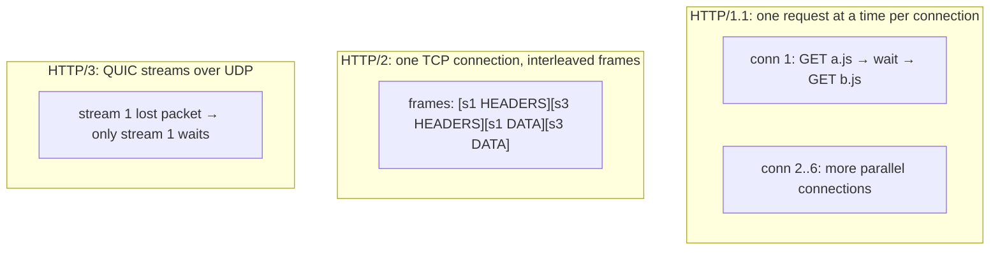

**4. Internal implementation**

- HPACK/QPACK keep a table of previously sent headers so repeated headers (cookies, user-agent) are sent as small indexes.
- HTTP/2 **server push** exists in the spec but browsers removed support; `103 Early Hints` is used instead.
- Browsers learn a server supports HTTP/3 from the `Alt-Svc` header (or DNS HTTPS records), then switch.

**5. Why is it designed this way?**
Web pages load hundreds of resources; HTTP/1.1's one-at-a-time model wasted connections and round-trips. HTTP/2 fixed multiplexing; HTTP/3 fixed TCP's head-of-line blocking and slow handshakes, especially on lossy mobile networks.

**6. Server differences**
Spring Boot: `server.http2.enabled=true` (HTTP/2 over TLS with Tomcat). HTTP/3 is usually terminated at the edge (Cloudflare, Nginx with QUIC, cloud load balancers) and forwarded to apps over HTTP/1.1 or HTTP/2.

**7. Practical example**
An Angular app loading 40 small files over HTTP/1.1 queues them over 6 connections; over HTTP/2 all 40 requests go out at once on one connection.

**8. How can I observe it?**
DevTools → **Network** → right-click columns → enable **Protocol** (`http/1.1`, `h2`, `h3`). `curl -I --http2 https://site` / `curl --http3`. Wireshark can decode HTTP/2 frames when given TLS keys (`SSLKEYLOGFILE`).

---

## Security: TLS, Keys and Certificates

### ❓ How does HTTPS and the TLS Handshake work?

### 📝 Answer

**1. What is it?**
**HTTPS** = HTTP sent inside a **TLS** connection. The **TLS handshake** proves the server's identity (certificate), and both sides agree on fresh **symmetric keys** that encrypt and protect everything afterwards.

**2. How does it work internally?** (TLS 1.3)

1. **ClientHello**: supported cipher suites, a random value, and a **key share** (an ephemeral Diffie-Hellman public key, e.g. X25519).
2. **ServerHello**: chosen cipher + the server's key share. Both now compute the same **shared secret** (ECDHE) — never sent over the wire.
3. Keys are derived from it (HKDF); everything after this is **encrypted**.
4. Server sends **Certificate** (its public key + CA signature) and **CertificateVerify** (a signature over the handshake so far, made with its **private key**) and **Finished**.
5. Client validates the certificate chain and the signature, sends **Finished**.
6. HTTP requests flow, encrypted with AES-GCM or ChaCha20-Poly1305. Total: **1 round-trip**.

**3. Visual**

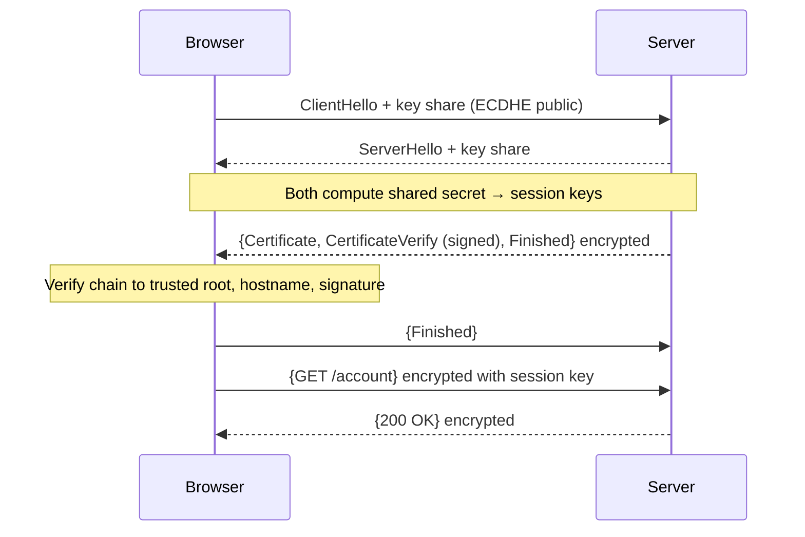

**4. Internal implementation**

- **Ephemeral** key exchange gives **forward secrecy**: stealing the server's private key later can't decrypt old recorded traffic.
- **AEAD** ciphers (AES-GCM) encrypt and authenticate each record — tampering is detected.
- Session **resumption** (PSK tickets) allows 0-RTT data on reconnect (replay risk, so only for safe requests).
- **SNI** in ClientHello tells the server which hostname's certificate to send (many sites on one IP).

**5. Why is it designed this way?**
Asymmetric crypto solves "agree on a secret over an open network" and "prove identity", but it's slow; symmetric crypto is fast for bulk data. TLS 1.3 removed old insecure options and cut the handshake from 2 round-trips (TLS 1.2) to 1.

**6. Language differences**
Java: JSSE (`SSLContext`, keystores/truststores `cacerts`). Node: OpenSSL via `tls`. Python: `ssl` (OpenSSL). Go: its own `crypto/tls`. .NET: SChannel on Windows / OpenSSL on Linux. All implement the same protocol.

**7. Practical example**
Spring Boot with `server.ssl.key-store=classpath:keystore.p12` serves HTTPS directly; more commonly TLS is terminated at Nginx or a cloud load balancer.

**8. How can I observe it?**
Browser padlock → certificate details. `openssl s_client -connect shop.com:443 -servername shop.com` prints the chain and negotiated cipher. **Wireshark** filter `tls.handshake` shows ClientHello/ServerHello.

---

### ❓ How do Public-Key and Private-Key cryptography work?

### 📝 Answer

**1. What is it?**
**Asymmetric cryptography** uses a **key pair**: a **public key** (share with everyone) and a **private key** (keep secret). What one key does, only the other can undo or check.

Two uses:

- **Encryption** — encrypt with the recipient's **public** key → only their **private** key decrypts.
- **Digital signatures** — sign with your **private** key → anyone checks with your **public** key.

**2. How does it work internally?**

1. Key generation picks secret numbers and derives the public key with a **one-way** math function (easy forward, infeasible to reverse).
2. **RSA**: based on multiplying two huge primes (easy) vs factoring the product (infeasible); key sizes 2048–4096 bits.
3. **Elliptic curves (ECDSA, Ed25519, X25519)**: based on the elliptic-curve discrete log problem; 256-bit keys ≈ RSA 3072-bit strength, much faster.
4. **Diffie-Hellman / ECDHE**: both sides combine their private key with the other's public key and arrive at the **same shared secret**.

**3. Visual**

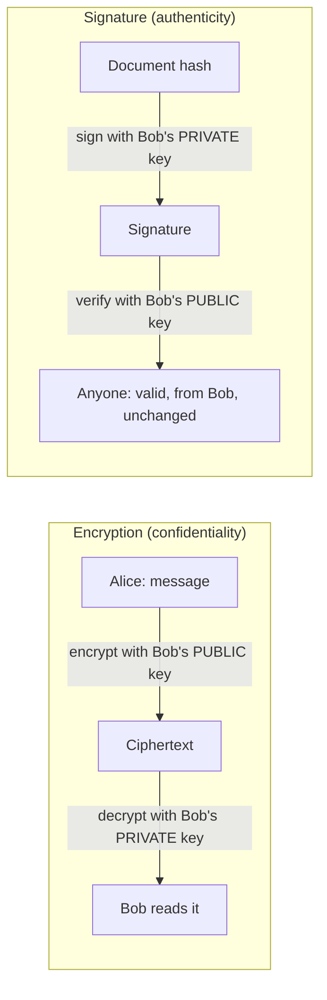

**4. Internal implementation**

- Signatures sign a **hash** (SHA-256) of the data, not the data itself.
- In practice, asymmetric crypto only **exchanges or protects a symmetric key** (hybrid encryption); bulk data uses AES.
- Private keys are stored in key stores (`.p12`, `.pem`, Java keystore) or hardware (HSM, cloud KMS, TPM).

**5. Why is it designed this way?**
It solves key distribution: you can publish a public key openly and still receive secrets or prove identity. It is slow and has size limits, hence the hybrid approach.

**6. Language differences**
Java: `KeyPairGenerator`, `Signature`, `Cipher` (JCA). Node: `crypto.generateKeyPairSync`, `crypto.sign`. Python: `cryptography` library. Go: `crypto/ecdsa`, `crypto/ed25519`. Same algorithms; never write your own crypto math.

**7. Practical example**
JWT signed with **RS256**: the auth server signs tokens with its **private** key; every microservice verifies them with the **public** key (published at a JWKS URL) — services can verify but can't create tokens.

**8. How can I observe it?**
`openssl genpkey -algorithm ed25519 -out key.pem`, `openssl pkey -in key.pem -pubout`, then sign and verify a file with `openssl pkeyutl`. **jwt.io** shows header (`alg`), payload and signature verification with a public key.

---

### ❓ How does a receiver verify that the sender possesses the legitimate private key?

### 📝 Answer

**1. What is it?**
With a **challenge-response signature**: the receiver asks the sender to sign **fresh, unpredictable data** with the private key, then checks the signature with the known public key. Only someone holding the private key can produce a valid signature — and the key itself is never sent.

**2. How does it work internally?**

1. The receiver already trusts a **public key** for the sender (from a certificate chain, a JWKS endpoint, or a pre-registered key like SSH `authorized_keys`).
2. The receiver sends (or both create) a **challenge**: random bytes / a nonce / the handshake transcript.
3. The sender computes `signature = Sign(privateKey, hash(challenge))`.
4. The receiver runs `Verify(publicKey, hash(challenge), signature)` → true/false.
5. Because the challenge is fresh, an old signature can't be **replayed**.

**3. Visual**

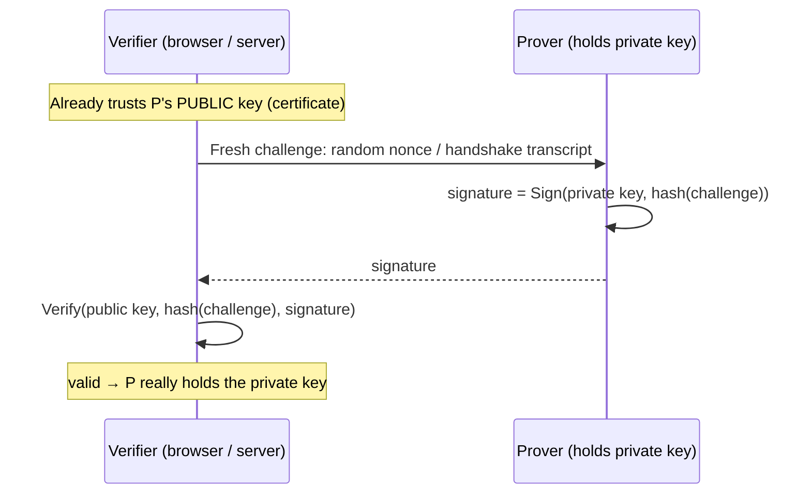

**4. Internal implementation**

- **TLS 1.3**: the server's `CertificateVerify` message is a signature over the **hash of the whole handshake** (which includes both random values) → proves it holds the certificate's private key for *this* connection.
- **SSH key login**: the server checks a signature over session-specific data with the public key in `authorized_keys`.
- **WebAuthn / passkeys**: the website sends a challenge; the device signs it with a private key that never leaves it.
- **JWT**: the "challenge" is the token content; the signature proves the issuer created it (expiry limits replay).

**5. Why is it designed this way?**
Proving possession without revealing the secret means nothing an eavesdropper sees can be reused. Fresh challenges stop replay attacks; trust in the public key comes separately from certificates/CAs.

**6. Language differences**
Same pattern everywhere: Java `Signature.getInstance("SHA256withECDSA")`, Node `crypto.verify`, Python `public_key.verify(...)`, Go `ecdsa.VerifyASN1`.

**7. Practical example**

```java
Signature s = Signature.getInstance("SHA256withECDSA");
s.initVerify(publicKey);
s.update(challenge);
boolean ok = s.verify(signatureFromClient);
```

**8. How can I observe it?**
`ssh -v user@host` shows "Offering public key… Server accepts key" and the signature step. Wireshark TLS 1.3 needs `SSLKEYLOGFILE` to decrypt and show `CertificateVerify`. Browser passkey login: DevTools → WebAuthn panel.

---

### ❓ How do Digital Certificates and Certificate Authorities establish trust?

### 📝 Answer

**1. What is it?**
A **certificate** (X.509) binds a **public key** to an **identity** (domain name), and is **signed** by a **Certificate Authority (CA)**. Your OS/browser ships with a list of trusted **root CAs**; trust flows down a chain of signatures from those roots.

**2. How does it work internally?**

1. The site creates a key pair and sends a **CSR** (certificate signing request) to a CA.
2. The CA checks domain control (e.g. Let's Encrypt **ACME** HTTP or DNS challenge) and signs the certificate with an **intermediate** CA key.
3. The server sends **leaf + intermediate** certificates during the TLS handshake.
4. The browser builds the chain: leaf ← signed by intermediate ← signed by a **root** in its trust store.
5. It checks each signature, validity dates, that the domain matches **SAN** (Subject Alternative Name), key usage, and revocation/Certificate Transparency policies.

**3. Visual**

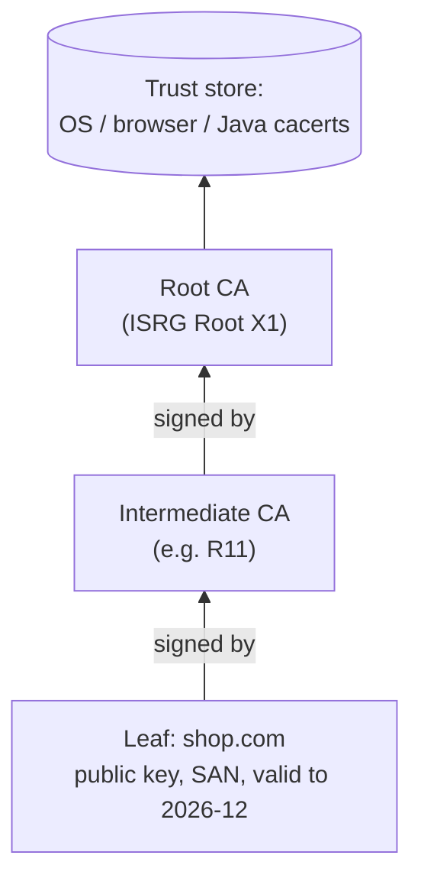

**4. Internal implementation**

- Certificate fields: subject, issuer, serial, validity, public key, SAN list, extensions, CA's signature.
- Root keys are kept **offline**; intermediates do daily signing, so a compromise can be contained.
- **Revocation**: CRLs and OCSP (OCSP stapling); browsers increasingly rely on short lifetimes and their own revocation lists.
- **Certificate Transparency** logs: every public cert is logged publicly, so mis-issued certificates can be spotted.

**5. Why is it designed this way?**
Nobody can personally verify every website's key. Delegating to a small set of audited CAs (whose roots are pre-installed) makes trust scale to the whole web. Weakness: any trusted CA can issue for any domain — hence CT logs.

**6. Platform differences**
Windows certificate store, macOS Keychain, Linux `/etc/ssl/certs`, **Java's own `cacerts`** (a frequent cause of `PKIX path building failed` when a corporate CA isn't imported), Node uses its bundled Mozilla list (`NODE_EXTRA_CA_CERTS` to add more).

**7. Practical example**
Spring Boot calling an internal API with a company-issued certificate fails with `PKIX path building failed` → import the company root CA into the JVM truststore (`keytool -importcert`) or configure an SSL bundle.

**8. How can I observe it?**
Browser padlock → "Certificate is valid" → view the chain. `openssl s_client -connect site:443 -showcerts`; `keytool -list -cacerts` lists Java's trusted roots. **crt.sh** searches CT logs for a domain.

---

## Persistent Connections and Traffic Routing

### ❓ How do WebSockets establish persistent connections?

### 📝 Answer

**1. What is it?**
A **WebSocket** is a long-lived, **two-way** connection between browser and server over one TCP (TLS) connection. Either side can send messages at any time — no request/response pattern.

**2. How does it work internally?**

1. The browser sends a normal HTTP/1.1 request with `Upgrade: websocket`, `Connection: Upgrade` and a random `Sec-WebSocket-Key`.
2. The server answers **`101 Switching Protocols`** with `Sec-WebSocket-Accept` = base64(SHA-1(key + a fixed GUID)) — proof it understood the WebSocket handshake.
3. The same TCP connection now carries **WebSocket frames** instead of HTTP.
4. Frames have an opcode (text, binary, ping, pong, close), a length, and a payload; client-to-server frames are **masked**.
5. **Ping/pong** frames keep the connection alive through proxies; a **close** frame ends it.

**3. Visual**

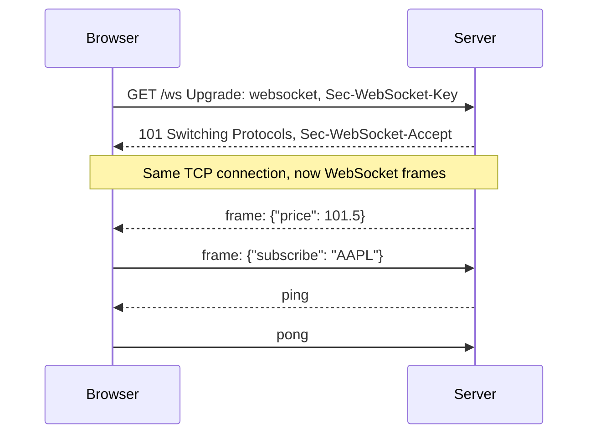

**4. Internal implementation**

- One open socket per client on the server → servers use non-blocking I/O (Netty, Node, Tomcat NIO) to hold many thousands of connections.
- Load balancers must support long-lived connections and upgrades; multiple server instances need a **shared message bus** (Redis pub/sub, Kafka) to broadcast to all clients.
- Masking prevents cache-poisoning attacks on old proxies.

**5. Why is it designed this way?**
Starting with HTTP lets WebSockets pass through existing ports (80/443), proxies and auth. A persistent connection avoids polling overhead and gives low-latency server push. Alternatives: **Server-Sent Events** (one-way server → client over HTTP, simpler) and long polling.

**6. Framework differences**
Spring: `@EnableWebSocket` handlers or **STOMP** over WebSocket with a message broker. Node: `ws`, Socket.IO (adds fallbacks and rooms). ASP.NET Core: **SignalR**. Angular: RxJS `webSocket()` subject.

**7. Practical example**

```js
const ws = new WebSocket('wss://shop.com/ws/prices');
ws.onmessage = e => updatePrice(JSON.parse(e.data));
ws.onopen = () => ws.send(JSON.stringify({ subscribe: 'AAPL' }));
```

**8. How can I observe it?**
DevTools → **Network** → filter **WS** → click the connection → **Messages** tab shows every frame. The Headers tab shows the 101 response and the Sec-WebSocket headers.

---

### ❓ How do Load Balancers, Reverse Proxies and API Gateways work?

### 📝 Answer

**1. What is it?**

- **Reverse proxy** — a server in front of your apps that receives requests and forwards them (TLS termination, caching, compression).
- **Load balancer** — spreads traffic across several instances and removes unhealthy ones.
- **API gateway** — a reverse proxy specialised for APIs: routing by path/version, authentication, rate limiting, request transformation, aggregation.

One product often does several of these (Nginx, Envoy, AWS ALB, Spring Cloud Gateway, Kong).

**2. How does it work internally?**

1. Client connects to the proxy's public address.
2. **L4** load balancer: forwards TCP/UDP connections by IP/port (fast, doesn't read HTTP). **L7**: terminates TLS, reads HTTP (path, headers, cookies), then routes.
3. It picks a backend with an algorithm: **round robin**, **least connections**, **weighted**, or **consistent hashing** (same user → same instance).
4. **Health checks** (e.g. `GET /actuator/health` every 10 s) remove failing instances.
5. Gateways also run filters: validate JWT, check rate limits, add headers (`X-Forwarded-For`), log and trace.

**3. Visual**

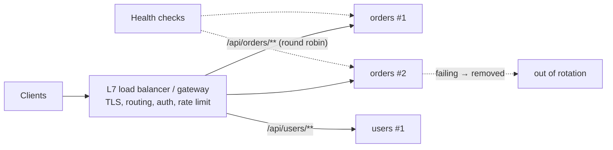

**4. Internal implementation**

- Proxies keep **connection pools** to backends and reuse them (clients may use HTTP/2 to the proxy, HTTP/1.1 to backends).
- **Sticky sessions** use a cookie or hash of client IP — needed only if servers keep session state in memory.
- Rate limiting usually uses **token bucket** counters (often stored in Redis for a cluster).
- Kubernetes: a `Service` load-balances at L4 (kube-proxy iptables/IPVS rules or eBPF); an **Ingress**/Gateway API controller does L7.

**5. Why is it designed this way?**
Horizontal scaling and zero-downtime deploys need traffic spread over instances with failing ones removed automatically. Centralising cross-cutting concerns (TLS, auth, limits) at the edge keeps services simple. Cost: an extra hop and a component that must itself be highly available.

**6. Framework differences**
Spring Cloud Gateway (Netty, reactive filters, `lb://` service discovery), Netflix Zuul (older, servlet-based), NestJS/Express gateways, YARP for .NET, Envoy in service meshes (Istio).

**7. Practical example**

```yaml
spring.cloud.gateway.routes:
  - id: orders
    uri: lb://order-service
    predicates: [ Path=/api/orders/** ]
    filters: [ name: RequestRateLimiter ]
```

**8. How can I observe it?**
Response headers like `Server`, `Via` or `X-Served-By`; call an endpoint that returns the instance hostname repeatedly to see round robin. Cloud consoles show target health; Spring Cloud Gateway exposes `/actuator/gateway/routes`.
