# 🔩 Under the Hood: Cloud, Virtualization & Deployment

How one physical machine becomes many virtual ones, how containers isolate apps, how Kubernetes runs them, and how code travels to production.

## Virtual Machines

### ❓ What is a Virtual Machine? How can one physical computer run multiple VMs?

### 📝 Answer

**1. What is it?**
A **virtual machine (VM)** is a complete computer made of software: virtual CPUs, memory, disks and network cards, running its **own operating system** (the **guest**). A **hypervisor** lets one physical machine (the **host**) run many VMs, each isolated from the others.

**2. How does it work internally?**

1. The hypervisor starts and owns the real hardware.
2. Each VM gets virtual hardware: e.g. 4 vCPUs, 8 GB RAM, a virtual disk file, a virtual NIC.
3. Guest code runs **directly on the real CPU** most of the time (hardware virtualization: Intel VT-x / AMD-V).
4. When the guest does something privileged (touch hardware, change page tables), the CPU **traps** to the hypervisor ("VM exit"), which handles it and resumes the guest.
5. Disk and network I/O go through virtual devices that the hypervisor maps to real disks and NICs.

**3. Visual**

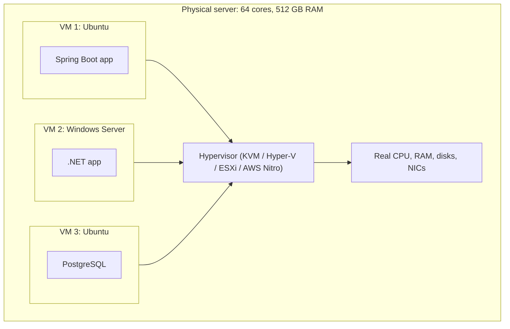

**4. Internal implementation**

- **Type 1** hypervisors run on bare metal (ESXi, Hyper-V, KVM inside Linux, Xen, AWS Nitro). **Type 2** run as an app on a normal OS (VirtualBox, VMware Workstation).
- CPU support: VT-x/AMD-V for trapping privileged instructions; **EPT/NPT** for memory translation (next question).
- **Paravirtual drivers** (virtio, VMware Tools) make guest I/O efficient by cooperating with the hypervisor instead of emulating real hardware.

**5. Why is it designed this way?**
Servers sat mostly idle running one app each. VMs consolidate many workloads per machine, isolate them strongly (separate kernels), allow different OSes, and can be moved, snapshotted and created in minutes. Cost: each VM carries a full OS (GBs of disk, hundreds of MB of RAM, slower boot).

**6. Platform differences**
Every cloud "instance" is a VM: AWS EC2 (Nitro), Azure VMs (Hyper-V), Google Compute Engine (KVM). Docker Desktop on Windows and macOS runs a small Linux **VM** to host containers.

**7. Practical example**
An AWS `m7i.large` (2 vCPUs, 8 GB) is a slice of a much larger physical server shared with other customers' VMs, isolated by the Nitro hypervisor.

**8. How can I observe it?**
Windows: Task Manager → Performance → CPU shows "Virtualization: Enabled". Inside a VM: `systemd-detect-virt` (Linux) or `systeminfo` (Windows "System Model"). Create a VM in Hyper-V or VirtualBox and watch its process on the host.

---

### ❓ How does a Hypervisor allocate CPU, Memory and Storage?

### 📝 Answer

**1. What is it?**
The hypervisor divides real hardware between VMs: CPU **time**, physical **memory pages**, and **disk** space/IO — usually promising more than it has (**overcommit**), because VMs rarely use everything at once.

**2. How does it work internally?**

- **CPU**: each vCPU is a schedulable thread on the host. The hypervisor's scheduler runs vCPUs on physical cores in time slices, like an OS schedules threads.
- **Memory**: guests think they own contiguous "physical" memory. The CPU's **second-level page tables** (Intel EPT / AMD NPT) translate guest-physical → host-physical addresses in hardware.
- **Storage**: a virtual disk is a file or volume (VMDK, VHDX, qcow2, EBS volume); guest block reads/writes become reads/writes to that backing storage, often over the network in clouds.

**3. Visual**

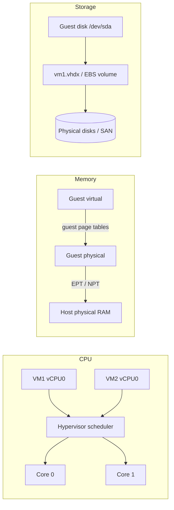

**4. Internal implementation**

- **CPU steal time**: time a vCPU wanted to run but the host gave the core to someone else — visible inside the guest.
- Memory tricks: **ballooning** (a guest driver gives back unused RAM), **page sharing/deduplication**, **swapping** at host level (slow), **huge pages** for fewer TLB misses.
- Storage: **thin provisioning** (allocate on write), snapshots via copy-on-write, IOPS limits per volume.
- Cloud providers mostly **avoid** CPU and memory overcommit on standard instances for predictable performance; "burstable" types (AWS T-family) use CPU credits.

**5. Why is it designed this way?**
Hardware-assisted translation keeps VMs near native speed. Overcommit raises utilisation (cheaper), at the risk of contention ("noisy neighbours").

**6. Platform differences**
KVM: each vCPU is a Linux thread scheduled by the Linux kernel. VMware ESXi: its own scheduler (co-scheduling for multi-vCPU VMs). AWS Nitro: offloads networking and storage to dedicated Nitro cards, leaving almost all host CPU for guests.

**7. Practical example**
A Java app in a VM shows high latency with low CPU usage inside the guest; `top` shows `st` (steal) at 30% → the host is oversubscribed.

**8. How can I observe it?**
Inside Linux guests: `top` / `vmstat` → `st` column (steal time). Hyper-V Manager / vSphere show per-VM CPU ready time and memory demand. Cloud: CloudWatch `CPUCreditBalance` for burstable instances.

---

## Containers

### ❓ How does Docker work internally?

### 📝 Answer

**1. What is it?**
Docker runs applications in **containers**: normal Linux processes that the kernel **isolates** (they see their own filesystem, network, process list) and **limits** (CPU, memory). There is no separate OS kernel per container.

**2. How does it work internally?**

1. `docker run nginx` → the **Docker CLI** calls the **Docker daemon** (`dockerd`) API.
2. The daemon ensures the **image** is present (pulls layers from a registry).
3. It asks **containerd**, which uses **runc** (the OCI runtime) to create the container.
4. runc creates **namespaces** for isolation and **cgroups** for limits, mounts the image layers with **OverlayFS** plus a writable layer, then starts the process (`nginx`) as PID 1 inside.
5. Docker networking connects it to a virtual bridge (`docker0`) with NAT and port mappings (`-p 8080:80`).

**3. Visual**

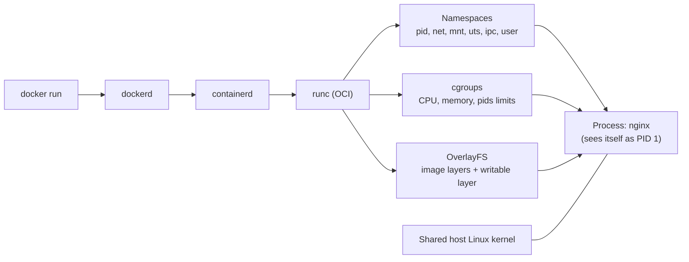

**4. Internal implementation**

| Kernel feature | Gives the container |
|---|---|
| PID namespace | Own process tree (PID 1 inside) |
| Network namespace | Own interfaces, IP, ports |
| Mount namespace | Own filesystem view (the image) |
| UTS / IPC / user namespaces | Own hostname, IPC objects, user ID mapping |
| cgroups v2 | Memory limit (OOM-kill beyond it), CPU quota, PID limits |
| seccomp, capabilities | Restricted system calls and privileges |

On Windows/macOS, Docker Desktop runs these inside a lightweight **Linux VM** (WSL 2 on Windows).

**5. Why is it designed this way?**
Using kernel features instead of a full VM gives near-native performance, millisecond start-up and tiny overhead. Trade-off: weaker isolation than VMs (shared kernel), so untrusted multi-tenant workloads often add gVisor, Kata Containers or Firecracker micro-VMs.

**6. Language differences**
Any language works. JVMs since Java 10 read **cgroup limits** to size the heap and thread pools (`-XX:MaxRAMPercentage`); older JVMs saw the host's full RAM and got OOM-killed. Node's heap and Go's `GOMAXPROCS` (container-aware since Go 1.25) have similar settings.

**7. Practical example**

```bash
docker run -d -p 8080:8080 --memory=512m --cpus=1 shop-api:1.4
```

Inside: one Java process with its own filesystem and network; outside: just another process on the host, limited to 512 MB and 1 CPU.

**8. How can I observe it?**
`docker inspect <id>` (namespaces, mounts, limits), `docker stats` (live CPU/memory vs limit), `docker top <id>` (the process on the host). On Linux: `ps -ef` on the host shows the container's process; `ls -l /proc/<pid>/ns` shows its namespaces.

---

### ❓ How are Containers different from Virtual Machines?

### 📝 Answer

**1. What is it?**
Both isolate workloads, at different levels:

- **VM** — virtualises **hardware**; each VM runs its **own OS kernel**.
- **Container** — virtualises the **operating system**; all containers share the **host kernel** and are isolated processes.

**2. How does it work internally?**

- VM: hypervisor → guest kernel → guest OS services → your app. Isolation enforced by CPU virtualization hardware.
- Container: host kernel → namespaces + cgroups → your app process. Isolation enforced by the kernel.

**3. Visual**

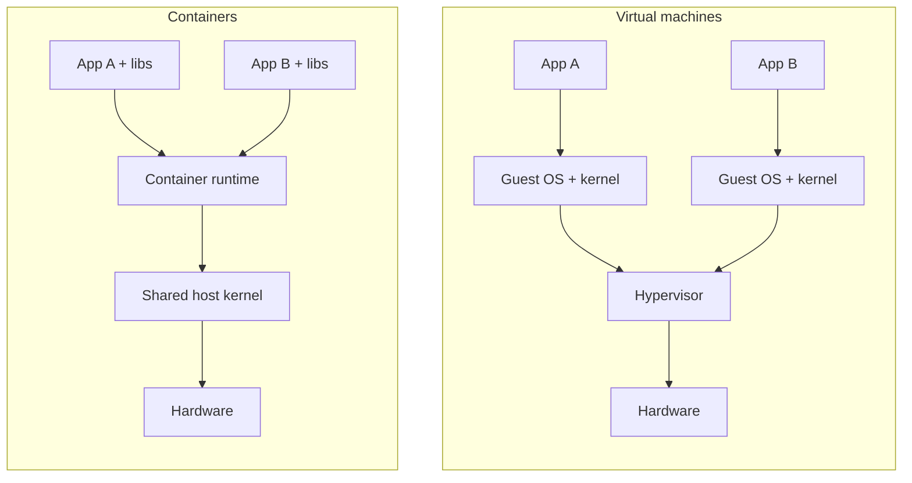

**4. Internal implementation**

| | Virtual machine | Container |
|---|---|---|
| Boot time | Seconds to minutes | Milliseconds to seconds |
| Size | GBs (full OS) | MBs (app + libraries) |
| Kernel | Own kernel per VM | Shared host kernel |
| Isolation | Strong (hardware) | Good (kernel), weaker than VM |
| OS mix | Any OS on any host | Linux containers need a Linux kernel |
| Density | Tens per host | Hundreds per host |

**5. Why is it designed this way?**
VMs maximise isolation and flexibility; containers maximise density, speed and portability of the **app**. In the cloud they are usually **combined**: containers run inside VMs (EKS/AKS/GKE nodes are VMs).

**6. Platform differences**
**Micro-VMs** (AWS Firecracker for Lambda/Fargate, Kata Containers) blend both: VM-level isolation with container-like start-up. Windows containers exist but need a Windows host kernel.

**7. Practical example**
Running 20 Spring Boot microservices: 20 VMs would each need an OS (~20 × 1 GB overhead); 20 containers on one VM share its kernel and start in seconds.

**8. How can I observe it?**
`uname -r` inside a container prints the **host's** kernel version; inside a VM it prints the guest's own. Compare `docker run` start time with booting a VM.

---

### ❓ How do Docker Images and Containers work?

### 📝 Answer

**1. What is it?**

- **Image** — a **read-only template**: a stack of filesystem **layers** plus metadata (default command, env vars, exposed ports).
- **Container** — a **running instance** of an image: the image layers + one thin **writable layer** + an isolated process.

Image = class, container = object.

**2. How does it work internally?**

1. Each Dockerfile instruction that changes files (`FROM`, `COPY`, `RUN`) creates a **layer**: a tar of the changed files.
2. Layers are identified by a **SHA-256 digest** of their content; an image **manifest** lists the layers + config.
3. `docker push` uploads only layers the registry doesn't have; `docker pull` downloads only missing ones.
4. `docker run`: OverlayFS stacks the layers (lower, read-only) and adds a writable **upper** layer.
5. Writing to an existing file **copies it up** into the writable layer (copy-on-write); deleting creates a "whiteout" marker. Removing the container discards the writable layer.

**3. Visual**

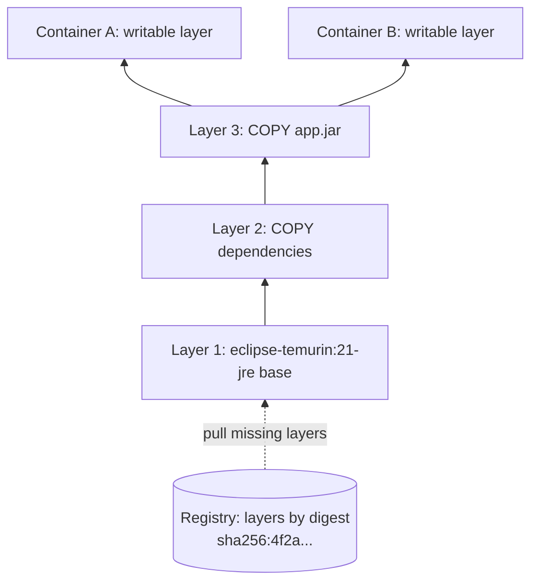

**4. Internal implementation**

- Image format follows the **OCI** specification (manifest, config JSON, layer tarballs).
- Layers are **shared** between images and containers on the same host: ten containers from one image use the image's disk space once.
- Build cache: if a layer's instruction and inputs are unchanged, Docker reuses it — so copy dependency files **before** source code.
- Tags (`shop-api:1.4`) are movable names; **digests** are immutable.

**5. Why is it designed this way?**
Layering makes builds, pushes and pulls incremental and saves disk. Immutable images guarantee the same artifact in test and production. Container data must live in **volumes**, because the writable layer is temporary.

**6. Language differences**
Java: multi-stage build (JDK to build, small JRE image to run), or `spring-boot:build-image` (Cloud Native Buildpacks) with layered JARs. Go and Rust: static binaries on tiny `distroless`/`scratch` images (~10–20 MB). Node/Python: copy `package.json`/`requirements.txt` first for caching.

**7. Practical example**

```dockerfile
FROM eclipse-temurin:21-jre
WORKDIR /app
COPY target/app.jar app.jar          # only this layer changes on each release
ENTRYPOINT ["java", "-jar", "app.jar"]
```

**8. How can I observe it?**
`docker history shop-api:1.4` (layers and sizes), `docker image inspect` (digests, config), **dive** tool (browse each layer's files), `docker diff <container>` (files changed in the writable layer).

---

## Orchestration and Delivery

### ❓ How does Kubernetes schedule and manage containers?

### 📝 Answer

**1. What is it?**
**Kubernetes** runs containers across a cluster of machines. You declare the **desired state** ("3 replicas of orders:1.4, each 500m CPU, 512Mi memory"); Kubernetes continuously works to make reality match it.

**2. How does it work internally?**

1. `kubectl apply -f deployment.yaml` sends the object to the **API server**, which stores it in **etcd**.
2. The **Deployment controller** creates a **ReplicaSet**, which creates 3 **Pod** objects (not yet placed).
3. The **scheduler** picks a node for each Pod: **filter** nodes that fit (enough CPU/memory requests, taints, affinity), then **score** the rest and pick the best.
4. The **kubelet** on that node sees the Pod assigned to it, asks the container runtime (containerd) to pull the image and start containers.
5. kubelet runs **probes**; failed liveness → restart; not ready → removed from Service endpoints.
6. Controllers keep reconciling: a node dies → its Pods are recreated elsewhere.

**3. Visual**

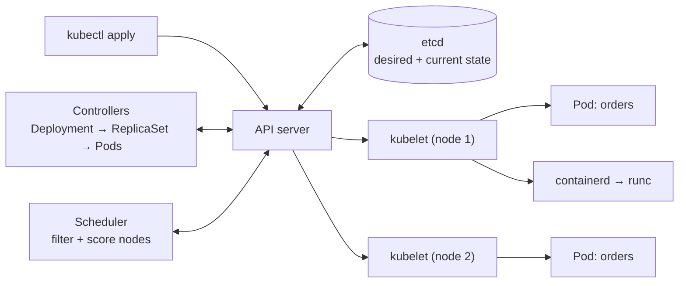

**4. Internal implementation**

- Everything is a **control loop**: watch state via the API server, compare with desired, act, repeat (level-triggered, so missed events are recovered).
- Scheduling uses **requests** (reserved), while **limits** are enforced by cgroups at runtime (CPU throttled, memory over limit → OOMKilled).
- **Services** get a stable virtual IP; kube-proxy (iptables/IPVS) or eBPF (Cilium) load-balances to ready Pods; CoreDNS gives names like `orders.default.svc.cluster.local`.

**5. Why is it designed this way?**
Declarative desired state + reconciliation makes the system **self-healing** and lets many independent controllers cooperate through one API. Cost: significant complexity and many moving parts.

**6. Platform differences**
Managed Kubernetes: EKS, AKS, GKE (they run the control plane). Simpler alternatives: AWS ECS, Google Cloud Run, Azure Container Apps, Docker Swarm, Nomad.

**7. Practical example**

```yaml
spec:
  replicas: 3
  template:
    spec:
      containers:
        - name: orders
          image: myrepo/orders:1.4
          resources: { requests: { cpu: 500m, memory: 512Mi }, limits: { memory: 768Mi } }
          readinessProbe: { httpGet: { path: /actuator/health/readiness, port: 8080 } }
```

**8. How can I observe it?**
`kubectl get pods -o wide` (which node), `kubectl describe pod <name>` → **Events** (Scheduled, Pulling, Started, probe failures), `kubectl get events --sort-by=.lastTimestamp`, `kubectl top pods`.

---

### ❓ How does an application move from source code to a running production environment?

### 📝 Answer

**1. What is it?**
The **delivery path**: code is committed, built into an **artifact**, tested, packaged into an **image**, deployed through environments, configured, and finally serves real traffic — ideally fully automated and repeatable.

**2. How does it work internally?**

1. **Commit & review** — push to Git, open a pull request, review.
2. **Build** — compile and run unit tests (`mvn verify`, `ng build`) → artifact (`app.jar`, `dist/`).
3. **Package** — build a Docker image tagged with the commit SHA; push to a registry.
4. **Deploy to test/staging** — run integration/E2E tests against real dependencies.
5. **Promote to production** — the **same image** is deployed (rolling, blue/green or canary), with production config and secrets injected at runtime.
6. **Run & observe** — health checks, logs, metrics, traces; roll back by redeploying the previous image.

**3. Visual**

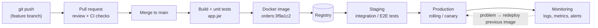

**4. Internal implementation**

- **Build once, deploy many**: environments differ only in configuration, never in the artifact.
- Infrastructure is described as code (Terraform, Helm charts, Kubernetes YAML) and versioned in Git; **GitOps** tools (Argo CD, Flux) sync clusters from Git.
- Database schema changes are versioned migrations (Flyway, Liquibase) applied during deployment, written to be backward compatible with the previous app version.

**5. Why is it designed this way?**
Automation removes manual, error-prone steps; immutable artifacts make "it worked in staging" meaningful; small, frequent releases are easier to test and roll back.

**6. Stack differences**
Java: Maven/Gradle → JAR → JRE image. Angular: `ng build` → static files → Nginx image or CDN/object storage. Node: `npm ci && npm run build` → image. Go: single binary → `distroless` image. Serverless (AWS Lambda) skips container management — you deploy a ZIP or image to the platform.

**7. Practical example**
Fixing a bug in `OrderService`: PR → CI tests pass → merge → image `orders:9b2e4d1` → staging tests → canary to 5% of traffic → metrics healthy → 100%.

**8. How can I observe it?**
CI dashboard (GitHub Actions / Jenkins / GitLab) for each stage; registry tags; `kubectl rollout history deployment/orders`; deployment markers in Grafana/Datadog show which release changed error rates.

---

### ❓ How do CI/CD pipelines build, test and deploy applications?

### 📝 Answer

**1. What is it?**

- **CI (Continuous Integration)** — every push is automatically built and tested.
- **CD (Continuous Delivery/Deployment)** — tested builds are automatically deployed to environments (production either after an approval or fully automatic).

A **pipeline** is a defined sequence of **stages** and **jobs** run by a CI server.

**2. How does it work internally?**

1. A Git event (push, PR) hits the CI server via a **webhook**.
2. The server reads the pipeline file (`.github/workflows/ci.yml`, `Jenkinsfile`, `.gitlab-ci.yml`).
3. A **runner/agent** (a VM or container) is assigned; it checks out the exact commit.
4. Jobs run commands: restore **caches** (Maven `~/.m2`, `node_modules`), build, test, scan (SAST, dependency CVEs), build the image.
5. Outputs are stored as **artifacts** (JARs, test reports, images).
6. Deploy jobs use stored **credentials/secrets** to push to a registry and update the environment; **environment protection rules** require approvals.
7. Any failing step stops the pipeline and reports back to the PR.

**3. Visual**

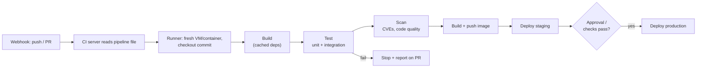

**4. Internal implementation**

- Jobs can run in **parallel** (matrix builds across Java versions) or depend on each other (`needs:`).
- Runners are ephemeral → reproducible builds; caches are keyed by lock-file hashes (`pom.xml`, `package-lock.json`).
- Deployment strategies: **rolling** (replace a few at a time), **blue/green** (switch traffic between two full environments), **canary** (small % first, watch metrics).

**5. Why is it designed this way?**
Catching problems minutes after a commit is far cheaper than at release time. Pipelines as code are reviewed and versioned like application code.

**6. Tool differences**
GitHub Actions (YAML workflows, marketplace actions), GitLab CI (built into GitLab), Jenkins (self-hosted, Groovy `Jenkinsfile`, plugins), Azure DevOps Pipelines, CircleCI. Deployment-only tools: Argo CD (GitOps pull), Spinnaker.

**7. Practical example**

```yaml
on: [push]
jobs:
  build:
    runs-on: ubuntu-latest
    steps:
      - uses: actions/checkout@v4
      - uses: actions/setup-java@v4
        with: { distribution: temurin, java-version: 21, cache: maven }
      - run: mvn -B verify
      - run: docker build -t ghcr.io/me/orders:${{ github.sha }} .
```

**8. How can I observe it?**
The pipeline UI shows each step's logs, duration and artifacts; failed tests appear as annotations on the PR. Re-run with debug logging (`ACTIONS_STEP_DEBUG=true` in GitHub Actions).

---

### ❓ How do cloud platforms allocate computing resources?

### 📝 Answer

**1. What is it?**
When you request a VM, container or function, the cloud's **control plane** finds physical capacity in a chosen **region** and **availability zone**, carves out the requested CPU, memory, disk and network, and attaches it to your account — in seconds, through an API.

**2. How does it work internally?**

1. You call an API (console, CLI, Terraform): "1 × m7i.large in ap-south-1a, 50 GB gp3 disk".
2. The control plane checks **quotas** and permissions (IAM).
3. A **placement service** picks a physical host with free capacity that matches the instance family, honouring placement rules (spread across racks, etc.).
4. The host's hypervisor creates the VM; storage service creates a **network-attached** volume (EBS) and attaches it; the virtual network (VPC) assigns a private IP and security groups.
5. Metering starts: you pay per second/hour of allocation.

**3. Visual**

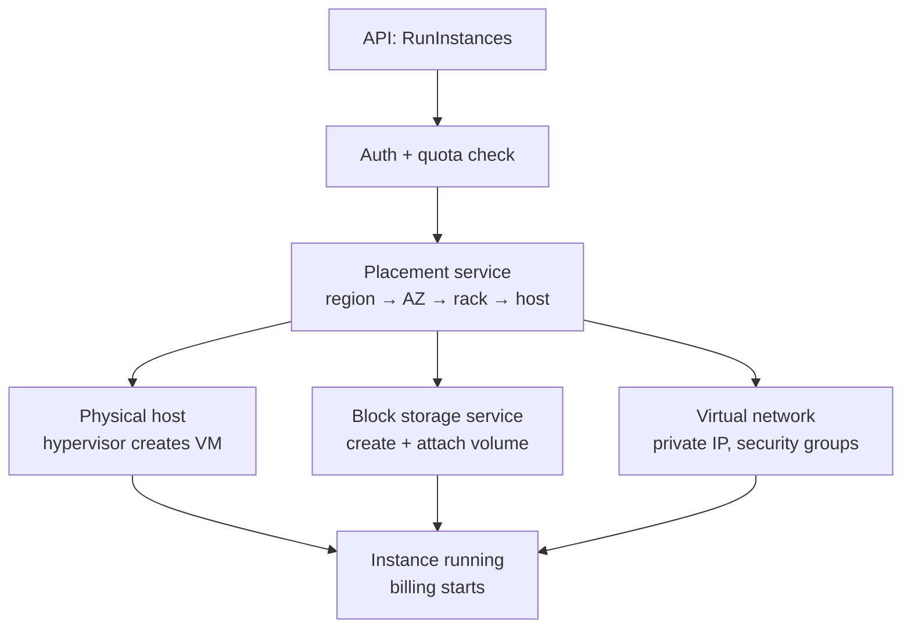

**4. Internal implementation**

- **Region** = a geographic area; **AZ** = one or more separate data centres with independent power/network inside it.
- Instance types map to hardware generations and fixed CPU:memory ratios (general, compute-, memory-optimised).
- Serverless (Lambda, Cloud Run, Fargate) uses the same pools with micro-VMs (e.g. **Firecracker**) allocated per request/container, scaled to zero when idle.
- Spot/preemptible capacity sells unused hosts cheaply but can be reclaimed with short notice.

**5. Why is it designed this way?**
Pooling huge amounts of hardware and allocating it on demand lets providers keep utilisation high and customers pay only for what they use. AZs let you survive a data-centre failure by spreading instances.

**6. Platform differences**
AWS (EC2, Nitro), Azure (VMs on Hyper-V, Scale Sets), Google Cloud (Compute Engine on KVM, live migration during host maintenance). Kubernetes adds a second level of allocation: Pods packed onto those VMs by requests.

**7. Practical example**
An Auto Scaling group requests 2 more instances during a sale; they appear in different AZs within a minute and register with the load balancer.

**8. How can I observe it?**
AWS console/CLI: `aws ec2 describe-instances` (AZ, instance type, state transitions pending → running), **Service Quotas** page, **Cost Explorer** for metering. Instance metadata from inside: `curl http://169.254.169.254/latest/meta-data/placement/availability-zone` (IMDSv2 needs a token).

---

### ❓ How do Auto Scaling and Load Balancing work?

### 📝 Answer

**1. What is it?**

- **Load balancing** — spread incoming requests across healthy instances.
- **Auto scaling** — automatically **add or remove** instances based on load (metrics or schedules).

Together: more traffic → more instances → the load balancer starts sending them traffic.

**2. How does it work internally?**

1. Instances/Pods report **metrics** (CPU, requests per target, queue length, custom metrics).
2. A scaling policy compares them with a **target** (e.g. CPU 60%).
3. Kubernetes HPA formula: `desired = ceil(current × currentMetric / target)` — e.g. 4 Pods at 90% CPU with target 60% → 6 Pods.
4. New instances start, pass **health checks**, and are **registered** with the load balancer.
5. On scale-in, instances are **drained** (finish in-flight requests, stop receiving new ones), then removed.
6. **Cooldown / stabilisation windows** prevent flapping up and down.

**3. Visual**

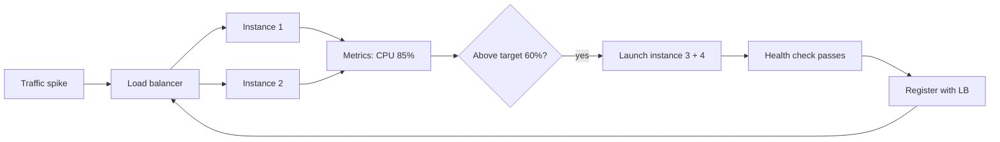

**4. Internal implementation**

- AWS: CloudWatch alarms / target tracking → Auto Scaling Group adjusts desired capacity → ALB target group registration.
- Kubernetes: **HPA** (Pods, every ~15 s), **Cluster Autoscaler / Karpenter** (adds nodes when Pods can't be scheduled), **KEDA** (scale on queue length, including to zero).
- New Java instances need **warm-up** (JIT, caches): slow-start settings on the load balancer ramp traffic gradually.

**5. Why is it designed this way?**
Paying for peak capacity all the time is expensive; scaling with demand keeps cost and performance balanced. Health checks + draining keep scaling invisible to users. Limits: scaling takes time (minutes for VMs), so sudden spikes need headroom or pre-scaling.

**6. Platform differences**
AWS ASG + ALB/NLB, Azure VM Scale Sets + Load Balancer/App Gateway, GCP Managed Instance Groups + Cloud Load Balancing, Kubernetes HPA + Services/Ingress, serverless platforms scale per request automatically.

**7. Practical example**

```yaml
apiVersion: autoscaling/v2
kind: HorizontalPodAutoscaler
spec:
  scaleTargetRef: { kind: Deployment, name: orders }
  minReplicas: 2
  maxReplicas: 10
  metrics:
    - type: Resource
      resource: { name: cpu, target: { type: Utilization, averageUtilization: 60 } }
```

**8. How can I observe it?**
`kubectl get hpa -w` (current vs target, replica count changing during a load test with k6/JMeter), `kubectl describe hpa` (scaling events). AWS: ASG "Activity" tab and ALB target health.

---

### ❓ How are Secrets and Environment Configurations managed?

### 📝 Answer

**1. What is it?**

- **Configuration** — settings that differ per environment: URLs, feature flags, pool sizes, log levels.
- **Secrets** — sensitive config: passwords, API keys, private keys, tokens.

Rule (**12-factor app**): keep both **out of the code and the image**; inject them at runtime, so the same artifact runs everywhere.

**2. How does it work internally?**

1. Non-secret config lives in versioned files (`application-prod.yml`, Helm `values-prod.yaml`, ConfigMaps).
2. Secrets live in a **secret store**: HashiCorp Vault, AWS Secrets Manager / SSM Parameter Store, Azure Key Vault, GCP Secret Manager, or Kubernetes Secrets.
3. At deploy/start time, the platform injects them as **environment variables** or **mounted files**, or the app fetches them via an SDK using its **workload identity** (IAM role) — no password needed to get the passwords.
4. The app reads them (Spring Boot: env vars override properties, e.g. `SPRING_DATASOURCE_PASSWORD`).
5. Rotation: the store changes the secret; the app reloads or restarts to pick it up.

**3. Visual**

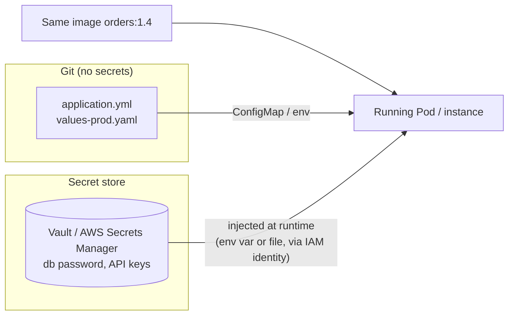

**4. Internal implementation**

- Kubernetes Secrets are only **base64-encoded** in their YAML; protection comes from RBAC and enabling **encryption at rest** in etcd. Tools like External Secrets Operator or Sealed Secrets sync/encrypt them.
- Vault can issue **dynamic secrets** (short-lived DB credentials created per app instance).
- Environment variables are visible to anyone who can inspect the process or container; mounted files with tight permissions are slightly safer.

**5. Why is it designed this way?**
Secrets in Git or images leak through history, forks and registries. Central stores give access control, audit logs and rotation. Separating config from code means no rebuild to change a URL.

**6. Framework differences**
Spring Boot: profiles, `@ConfigurationProperties`, env var relaxed binding, `spring.config.import=vault://` or `aws-secretsmanager:`. ASP.NET Core: `appsettings.{Env}.json` + environment variables + Key Vault provider; **User Secrets** for local dev. Node: `process.env` (+ `dotenv` locally). Angular: build-time `environment.ts` files — **never** put secrets in frontend code, it ships to every browser.

**7. Practical example**

```yaml
# application.yml
spring.datasource.url: ${DB_URL}
spring.datasource.password: ${DB_PASSWORD}   # injected from the secret store at runtime
```

**8. How can I observe it?**
Spring Boot Actuator `/actuator/env` shows where each property came from (values masked). `kubectl describe pod` shows env sources (not values). Scan repositories for leaked secrets with **gitleaks** or GitHub secret scanning.
