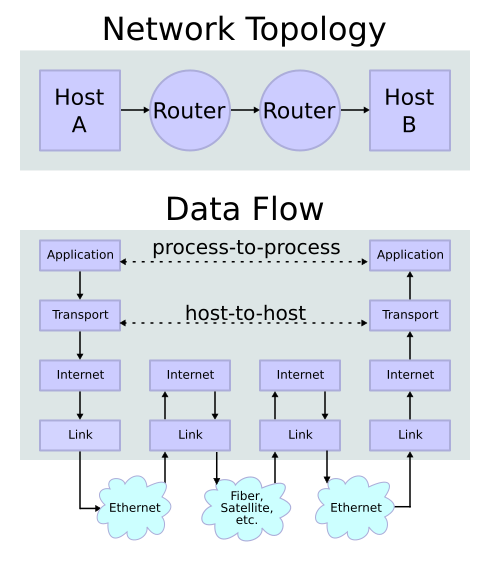
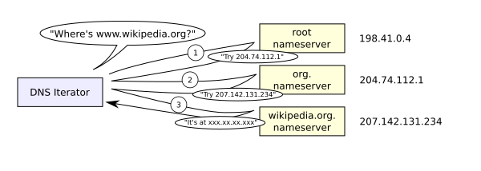
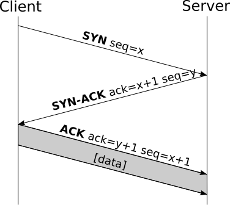
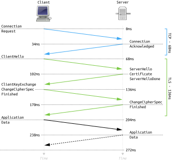

# 📡 How Data Travels Across the Internet

## How data travels: packets, layers and DNS (networking, all languages)

### ❓ How does data travel from one computer to another?

**Generic answer:** Data is cut into small packets, each wrapped in layers of headers (application, transport, IP, link), sent hop by hop through routers, and reassembled at the other end.

**Under the hood:**

Imagine sending a 5 MB photo from Chennai to a server in Mumbai. There's no single wire between them, the path has many shared links, and parts can get lost. One giant blob would block everyone and be lost entirely on any error.

**Step 1: Cut into packets**

The data is split into packets of ~1,500 bytes.

**Step 2: Wrap in layers (envelopes inside envelopes)**

| Layer | Job | Examples |
|---|---|---|
| **Application** | What the program says | HTTP, DNS, SMTP |
| **Transport** | Which program (port), reliable or not | TCP, UDP |
| **Internet** | Which computer (IP address), routing | IP |
| **Link** | The next hop on the local network | Ethernet, Wi-Fi |

**Step 3: Hop through routers**

Each router reads only the IP header and forwards the packet one step closer. Packets may take different paths.

**Step 4: Unwrap and reassemble**

The receiver peels off the layers; TCP puts packets back in order and asks for lost ones again.

_Image: [Wikimedia Commons](https://commons.wikimedia.org/wiki/File:IP_stack_connections.svg) · Kbrose · CC BY-SA 3.0_

**Analogy:** posting a parcel — the letter (HTTP) goes in an envelope with a flat number (port), inside a box with a street address (IP), carried by local vans (Wi-Fi/Ethernet) between post offices (routers).

**Final understanding:** **Big data, shared unreliable network → small packets → layered headers → router hops → reassembly.**

---

### ❓ How does DNS find a website's IP address?

**Generic answer:** DNS is the internet's phone book: a resolver asks the root, then the `.com` server, then the domain's own name server for the IP, and caches the answer.

**Under the hood:**

Imagine you type `shop.com`. Computers route by IP numbers, not names — and no single server could hold every name on the internet.

**Step 1: Check caches**

The browser and operating system check whether they already know the IP.

**Step 2: Ask a resolver**

If not, your ISP's resolver (or 8.8.8.8 / 1.1.1.1) does the work.

**Step 3: Walk the hierarchy**

Resolver → **root server** ("ask the `.com` servers") → **`.com` server** ("ask shop.com's name server") → **shop.com's name server** ("203.0.113.10").

**Step 4: Cache for the TTL**

Every layer caches the answer for its **TTL**, so most lookups take milliseconds.

_Image: [Wikimedia Commons](https://commons.wikimedia.org/wiki/File:An_example_of_theoretical_DNS_recursion.svg) · Lion Kimbro · Public domain_

**Common problem:** a DNS change "not working yet" is usually old cached answers waiting for their TTL to expire.

**Final understanding:** **Names for humans, IPs for routers → cache → resolver → root → TLD → domain's server → cache again.**

---

## TCP, UDP and HTTPS (networking, all languages)

### ❓ What is the difference between TCP and UDP?

**Generic answer:** TCP is a reliable, ordered connection (handshake, numbering, re-sending); UDP sends packets with no guarantees but very little delay.

**Under the hood:**

Imagine two apps: a bank API, where one missing byte corrupts everything, and a video call, where a late packet is useless anyway. They need opposite rules.

**Step 1: TCP — set up a connection**

The **three-way handshake**: client sends **SYN**, server answers **SYN-ACK**, client sends **ACK**. Both sides now agree on starting sequence numbers.

_Image: [Wikimedia Commons](https://commons.wikimedia.org/wiki/File:Tcp-handshake.svg) · CC BY-SA 3.0_

**Step 2: TCP — number, acknowledge, re-send**

Every byte is numbered; the receiver acknowledges; anything unacknowledged is re-sent; data is delivered **in order**. Flow and congestion control slow the sender when needed.

**Step 3: UDP — just send**

No connection, no acknowledgements, no ordering. Tiny overhead. Used for video calls, games, DNS. HTTP/3 builds its own reliability on UDP (QUIC).

**Analogy:** TCP is a **registered parcel** with tracking; UDP is a **postcard**.

**Final understanding:** **Need every byte in order → TCP (handshake, numbering, re-send); need speed over perfection → UDP.**

---

### ❓ How does HTTPS keep data private (the TLS handshake)?

**Generic answer:** HTTPS is HTTP inside a TLS tunnel: the server proves its identity with a certificate, both sides agree on a secret session key, and all data is then encrypted with it.

**Under the hood:**

Imagine logging in on café Wi-Fi. Anyone on that network can see your packets. Two problems: they could **read** your password, or **pretend** to be your bank.

**Step 1: Hello**

The browser says hello and lists the encryption methods it supports.

**Step 2: Certificate**

The server sends its **certificate**: its public key, signed by a trusted Certificate Authority.

**Step 3: Verify**

The browser checks: trusted CA? right domain? not expired? This defeats impostors.

**Step 4: Agree on a key without sending it**

Both sides use **public-key cryptography** (e.g. ECDHE key exchange) to derive the same secret **session key** — the key itself never crosses the network.

**Step 5: Encrypt everything**

All further data uses that fast **symmetric** key.

_Image: [Wikimedia Commons](https://commons.wikimedia.org/wiki/File:Full_TLS_1.2_Handshake.svg) · Fleshgrinder · Public domain_

**Interview points:** public-key crypto is slow, so it's used only to agree the key; TLS 1.3 needs one round trip.

**Final understanding:** **Open network → prove identity (certificate) → agree a secret (key exchange) → encrypt fast (symmetric key).**
