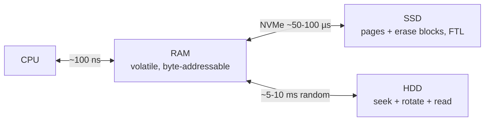
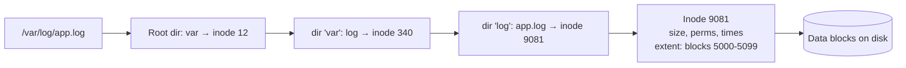
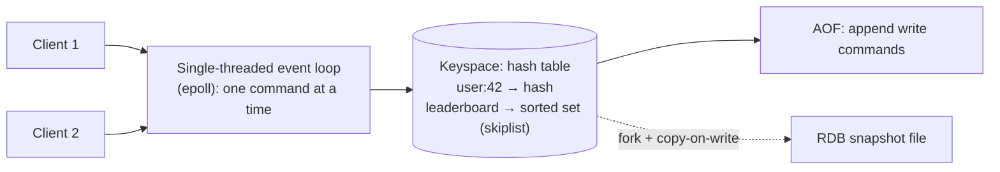
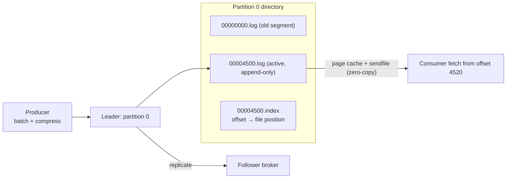
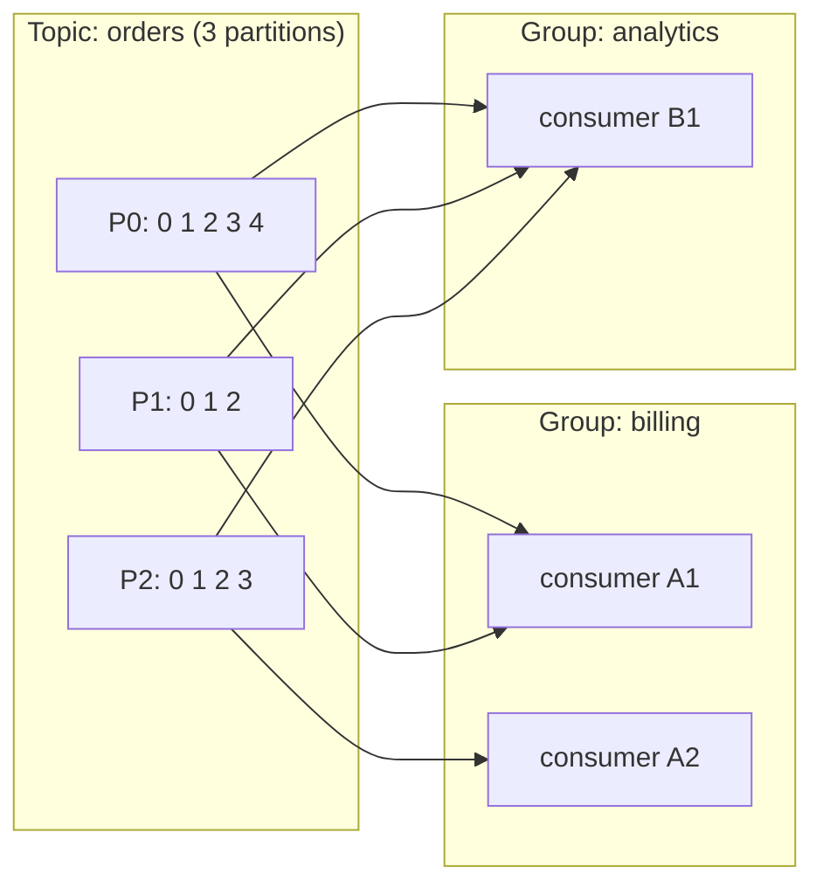
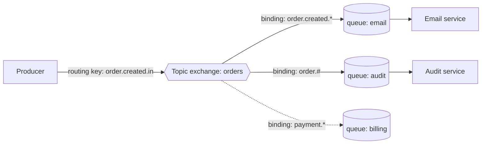
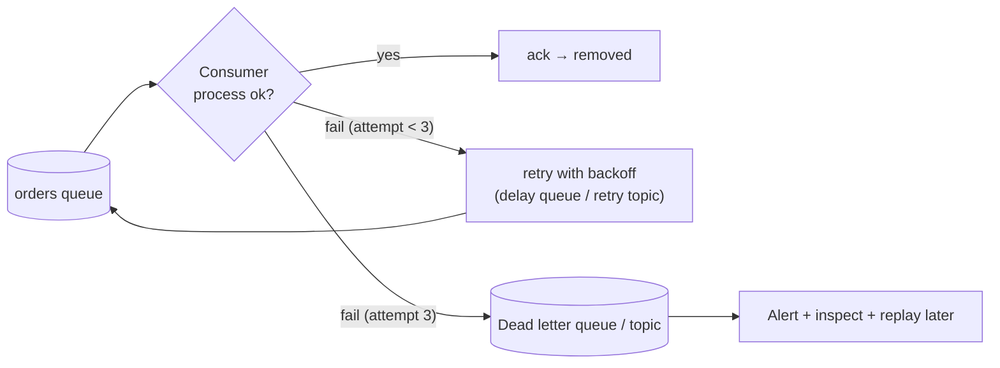
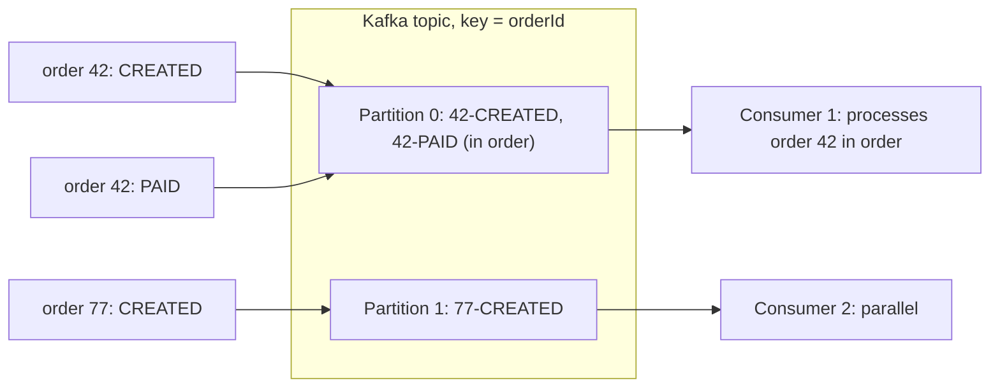
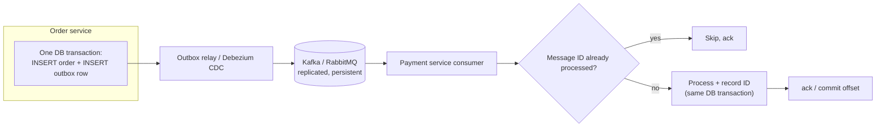

# 🔩 Under the Hood: Storage, Caching & Message Processing

How disks and file systems store bytes, how Redis serves data so fast, and how Kafka and RabbitMQ move messages reliably.

## Storage Hardware and File Systems

### ❓ How do HDD, SSD and RAM store and retrieve data differently?

### 📝 Answer

**1. What is it?**

| | RAM (DRAM) | SSD (NAND flash) | HDD (magnetic disk) |
|---|---|---|---|
| Stores bits as | Charge in tiny capacitors | Charge trapped in flash cells | Magnetised regions on spinning platters |
| Keeps data without power? | **No** (volatile) | Yes | Yes |
| Random read latency | ~0.1 µs (100 ns) | ~50–100 µs | ~5–10 ms |
| Moving parts | None | None | Spinning platters + moving arm |

**2. How does it work internally?**

- **RAM**: the memory controller selects a row and column; capacitors leak, so every row is **refreshed** every few ms. Accessed in 64-byte cache lines.
- **SSD**: data is written in **pages** (4–16 KB) but erased only in large **blocks** (MBs). A **Flash Translation Layer** (FTL) maps logical addresses to physical pages, writes new data to fresh pages, and garbage-collects old blocks.
- **HDD**: the arm **seeks** to the right track, waits for the sector to rotate under the head (**rotational latency**), then reads. Sequential reads are fast; random reads are very slow.

**3. Visual**



**4. Internal implementation**

- SSD **wear levelling** spreads writes across cells (each cell survives a limited number of erase cycles); **write amplification** happens when the drive must move valid data to erase a block. `TRIM` tells the SSD which pages are free.
- NVMe SSDs connect over PCIe with many parallel queues; SATA SSDs are limited by the older AHCI interface.
- OSes and databases cache disk data in RAM (page cache, buffer pool) to hide disk latency.

**5. Why is it designed this way?**
RAM is fast but expensive and volatile; SSDs give persistence with no moving parts; HDDs give the cheapest capacity per GB. Systems layer them: hot data in RAM, working data on SSD, archives on HDD/object storage.

**6. Language differences**
Programs don't see the device type: Java `FileChannel`, Node `fs`, Python `open()` all go through the OS. But access **patterns** matter: sequential I/O (logs, Kafka) performs well even on HDDs; random small reads need SSDs or caching.

**7. Practical example**
A database with 1,000 random reads per request: from RAM ~0.1 ms total, from NVMe SSD ~50–100 ms, from HDD ~5–10 seconds.

**8. How can I observe it?**
Windows Task Manager → Performance → Disk (active time, response time); `winsat disk` or **CrystalDiskMark** for sequential vs random speeds. Linux: `iostat -x 1` (`await`, `%util`), `fio` benchmarks.

---

### ❓ How does a File System organize files and directories on disk?

### 📝 Answer

**1. What is it?**
A **file system** (NTFS, ext4, APFS, XFS) turns a disk — just a long array of blocks — into named **files** inside **directories**, with sizes, permissions and timestamps.

**2. How does it work internally?**

1. The disk is divided into fixed-size **blocks** (usually 4 KB).
2. Each file has a **metadata record**: ext4 **inode** / NTFS **MFT entry** — size, owner, permissions, timestamps and **where its data blocks are** (extents: "blocks 5000–5099").
3. A **directory** is a special file mapping **names → inode numbers**.
4. Opening `/var/log/app.log`: read the root directory → find `var` → its inode → its directory data → find `log` → … → `app.log` inode → data blocks.
5. Free space is tracked with **bitmaps** or B-trees.
6. A **journal** records metadata changes first, so a crash can't leave the file system inconsistent.

**3. Visual**



**4. Internal implementation**

- `write()` normally copies into the OS **page cache** and returns; data reaches the disk later. `fsync()` forces it to disk — databases call it at commit.
- Deleting a file removes the directory entry and frees blocks when no references remain (hard links, open handles).
- NTFS stores tiny files **inside** the MFT record; ext4 uses extents and delayed allocation to reduce fragmentation.

**5. Why is it designed this way?**
Separating names (directories) from file metadata (inodes) allows hard links, cheap renames and fast lookups. Journaling avoids long disk checks after crashes. Page caching makes repeated reads and small writes fast.

**6. Language differences**
`Files.write` (Java), `fs.writeFile` (Node), `open().write` (Python) all end in the same system calls (`open`, `write`, `fsync`). Java's `FileChannel.force(true)` = `fsync`. Windows file names are case-insensitive by default; Linux ext4 is case-sensitive — a common cause of "works on my machine" bugs.

**7. Practical example**
A log file of 10 MB on ext4: one inode + a few extents pointing to ~2,560 blocks of 4 KB. `mv app.log old.log` in the same directory only changes the directory entry — instant, no data copied.

**8. How can I observe it?**
Linux: `stat file` (inode, blocks), `ls -i`, `df -i` (inode usage), `filefrag -v file` (extents). Windows: `fsutil file queryextents C:\path\file`, `fsutil fsinfo ntfsinfo C:`.

---

## Redis and Caching Patterns

### ❓ How does Redis store and retrieve data internally?

### 📝 Answer

**1. What is it?**
**Redis** is an **in-memory** data store: all data lives in RAM, organised as keys pointing to data structures (strings, hashes, lists, sets, sorted sets, streams). That's why typical operations take microseconds.

**2. How does it work internally?**

1. Clients send commands over TCP using the simple **RESP** protocol (`SET user:42 "Asha"`).
2. One main thread runs an **event loop** (epoll/kqueue): read ready sockets → parse command → execute → queue reply.
3. The keyspace is a big **hash table** (`dict`): key → value object.
4. Each value uses a compact **encoding** when small (e.g. a small hash as a **listpack**) and switches to a full structure when large (hash table, **skiplist** for sorted sets).
5. Persistence happens alongside: **RDB** snapshots and/or **AOF** (append-only log of write commands).

**3. Visual**



**4. Internal implementation**

- **Incremental rehashing**: when the hash table grows, Redis keeps two tables and moves a few buckets per operation — no long pause.
- **Single-threaded execution** means each command is **atomic** and needs no locks; Redis 6+ can use extra **I/O threads** for socket reads/writes, but commands still run one at a time.
- **Expiry**: keys with TTL are removed lazily (when accessed) plus by a periodic sampling job.
- **Eviction** when `maxmemory` is reached: policies like `allkeys-lru` / `allkeys-lfu`, using **approximate** LRU by sampling a few keys.
- RDB uses `fork()`: the child writes a snapshot while the OS shares memory pages copy-on-write.

**5. Why is it designed this way?**
RAM + simple single-threaded execution avoids locking overhead and disk latency → 100k+ operations/second per core with predictable latency. Trade-offs: dataset limited by RAM; one slow command (e.g. `KEYS *`) blocks everyone.

**6. Language differences**
Clients: Java (Lettuce — Spring Boot default, Jedis), Node (`ioredis`, `node-redis`), Python (`redis-py`), Go (`go-redis`). Spring: `RedisTemplate`, `@Cacheable` with `RedisCacheManager`. Alternatives: Valkey (open-source fork), Memcached (simpler, multi-threaded, strings only), KeyDB/Dragonfly (multi-threaded).

**7. Practical example**

```bash
SET product:42 '{"name":"Pen","price":10}' EX 300   # string with 5-minute TTL
ZADD leaderboard 980 "asha" 870 "ravi"              # sorted set (skiplist)
ZREVRANGE leaderboard 0 9 WITHSCORES                 # top 10 in O(log n + 10)
```

**8. How can I observe it?**
`redis-cli`: `INFO memory`, `INFO stats` (hits/misses), `OBJECT ENCODING key`, `MEMORY USAGE key`, `SLOWLOG GET`, `MONITOR` (every command, dev only), `--latency`.

---

### ❓ How do Cache-Aside, Write-Through and Write-Behind work?

### 📝 Answer

**1. What is it?**
Three patterns for keeping a cache (Redis, in-memory) and a database in step:

| Pattern | Read | Write | Risk |
|---|---|---|---|
| **Cache-aside** (lazy loading) | App checks cache → miss → reads DB → fills cache | App writes DB, then **deletes** the cache entry | Brief stale data; first read after a miss is slow |
| **Write-through** | Read from cache | Write to cache **and** DB together (synchronously) | Slower writes; caches data that may never be read |
| **Write-behind** (write-back) | Read from cache | Write to cache; DB updated **later** in batches | Data loss if the cache dies before flushing |

**2. How does it work internally?**
Cache-aside read:

1. `GET product:42` from Redis.
2. Hit → return. Miss → `SELECT` from DB → `SET product:42 ... EX 300` → return.

Cache-aside write: `UPDATE` the DB → `DEL product:42` (next read reloads fresh data).

Write-behind: writes go to a cache layer that queues them and flushes to the DB asynchronously (coalescing many updates into one).

**3. Visual**

```mermaid
flowchart TB
  subgraph CA["Cache-aside"]
    R1[Read] --> C1{"In Redis?"}
    C1 -- hit --> OK1[Return]
    C1 -- miss --> DB1[(DB)] --> F1[Store in Redis with TTL] --> OK1
    W1[Write] --> DB1b[(DB)] --> D1[Delete cache key]
  end
  subgraph WT["Write-through"]
    W2[Write] --> C2[Cache] --> DB2[(DB) same request]
  end
  subgraph WB["Write-behind"]
    W3[Write] --> C3[Cache] -. "later, batched" .-> DB3[(DB)]
  end
```

**4. Internal implementation**

- **Delete, don't update**, on write in cache-aside: updating the cache can race with a concurrent read and store an old value.
- Always set a **TTL** so mistakes heal themselves.
- **Cache stampede** (many requests miss at once after expiry): use a lock/single-flight per key, random TTL jitter, or refresh-ahead.
- Write-through/behind need a cache that knows the DB (e.g. Hazelcast/Ehcache with loaders and writers) — Redis alone usually means cache-aside.

**5. Why is it designed this way?**
Cache-aside is simple, resilient (cache down → app still works from DB) and caches only what is read, so it's the default. Write-behind maximises write throughput when some data-loss risk is acceptable (counters, analytics).

**6. Framework differences**
Spring: `@Cacheable` (cache-aside read), `@CacheEvict` (delete on write), `@CachePut` (update). .NET: `IDistributedCache`. Hibernate second-level cache can work read-through/write-through. Node: manual with `ioredis`.

**7. Practical example**

```java
@Cacheable(cacheNames = "products", key = "#id")
public Product find(long id) { return repo.findById(id).orElseThrow(); }

@CacheEvict(cacheNames = "products", key = "#p.id")
public Product update(Product p) { return repo.save(p); }
```

**8. How can I observe it?**
Redis `INFO stats` → `keyspace_hits` / `keyspace_misses` (hit ratio); `redis-cli MONITOR` while calling the API shows GET → (miss) SET. Spring Boot Actuator `/actuator/caches` and cache metrics.

---

## Kafka and RabbitMQ

### ❓ How does Kafka store messages and achieve high throughput?

### 📝 Answer

**1. What is it?**
Kafka stores messages in an **append-only log** on disk, split into **partitions** spread across brokers. It reaches millions of messages per second by writing and reading **sequentially**, in **batches**, and letting the OS cache do most of the work.

**2. How does it work internally?**

1. A producer **batches** records per partition (and compresses them: lz4, zstd, snappy).
2. The partition **leader** broker **appends** the batch to the end of the active **segment file** (sequential write).
3. **Followers** fetch the batch to replicate it; once in-sync replicas have it, it's **committed**.
4. Consumers **fetch** from an offset; the broker sends file data straight to the socket with **zero-copy** (`sendfile`), usually from the OS **page cache** (recent data is still in RAM).
5. Old segments are deleted (or compacted) by **retention** time/size — reading doesn't delete anything.

**3. Visual**



**4. Internal implementation**

- Each segment has a `.log` (record batches), a sparse `.index` (offset → byte position) and a `.timeindex` (timestamp → offset) for fast seeks.
- Producer `acks=all` + `min.insync.replicas=2` → a write survives one broker failure.
- Modern Kafka uses **KRaft** (its own Raft-based metadata quorum) instead of ZooKeeper.
- Kafka avoids its own big cache on the JVM heap and relies on the OS page cache (less GC, survives broker restarts).

**5. Why is it designed this way?**
Sequential disk I/O is fast (even on HDDs), batching amortises network and disk costs, zero-copy avoids moving data through user space. Keeping data after reading enables **replay** and many independent consumers. Trade-off: no per-message routing or priorities like a traditional broker.

**6. Language differences**
Official Java client; librdkafka-based clients for C/C++, Python (`confluent-kafka`), Go, .NET; Node (`kafkajs`, librdkafka bindings). Spring: `KafkaTemplate`, `@KafkaListener`.

**7. Practical example**

```properties
spring.kafka.producer.acks=all
spring.kafka.producer.properties.linger.ms=10        # wait up to 10 ms to fill a batch
spring.kafka.producer.compression-type=zstd
```

**8. How can I observe it?**
Look at the broker's `log.dirs`: `orders-0/00000000000000000000.log`. `kafka-dump-log.sh --files <segment>.log` prints batches. `kafka-console-consumer.sh --from-beginning` shows replay. Metrics: `BytesInPerSec`, consumer lag.

---

### ❓ How do Kafka Partitions, Offsets and Consumer Groups work?

### 📝 Answer

**1. What is it?**

- **Partition** — a topic is split into ordered logs; each partition is the unit of parallelism and ordering.
- **Offset** — a message's position number inside a partition (0, 1, 2…).
- **Consumer group** — consumers sharing work: each partition is read by **exactly one** consumer in the group; different groups each get **all** messages.

**2. How does it work internally?**

1. The producer chooses a partition: with a **key**, `hash(key) % partitions` (murmur2) → same key always goes to the same partition (ordering per key); without a key, batches are spread across partitions.
2. A **group coordinator** broker manages each consumer group: members join, one partition **assignment** is computed.
3. Each consumer polls its partitions from its current offset.
4. After processing, it **commits** offsets to the internal topic `__consumer_offsets`.
5. A consumer joins, leaves or crashes → **rebalance**: partitions are reassigned; the new owner resumes from the last committed offset.

**3. Visual**



**4. Internal implementation**

- More consumers than partitions → extra consumers sit idle. Max parallelism per group = number of partitions.
- **Cooperative sticky** assignment rebalances incrementally (only moved partitions pause).
- Committing **before** processing → possible loss (at-most-once); **after** → possible duplicates on crash (at-least-once).
- **Consumer lag** = latest offset − committed offset.

**5. Why is it designed this way?**
Partitions let Kafka scale writes and reads across brokers and consumers, while still guaranteeing order where it matters (per key). Offsets owned by consumers make replay trivial and the broker simple.

**6. Framework differences**
Spring Kafka: `@KafkaListener(groupId = "billing", concurrency = "3")` creates 3 consumers; `AckMode` controls commits. Kafka Streams and Flink build stateful processing on the same partition model.

**7. Practical example**
Key = `orderId`: all events for order 42 (`CREATED`, `PAID`, `SHIPPED`) land in one partition and are processed in order, while other orders are processed in parallel.

**8. How can I observe it?**
`kafka-consumer-groups.sh --describe --group billing` shows partition, current offset, log-end offset, **LAG** and the owning consumer. Kafka UI / Conduktor / AKHQ show the same visually.

---

### ❓ How does RabbitMQ route messages using Exchanges, Queues and Bindings?

### 📝 Answer

**1. What is it?**
In RabbitMQ (AMQP 0-9-1), producers never send to a queue directly. They publish to an **exchange** with a **routing key**; **bindings** (rules) connect exchanges to **queues**; consumers read from queues.

**2. How does it work internally?**

1. Producer publishes `{exchange: "orders", routingKey: "order.created.in", body}`.
2. The exchange looks at its **type** and bindings:
   - **direct** — routing key must equal the binding key.
   - **topic** — pattern match with `*` (one word) and `#` (zero or more words).
   - **fanout** — copy to every bound queue, ignore the key.
   - **headers** — match on message headers.
3. A copy is placed in each matching queue (no match → dropped, or returned if `mandatory`).
4. Consumers subscribed to a queue receive messages **pushed** to them, limited by **prefetch**.

**3. Visual**



**4. Internal implementation**

- Routing tables are kept in each node; topic matching uses a trie of binding patterns.
- **Classic queues** live on one node; **quorum queues** are replicated with the **Raft** protocol (recommended for durability); **streams** offer a Kafka-like append-only log.
- Messages are delivered with a delivery tag; they stay in the queue until **acknowledged**.
- The **default exchange** routes by queue name, which is why "send to a queue" seems to work directly.

**5. Why is it designed this way?**
Decoupling producers from queues lets you add new consumers (a new queue + binding) without changing producers, and route by message type. Trade-off vs Kafka: messages are removed once consumed — no replay (except with streams).

**6. Framework differences**
Spring AMQP: `RabbitTemplate.convertAndSend("orders", "order.created.in", event)`, `@RabbitListener(queues = "email")`, declare `TopicExchange`, `Queue`, `Binding` beans. Node: `amqplib`. .NET: `RabbitMQ.Client`, MassTransit. Python: `pika`.

**7. Practical example**

```java
@Bean Binding emailBinding(Queue email, TopicExchange orders) {
    return BindingBuilder.bind(email).to(orders).with("order.created.*");
}
```

**8. How can I observe it?**
RabbitMQ **Management UI** (port 15672): Exchanges → Bindings tab, Queues → message rates, "Get messages" to peek. `rabbitmqctl list_bindings`.

---

### ❓ How do Message Acknowledgements, Retries and Dead Letter Queues work?

### 📝 Answer

**1. What is it?**

- **Acknowledgement (ack)** — the consumer tells the broker "I processed this; you can forget it".
- **Retry** — a failed message is tried again (immediately or after a delay).
- **Dead Letter Queue (DLQ)** — where messages go after repeated failure, so they don't block others and can be inspected.

**2. How does it work internally?**
RabbitMQ:

1. A delivered message is **unacked** until the consumer acks.
2. `ack` → removed. `nack/reject` with `requeue=true` → back in the queue; `requeue=false` → sent to the queue's **dead-letter exchange** (`x-dead-letter-exchange`).
3. Consumer crashes / channel closes → unacked messages are **redelivered** (flag `redelivered=true`).
4. Delayed retries: dead-letter into a "wait" queue with a TTL that dead-letters back to the main queue.

Kafka:

1. No per-message ack: the consumer **commits offsets**.
2. Retries are done by the client (Spring Kafka `DefaultErrorHandler` with backoff) or by **retry topics** (`orders-retry-1`, `-retry-2`).
3. After the last attempt the record is published to a **dead-letter topic** (`orders-dlt`) and the offset moves on.

**3. Visual**



**4. Internal implementation**

- **Prefetch** (RabbitMQ `basic.qos`) limits unacked messages per consumer — too high starves others, too low hurts throughput.
- Quorum queues support a **delivery limit**: after N redeliveries the message is dead-lettered automatically.
- Retries make delivery **at-least-once** → consumers must be **idempotent**.
- Non-retryable errors (bad JSON, validation) should go straight to the DLQ — retrying won't help.

**5. Why is it designed this way?**
Acks make "processed" explicit, so crashes don't lose messages. Backoff gives temporary failures time to recover. DLQs isolate **poison messages** that would otherwise block a queue or partition forever.

**6. Framework differences**
Spring AMQP: `AcknowledgeMode.AUTO` (ack on success, reject on exception) + `RetryInterceptorBuilder` + `RejectAndDontRequeueRecoverer`. Spring Kafka: `@RetryableTopic(attempts = "3", backoff = @Backoff(delay = 1000, multiplier = 2))` creates retry and DLT topics. AWS SQS: visibility timeout + redrive policy (`maxReceiveCount`) to a DLQ.

**7. Practical example**

```java
@RetryableTopic(attempts = "3", backoff = @Backoff(delay = 1000, multiplier = 2.0))
@KafkaListener(topics = "orders")
void onOrder(OrderEvent e) { billing.charge(e); }    // throws → retried at 1 s, 2 s → then orders-dlt

@DltHandler
void onDlt(OrderEvent e) { alerts.notify(e); }
```

**8. How can I observe it?**
RabbitMQ UI: "Unacked" count per queue, DLQ message count, "redelivered" flag. Kafka: consume `orders-dlt` with headers (`kafka_dlt-exception-message`). Spring logs each retry attempt.

---

## Ordering and Reliability

### ❓ How does message ordering work?

### 📝 Answer

**1. What is it?**
Ordering means consumers see messages in the order they were produced. Brokers only guarantee it **within one unit**: a Kafka **partition** or a RabbitMQ **queue** with a single consumer — never across a whole topic or multiple consumers.

**2. How does it work internally?**
Kafka:

1. Messages with the same **key** go to the same partition → appended in order → read in offset order by one consumer of the group.
2. Producer retries could reorder batches; the **idempotent producer** (default since Kafka 3.0) adds sequence numbers so the broker rejects duplicates and keeps order (with ≤ 5 in-flight requests).

RabbitMQ:

1. A queue is FIFO, but with **several consumers** or **requeued** messages, processing order is no longer guaranteed.
2. **Single active consumer** queues or one consumer per queue restore strict order.

**3. Visual**



**4. Internal implementation**

- Adding partitions **changes** `hash(key) % n` → keys move to new partitions → ordering for existing keys can break around the change.
- Retry topics and DLQs **break ordering** (a failed message is processed later than newer ones). If strict order matters, retry in place (block the partition) instead.
- Multi-threaded processing inside one consumer must keep per-key order (e.g. thread per key hash).

**5. Why is it designed this way?**
Global ordering would force all messages through one sequence — no parallelism. Per-key ordering keeps the guarantee where business logic needs it (one order, one account) while scaling everything else.

**6. Platform differences**
AWS SQS FIFO queues: ordering per **message group ID** (similar to Kafka keys). Azure Service Bus: sessions. Google Pub/Sub: ordering keys. All follow the same "order per key" idea.

**7. Practical example**
Account events `DEPOSIT 100`, `WITHDRAW 80`: processed out of order, the withdrawal could be rejected for insufficient funds. Using `accountId` as the key keeps them in order.

**8. How can I observe it?**
Produce numbered messages with the same key and log partition + offset in the consumer. `kafka-console-consumer.sh --property print.key=true --property print.partition=true` shows key → partition mapping.

---

### ❓ How does a distributed application achieve reliable message processing?

### 📝 Answer

**1. What is it?**
Making sure every important message is processed **effectively once**, even when producers, brokers or consumers crash at any moment. Networks give you at-most-once or at-least-once delivery; "exactly-once **effect**" is built on top with **idempotency** and **transactions**.

**2. How does it work internally?**

1. **Don't lose on send**: write the business change and the event in **one DB transaction** using the **transactional outbox** table; a relay (poller or CDC like Debezium) publishes outbox rows to the broker.
2. **Don't lose in the broker**: persistent messages, replication (`acks=all`, quorum queues).
3. **Don't lose on receive**: ack/commit only **after** successful processing → at-least-once.
4. **Don't double-apply**: consumers are **idempotent** — store processed message IDs (or use natural keys/upserts) and skip duplicates.
5. **Handle failures**: retries with backoff, DLQ for poison messages, monitoring of lag and DLQ size.

**3. Visual**



**4. Internal implementation**

| Guarantee | How | Risk |
|---|---|---|
| At-most-once | Ack/commit before processing | Lost messages |
| At-least-once | Ack/commit after processing | Duplicates → need idempotency |
| Exactly-once (Kafka → Kafka) | Idempotent producer + **Kafka transactions** (`read_committed`) | Only inside Kafka; external side effects still need idempotency |

- "Dual write" (save to DB, then publish) is unsafe: a crash between the two loses or invents events — the outbox fixes it.
- Idempotency keys can be stored with a **unique constraint** so a duplicate insert simply fails.

**5. Why is it designed this way?**
Distributed transactions across DB + broker (2PC) are slow and fragile. Outbox + at-least-once + idempotent consumers achieve the same business result with simple, local transactions.

**6. Framework differences**
Spring: Spring Modulith event publication registry, Debezium outbox router, Spring Kafka transactions (`KafkaTransactionManager`). .NET: MassTransit/NServiceBus outbox. Node: manual outbox tables or libraries. AWS: SQS FIFO deduplication ID (5-minute window).

**7. Practical example**

```sql
CREATE TABLE processed_messages (message_id VARCHAR(64) PRIMARY KEY);
-- In the consumer's transaction:
INSERT INTO processed_messages VALUES (:messageId);   -- duplicate → unique violation → skip
UPDATE accounts SET balance = balance - :amount WHERE id = :id;
```

**8. How can I observe it?**
Chaos test: kill the consumer (`docker kill`) mid-processing and restart — the message is redelivered and the idempotency check prevents a double charge. Monitor consumer lag, DLQ size and the outbox table's unpublished row count.
